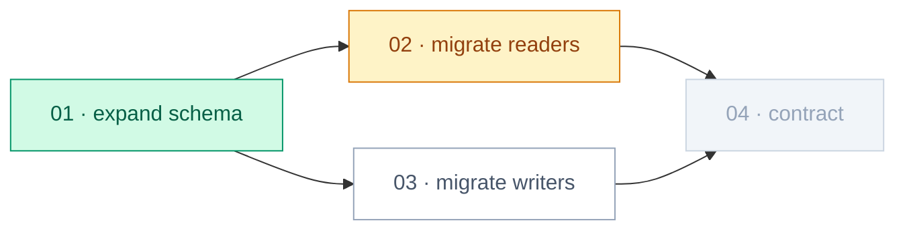

# Design elements for specs

A spec is read in plain markdown far more often than as a rendered page — in a PR diff, in the task UI, in an editor, by an agent with a fresh checkout. The rendered report is a one-shot approval surface; the markdown is what gets read twenty times during implementation.

So the design work goes in the markdown. Anything that lives only in the HTML evaporates.

## Every element earns its place by doing one of five jobs

| Job | The problem it solves | Element |
|---|---|---|
| **Locate** | "Where am I, and what kind of thing is this?" | Fixed heading order · the `---` under the lede · deep links |
| **Chunk** | A wall of text has no handholds — you can't enter or leave it | Tables · one instruction per line · short sections |
| **Signal state** | The reader can't hold what's settled, shipped, or blocked | Status line · progress bar · graph node colours · task lists |
| **Show shape** | Relationships prose can't carry | Mermaid graphs · before/after trees |
| **Hide** | The surface must stay capped while the substance stays present | `<details>` blocks |

If an element does none of the five, it is decoration. Cut it. Decoration is not neutral — it competes for the same attention the real signals need.

## No section is prose-only

The failure mode isn't length, it's flatness. A dense four-column table gets read to the bottom; three uniform paragraphs do not, and shortening them to two doesn't help. What stops reading is a stretch with nothing for the eye to land on.

So every `##` carries at least one table, list, diagram, or code block. A section that resists this is telling you something true: it's either not yet decided, or it's two sections.

The corollary bites hardest when tidying. Cutting an element to "clean up" removes a handhold, and the page gets harder to read while looking neater.

## The elements

### Status line with a progress bar

Progress that isn't visible doesn't register. Put it in the status line, in text, so it renders everywhere:

```md
> **Status:** in progress · ▓▓▓▓▓░░░░░ 3/7 tickets · **Updated:** 2026-07-25
```

Update it in the same edit that lands a ticket. A status line that lags is worse than none — once it's wrong, no line in the file is trusted.

### The decision table — four columns, never five

```md
| # | Decision | Chosen | Rejected because |
|---|---|---|---|
| [1](#1-where-the-seam-sits) | Where the seam sits | Coordinator owns retry | Per-harness retry diverges silently |
| [2](#2-message-assembly) | Message assembly | Backend only | Sandbox-side coalescing duplicates work per harness |
```

The table is the highest-value element in the file, and the reason is the layout, not the content: the rejected alternative sits *beside* the chosen one, so the reader cannot take in the decision without also taking in what it cost. A bulleted list of decisions hides that; a table can't.

Four columns is the cap — past that, cells wrap and the table stops being scannable in a narrow diff view. The `#` links down to the `###` section carrying the full reasoning.

For a decision that is still open, add a fifth *row* rather than a fifth column: ranked options, one line each, recommendation first.

### The work graph, coloured by state

The same Mermaid graph does two jobs — it shows the dependency shape *and* it is the progress display. Colour the nodes by state and it stops being a plan and starts being a status board:

````md

````

Ticket names only — no acceptance criteria, no file paths. If the graph needs a legend to be read, it has too many states; four is the ceiling.

Where Mermaid isn't rendered, it degrades to a fenced block that still reads top-to-bottom. Don't let that stop you using it.

### `<details>` for the long tail

This is "cap the surface, never the substance" as a widget. The content stays in the file, in full, and the scroll stays short:

```md
<details>
<summary><b>Maintainer stories</b> — 24 more, grouped by concern</summary>

…the full list…

</details>
```

Use it for: user-story groups past the first, prior art for tests, the full reasoning behind a rejected option, migration step-by-steps. Never for anything in the lede — the lede is what the reader is guaranteed to see, so it cannot be behind a click.

Always put the count in the summary. "24 more" tells the reader whether to open it; "more details" doesn't.

### Callouts, rationed

GitHub alert syntax, and only for things that would genuinely surprise:

```md
> [!WARNING]
> This contradicts ADR-0007 (teams grant no resource access). Reopening it is part of the ask — see Decision 3.
```

One or two per spec. Used for emphasis, they stop meaning anything; used for surprise, they're the only element that reliably interrupts a skim.

### Deep links from lede to detail

Every decision row links to its `###` section. Every mention of another spec links to the file. This is what makes "one click down a level" true rather than aspirational — without it, the capped lede is just a lossy summary.

### Before/after as trees

For structural change, two fenced trees under `**Today**` and `**After**` headings beat any prose description, and they diff cleanly when the plan changes:

```
Today                          After
sandbox/src/                   sandbox/src/
├── services/          →       ├── features/
│   ├── file.service.ts        │   ├── files/
│   └── git.service.ts         │   └── git/
└── app.ts                     └── app.ts
```

Fine to draw them stacked rather than side by side when the paths are long.

## Ban list

Each of these looks like design and spends attention without returning any:

- **Emoji as decoration.** A status glyph in a fixed column is a signal; a rocket in a heading is noise.
- **Bold as emphasis-spray.** Bold is reserved for the lede's field labels. Once a third of a paragraph is bold, none of it is.
- **Bullets nested past two levels.** Three levels means the structure belongs in a table.
- **Tables past four columns.** They wrap in every narrow view and stop being scannable.
- **Screenshots.** They go stale silently and can't be diffed.
- **New headings.** The heading set is fixed. Adding one costs every future reader the map they'd already learned.
- **ASCII art** that isn't a directory tree or a box diagram.
