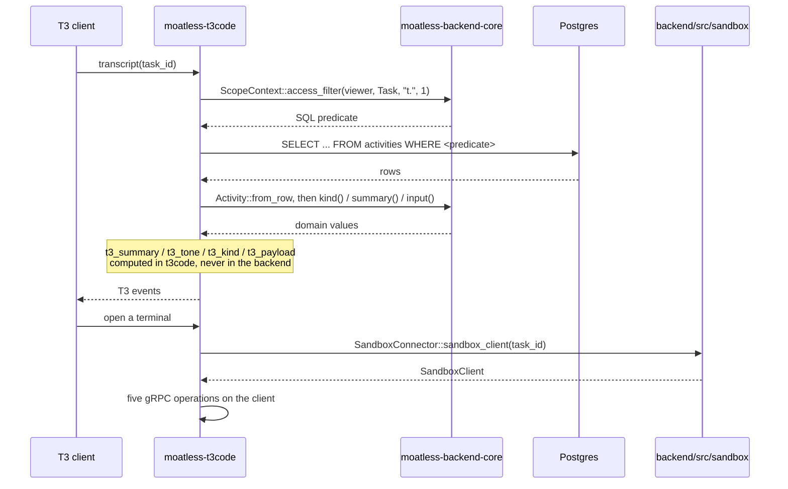

# Give `moatless-t3code` a floor to stand on

> **Status:** approved
> **Updated:** 2026-08-02
> **Vocabulary:** CONTEXT.md

## Current solution

`crates/t3code` exists and compiles, but it stands on nothing. Every dependency it has on the backend was resolved by
redeclaring the backend's version inside `crates/t3code`, so three separate duplications now exist. This plan removes
all three by giving the crate a real floor to depend on.

### Anchors

**The activity code that was copied.** These four files are near-verbatim copies of `backend/src/task_activities/`:

| File | Lines | Difference from the backend's copy |
|---|---|---|
| `crates/t3code/src/task_activities/view.rs` | 728 | byte-identical |
| `crates/t3code/src/task_activities/mapping.rs` | 1353 | one import line |
| `crates/t3code/src/task_activities/models.rs` | 187 | rustfmt reflow and one doc-link path |
| `crates/t3code/src/task_activities/dao.rs` | 185 | a narrowed subset of the backend's 697-line version |

**The traits and types that were redeclared.** `crates/t3code/src/local.rs` is 412 lines and declares six traits and
eight types that already exist:

| Declared in `local.rs` | Already declared at |
|---|---|
| `WorkspaceDao` :329 | `backend/src/workspace/dao.rs:61` (15 methods) |
| `TaskDao` :339 | `backend/src/task/dao.rs:38` (24 methods) |
| `SandboxIntentReader` :348 | `backend/src/sandbox/access.rs:79` |
| `SandboxObserver` :353 | `backend/src/sandbox/access.rs:42` |
| `SandboxConnector` :370 | `backend/src/sandbox/access.rs:95` |
| `DevicePairing` :405 | `backend/src/auth/pairing.rs:223` — a struct, not a trait |
| `PairingClient` :106 | `backend/src/auth/pairing.rs:186` |
| `PairedDevice` :112 | `backend/src/auth/pairing.rs:192` |
| `PairingError` :119 | `backend/src/auth/pairing.rs:201` |
| `SandboxError` :127 | `backend/src/sandbox/error.rs:10` |
| `LogOptions` :155 | `backend/src/sandbox/access.rs:19` |
| `ListedWorkspace` :227 | `backend/src/workspace/dao.rs:28` |
| `SandboxStatusFullResponse` :320 | `backend/src/sandbox/schemas.rs:134` |

`TaskView` (:233), `ServerLogStream` (:325) and `SandboxFile` (:398) are the only genuinely t3code-local declarations
in the file.

**The bridges those redeclarations required.** `backend/src/t3code/backend.rs` holds four structs whose only job is to
wrap the backend's trait object and implement the identically shaped t3code one: `AppStatePairing` :30,
`AppStateSandboxConnector` :130, `AppStateSandboxObserver` :197, `AppStateSandboxIntent` :233. `AppStateAgents` :310
and `AppStateCommands` :319 are **not** bridges — they hold `AppState` and stay.

**Where the split inside `view.rs` goes.** `backend/src/task_activities/view.rs:16` is
`pub struct ActivityView<'a> { activity: &'a Activity }` — a borrowed accessor, not an owned DTO. Its 19 public methods
divide by consumer with no overlap:

- T3 only, 17 call sites in `crates/t3code`: `t3_summary` :41, `t3_tone` :76, `t3_kind` :90, `t3_payload` :107, plus
  their private helpers `tool_presentation` :161 and `codex_tool_presentation` :217. `tool_presentation` is called
  only from :45 and :114, both inside `t3_*` methods.
- Backend only, from `backend/src/message/transform.rs:250,268,293,307`: `activity_id`, `kind`, `status`, `summary`,
  `tool_use_id`, `input`, `result_text`, `typed_result`, `detail`, `is_error`, `is_settled`, `external_adapter`,
  `external_event_id`, `external_source_name`, and `new`.

**The rest.**

- `crates/backend-core/src/scope.rs` — 519 lines, the crate's only module; `ScopeContext` :111,
  `access_filter` :158, `AccessFilter::sql` :93, `next_param` :98.
- `crates/t3code/src/dao.rs:154` `ConversationDao`, :260 `PgConversationDao`, :290 its constructor holding a
  `DbPool`, :526 the impl. :342 already calls `viewer.access_filter(ScopedEntity::Task, "t.", 1)`.
- `backend/src/sandbox/client.rs:119` `SandboxClient` — 670 lines wrapping `SandboxServiceClient<Channel>`.
- `backend/src/sandbox/lifecycle/orchestrator.rs:371` `desired_state`, reached via `require_intent`.
- `backend/src/task_activities/dao.rs` — the write path: `upsert` :151, `settle` :203, `record_sandbox` :241,
  `record_standalone` :274, `admit_usage` :307.
- `crates/api-schemas/Cargo.toml:23` — `database = ["sqlx"]`.
- `.github/workflows/ci.yml:141-145` — the clippy lines. `moatless-backend-core` is not among them.

### What the code does not say

**The copy was one import from being a move.** `backend/src/task_activities/mapping.rs:10` is
`use crate::message::models::MessageType`, and `backend/src/message/models.rs:7` is
`pub use moatless_api_schemas::enums::{MessageRole, MessageType}`. The type was already in a shared crate. That single
line is also the entire `task_activities → message` dependency edge.

**Two decoders now read one table.** Both copies declare `struct Activity` with a `sqlx::FromRow` impl, and both run
read queries against `activities`. The drift risk is against the schema, not merely between the two files.

**`TaskDao` exists to read one field.** `crates/t3code/src/local.rs:233` `TaskView` has a single field, `status`, of
type `TaskStatus` — which already lives in `moatless-api-schemas`. A 1-method trait shadowing a 24-method one, plus a
`Task` row struct of 31 fields, plus a pass-through adapter, all resolve to one enum that was already shared.

**`SandboxConnector` runs the other way.** The backend's version has one method — `sandbox_client(task_id)` — and its
doc comment at `backend/src/sandbox/access.rs:95` states it is the only construction path for a task-addressed client,
because the Docker and Kubernetes adapters own addressing and the readiness gate. t3code's version has five, which are
operations on the client that method returns.

**`SandboxIntentReader` cannot be self-served.** `desired_state` routes through `Lifecycle::require_intent`, which is
orchestrator state under transition locking, not a column a reader can select.

**A written invariant is already being violated.** `backend/src/task_activities/mod.rs:29` says "No T3 vocabulary
appears here — `moatless_t3code` turns a row into the event", while `view.rs` in that same module holds four `t3_*`
methods. Nothing checks it, and by decision nothing will; the placement is what makes it true.

**`crates/sandbox-proto` does not inherit workspace lints.** Its `Cargo.toml` opts out deliberately, because it holds
tonic-build and prost output that cannot satisfy pedantic clippy. Moving `SandboxClient` there means 670 lines of
hand-written code stop being linted. This is accepted, not overlooked — see Out of scope for the alternative.

## Planned solution

**New**

- A shared vocabulary for reading the `activities` table, in `crates/backend-core`.
- Three action traits in `crates/backend-core`, implemented by `backend/src/sandbox`.
- A `database` feature on `crates/backend-core`, following `crates/api-schemas/Cargo.toml:23`.
- A clippy and test line for `moatless-backend-core` in `.github/workflows/ci.yml` and `AGENTS.md`.

**Changes materially**

- `crates/t3code` stops redeclaring what already exists; it serves its own reads and translates into T3 vocabulary at
  its own edge.
- `crates/backend-core` stops being pure policy and becomes the shared floor.
- `backend/src/task_activities/view.rs` splits along the line already drawn in its method names.
- `backend/src/sandbox/client.rs` moves to `crates/sandbox-proto`.
- `backend/src/t3code/backend.rs` loses four of its six adapter structs.

**Untouched**

- Every route path, payload and status code. The HTTP surface is identical.
- The database schema, and what every query returns.
- The backend's activity write path, and its REST rendering of activities via `message/transform.rs`.
- The sixteen domain modules. Handlers are not evicted here, so the 135,723-line dependency cycle survives this change.
- `backend/src/adapters` and `backend/src/sandbox` as modules — 72,000 lines that stay in the root crate.
- `AppStateAgents` and `AppStateCommands`, which legitimately hold `AppState`.

### Problem

`crates/t3code` was extracted without a crate beneath it to depend on. Faced with six dependencies that lived in the
root crate, the extraction resolved each one by declaring a local copy — of the trait, of the types in its signature,
and in one case of 2,256 lines of interpretation logic. The result compiles and passes CI, and it costs:

- **An implementer**, who must now change activity mapping in two files and has nothing telling them the second exists.
- **The schema**, which has two independent `FromRow` decoders that can drift apart silently.
- **The next crate**, which has no floor either and will reach for the same solution. Two agents have already done so.

The compile-time case is secondary and honestly weak: stage one predicted ~9% on the edit-elsewhere loop and measured
−5.1%. This change is justified by the duplication it removes and the floor it establishes, not by a build-time number.

### Behaviour

**A T3 Code client**

- Given a paired T3 client reading a task transcript, when the transcript is fetched, then every event carries the
  same `kind`, `tone`, `summary` and payload it carries today.
- Given a tool call in the transcript, when T3 renders its summary, then the value equals what `t3_summary` produces
  today, because the function is the same function in a different crate.
- Given a T3 client opening a terminal, when it requests a sandbox connection, then the Docker or Kubernetes adapter
  resolves addressing and readiness exactly as now, and T3 never constructs a service name or gRPC URL.
- Given a device pairing exchange, when a code is redeemed, then the outcome and error cases are unchanged.

**A frontend user**

- Given the conversation view, when activities render, then the payload is byte-identical, because
  `message/transform.rs` keeps calling the same accessors on the same type.

**An engineer changing activity interpretation**

- Given a new `ActivityKind`, when it is added in `crates/backend-core`, then both the backend's REST surface and the
  T3 surface see it, and no second edit is required.
- Given an edit inside `crates/t3code`, when clippy runs for that crate, then the backend is not recompiled.

### Architecture and key flows

The rule that places every item, and the one to preserve when extending this: **port an action, share a vocabulary.**
Where one side performs an operation for the other, declare a trait. Where both sides independently touch the same
table or the same domain concept, that concept lives in the shared crate exactly once. A copy is neither and is never
correct.

`crates/t3code` is a **read model**: it owns its queries — it already holds a `DbPool` and twelve of them — and depends
on `backend-core` for the vocabulary to decode rows. Traits exist only for actions it cannot perform itself.

#### `crates/backend-core` — becomes the shared floor

- **Proposed responsibility.** Policy, the vocabulary for reading domain tables, and the traits for acting on live
  subsystems.
- **Proposed change.** Gains two areas.

  *The activity vocabulary*, moved from `backend/src/task_activities/`:
  - `Activity` and its `sqlx::FromRow` impl — the one decoder for the `activities` table.
  - `ActivityKind`, `ActivityStatus`, `ActivityRow`, `ToolOutcome`, `result_text`, `item_type`, `PLAN_TOOL`, and the
    rest of `mapping.rs` **except** nothing — the whole file moves, since its only non-`std` imports are `serde_json`
    and `MessageType`.
  - `ConversationChange`, `ConversationHead`, `RETAINED_CHANGES`, `EVENTS_PER_CHANGE`, `resume`, `position_of`,
    `changes_from` — all of `models.rs`.
  - The 15 domain accessors of `ActivityView`, keeping the borrowed `ActivityView<'a>` shape. Do not convert it to an
    owned struct; both consumers call accessors, and materialising it allocates per activity per request.

  *The action ports*, moved from `backend/src/sandbox` and `backend/src/auth`:
  - `SandboxObserver`, `SandboxIntentReader`, `SandboxConnector` — the **backend's** shapes, not t3code's.
  - `SandboxError`, `LogOptions`, `SandboxStatusFullResponse`, and a `ServerLogStream` alias.
  - The `DevicePairing` **struct** with `PairingClient`, `PairedDevice`, `PairingError`. It has one implementation, so
    `AGENTS.md`'s single-implementation rule means the struct moves and no trait is invented.

- **Proposed change to its manifest.** Add `sqlx` behind a `database` feature, mirroring
  `crates/api-schemas/Cargo.toml:23`. `async-trait` and `futures` for the stream alias. The `description` field
  currently reads "Pure policy and shared core types for the Moatless backend" and must be rewritten; that statement
  stops being true.
- **Evidence.** `mapping.rs` imports only `serde_json` and `MessageType`; `models.rs` imports nothing; `view.rs`
  imports `std::borrow::Cow`, `serde_json`, and its own siblings. None of the three has a backend dependency to break.

#### `crates/sandbox-proto` — gains the gRPC client

- **Proposed responsibility.** Everything that speaks the sandbox gRPC protocol.
- **Proposed change.** `backend/src/sandbox/client.rs` moves here as a module.
- **Evidence.** The file has zero occurrences of `AppState`, `DbPool` or `sqlx`, and this crate already depends on
  `tonic 0.14` and generates `SandboxServiceClient`.

#### `crates/t3code` — gains its vocabulary, loses its declarations

- **Proposed responsibility.** The T3 contract end to end: its own queries, and its own translation into T3
  vocabulary.
- **Proposed change.**
  - Gains `t3_summary`, `t3_tone`, `t3_kind`, `t3_payload`, `tool_presentation`, `codex_tool_presentation` as an
    extension over `backend_core`'s `ActivityView`. A trait with a blanket impl over `ActivityView<'_>`, or free
    functions taking `&ActivityView<'_>` — either is fine; do not fork the type.
  - Deletes `crates/t3code/src/task_activities/` entirely.
  - Deletes `TaskDao`, `WorkspaceDao` and every redeclared type from `local.rs`. What remains of that file is
    `TaskView`, `SandboxFile` and `ServerStatus`; fold the remnant into whichever module uses it and delete the file
    if nothing is left.
  - Replaces `TaskDao::find_by_id` with a column selected in its own query. `TaskStatus` is already imported from
    `moatless-api-schemas`.
  - Replaces `WorkspaceDao::list_readable_including` with the same query the backend runs, built from
    `ScopeContext::access_filter`. See Failure, safety and recovery — this is the one item with a security
    consequence.
  - Replaces its five-method `SandboxConnector` with calls on the `SandboxClient` returned by
    `SandboxConnector::sandbox_client`.
- **Evidence.** `crates/t3code/src/dao.rs:342` already builds a scoped query this way, so the pattern is established
  in this crate rather than introduced by this change.

#### `backend/src/task_activities/` — splits

- **Proposed responsibility.** The activity **write** path only.
- **Proposed change.** `mapping.rs`, `models.rs` and the domain half of `view.rs` move to `backend-core` and are
  re-exported here if that keeps call sites short. `dao.rs` keeps `upsert`, `settle`, `record_sandbox`,
  `record_standalone` and `admit_usage`, and takes its `Activity` from `backend-core`. `pruner.rs` stays.
  The four `t3_*` methods and their two helpers are deleted from `view.rs`, not moved to another backend file.
- **Evidence.** `backend/src/message/transform.rs:250` and three neighbours are the backend's only `ActivityView`
  consumers, and they call none of the `t3_*` methods.

#### `backend/src/t3code/backend.rs` — loses four bridges

- **Proposed responsibility.** Adapting `AppState` to the two ports that genuinely need it.
- **Proposed change.** Delete `AppStatePairing`, `AppStateSandboxConnector`, `AppStateSandboxObserver` and
  `AppStateSandboxIntent`. The backend's own implementations now satisfy the traits t3code names, because both name
  the same trait. Keep `AppStateAgents` and `AppStateCommands`.

#### The key flow — a T3 client reads a transcript



The read path never enters the backend crate, which is what stops a backend edit invalidating `t3code`. The action
path crosses exactly one trait, and the Docker and Kubernetes adapters remain the only construction path for a client.
The conversation feed and device pairing follow the same split and are not drawn.

### Interfaces and contracts

**External contracts — changing one is a product decision.**

| Consumer | Interface it holds | What it can rely on | Status |
|---|---|---|---|
| The paired T3 Code client | the UI-RPC wire surface, `crates/t3code/src/lib.rs` | Every event and command keeps its current shape and spelling | unchanged |
| `apps/frontend`'s conversation view | REST activity payloads via `backend/src/message/transform.rs:250` | The 15 domain accessors it renders from behave identically | unchanged |
| `moatless-sandbox` and `crates/cli` | `crates/sandbox-proto` | Gaining `SandboxClient` adds to the crate; nothing existing moves or changes | unchanged |

**Internal interfaces — a plan, not a promise. These may change later without a spec update.**

| Boundary | Shape |
|---|---|
| `backend/src/sandbox`'s K8s and Docker adapters | Implement `SandboxObserver` and `SandboxConnector` as now; only the declaring crate changes |
| `backend-core`'s activity vocabulary | `ActivityView<'a>` stays borrowed; `Activity` stays the single `FromRow` |
| `t3code`'s T3 accessors | Extension over `backend_core::ActivityView`, by blanket impl or free function |

### Failure, safety and recovery

One item in this change has a security consequence; the rest is placement.

**`t3code` applies the workspace access filter itself.** Replacing `WorkspaceDao::list_readable_including` means the
scoping predicate is built in `crates/t3code` rather than in `backend/src/workspace/dao.rs`.

| Condition | Consequence | Requirement |
|---|---|---|
| The `WHERE` clause omits or weakens `access.sql()` | A viewer sees workspaces they cannot read — a data-exposure bug that no type check catches | Build the predicate from `ScopeContext::access_filter`; never hand-write the SQL |
| The `readable` column and the `WHERE` clause use different expressions | A row is admitted but reported unreadable, or the reverse | Interpolate `access.sql()` twice from one `AccessFilter`, as `backend/src/workspace/dao.rs` does and documents |
| Bind order does not match `next_param()` | Wrong rows, or a runtime bind error | Take the parameter index from `AccessFilter::next_param()`, not a literal |

The backend's implementation is the reference: copy its structure, not its text. Its inline comment explains why the
fragment appears twice, and that reasoning is the invariant to preserve.

Nothing else here fails differently. No dependency is added to a request path, no write becomes partial, and nothing
new is retried. Rolling the change back is a revert: no migration runs, and no persisted state is written in a new
shape.

### Testing and verification

**Commands.** Use these exactly; varying the form strands a fresh incremental unit and can get the sandbox evicted.

```bash
task rust:gc                                                  # if target/debug/incremental has grown
cargo clippy -p moatless-backend-core --all-targets -- -D warnings
cargo clippy -p moatless-t3code --all-targets -- -D warnings
cargo clippy -p moatless-vibe-backend --all-targets -- -D warnings
cargo clippy -p moatless-sandbox -- -D warnings
cargo test -p moatless-backend-core
cargo test -p moatless-t3code
cargo test -p moatless-vibe-backend
```

`backend/tests/ui_rpc_shell_test.rs`, `ui_rpc_command_test.rs`, `ui_rpc_thread_test.rs` and
`ui_rpc_preview_tabs_redis_test.rs` are behind `#![cfg(feature = "db-tests")]`. A plain `cargo test` compiles none of
them; the database-backed tier is outside this task's required verification in the implementation sandbox.

**Add to CI and AGENTS.md.** `.github/workflows/ci.yml:141` currently has no `moatless-backend-core` line. Add its
clippy and test invocations there and to the Rust block in `AGENTS.md`, so the crate that everything now depends on is
checked directly rather than transitively.

**Unit tests.** The tests inside `mapping.rs`, `models.rs` and `view.rs` move with the code to `backend-core`. The T3
accessor tests move to `crates/t3code`. Neither set should be rewritten; if a test needs changing to compile, that is
a signal the split is in the wrong place.

**Acceptance criteria.**

- Given the workspace, when every crate is grepped for declarations, then no type or trait name is declared in both
  `backend/src` and `crates/t3code/src`.
- Given the repository, when `crates/t3code/src/local.rs` and `crates/t3code/src/task_activities/` are looked for,
  then neither exists.
- Given the workspace, when `impl sqlx::FromRow` for `Activity` is searched for, then exactly one is found.
- Given the workspace, when identifiers prefixed `t3_` are searched for, then all of them are inside `crates/t3code`.
- Given `backend/src/t3code/backend.rs`, when its structs are listed, then `AppStatePairing`,
  `AppStateSandboxConnector`, `AppStateSandboxObserver` and `AppStateSandboxIntent` are absent and `AppStateAgents`
  and `AppStateCommands` remain.
- Given a one-line edit inside `crates/t3code/src`, when clippy runs for `moatless-t3code`, then
  `moatless-vibe-backend` is not recompiled.

**Measurements.** Record cold full-workspace clippy, an edit inside `t3code`, and an edit elsewhere in the backend,
before and after, on the same sandbox. The expected result is roughly neutral: this change removes duplication, and
the compile-time win is the handler eviction, which is out of scope. Report the numbers as measured. A neutral or
slightly worse result is the predicted outcome and is not a reason to withhold or adjust it.

**What only a person can judge.** Whether a T3 session still looks right — transcript, tool summaries, tones,
terminal. Whether `backend-core` still reads as one crate with one purpose now that it holds a database layer and
three service traits. Whether the read-model rule is legible enough that the next crate follows it without being told.

## Out of scope

- **Evicting HTTP handlers, and the bounded contexts that unblocks.** 96% of `backend/src` — 135,723 lines across 32
  modules — is one dependency cycle, closed because every domain module carries its own axum handlers and a handler
  needs `AppState`, `AuthUser` and `AccessControlError`. All the upward references sit in 45 files of roughly 700,
  already named `handlers.rs` and `routes.rs`. Evicting them frees 21,720 lines, and the domain layer then contracts
  into contexts — Conversation 14,012, Source 6,174, Credentials 5,678, and four leaves — whose cross-context cycles
  reduce to two references, `crate::agent::catalog` and `crate::credentials::CredentialError::NotFound`, both in
  `backend/src/task/service.rs`. Fourteen files hold `AppState` outside a handler and are the real work, 6,397 lines.
  This is the next crate, not this one.
- **A CI check or an `AGENTS.md` rule against cross-crate duplication.** Considered and declined: once `backend-core`
  holds the vocabulary there is no motive to copy it, and the layering is the enforcement.
- **Keeping `SandboxClient` under workspace lints.** Moving it to `crates/sandbox-proto` means 670 lines of
  hand-written code stop being linted, because that crate opts out for its generated code. The alternatives are a
  fourth crate for the client alone, or `backend-core` gaining tonic. Both cost more than the lint coverage is worth
  here; revisit if that module grows.
- **The duplicate crypto stack.** `aws-lc-sys` is 75.8s and the single largest dependency, and `ring` compiles as
  well. Worth ~76s of the cold path and independent of this work.
