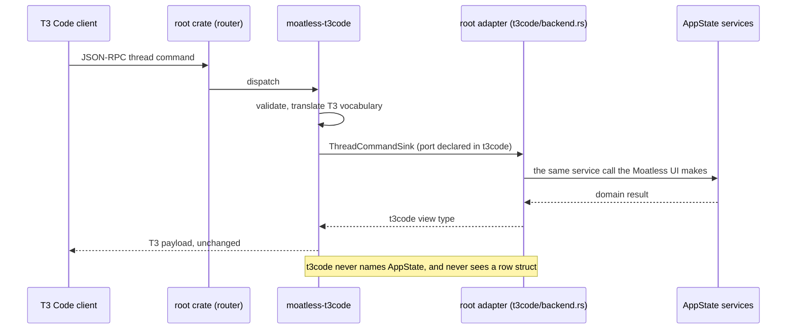

# Split the backend crate, starting with the T3 compatibility surface

> **Status:** approved
> **Updated:** 2026-08-02
> **Vocabulary:** CONTEXT.md

## Current solution

`moatless-vibe-backend` is one crate of 149,722 lines across 29 modules under `backend/src`, plus 5,962 lines of
top-level files. `ci.yml:141` checks it with `cargo clippy -p moatless-vibe-backend --all-targets -- -D warnings`.

### Measured cost, on a 4 vCPU / 8 GiB sandbox

| Scenario | Wall | Notes |
|---|---|---|
| Cold check, `--all-targets` | 251s | 421 dependencies finish at t=131s |
| The lib unit | 120s | starts t=131s |
| The same lib under `cfg(test)` | 95s | starts t=131s, runs alongside the first |
| Edit one file, incremental | 44s | **this is the number to beat** |
| Edit one file, `CARGO_INCREMENTAL=0` | 93s | not the baseline — incremental is on by default |
| No-op | 0.5–1.7s | |

215s of the 251s cold path is this one crate. `aws-lc-sys` alone is 75.8s of the 131s dependency phase.

### Anchors

| What | Where |
|---|---|
| `AppState` | `backend/src/state.rs:58` |
| `UiRpcDependencies` — the 12-port struct | `backend/src/ui_rpc/mod.rs:293` |
| The only `AppState` reference inside `ui_rpc` | `backend/src/ui_rpc/backend.rs` |
| Runtime gate | `ui_rpc::router_from_env`, `ui_rpc::is_enabled()` |
| Wiring | `backend/src/main.rs:420,422,466,474,480,481,482` |
| Feature flag call | `backend/src/feature_flags.rs:54` |
| Module declaration | `backend/src/lib.rs:55` |
| Shared-enum re-export | `backend/src/task/models.rs:9` |
| `Task` row struct | `backend/src/task/models.rs:37` |
| The extraction target crate | `crates/backend-core` — 525 lines, depends only on `moatless-api-schemas` |
| Optional-`sqlx` precedent | `crates/api-schemas/Cargo.toml` — `sqlx = { ..., optional = true }` |
| Port precedent in the largest module | `backend/src/sandbox/AGENTS.md:10` — `SandboxRuntime`, `SandboxObserver`, `SandboxConnector` |
| Glossary entries that change | `CONTEXT.md:400`, `CONTEXT.md:431`, `CONTEXT.md:434` |

### What the code does not say

**`ui_rpc` is already built the way this plan wants everything built.** `UiRpcDependencies` at
`backend/src/ui_rpc/mod.rs:293` is a struct of 12 injected dependencies, nine of them `Arc<dyn Trait>`. The module does
not reach for `AppState` anywhere except `backend/src/ui_rpc/backend.rs`, which is documented as "the Moatless side of
the compatibility module's write ports" and holds 8 references in 363 lines. Extraction is therefore a move of 13,564
lines plus a boundary that already exists — not a decoupling exercise.

**Only two files outside the module reference it in code.** `backend/src/main.rs` (wiring) and
`backend/src/feature_flags.rs:54` (`is_enabled()`, with three further calls in that file's own tests). Everything else
that greps as a reference is a doc comment.

**Two rustdoc links will break silently.** `backend/src/task_activities/mod.rs:29` and
`backend/src/task_listing/mod.rs:13` carry `[`crate::ui_rpc`]` intra-doc links. Clippy does not check intra-doc links;
only `cargo doc` does, and it is not in `ci.yml`. Fix them in the same commit or they rot unnoticed.

**Six of the twelve dependencies are defined outside the module**, and this is the only real work in stage one:

| Dependency | Defined at | Travels with the crate? |
|---|---|---|
| `ConversationDao` | `backend/src/ui_rpc/dao.rs:154` | yes |
| `PreviewTabDao` | `backend/src/ui_rpc/preview_tabs.rs:111` | yes |
| `AgentCatalogSource` | `backend/src/ui_rpc/ports.rs:100` | yes |
| `ThreadCommandSink` | `backend/src/ui_rpc/ports.rs:106` | yes |
| `WorkspaceDao` | `backend/src/workspace/dao.rs:61` | no — needs a narrow port |
| `TaskDao` | `backend/src/task/dao.rs:38` | no — needs a narrow port |
| `SandboxObserver` | `backend/src/sandbox/access.rs:42` | no — needs a narrow port |
| `SandboxIntentReader` | `backend/src/sandbox/access.rs:79` | no — needs a narrow port |
| `SandboxConnector` | `backend/src/sandbox/access.rs:95` | no — needs a narrow port |
| `DevicePairing` | `backend/src/auth/pairing.rs:223` | no — and it is a concrete struct, not a trait |

**Most of the `sandbox` → `task` cycle is already pointing at a lower crate.** `backend/src/task/models.rs:9`
`pub use`s `SandboxDesiredState`, `SandboxStopReason`, `TaskStatus` and `Visibility` from
`moatless_api_schemas::enums`; callers just reach them through the `crate::task::models` path. Of the 57 references on
that edge, only `Task` (`sqlx::FromRow`, `models.rs:37`) and `TaskDao` are genuinely backend-local. That cycle is
largely an import-path change. This matters for stage three, not stage one.

**Every candidate boundary is a cycle, and every cycle is types one way and behaviour the other:**

| Cycle | Types edge | Behaviour edge |
|---|---|---|
| `sandbox` ↔ `task` | `task::models::*` — 13 refs | `sandbox::lifecycle`, `sandbox::preflight` |
| `adapters` ↔ `bindings` | `adapters::models::*`, `AdapterError` | `bindings::runtime`, `bindings::dao` |
| `ui_rpc` ↔ `task_activities` | `task_activities` — 16 refs | 1 ref back, and it is a doc comment |

**27% of the crate is `#[cfg(test)]`** — 40,310 lines, concentrated in `adapters` (13,012), `sandbox` (11,243) and
`ui_rpc` (5,475). That is what the second 95s compile exists to build.

**Five modules avoid `AppState` entirely** — `task_activities`, `adapter_apps`, `event_ingress`, `task_turn`,
`task_listing` — totalling 7,173 lines, 5% of the crate. Everything else holds one of its 559 references.

## Planned solution

**New**

- `crates/t3code` — package `moatless-t3code`, holding the 13,564 lines currently under `backend/src/ui_rpc` except
  `backend.rs`.
- Narrow port traits declared inside `moatless-t3code` for the six dependencies defined outside it.
- A recorded build-time measurement, taken before and after, that decides whether stage two happens.

**Changes materially**

- `backend/src/ui_rpc/backend.rs` moves to the root as the adapter that implements `moatless-t3code`'s ports.
- `backend/src/main.rs` wires the new crate instead of a local module.
- `backend/src/feature_flags.rs` calls `is_enabled()` across a crate boundary.
- `CONTEXT.md` — the surface is named `t3code`, and the anti-corruption rule is amended to permit it.

**Untouched**

- Every method name and payload on the T3 JSON-RPC surface. This is a move, not a redesign.
- The database schema, every migration, and every row struct's shape.
- `apps/frontend` and `crates/cli` — neither gains a dependency.
- The `moatless-sandbox` binary and every other `backend/src` module. Stage one touches no module other than the four
  files named above.
- `adapters`, `sandbox`, `bindings`, and both remaining cycles. They are stages two onward and conditional.

### Problem

An agent or developer changing backend code waits 44s for `cargo clippy -p moatless-vibe-backend --all-targets --
-D warnings` after editing a single file, and 251s when the target directory is cold. 215s of that cold path is one
crate, compiled twice — once normally and once under `cfg(test)` — because 155k lines and 40k lines of test code live
in a single compilation unit. No caching helps: incremental compilation is already on and already supplies the
difference between 93s and 44s. The remaining cost is structural, and only changing what depends on what will move it.

The risk this plan is built to manage is that the structural fix does not pay. Rust crate boundaries help the edit loop
only when the edited crate has few dependents; they can make a cold path *worse*, because a dependent crate must wait
for its dependency's metadata. Stage one is chosen to test that cheaply rather than to deliver the largest win.

### Behaviour

**As someone editing the T3 surface**

- Given `moatless-t3code` is a separate crate,
  when I change a file under `crates/t3code/src` and run clippy,
  then only that crate and the root's thin wiring recompile, and the wait is well under the 44s baseline.

**As someone editing any other backend module**

- Given `moatless-t3code` sits below the root and does not depend on it,
  when I change a file under `backend/src` and run clippy,
  then `moatless-t3code` does not rebuild, and 13,564 fewer lines are rechecked.

**As the T3 Code client**

- Given the surface has moved crates but not changed,
  when I call any discovery, thread, command, preview or server method,
  then I receive the same response I received before, byte for byte.
- Given `router_from_env` reports the surface disabled,
  when I connect,
  then I get the same 404 I got before — the gate is unchanged and still governs mounting.

**As CI**

- Given a new workspace member exists,
  when `rust-checks` runs,
  then `moatless-t3code` is linted by its own pinned clippy invocation and a regression in it fails the build.

### Architecture and key flows

The target shape is a root crate that answers "what is wired to what", sibling crates that never reference each other,
and a shared core beneath them. Siblings that do not reference each other is the property that lets them compile
concurrently and stops an edit in one invalidating the others; it is the whole mechanism, and any boundary that does
not preserve it is decorative.

```
moatless-vibe-backend  (root: routes, startup, port implementations)
        |
        +-- moatless-t3code        <- stage one
        +-- (moatless-sandbox-svc) <- stage three, conditional
        +-- (moatless-adapters)    <- stage four, conditional
                |
        moatless-backend-core      <- shared types and policy
                |
        moatless-api-schemas       <- DTOs, already shared with the CLI
```

#### `crates/t3code` — new

- **Proposed responsibility.** Serve the T3 Code contract, translating T3 vocabulary to Moatless vocabulary at the
  wire, and reach everything outside itself only through traits it declares.
- **Proposed change.** Move every file under `backend/src/ui_rpc` except `backend.rs`. Declare narrow port traits for
  the six external dependencies. Keep `ports.rs` as the home for all of them, alongside the `AgentCatalogSource` and
  `ThreadCommandSink` already there.
- **Evidence.** `backend/src/ui_rpc/mod.rs:293` already injects all twelve; `backend/src/ui_rpc/ports.rs:100,106`
  already declares two of them this way.

**The ports return `t3code`-local view types, not backend row structs.** This is the load-bearing constraint of stage
one: if `moatless-t3code`'s `TaskDao` port returns `crate::task::models::Task`, the crate depends on a backend-local
`sqlx::FromRow` struct, that struct has to be hoisted into `moatless-backend-core`, and `moatless-backend-core` grows
`sqlx` — all before stage one can compile. Declaring narrow view types instead keeps stage one to one crate and no
hoist. The translation that fills them belongs in the root adapter, which is already where translation lives.

`DevicePairing` (`backend/src/auth/pairing.rs:223`) is a concrete struct and gets the same treatment: a trait declared
in `moatless-t3code` carrying only the pairing operations the surface calls, implemented in the root over the existing
struct.

#### `backend/src/ui_rpc/backend.rs` — moves to the root

- **Observed.** Implements `AgentCatalogSource` and `ThreadCommandSink` over `AppState`; 8 `AppState` references in 363
  lines. Its own module doc says "Everything here is translation".
- **Proposed responsibility.** The single place the root translates between `AppState` and every port
  `moatless-t3code` declares.
- **Proposed change.** Relocate under `backend/src/t3code/` in the root crate and extend it to implement the six new
  ports as well as the two it already implements.
- **Evidence.** `backend/src/main.rs:480,481` already constructs it as `AppStateAgents` / `AppStateCommands`.

#### `backend/src/main.rs` — wiring only

- **Proposed change.** `ui_rpc::` paths become `moatless_t3code::`; the `UiRpcDependencies` literal at line 466 gains
  the six new port implementations. No control flow changes.

#### `backend/src/feature_flags.rs` — one call

- **Observed.** Line 54 calls `crate::ui_rpc::is_enabled()`; three more calls sit in its own test module.
- **Proposed change.** Call `moatless_t3code::is_enabled()`. The gate itself does not move and does not change.

#### `CONTEXT.md` — the vocabulary

- **Observed.** Line 431 defines **UI RPC**, with **T3 compatibility surface** as its alias. Line 434 states the
  module is an anti-corruption layer where "T3 names appear on the wire, Moatless names stay inside". Line 400 requires
  T3 terms to be always qualified.
- **Proposed change.** Make `t3code` the primary name. Amend line 434 to say the rule governs what the surface
  *translates*, not what it is called: this module is the boundary itself, so naming it after what it adapts to is the
  exception the rule implies. `t3code` satisfies the always-qualified rule at line 400; a bare `t3` would not.

**Rename blast radius**, all in one commit: 11 files under the module, `backend/src/lib.rs:55`, `backend/src/main.rs`,
`backend/src/feature_flags.rs`, `backend/src/auth/middleware.rs:84` (comment), `backend/src/message/transform.rs:25`
(comment), `backend/src/message/dao.rs:33` (comment), `backend/src/task_activities/mod.rs:29` (rustdoc link),
`backend/src/task_listing/mod.rs:13` (rustdoc link), `backend/tests/ui_rpc_thread_test.rs`,
`backend/tests/ui_rpc_command_test.rs`, `CONTEXT.md`, `docs/t3-code-integration-start-here.md`,
`docs/t3-code-domain-mapping.md`, `.agents/skills/t3-development/SKILL.md`, `.agents/skills/shadow-dev/SKILL.md`.

`.plans/t3-settle-snooze.md` and four files under `.plans/completed/` also mention `ui_rpc`. Leave the completed ones
alone — they are history and record what was true when they shipped. Update `.plans/t3-settle-snooze.md`, which is
still active.

#### The key flow — a T3 command after the split



The failure path is unchanged and is not redrawn: a refused command still returns `CommandRefusal`
(`backend/src/ui_rpc/ports.rs`), and a disabled surface still 404s at the router. Neither crosses the new boundary
differently from how it crosses the module boundary today.

### Interfaces and contracts

**External contracts** — behaviour something outside this crate relies on:

| Consumer | Interface it holds | What it can rely on | Status |
|---|---|---|---|
| The T3 Code client (`soaplabs/t3code`) | the JSON-RPC surface mounted by `router_from_env` | every method name and payload byte-identical | unchanged |
| The T3 Code client | the env gate behind `is_enabled()` | same variable, same 404 when off | unchanged |
| `apps/frontend`, `crates/cli` | `moatless-api-schemas` | no new dependency; no `sqlx` reaches the CLI | unchanged |
| Agents and humans reading the glossary | `CONTEXT.md:431` — the term **UI RPC** | one name for the surface, `t3code`, updated in the same commit | **breaking** |
| `ci.yml` `rust-checks` | the set of crates linted | a new pinned clippy line for `moatless-t3code` | **new** |

**Internal interfaces** — the port traits `moatless-t3code` declares are an implementation boundary, not a promise.
They can be renamed, merged or resliced later without a spec change, provided the crate keeps naming no concrete type
owned by a sibling.

`AGENTS.md` pins one clippy invocation per crate, matching `ci.yml` exactly. Adding a crate means adding its line to
both — alternating invocation forms costs a full dependency-graph rebuild and strands a 0.4–1 GB incremental unit.

That pinning, and `task rust:gc`, arrive in PR #237. If it has not merged when this is implemented, take the clippy
line's form from `ci.yml:141` and reclaim `target/debug/incremental` by deleting it directly between measurements.

### Testing and verification

**What must pass**

```bash
cargo clippy -p moatless-t3code --all-targets -- -D warnings
cargo clippy -p moatless-vibe-backend --all-targets -- -D warnings
cargo test -p moatless-t3code
cargo test -p moatless-vibe-backend
cargo doc --no-deps -p moatless-vibe-backend -p moatless-t3code   # the two intra-doc links
```

The 5,475 lines of `#[cfg(test)]` code inside the module move with it, unchanged apart from import paths.

**The two integration tests stay in `backend/tests/`.** `ui_rpc_thread_test.rs` (261 lines, 0 `AppState` references)
and `ui_rpc_command_test.rs` (774 lines, 5 `AppState` references) are both behind `#![cfg(feature = "db-tests")]` and
need a live Postgres. Moving the first would mean giving `moatless-t3code` its own `db-tests` feature, its own `sqlx`
dev-dependency and its own database harness, to relocate 261 lines that already run where they are. Only their import
paths change.

Because both sit behind `db-tests`, a plain `cargo test -p moatless-vibe-backend` compiles neither. For the stage-one
PR, do not run `task test:integration`; the implementation sandbox does not provide the live Postgres configuration it
requires. Leave the tests in `backend/tests/` and compile-check the affected `db-tests` targets with their feature
enabled instead.

**The measurement that decides stage two.** Take all three numbers on the same machine, before and after, with the
crates registry warm and `target/debug/incremental` freshly reclaimed via `task rust:gc` between runs:

| Measurement | How | Baseline | Passes if |
|---|---|---|---|
| Editing the T3 surface | `touch` a file in the surface, time the clippy line | 44s | well under 44s |
| Editing elsewhere | `touch backend/src/access_control.rs`, time the clippy line | 44s | roughly 40s — about 9% better |
| Cold path | delete the target dir, time the clippy line | 251s | not materially worse than 251s |

**Stage one is predicted to be roughly neutral on the cold path, possibly slightly worse**, because the root must now
wait for `moatless-t3code`'s metadata before it can start. What it gains is the surface's `cfg(test)` unit compiling
alongside the root's rather than inside it. Do not treat a flat cold number as a failure; treat a flat *edit-elsewhere*
number as one, because that is the number the whole thesis rests on.

Record the results wherever the work item lives. If the edit-elsewhere loop does not improve by roughly its share, the
model is wrong: crate boundaries are not beating incremental compilation on this codebase, and stages two through four
should not be attempted.

**Acceptance criteria**

- Given a fresh checkout, when CI runs, then `moatless-t3code` is linted and tested by its own pinned invocations.
- Given the T3 surface is enabled, when the existing surface tests run, then they pass unmodified apart from import
  paths.
- Given `moatless-t3code`'s `Cargo.toml`, when read, then it names no path dependency on `moatless-vibe-backend`.
- Given `crates/t3code/src`, when grepped, then it contains no occurrence of `AppState`.
- Given the three measurements above, when compared to baseline, then the edit-elsewhere loop has improved by roughly
  9% and editing the surface has improved substantially.

**What only a person can judge**

- Whether `t3code` still reads correctly against the amended anti-corruption rule.
- Whether the twelve ports are the boundary that is wanted, or just where they happened to land.
- Whether a ~9% loop improvement justifies stages two through four.

## Out of scope

- **Stages two, three and four.** The `backend-core` hoist, `sandbox`, and `adapters` are conditional on stage one's
  measurement. Their internal questions — whether `bindings` should merge into `adapters` rather than have
  `adapters::models` hoisted beneath both, and whether any `#[cfg(test)]` suite should move to `tests/` — are decided
  when those stages are reached, not here.
- **Whether the T3 surface stays opt-in.** It extracts either way; if it becomes default-on its two inbound references
  will grow, which is a reason to revisit the boundary and not a reason to delay it.
- **The duplicate crypto stack.** `aws-lc-sys` is 75.8s and the single largest dependency, and `ring` is compiled as
  well — pulled by `aws-sigv4` and a second `rustls` major (0.21 via `aws-smithy-http-client`, 0.23 elsewhere).
  Consolidating on one backend is worth ~76s of the cold path and is independent of this work.
- **`sccache`.** Already used by `build-sandbox-images.yml` and `cd-ecr.yml`, absent from the sandbox image. It would
  cache the 131s dependency phase across sandboxes, and it is the better lever if the cold path is the priority.
- **Behaviour changes anywhere.** This plan moves code and declares traits. A change that alters what the T3 surface
  returns belongs in its own spec.
