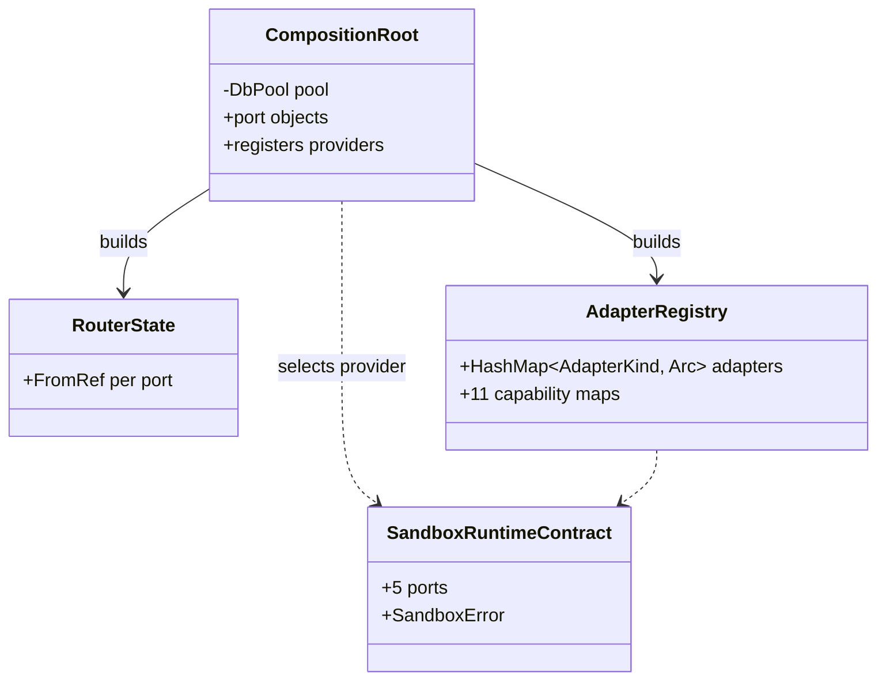

# Make the ports singular, then split the backend into crates

> **Status:** in progress. Steps 1–4 and 6 **shipped**; Step 5 **in flight**; Steps 7–9 **partially shipped** — everything left of them is a named Step 10 precondition, so the Step 10 table is the one place they are listed; Steps 10–11 **not started** beyond 10a.
> **Census baseline:** 179 illegal edges. `identity` and `workspaces` both have **zero illegal outgoing** — #364 cleared identity, #368 and #371 (9d, the router, 9c) cleared workspaces, which also left the SCC (12 crates → 11). Only `identity` reads **READY** — it depends on the floor alone. `workspaces` reads **WAITING**, because `identity` is still a module rather than a crate. **The next work is not another edge — it is 10b, one `Cargo.toml`.** See *The carve frontier*, which is what the next work is chosen against.
> **Updated:** 2026-08-06
> **Vocabulary:** CONTEXT.md
> **Predecessors:** `.plans/backend-crate-split.md`, `.plans/backend-crate-hierarchy.md`
> **Related:** `.plans/remaining-adapter-breakup.md` — runs after Step 4, see Out of scope.

**Where this stands.** Shipped steps are compressed to their outcome and the rules later steps still rest on; the open work is Step 5's sweep, Step 7d, the deferred error/credential cluster, and Steps 10–11.

| Step | State |
|---|---|
| 1 Collapse duplicated sandbox ports | shipped |
| 2 One composition root | shipped |
| 3 Close the DAO bypasses | shipped |
| 4 Capability registry consistency | shipped except 7d's field widening |
| 5 Decompose `AppState` | **in flight** — the per-handler sweep, ratcheted in CI |
| 6 `BackendSandboxServiceImpl` and `Option`-as-mode | shipped |
| 7 Untangle `bindings` and `adapters` | 7a, 7b shipped; **7c folded into the error split**; **7d open** |
| 8 Placement moves | four shipped, four repriced or deferred into the error/credential cluster |
| 9 Consumer-owned ports | one shipped (`AgentErrorSink`); five were phantom; 9d reopened against Step 10; 9e closed by placement in the Step 5 message slice |
| 10 Carve the crates | **in progress** — 10a carved; the frontier is the report's |
| 11 The two package renames | not started |

**The generated authorities.** Nothing in this document restates a number a tool computes.

| Question | Authority |
|---|---|
| Which module belongs to which crate, and each crate's line total | `scripts/crate-census-report.txt`, `CRATE MEMBERSHIP` — generated from `tools/crate-census/src/bands.rs::crate_of_backend_mod` |
| How many illegal cross-crate references remain, by class and by edge | `scripts/crate-census-baseline.txt`, checked by `scripts/check-crate-census.sh` |
| Which crate can be carved next | the report's `CARVE READINESS` table |
| Which modules still name `AppState` | `scripts/appstate-composition-root-baseline.txt`, checked by `scripts/check-appstate-composition-root.sh` |
| Which `bindings` files still name `crate::adapters` | `scripts/bindings-adapters-baseline.txt` |

## Current solution

`backend/src` is one crate of roughly 140,000 lines. Two modules are half of it — `adapters/` ≈37,000 and `sandbox/` ≈35,000 — and the rest is long-tailed: `auth/` ≈9,800, `task/` ≈7,300, `message/` ≈6,400, `loops/` ≈4,500, `bindings/` ≈3,900, then eighteen modules under 3,000. Figures drift with `main` by a few tenths of a percent per dozen commits; re-measure before quoting one as current, and take crate-level counts from the census report rather than from this file.

The crate already has ports — 87 traits when this program started. The problem was never their absence: they were not singular, not the only way in, and not consistently owned. Steps 1–4 fixed the first two. What is left is ownership, which is what a crate boundary is.

**The findings that still bear on open work:**

- **`AppState` is the remaining god object.** 40 public fields at `state.rs`. Because every field is public and the struct is passed whole, holding an `AppState` is equivalent to holding every port plus the raw pool. Step 5's sweep is what removes it, and the ratchet is what says how much is left.
- **A module cycle is not a crate cycle, and `AppState` is not the tangle.** `backend/src` is 46 module-level nodes whose strongly connected component held 29 of them; simulating Steps 1–6 against that graph leaves a 26-module component, membership-identical to deleting the `state` node. Steps 1–6 are worth exactly "remove the god objects" — the prerequisite, not the layering. Steps 8–11 are where the layering happens.
- **`crates/t3code` is already the shape this program is trying to reach, and nothing in the repository says so.** Its `Cargo.toml` names `moatless-api-schemas`, `moatless-backend-core` and `sandbox-proto` — and no backend crate. It declares nine of its own ports, takes them in one `UiRpcDependencies` struct at `lib.rs:392`, and reaches into no god object. 19,696 lines on the far side of a port boundary that already holds. Every pattern Steps 5, 9 and 10 propose has a working instance there; the program is finishing a shape, not inventing one.
- **The T3 surface is off by default and is heading to default-on.** `lib.rs:527`'s `is_enabled()` reads `T3_UI_RPC_ENABLED` and falls back to `false`; `router_from_env` (`:308-313`) returns `Ok(None)` when unset, so `main.rs`'s mount is skipped. The flip is a product decision outside this program, but it lands on two things this program touches — `router_from_env`'s fail-closed startup (recorded at `task_listing/dao.rs:76`, which *"fails startup rather than inventing an identity"*) and `auth/middleware.rs:84`'s unauthenticated `/oauth/token` path, which stops being a 404 anywhere.
- **Two `ActivityKind` enums model the same concept differently.** `crates/backend-core/src/activity/mapping.rs:103` has nine variants; `adapters/providers/linear/agent_api.rs:55` has five. The second is Linear's wire vocabulary and correctly belongs to Linear; only the name collides. Out of scope, recorded so it is not rediscovered as a defect.
- **The build-time argument is real and is not the justification.** Measured on this checkout: an edit inside the runtime half goes from 17.9s to 1.72s; an edit inside the domain half goes from 18.0s to 15.4s. The second number is the one that matters — splitting by direction alone barely moves the common case, because the domain half stays large. Architecture is what justifies the program; the build win is a consequence.
- **The sandbox is provisioned at `requests: {cpu 2, memory 4Gi}`, `limits: {cpu 4, memory 8Gi}` with `CARGO_BUILD_JOBS: "2"`** (`.moatless/workspaces.json`). Pods exceeding their memory *request* are evicted first under node pressure, so the request governs stability, not the limit.

## Planned solution

**New**

- Fifteen crates under `crates/`, replacing the single `backend/` crate: nine bands, the adapter vocabulary, two sandbox providers, five adapter providers minus the overlap, and a root that is only wiring.
- Consumer-owned ports where a lower band genuinely calls upward, each declared by the crate that calls — one shipped, the rest re-derived per edge as each carve reaches it.

**Changes materially**

- `backend/src/state.rs` — `AppState` stops being a type any handler names.
- `backend/src/adapters/registry/mod.rs:43-46` — the four `Option<Arc<ConcreteAdapter>>` fields become `Arc<dyn>` and their typed accessors are deleted (7d). This is the edge that makes five provider crates possible.
- `backend/src/task_connections/` — a cross-cutting admin view, already a top-level module in the server band. Done; it is listed here because the reasoning that placed it still governs the next one of its shape.
- `backend/Cargo.toml` — the package stops being `moatless-vibe-backend`; the root is `crates/server`, package `moatless-server`.
- `sandbox/Cargo.toml` — the package becomes `moatless-sandbox-agent`, with the 26 `-p` flags, path dependencies and `Cargo.lock` entries that name it.
- `AGENTS.md` and five workflows — the `-p` flags in the clippy and test blocks, rewritten in the same commit as each rename.
- `backend/src/adapters/error.rs` — splits, once the prior question of whether `bindings` owns an error type is settled. Four deferrals hang off it; see the error/credential cluster under Step 8.

**Untouched**

- Every HTTP route, request shape and response shape. No API contract changes.
- Every database table, column and index. No migrations.
- All adapter behaviour — Slack, Telegram, Linear, GitHub PR, webhook. Inbound normalization, outbound delivery, reactions and binding status all behave identically.
- `apps/frontend` and the generated `@moatless/api-client`.
- `crates/claude-agent-sdk` and `crates/codex-sdk`, including their six internal traits.
- The T3 client protocol — `crates/t3code`'s public surface and the UI-RPC methods it serves.
- Sandbox provisioning, images, and the gRPC wire protocol between backend and sandbox.
- Every Docker image name, Kubernetes pod name, Service name and label. The `moatless-sandbox` *package* is renamed; the 182 places that string names a deployment artifact are not.
- `reconcile_shell_command` and the rest of `github_pr`'s 1,848 lines of behaviour; it is GitHub semantics, not a layering artifact, and does not move.
- `backend/src/sandbox/error.rs`'s 22 variants and its axum `IntoResponse`. It stays as the sandbox module's HTTP error; only what the *ports* return is singular.

### Problem

**The person changing domain code** cannot tell from the type system which parts of the system their change can reach. Holding an `AppState` means holding the pool, so any handler can query any table; reviewing a change means reading it, not trusting a boundary. That is the whole of what is left to feel: the duplicated sandbox ports and the inconsistent capability registry are gone, and what remains is that direction is enforced by review rather than by Cargo.

Underneath it: a port that is not the only way in constrains nothing, and a port whose consumer and provider compile together constrains less than one that does not.

### Behaviour

This program changes no observable behaviour. The acceptance statements are about what stays true and what becomes impossible.

**As an operator**

- **Given** a deployment on any supported sandbox provider, **when** the program completes, **then** every API response, event payload and adapter delivery is identical to before.
- **Given** a running cluster, **when** the two package renames land, **then** no pod, image, Service or label name changes and no redeploy is required for them.

**As a developer changing domain code**

- **Given** a change to adapter or binding logic, **when** they need data, **then** the only reachable way to get it is a port their own signature names.
- **Given** an attempt to construct `PgTaskBindingDao(pool)` outside the composition root, **when** CI runs, **then** the build fails naming the file and line.
- **Given** a change in a low band that reaches into a higher one, **when** they build, **then** it does not link — the dependency is not expressible rather than discouraged.

**As a developer adding a sandbox provider or an adapter**

- **Given** the five runtime ports, **when** they implement each once, **then** the provider is complete — there is no second set and no bridging module to write.
- **Given** a new provider crate, **when** it is added, **then** nothing but the composition root names it, and removing it is deleting a directory and a line of wiring.

### Architecture and key flows

**Eleven steps, in three parts.** Each step leaves the tree green and is separately shippable.

| Part | Steps | What it achieves |
|---|---|---|
| **I — Make the ports singular** | 1–4 | Every port is declared once and is the only way in. Module graph unchanged in shape. **Shipped.** |
| **II — Remove the god objects** | 5–7 | No type means "everything the process has", and the largest module cycle is broken rather than absorbed. |
| **III — Split into crates** | 8–11 | The bands become packages, so direction is checked by Cargo rather than by review. |

Dependencies among what is left: 5 → 10; 7d → 10h.

**Where it is safe to stop.** Not at 9 — placement fixed and ports inverted, still one crate, band order holding by convention only, and convention decays. Everything from Step 8 onward is throwaway unless Step 10 lands, so **do not stop between Step 8 and Step 10**. Step 10 is the program's real endpoint; Step 11 is names.

---

#### Steps 1–4, 6 — shipped

Compressed to the outcome and the rules later steps still rest on.

**Step 1 — the sandbox ports are singular** (five ports and one contract error, declared once). Two rules survive it:

- **The unified port error names neither `kube` nor `bollard` in its public shape.** Provider errors are converted at the provider boundary into provider-classified variants carrying a kind and a message. This is what lets a caller depend on the contract without compiling either container runtime, and it is the precondition for `sandbox-k8s` and `sandbox-docker` being separate crates at 10f. `backend/src/sandbox/error.rs` keeps its 22 variants and its axum `IntoResponse` — it is the sandbox module's HTTP error, collapsing it would be an API change, and only what the *ports* return is singular.
- **The DTO projection is a feature, not duplication.** The backend's sandbox status type carries thirteen fields and the contract type carries two; the contract observer is *projected from* the rich reader rather than being the same object under a second name. An implementer who deletes the projection silently widens the T3 contract. It now sits beside the contract, named as an outbound projection, rather than hidden inside a trait impl.

**Step 2 — one composition root** (`backend/src/compose.rs`). **The invariant is about DAO construction, not `DbPool` visibility**: no `Pg*Dao` is constructed outside the root. Raw-pool services legitimately hold a pool and keep doing so — they are the same population as the 35 raw-`sqlx::query` files, and are out of scope. A "no `DbPool` outside the root" rule would fail on day one.

**Step 3 — the DAO bypasses are closed**, and `scripts/check-dao-composition-root.sh` fails on a new `Pg[A-Za-z]+Dao(` construction outside the root and the `dao.rs` files, naming the offending `file:line`. A grep is the right instrument because the property is syntactic.

**Step 4 — the capability registry is consistent**: 12 traits, 11 maps, and the delivery layer no longer names the five concrete providers. `AdapterUserIdentity`, `AdapterIdentity`'s map, and `sender_label_suffix` are gone. **The rule that governs any further deletion: an absent capability is load-bearing.** When a kind has no entry in a map the registry returns that capability's `AdapterError`, and a caller may depend on it — so no further map is removed without a test asserting that capability's absent path first. `AdapterPostBindingFollowup` has one implementor and stays: the repository's no-single-implementation rule is about speculative abstraction, not about a closed set where one member opts in. **The registry named four concrete providers in its typed fields; erasing those was 7d — shipped as #438: construction moved to the composition root (`compose.rs`) via provider-owned `register_into`, so no loops-band file names a concrete adapter and the census ceiling fell 97→83. The sidestep that kept `register_into` clean is the reusable rule for every remaining port — trait objects (`Arc<dyn Cap>`) in a signature, concrete types only in a body; a `pub` fn that names a `pub(crate)` capability trait trips `private_bounds`.**

**Step 6 — `Option`-as-mode resolved.** Databaseless is a real, codebase-documented mode: `ports: Option<&Ports>` drove fourteen of the twenty `Option`s to `None` together. They split by the rule the constructions enforce — *a projection is earned when every construction populates it wholly or not at all*, which is stronger than read-overlap because it is about an invariant the composition root guarantees rather than convenience at a call site. Two projections hold, `HandlerDbPorts` and `IngressPorts`. The remaining six `Option`s are independently gated features (events/REDIS, s3, github_app_service, task_token_secret) and stay. `backend_config` dropped to a plain `Arc<Config>`. **Config sections do not move between crates** — every production reference names the composite `Config`, so relocating sections changes zero call sites; narrowing *parameters* is a call-site change and belongs to each function's own module.

#### Step 5 — Decompose `AppState` into per-handler ports — **in flight**

*Requires Steps 2 and 3. Blocked without them: decomposing a struct whose fields are reachable by bypasses regresses the moment someone adds the next one.*

- **Proposed responsibility** — a handler's signature states the ports that handler uses, and nothing else. No type in the tree means "everything the process has" except the composition root, which no handler names.
- **Proposed change** — **no context structs.** Each handler takes the ports it uses, extracted from the root by `axum::extract::FromRef`: `State(tasks): State<Arc<dyn TaskDao>>` in place of `State(state): State<AppState>`. The root remains one struct, held by the router, named by the composition root and by nothing else.

  This is chosen over per-band context structs because a context struct is a smaller `AppState` with the same failure mode. It requires a grouping judgement for all 40 fields, that judgement can itself contain a cycle, adding a field to a context silently widens every handler that already takes it, and nothing in the type system says a handler uses only some of what its context holds. `FromRef` needs no grouping decision at all, and a handler's dependencies become exactly what its parameter list says.

  **A port-owning service is not a context struct, and the distinction is what the caller does with it.** A context struct is *passed as an argument* so the callee can read fields off it — a smaller `AppState`, inheriting its failure mode. A service **owns** its ports as private fields and exposes behaviour; a caller holds one handle and calls methods, and cannot reach the ports at all. `sandbox/notify.rs::SandboxWakeService` and `bindings/runtime.rs::RoutingService` are both this shape. So the rejection above governs parameters, never a struct that absorbs the ports it reads — and a service is the right answer wherever one cohesive subgraph reads a fixed set, particularly for a worker, which takes its dependencies once at construction and has no extractor or router in play at all.

- **Evidence — the extractors already work this way.** `OptionalScope` and `SseAuth` are `impl<S: Send + Sync> FromRequestParts<S>`; `OptionalScope`'s doc says outright it is "state-agnostic … for routers whose state is **not** `AppState`". `AuthUser`, `MaybeAuthUser` and `ScopeContext` bound to `AppState` for exactly one value between them — the task-token secret — so they became generic over `S` with a `FromRef` bound carrying the one-method `UserTokenVerifier` port, which also closed `extractors → sandbox`.

- **Handlers stay with their domain; the module moves to where its reach already puts it.** With handlers naming ports, `extractors` stops being a thing every handler file imports as a precondition of compiling. The alternative — treating the handler band as a crate — means relocating 47 files and 17,803 lines, and the remaining cross-crate edges from handler files do not resolve as one group. **The derived rule: a module with an authenticated HTTP handler cannot be core** — `AuthUser` is band-identity by construction, and a `FromRequestParts` extractor cannot be inverted behind a port without the handler leaving the HTTP layer. Ruling C applied it: `file_storage` and `task_event` moved to tasks and `secret` to identity, each following its handler's reach. **The Rust orphan rule is why a type and its `FromRequestParts` impl must travel together**, which makes each of those a type move rather than a re-export.

- **The two ports that were declared correctly and then went onto `AppState` anyway.** `task/reaper.rs`'s `AgentStatusPort` states the rule outright — *"the one interior read it needs, declared consumer-side so the provider handle stays off `AppState`"* — and `reconciler.rs`'s `NotifyPort` is the same shape. Both then became `AppState` fields with one consumer each, so the god object survived with better field types. Both are now off `AppState`. `agent_status` is threaded to the reaper and handed over at construction. `sandbox_notify` is owned exclusively by `sandbox/notify.rs::SandboxWakeService`, which implements the tasks-band `SandboxWaker` port; `AppState` takes the notifier as a constructor parameter and holds no field for it.

  **The rule that got the second one off, and it is the cheaper move in general: a port with a single consumer leaves `AppState` by giving that consumer a service that owns it, not by migrating every caller of the function that reads it.** `ensure_sandbox_and_notify` keeps a thin `&AppState` door for its six above-band callers, who are unaffected. The field count is what proves it — `−sandbox_notify +sandbox_waker` is net zero, where a caller migration would have touched six files to reach the same place.

- **`AppState.db` is a named residue, not a new grant.** A handler that calls a raw-pool query function predating the DAO layer takes `State(db): State<DbPool>`, handed out by `FromRef<AppState> for DbPool`. The call sites are the same population Step 3 deliberately left alone (`list_adapter_apps`, `upsert_adapter_app`, `delete_adapter_app`, `bot_users_by_app_key`, the `workspace/git_sync.rs` pool helpers); converting them to DAOs is that step reopened, not Step 5 scope. It is not sanction to run new SQL from a handler. **Each sweep slice reports how many `State<DbPool>` parameters it adds and the running total**, so the final count is chosen rather than discovered.

- **Every slice ends with a write-only sweep over *all* `AppState` fields, and the test has two conditions because one decays to noise.** Nothing in the toolchain reports a dead field: a `pub` field on a `pub` struct is never dead-code-flagged, so it survives every gate and carves into public API looking deliberate. A field is dead when **both** hold:

  1. no direct `.field` read outside `state.rs` and `compose.rs`, **and**
  2. no `State<Arc<T>>` consumer of that field's `FromRef` impl — or no `FromRef` impl at all.

  **Condition 1 alone gets less useful every time this step succeeds.** Porting a handler is *precisely* the act of replacing its direct `state.field` read with a `FromRef` extraction, so each slice converts some field from direct-read to extractor-only. `loop_sync` became a condition-1 false positive during the `loops/http` slice — the slice's own conversion of `reset_git_loop` removed its last direct reader. At the end of Step 5 every surviving field is extractor-only and condition 1 flags all of them. **The false-positive rate rises with the program's progress and reaches everything.**

  Found so far, both real under both conditions: `sandbox_notify` (written, never read, kept alive by a doc comment defending a consumer that did not exist) and `secret_audits`. `plugin_sync` is the third and a distinct shape — the field has no reader **and** its `FromRef` impl has no extractor, so the redundant exposure is two published things rather than one, while the value itself lives on inside `SkillService`, which took it from the local at construction. Checking condition 2 is what tells those apart from `auth_config`, `codex_oauth_config`, `secrets_config`, `git_sync`, `task_presenter` and `loop_sync`, every one of which is live through an extractor.

- **`message/send.rs`'s two reads become a named port**, not a field: given an adapter name and an external id, what other ids could this event be stored under. That is self-echo deduplication and should be modelled as such rather than as access to the whole adapter registry.

- **`bindings` reads twelve ports because it is five jobs sharing a `mod.rs`, not one job needing twelve.** The union of its `state.*` reads is {adapters, task_bindings, messages, loops, adapter_connections, tasks, task_turns, recently_sent, config, s3, files, event_receipts} — the largest count in the sweep. `runtime` (inbound routing + fan-out), `outbound` (thread/reply sends), `reply` (external replies), `status_service` (binding status) and `handlers` (the HTTP surface) each read a coherent slice; the union is large only because ten modules share one directory, the same shape `adapters/models.rs` had before 7a. Per-handler ports make each slice visible; whether `bindings` is then one crate or several is a Step 10 question.

- **The fourteen loops-band `AppState` rows partition nine-to-five, and the five are gated by the provider slices.** `loops → server [CODE] crate::state::AppState` is fourteen rows: `adapters/{capabilities, common, delivery/typed, handlers, inbound_delivery, routes, subject_events}`, `bindings/{handlers, outbound, reply, runtime}`, `loops/{firing/schedule_runner, http/handlers, http/mod}`.

  **The mechanism.** A loops-band symbol that names `AppState` **is** the `loops → server` edge. A door a provider calls must sit at or below loops, because provider (band 9) → loops (8) is downward-legal while provider → server (10) is illegal. So while any provider passes `AppState` into a loops-band function, that file keeps its row. Moving the door up to the server band does not fix it, it makes it worse: the provider file gains a *second* row for a distinct symbol on top of the `AppState` row it already carries.

  **Gated (5): `adapters/common.rs`, `adapters/delivery/typed.rs`, `adapters/inbound_delivery.rs`, `adapters/subject_events.rs`, `bindings/runtime.rs`.** The other nine are reached only from loops- and server-band callers — mostly axum handlers reached by their own router, or router functions reached only by `main.rs` — and can migrate in band order now.

  **The test is per-signature, not per-module, and a module-level grep gets it wrong.** `bindings/outbound.rs` is referenced from two provider files (`github_pr/routing.rs:591`, `linear/issues.rs:570`) and is *not* gated: both call `truncate_text(&str, usize)`, a pure helper that names no state. `adapters/common.rs` is referenced from two provider files and *is* gated, because `ensure_task_access` and `resolve_connection` both take `&AppState`. Ask whether a provider calls a function that **takes `AppState`**, never whether a provider names the module.

  **Forwarding into a gated file is not itself gating.** A gated file can carry a thin `&AppState` door for its provider callers and a port-typed core for everyone else — the shape `upsert_binding`/`upsert_binding_into` already has. So a file that forwards into one clears its own row by calling the core, leaving the door and the gated file's row untouched.

  **A door is earned by callers that still need it, not by the file being gated.** Check each function's callers before splitting it: `adapters/common.rs::ensure_repository_exists` has `loops/http/handlers.rs` as its sole caller, so a retained `&AppState` door would be dead the moment it was written — that function converts outright. `load_adapter_connection_for_auth` (also called from `common.rs::resolve_connection`, `bindings/handlers.rs`, `bindings/reply.rs`) and `load_loop_for_auth` (also called from `bindings/handlers.rs`) do have other callers, and those two earn doors. Splitting every function in a gated file is the mechanical reading of this rule and it manufactures dead code.

  **`bindings/runtime.rs` is the worst of the five, and `upsert_binding` alone is why.** That one function has nine external call sites across six files — `adapters/handlers.rs:193` and `:314`, `bindings/outbound.rs:102`, `linear/issues.rs:250`, `linear/api_routes.rs:863`, `linear/sessions.rs:370`, and `github_pr/routing.rs:154`, `:235`, `:546` — six of them in the four provider files. Its row clears when those move, which is their slices' work.

  **`adapters/delivery/typed.rs` is provider-only**: thirteen provider files reference it and no loops- or server-band caller does. Gamma is a fact about callers, not a classification.

  **This is a split, not a reversal.** Nine files proceed in band order; only the gated tail waits on the provider slices.

  - **`loops/http/handlers.rs` is deferred behind `adapters/common.rs`.** Four of its handlers forward `&state` into `ensure_repository_exists`, `load_adapter_connection_for_auth` and `load_loop_for_auth`, all `pub(crate)` in `common.rs`. `common.rs` is not a facade needing design — its five `&AppState` functions each read exactly one port, a mechanical five-signature rename. What defers it is its callers: **26 sites across 6 files**, most in the adapters band and after, so pulling them into the loops slice inverts the band order. **Count by the `use crate::adapters::common::{…}` import, not by a grep for the function names**: `resolve_connection` exists three times under three owners, so a name census double-counts. Owned by the adapters band, where the rename clears `common.rs` and `http/handlers.rs` together.
  - **`loops/firing/schedule_runner.rs` is in the ungated nine and ready.** The wake it forwards into is a port — `task/sandbox_waker.rs::SandboxWaker` — so it takes that port instead of `&AppState`. It also reads `message_send`, `loops` and `tasks` directly while forwarding `adapters`+`task_creation` to `inbound`; none of that is a shared accessor to unpick, so the ports are read individually rather than through one handle — which says nothing against a `ScheduleRunner` owning them, and a worker is where a port-owning service fits best. Built in #410 as a six-port `ScheduleRunner`, and it paid more than the row it was priced at — below.

- **A band-inverting port pays in dependencies, not only in edges, and `SandboxWaker` is the first instance measured.** `schedule_runner.rs:191` forwarded into `sandbox::notify::ensure_sandbox_and_notify`, and that line was the **sole** loops-band reference to anything under `sandbox/`. Taking the tasks-band port directly cleared the census row it was priced at, and did one thing that was not priced: `loops`' declared dependency set went `identity, sandbox-control, tasks, workspaces` → **`identity, tasks, workspaces`**. `tasks` in turn depends on `identity, workspaces` alone, both extracted, so the whole `loops → tasks → workspaces → identity` closure is now free of `sandbox-control` — a crate still carrying twelve illegal outgoing edges of its own. `loops` stopped waiting on it directly and transitively at once. **So the unit a port is priced in is wrong by default: an edge is what the census scores, and a dependency is what the carve order runs on.**
<!-- plan-assert: contains crates/tasks/src/task/sandbox_waker.rs pub trait SandboxWaker -->
<!-- plan-assert: count 0 backend/src/loops crate::sandbox -->
<!-- plan-assert: count 0 backend/src/bindings crate::sandbox -->

  **The general form: a trait that inverts a band edge is the crate boundary, so the single-implementation bar is not the operative test on it.** That is how 8h's `SetupRequirementCheck` is barred while 8c's `TaskBindingDao` is not, and the discriminator between them is **whether a placement makes the edge legal**. 8h's did — once #352 and #359 landed, `setup/` held no reference above identity, so moving the module beat inverting it and the trait would have been abstraction with a registry bolted on. `SandboxWaker`'s does not: the wake body needs `Lifecycle` and `NotifyPort` (sandbox-control 6) while every caller sits at tasks 5 or above, so there is no directory the code could live in that makes the reference point downward. **Read the module's outgoing set before proposing a port** — the same instruction 8h ends on, reaching the opposite answer, which is what makes it a test rather than a preference.

  **What is gated, and what is only surfaced.** The removed edge was **legal**, so the census ratchet does not hold it down — nothing stops a loops-band file naming `sandbox/` again. The three assertions above cover the trait's existence and two of the loops band's three directory roots; the third root is the loops-band files under `adapters/`, which cannot be gated by directory because the provider subdirectories in that same tree reach `sandbox/` legitimately (`linear/close.rs:23` names `ArchiveRetention`). The uncovered residue shows up anyway, one step later: the band dependency lines live in `crate-census-report.txt`, which `--check` compares byte-exact, so a reappearance lands in a report diff. A ratchet on legal edges is not proposed — it would fire on every correct downward reference, and a gate that fires on correct work teaches people to silence gates.

- **The remaining ungated files are not independent picks — they are two verticals and a trait seam, and each vertical's tail is gated by something outside it.** Read as a list, `adapters/{capabilities, handlers, routes}` and `bindings/{handlers, reply}` look like five slices to order by cost. Read by what calls what, they are three units and only one of them is choosable.
  - **`bindings/handlers.rs` + `bindings/reply.rs` are one atomic slice.** `reply.rs`'s entire public surface is `ExternalReplyService::new` and `resolve_message_target`, and `bindings/handlers.rs` is the sole caller of both (`handlers.rs:16, :126, :156, :188, :222`). A door left on `reply.rs` for the other slice would have no other slice to serve — it is dead the moment it is written, which is the earned-door rule reaching its degenerate case.
  - **`adapters/handlers.rs` + `adapters/capabilities.rs` are provider-touching, and `capabilities.rs` is the smaller-looking half only by row count.** Its single `AppState` token is one trait-method signature — `on_binding_created` at `capabilities.rs:223` — implemented at `providers/linear/adapter.rs:319` and called at `adapters/handlers.rs:208`. Clearing it changes the trait, the implementation in a provider crate and the caller together. This is the shape above: the trait **is** the boundary, so the question is what the boundary's signature should be, not how to get `AppState` out of one file.
  - **`adapters/routes.rs` is neither vertical's cheap tail.** It registers both handler files *and* the five provider webhook handlers (`routes.rs:34-49`); `slack`, `telegram`, `github_pr` and `linear` all take `State<AppState>` directly, and a handler taking `State<AppState>` can only be registered in a `Router<AppState>`. So `routes.rs` is gated by the **provider** slices as well as by the two handler files — it is close to the last loops-band file in Step 5, not the four-file vertical it reads as. Re-derive the registration list before nominating it.

- **A composed service becomes an `AppState` field projected by a `FromRef`, and a handler extracts the service rather than its ports.** `AppState` already carries fourteen of them — `MessageSendService`, `TaskCreationService`, `TaskPresenter`, `TaskCloser`, `SkillService`, `LoopSyncService`, `GitSyncService`, `CredentialSync`, `SecretService`, `RepositoryTokenResolver`, `GitHubAppRegistry`, `AdapterDeliveryStore`, `PluginSyncService`, `Lifecycle` — and `task/handlers.rs:62-64` is a ported handler extracting three in one signature. That is the shape a ported handler in this repository has.
<!-- plan-assert: contains crates/tasks/src/task/handlers.rs State<Arc<MessageSendService>> -->

  **The count is what decides it, and the threshold is not a number of ports but who consumes them.** `bindings/reply.rs::ExternalReplyService<'a>` holds `&'a AppState` and reads seven ports directly, but its true union is **eleven**: `tasks`, `s3`, `config` and `files` enter because the outbound cores it calls must be handed their own ports. A handler that extracts eleven, hands all eleven to a constructor and calls one method has not come off `AppState` — it has retyped `AppState` as an argument list, which is the context-struct failure above arriving by a different road. Four of the eleven the handler never touches. **That is the test: a caller that carries a port it does not use is a courier, and a courier is the smell a service exists to remove.**

  **What this is NOT priced against.** A field on `AppState` is not the cost — what the program ratchets is `scripts/appstate-composition-root-baseline.txt`, the set of MODULES naming `AppState`, and adding a composed-service field removes modules from it. Nor is a `FromRef` that *constructs* the service per request from `AppState`'s fields the way to avoid the field: none of the forty-six existing impls constructs rather than projects, and it moves composition-time work into every request to save a field that costs nothing. Build the service once at composition, hold it, project it.

  **Measure the union with whitespace collapsed.** `reply.rs` reads seven and `outbound.rs` ten; a line-oriented grep for `state.<field>` finds four and eight, because rustfmt breaks the long chains — and the long chains are the expensive ones. The same bias that under-counted the `loops/http` slice. **The paragraph above was first written with forty-two, from a grep anchored on `^impl`, which missed the four multiline provider-handle impls at `state.rs:781, :789, :797, :805`** — the error the paragraph warns about, committed inside it, and caught by review rather than by the author. Any count that reaches a plan or a PR body is taken from a whitespace-collapsed match.

- **`bindings/outbound.rs` cleared on the two conditions it was priced at, and the "product" half resolved to *abandoned*, not ported.** Its `&AppState` functions divided sharply by caller: `send_to_binding`, `maybe_task_comment_footer` and `persist_outbound_stub_for_binding` had `reply.rs` as their sole caller and converted outright; `resolve_files` had two callers and earned a door for exactly one of them (`adapters/handlers.rs`); **`direct_send_to_rule` had no in-tree caller but its own definition** — the `AdapterNewThread` deferral, uncalled code rather than product code. Both cleared in one slice. `direct_send_to_rule` was **deleted** together with the entire `AdapterNewThread` capability it was the sole caller of — the registry field and accessor, the trait, its Slack and Telegram `send_message` impls, the `binding_destination_from_new_thread` destination-builder override and the subject tests that exercised it — *abandoned* clearing the row by deletion at zero layering cost. The `resolve_files` door was removed by repointing its one external caller (`adapters/handlers.rs`) straight at the `resolve_files_with` port core. `outbound.rs` no longer names `AppState` in code, only in prose.
<!-- plan-assert: count 0 backend/src AdapterNewThread -->
 The door note still holds for the shape it taught: `resolve_files` is **not** a one-port function — it reads `state.s3`, `state.config.s3.bucket_name` and `state.files`, so its core is three parameters and its one surviving consumer (`adapters/handlers.rs`) hands three extractors to one call. A resolver service was **not** earned: with the second consumer deleted there is a single call site, and three inline arguments there are cheaper than a service — the door died by inlining, not by abstraction.

- **Sole illegal cause is a census classification; cheap to port is a property of the edit, and a slice ordered by the first is ordered by the wrong one.** Every one of the five adapter-provider crates is blocked **solely** by `AppState` — `adapter-webhook` x1, `adapter-slack` x3, `adapter-telegram` x4, `adapter-github-pr` x8, `adapter-linear` x14, thirty rows and not one other illegal symbol among them. That reads as *clear one symbol and five crates go clean*, the cheapest slice on the board. It is close to the most expensive, and the first Step 5 slice was drawn on that reading. The import-only scoring rule above is the mechanism: one census row stands for a whole file, so a row is one parameter in one leaf handler, or a constructor taking the whole root by value, or a file's worth of forwarding signatures — and the row itself does not say which. **Every one of those thirty rows is anchored at the file's `use crate::state::AppState;` line**, so the report literally points at an import and says nothing about what the file does with the type.

  **Measured, the thirty rows are thirty files and one hundred and forty-six lines naming `AppState`** — thirty of those are the `use` lines the rows point at, leaving **116 sites** the report does not show, **between 1 and 11 per file**, and the shape matters more than the ratio: **ten of the thirty files hide exactly one site, and the tail runs to 10 (`github_pr/api_routes.rs`) and 11 (`linear/api_routes.rs`)**. So the mean of ~4 describes almost none of them. A row is worth somewhere between one edit and eleven, a third of rows really are as cheap as they look, and nothing in the report says which kind you are holding.

  **And then the blocking files are not in the crates being carved at all.** What stops a provider is not only its own signatures but what it forwards *into*, and the three hubs that carry that are loops-band, not provider-band: `adapters/delivery/typed.rs` (`F: Fn(AppState, …)` closure bounds plus an owned `state: AppState`), `adapters/inbound_delivery.rs` (an owned `state: AppState` in its constructor) and `bindings/runtime.rs` (`&AppState` in nine signatures). One census row each, identical in the report to any provider row. So the cost of clearing a crate is not bounded by that crate's rows at all, and the report offers no way to see this — the hub rows sit under a different band heading and read as unrelated work.

  **Order a slice by measured sites, and open every file before writing code.** That is the check that caught this; it is not a re-reading of the report, because the number the report gives is not the number that governs the edit. Per-file site counts are measurements taken when a slice is scoped, not durable figures — re-measure before costing.

  **And do not count port reads with a line-oriented pattern, because rustfmt splits the receiver from the field.** `grep -o 'state\.[a-z_]*'` finds `state.loops.delete(&id, &ctx)` and misses

  ```rust
  state
      .loops
      .get(&id, &ctx)
  ```

  which is how rustfmt writes any chain over the width limit. On `loops/http/handlers.rs` that pattern reported 3 ports and 5 `loops` reads against an actual 6 and 13, and it missed `repositories` and `loop_sync` entirely. **The bias is the problem, not the shortfall:** what it drops is exactly the long chains, which are the handlers reading the most ports and doing the most work, so it returns a confident reading of the file's cheap half. Match `^\s*\.field` as well as `state.field`, or read the file. This is the same defect as the two above — an instrument answering a different question from the one asked — and it is the one most likely to recur, because counting port reads is what every remaining slice does first.

  **What the churn costs so far, as edges:edits, n = 3** — leaf handler 1:1, constructor 1:6, four-module cluster 1:6.5. The atom is the outlier, not the cluster, and the cost tracks how many sites name the thing being re-signed rather than how many edges clear. A fourth point from a wide mechanical slice is what turns three observations into something worth predicting from.

  **The census scores intra-workspace edges only, so a file can be a full band misplaced with zero illegal rows — and the report never lists what merely *calls* a re-signed symbol.** Two blind spots, one shape: the report shows in-workspace `crate::` references, so (a) an external dependency is invisible to it — `reaper.rs`'s orphan sweep was half raw `kube::Api<Deployment>` LISTs the census never flagged, only its eleven `crate::sandbox::k8s::*` rows showed, yet the whole body was k8s infrastructure a band too high; and (b) a signature change surfaces only at the files that *name* the changed type, never at the files that call it — `send_user_message`'s re-sign was invisible at its `t3code` caller (#415) and its `tests/` caller (#416) until `--all-targets` clippy caught them, one edit each nobody priced. The rule for a placement or a re-sign: the real test is not the illegal-row count but **whether the moved file would force a dependency into the target crate's `Cargo.toml`** — if the `tasks` crate would have to depend on `kube`/`k8s_openapi`, the file is misplaced regardless of how many rows it shows — and before costing a re-sign, **grep the symbol across `backend/` + `crates/` + `tests/`** — and across every *spelling* of the path, not just every directory: `tests/` reaches the crate from outside and names it differently, so an in-crate `crate::adapters::providers::linear` is spelled `moatless_vibe_backend::adapters::providers::linear` there, and a sweep keyed on the in-crate `crate::` prefix skips the external spelling silently — it compiles in-crate and fails only in the `db-tests` target (the `adapters/mod.rs` re-export deletion hit exactly this: one integration test named `moatless_vibe_backend::adapters::linear`, missed by an in-crate `crate::adapters::` sed). Grep the symbol, not the illegal-rows report. The external-dep instance is now empty for `tasks`: `reaper.rs` was its only file with direct `kube`/`k8s_openapi` use (grep across all eleven tasks-band dirs), and this slice moves the sweep out — so the class closes here.

- **A `Connector`-style struct does not narrow arity, and is earned by something else.** The loops slice gave `listen.rs` a struct over its three ports; clippy counts the `&self` receiver, so trading a single `state` parameter for `&self` is net-zero and the surviving `too_many_arguments` suppressions stay. The struct is earned by the overlap discriminator, not by removing width.

#### Step 7 — Untangle `bindings` and `adapters`

*7a and 7b shipped. 7c folded into the error split. **7d is open and is not contingent on any of it.***

**Shipped.** 7a extracted `moatless-adapter-model` — `models`, `dao`, `parse_adapter_kind`, and `footer`'s pure render/parse layer — behind a transitional facade in `adapters/mod.rs`; 7b moved `subscription_context`/`binding_context` down beside the types they convert, cutting `capabilities.rs → bindings` so the file that declares the provider contract no longer reaches into the binding runtime; the dead `bindings/direct_send.rs` was deleted outright. `scripts/check-bindings-adapters-baseline.sh` ratchets the rest of the edge in CI — five files still name `crate::adapters` (`handlers`, `outbound`, `reply`, `runtime`, `status_service`) and the count can only shrink.

Two rules the extraction established:

- **`error.rs` and `common.rs` do not move whole, because neither is vocabulary.** `adapters/error.rs` is an error-conversion hub sitting *above* four other domains — it wraps `RepositoryError`, `AuthError`, `TaskCreationError` and `MessageError` as `#[source]` and renders through `crate::error::error_response`. `adapters/common.rs` is handler support: it imports `access_control`, `loops::dao` and `AppState` and returns `task::models::Task`. Only `parse_adapter_kind` is L0-shaped, and only it was lifted.
- **The L0 crate is not free-standing, and that is stated rather than absorbed.** It takes `moatless-backend-core` and `moatless-api-schemas`, both with the `database` feature, because `Scope`, `RoutingMode` and `AdapterKind` live there and their `sqlx` impls are `database`-gated.

**7d — delete the four typed accessors and the fields behind them. Open.**

Delete `registry/mod.rs:207` `github_pr()`, `:212` `linear()`, `:217` `slack()`, `:222` `telegram()` and the four `Option<Arc<ConcreteAdapter>>` fields at `:43-46` that back them; what remains of the per-provider handle is the `dyn Adapter` already in the map. Each provider's handlers receive their own adapter through router state, and `telegram/poller.rs` takes `Arc<TelegramAdapter>`. Eight callers migrate: `github_pr/handlers.rs:31`, `merge_conflict.rs:92`, `post_merge.rs:150`; `linear/handlers.rs:39`, `api_routes.rs:531`; `slack/handlers.rs:32`; `telegram/handlers.rs:34`, `poller.rs:86`. This kills `registry ↔ provider` in both directions for all four providers.

**Widening the fields without deleting the accessors buys only an `as_any` and a downcast** — the field and its accessor are a single change, which is why this did not land in Step 4. A provider reaching back through the registry that holds it is wrong on its own terms, and **it is the single fact that decides whether five provider crates are possible at all**, so 7d ships whether or not anything else in this step does.

**7c is deferred into the error split (ruled).** `bindings` declaring `OutboundProviders` and `BindingStatusSource` cannot invert anything yet: all four capability traits return `Result<_, AdapterError>`, so a `bindings`-declared port returns `adapters` types and `outbound.rs`/`status_service.rs` keep naming `crate::adapters::capabilities::*` and `::error`. It would rename `&Adapters` to a single-implementation port with no test mock, against the pragmatic rule. **The prior question is a design one a mechanical split cannot answer: does `bindings` own an error type of its own, with `adapters` converting into it at the boundary?** `runtime.rs:305` (`AdapterError::TaskCreation`) and `:794` (`AdapterError::MessageDelivery`) say the binding runtime's real failure modes include "creating a task failed" and "delivering a message failed" — not port errors that leaked. Settle that before any variant moves, or the split gets done twice. Cost of the split itself: 491 `AdapterError::` construction sites across 62 files, with `IntoResponse` and `source`-chain snapshot tests asserting exact rendering and exact preserved sources.

**`adapters/routes.rs` is not inverted; it disappears.** It mounts `bindings::handlers::*` inside the adapters router. Route assembly is the server band's job and the server may name both, so this reach is removed by relocation.

**`bindings` and `adapters` stay modules.** After 7d their direction is already correct and already checked by the compiler — a trait does not compile against its implementations — so splitting them buys enforcement that mostly exists and costs the `bindings::handlers` route wiring. That call is taken at Step 10, on evidence.

---

#### The target: fifteen crates

`backend/src` becomes fifteen crates, each taking whole modules — no module is split across two crates except the root files, which divide three ways.

| Crate | Role |
|---|---|
| `moatless-core` | Shared vocabulary: config, errors, events, metrics, and the `task_listing` / `tag` read models every crate depends on. |
| `moatless-identity` | Authentication, teams, request extractors, app-level secrets, and the setup requirements `/me` reports (8h). |
| `moatless-workspaces` | Workspaces, repositories, skills, plugins, and credentials. |
| `moatless-tasks` | Tasks, messages, turns, agent runs, feedback, file attachments, and task events. |
| `moatless-sandbox-control` | Sandbox lifecycle and control, independent of the Sandbox runtime. |
| `moatless-sandbox-k8s` | The Kubernetes Sandbox runtime. |
| `moatless-sandbox-docker` | The Docker Sandbox runtime. |
| `moatless-adapter-model` | The Adapter/binding model types both sides depend on — a `crates/*` crate lifted in Step 7a, not carved from `backend/src`. |
| `moatless-loops` | Loops, bindings, and the Adapter core that no single Adapter owns. |
| `moatless-adapter-github-pr` | The GitHub PR Adapter. |
| `moatless-adapter-linear` | The Linear Adapter. |
| `moatless-adapter-slack` | The Slack Adapter. |
| `moatless-adapter-telegram` | The Telegram Adapter. |
| `moatless-adapter-webhook` | The Webhook Adapter. |
| `moatless-server` | Composition root: routing, startup, supervisor, SSE, and the T3 compatibility surface. |

These descriptions become the crates' own doc comments, so they follow `CONTEXT.md` rather than this document's prose: an external-system integration is an **Adapter**, never a "provider", and the backend that runs Sandboxes is a **Sandbox runtime**, never a "sandbox provider". The surrounding prose in this plan predates that discipline and still says "provider" in about thirty places; the term is correct only in `Provider token`, `Git host`, and code identifiers such as `provider_settings`, `OutboundProviders` and the `providers/` directory.

**The mapping is generated, and this table names roles only.** Module membership and per-crate line totals come from `bands.rs::crate_of_backend_mod` into the report's `CRATE MEMBERSHIP` section. That section carries an `UNASSIGNED` row: a top-level module no arm names falls through to it rather than being folded silently into `server`, so the output can say *I do not know where this belongs* instead of guessing. `UNASSIGNED` is empty today; a non-empty row is a finding to place in `bands.rs`, not a `--check` failure. **The rule is a regeneration invariant, not a two-place sync: any change to `crate_of_backend_mod` regenerates `scripts/crate-census-report.txt` in the same commit**, enforced by CI's `--check`.

The scoped-resource pre-row helpers (`AccessControlError`, `ResolvedScope`, `resolve_scope_for_create`, `ensure_can_use_repository`) live in `moatless-backend-core` beside the `ScopeContext` policy they are helpers over: every type they name is already in that crate, so they add no edge. They are not identity work — the sole `AuthUser` coupling was a convenience wrapper, and handlers resolve create-scope by calling `resolve_scope_for_create(&auth.scope_context(), …)` directly.

**`tools/crate-census` is the accounting.** A syn resolver that follows `crate::`/`super::`/`self::`/`use` and `pub use` re-export chains **to definition sites**, scans attribute and macro token streams and doc comments as separate classes, and scores each reference against the 15 bands. It is the Step 10 ratchet and is deleted at 10i, when Cargo enforces the bands. Its one blind spot, macro-generated paths, is audited to zero and re-inventoried on every run. Intra-doc paths are a separate class, never a Cargo edge and never in the illegal total — the up-pointing ones are real carve work, as 8f showed, but they sit outside the ratcheted count so the total cannot move when a comment is edited. A file-based `#[cfg(test)] mod …;` is scored test-context, not production. Removing the illegal edges turns the target-crate graph from **one 14-crate strongly connected component into a DAG** (Tarjan, both runs in the report).

**Second blind spot, surfaced at 10d and audited to n=1: a local definition beside a floor-glob re-export launders to the floor.** `resolve.rs` walks child → named re-export → glob re-export → local item, and the **external-glob** branch (`resolve.rs:140`) pushes the floor crate *unconditionally* — unlike the **internal-glob** branch (`resolve.rs:129`), it never checks that the floor crate actually exports the symbol. So a free function *defined locally* next to a `pub use moatless_api_schemas::…::*` glob resolves as though it came from the floor crate, and `classify_edge` scores every reference to it as legal-downward — the call edges are never counted. `backend/src/bindings/schemas.rs::task_binding_summary_from_binding` (a `TaskBinding → TaskBindingSummary` converter sitting beside three floor globs) was the one instance: P2's audit diffed the resolved target of all 34,583 references with a locally-fixed scanner and found it the **only** member of the class in the tree — the other ten floor-glob modules define nothing locally. Because its `tasks`-band callers appeared while it was mis-scored, the **committed ceiling has been one below the true count** ever since; 10d relocates the converter into `crates/tasks/src/task/binding_summary.rs` (its only callers are the presenter and handlers), where the edge is `tasks`-internal and legal, so the scanned count and the true count now **agree at 112 with no hand-raise** — a ratchet-truth restoration, not a masked regression. The scanner one-liner that closes the `resolve.rs:140` branch lands immediately after this merge as a **byte-stable no-op** on the regenerated baseline; it is not fixed in this PR, because a scanner fix that surfaced previously-invisible edges would make the ceiling *rise* and must be a separately reviewed decision.

**A facade module turns `pub(crate)` into a lie, and the carve pays for it in visibility, not in edges.** When a module is lifted into its own crate and re-exported through a backend facade, every `pub(crate)` item that a *higher* backend band reached through that module stops compiling — `pub(crate)` was crate-private and the consumer is now across the boundary. 10d hit this seven times through the facades (`message::hooks`'s four shell-reconcile helpers, `task::models::{has_explicit_intent, sandbox_intent_epoch}`, `event_ingress::is_error_sub_type`) plus two service structs (`TaskPresenter`, `TaskCloser`) the composition root built by naming private fields. The fix is always the same shape and always **free at the ratchet**: widen the item to `pub` (a downward backend→crate edge, legal, uncounted-legal) or add a `pub fn new(...)` so the caller stops naming fields — never re-route the call. Price it at scope time by grepping the moved module's `pub(crate)` surface for names used outside the moved tree; the count is visibility work, not census work, so it never moves the ceiling but it is real edits 10e–10i will each owe.

**A physical carve without its `bands.rs` precursor arms silently unbands the crate; the backstop count is the tripwire; the arms are part of the extraction, not a follow-up.** This is the finding-1 laundering shape at crate scale, surfaced at 10e by reading the report's `CARVED BUT UNBANDED` line. Each carve of a real band (identity/10b, workspaces/10c, tasks/10d, …) must add two `bands.rs` arms: `floor_crate_of_dir("<dir>") => "<name>"` (so the crate's own files score as their band, not `floor:<name>`) and `external_crate("moatless_<name>") => "<name>"` (so every backend facade `pub use moatless_<name>::…` resolves to a scored downward edge instead of `_ => None`). Miss them and the whole crate leaves the scored graph: its files score as `floor:<name>` (band 0, excluded), its facade re-exports score as no-edge, and — the dangerous half — its *outgoing* edges launder to `floor -> X = downward-legal`, so a future illegal edge out of the crate is never caught. 10d carved `tasks` but skipped both arms, leaving band-5 `tasks` invisible to the ratchet from #429 until 10e restored it; the omission was non-fatal only because `tasks` was carved *because* it already had zero illegal edges, so nothing hidden had appeared yet. The `carved_but_unbanded` guard in `main.rs` is the tripwire — its count in the report is `1` the instant a `crates/<dir>` naming a real band still resolves to `floor:<dir>`, and its synthetic test tracks the current carve frontier and breaks loudly the day that frontier's arm lands (forcing a repoint to the next). Backfilling the arms is **ceiling-neutral** (it surfaces only previously-uncounted *legal* edges; if it moved the illegal count a hidden edge would exist and the carve was never truly ready), which is why it lands as its own reviewed tool PR like the P2 scanner fix, and why every 10e–10i extraction checklist reads: **move the files, add the two arms, regenerate — the arms ship in the same slice as the `git mv`, never after.**

**A band's error type is part of its `Cargo.toml` surface, and the census cannot see it — the second instance of the line-243 blind spot, through a carrier no relocation reaches.** The census scores `crate::`/`moatless_*` band edges only; a third-party SDK type named in a band's code is invisible to it, so *zero illegal outgoing* can hold of a band that will not compile without `kube` and `bollard`. Line 243 caught the first instance as **misplaced infrastructure** — `reaper.rs`'s raw `kube::Api` sweep sat a whole band too high, and relocating the file closed it. This one is the same blind spot with a carrier relocation cannot fix: `backend/src/sandbox/error.rs`'s `SandboxError` — control's own HTTP error, which *belongs* in the band — carried `KubeError(#[from] kube::Error)` and `Docker { source: bollard::errors::Error }`, two production variants that would have forced `moatless-sandbox-control`'s `Cargo.toml` to depend on both provider SDKs, the exact coupling the band split exists to prevent. The enum honored the line-130 invariant at the *contract* boundary (`into_contract` collapses both to a `ProviderKind` + message, so nothing downstream of the contract compiles either SDK) but never in its own variant shape; `error.rs:150-159` documents the invariant the enum itself broke. The fix — **PR-3a, ceiling-neutral (97→97), landed before the 10e carve** — boxes both variants to `Box<dyn std::error::Error + Send + Sync>` with `#[source]`: **boxing, not stringifying, so `causal_chain` still walks the underlying SDK error** (a regression test, `every_wrapping_variant_keeps_its_cause_on_the_source_chain`, pins it), and moves the boxing to the ~38 provider-band construction sites. Those sites are **forced explicit, not restyled**: the `#[from]` dies with the SDK type and the orphan rule bars any replacement `From<kube::Error>` in the provider band (both types foreign there), so every `?` and `.map_err` boxes at the call — a reviewer must not "simplify" it back to a blanket conversion, because none is expressible. **Checklist, beside the two `bands.rs` arms: before the skeleton commit, grep the carved band's error types for SDK-typed variants — a `#[from]`/`#[source]` field naming a provider or other non-workspace crate is a `Cargo.toml` edge the census will not show you.**

**The mirror of the error-type check: a carve leaves the source crate's `Cargo.toml` naming SDKs only the carved code used, and the census scores no `[dependencies]` edge, so a dead manifest dep is as invisible to it as a needed one.** The error-type check above catches the SDK a band names in code but not in its manifest; this catches the SDK a band names in its manifest but no longer in code. When a carve lifts provider- or SDK-typed code out of the source crate, every third-party dependency that only the moved code reached becomes a manifest-only entry — still compiled, still in the dependency closure, but referenced nowhere under the crate's `src/`. Because the census resolves only `crate::`/`moatless_*` band edges and never a `[dependencies]` line, it reports the source crate clean while its build graph still drags the carved-away SDK, which is the exact re-coupling the band split spent the carve removing. **Checklist, beside the two `bands.rs` arms and the error-type grep: after the `git mv`, `rg` each SDK the carve moved against the source crate's `src/`; expect it manifest-only — a hit only in `Cargo.toml` with none under `src/` is a dead dependency to remove in the same slice, never a follow-up.**

**The same blind spot in the port's direction: a port whose reference is downward-legal on the rows table but whose crate graph is a cycle, because the registry it would hand over aggregates the consumer it is handed to.** PR-4's Wall 1 (`create_task_from_loop`'s `adapters: Option<&Arc<Adapters>>`) reads as an ordinary `Step 5 (AppState -> ports)` remediation — hand the caller its `Adapters` registry as a port instead of reaching it off `AppState`. But once `github_pr` carves, that port is a Cargo cycle: `Adapters` lives in `loops` and *aggregates every provider*, so a provider crate owning `Arc<Adapters>` makes `adapter-github-pr`'s `Cargo.toml` depend on `loops` while `loops` already depends on `adapter-github-pr`. The census cannot see it — it scores the direction of a `crate::` reference in a `Cargo.toml` nobody has written, and the cycle lives only in the manifest of a crate that does not exist yet. This is the line-243 blind spot with the arrow reversed: there the test was *what would the **target** crate's `Cargo.toml` need*; here it is *what would the **port's** `Cargo.toml` need from its consumer* — and neither is answerable from the rows table. **The single test for the whole class (error-variant SDK, dead manifest dep, and this port cycle): before proposing a port or a placement, write the target's dependency line and check whether it closes a cycle or pulls a foreign crate.** The answer here is placement, not the port: the param existed only to feed `assemble_firing_prompt -> inbound_presentation_by_name(label) -> reply_instructions()`, and `github_pr::reply_instructions()` is a static string with no `self` read (`adapter.rs:127`), so it lifts to a provider-local free function whose resolved value the firing caller passes — no registry named, no port designed, no cycle. Placement-beats-inversion again, and the cheapest answer to a wall priced as a coordinated inversion.

**Third instance of the same class — an instrument answering a narrower question than the one asked — now at CI-gate scale: the program ratchets five decoupling invariants, each gate scoped to its own slice of the decoupling, so a slice reads green on the gate it aimed at and red on another that names the same file.** The line-243 blind spot and its `Cargo.toml` sibling above are one instrument mis-scoped against an external carrier; this is five instruments each correctly scoped to a *different* question, which sums to the same trap. PR-Linear-1 dropped `AppState` from eight provider files and regenerated `crate-census-baseline.txt`; the census gate went green — the illegal-edge *count* fell — while `appstate-composition-root` failed on those same eight, still listed in *its* baseline. Census answered *are there illegal cross-crate edges?*, appstate answered *who still names the god object?*, and only reading both said *decoupled*. **The rule: a slice that decouples a symbol or file satisfies every invariant that names it and prunes every baseline that lists it in the same commit — clearing the one gate you came for is not clearing the set.** The five, and what each ratchets:

- **crate-census** — Step 10, `scripts/crate-census-baseline.txt`: the illegal cross-crate edge *count*, a monotone ceiling lowered on regeneration.
- **AppState composition-root** — Step 5, `scripts/appstate-composition-root-baseline.txt`: the *set* of files naming `AppState`; a swept file deletes its own line.
- **bindings→adapters** — Step 7, `scripts/bindings-adapters-baseline.txt`: the *set* of `bindings/` files naming `crate::adapters`; a cut file deletes its own line. A `loops`/`adapters` slice trips this the way the `AppState` sweep tripped appstate.
- **DAO composition-root** — Step 3, no baseline file (an inline exclusion list): a concrete `Pg*Dao` is constructed only in `compose.rs`, everywhere else `Arc<dyn *Dao>`; a new construction trips it with no line to prune.
- **plan-assertions** — no baseline (the `<!-- plan-assert -->` prose in `.plans/`): the plan's claims against source; a slice moving code a plan-assert names updates the assert.

Three carry a shrinking `.txt` you prune, two are invariants you keep satisfied, but the discipline is one: before a decoupling slice is done, grep what you removed across all five, not just the gate you came to clear.

**A ratchet that lists both debt and permanent-by-design entries can no longer say what *done* means; the fix is a category, not a count.** The `appstate-composition-root` baseline is a shrink-only ratchet whose entire authority comes from emptying: an entry is a module that still names `AppState` and *will stop*, and "baseline empty" is the only definition of done it has. The 10g relocation (#449, a `bands.rs` arm — not yet merged as of this entry) places `adapters/handlers.rs` in the `server` band, and once it lands that file names `AppState` band-legally and permanently: it is a composition handler and its six `State<AppState>` extractions are its job, not a debt. Its baseline entry then becomes **correct-and-permanent**: it can never clear by de-`AppState`-ing, because doing so would be pointless work on a file already in the band that owns the type. A permanent-by-design entry sitting in the same list as debt entries means the list no longer means what its name says, and the failure is asymmetric — the next reader either tries to clear a line that must not clear, or begins reading a nonzero count as normal, and the second is how a ratchet dies, because the count reaching zero was the whole signal. **The fix is a category, not a count: an `AppState`-namer that is `server`-band by design belongs in a whitelist, not the sweep baseline — exactly as `*/routes.rs` does.** The precedent already exists: `check-appstate-composition-root.sh::is_routing_table` whitelists routing tables, so a *server-band-composition-handler* category is its sibling — but not its extension, because the same check deliberately **bars a handler file from the routing-table whitelist** (a `State<AppState>` handler must not hide behind a router's exemption). So the new category is its own predicate: a `server`-band handler file whose `AppState` naming the `bands.rs` map has already ruled legal (`adapters/handlers.rs`, and any 10g relocation after it), carrying its own precondition the way the routing-table entry carries "no handler of its own." Until that category exists the appstate baseline cannot reach zero honestly and its "sweep complete" branch is unreachable while any 10g file is listed. **Build the category before the sweep's tail, not after: the day someone tries to close the ratchet out is the day this bites, and the baseline gives them no signal that one of its lines was never theirs to clear.**

**A census row's remediation annotation is conjecture travelling with the evidence — never a reason to exempt the row from the test you apply to its neighbours.** The report annotates each illegal edge with the step expected to retire it; forty-two of seventy-two carried `[7d + 10h — registry field-widening + provider carve]`. Read as routing, that label exempted the whole block from the 8h placement test applied to every other row — and the exemption was wrong. Applied, the test found `adapters/routes.rs` (41 provider rows + the one `AppState` row) is a *placement, not a seam*: its entire outgoing set — the five provider crates, `bindings`/`handlers` in `loops`, `AppState` in `server` — sits at or below its only two production consumers, both server-band (`adapter_router` at `main.rs`, `AdapterApiDoc` at `startup.rs`), so a single `bands.rs` arm moving the file to `server` runs every one of those references downward-legal and retires all 42 (72 → 30) with no port, trait, or `FromRef`. The annotation is prose *we* wrote into the census tool — a hypothesis about future remediation — sharing the same table, column, and font as the measured rows beside it; verifying every number in the report and inheriting its one unmeasured field as fact is how the largest single placement in the program hid in plain sight for four merges. **The rule: the measured columns (source, target, band, site) are evidence; the remediation label is a guess wearing evidence's clothes. Test the row by its outgoing set, never by its annotation.** (The sibling to this row group — `adapters/mod.rs:41`'s five provider re-exports — was measured, not assumed: the short paths `crate::adapters::{github_pr,…}` are named by `state.rs`, `compose.rs`, `event_handler`, `main.rs` and ten tests, so the re-export is load-bearing and its five rows do *not* fall with `routes.rs`; the free −5 the annotation might suggest is not there.)

**The same authority failure one level up — the plan's own structure is the third carrier.** The row above is the census tool's remediation column read as a schedule; the identical failure rides two further carriers, and the common defect is that an artifact's *filing location* is taken as a claim about *when*, which is the one field none of these instruments measures. The first carrier was the tool — the `[7d + 10h]` annotation read as routing exempted `adapters/routes.rs` from the placement test. The second was the CI gate's scope — a slice reads green on the gate it aimed at and nobody re-runs the one it also answers. The third is *this document*: a finding filed under the step expected to consume it reads as scheduled for that step, and nobody re-asks whether it is available **now**. `adapters/handlers.rs` and `bindings/handlers.rs` sat under **10g** as "the twelve adapter/binding HTTP handlers are server-band, measured" — true, and so read as 10g's future work — when in fact they clear **today** by the same one-arm `bands.rs` relocation `#442` used for `routes.rs`, ahead of any provider carve and with no port, trait, or `FromRef`. Three findings (`routes.rs`, `adapters/handlers.rs`, `bindings/handlers.rs`) reach the same placement answer, and all three were held under the step named to consume them until the carve frontier forced a re-read. **The rule: a finding's filing location — annotation column, gate baseline, or plan heading — encodes a *when*, and that `when` is conjecture wearing the same authority as the measured fields beside it. Before deferring a finding to the step it is filed under, test whether it is available now — the outgoing-set test one level up: read the finding, not its filing.**

**A single-file `rustfmt --style-edition 2024` on a 2021-ordered import block manufactures a conflict in the one file every lane touches.** The skill bars the crate-wide `cargo fmt` because it rewrites unrelated files; the same hazard survives at single-file scale through import *ordering*. `backend/src/compose.rs` — the composition root every port sweep edits — carries its `use` block in the older grouping (external `moatless_*` crates interleaved with `crate::`, not sorted last). A three-line register-signature change there needs no reformatting, but running `rustfmt --style-edition 2024` on the file "to be safe" reordered the whole block into the 2024 grouping; that reorder — not the register change — then collided with a concurrent lane's edit to the same imports and cost a hand-resolved rebase. **The rule: if a change does not alter a file's formatting — arguments that still fit the width, a body edit inside existing braces — do not run `rustfmt` on it; format only files whose formatting your edit actually changed.** The 2024 style-edition is correct for new modules, but applying it opportunistically to a 2021-ordered file is a reorder disguised as a no-op, and the composition root is exactly where two lanes will be reordering against each other.

**A precondition is met when the census says the edge is zero, not when the step it names is marked shipped.** Three shipped steps left residue a later step assumed gone: Step 5 shipped and its `AppState` edges are still live; Step 1 shipped and made `FleetObserver` singular and provider-free but, not being a placement step, left its two provider adapters inside the control-band directory; Step 3 shipped and the codex refresher still bypassed the `LeaderGuard` port. Read every "requires Step N" against the census, not the ship log.

**Every illegal reference is pinned to a named step; zero are unpinned.** The rulings that got them there:

- **Ruling A (LeaderGuard) — built.** The port existed for exactly this and the codex refresher bypassed it. The trait moved to `core` (dependency-free), `K8sLeaderGuard` moved beside the k8s client, and the refresher takes `Arc<dyn LeaderGuard>` from the composition root. Four edges gone, no new abstraction.
- **Ruling B (10f, repriced).** Eleven of the eighteen `sandbox-control → provider` refs are the 10f defect in the control→provider direction: non-Kubernetes helpers under `k8s/` — workspace-config parsing (`auto_provision`), failure-reason strings (`pod_status`), `StorageBackend`. 10f's stated content was three symbols; the census shows fourteen.
- **Ruling B, one-symbol correction (surfaced building 10e).** The ruling's test is *non-k8s helpers land in control*, and building the inbound half found the census's fourteenth symbol — `extract_container_observed_statuses` — fails that test: it takes `&Pod`, so it is genuinely Kubernetes-typed and stays in `k8s/`. It was ever in the class only because `sandbox/models.rs` carried a **dead** `pub use k8s::pod_status::extract_container_observed_statuses;` re-export with zero callers through that path, which the census scored as a control→provider edge. That line is *deleted*, not moved — moving it would have pulled a `k8s_openapi` type *down* into band 6, the opposite of the ruling's intent; a symbol with zero callers through a path is a line to delete, not an edge to invert. Ruling B survives unchanged; its inventory was off by one — thirteen movable helpers, not fourteen. The movable set landing in `sandbox-control` at 10e is `auto_provision` (whole file, non-k8s), `StorageBackend`, and the two `pod_status` consts (`SERVER_FAILURE_REASONS`, `DEFAULT_SERVER_READINESS_TIMEOUT_SECS`); folding both consts also clears `sandbox-docker`'s single `pod_status` edge, so the 10e delta is −12 (112 → 100) and 10f's remainder is exactly the two `pod_reader` edges.
- **Ruling C (8g) — built.** The `core → identity` edges did not answer as one question. The `access_control` half was type-misfiled, not handler-misfiled, and moved to `moatless-backend-core` with the `AuthUser` shim deleted. `feedback/handlers.rs` is downward-legal. The rest — `file_storage`, `secret`, `task_event` — were not core-band at all: none is consumed by anything core-band, each has one up-reaching file (its handler), and core was merely carrying the S3 SDK and AES-GCM into every crate's closure for two modules nothing in core uses. Each moved to the band its handler already reached.
- **Ruling D (9e) — closed by placement (Step 5 message slice), unblocking 10d.** The edge needed no trait and no hook registration. `message/hooks::on_agent_message_persisted` did two things across the band edge — a ~50-line message-domain parse and a one-line `tasks → adapter` dispatch — so it split at that edge. The parse (walk the `tool_result` blocks, resolve each to its `tool_use` call, unwrap the shell wrapper, normalize continuations) stays in the tasks band as `message/hooks::extract_shell_reconcile_targets`, returning the resolved targets; the dispatch to `reconcile_shell_command` moves up into `event_handler/agent_handlers.rs`, server band, where `server → adapter-github-pr` (10 → 9) is downward-legal. So the answer to 9e is neither the `Adapter`-trait method `shell_reconcile.rs:34-36` refuses in writing nor the consumer-declared-hook shape once considered — it is the parse and the dispatch sitting on opposite sides of the band edge. `reconcile_shell_command` itself does not move (lines 79, 821); only its call site inverts.
- **Ruling E (user-token verify) — built.** `auth/routes.rs` verified a *user* auth token via `sandbox::jwt`. Rather than move the verify, `exchange_token_handler` calls the `UserTokenVerifier` port the extractors already consume; the token secret and the `sandbox::jwt` dependency stay behind it.
- **Ruling E-(b) (session-gate `TaskDao`) — built.** `verify_handler`, the Traefik ForwardAuth endpoint, held `Arc<dyn TaskDao>` to answer one question about a preview-URL host: may this caller reach the task. It needed a bool, not a DAO. `may_access_task(task_id, &ScopeContext) -> bool` is declared consumer-side in `extractors.rs`, implemented over `TaskDao` in the tasks band, and wired to one shared `PgTaskDao` at the root; the gate logic moved into `enforce_preview_access` and landed with its first tests. Reading 2 — move the handler to the server band — was priced and rejected: `authenticate_request` is private and shared by nine handlers, so relocating `verify_handler` would force it public across a crate boundary and take `/api/v1/auth/verify` out of the module that owns the endpoint.
- **Ruling F (FleetObserver adapters) — built.** `K8sFleetObserver` and `DockerFleetObserver` were sitting in the control-band directory rather than fanning out from it. Each moved into its provider crate's directory; the `FleetObserver` trait and its reconciler stay in `sandbox-control`. Both depend down on `sandbox-control` and on `tasks`, and are independent of each other, so no sibling edge appears.

**Four consecutive rulings landed the same way, which is now the first thing to check.** A/`LeaderGuard`, F/`FleetObserver`, E/`UserTokenVerifier` and E-(b)/`TaskAccess` were each priced as needing new design, and in each the port already existed and the code was not arranged around it. Before designing an abstraction for an illegal edge, look for the port that is already there.

**Carve readiness is a frontier, re-run after each carve:** a crate is carvable only when it has no illegal outgoing edge *and* every crate it depends on is already extracted. A crate with no illegal outgoing edge can therefore still read WAITING rather than READY. 10a is done — `moatless-core` is `crates/core` — and the report's carve-readiness table is where the frontier currently points.

**The band order.** Cargo edges point from a crate to the crates it depends on, so a legal edge always runs from a higher band to a lower one:

```
band 0  core
band 1  identity      adapter-model       ← siblings
band 2  workspaces
band 3  tasks
band 4  sandbox-control
band 5  sandbox-k8s   sandbox-docker      ← siblings
band 6  loops
band 7  adapter-github-pr  -linear  -slack  -telegram  -webhook   ← siblings
band 8  server
```

**Crates in the same band are siblings and may not depend on each other**, which is the whole point of a provider band: two providers that reference each other are one provider wearing two names. `sandbox-docker → sandbox-k8s` is the only sibling edge that exists today, and it is real — see 10f.

**Band convexity is what makes the grouping legal, and it is a real constraint on any regrouping.** A crate may span a contiguous run of bands; it may not skip one. Merging two modules with anything between them that routes both ways creates a cycle no port can remove. That is why `agent/` and `event_ingress/` are in `moatless-tasks` rather than in a crate with `workspace/` and `repository/`: those two sit below `task/` and these two above it, and a crate holding all four re-creates the cycle the split exists to remove. Any later regrouping re-runs the check rather than reasoning about it.

**Grouping does most of the work, and `adapters`↔`bindings` is the one exception.** Cargo rejects cycles between packages, not inside one, so most of the 45 mutually-referencing module pairs stop being constraints when both ends land in one crate. The 41/32 pair does not get grouped away: it is three separable faults, and the third — providers fetching themselves out of the registry — decides whether five provider crates are possible at all. Step 7 breaks it for that reason rather than for a packaging one.

**Naming: the directory is bare, the package carries `moatless-`.** That is what eight of the eleven existing crates already do. `claude-agent-sdk` and `codex-sdk` are exceptions because they mirror upstream names; `sandbox-proto` is the only unexplained one and is not changed by this program; `moatless-vibe-backend` stops existing at Step 11.

#### Step 8 — The placement moves

*Still one crate at the end of this step. Each move is its own commit, and each lands before anything else touches the file.*

**Shipped — four:**

- **8a.** `api_base` and `DEFAULT_API_BASE` were the sole `identity → adapter-github-pr` carrier; they moved to `config.rs` (core). Edge to zero.
- **8e.** `github_client.rs` was the sole `sandbox-control → server` carrier; it moved to core. `GitProviderError` is shared with `gitness_client` (which stays in server), so it moved to a neutral core module `git_provider.rs` rather than into `github_client` — putting it in `github_client` would make `gitness_client` reach up into it. Edge to zero.
- **8f.** `UnclosedTurn` moved from `task_turn::models` to `task_event::models`; `task_turn::models` re-exports it, so `reaper`, `event_ingress` and `task_turn::dao` are unchanged. The two upward doc links were demoted to plain code spans. `core → tasks` to zero.
- **8g.** Ruling C — `file_storage` and `task_event` to tasks, `secret` to identity. Neither option first floated was taken: the extractor did not move down and the handlers were not lifted.

**Open, repriced, or defective:**

- **8b does not kill its edge.** The two OAuth scope enums are not the only `identity → workspaces` carriers: `auth/routes.rs:2004,2006` call `credentials::codex::parse_codex_auth_json`/`build_codex_metadata`. Moving the enums leaves those two calls. Deferred to the cluster below.
- **8c has no referent as written — ruled.** The `tasks → loops` edge has six carriers and none is "binding code filed under `task/`": `task/closer.rs` and `task/reaper.rs` hold `Arc<dyn TaskBindingDao>` as a task-close/reap port; `task/presenter.rs` holds it plus `Arc<LoopDao>` to assemble a `TaskResponse`; `message/send.rs` holds `Arc<RecentlySent>`; `task/handlers.rs` reads binding summaries into the task list; `task/connections_handlers.rs` is a cross-cutting admin view that also reaches `adapters` (band 7, above loops). Moving any of them to loops drags task/message domain code up into loops — the band-convexity cycle Step 10 forbids. Its real content is two things: **(1)** one genuine misfile, `connections_handlers.rs`, whose home is the **server** band; **(2)** a **`tasks`/`message → loops` consumer-owned port** for the other five. `TaskBindingDao` is already a trait with a test mock, so this clears the single-implementation bar — the inversion moves its *declaration* down from `crate::bindings::dao` to the consumer band. Both belong to 10d.
- **8h — the cut was defective, the premise under it dissolved, and the fix is a placement rather than a trait. Ruled: `setup` is identity-band content.** The original finding stands as far as it goes: `evaluator.rs:8` imports `super::github::GithubTokenRequirement` and hard-constructs it in `checks()`, `github.rs:6` imports back `SetupContext`/`SetupRequirementCheck`, so **no cut along the file boundary** kills `identity → server` — the only cut that works inverts the check registry from a server-band root, which entrenches `SetupRequirementCheck` as a single-implementation trait that `AGENTS.md` bars. That reasoning was never wrong; it was answering the wrong question. It searched for a seam *inside* `setup/` because it took as given that `setup/` stays in the server band, and the clause holding it there was the third one — `github.rs` reached `credentials` (workspaces 4) and `sandbox` (sandbox-control 6). **That clause is no longer true.** At `023b9ef88` the file read `crate::credentials::github::scope::GitHubScope` and `crate::sandbox::secrets::GITHUB_TOKEN`; **#352** moved the constant down to `moatless_core::secret_keys` (floor) and **#359** moved the type to `crate::auth::github_scope` (identity). Neither PR was aimed at 8h. Today `setup/`'s entire production surface is `crate::auth::*`, `crate::secret::*` and `moatless_core` — nothing above identity — and its only consumer in the repository is `auth/routes.rs:22`. The module therefore carves whole into identity and both edges become intra-band. **Measured:** moving `"setup"` to the identity arm of `bands.rs` takes the census 186 → 184 and identity 4 → 2 illegal outgoing, adding no new illegal edge. `SetupRequirementCheck` stays single-implementation and this program never depends on it being otherwise — the bar is not *cleared*, it is *not reached*, because no inversion happens. **The trap for the next reader:** the barred trait inversion is the obvious cut and it is still barred; do not re-derive it. Read the module's outgoing set first — a module whose every reference sits at or below its consumer's band does not need a seam, it needs a band.
- **8h's placement — a map entry, not a directory move.** `setup` becomes a **sibling** of `auth` inside `moatless-identity`, not a child. Relocating to `backend/src/auth/setup/` would reach the same band through the existing map with no `bands.rs` edit, and is rejected: it asserts that `auth` owns the concept, and the concept is *what is still missing before the app works* — one Provider-token check today, plausibly a Workspace or Sandbox one later. A future check that reaches outside identity should move `setup` back up as a unit, which a top-level module does cleanly and a subdirectory of `auth` does not. `bands.rs:99-101` already carries exactly this shape for `secret` — an arm entry whose reason lives in a comment — so this follows a precedent rather than setting one.

**The deferred error/credential cluster — the "one entry condition" was a gate that does not bind.** Four deferrals were tracked together on a shared entry condition — *the error split lands first* — and measurement split them into two groups that share only a theme (`IntoResponse` errors that cannot descend to core), not a dependency. A prose gate reads identical to a real one until you check for the backing edge: 8h's block on 10b **was** real — two live `identity → server` edges at `auth/routes.rs:22` (`setup::evaluate_setup`, `SetupContext`), correctly named in the 10b row — whereas the cluster's entry condition bound 8b-remainder and 8d to nothing an edge carries. (The two edges are still live; what changed is that 8h above retires them by placement, so the *gate* is gone and the *edges* are ordinary 10b work.) That is the defect: a coupling stated in prose that no dependency backs, surfaced by applying the three earning tests rather than by re-reading.
- **(1) the `AdapterError` descent and (2) 7c** are genuinely gated on the split and land at 10g/10h: after the descent the capability traits return the L0 error, so 7c's `OutboundProviders`/`BindingStatusSource` ports name only floor/adapter-model. 7c scores zero on all three earning tests today (its edges are intra-band-8, unscored; it is a single-implementation port with no test mock; its ruling is already banked), so it is not built early — it folds in mechanically with the descent it depends on.
- **(3) 8b's remainder and (4) 8d are decoupled and move to 10b/10c.** Neither touches `AdapterError`: `parse_codex_auth_json`/`build_codex_metadata` and `save_codex_auth_for_scope` name `ProviderSettingsError`, a separate type, and the two paths carry five illegal edges on the identity and workspaces frontiers (`auth/routes.rs:2017,2019 → credentials::codex` and `credentials/codex/auth_json.rs:13,21,24 → provider_settings::error::ProviderSettingsError`). Nothing in them waits on the split; they are ordinary carve work that drops frontier edges, and they belong to the identity/workspaces carves that consume them.

#### Step 9 — Consumer-owned ports

*Still one crate at the end of this step.*

**One of the six priced ports was real; five were phantom.** The per-edge re-run — whole tree, definition sites followed — found only 9a survives as a port.

- **9a shipped as the `AgentErrorSink` port.** The row priced three `tasks → server` symbols and only one was an edge. The real shape is one inversion plus two placement moves *down*: `AgentEvent` + `EventKey` and `is_agent_message` were plain agent-event vocabulary sitting a band too high and moved to a new tasks-band `agent_event` module — a backend-only Redis-parse model that does **not** belong in the shared `moatless_events` crate, which the sandbox also compiles. `event_ingress`'s use is satisfied by the move, not a port. The one genuine upward call — the reaper's orphaned-turn error path forwarding the whole `AppState` to `agent_handlers::handle_agent_error` — inverts through a consumer-owned `AgentErrorSink` declared in `reaper.rs`. **`handle_agent_error` stays server-band**: it reaches `state.tasks/events/linear_active_turns`, then `notify_parent_task_of_child_error` → `task_relations` → `ensure_sandbox_and_notify`, running into the sandbox band, so it cannot descend.
- **9b, 9c, 9f were phantom or placement.** `SandboxConnector` is defined in the L0 floor, so `workspaces → …` is downward-legal and there was no edge to invert; its `ServerConfig` half was a placement (the preview-server entry in `sandbox::models`, **not** `config.rs`'s port config — two same-named types) and moved down beside `ResourceConfig`. `AdapterConnectionDao` is defined in `crates/adapter-model/src/dao.rs`, reached through the `adapters/mod.rs` facade. 9c is not a boundary needing a port; see 10c.
- **9e is dead as a trait method and closed by placement, not a hook.** `reconcile_shell_command` as an `Adapter` method is refused in writing at `shell_reconcile.rs:34-36`. Ruling D closes it not with a port but by splitting `on_agent_message_persisted` at the band edge: the message-domain parse stays tasks-band (`extract_shell_reconcile_targets`), the dispatch moves to `agent_handlers.rs` (server → adapter-github-pr is downward-legal). No trait, no registration. Landed in the Step 5 message slice, unblocking 10d.
- **9d stays open, against 10g.** `sync_repo_config` is not the misfiled cross-cutting handler `connections_handlers` was: its body runs `sync_repo_loops` (loops) **and** `log_workspace_sync` (workspaces, `pub` since 10c only because the carve split its call sites across the boundary) and returns three values, half of them workspaces-native, so it does not move. The straddle is what pins it, not the visibility — widening `log_workspace_sync` did not unpin anything.

**Three rules this step established, and all three bear on Steps 10 and 11.**

- **The definition-site rule.** A census is done when you find where a symbol is *defined*, not where it is *named*. **The facade-laundering pattern — three instances of one mechanism:** 9f (`AdapterConnectionDao` via `crate::adapters::`), 9b's `SandboxConnector` (floor trait named through workspaces), and 8d before them (Codex schemas re-exported through `provider_settings::schemas`). Any count reading a known re-export surface — `crate::adapters::dao`/`models`, `provider_settings::schemas`, a `task_turn::models` re-export of a `task_event` type — is suspect until the definition site is checked. **Steps 10 and 11 are costed from the same column and inherit the same defect**; the carve's two-independent-assembly-sites lists (routers, ApiDocs, workspace members, the composition root, CI job matrices) need pricing the same way.
- **A `Refs` count prices how many times module A names module B, never which symbol carries the edge.** Step 7 was priced as seven sub-steps and delivered under a different shape; Step 8 was priced as eight moves and is three real ones plus one narrowing; Step 9 was priced as six ports and is one. A move that relocates the named symbol can leave the edge standing behind a second carrier. Re-run the census per edge before costing or building.
- **Import-only symbols score once per file; qualified paths score per occurrence.** A symbol reached through a `use` import and then named by its bare identifier — `AppState` in a signature, after `use crate::state::AppState;` — scores **one** census edge for the whole file, no matter how many `State<AppState>` and `state: &AppState` occurrences it has. A symbol named by a **qualified** path each time — `GitHubScope::User`, `crate::state::AppState` written out — scores **once per occurrence**: `credentials.rs` gave ten `GitHubScope` rows on its own. So `crate::state::AppState` is one edge per *distinct* file (the file is the edge), while a per-site tally of `State<AppState>`/`&AppState` inside those files counts something the census does not. Its live edge count is not written here: `scripts/crate-census-baseline.txt` is the authority, it moves with every slice, and a number copied into this file is stale by the next merge. The rule for costing: **import-only symbol, count files; qualified symbol, count occurrences** — and check which a symbol is before predicting a delta, because a file-classification of an import-only symbol is legitimate at edge granularity and a file-classification of a qualified one is not.

**9c and 9d are not the same problem, though both are a workspaces-band call reaching upward.** 9d needs the sub-sync result *synchronously*, so its only fix is a server-band composition. 9c's fan-out is *fire-and-forget delivery*, so its fix is a contract change. Do not group them.

#### Step 10 — Carve the crates

*Requires Steps 5, 7 and 8. This is the step the program exists for.*

The `Cargo.toml` files appear one band at a time, lowest first, because a crate can only be extracted once everything it depends on is already a crate.

| # | Crate | Precondition beyond the band below |
|---|---|---|
| — | `moatless-adapter-model` | already a crate — Step 7a extracted it, listed here only because the bands below depend on it |
| 10a | `moatless-core` | **Carved** — `crates/core`. Edges: report |
| 10b | `moatless-identity` | **READY — zero illegal outgoing, and out of the SCC.** #352, #358 and #359 retired 8b's remainder, the error/credential cluster and the 9b `GITHUB_TOKEN` placement; #364 retired the last four (8h as a placement, one dead function, one constructor move). Nothing design-side remains: this crate carves when someone writes its `Cargo.toml`. Edges: report |
| 10c | `moatless-workspaces` | **none left — zero illegal outgoing.** 9d and the router went in #368, the 9c orchestration move in #371; the design record for both is below. Blocked only on 10b actually being extracted. Edges: report |
| 10d | `moatless-tasks` | **8c's real content** — the `connections_handlers` move to server and the `tasks`/`message → loops` port; **Ruling D**'s reopened hook; the **`TaskReaper` field inversion** (below). Edges: report |
| 10e | `moatless-sandbox-control` | **Ruling B's inbound half** — the non-Kubernetes helpers under `k8s/` must land in `sandbox-control` before it carves, so that move happens here even though the row it is named against is 10f. Ruling F's outbound half is already built. Edges: report |
| 10f | `moatless-sandbox-k8s`, `moatless-sandbox-docker` | **Ruling B**, in the sibling direction: `sandbox-docker` reads three helpers out of `k8s/` and the same move fixes both. Edges: report |
| 10g | `moatless-loops` | **9d** (server-band composition, below); `bindings` must not name `Adapters` (7d and the error split). Edges: report |
| 10h | the five `moatless-adapter-*` | **Step 7d.** Edges: report |
| 10i | `moatless-server` | everything above |

The precondition column names **only the design work the census cannot compute**. It carries no edge counts, symbol lists or "requires Step N" that the tool already scores; "Edges: report" means the carve-readiness table is the current, machine-generated authority for what edge each carve must first drive to zero. Two hand-maintained copies of what the census computes would disagree eventually and the reader could not tell which is current.

**10c precondition — 9c is a subsystem move, not a `store()` contract change. This paragraph was wrong and is rewritten.** The original framing said: `store()` (`credentials/mod.rs:338`) stops broadcasting, server-band callers broadcast explicitly, `Option<BroadcastContext>` is deleted, `TaskDao` leaves credentials, `workspaces → tasks` dies — one change paying four ways with no trait. **That scoping does not clear the edge**, because `credentials/mod.rs:39`'s one `TaskDao` import serves **two** consumers and the paragraph only saw one:

1. `broadcast_to_scope` (`credentials/mod.rs:406`) — the delivery fan-out, called from `store()`, `ensure_fresh_codex` and `broadcast_codex_rotation`. This is the half the paragraph addressed.
2. `any_other_open_codex_task` (`credentials/codex/refresh.rs:77`) — **not delivery.** It is step 1 of `ensure_fresh_codex`: list open codex Tasks in scope through `ctx.tasks.list_open_codex_tasks_for_scope` and skip the backend refresh when one is in flight, so the backend does not race a sandbox CLI for a **single-use** refresh token.

Relocate only the fan-out and consumer 2 still holds `ctx.tasks`, the import stays, and 9c as originally scoped buys **zero** edges.

**The fact that decided the shape, and it was a latent correctness bug rather than a smell.** `refresh.rs:82` read `let Some(ref ctx) = self.broadcast_ctx else { return false; }`, and `false` means *no other open codex Task*, which means **proceed with the refresh**. So `Option<BroadcastContext>` did not merely make broadcasting optional — **an unwired context silently disabled the race guard.** The doc's "when omitted, `store` does not broadcast" understated it by the whole of consumer 2. Both composition roots (`startup.rs:462`, `state.rs:290`) wired it, so this was latent rather than live — but it was latent behind exactly the duplicated assembly 9c existed to delete. **#371 retired it by construction rather than by fixing it:** `CredentialSync` holds `tasks: Arc<dyn TaskDao>` unconditionally, so there is no unwired state left to read as "no task in flight". The assertions below pin the construction, not the deletion — an `absent` on a name nobody would reintroduce asserts nothing, whereas re-`Option`ing the field breaks the literal.

<!-- plan-assert: contains crates/tasks/src/credential_sync/mod.rs any_other_open_codex_task -->
<!-- plan-assert: contains crates/tasks/src/credential_sync/mod.rs tasks: Arc<dyn TaskDao> -->

**Ruled: the orchestration moves up; credentials keeps the pure refresh.** Two measurements decide it against keeping the guard in credentials behind a new port. First, only **one** of `ensure_fresh_codex`'s five callers supplies a real `except_task_id` — `sandbox/secrets.rs:334` passes `current_task_id`, while `refresher.rs:116`, `credentials/mod.rs:185` and `task/service.rs:255` all pass `None`. A policy four of five callers cannot inform is orchestration, not credentials-band policy. Second, the sweep is **already** server-band: `main.rs:671` spawns it via `spawn_codex_refresher` (`main.rs:1015`), so only the body sits in credentials. Moving it up is repatriation.

**Where: the tasks crate, and it is forced rather than chosen.** *This paragraph originally ruled the server band by analogy to 9d, on the reasoning that band 6 was the lowest that could hold both `TaskDao` (5) and `SandboxConnector` — which it called band 6. Both halves were wrong, and the correction is the useful part.* `SandboxConnector` is defined in `crates/backend-core/src/sandbox/mod.rs:208`, which `bands.rs:166` maps to `floor:backend-core` — **band 0**, exactly as this document already says twice elsewhere. And the lowest-band-that-holds-the-dependencies question is the wrong question. Two constraints fix the answer:

| Constraint | Reads | Admits |
|---|---|---|
| **Dependencies** — it names `TaskDao` (5) | legal iff `band(orch) > 5`, or same crate | the tasks crate, **or** a band above 5 |
| **Callers** — `task/service.rs` (5) names it | legal iff `5 > band(orch)`, or same crate | the tasks crate, **or** a band below 5 |

The two "or a band" arms contradict, so the intersection is the term they share: **the orchestrator must live in the tasks crate.** Server band is not a worse option, it is not an option — five callers span bands 5 to 10, and three of them (`sandbox/secrets.rs` and `sandbox/grpc_server.rs` at 6, `task/service.rs` at 5) would turn into new illegal upward edges, adding three to remove one. Reaching the server band from below needs a low-band inversion trait whose only job is to undo the trap.

**The general rule this cost, and it generalises past 9c:** dependencies give an orchestrator a **floor**; callers give it a **ceiling**. Check the ceiling first. It is the one that gets forgotten, because dependencies are visible in the struct and callers are not — 9d hid this by having exactly one caller, already server-band.

**Home and name.** `backend/src/credential_sync/` (`mod.rs`, `refresher.rs`) with a `bands.rs` arm mapping `credential_sync → tasks` — not `task/codex_sync.rs`. Filed under `task/`, the next reader carving `moatless-tasks` finds a credential module inside it and the reason is not local to anything they are looking at; the `bands.rs` arm puts the forcing argument where the question gets asked, which is 8h's ruling applied again — **a map entry beats a directory move when the directory misstates the relationship.** Named `CredentialSync`, not `CodexSync`: `should_broadcast` (`credentials/mod.rs:58`) covers `CLAUDE_CODE_OAUTH_TOKEN` as well as `CODEX_AUTH_JSON`, so a codex-only name is false on its face for half the keys it fans out. No routes — this is a service, so the three-file `repository_sync` shape does not apply.

**What stays:** `refresh_inner`, persistence, `read_raw_codex`, the lock — credentials answers *make this token fresh*, `CredentialSync` answers *should we, and who needs telling*. When it is done credentials names neither `TaskDao` nor `SandboxConnector`.

<!-- plan-assert: contains crates/backend-core/src/sandbox/mod.rs pub trait SandboxConnector -->
<!-- plan-assert: contains crates/workspaces/src/credentials/mod.rs CLAUDE_CODE_OAUTH_TOKEN -->

**The guard is checked outside the per-scope mutex afterwards, deliberately.** Today `ensure_fresh_codex` takes the in-process per-scope lock (`refresh.rs:44-47`) and *then* checks the guard at `:51`; after the split the orchestrator checks the guard before calling down. This removes no protection: that mutex only dedups backend-against-backend work and never synchronised with a sandbox at all, while the guard exists to protect against a sandbox CLI — and the real single-use-token safety is the Postgres advisory lock plus the CAS inside `refresh_inner`, both untouched. **The alternative that keeps the exact ordering is rejected:** the orchestrator could take the lock handle from credentials and hold it across the guard, which is legal and downward, but it makes lock acquisition part of credentials' public contract, and a caller who forgets it gets silent corruption instead of a compile error. A leakier boundary is a worse trade than a marginally wider benign window.

**Test shape, ruled.** Two tests, both in `credential_sync`: the guard predicate directly, and a **call-count assertion on the fake `TaskDao`** proving `ensure_fresh_codex` still consults the guard — which catches "predicate correct but unused" without any new trait, because the orchestrator already holds that fake. A one-method `CodexRefreshEntry` seam was proposed to also catch "consulted but ignored" and is **refused on an estimate**: a trait in the workspaces band whose only production implementor is `CredentialService`, existing so a test can count refresh entries, is the shape this program spends 180 edges removing, and `AGENTS.md`'s single-implementation rule is pointed at exactly it. The bug that was actually found dies by construction once `tasks` stops being `Option`. If that residual hole is worth closing, close it with the db-test — seed a stale row plus an open codex task, assert the OAuth endpoint is never hit — which tests behaviour rather than wiring.

**The counterpart to that refusal turned up immediately, from the other side, and it is the more dangerous half.** The follow-up PR for the suppressed broadcast (above) shipped a behaviour test — a user-scope save with an open sandbox must dial the connector — that was green *and did not guard the bug*. Run against the branch it passed; run again with the production fix reverted so the call site went back through `store`, it passed identically. The cause is the fixture, not the assertion: `StubProviderTokens` documents itself as "Writes are accepted and dropped" (`auth/test_support.rs:15`), its upserts are `Ok(())` no-ops, and `find_provider_token` reads a `user_row` that `default()` leaves `None` — so the dedup reads nothing, falls through, and broadcasts either way. **The suppression condition the test existed to catch was unreachable in the fake**, while the test's own docstring named that condition exactly.

**So: a regression test is not finished when it passes. It is finished when it has been watched to fail against the reverted code.** Both runs belong in the PR body, because "the suite is green" is evidence about the suite and no evidence at all about the new test. The two failure modes are separable and neither implies the other — the 9c refusal above was about *assertion* strength (predicate correct but unused), this is about *fixture* discrimination (assertion correct, discriminating state unreachable). A fake that drops writes cannot test any code whose behaviour turns on reading its own write back, and that is the exact shape of every dedup, cache and idempotency path in this backend.

**The same shape turned up a third time in the lint gate, and this one is load-bearing for every remaining carve.** `ci.yml`'s clippy job enumerated crates **by hand**, and the list had drifted from the workspace: of 13 members, only 4 were fully gated (`moatless-core` ×2 for the feature matrix, `moatless-backend-core` ×2, `moatless-t3code`, `moatless-vibe-backend`). Six — `crate-census`, `moatless-adapter-model`, `moatless-api-client`, `moatless-api-schemas`, `moatless-cli`, `sandbox-proto` — were linted **not at all**, and three more (`moatless-sandbox`, `claude-agent-sdk`, `moatless-events`) ran without `--all-targets`, so their test tiers were unlinted while the job's own comment justified that flag on the grounds that without it "lints the workspace denies never reach a single test module". The test job carried the identical seven-crate list, which is how a **deterministically failing** test (`copy_assets_writes_files`, `crates/cli/src/commands/docker/helpers.rs:380`) sat green on `main`.

**Step 10 is nine more crates.** A hand-maintained crate list is not a tidiness problem in a program whose entire output is new crates — every one of `moatless-identity`, `moatless-workspaces` and the seven after them would land ungated, unnoticed, exactly as the current six did. So the gate is the workspace (`cargo clippy --workspace --all-targets -- -D warnings`) with the feature-matrix runs kept on top, because a default-features run lints neither the `openapi`-gated code nor the feature-droppable path. **When a carve adds a crate, nothing needs adding to CI — that is the property being bought.**

**And the measurement lesson, which cost both a reviewer and an implementer the same way.** Per-crate `cargo clippy -p <crate>` counts are cache-sensitive: a target that is already fresh emits nothing, so a zero can mean "clean" or "not checked" and the two are indistinguishable in the output. Counting that way produced a wrong per-file attribution here — 24 denials reported as all in one file were really 22 there, one in a second test file and one in a `src/` unit test, the last two invisible because their targets were cached. The only reading the cache cannot fool is the whole gate running to green. **An empty result is evidence only if you know the check ran**, which is the same sentence as the fixture finding above with "check" swapped for "test".

**The fourth instance was the census gate itself, and it passed while measuring the wrong tree.** `crate-census --check` regenerates in memory and byte-compares against the files **on disk** — the working tree — and never invokes git, which is deliberate: the CI job then needs neither a writable checkout nor a `safe.directory` marking. The cost of that choice went unwritten. #371 regenerated `crate-census-baseline.txt` and committed only `crate-census-report.txt`; the working tree still held the regenerated baseline, so `--check` compared 179 against 179 and reported the baseline current, while CI — which checks out the committed tree, where the baseline still said 180 and listed an edge the carve had deleted — failed. The gate ran, and it ran correctly; it was pointed at a tree that agreed with the intent rather than with the commit. **A result is evidence only if you know what it was measured against**, which is the third phrasing of the same sentence: the fixture finding swapped "test" for "check", and this one swaps the *subject* of the check rather than its strength. It is the worst-behaved of the three, because the stale source was **newer** than the committed one — the tree agreed with the future the author was about to create, so the check confirmed the intention instead of the state.

**What made it reachable was a comment that described the tool as doing something it does not.** Both `scripts/check-crate-census.sh` and `tools/crate-census/src/main.rs` said `--check` "compares against the committed files". Anyone reasoning about the gate from that sentence concludes a dirty tree is safe, which is exactly the conclusion that was reached. Both now say *on disk (the working tree)* and state the failure mode outright — regenerate and commit **both** files, and run the check against a clean tree. The assertions below pin that wording rather than the behaviour, because the behaviour is what the byte-compare already enforces and the wording is what a person acts on; a branch that reverts the corrected sentence trips the plan gate.

<!-- plan-assert: contains scripts/check-crate-census.sh the files ON DISK (the working tree) -->
<!-- plan-assert: contains tools/crate-census/src/main.rs the files ON DISK -->

**The ratchet does not ratchet, and the reason is structural rather than an oversight.** `crate-census-baseline.txt` opens by declaring itself "the ratcheted count — it only shrinks", and nothing enforces that. `--check` verifies that the tool's regenerated output matches the committed files; the routine `cargo run -p crate-census` **overwrites** the baseline with the branch's own edge list, so committed and regenerated agree by construction at *any* count. There is no independent floor, and no second ref to compare against. Demonstrated rather than argued, and measured on two different trees because the number is not the point. On a branch whose *whole* tooling predates 9c — `bands.rs` without the `credential_sync` arm and none of the carve's code — regeneration settles at a self-consistent **180** while `main` is 179. Revert only the `bands.rs` arm on current `main` and it settles at **184** instead: the carve's module now exists, so dropping it back to the `server` band exposes five upward references to `credential_sync::CredentialSync` rather than the single `credentials/mod.rs:39 → TaskDao` edge. Two trees, two counts, and in **both** cases `check-crate-census.sh` prints *baseline is current*. That invariance is the finding — the count a reverted branch lands on depends on how much of the carve it is missing, and the gate is equally silent whichever it is. **A gate that validates self-consistency cannot detect a regression that is self-consistent**, and a carve regression is exactly that shape. The fix keeps the no-git constraint: the header becomes a monotone ceiling the tool may only lower during regeneration and asserts `current <= ceiling` on check, so a carve costs its author nothing and a raise costs a hand-edited line in a reviewable diff. Enforce on the total the header already prints, not on CODE alone — `ATTR` and `MACRO` illegal edges are Cargo edges too, which is why the census resolves token streams at all, and CODE-only would leave 32 of the current 179 unguarded.

**The complementary hole, from the same week: a byte-exact gate catches drift but not staleness.** A merged PR that only *added* Rust files changed no illegal edge and still broke `main`, because the report pins physical file and line counts. So the regeneration rule is not "did you add a cross-crate edge", and it is not "did you add or delete a `.rs` file" either. The report carries a `wc -l` total per band and one for `backend/src`, so **any edit that changes any line count in the tree the census walks makes the report stale** — adding a line to a `#[cfg(test)]` module is enough, and that is the case that gets missed, because "test-only" reads as "census-neutral" and the illegal count does not move. In practice: **regenerate as the last step of any commit that touches Rust**, and confirm by running the check scripts rather than by reasoning about what the tool counts. **"Last step" means after the final `cargo fmt`, and that ordering is a theorem rather than a habit** — the census is a pure function of the final `.rs` tree, regeneration writes only the two `.txt` files and never a `.rs`, so a run that follows the last thing to mutate a `.rs` file is current by construction; there is no case where formatting first is wrong, and a post-regeneration code edit simply means doing both again. It is worth stating because the trigger sentence alone does not imply it and the omission has cost two consecutive slices: in both, rustfmt wrapped a long chain *after* regeneration, moving line counts without moving an edge, and the author had already reached the point of believing the work was done. The corollary is a scheduling fact rather than a correctness one: the census is a merge-conflict magnet, so with *N* census-touching branches in flight, *N−1* must regenerate after the first lands, and the cheapest order merges the census-free ones first.

**And format single files by name — never a `mod.rs`, because `rustfmt <path>/mod.rs` formats the whole subtree it declares, silently reshuffling every sibling.** Same failure family: a run that moves line counts in files the author never touched, discovered only by `git status` after the fact (`--skip-children` is nightly-only). The reaper carve hit it — `rustfmt sandbox/k8s/mod.rs` rewrote nine untouched siblings, reverted by `git checkout`. So the fmt-then-regenerate order above assumes the fmt touched only the intended files; formatting a `mod.rs` breaks that assumption before regeneration even runs.

**The class those measurement lessons are all instances of: a command's stdout is not its outcome.** Three times now a command failed, the failure was invisible in whatever got looked at next, and the work proceeded on a green that was not one. `tail`'s exit status read *through a pipe* — the shell reports the pipe's status, not `tail`'s, so a failed read looks clean. A `git add <paths…>` that aborted on **one** stale pathspec (`did not match any files`, because a `git mv` had already moved it) and therefore staged **nothing** — the commit captured only the bare rename and the pushed tree did not build, invisible because every local check ran against the correct working tree while the *commit* was wrong. And `gh pr merge` printing `not possible to fast-forward` while the API merge had in fact already succeeded — the stdout said failure and the ground truth said done. It is the same sentence as *an empty result is evidence only if you know the check ran*, with *check* swapped for *command*; the readings that cannot be fooled consult the thing itself rather than the invoking command's printout — `rc=$?` captured **before** any pipe, `git show --stat HEAD` after **every** commit (`cargo check` builds the working tree, not the commit, so it cannot catch a mis-staged one), and merge/CI **state read from the API or the SHA**, never from the command that triggered it.

**A fourth carrier in the same class, distinct enough to name: a *truncated view* of a command's output read as the whole output.** The #451 final rebase had three conflicts — two census artifacts and the appstate baseline — and the resolution loop read the rebase progress with `tail -10`, which showed two of the three. Believing the tree resolved, the author ran `git add -A`, staging the appstate baseline *with its `<<<<<<< / ======= / >>>>>>>` markers still in it*, and would have committed a corrupted ratchet. `tail` did not lie; it answered the question it was asked, and the question — "the last ten lines" — was the wrong one. The reading that cannot be fooled is the same shape as the three above: consult the thing itself with the tool that enumerates it exactly. **After a rebase, enumerate unmerged files with `git status` (or `git diff --name-only --diff-filter=U`), never from the rebase command's own scrolling output — and never `git add -A` into a tree with an unresolved conflict; add the resolved paths by name.** `git status` lists every unmerged path and does not truncate; a `tail` of the rebase log is a window whose size the author chose without knowing the conflict count.

**Note what caught it — because it is an argument for a property the next person will be tempted to file off.** Not review, not CI: the `check-appstate-composition-root.sh` ratchet, which failed with a message naming the literal conflict marker it found in the baseline. A ratchet that fails *informatively* — that prints what it saw, not just that it is unhappy — is the whole difference between a near-miss caught at the desk and a corrupted baseline that rides three merges before anyone notices the sweep set went wrong. The ratchets are noisy on purpose. The next person to find them annoying should read this entry first: the noise is the mechanism, and a gate that fails quietly would have let this through.

**The class abstracts one level above the command: a gate that runs a *subset* of its checks reports the same word — "green" — as one that runs all of them.** #441 shipped a PR whose local gate ran one of the six composition-root ratchets (the census) and reported "all local gates clean"; the AppState-sweep ratchet was never invoked, so its failure was invisible and the reviewer, not the author, found it. This is the same failure as the three above with the unit enlarged from a command to a gate: "all checks pass" is evidence only when the sentence and the gate enumerate the *same set*, exactly as "an empty result is evidence only if you know the check ran". The reading that cannot be fooled is the same shape — consult the thing itself: enumerate the gate's members (the six `scripts/check-*.sh`), run all of them, and treat a green from a subset as *unread*, not clean. A partial gate and a complete one are indistinguishable from the summary word alone, which is why the word is not the evidence.

**The test-context demotion keys on a substring, so the gate idiom is load-bearing for the census and not only for compilation.** `attrs_have_cfg_test` (`scan.rs:315`) is not a `cfg(test)` matcher despite its name: it is `a.path().is_ident("cfg") && a.to_token_stream().to_string().contains("test")` — **any** `#[cfg(…)]` whose whole token stream contains the substring `test`. `visit_item_mod` (`scan.rs:177`) applies it to every `mod` item in every scope, floor crates included, and `main.rs:98` demotes through the resulting set.

This matters because every carve from here must re-gate fakes. A `#[cfg(test)] pub mod test_support` is invisible across a crate boundary, so any fake another crate consumes has to become `#[cfg(any(test, feature = "test-support"))]` — the shape `crates/core/src/config.rs:1430` already uses. That token stream contains the bare `test` disjunct, so the module stays demoted and **nothing is promoted**: at 10b, `secret/test_support.rs`'s one external head stays `TEST-CONTEXT` across the move and legal CODE holds at 4037. The convention is what buys that, and it is not obviously load-bearing to anyone reading it as a compile-visibility gate. **Always gate a test helper `#[cfg(any(test, feature = "…"))]` with the bare `test` first.** Measured (#423), the standing surface this rule leaves is thinner than "every carve re-gates a pile": `MockTaskDao` was the *only* `backend/src` fake mis-gated across a live future boundary (bare `#[cfg(test)]`, named from `sandbox/*` and `provider_settings/*` test builds); every other cross-consumed fake — `MockUserDao`, `MockProviderTokenAuthDao`, `MockTagDao`, and the `auth`/`secret` `test_support` modules — was already `test-support`-gated as its own crate carved, `adapters/test_support` already rides a `db-tests` disjunct, and `RecordingPublisher` needs a relocation rather than a re-gate. So each carve re-gates the fakes *it* newly exposes, and the backlog is near-empty at any moment.

The failure is narrow and runs in both directions, which is why the matcher is worth writing down rather than the rule that was first drawn from it:

| Gate | Demoted? | Consequence |
|---|---|---|
| `#[cfg(any(test, feature = "test-support"))]` | yes — bare `test` | correct, and correct *by convention* |
| `#[cfg(feature = "test-support")]` alone | yes — `test` inside the feature *name* | correct **by luck of the name** |
| `#[cfg(feature = "fixtures")]` | no | a test fake scores as **production**; an upward head becomes an illegal edge from a file that ships in no binary |
| `#[cfg(feature = "latest")]` on production code | yes — `latest` contains `test` | a **production** module silently scores test-context and its edges, illegal ones included, leave the ratcheted count |

The last row is the dangerous one, because it *removes* edges rather than adding them — the same absence-presenting-as-success shape as every other witness in this section, reached through a name that has nothing to do with testing. `fastest` and `attestation` match too. Measured across `backend/src`, `crates/*/src` and the tool itself, exactly two non-`cfg(test)` gates match today — `live-sandbox-tests` and `db-tests` — and both are genuine test gates, so the instrument is correct everywhere right now. It is correct by coincidence of naming, and nothing tells the next person that renaming a feature can move the illegal count.

<!-- plan-assert: contains tools/crate-census/src/scan.rs .contains("test") -->

**And a timeout reports a duration, not a cause.** A 300-second CI timeout on `moatless-sandbox`'s `sustained_ack_failure_never_re_runs_and_aborts_on_shutdown` reads as a slow test, and the natural response is to raise the limit. Measured instead: the test passes in 0.55s in isolation, hangs roughly once per 150 runs under CPU contention, and a caught hung process shows all four threads in state `S` at 0.0% CPU with zero accumulated time, stable across a sampling window. Nothing is spinning and nothing is progressing — a genuine deadlock that would hang forever, where the timeout merely bounded the observation. **Starvation and deadlock are indistinguishable from the timeout alone and distinguishable in one command**, and the distinction decides the fix. Worth stating here because Step 10's gate change tests every workspace member: a one-in-a-hundred hang that used to surface rarely now surfaces on most PRs, which is an argument for fixing it promptly and not for widening the timeout.

**`ensure_fresh` was dead and left with 9c.** `credentials/mod.rs:176` was `pub`, so `dead_code` never fired; `ensure_fresh(` appeared at its definition and nowhere else in backend, crates, tests, docs or apps. **Second instance of this pattern in this program**, after `resolve_state_github_token` — `pub` on an internal convenience wrapper is how dead code survives a compiler that would otherwise report it. #371 deleted the function, not just its codex branch, and rewrote the two doc comments that named it (`auth/token_refresh.rs:30`, `:41`), which is the #363 lesson: a dead-code claim is only true if tests and docs were checked too, and the reference that breaks is usually in prose. The assertion below is a `count 0` rather than a deletion, because the claim worth keeping is not "it was removed" but "nothing has put it back".

<!-- plan-assert: count 0 backend/src pub async fn ensure_fresh( -->

**Deleting it cost two struct fields, and that is the honest arithmetic of a dead-code removal.** `provider_token_auth` and `github_app_service` on `CredentialService` were read at exactly two lines, both inside `ensure_fresh`; with the function gone, clippy's `-D warnings` reported them, and #371 dropped both fields and the two constructor arguments at both composition roots. Neither DAO left the system — `startup.rs` and `state.rs` still build them and still hand them to their real consumers — so what was removed is a second, unread handle. **Retaining an unread field as "a seam for later" was considered and refused:** a seam nothing reaches through is indistinguishable from a wiring bug, and the compiler was already saying so. The generalisation: *a dead function's true blast radius is its transitive private state, and the linter finds it only after the function is gone* — which is why "delete the dead thing" is not reviewable as a one-line change until it has been attempted.

**9c also surfaced a suppressed broadcast that predates it, and the fix is deferred out of the carve on purpose.** Both user-scope Codex save paths persist the row and *then* call `store` to fan the rotation out: `provider_settings/codex_save.rs:35` calls `upsert_codex_blob`, which for `CodexScope::User` delegates straight to `upsert_token(user_id, "codex", …)` (`provider_token_dao.rs:258`), and `:46` then calls `store(user_id, "CODEX_AUTH_JSON", …)`; `credential_key_to_provider` maps that key to `"codex"` (`credentials/mod.rs:82`), so `store`'s dedup reads back the row it just wrote, finds the identical value, and returns before the broadcast (`credentials/mod.rs:198-213`). `poll_codex_device_login` (`provider_settings/handlers.rs:1774`, `:1788`) has the same ordering. **So a user who reconnects Codex gets `connected: true` while their running sandbox keeps the stale blob** — the intended fan-out has never fired on either path. Verified on `35167a357`, before 9c: the early return, the ordering and the key mapping are all pre-existing, and `StoreOutcome::Unchanged` maps onto that early return byte for byte, so #371 preserved the behaviour exactly as its mandate required.

**Third instance of the same failure mode in this program, and the pattern is now nameable.** `handlers.rs:1784` says "Broadcast the freshly-minted Codex auth.json to any running sandboxes"; `codex_save.rs:38-42` goes further and gives the *reason* for routing via `store` — "so the standard dedup path runs" — when the dedup path is precisely what suppresses the broadcast. After `loops/sync/error.rs` (which stated the inverse of its own error contract) and `token_refresh.rs:30` (which advised callers toward a wrapper with zero callers), the rule earns its own line: **a comment that describes the effect of a call is a claim about a different file, and nothing checks it.** Comments that name their own module's contract rot; comments that name a *callee's* behaviour rot faster, because the callee's author never reads them.

**Ruled: fix it in a follow-up PR, not in #371 — and the fix is not the one the ordering suggests.** The carve is behaviour-preserving by mandate, and a bisect landing on #371 must not have to distinguish "the carve broke it" from "the fix broke it". There is also no schedule pressure to fold it in, since nothing can merge while the runner fleet is down. **The fix is to call `broadcast_codex_rotation(&scope, &serialized)` at both user-scope sites instead of `store`**, because the blob is already persisted by then. The tempting alternative — drop the call-site upsert and let `store` be the single writer, so the dedup fires correctly — **does not work, and the reason should be written down before someone re-proposes it**: `upsert_codex_blob` carries `token_type` and `metadata` (`codex_save.rs:35`), and `store`'s upsert passes `None, None, None` for exactly those columns (`credentials/mod.rs:220`), so single-writer would silently drop the Codex account metadata. The double write is not redundancy; it is a column mismatch. **What makes the direct broadcast safe is a second fact worth stating: it does not open an echo loop.** The cycle would be broadcast → sandbox watcher → gRPC push → `store(.., SandboxRotation)`, and *that* store still dedups against the identical value and does not re-broadcast. The loop terminates one hop in, at the sandbox-rotation store, which keeps its dedup.

**And the deletion paid an edge nobody predicted.** Retiring `ensure_fresh` removed the doc reference at `auth/token_refresh.rs:30` and the `refresher.rs` move removed a second, taking the census's doc-path count **5 → 3** and retiring two Step-8f items in a diff aimed at neither. Doc paths are not in the illegal count, so nothing in the headline number showed it and the implementing agent's own report missed it. **A shrink-only baseline records more than one measurement; read every section that moved, not the one the work was aimed at.**

**Entry condition, widened.** The fan-out test credentials never had, **and** a test for the in-flight guard. A test proving only that broadcasting happens leaves the more dangerous half unexercised — the guard is the half that protects a single-use token.

**On "no trait anywhere":** that phrase belonged to the fan-out and was written before consumer 2 was known. It is not a standing bar on the guard. What does still apply on its own terms is `AGENTS.md`'s single-implementation rule, so a new one-method port invented here would need a real second implementor or a test mock; and note that this program's established inversion is not inventing a port but moving an existing trait's *declaration* down to the consumer band, as 8c does for `TaskBindingDao`.

**10g precondition — 9d was a server-band composition, and that was the only shape. Shipped in #368.** `sync_repo_config`'s two sub-syncs moved to a server-band composition that orchestrates them; `workspaces → loops` died with no trait. The event-driven alternative was **refuted by the admin-visibility contract**: the handler returns `LoopSyncSummary` to the admin who triggered the sync and must surface a failed refresh synchronously (`repository_sync/handlers.rs:96-99`), so a skipped refresh is never mistaken for a successful approval-revocation — a publish can return neither a summary nor a failure to that caller. One option, not two.

**9d's shape, and the near-miss worth keeping.** The obvious form does not work, and it is the one the next reader will reach for: a server-band `RepoConfigSync { loop_sync, git_sync }` that the `sync_config` handler extracts via `FromRef` is `band(src)=4 ≤ band(dst)=10` — it swaps `workspaces → loops` for `workspaces → server` and buys nothing, the same trap the router was in. Only `server` (10) and the adapter band (9) may legally name `loops` (8), so **nothing a workspaces handler names can reach the loop sync**; the endpoint itself had to leave the band. So 9d was a relocation: `sync_config` and `sync_repo_config` moved to `repository_sync/`, in the three-file shape (`mod.rs`, `handlers.rs`, `routes.rs`) `task_connections/` already uses for exactly this reason — a cross-band endpoint that had to leave its domain module. `sync_repo_config` tightened from `pub(crate)` to private on the way, its one caller having moved with it. **The general rule: when a handler's extraction is the illegal edge, no state type can fix it — a band's problem is not solved by the thing it extracts, only by the handler leaving.**

**Preserve `log_workspace_sync` across the move — it is not a logging helper.** The relocated `sync_repo_config` calls it (`server → workspaces`, downward and legal) rather than calling `git_sync.sync_repo_workspaces` directly. It swallows the error into an empty summary and warns (`crates/workspaces/src/repository/handlers.rs:130`), and that is deliberate: **the two halves of this endpoint have opposite failure contracts.** The Loop half must surface failure synchronously, per the admin-visibility contract above; the workspace half must not, or a git-workspace hiccup fails an administrator's approval-revocation sync. Calling through to the raw service returns a `Result` and silently inverts that asymmetry. **10c widened it from `pub(crate)` to `pub`, and the widening is forced rather than chosen:** its two call sites now straddle a crate boundary — the definition and `create_repository` in `moatless-workspaces`, the relocated `sync_repo_config` still in the backend at the server band — and `pub(crate)` cannot span two crates. Nothing about the failure contract relaxed; what changed is that a sibling call became a cross-crate call. The two pins below still total three occurrences of the name — the definition plus those two calls — now split two-in-workspaces and one-in-backend, so the split itself records where the boundary fell.

<!-- plan-assert: contains crates/workspaces/src/repository/handlers.rs pub async fn log_workspace_sync -->
<!-- plan-assert: contains crates/workspaces/src/workspace/git_sync.rs sync_repo_workspaces -->
<!-- plan-assert: count 2 crates/workspaces/src log_workspace_sync( -->
<!-- plan-assert: count 1 backend/src log_workspace_sync( -->

**The comment that said the opposite.** `loops/sync/error.rs` documented this exact contract backwards — loop-sync failure "folded into the response summary", invoked from "create + sync-config" — when `sync_repo_loops` has one call site in the tree, `create_repository` never calls it, and that one caller *aborts*. Two of the three claims predated 9d. It is corrected in #368, and the lesson is where to look: **a contract's own error module is the least-read place it is written down, and therefore where it rots first.** When a ruling turns on a failure contract, grep the error type's module before assuming the contract is documented correctly anywhere.

<!-- plan-assert: count 1 backend/src .sync_repo_loops( -->

**10g — the twelve adapter/binding HTTP handlers are server-band, measured.** `adapters/handlers.rs` (six) and `bindings/handlers.rs` (six) are not leaf-domain code: `bindings/handlers.rs` reaches into the adapters band on every handler — it imports `crate::adapters::common::{ensure_task_access, load_adapter_connection_for_auth, load_loop_for_auth, task_binding_response}` and `crate::adapters::error`, and calls the provider registry `state.adapters.reactions_by_name` — and `adapters/handlers.rs` calls `crate::bindings::runtime::upsert_binding` and the registry, orchestrating across tasks/loops/adapters/message. That is the `connections_handlers` shape (server band, line 273), and it follows `adapters/routes.rs` there (line 186) when loops carves. The production HTTP boundary under `bindings/` is exactly `handlers.rs`: the only `IntoResponse` elsewhere is `runtime.rs`'s `#[cfg(test)]` mod. So neither `bindings` nor the post-descent adapter core retains an HTTP boundary, which is why the error split's shared vocabulary descends to `adapter-model` with **no band-local renderer** — the `IntoResponse` stays in the adapters band with the four up-naming variants, not in a `BindingError`. Every `pub async fn` in either file is one of those handlers, so the count is pinned on that:

<!-- plan-assert: count 6 backend/src/adapters/handlers.rs pub async fn -->
<!-- plan-assert: count 6 backend/src/bindings/handlers.rs pub async fn -->

**10g precondition — the shared `AdapterError` vocabulary descends to `adapter-model`, and it lands here, not as its own layer.** *The rule:* a variant descends iff it names nothing above band 2; classify any variant added later by that rule alone, without re-deriving. *The partition, both halves by name.* Sixteen descend to `moatless-adapter-model` — `ConfigNotFound`, `NotFound`, `BadRequest`, `Conflict`, `AdapterNotConfigured`, `SignatureInvalid`, `Db`, `AdapterApi`, `ProviderUnreachable`, `ProviderResponseInvalid` (with `ProviderDecodeError`), `Unauthorized`, `AccessDenied`, `MultipleTargets`, `ConfigSerialization`, `Overloaded`, `Internal` — carrying only `String`, unit, `sqlx::Error`, `reqwest::Error`, `serde_json::Error`, or `Vec<ReplyTargetDescriptor>` (api-schemas, floor). Four stay in the adapters band because they name a `crate::` path above band 2: `UserCredential` (`auth::error::AuthError`, identity 3), `RepositoryCredential` (`repository::error::RepositoryError`, workspaces 4), `TaskCreation` and `MessageDelivery` (`task`/`message`, tasks 5). The `IntoResponse` renderer stays with the four. *The mechanization is forced, not chosen — and the next reader will propose the one that does not work:* the four up-namers cannot ride a whole-enum move, so re-exporting `AdapterError` from `adapter-model` at its current path (type stays put, call sites unchanged) is **unavailable**. The split is a wrap — a new `SharedAdapterError` (the sixteen, no `IntoResponse`) in `adapter-model`, and `AdapterError` becomes `{ the four, #[from] SharedAdapterError, IntoResponse over both }`. That makes `AdapterError::AdapterApi(x)` stop existing, so the compiler enumerates the work. *The price:* **~460 construction sites across 62 files**, compiler-caught. *Why here and not sooner:* measured, the descent drops **zero** census-illegal edges — nothing in bands 2–7 names `AdapterError`, and `bindings → adapters::error` is intra-band-8 today, unscored — so its only value is establishing this partition, which is knowledge banked in this paragraph, not a 62-file diff that must be kept alive. The diff earns its place only when `bindings` and `adapters` are separate crates at different bands and `bindings` returns the L0 error downward, which is 10g; parked earlier it would spend its life rebasing against the step meant to consume it. The `t3code` attach-PR arms it would silently reclassify are already pinned (`t3code/backend.rs`, the `AdapterError::UserCredential`/`::AdapterApi` test).

<!-- plan-assert: contains backend/src/adapters/error.rs crate::auth::error::AuthError -->
<!-- plan-assert: contains backend/src/adapters/error.rs crate::repository::error::RepositoryError -->
<!-- plan-assert: contains backend/src/adapters/delivery/mod.rs impl From<AdapterError> for AdapterDeliveryFailure -->

**10d precondition — two reaper fields must invert to ports, and doing so closes the 9a coverage gap for free.** `TaskReaper` takes eleven collaborators: eight are trait-backed ports, and three are concrete — `config: Arc<Config>`, `k8s: K8sClient`, `sandbox: Arc<Lifecycle>`. Only two of the three are above the tasks band and block the carve: `k8s` and `sandbox`. `config` is core band — a downward dependency — so it is **not** a blocker and needs no port. A `moatless-tasks` that names either above-band concrete does not compile, so 10d cannot ship until `k8s` and `sandbox` are ports. This is unpriced work and a hard precondition, not a cleanup.

**The side effect:** once both are ports, `TaskReaper::new` is constructible from fakes for its ports and a plain `Config`, so the integration test covering the reaper's invocation of the error sink from `close_orphaned_turn` writes itself. That is the 9a coverage gap: the shipped unit test (`close_orphaned_turn_as_error_delivers_reconcile_event_to_sink`) covers the helper — the reconcile event's shape, and that the sink fires exactly once — but **not** the reaper's invocation of it. Deleting that call leaves the unit green while orphaned turns silently stop closing and the UI stays blocked. **Entry condition: if 10d lands without a test that fails when the `close_orphaned_turn` → sink call is deleted, that is the miss to catch, because at that point it is cheap.**

At every point the workspace builds and the full gate runs. The crate count goes up and nothing else changes.

After 10i, `backend/` no longer exists as a source directory. `backend/Cargo.toml` becomes `crates/server/Cargo.toml`; the workspace `members` list gains thirteen entries and loses one. `tools/crate-census` is deleted, because Cargo now enforces what it measured.

#### Step 11 — The two package renames

*Requires Step 10. Last, because each rewrites command lines rather than code.*

| # | Rename | Sites |
|---|---|---|
| 11a | `moatless-sandbox` → `moatless-sandbox-agent` | 26 — `-p` flags in `AGENTS.md` and five workflows, path dependencies, `Cargo.lock` |
| 11b | `moatless-vibe-backend` → `moatless-server` | `AGENTS.md`'s clippy and test block, `ci.yml`, `scripts/shadow/up.sh:59`, `Cargo.lock` |

`moatless-sandbox` is the in-container agent, so without 11a the three sandbox orchestration packages read as children of it and are not. Of 210 occurrences of that string in the repository, **182 are Docker image, pod and service names and only 26 are the Cargo package** — separate name spaces, so the rename touches no deployment artifact. It leaves the family reading correctly: `-agent` runs inside the sandbox, `-control` orchestrates from outside, `-k8s` and `-docker` are the two providers it dispatches to.

`AGENTS.md` is the file whose clippy block must stay runnable verbatim, so it is edited **in the same commit** as each rename, never after. A commit that renames a package and leaves `AGENTS.md` naming the old one hands the next agent a command that fails.

**11b's grep-zero gate is narrower than it looks.** `moatless-vibe-backend` is also the JWT issuer, the GitHub User-Agent, the Kubernetes field manager, and the Deployment, Service and OTel service names. Only the Cargo package identifier is renamed; the operational names are on the Untouched list and stay.

### Data model

No table, column, index or migration changes anywhere in this program. The state whose identity and consistency does change is in-memory.



#### AdapterRegistry

`backend/src/adapters/registry/mod.rs` — the in-memory capability registry, keyed by `AdapterKind`. Identity is the kind; the invariant is that a kind's presence in a map means it can perform that capability. Step 4 removed the `AdapterUserIdentity` and `AdapterIdentity` maps; **the four `Option<Arc<Concrete>>` fields become `Arc<dyn>` at 7d**, because a registry that names `GithubPrAdapter` cannot live in a crate below it. All other maps are unchanged: an absent key is load-bearing, per the Step 4 rule.

#### Composition root

Holds the `DbPool`, the constructed ports, the selected sandbox provider, and the registered adapter providers. Its lifecycle is the process; its invariant is that **it is the only place a `Pg*Dao` is constructed** and the only place a concrete provider type is named. It is not the only holder of a `DbPool` — raw-pool services legitimately hold one. That construction invariant is what the Step 3 CI check enforces, and it is the only reason the port abstractions constrain anything at all.

#### Router state

One struct, held by the router, named by the composition root and by no handler. It implements `FromRef` for each port a handler extracts, so `State<Arc<dyn TaskDao>>` resolves without the handler naming the root. Its field count is not a design target — nothing reads it whole, so a field added to it widens nobody.

#### `task_listing` — a rename and a signature change this program does not do

Not part of any step. Recorded because Step 10 is where it stops being cosmetic, and rediscovering it there is expensive.

`task_listing` is a change feed with two subjects (`models::ChangeSubject`), not a task-domain module. Of the nine calls into it from outside `task/`, seven are `record_workspace_change` and two are from `tag/dao.rs`. The name predates the second subject. That is also why it sits in `moatless-core` rather than `moatless-tasks`.

The direction of those edges is fixed by the design and cannot be inverted. `dao.rs:1-23` requires the record to be written on the mutation's own `&mut PgConnection` — a pool would commit immediately and make the record visible before the mutation it describes — and requires the position to be allocated in that same transaction from one deployment-wide counter row held until commit, because an id assigned at INSERT and made visible at COMMIT can be read out of order and a polling reader will skip a record silently while reporting itself up to date. So it is neither an event emitted afterwards nor a port a higher module calls: every mutator of listing-visible state calls it directly, and it calls nothing. That makes it a leaf that several domains write.

Two changes it needs:

- **A name with one subject in it.** `task_listing` reads as task-owned and it is not; a reader who takes the name at face value will place it wrong.
- **An ordering rule the signature enforces.** `dao.rs:13-23` states it in prose: take every other lock this transaction needs before calling this, and none afterwards. The counter is one row the whole deployment serialises on, so a transaction that takes it before a `tasks` row is on the opposite side of a lock order from every writer that takes it after, and the pair deadlocks under concurrent load. A doc comment is adequate while every caller compiles in one crate. **It is not adequate across a crate boundary**, and the fix is to stop exporting a bare `record_change(&mut tx, …)` in favour of a wrapper that owns commit ordering, so "last" is not a thing a caller can get wrong.

### Interfaces and contracts

**External contracts — none change.** The HTTP API, the generated `@moatless/api-client` consumed by `apps/frontend`, the backend↔sandbox gRPC protocol, the T3 UI-RPC surface served by `crates/t3code`, every adapter's inbound webhook handling and outbound delivery, and every database schema are unchanged. This program is invisible from outside the process.

**Operational names are also a contract, and are also unchanged.** Docker image names, Kubernetes pod, Service and PVC names, and every label are untouched by Step 11. The two things renamed are Cargo package identifiers, which appear only in `-p` flags, path dependencies and `Cargo.lock`.

**Internal interfaces.** Each is a proposed implementation boundary, not a promise; changing one later needs no spec update. Only the ones still ahead are listed.

| Interface | Consumer | Today | After |
|---|---|---|---|
| Handler state | every module still on the `AppState` baseline | one 40-field struct | the ports each handler names, Step 5 |
| Per-provider adapter handle | `github_pr`, `linear`, `slack`, `telegram` handlers and `telegram/poller.rs` | typed accessor on the registry | router state, Step 7d |
| Binding outbound and status | `bindings/outbound.rs`, `bindings/status_service.rs` | `&Adapters` | consumer-owned ports, after the error split |
| Loop sync on repository change | `repository/handlers.rs:14` | direct call to `sync_repo_loops` | server-band composition, 10g |
| Shell-command reconciliation | `message/hooks.rs:22` | direct call into `github_pr` | consumer-owned hook, Ruling D / 10d |
| Reaper sandbox access | `task/reaper.rs` | `K8sClient` and `Arc<Lifecycle>` fields | ports, 10d |
| Setup evaluation | `auth/routes.rs` | `setup::evaluate_setup`, a call upward | blocked — see 8h |

The `AppState` references are listed as blast radius, not as a contract. They are mechanical call-site updates.

### Failure, safety and recovery

The program changes no runtime failure behaviour. The failure modes worth naming are the ones the *work* can introduce.

| Condition | State before | State after | What the caller sees | Mitigation |
|---|---|---|---|---|
| A step lands with a behavioural change slipped in | green | green, behaviour differs | nothing until production | Each step is reviewed as a pure refactor. A diff that changes a `match` arm or an error mapping is out of that step's scope and is split out |
| The error split collapses two variants callers distinguish | 491 construction sites | fewer variants | a caller's `match` takes a different arm | Every `match` is enumerated and each arm mapped explicitly before merging; `IntoResponse` and `source`-chain snapshot tests assert exact rendering and exact preserved sources |
| 7d hands a provider its own adapter and a second construction site appears | one registry entry | two | a provider configured twice, diverging | 7d deletes the accessors rather than adding a parallel path; `registry/bootstrap.rs` stays the only construction site |
| A placement move leaves a stale `pub use` behind | green | green | a type reachable by two paths, and the edge not actually removed | Each move's commit deletes the original declaration, not just adds the new one. The census scores the definition site, so a re-export does not read as done |
| Step 10 extracts a crate whose band still has an upward edge | green | does not compile | the carve stalls mid-way | The carve-readiness frontier in the report. A band that will not extract means a placement or port item was missed, and the fix is that item, not a `Cargo.toml` workaround |
| A carve is blocked by visibility rather than by an edge | green | does not compile | a `pub(crate)` item used outside the target crate | **Visibility is invisible to a reference census.** Each carve inventories its crate's restricted-visibility items used from outside and decides each — widen, or keep private and move the caller — before writing the `Cargo.toml` |
| A carve lands without its crate in the gate | green | green | the crate is compiled as a dependency and never linted or tested | `AGENTS.md`'s block, `ci.yml`'s clippy step, and `ci.yml`'s `PKGS` candidate list all gain the crate in the same commit that creates it. CI selects packages from a hardcoded candidate list, so a crate absent from it can never be selected in its own right however correct the change-detection closure is |
| Step 11 renames a package and leaves `AGENTS.md` stale | green | green | the next agent runs a `-p` flag that does not resolve | `AGENTS.md` and the workflows are edited in the same commit as each rename |
| A rebase against a moved `main` produces a diff against the wrong base | — | — | phantom deletions in review | Every step's review states its merge-base explicitly. This has produced three false findings in this engagement; it is the single most common review error here |

**Recovery.** Every step is one branch, one PR, revertable independently. Step 10's per-band commits revert in reverse order; reverting 10a alone is not possible once 10b has landed.

**Degraded operation is unchanged.** Whatever the process does today when the database is unreachable, it does after.

### Testing and verification

**Per-step gate.** `AGENTS.md`'s Rust command block, run verbatim, plus `task test:integration` — the real database tier. `cargo test` does not reach it and neither does CI: `ci.yml` links the `db-tests` targets with `cargo nextest run --features db-tests --no-run` and never executes them, so the only thing that runs the `#[sqlx::test]` tier is a real Postgres.

`AGENTS.md` holds the single copy of those lines and this file does not restate them — each flag set keys a separate rustc incremental unit, so a drifting second copy costs a recompile rather than a stale sentence. **During Step 10 the gate grows one line per crate** — two where a feature gates real code, as `moatless-core`'s `openapi` does — in band order, and `AGENTS.md`'s block is extended in the same commit that adds the crate. The `-p moatless-vibe-backend` line becomes `-p moatless-server` at 11b.

**The E2E suite has a measured baseline of 26 failures on `main`, all predating this program — compare against 26, not zero.** The first full run in repo history was 69 passed, 26 failed, 127 skipped; an identical-harness run on pre-stack `main` failed the same 26, name-for-name in both directions. They are three classes, all tracing to `06615c520`: 14 "Activating a Loop requires an explicit run-as user"; 6 "`moat repos create` … required arguments were not provided"; and 6 sandbox/workspace assertions (SANDBOX-01 ×2, SANDBOX-07, SERVER-02, WS-20, WS-30.1). A later step that changes this number owns the change.

**Step-specific verification**

| Step | Proves it worked |
|---|---|
| 5 | No handler names `AppState`; the only remaining occurrences are the root's declaration and the composition root. Every handler signature names its ports. The `appstate` baseline is empty |
| 7d | `registry/mod.rs` exposes no concrete provider type, and no file under `providers/` names `Adapters` |
| 8 / 9 | Each named edge is zero in the census, and every moved item has exactly one declaration — a move that adds a `pub use` without deleting the original scores as done and is not |
| 10 | `cargo tree` shows no path from a lower band to a higher one **and no edge between two crates in the same band**. Fifteen packages. The full gate green after each band |
| 11 | `AGENTS.md`'s command block runs verbatim. No Docker or Kubernetes name changed — diff the rendered Helm values and the compose file |

**The router follows the sweep; it cannot lead it.** `scripts/check-appstate-composition-root.sh` permits a `*/routes.rs` (and `loops/http/mod.rs`) to name `AppState` where the row above permits only the declaration and the composition root. The check is the one with teeth, so read it as the operative criterion: **a routing table may name `AppState` only while it registers a handler that does.** A router builder goes generic — `pub fn x_router<S>(state: S) … where Arc<dyn Port>: FromRef<S>`, the composition root supplying `AppState` at the unchanged call site — exactly when every handler it registers already names its ports. The order is forced: a `State<AppState>` handler makes its router's `S` satisfy `AppState: FromRef<S>`, whose only impl is axum's blanket `FromRef<S> for S` at `S = AppState`, which pins `S` and makes the generic vacuous. So the handlers port first and the router follows for free. `tag/routes.rs` is the first router taken generic — its one handler was already ported — which took the last illegal edge off `moatless-core` and made 10a decidable; the remaining routers wait on their handlers.

**Relocation is the exit this framing missed.** The order above binds a router that *stays in its band* and goes generic. A cross-band orchestration router whose home is the composition layer has a second exit that does not wait on its handlers: move the file to the `server` band with a `bands.rs` arm, and the edge vanishes because the file now scores `server → server`. `#442` took `adapters/routes.rs` this way (−42), and this PR takes `adapters/handlers.rs` and `bindings/handlers.rs` the same way (10g). The distinction is placement, not porting: a router that was in the wrong band does not go generic to shed its `AppState` edge — it leaves the band, and its `State<AppState>` handlers come with it, legal-by-location. The `handler-blocked` verdicts below apply only to routers whose correct home *is* their current band; a mis-placed router is a relocation, read as such.

**The router-generic pattern is exhausted — a survey of all nine.** After `secret`, `team`, `tag`, and the workspaces trio (`workspace`, `skill`, `plugin`), the census was walked for every remaining `*/routes.rs` (and `loops/http/mod.rs`) that still names `AppState` by value. Nine router builders exist; three could go generic, and after they do **no router can go generic without prior porting work.** The nine, by module and verdict:

| router | verdict | reason |
|---|---|---|
| `feedback/routes.rs` | clean → generic | ports `Arc<dyn FeedbackDao>`, `Arc<dyn TaskDao>`, `UserTokenVerifier`; all `tasks`-band or downward |
| `file_storage/routes.rs` | clean → generic | ports `Arc<S3Config>` (core), `Arc<dyn FileDao>`, `Option<S3Storage>` (`file_storage/s3` = `tasks`), `UserTokenVerifier`; all downward or `tasks`-band |
| `task_event/routes.rs` | clean → generic | ports `Arc<dyn TaskDao>`, `Arc<dyn TaskEventDao>`, `UserTokenVerifier`; all `tasks`-band or downward |
| `repository/routes.rs` | band-trap → excluded | `handlers.rs` extracts `Arc<LoopSyncService>` — `loops` (band 8) named from `workspaces` (band 4): generic bound is `−1 +1 = net 0` |
| `task/routes.rs` | band-trap → excluded | `handlers.rs` extracts `Arc<dyn TaskBindingDao>` (`bindings` = `loops`, band 8) and `Arc<Lifecycle>` (`sandbox/lifecycle` = `sandbox-control`, band 6) from `tasks` (band 5): `−1 +2 = net +1` |
| `adapters/routes.rs` | relocated → server | not a router to take generic — a cross-band orchestration boundary; `#442` placed it in `server` via a `bands.rs` arm (−42), and `adapters/handlers.rs` follows here (10g). Its ×6 `State<AppState>` handlers move with it and score `server → server`, clean, no porting |
| `agent/routes.rs` | handler-blocked | `agent/handlers.rs` still extracts `State<AppState>` ×1 |
| `message/routes.rs` | handler-blocked | `message/handlers.rs` still extracts `State<AppState>` ×5 |
| `loops/http/mod.rs` | handler-blocked | `loops/http/handlers.rs` still extracts `State<AppState>` ×11 |

The two band-traps outlive the router question, because they are a **dependency-DIRECTION** finding, not a router one. `repository` (workspaces) points *up* into `loops` through `LoopSyncService`; `task` (tasks) points *up* into `loops` through `TaskBindingDao` and into `sandbox-control` through `Lifecycle`. Those are three edges that run the wrong way in the target graph, and Step 10 has to invert or port them regardless of whether either router ever goes generic — a router taken generic would only make the upward edge *durable* by naming it in a bound, which is why both are excluded here. The mechanically-sweepable residue of `AppState` is therefore exactly these three edges; the other 57 are per-site porting, roughly twenty of which ride along with the provider carves (10h).

**The blocked routers are three states, not one.** The four `handler-blocked` rows above collapse a distinction that matters to Step 10. Reading each blocked handler's actual port needs (including the shared `&AppState` helpers it forwards into) separates them:

- **blocked-and-free** — `adapters`, `agent`, `loops`. Every port their handlers would name is same-band or downward; porting the handlers adds *zero* illegal edges, so the only cost is the porting itself. The work funnels through ~8 shared single-port helpers (`ensure_task_access`→`TaskDao`, `load_loop_for_auth`→`LoopDao`, `ensure_repository_exists`→`RepositoryDao`, `load_adapter_connection_for_auth`/`resolve_connection`→`AdapterConnectionDao`, `resolve_run_as_user`→`UserDao`), so unblocking a router is porting those helpers plus threading, not per-handler invention. Six of `loops`' eleven handlers reduce to `LoopDao` alone.
- **band-trapped** — `repository`, `task`. The *bound itself* would be upward (above), independent of any handler-porting order.
- **blocked-and-upward** — `message`. Distinct from both: no single bound is upward, but `send_message` forwards through `service::send_user_message` (`message/service.rs:71`) into `crate::sandbox::notify::ensure_sandbox_and_notify` (`sandbox/notify.rs:40`), which reaches `Arc<Lifecycle>` and `Arc<dyn NotifyPort>` — both `sandbox-control` (band 6), above `message`'s `tasks` (band 5). The reach is through a *call chain*, not a handler extraction, so it surfaces only when the chain is bottomed out. `message`'s other four handlers are blocked-and-free; `send_message` alone gates the router, and it gates on a seam, not a helper: `tasks` needs to ensure a sandbox is running and notify it, and that must become a consumer-owned port (`tasks` defines the trait, `sandbox-control` implements it, `6 → 5` legal), not a descent.

  **That port was built and this classification is spent.** `task/sandbox_waker.rs::SandboxWaker` is the trait named above, declared in `tasks` and implemented by `sandbox/notify.rs::SandboxWakeService` in `sandbox-control`. `message/service.rs` reads `state.sandbox_waker` directly and is not among the `ensure_sandbox_and_notify` door's remaining callers. **`message` is blocked-and-free**; its five handlers read `tasks`, `message_send` and `sandbox_waker`, none above band 5.
<!-- plan-assert: contains crates/tasks/src/message/service.rs sandbox_waker -->

  **The general failure, on its second occurrence: a blocker recorded against one step is cleared by a slice aimed at another, and nothing re-reads it — because the person who cleared it was not looking at it.** 8h was blocked on `setup/` reaching `credentials` and `sandbox` until #352 and #359 moved both symbols, neither PR aimed at 8h. `message` was blocked on an upward call chain until #401 built the port, which was priced as a `schedule_runner` prerequisite. In both cases the record stayed true-looking for weeks and would have sent the next round of work at a target that no longer existed. `check-plan-assertions.sh` exists because of the first one; the assertion above exists because of the second. **The habit that catches it without a gate: when a slice moves a symbol, ask what ELSE named that symbol as a reason, not only what called it.** That one is for the author doing the moving, and it is the weaker half, because the author usually does not know which rows cite their symbol. **The reader's half is the one that actually fires: before nominating work against a recorded blocker, grep that blocker's live callers instead of trusting the status line.** Both occurrences were confirmed that way and neither would have been noticed otherwise — the clear is invisible precisely because whoever caused it was not reading the row.

**The `tasks → sandbox-control` cluster — one boundary named seventeen times.** `send_message`'s upward reach is not a lone site: it is one edge of a **26-edge** `tasks → sandbox-control` cluster in the baseline (all `CODE`), and reading that cluster by the *module* each edge names rather than by symbol is what makes it tractable:

| target module | edges | symbols |
|---|---:|---|
| `sandbox/lifecycle` | **17** | `Lifecycle` ×4, `LifecycleError` ×6 (incl. the `LE::` alias), `ArchiveRetention` ×6 (`on_close`, `DeleteArchives`), `lifecycle::dao` ×1 |
| `sandbox/secrets` | 4 | the four provider env-var constants |
| `sandbox/preflight` | 4 | `PreflightError`, `PreflightCredentials`, `GithubValidator`, `preflight_validate_github_token` |
| `sandbox/notify` | 1 | `ensure_sandbox_and_notify` (the `send_message` seam) |

Seventeen of twenty-six are the **one** `sandbox/lifecycle` boundary, named across `task/{error,creation,reaper,handlers,closer,service,dao}.rs`. Read by symbol this cluster looks like thirty diverse couplings; read by module it is essentially one seam plus three small ones — the correction is general: **when the question is where a crate boundary goes, group by the module a symbol lives in, not by the symbol.** Inverting the `lifecycle` boundary retires those seventeen edges and removes the `Arc<Lifecycle>` half of `task`'s band-trap — but `task` *also* names `Arc<dyn TaskBindingDao>` (`bindings → loops`), a second, independent trap, so the lifecycle inversion is necessary but not sufficient to release `task_router`. This is the first hard measurement of what the `tasks` carve costs at the `sandbox-control` boundary, and the seam design (who owns the ensure-and-notify trait, who owns the lifecycle contract) is a decision to make against this table, not ahead of it. One row group in that table is its own file but not its own seam: the six `task/error.rs` rows are an `impl From<LifecycleError> for TaskError`, and **a `From<E>` impl is never its own slice — it is the tail of whatever forced the conversion.** They clear when the `lifecycle` boundary is inverted (the impl descends into the sandbox-control adapter, which returns a band-clean error), not as independent work; grouping the census by edge hides this, because rows that share a *cause* need not share a file — the same dependency-vs-edge distinction #411 drew.

**Built (139 → 122): the lifecycle seam is `task::sandbox_lifecycle::SandboxLifecycle`, and its three design choices are what the row count could not name.** The four consumers (`closer`, `reaper`, `handlers`, `service`) hold `Arc<dyn SandboxLifecycle>`, `Lifecycle` implements it at the composition root, and all seventeen `sandbox/lifecycle` edges cleared in one slice.
- **The port is sized to the boundary, not to `Lifecycle`.** Four methods — `start`, `stop`, `remove`, `desired_state` — are the whole tasks-band cross-boundary surface; `Lifecycle`'s `restart`/`redeploy`/`expected_sandbox_image` have no tasks-band caller (only the sandbox HTTP handlers, on the legal side), so they stay off the port. A port cut to the full impl would have re-imported the sandbox band's own vocabulary.
- **It owns its own error, and that is the 409.** `SandboxOpError` carries the three client-visible outcomes (404 / 400 / 409); reusing the T3 contract's `SandboxStarter`/`SandboxStopper`/`SandboxIntentReader` — which flatten through `core_sandbox::SandboxError`, a type with no `Conflict` variant — would silently turn `OperationInProgress` lock contention from **409** into **500**. The `LifecycleError → SandboxOpError` classification descended into the sandbox-band impl (`orchestrator.rs::op_error`); `task/error.rs` keeps a `From<SandboxOpError>` over a band-clean type, mapping the rest of the way to HTTP. The net `LifecycleError → TaskError` mapping is byte-identical to before, so no status code moved.
- **Two placements rode with the inversion.** `ArchiveRetention` moved to `task::models` (the close/reap/delete sites that *choose* a retention are tasks-band), re-exported from `sandbox::lifecycle` so the store, providers, and reconciler reach it on the legal downward edge unchanged; and `load_sandbox_intent_views` moved to `task/dao.rs` beside the other task-response reads of the `sandboxes` table (`Lifecycle` stays the sole *writer* of that intent). The `t3code` and `tests/` callers of the re-signed `service::stop_task` were caught by `--all-targets` clippy, not by the census — the blind spot #415/#416 named.

<!-- plan-assert: contains crates/tasks/src/task/sandbox_lifecycle.rs pub trait SandboxLifecycle -->
<!-- plan-assert: absent crates/tasks/src/task/error.rs crate::sandbox::lifecycle::LifecycleError -->

**What porting the three blocked-and-free routers buys — sized, and not built.** Measured per edge from the baseline (message excluded, it waits on the seam):

- **`agent` — 3 edges, self-contained.** `agent/routes.rs:8`, `agent/handlers.rs:10`, `agent/service.rs:7`. `list_agents` forwards nowhere outside its own file; its fields are `state.secret_records` (`SecretDao`, identity 3) and `state.provider_tokens` (`ProviderTokenDao`, `auth` = identity 3). Both downward from `tasks` (5). The cleanest isolated `−3` on the board.
- **`loops` — 2 edges plus a shared one.** `loops/http/mod.rs:8`, `loops/http/handlers.rs:25`, and it shares `adapters/common.rs:18` with `adapters` (the `ensure_*`/`load_*_for_auth` helpers, each a one-port mechanical rename). Ports all `≤ loops` (8): `LoopDao`/`TaskBindingDao`/`AdapterConnectionDao`/`LoopSyncService` intra-8, `RepositoryDao` (4), `UserDao` (3).
- **`adapters` — 2 edges but not free-standing.** `adapters/routes.rs:10`, `adapters/handlers.rs:20`; removing the handler edge also requires `adapters/common.rs:18` (shared) **and** `bindings/outbound.rs:6`. `adapters/capabilities.rs:8` — the `on_binding_created` **trait** signature — is already cleared: #441 dropped its `state: &AppState`, had the sole implementor (the linear provider) own its ports through a `with_tasks` builder, and so changed the trait **standalone**, ahead of the 10h linear carve rather than dragged into it. The earlier read — that changing the trait forces the implementor and so drags the edge into the carve — was wrong: implementor-owns-ports is exactly what decouples the two, which is why it moved on its own.

Every added port bound across all three resolves same-band or downward, so the porting adds **zero** illegal edges — the "blocked-and-free" label holds at edge granularity, not just by inspection. The total: **6 clean edges** (`agent` + `loops` + shared `common.rs`), up to **10** if `adapters` is included, and `adapters`' share is coupled to a provider carve.

**The three remaining levers, priced against each other** — the first time this program's options sit in one column:

| lever | census edges | shape |
|---|---:|---|
| router handler-porting (`agent`+`loops`) | 6 | per-site porting spread across ~6 files, most one-port helper renames |
| `tasks → sandbox-control` lifecycle seam | 17 | **one** consumer-owned-port inversion (`tasks` owns the trait, `sandbox-control` implements) |
| `loops` Adapter structure | 76 | the five-Adapter carve (10h) |

Router porting is the **smallest** lever and the **most cost per edge** — six edges bought by touching six files — while the other two are single structural decisions retiring 17 and 76. So the router port does not jump the queue: `agent` is a clean `−3` whenever someone wants it, `loops` a clean `−2`-plus-shared, and `adapters` should ride with or wait for 10h.

**But edge count is the wrong currency for sequencing, and this table is not the queue.** Ranking by edges answers *which structural bet is biggest*; it does not answer *what to do next*, because carving is bottom-up and a crate cannot carve before the crates below it. None of the three rows touches the frontier: router porting changes `agent` (tasks) and `loops`, the lifecycle seam changes `tasks`, and the Adapter carve changes `loops` and the five Adapters. `tasks` is third in the carve order and `loops` is seventh. So the 76-edge row retires the largest number on the board and carves nothing. Read this table when choosing between structural bets; read the frontier below when choosing what to build.

#### The carve frontier — what edge count does not tell you

The census computes the frontier itself, and it is the authority. **Identity cleared on `d03c76489` (#364) and `workspaces` is the frontier now.** What identity cost is recorded below, because the shape of it is the reusable part.

```
FRONTIER -> identity: the base case, BLOCKED on 4 illegal outgoing.   (1ecd4eead)
FRONTIER -> identity: READY now (no illegal outgoing, floor-only deps). (d03c76489)
```

`identity` depends only on the floor and `adapter-model`, both already crates, so it was the base case: nothing else in the program could carve until it did. Its four edges were small, and three of them were not the porting work the count implied.

| # | Edge | What it was | Work | Shipped |
|---|---|---|---|---|
| 1–2 | `auth/routes.rs:22` → `setup::{SetupContext, evaluate_setup}` | 8h — a misplacement, not a seam (above) | one `bands.rs` arm entry; the directory moves at carve time | #364 |
| 3 | `auth/credentials.rs:369` → `crate::state::AppState` | `resolve_state_github_token` — **dead** | delete it | #364 |
| 4 | `auth/routes.rs:17` → `crate::compose::Ports` | `AuthState::new` copies eighteen fields out of `Ports` | `Ports::build_auth_state` in `compose.rs` | #364 |

<!-- plan-assert: absent crates/identity/src/setup/github.rs crate::sandbox -->
<!-- plan-assert: absent crates/identity/src/setup/github.rs crate::credentials:: -->
<!-- plan-assert: contains backend/src/compose.rs build_auth_state -->
<!-- plan-assert: absent crates/identity/src/auth/routes.rs crate::compose::Ports -->

**Edge 4's destination was the decision, not its existence.** The two obvious forms both fail: an eighteen-argument constructor in `auth` trips `clippy::too_many_arguments` under `-D warnings`, and an eighteen-field literal inlined at `main.rs` invents a shape. `compose.rs` already had the answer two hundred lines up — `impl Ports` carries `build_lifecycle` and `build_reconciler`, each taking `&self` plus extras and returning a higher-band type assembled from ports. `build_auth_state` joins them, and `main.rs` is one line. **The tradeoff, recorded in the doc comment so it is not rediscovered:** the three config-derived values (OAuth providers, response cache, login throttle) are now built in the server band rather than in identity. That is acceptable only because `AuthState` has eighteen `pub` fields and no private invariant — its constructor was a convenience, not a boundary. **The trigger that reverses it: if `AuthState` ever grows a private field, the constructor returns to identity behind an identity-owned port bundle.**

**Two report lines worth reading that the edge count does not carry.** The Tarjan SCC went from 13 crates to 12 and `identity` left it — a stronger statement than READY, which only says no illegal *outgoing* edge remains. Leaving the SCC says identity is out of the mutual-dependency knot in the full graph, legal edges included, and it is the line a reader who distrusts the census can check independently. Separately, `TEST-CONTEXT` fell 2384 → 2365; that is not a regression but the reband working, because `setup/`'s test modules name `crate::auth` and `crate::secret`, which were cross-crate before the move and are intra-crate after. **Both numbers move on a carve and both get queried in review if they appear unexplained.**

**An edge removal has more than one ratchet.** #364's reviewer caught what the prediction missed: clearing the last `AppState` reference out of `auth/credentials.rs` also required shrinking `scripts/appstate-composition-root-baseline.txt`, because that Step 5 invariant is a separate shrink-only baseline from the census. The general form: **before claiming an edge class is retired, grep `scripts/` for every baseline naming the file you touched.** The repo tracks several invariants this way and the census is only one of them.

**Edge 3 is dead code that no warning reports.** `resolve_state_github_token` (`auth/credentials.rs:368`) is a `pub` convenience wrapper over `resolve_github_token_for_scopes`, and its definition is its **only** code occurrence: `rg -n "resolve_state_github_token" backend crates scripts` returns that one line, so it has no production and no test caller. `pub` suppresses `dead_code`, which is why it survived. It is a whole `identity → server` edge retired by a deletion, and the general lesson is worth more than the edge: **before porting a symbol to kill an edge, check the symbol still has callers.** Its four-line doc comment explains why handlers should prefer it, and no handler ever did.

**`workspaces` reached zero illegal outgoing edges, and that is not the same as being carveable.** Its three went in two PRs: `repository/handlers.rs:18 → LoopSyncService` (9d) and `repository/routes.rs:7 → AppState` (the router) in #368, measured 182 → 180 with zero additions; then `credentials/mod.rs:39 → TaskDao` in #371 (9c), 180 → 179, which also took it out of the SCC — `CYCLE (12 crates)` became `CYCLE (11 crates)` with `workspaces` no longer in it. **But the census does not report it READY; it reports WAITING**, and the distinction is the useful part:

```
workspaces  deps: identity   WAITING — no illegal outgoing, but its deps are not extracted yet
```

**READY means "no illegal outgoing **and** every crate it depends on is physically a crate".** `workspaces` depends on `identity`, which is itself READY and unbuilt — 10b is one `Cargo.toml` nobody has written. So the last design work on this branch of the tree is done and the remaining blocker is mechanical, in a different row of the carve table. Reading WAITING as READY would send someone to write `crates/workspaces/Cargo.toml` against a dependency that is still a module in `backend/src`, and the failure would arrive as a build error with no hint of which of the two rows was wrong. **Driving a crate's edge count to zero buys the right to carve the crates below it, not the crate itself.**

<!-- plan-assert: absent crates/workspaces/src/credentials/mod.rs crate::task::dao::TaskDao -->

**The coupling was real, and it is the transferable part.** The router was trapped **because** `handlers.rs` extracted `Arc<LoopSyncService>`; taking the router first would have bought `−1 +1 = net 0`, which is why the router survey excluded `repository/routes.rs` in the first place. 9d removed the extraction, so the generic bound stopped being upward and the router went generic for a clean `−1`. Two edges, one move — and the general form is **an edge that survives a survey is often not a second problem but a symptom of the first**, so re-run the survey after each carve rather than trusting the exclusion list.

**#368 also fired the plan-claim gate for the first time on real work, and the first firing was a false address rather than a false claim — nearly.** The assertion that fired pinned `LoopSyncSummary` in `repository/handlers.rs`; 9d moved it, exactly as ruled. The tempting fix — repoint the assertion — would have turned CI green over *this paragraph*, which at the time still said three edges and still gave sequencing advice for an order already executed. **An assertion pins the paragraph it sits under, not the line it names**, so when one fires the question is never "where did the symbol go" but "is the claim still true". Here it was not, and the paragraph was rewritten instead. The pin below now sits on the contract's real home.

<!-- plan-assert: contains backend/src/repository_sync/handlers.rs LoopSyncSummary -->

**#371 then fired it four times, and the fourth is the one worth recording: an assertion can go stale before it is merged.** Three of the four pinned symbols 9c moved or deleted, and the implementing agent reported them correctly without touching this file. The fourth — `count 1 backend/src pub async fn ensure_fresh(` — was invisible to them, because it lived on #369's branch while the deletion lived on #371's, and neither branch alone was red. It appeared only when the two were stacked. **Two in-flight branches can each hold half of a broken claim**, and the gate finds it at the first merge rather than at the second only if the design record lands before the code that executes it. That is now the ordering rule for this program: **the plan PR merges ahead of the PR that implements it**, not behind it.

**`docs/deferred-changes.md` has no equivalent gate, and its caller lists are what rot.** This file's claims are pinned by `check-plan-assertions.sh`; that one's are pinned by nothing. Its entry *conditions* age well — a condition is a question, and a question stays true. Its **caller lists do not**, because a deferred row often exists precisely to say "these N callers must move first", and every slice that moves one silently falsifies it. The `sandbox/notify.rs` row named six callers including `bindings/runtime.rs`; the beta slice moved `runtime.rs` onto `wake_for_message` and left the row reading six when it was five, through a review that read the diff line by line and never asked which durable claims the diff invalidated. **So: a slice that moves a caller named in a deferred row updates that row in the same PR**, and a review of a slice asks what it falsified as well as what it changed. Not enforced by an assertion — one pinning a caller count would go red on every correct move, and a gate that fires on correct work teaches people to silence gates.

**The ruling: build the frontier, not the biggest number.** Identity (one map entry, one deletion, one constructor move) then workspaces (9c and 9d) carves the two lowest crates. The three levers above are then re-priced against a board where `tasks` is next, which is where the lifecycle seam becomes the live question rather than a banked one.

**A carve moves edges in two directions, and the two directions cost different things.** Measured across `identity` and `workspaces` rather than derived, because the first version of this was derived and was wrong. The distinction is invisible in the totals, and mistaking one for the other prices the next carve against a number that cannot answer the question being asked.

- **Incoming edges — what the rest of the tree names inside the carved crate — are census-invariant.** They cost **zero** movement in the legal-CODE count and **all** of the visibility churn. The mechanism is that the census scores by *band partition*, not by physical crate: `bands.rs::crate_of_backend_mod` maps a module to a band, so `server → workspaces` was already scored as a cross-crate edge while `workspaces` was still compiled inside the backend binary. The carve relabels those references from same-binary-different-band to different-crate-different-band, which is the same census label at both ends.
- **Outgoing edges — what the carved crate names beneath it — carry the whole legal-CODE collapse and none of the churn.**

<!-- plan-assert: contains tools/crate-census/src/bands.rs crate_of_backend_mod -->

**The workspaces arithmetic closes on outgoing alone, and the exactness is the evidence rather than a coincidence.** Pre-carve outgoing 226, post-carve survivors 102, so the collapse is 124; the measured net legal-CODE change was 3894 → 3770, which is −124. There were **145** incoming `backend → workspaces` edges at that same moment (server 67, sandbox-control 29, tasks 25, loops 10, sandbox-k8s 6, adapter-github-pr 5, sandbox-docker 3). Had the carve re-scored any of them, the arithmetic could not close on outgoing alone. It closes, so it did not.

**The pre-carve estimator, with its error term named and exactly one observation of it.** The collapse itself needs the post-carve survivor count, which does not exist until you carve, so it is not a planning instrument. The *proxy* is: census outgoing minus the literal `moatless_*` heads already named in the crate's files. For workspaces that is 226 − 96 = 130, against a measured collapse of 124. The error is `survivors − literal heads` = 102 − 96 = **+6**, because some survivors resolve through re-export chains whose head is not a literal `moatless_*` path, so literal heads slightly under-count what survives — post-carve `api-schemas` shows 13 survivors against 9 literal heads. **n = 1.** One observation of +6 says nothing about whether the error is typically small, or reliably positive. Size a carve with the proxy; never quote it as a prediction, and re-derive the outgoing count from an instrumented run when the carve is actually built.

**The residual trap this replaces, recorded because it was believed for a full exchange and survived a review.** The first form of this model read `gap 130 − measured 124 = 6` and named the 6 "the new `backend → workspaces` edges that refill the count". Nothing was counted. The residual was christened after the fact, which makes the model unfalsifiable — any measured collapse leaves a residual, and the residual would have received the same name whatever its size. Counting it refuted it: the additions are 145, not 6, and they net to zero. **A formula whose leftover is named rather than measured is not a model, it is a subtraction with a story attached.** The same shape produced `drop = 226 − 151` earlier in this program, which mixed grep-occurrence units with census distinct-symbol units and was disproved arithmetically. Both errors are detectable by one question: *was the residual measured independently, or is it what is left over?*

**The churn is the other half, and it is the half that reaches review.** A carve converts `pub(crate)` sibling coupling into explicit `pub` cross-crate surface, because `pub(crate)` cannot span two crates and every incoming edge that was a sibling call becomes a cross-crate call. Eleven items widened at 10c — `should_broadcast`, `RepositoryTokenResolver::{new, resolve}`, `parse_github_owner_repo`, `resolve_repository_github_token_with`, `log_workspace_sync`, `list_branches`, `CodexRefreshOutcome`, `refresh_codex_locked`, `read_raw_codex`, `into_blob` — against roughly 90 incoming refs across 60 consumer files. **This is one observation and not a rate.** Linear-through-origin off a single point would put `tasks` (235 incoming refs) near 28 widenings; that is what linear *would* say, and it is not claimed. If the tasks carve lands near 28 the predictor is incoming refs; if it lands near 60 the relationship is not linear and the better candidate is distinct consumer files or distinct symbols crossed, since raw refs double-count. The carve is the second point that turns one observation into a line, or refutes it.

**The quiet form, and why grepping this document is not sufficient on its own.** `should_broadcast` widened from `pub(crate)` to `pub` at 10c, and no sentence anywhere in this plan mentions its visibility. The widenings that can be found by searching the plan for the string `pub(crate)` are the minority; most are invisible in prose and appear only in the diff. So the carve-time sweep has two halves and only one of them is textual: **grep the plan for every moved symbol and read each hit**, which is bounded and cheap, *and* **read the diff for visibility changes**, which the plan cannot tell you about.

<!-- plan-assert: contains crates/workspaces/src/credentials/mod.rs pub fn should_broadcast -->

**The sweep has two yields and they need opposite handling.** Carve-caused staleness — a claim the move itself falsifies — must be fixed **in** the carve PR, because that PR is what makes it false and splitting them leaves `main` transiently wrong. Pre-existing staleness that the sweep merely surfaced must **not** be, because a claim that was already false, folded into a 74-file diff, is a claim nobody reviews. 10c produced one of each: `log_workspace_sync`'s visibility was carve-caused and landed in #390; `credentials/mod.rs:58` was a line number that had been wrong for the whole program and was left out of it.

**A refinement to the frontier ruling, from partitioning the illegal edges by their pinned cause rather than by target crate.** The frontier says which crate carves next; it does not say which work clears the most edges, and those diverge sharply. Partitioned by pin, the 179 illegal production edges are nine causes, and one symbol — `crate::state::AppState`, Step 5 — carries **55 of them across eight source crates**, 31% of the total. For five of those crates it is not merely the largest cause but the only one: `adapter-github-pr` 8 of 8, `adapter-linear` 14 of 14, `adapter-slack` 3 of 3, `adapter-telegram` 4 of 4, `adapter-webhook` 2 of 2. Step 5 therefore clears the entire adapter tier's illegal outgoing and takes `sandbox-control`'s single server edge with it. Those crates do not become READY — they still depend on unextracted `loops` and `tasks`, so they move BLOCKED → WAITING — but the tier stops having work of its own. **The ordering rule that falls out: clear the cheapest edges before carving the frontier, not after.** `tasks` needs all 57 of its illegal edges gone regardless, 8 of which are Step 5; going at its 36-edge sandbox inversion first means doing the program's hardest class while its cheapest one inflates every count including the one being carved.

**The closing state of the graph question, at ceiling 12 — the loops frontier is READY and the whole remaining illegal set is one cause in one direction.** With loops' 46 provider edges gone (#442, #445), `adapters/`+`bindings/handlers.rs` relocated to server (#449), the census resolver de-aliased so the graph reads true (#452), and the slack and telegram webhooks taken off `AppState` onto named ports (#447, #451) with github_pr's own ingress inverted (#444), the report's Tarjan SCC has shrunk to **three crates: `server ↔ {adapter-github-pr, adapter-linear}`**. `loops`, `adapter-webhook`, `adapter-slack` and `adapter-telegram` are **not** in it. A reader may still quote a 5- or 7-crate figure; both are stale — 7 was true at ceiling 72 when `loops` carried its 46 illegal edges and `webhook` was caught with it, and 5 was true at ceiling 18 before #447/#451 cleared slack and telegram. The distinction that keeps catching readers is **strong connectivity, not reachability**: `server` reaches `loops`, `webhook`, `slack` and `telegram` by legal *down*-edges, which makes them downstream, not co-cyclic; only a crate with an illegal *up*-edge back into `server` is in the knot. `loops` names only `identity`/`tasks`/`workspaces` beneath it and nothing returns to it. So the census reports `FRONTIER -> loops: READY now`, and the SCC independently confirms it — loops extracts as the first crate this program carves, whatever the cycle does.

Arc by arc, the 3-crate SCC is two arc families, and the split is structural rather than incidental:

| Arc | Direction | Legal? | Why | Fate |
|---|---|---|---|---|
| `adapter-github-pr → server` ×7 | up | **illegal** | `crate::state::AppState` (Step 5); `band(adapter) < band(server)` so an adapter→server edge is illegal *by the band rule*, never by accident | clears at Step 5 (this P2 slice) |
| `adapter-linear → server` ×5 | up | **illegal** | same | clears at Step 5 (the linear carve, P1) |
| `server → adapter-github-pr` | down | legal | composition root constructs/registers the provider (`compose.rs`, `state.rs`) | **permanent** |
| `server → adapter-linear` | down | legal | same | **permanent** |

The twelve up-arcs are the **entire** illegal set — there is no illegal edge anywhere else in the census — and every one is `crate::state::AppState`, distributed 7 github_pr / 5 linear. (Against the 179-baseline partition above, `slack`, `telegram` and `webhook` have all fallen to 0 and left the component; `linear` 14 → 5; `github_pr` 8 → 7 as #444 cleared its `ingress.rs`.) The cycle exists *solely* because of these twelve return arcs; the two `server → adapter` forward arcs are legal, permanent, and correctly so — a composition root legitimately names every provider it wires, and a down-arc never blocks a lower crate, it only fixes `server` as the last crate to extract. So the answer to the question a cycle always raises — *is any arc legal-and-permanent in a way that traps a crate?* — is **no**: the only permanent arcs point down, none touches `loops`, and removing the twelve up-arcs leaves a pure DAG. The report states the same thing in one line: `legal edges only (illegal removed): DAG — no multi-crate cycle`. **The program's tail is fully enumerated**: Step 5 on these two provider file-sets clears all twelve, the two adapters move BLOCKED → extractable, and `server` extracts last. There is no residual, and no legal-permanent return arc hiding a missed placement — the DAG on the other side of Step 5 is the whole answer.

**A provider must never carry the aggregate that aggregates it — the refuse-the-registry rule, surfaced three times independently.** Clearing these Step-5 edges means re-sourcing each `state.<field>` a provider reads to a narrow downward port. One field resists that move and must be *deleted* rather than ported: `state.adapters` (`Arc<Adapters>`, the provider registry). A provider crate holding the registry that holds it is the documented port cycle — the aggregate names every provider, so a provider owning it re-creates the very server↔adapter knot Step 5 exists to cut. The first two came up in one day from two lanes at the type you write down: github_pr's `routing.rs::create_provider_event_task` passed `state.adapters` into the shared `loops::firing::inbound::create_task_from_loop`, and the linear carve's Wall 1 hit the identical param from `linear/issues.rs`. In both the registry is read for exactly one thing — a provider's static `reply_instructions()` string — so the fix is placement, not a port: lift `reply_instructions` to a value the caller passes and drop the `adapters` param from the shared signature entirely. **The rule to carry forward: when a provider reads `state.adapters`, the answer is never a narrower port to the registry — it is to remove the read, because the only band-legal owner of the registry is `server`.** (The shared `create_task_from_loop` signature lives in the loops band and has multiple provider call sites, so its reshape takes a single owner across the lanes that touch it, not one edit per provider.)

**The third instance is the one the type does not show, and it changes the test.** Routing github_pr off `AppState` looked like it wanted the provider to carry `Arc<RoutingService>` — a clean, band-8, downward port, nothing registry-shaped about it. But `RoutingService` *holds* `Arc<Adapters>`, so carrying it on the adapter is `RoutingService → Adapters → GithubPrAdapter`: the registry arrives **transitively**, smuggled one hop inside an innocent band-8 service, and the field is both an `Arc` reference cycle and a construction-ordering impossibility. `RoutingService::new` runs at `state.rs:464`, *after* `Adapters::from_config` returns, precisely because it takes the built registry — so the adapter cannot hold a thing that does not exist when the adapter is constructed. **The refinement: the test is not "is this type the registry" — the first two instances are, and are caught at the signature — it is "does this type transitively reach the aggregate that contains me," and that question is answered by construction *order*, not by band. If a thing is constructed after you, you cannot hold it.** The cycle-free move is the one the three already-migrated providers use for exactly this bundle: capture `Arc<RoutingService>` in the delivery closure (`compose.rs:231-235`, `delivery::register(handlers, state.routing.clone())`), where it exists by then, rather than as an adapter field. github_pr was the odd provider still taking the whole `&state` into its `delivery::register`; matching the other three is the fix, not a fourth shape.

**Where a test lives, and why the split is the lever rather than the move.** 30,857 of `backend/src`'s lines are `#[cfg(test)]` — 53,713 across the workspace — and they are what the second compile of `cargo test` builds. The instinct is to move them to `backend/tests/`. Measured against what actually forces co-location — does the test module name an item that is private in the same file — that instinct pays badly:

| | files | test lines |
|---|---:|---:|
| Names a private item; **must** stay co-located | 156 | 27,403 |
| Public surface only; **could** move | 108 | 10,957 |

71% is load-bearing. `sandbox/k8s/pod_builder.rs` (1,763 test lines) drives `build_sandbox_container` and `cache_host_parent`; `sandbox/lifecycle/orchestrator.rs` (1,036) drives `allocate_generation` and `commit_fact_and_clear_marker`. Those are private deliberately, and testing them through the public surface would be worse code bought with a faster build. **So the rule is: co-location is the default, and a test moves to `tests/` only when it already names nothing private.** The 10,957 lines that qualify are opportunistic cleanup, not a step, and no step is gated on any of it. The crate split is what shortens that compile and it needs no test to move — stated as a consequence, not a target.

**This document is gated too, and that is new.** `scripts/check-plan-assertions.sh` (CI job *Plan claims still hold*) fails when a `<!-- plan-assert: ... -->` in `.plans/` stops describing the source. It exists because 8h went stale invisibly: the plan recorded a step as blocked by two imports, two unrelated PRs removed both, and the claim survived to misdirect the next round of work. Written as `contains backend/src/setup/github.rs crate::sandbox`, that claim would have failed the day #352 landed. **Assert what gates work, not everything a section mentions** — an assertion is a promise to maintain, and a plan that asserts its own prose is noise. When one fails, the default fix is to rewrite the section, not to change the code: the check reports the plan's file and line for that reason. Four kinds: `exists <path>`, `contains <path> <literal>`, `absent <path> <literal>`, and `count <n> <path-or-dir> <literal>`, all fixed-string and whole-file. The first three catch a plan naming a symbol the source no longer has; `count` catches the other staleness, a paragraph whose prose is right and whose **arithmetic** is not — "the twelve handlers", "six and six" — which is the figure the next reader sequences against and the one nobody re-derives. It counts occurrences rather than matching lines, and its target may be a directory, because those totals are usually sums over a tree.

**Contract tests.** `backend/src/sandbox/lifecycle/contract_tests.rs` is the model: it drives the `Lifecycle` orchestrator over the real `PgLifecycleDao` and `PgLifecycleLock` with a *recording* runtime — real database, faked runtime. Every new consumer-owned port gets a test against a recording implementor, and that is the only new test infrastructure this program needs.

**What E2E can and cannot gate here.** The two profiles are not interchangeable.

- **`E2E_PROFILE=docker` runs off-sandbox and is the profile that gates branch code.** `.github/workflows/e2e.yml` is `workflow_dispatch` on staging-runners-large: `moat gh workflow run e2e.yml -f playwright_suite=api --ref <branch>`.
- **`E2E_PROFILE=k8s` does not exercise a branch by default.** It resolves `baseUrl` to the in-cluster Service — whatever image the cluster is running. Pointing it at branch code means standing up the shadow backend, and `scripts/shadow/up.sh:59` runs a full `release` build; under a 4 GiB sandbox memory request it is not runnable at all.
- **Neither profile reaches the T3 surface**, and capabilities differ: `seedUsers`, `resetDatabase`, `directDatabase`, `inboundCallbacks` and `localImages` are docker-only, while only k8s covers the `K8sSandboxAdapter` path itself.

So the gate is **per commit, not per step**: a commit that changes no observable wiring is gated by the clippy lines and its own unit tests; a commit that changes wiring the HTTP surface observes is gated by the docker profile in CI. **A gate that cannot run is worse than a smaller one that can** — it reads as coverage and delivers none.

Steps 8 and 10 are the two most mechanically risky and the cheapest to gate: both are behaviour-preserving by construction, so the existing suite plus `cargo tree` is the whole gate. A new port is the opposite — it can be subtly wrong while everything compiles — and is what earns its own tests.

**What only a person can judge**

- Whether the ports a handler names in Step 5 are concepts or just the fields it used to reach through `state`. A signature listing six ports has made the coupling visible, not smaller; visible is the point, but six is still a question worth asking of that handler.
- Whether each new port is a concept the lower crate genuinely owns, or a hole punched to make a build work. The test is whether the trait reads as something `moatless-tasks` needs, or as something `moatless-server` happens to provide.
- Whether the groups are the right groups. Band convexity says which groupings are *legal*; it does not say which is best, and a legal grouping can still put two unrelated things together.

## Out of scope

- **The 35 files with raw `sqlx::query` outside a `dao.rs`, and the raw-pool services alongside them.** A genuine one-off query, a service that legitimately owns a pool, a migration tool and a test helper are four different things and need classifying before any of them moves.
- **`crates/claude-agent-sdk` and `crates/codex-sdk`.** Their six traits are their own protocol abstractions. Vendored SDKs follow upstream shape.
- **Restructuring the inside of each adapter provider.** 10h gives each provider its own crate; it does not change what is in one. That is `.plans/remaining-adapter-breakup.md`'s territory.
- **Renaming `adapters/providers/linear/agent_api.rs`'s `ActivityKind`.** It is Linear's wire vocabulary and correctly lives with Linear; only the name collides.
- **`sandbox-proto`'s missing prefix.** The one existing crate whose name breaks the rule for no discoverable reason. A free consistency fix, and not this program's business.
- **CONTEXT.md's "sandbox runtime" double meaning.** Step 11's naming works around the collision rather than resolving it; the glossary fix is a separate change.
- **`reconcile_shell_command` and `github_pr`'s 1,848 lines.** GitHub semantics, not layering. It does not move; only its call site inverts.
- **Flipping `T3_UI_RPC_ENABLED` to default-on.** A product decision. It is named here rather than ignored because it lands on `router_from_env`'s fail-closed startup and the unauthenticated `/oauth/token` path — whether the flip keeps failing startup on incomplete configuration or degrades to not-mounted with a loud log belongs with the flip, not with the refactor.
- **Raising the sandbox memory request.** Real, and orthogonal — an eviction problem, not an architecture one.
- **Any performance target.** The build-time numbers here are measurements taken to size the problem. There is no threshold this program must hit, and no step should be shaped to hit one.
