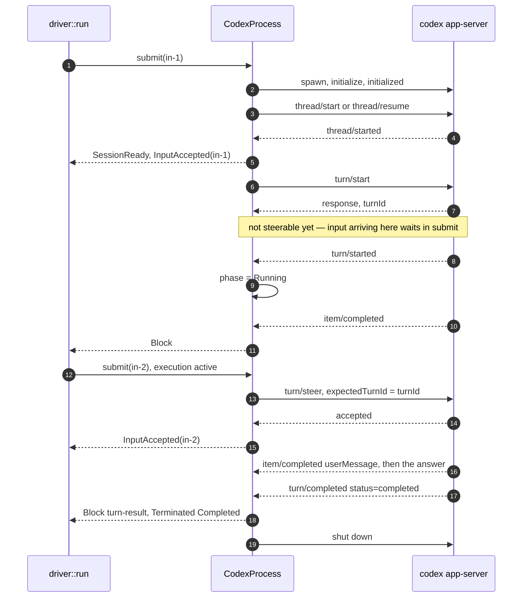
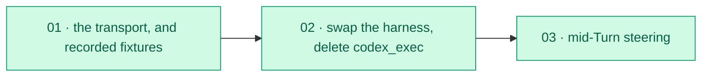

# Move the Codex Agent harness from `codex exec` to `codex app-server`

> **Status:** in progress (3/3 tickets merged to `codex-app-server-harness`; integration PR open against `main`)
> **Updated:** 2026-07-31
> **Vocabulary:** CONTEXT.md

## Current solution

The Codex Agent harness runs one `codex exec --json` subprocess per Turn. The subprocess has no
input channel once it has started, so a message that arrives mid-Turn is queued by the driver and
becomes the *next* Turn.

### The transport

`sandbox/src/agent/codex_exec.rs` (999 lines) owns both the subprocess and the wire types.

`codex_exec::start` (`codex_exec.rs:466`) builds the command:

```
codex exec --json
     --dangerously-bypass-approvals-and-sandbox
     --skip-git-repo-check
     --cd <config.workspace_dir>
     --model <resolve_codex_model(...)>
     -c model_reasoning_effort="high"
     -c developer_instructions="<build_prompt_append(config, request)>"
     [resume <session_id> | resume --last]
     <prompt>
```

with `CODEX_HOME = config.codex_home_dir`, `HOME = config.home_dir`, plus the coordinator-supplied
`env` map (`codex_exec.rs:517-524`).

`command.stdin(Stdio::null())` at `codex_exec.rs:478` is the reason mid-Turn input is impossible.
Its comment records why: *"Detach stdin so codex doesn't block reading an inherited empty stdin
(observed with codex-cli >= 0.118: a stdin-append path waits forever when the parent has no
controlling tty — sandbox runs as PID 1)."*

`CodexCliSession` (`codex_exec.rs:19-22`) is an unbounded `mpsc` receiver of
`Result<CodexExecEvent, String>` plus a `CancellationToken`. `cancel()` cancels the token, which
tears down the process tree.

`CodexExecEvent` (`codex_exec.rs:54-71`) is externally tagged on a `type` string, dot-separated:
`thread.started`, `turn.started`, `turn.completed`, `turn.failed`, `item.started`, `item.updated`,
`item.completed`, `error`.

`ThreadItemDetails` (`codex_exec.rs:165-179`) has a hand-written `Deserialize` (`codex_exec.rs:181`)
matching on a snake_case `type` string: `agent_message`, `reasoning`, `command_execution`,
`file_change`, `mcp_tool_call`, `collab_tool_call`, `web_search`, `todo_list`, `error`, and an
`Other { type_name, raw }` catch-all. Item structs use snake_case field names with no serde rename
— e.g. `CommandExecutionItem { command, cwd, aggregated_output, exit_code, status, duration_ms }`
at `codex_exec.rs:254-266`.

`Usage` (`codex_exec.rs:92-100`) carries `input_tokens`, `cached_input_tokens`, `output_tokens`,
`reasoning_output_tokens`, reported once per Turn on `turn.completed`.

The stderr reader calls `failure_detector.scan(&line)` per line (`codex_exec.rs:546`).

### The harness adapter

`sandbox/src/agent/harness/codex/mod.rs` (255 lines) implements the private `AgentProcess` port
(`harness/process.rs:60-86`).

- `CodexProcess::submit` (`codex/mod.rs:180`) spawns the CLI and records `input.id`. The driver
  mints a fresh process and calls `submit` exactly once.
- `CodexProcess::absorb` (`codex/mod.rs:118`) maps events to `ProcessEvent`s:
  `ThreadStarted` → `SessionReady` + `InputAccepted`; `ItemCompleted` → one `Block` per canonical
  block; `ItemStarted`/`ItemUpdated` → blocks only for `TodoList`; `TurnCompleted` → a turn-result
  `Block` carrying usage, then `Terminated { Completed }`; `TurnFailed` / `Error` →
  `Terminated { Failed(classify_turn_error(...)) }`.
- `CodexProcess::cancel` (`codex/mod.rs:225`) cancels the session token.
- `CodexProcess` does **not** override `accepts_injection()`, so it inherits `false`
  (`harness/process.rs:78-80`).

`Harness::codex` (`harness/mod.rs:213-228`) spawns `driver::run` — the one-execution-per-process
driver — with a factory closing over `CodexConfig { config, credential_failures }`.

`driver.rs:425` is the branch that decides: `if !cancel_requested && process.accepts_injection()`
inject, `else queue.push_back(next)` at `driver.rs:432`. Codex takes the `else`.

`build_harness` (`handle/mod.rs:80-113`) fixes the harness at Sandbox construction per ADR-0004.

### Normalization

`harness/codex/normalize.rs` produces one `SourceEvent` per native item, in native order. Item ids
are qualified as `{session}_{nonce}_{native_id}` (`normalize.rs:61-63`) with a fresh per-spawn
nonce on every `thread.started` (`normalize.rs:47-50`), because *"Codex restarts its `item_id`
numbering at `item_0` on every `codex exec --resume`"* (`normalize.rs:10-12`).

`harness/codex/blocks.rs:105` maps each family to canonical `text` / `tool_use` / `tool_result`
blocks through the shared `CanonicalContentBlock` enum and the pure builders in
`handle/codex_payloads.rs`.

### Error classification

Two independent substring-matching sites:

1. `CredentialFailureDetector::default_patterns` (`credentials/recovery.rs:45-57`) matches
   `refresh_token_reused`, `refresh token reused`, `failed to refresh token`, `401 unauthorized`
   against **stderr lines**, flipping a per-credential atomic flag the coordinator polls.
2. `classify_turn_error` (`harness/codex/classify.rs:61-112`) matches the turn error **message
   text** against three substring lists to produce `ErrorClass::Authentication` /
   `RateLimit` / `UnavailableSession`, defaulting to `InvalidInput`.

Recovery after detection (`handle/credential_recovery.rs:66-107`) pulls fresh credentials from the
backend, compares them against the on-disk `~/.codex/auth.json` (the authoritative pre-failure
value), and retries only if genuinely different. `MAX_CREDENTIAL_RECOVERY_RETRIES = 2`.
`retry.rs:17-19` treats only `RateLimit` and `ProcessExit` as retryable, capped at
`MAX_RETRIES = 5`.

Credentials themselves reach Codex through `CodexAuthJsonSink` (`credentials/sinks.rs:18-60`),
which atomically writes `$CODEX_HOME/auth.json` at 0600 — **not** through the Turn's environment.

### Measured behaviour, before the change

A gated end-to-end test against the real CLI
(`harness/codex/tests.rs::e2e_message_sent_mid_turn_is_answered_by_the_next_codex_turn`) records:

```
EXECUTION STARTED session=019fb663-c970-76e0-b3af-a7c425170cbe cause=Input(InputId("in-1"))
INPUT ACCEPTED in-1
SUBMITTING in-2 while the Turn is running
EXECUTION FINISHED Completed
EXECUTION STARTED session=019fb663-c970-76e0-b3af-a7c425170cbe cause=Input(InputId("in-2"))
INPUT ACCEPTED in-2
EXECUTION FINISHED Completed
```

Turn 1 answers ALPHA and never says BANANA. Two executions, same thread id.

### Dead code

`crates/codex-sdk` (1324 lines) speaks the app-server protocol already and is **not usable**:

- it resolves every Codex crate through `../../../../stuffs/codex/codex-rs/*`, a path outside this
  repository (`crates/codex-sdk/Cargo.toml:16-28`)
- it is a standalone workspace excluded from ours (`Cargo.toml:12`,
  `crates/codex-sdk/Cargo.toml:9-11`) with four forked `[patch.crates-io]` entries and a pinned
  toolchain
- it links the app-server **in-process** via `InProcessAppServerClient` (`codex-sdk/src/runtime.rs:3-5`)
- `QueryHandle::steer` sends `expected_turn_id: String::new()` (`codex-sdk/src/query.rs:70-90`),
  which the server rejects; its own E2E prints the error and passes
  (`crates/codex-sdk/tests/e2e.rs:743-802`)
- nothing under `sandbox/` or `backend/` references it

---

## Planned solution

**New**

- `sandbox/src/agent/codex_app_server/` — a JSON-RPC 2.0 client over `codex app-server --stdio`,
  with the typed protocol messages it needs.
- A steering path in `CodexProcess`: a message submitted while a Turn runs is sent as `turn/steer`
  and reported as a bare `ProcessEvent::InputAccepted`.
- A steerability gate in `CodexProcess`: input arriving before `turn/started` waits for the gate
  inside `submit`, and is handed back to the driver's queue if the gate never opens.
- An app-server item model — the camelCase families and fields, including `userMessage`.

**Changes materially**

- `sandbox/src/agent/harness/codex/mod.rs` — rewritten lifecycle; `accepts_injection()` becomes
  `true`.
- `sandbox/src/agent/harness/codex/classify.rs` — classification reads `codexErrorInfo` instead of
  matching substrings.
- `sandbox/src/agent/harness/codex/blocks.rs` — same canonical block shapes, driven by the new item
  enum.
- `sandbox/src/credentials/recovery.rs` — the flag is set from a typed error code, not from an
  stderr scan.
- `sandbox/tests/executor_test.rs:304` — its assertion that Codex cannot inject is now false.

**Deleted**

- `sandbox/src/agent/codex_exec.rs` — every caller moves to the new transport.

**Untouched**

- The `Harness` seam, its signal ordering contract, and ADR-0004 / ADR-0005.
- `sandbox/src/agent/harness/driver.rs` — the ordering itself. It already consults
  `accepts_injection()` and already reports an injected input as a bare `InputAccepted`
  (`driver.rs:413-435`, `signal.rs:15-18`). Ticket 03 changed one thing in it and nothing else: the
  mid-execution `submit` is now raced against cancellation, the same shape ticket 02 gave the
  opening one. That is a property of *any* injecting process that can wait in `submit`, not a Codex
  special case.
- `sandbox/src/agent/harness/codex/normalize.rs` — the `SourceEvent` shape, the
  `{session}_{nonce}_{item}` id scheme, and the turn-result usage carrier all stay.
- `sandbox/src/agent/handle/codex_payloads.rs` — the pure typed-payload builders.
- Run identity, message acknowledgment and event publication (`coordinator.rs`, `dispatcher.rs`).
- `handle/credential_recovery.rs` — pull, disk-dedup, retry, unchanged.
- `sandbox/src/init/transcript_sync.rs` — rollouts still land under `$CODEX_HOME/sessions/`.
- The Claude harness and both its transports.

### Problem

Someone watching a Codex Turn go the wrong way cannot redirect it. Their correction is queued and
delivered only after the Turn finishes — after the wasted work has already been done and paid for.
On the Claude harness the same correction lands inside the running Turn, so the two agents behave
differently for the same action, and the difference is not explained anywhere in the product.

The transport is the cause. `codex exec` closes its standard input, and it exposes no other way in.

`codex app-server` does. `turn/steer` appends input to a Turn that is already running: it is
delivered as a follow-up model request at the next request boundary, inside the same Turn, with no
new `turn/started`.

### Behaviour

**As someone using a Codex Task, when I send a message while the agent is working, my message is
answered in the Turn already running.**

```
Given a Codex Turn is running and has completed at least one tool call
When I send a message
Then the message is accepted against the running Turn
And no new Turn appears
And the agent acts on the message at its next model request
And the Turn's final answer reflects my message
```

Measured against codex-cli 0.145.0 with `/tmp/steer_probe.py`:

```
*** turn/started turn=019fb675-ecc1-7c92-b448-f2aa4b31702a
  item/completed  agentMessage: "I'll run the two commands separately…"
  item/completed  commandExecution: "/bin/bash -lc 'echo step-one'"
>>> turn/steer  expectedTurnId=019fb675-ecc1…  "reply with the single word BANANA"
    STEER RESPONSE: {"id":4,"result":{"turnId":"019fb675-ecc1-7c92-b448-f2aa4b31702a"}}
  item/completed  userMessage        ← injected into the SAME turn
  item/completed  agentMessage: 'BANANA'
*** turn/completed turn=019fb675-ecc1-7c92-b448-f2aa4b31702a status=completed
```

The pending `sleep 25` was abandoned and the answer came immediately.

**As someone using a Codex Task, when I send a message between Turns, nothing changes.**

```
Given no Codex Turn is running
When I send a message
Then a new Turn opens on the same Session
And the Session id is the same one the previous Turn used
```

**As someone using a Codex Task, when the agent is in a long wait, my message cuts it short.**

```
Given a Codex Turn is running a blocking wait
When I send a message
Then the wait is abandoned
And the agent responds to my message
```

Upstream `codex-rs/core/tests/suite/pending_input.rs` covers this directly:
`any_new_input_interrupts_sleep` and `steer_interrupts_wait_agent_and_is_sent_in_follow_up_request`.
Work already dispatched is not preempted —
`user_input_does_not_preempt_after_reasoning_item` shows an already-emitted tool call is preserved,
and `injected_user_input_triggers_follow_up_request_with_deltas` shows two HTTP requests and one
`TurnComplete`.

**As someone using a Codex Task, when I stop a Turn, it stops and the Session survives.**

```
Given a Codex Turn is running
When I stop it
Then the Turn ends as cancelled
And my next message resumes the same Session
```

**As the operator, when a credential expires, the Turn is refreshed and retried without me.**

```
Given a Codex Turn fails with the named code for an unauthorized request
When the sandbox pulls fresh credentials and they differ from what is on disk
Then the Turn is retried on the same Session
And the failure only surfaces after the recovery attempts are spent
```

**As the operator, when a Turn refuses to be steered, no message is lost.**

```
Given a Codex Turn is running
And the steer request is rejected
When the Turn finishes
Then the message opens the next Turn instead
```

### Architecture and key flows

#### `sandbox/src/agent/codex_app_server/mod.rs` — new

- **Proposed responsibility:** own one `codex app-server --stdio` subprocess and the JSON-RPC 2.0
  framing over its pipes — correlate request ids to responses, dispatch notifications, answer
  server-initiated requests.
- **Proposed change:** new module. Public surface mirrors what `codex_exec` offered so
  `CodexProcess` changes as little as possible:
  - `start(config, request, env, failure_detector) -> Result<AppServerSession, std::io::Error>` —
    spawns the process, performs `initialize` → `initialized`, and returns before any thread work.
  - `AppServerSession { notifications: mpsc::UnboundedReceiver<Result<ServerEvent, String>>, ... }`
    with `cancel()` on a `CancellationToken`, mirroring `CodexCliSession`
    (`codex_exec.rs:19-22`).
  - `start_thread(params) -> ThreadId`, `resume_thread(params) -> ThreadId`,
    `start_turn(params) -> TurnId`, `steer(thread_id, turn_id, text) -> Result<TurnId, RpcError>`,
    `interrupt(thread_id, turn_id)`.
- **Evidence:** the command is `codex app-server --stdio`, spawned in
  `/tmp/steer_probe.py:19-26` and `/tmp/err_probe.py:38-42` against `/usr/local/bin/codex` 0.145.0.
  `config.codex_cli_path` (`config.rs:152`, default `/usr/local/bin/codex`, env
  `SANDBOX_CODEX_EXECUTABLE_PATH`) is the same binary path used today.

**Spawn parity with `codex exec`:**

| `codex exec` today | app-server equivalent |
|---|---|
| `--cd <workspace_dir>` | `ThreadStartParams.cwd` |
| `--dangerously-bypass-approvals-and-sandbox` | `ThreadStartParams.sandbox = "danger-full-access"` and `approvalPolicy = "never"` |
| `--skip-git-repo-check` | none needed — measured: all three probes ran in plain `/tmp` directories with no git repository and `thread/start` succeeded |
| `--model <m>` | `ThreadStartParams.model`, and `TurnStartParams.model` per Turn |
| `-c model_reasoning_effort="high"` | `TurnStartParams.effort` |
| `-c developer_instructions="…"` | `ThreadStartParams.developerInstructions` / `ThreadResumeParams.developerInstructions` |
| `resume <id>` | `thread/resume` with `ThreadResumeParams.threadId` |
| `resume --last` | no direct equivalent — see Open questions |
| `CODEX_HOME`, `HOME`, coordinator `env` | process environment at spawn, unchanged |

`stdin` is now a pipe, not `Stdio::null()`. The PID-1 hang recorded at `codex_exec.rs:475-478` was
about `codex exec` blocking on an *inherited empty* stdin; app-server is given a real pipe that the
client writes to, so the condition does not apply. Verify this explicitly — see Testing.

#### `sandbox/src/agent/codex_app_server/protocol.rs` — new

- **Proposed responsibility:** the typed wire messages, and nothing else.
- **Proposed change:** serde types for the eight client requests, one client notification, the
  server notifications listed below, and the `ThreadItem` enum. Field naming is
  `#[serde(rename_all = "camelCase")]` throughout — this is the difference from `codex_exec.rs`,
  whose item structs use bare snake_case fields.
- **Evidence:** generated from the installed binary with
  `codex app-server generate-json-schema --out /tmp/codex-schema --experimental`.

**Client → server requests used** (`ClientRequest.json`):

| Method | Params type | Required fields |
|---|---|---|
| `initialize` | `InitializeParams` | `clientInfo { name, version }` |
| `thread/start` | `ThreadStartParams` | none required |
| `thread/resume` | `ThreadResumeParams` | `threadId` |
| `turn/start` | `TurnStartParams` | `threadId`, `input` |
| `turn/steer` | `TurnSteerParams` | `threadId`, `expectedTurnId`, `input` |
| `turn/interrupt` | `TurnInterruptParams` | `threadId`, `turnId` |

Client → server notification: `initialized` with empty params, sent once after the `initialize`
response.

`input` is an array of user-input items. The measured working shape is
`[{"type": "text", "text": "…"}]` (`/tmp/steer_probe.py:95-98`).

`capabilities` is **not** sent. Measured both ways on codex-cli 0.145.0 (ticket 01): with
`capabilities: {"experimentalApi": true}` and with the field omitted entirely, `turn/steer` is
accepted identically. This matches `codex features list` reporting `steer  removed  true` — the
feature has graduated. The flag stays on `InitializeParams` because the server accepts it, but the
transport sends `None`.

**Server → client notifications consumed:**

| Notification | Used for |
|---|---|
| `thread/started` | the Session id → `ProcessEvent::SessionReady` |
| `turn/started` | the Turn becomes steerable — see the gate below |
| `item/started`, `item/completed` | canonical blocks |
| `thread/tokenUsage/updated` | `ThreadTokenUsage { last, total, modelContextWindow }` for the turn-result block |
| `turn/plan/updated` | the running plan tracker — see the item-family table |
| `error` | `ErrorNotification { error: TurnError, threadId, turnId, willRetry }` |
| `turn/completed` | the terminal, carrying `Turn { id, status, error, items, itemsView }` |

Measured in ticket 01: the server omits `"jsonrpc": "2.0"` on notifications and adds a top-level
`emittedAtMs`. A reader that requires `jsonrpc` will drop every notification.

`turn/completed` reports `itemsView: "notLoaded"` and `items: []` in practice (measured,
`/tmp/win.log`), so blocks must be built from the streaming `item/completed` notifications. The
terminal is a terminal, not a replay.

Notifications that arrive and are ignored, observed in the probes: `configWarning`,
`remoteControl/status/changed`, `thread/status/changed`, `account/rateLimits/updated`,
`item/agentMessage/delta`.

**Server → client requests.** Under `approvalPolicy: "never"` and `sandbox: "danger-full-access"`
none were observed in any probe. The client must still reply to anything it receives — an
unanswered server request can stall the Turn. Reply to every unrecognised server request with a
JSON-RPC error rather than ignoring it. `ServerRequest.json` lists what exists:
`item/commandExecution/requestApproval`, `item/fileChange/requestApproval`,
`item/tool/requestUserInput`, `item/permissions/requestApproval`, `item/tool/call`,
`mcpServer/elicitation/request`, `account/chatgptAuthTokens/refresh`, `attestation/generate`,
`currentTime/read`, `applyPatchApproval`, `execCommandApproval`.

#### `sandbox/src/agent/harness/codex/mod.rs` — changes materially

- **Observed:** one execution per process, `accepts_injection()` inherited as `false`
  (`codex/mod.rs:180-232`).
- **Proposed responsibility:** hold the Turn identity for the life of the execution, and turn a
  mid-execution `submit` into a steer of that Turn.
- **Proposed change:**
  - `CodexProcess` gains `thread_id: Option<String>`, `turn_id: Option<String>`,
    `phase: TurnPhase`, and `held: Option<Input>`.
  - `submit` branches. First submit: spawn, `thread/start` or `thread/resume`, then `turn/start`.
    Later submit: park the input in `held`, then deliver it before returning — see *Where the
    mid-Turn message waits* below.
  - `fn accepts_injection(&self) -> bool { true }`, mirroring `ClaudeProcess`
    (`harness/claude/mod.rs:286`).
  - `absorb` maps `turn/started` → `phase = Running`; `turn/completed` → `phase = Ended`, emit the
    turn-result block, then `Terminated { Completed | Failed(...) }` by `TurnStatus`.
  - `cancel` sends `turn/interrupt` with the held ids, then cancels the session token.

**The steerability gate is not optional.** Measured with `/tmp/steer_window.py`:

```
TURN 019fb69b-ce7d-72c0-b39f-333d35ba6486
>>> steer A-after-turn-start-response
  A-after-turn-start-response: REJECTED 'no active turn to steer'
>>> steer B-on-turn-started
  B-on-turn-started: ACCEPTED {"turnId": "019fb69b-ce7d-72c0-b39f-333d35ba6486"}
  item/completed userMessage: ''
>>> steer C-on-first-item-completed
  C-on-first-item-completed: ACCEPTED {"turnId": "019fb69b-ce7d-72c0-b39f-333d35ba6486"}
```

Steering with the correct turn id immediately after the `turn/start` **response** is rejected. The
Turn only becomes steerable when the `turn/started` **notification** arrives. Input that arrives in
that window is held rather than sent optimistically.

**Where the mid-Turn message waits — amended in ticket 03.** The plan above said `submit` returns
`Ok` and the queue drains later, when `absorb` sees `turn/started`. Implementation ruled that out:
the drain has no caller to fail back to. The driver's own queue — the fallback this feature depends
on, "a message the Turn cannot take becomes the next Turn" — is reachable *only* through an `Err`
from `submit` (`harness/driver.rs`, the mid-execution submit arm). An input that has already been
answered `Ok` and is then rejected at drain time can only be dropped. Worse, it is never acked: the
coordinator clears `pending_acks` on `InputAccepted`/`InputRejected` alone, and the dispatcher holds
the single-flight `dispatch_lock` until the ack resolves, so one silently-dropped input wedges
message dispatch for the pod's lifetime.

So the wait happens *inside* `submit`. A mid-Turn input is parked in `held` and delivered before
`submit` returns, pumping notifications until `phase` leaves `Requested`. Nothing is reported accepted until the server has taken it, and every failure — a
rejected `turn/steer`, a Turn that ends before the gate opens, a stream error — surfaces as `Err`
and reaches the driver's queue as the ticket requires. On any such failure `held` is cleared: the
input it holds is the one being handed back, and the driver owns it from that point.

Two bounds keep that wait from becoming a hang, both of them failing into the same queue fallback,
and **both of them wrap the gate only**:

- `MID_TURN_DELIVERY_TIMEOUT` (5 s). `turn/started` normally follows `turn/start`'s response within
  milliseconds; if it does not, the message becomes the next Turn rather than blocking dispatch.
- The process's own `cancel_handle()` token (`AgentProcess::cancel_handle`, from ticket 02). A Stop
  arriving while input is held hands the input back at once instead of waiting out the timeout.

**Bound the gate, never the steer.** The `turn/steer` that follows the gate runs outside both. A
timeout wrapped around the whole delivery would drop the request future *after* its bytes were
written, `submit` would answer `Err`, and the driver would open a fresh Turn for a message the
server was still free to accept — the message acted on twice, once inside the running Turn and once
as the next one. Clearing `held` does not help: the input is taken out of it before the request is
awaited.
Bounding the gate alone means a timeout can only fire before anything was sent, so `Err` genuinely
means the server never took it. The steer needs no deadline of its own: it is a request against a
live Turn, and `PendingRequests` releases its waiter when the stream ends, which the cancel path
guarantees.

A Stop reaches a process waiting on the gate only because `run_execution` races cancellation around
the mid-execution `submit`, the one change ticket 03 made in `driver.rs`. Without that race the
token could not fire at all — the loop that reads `cancel_rx` is the loop blocked in the call — and
the timeout would be the only way out, five seconds later.

Delivery preserves submit order — the driver submits serially, so a second message cannot start
delivering until the first is done — and each delivered input produces exactly one
`InputAccepted`, so
the driver's ordering contract (`harness/driver.rs:391-395`, `harness/signal.rs:15-18`) is
satisfied: `ExecutionStarted → InputAccepted → Source* → ExecutionFinished`, with injected inputs
adding an `InputAccepted` and no second `ExecutionStarted`.

**Never branch on a steer error's text.** Every rejection measured is `-32600` with a different
sentence. `steer` classifies the failure by code alone and treats any of them the same way: the Turn
cannot take this input, so it becomes the next Turn.

#### `sandbox/src/agent/harness/codex/classify.rs` — changes materially

- **Observed:** `classify_turn_error` matches three substring lists against free text
  (`classify.rs:61-105`).
- **Proposed responsibility:** map a named `codexErrorInfo` value to a stable `ErrorClass`.
- **Proposed change:** replace the substring lists with the mapping in Failure below. Keep
  `classify_startup_error` (spawn failure) and `truncate_diagnostic`. `classify_stream_error`
  becomes framing-error classification for the JSON-RPC reader.

#### `sandbox/src/agent/harness/codex/normalize.rs` — untouched shape, new input type

- **Observed:** `item_sources` takes a `ThreadItem` and produces `SourceEvent`s; the per-spawn
  nonce exists because `codex exec --resume` restarts item ids at `item_0` (`normalize.rs:10-12`).
- **Proposed change:** the function signature takes the new item type. **Keep the nonce.**
  app-server item ids look globally unique in practice — the probes show
  `itemId: "msg_0ff3b638c11eca2b016a6c2f62fae08191adb6bef765bc3abc"` — but that was not established
  for every family, and removing the nonce would change the `{session}_{nonce}_{item}` scheme that
  persisted reads line up against (`normalize.rs:58-63`). Keeping it is free.
- Usage moves from `turn.completed`'s `Usage` (`codex_exec.rs:92-100`) to
  `thread/tokenUsage/updated`'s `ThreadTokenUsage.last`, whose `TokenUsageBreakdown` carries
  `inputTokens`, `cachedInputTokens`, `outputTokens`, `reasoningOutputTokens`, `totalTokens`,
  `cacheWriteInputTokens` — a superset of the four fields `turn_result_source`
  (`normalize.rs:123-143`) publishes. Hold the last-seen value and emit it on the terminal.

#### `sandbox/src/credentials/recovery.rs` — changes materially

- **Observed:** `scan(&str)` matches four substrings against stderr lines
  (`recovery.rs:45-70`), called from `codex_exec.rs:546`.
- **Proposed responsibility:** hold the per-credential flag; stop deciding *what* a failure looks
  like.
- **Proposed change:** add a method that sets a credential's flag directly, called by the harness
  when it sees `codexErrorInfo == "unauthorized"`. `take` / `take_triggered` and the coordinator
  polling are unchanged. Delete `scan`, `default_patterns` and the pattern map once
  `codex_exec.rs` is gone — Codex is the only entry (`recovery.rs:47`).

**Why the stderr scan must go, not just be supplemented.** In the unauthorized probe, stderr
carried three `401 Unauthorized` lines from `codex_models_manager::manager` — a *background* model
refresh with no relationship to the Turn — alongside one genuine
`codex_login::auth::manager: Failed to refresh token`. A line-scanner cannot tell them apart. The
typed error is scoped to a `turnId`.

#### Key flow — a message folded into a running Turn



Two further flows are not drawn. **Cancellation**: `turn/interrupt` with the held ids, then cancel
the session token, then the driver maps the resulting termination to a cancelled outcome
(`harness/process.rs:14-17`). **Turn failure**: `error` notification arrives, then `turn/completed`
with `status: "failed"` and the same `TurnError`, mapped to
`Terminated { Failed(classify(...)) }` with the Session left intact so the next Turn resumes it.

### Data model

`CodexProcess` is an in-memory per-Turn registry whose identity fields change. No persisted schema
changes.

| Field | Type | What this change does to it |
|---|---|---|
| `session` | `Option<CodexCliSession>` | **Meaning changes.** Becomes `Option<AppServerSession>` — a JSON-RPC client, not an NDJSON reader |
| `thread_id` | `Option<String>` | **New.** Needed by every `turn/*` request; today the Session id is only forwarded outward |
| `turn_id` | `Option<String>` | **New.** `turn/steer` requires `expectedTurnId`, and an empty one is rejected with `-32600 "expectedTurnId must not be empty"` (measured) |
| `phase` | `TurnPhase` | **New, ticket 03.** `Requested` → `Running` → `Ended`. Replaces both the planned `steerable: bool` and ticket 02's `turn_started: bool`: the gate needs to tell "not steerable yet" from "never will be", and the usage baseline needs the same distinction to tell the Session's replayed usage from the Turn's own |
| `held` | `Option<Input>` | **New, ticket 03.** The input awaiting delivery into the running Turn. `Some` only inside a mid-Turn `submit`, and one slot rather than a queue because the driver submits one input at a time and `submit` empties it before answering; cleared on any delivery failure, because the driver takes that input back |
| `usage_baseline`, `usage_latest` | `Option<TokenUsageBreakdown>` | **New.** Usage now streams before the terminal instead of riding on it, and reports cumulative Session figures rather than per-Turn ones, so the Turn's spend is the difference. Replaces the planned single `last_usage` — see the measurement below |
| `input_id` | `Option<InputId>` | Read, unchanged — `codex/mod.rs:65` |
| `session_ready`, `input_accepted` | `bool` | Read, unchanged — `codex/mod.rs:66-67` |
| `normalizer` | `Normalizer` | Read, unchanged — `codex/mod.rs:68` |

**Entity meaning.** A `CodexProcess` is one Turn's agent process. Its lifetime is exactly one
execution, matching the one-execution-per-process driver. It is created by the factory closure in
`Harness::codex` (`harness/mod.rs:218`) and dropped when the driver replaces it.

**Identity.** The Session (Codex calls it a *thread*) is identified by `thread_id` and outlives the
process. The Turn is identified by `turn_id` and does not. Both are UUIDv7 strings minted by Codex.

**Invariants.**

- `turn_id` is `Some` before `phase` can be `Running`.
- `phase` is `Ended` after `turn/completed`, and a Turn never leaves `Ended`.
- `held` is `None` whenever `submit` is not running.
- A `turn/steer` is only ever sent with the `turn_id` currently held, never a remembered one.

**Item families.** The wire item model changes from nine snake_case families to eighteen camelCase
ones. Mapping, with today's canonical block target:

| app-server | exec today | Canonical block |
|---|---|---|
| `agentMessage` | `agent_message` | assistant `text` |
| `reasoning` | `reasoning` | assistant `text` — **shape differs**: carries `content` and `summary`, not `text`. `summary` is what `text` was; an item with neither renders nothing (Open question 6) |
| `commandExecution` | `command_execution` | `tool_use` + `tool_result`, `CODEX_TOOL_SHELL` |
| `fileChange` | `file_change` | `tool_use` + `tool_result`, `CODEX_TOOL_EDIT` |
| `mcpToolCall` | `mcp_tool_call` | `tool_use` + `tool_result`, `CODEX_TOOL_MCP` |
| `collabAgentToolCall` | `collab_tool_call` | `tool_use` + `tool_result`, `CODEX_TOOL_COLLAB` |
| `webSearch` | `web_search` | lone `tool_use`, `CODEX_TOOL_WEB_SEARCH` |
| `turn/plan/updated` *(notification)* | `todo_list` | lone `tool_use`, `CODEX_TOOL_TODO_LIST` — **not an item.** See below |
| — | `error` | assistant `text` — app-server has **no** `error` item; errors arrive as the `error` notification only |
| `dynamicToolCall` | — | **New.** `tool_use` + `tool_result`, `CODEX_TOOL_MCP` — a namespaced tool with JSON arguments and content items back is what that card already renders (Open question 2) |
| `userMessage` | — | **New.** Deliberately dropped: every Turn echoes its own prompt back, so rendering it doubles every message (Open question 1) |
| `plan`, `hookPrompt`, `subAgentActivity`, `imageView`, `sleep`, `imageGeneration`, `enteredReviewMode`, `exitedReviewMode`, `contextCompaction` | — | **New.** Deliberately dropped — no honest home in the canonical vocabulary (Open question 2) |

**The plan is a notification, not an item.** Measured in ticket 01: a Turn that used `update_plan`
emitted four `turn/plan/updated` notifications carrying
`{ threadId, turnId, explanation, plan: [{ step, status }] }` with `status` in `pending` /
`inProgress` / `completed` — the same data `todo_list` carried — and **no** `plan` thread item. The
`plan` item exists in the schema with a single `text` field and was never produced by any probe.
Whatever maps to `CODEX_TOOL_TODO_LIST` must read `turn/plan/updated`.

**The Turn's own input is echoed as a `userMessage` item.** Not just the steered input: every Turn
opens with a `userMessage` item carrying the `turn/start` prompt. Open question 1 therefore decides
the rendering of *two* items per steered Turn, not one, and dropping the family drops both.

Anything unmatched falls through to the `ThreadItem::Other { type_name, raw }` path, forwarded as
`CanonicalContentBlock::Unknown` with bounded diagnostics (`normalize::unknown_source`). That path is
why an unhandled new family is not a data-loss bug — but it renders as nothing useful, so it is a
decision, not a default. A **dropped** family is the third outcome and a different thing: understood,
and renders nothing, with no diagnostics. `blocks.rs` documents all three so they cannot blur.

Field naming across every item struct changes from snake_case to camelCase. Fields observed on
`commandExecution`: `aggregatedOutput`, `command`, `commandActions`, `cwd`, `durationMs`,
`exitCode`, `id`, `processId`, `source`, `status`.

Two more shape differences, measured in ticket 01 and visible in
`sandbox/src/agent/codex_app_server/fixtures/`:

- `fileChange.changes[].kind` is **internally tagged**, not a bare string: `{"type": "add"}`,
  `{"type": "delete"}`, `{"type": "update", "move_path": null}` — where exec sent `"kind": "add"`.
  `move_path` is snake_case inside an otherwise camelCase protocol.
- `CommandExecutionStatus` and `PatchApplyStatus` are camelCase (`inProgress`), and both gained a
  `declined` variant.

**Two more measurements, from ticket 02, that change how the harness must be built.** Both were
taken against codex-cli 0.145.0 with `CODEX_HOME=/opt/moatless/.codex`.

*A resume emits no `thread/started` notification.* `thread/start` does; `thread/resume` announces the
Session id **only** in its response. So `ProcessEvent::SessionReady` must be driven from the
request response, not from the notification. This is not a robustness preference — waiting on the
notification would hang every Turn after the first, since every Turn after the first resumes. The
harness announces from the response and keeps the notification path idempotent (`session_ready` /
`input_accepted` guards), because a fresh thread produces both.

*`thread/tokenUsage/updated` reports two running figures and neither of them is a Turn.* `last` is
the most recent **model request** — a Turn that takes three requests emits three of these — and
`total` is everything the **Session** has spent, carried across `thread/resume`. Measured: a
three-request Turn reported `last` totals of 15842 / 15918 / 15969 against `total` of 15842 / 31760 /
47729, and a resumed connection's first reading was 47920, continuing the previous connection's
count. `codex exec --json` billed the same work as a single `usage` of 47902 input tokens, matching
the cumulative figure.

So a Turn's spend is the **growth of `total` while it ran**: capture a baseline from the readings
that arrive before `turn/started` (a resumed thread replays its stored total there), and subtract.
Holding the last-seen `last` — the obvious reading of "last usage wins" — would have under-reported
that Turn roughly threefold, and using `total` raw would bill every resumed Turn for the whole
conversation. `harness::codex::normalize::TurnUsage::between` is that subtraction and carries the
numbers above in its doc comment.

### Interfaces and contracts

**External contract.**

| Actor | Can do | Surface | Takes effect |
|---|---|---|---|
| A person | Send a message while a Codex Turn runs | Task conversation | At the agent's next model request, inside the running Turn |
| A person | Send a message between Turns | Task conversation | As a new Turn on the same Session |
| A person | Stop a Turn | Task conversation | Turn ends cancelled, Session stays resumable |
| The backend | Read Turn content and Run identity | Event stream | Unchanged |

Promises:

- A Turn a message was folded into is still exactly one Run, so the backend's `run_id` → turn
  number mapping is unchanged (`sandbox/CLAUDE.md`, "Run identity").
- An acknowledged message that was folded in carries the running Turn's `run_id`
  (`dispatcher.rs:357-404`), which is what already happens for Claude.
- A message that cannot be folded in becomes the next Turn. It is never dropped.
- A Session survives the process that created it. `$CODEX_HOME/sessions/` rollouts are written by
  both transports, so `init/transcript_sync.rs` and cross-pod restore are unaffected.
- Canonical block shapes, tool names and `toolUseResult` payloads are unchanged.

**Internal interfaces** — the module names, function signatures and struct fields above are an
implementation plan, not promises. Changing them later needs no spec update.

Call sites of the deleted `codex_exec`: `harness/codex/mod.rs`, `harness/codex/normalize.rs`,
`harness/codex/blocks.rs`, `harness/codex/tests.rs`, `handle/codex_payloads.rs`,
`agent/coordinator/tests.rs`.

### Failure, safety and recovery

Errors arrive on three channels. Two are typed; one is not, and must not be parsed.

**1. `turn/completed` — the terminal, and the authority.** `Turn.status` is one of `completed`,
`interrupted`, `failed`, `inProgress`. When `failed`, `Turn.error` is a `TurnError { message,
codexErrorInfo, additionalDetails }`. Measured:

```
*** turn/completed status=failed error={"message": "Your access token could not be refreshed.
    Please log out and sign in again.", "codexErrorInfo": "unauthorized", "additionalDetails": null}
```

**2. The `error` notification — the same `TurnError`, plus `willRetry`, arriving first.** Measured:

```
*** ErrorNotification {"error": {"message": "Your access token could not be refreshed. …",
    "codexErrorInfo": "unauthorized", "additionalDetails": null},
    "willRetry": false, "threadId": "019fb696-1ba0-…", "turnId": "019fb696-1c1e-…"}
```

Take the classification from whichever arrives; they agree. `willRetry` says whether Codex is
retrying internally — see Open questions.

**3. JSON-RPC request errors — `{ code: i64, message: String, data: any }`, and nothing more.**
`JSONRPCErrorError.json` has exactly those three fields. Every steering failure measured returned
the same code with a different sentence:

```
steer with a wrong turn id      -> {"code": -32600, "message": "no active turn to steer"}
steer with an empty turn id     -> {"code": -32600, "message": "expectedTurnId must not be empty"}
steer after the turn completed  -> {"code": -32600, "message": "no active turn to steer"}
```

**Never branch on these messages.** Any `turn/steer` failure means one thing — this Turn cannot
take the input — and the input is pushed back for the next Turn.

`ActiveTurnNotSteerable { turnKind }` and `NonSteerableTurnKind` exist in the protocol for review
and manual-compaction turns. The sandbox starts neither, so it should not occur; it is covered by
the same fallback if it does.

Backpressure: the server rejects with `-32001` "Server overloaded; retry later." when its ingress
is saturated. On a `turn/start` this is a transient failure; on a `turn/steer` it is the same
fallback as any other steer rejection.

**Classification mapping**, replacing `classify.rs:61-105`:

| `codexErrorInfo` | `ErrorClass` | `SessionImpact` | Retryable |
|---|---|---|---|
| `unauthorized` | `Authentication` | `Unknown` | via credential recovery |
| `usageLimitExceeded` | `RateLimit` | `Intact` | yes |
| `serverOverloaded` | `RateLimit` | `Intact` | yes |
| `internalServerError` | `RateLimit` | `Intact` | yes |
| `httpConnectionFailed { httpStatusCode }` | `RateLimit` | `Intact` | yes |
| `responseStreamConnectionFailed { httpStatusCode }` | `RateLimit` | `Intact` | yes |
| `responseStreamDisconnected { httpStatusCode }` | `RateLimit` | `Intact` | yes |
| `responseTooManyFailedAttempts { httpStatusCode }` | `RateLimit` | `Intact` | yes |
| `activeTurnNotSteerable { turnKind }` | `InvalidInput` | `Intact` | no |
| `contextWindowExceeded` | `InvalidInput` | `Intact` | no |
| `sessionBudgetExceeded` | `InvalidInput` | `Intact` | no |
| `badRequest` | `InvalidInput` | `Intact` | no |
| `cyberPolicy` | `InvalidInput` | `Intact` | no |
| `sandboxError` | `InvalidConfiguration` | `Intact` | no |
| `threadRollbackFailed` | `UnavailableSession` | `Lost` | no |
| `other`, or an unrecognised variant | `InvalidInput` | `Intact` | no |

`retry.rs:17-19` treats `RateLimit` and `ProcessExit` as retryable; the table above is built to
that existing policy, so `retry.rs` is untouched. An unrecognised variant must **log the raw
value** so a new upstream code is visible rather than silently collapsing to the default.

The full `CodexErrorInfo` enum, re-read from the generated schema in ticket 01 — the string variants
`contextWindowExceeded`, `sessionBudgetExceeded`, `usageLimitExceeded`, `serverOverloaded`,
`cyberPolicy`, `internalServerError`, `unauthorized`, `badRequest`, `threadRollbackFailed`,
`sandboxError`, `other`, plus five object variants: `httpConnectionFailed`,
`responseStreamConnectionFailed`, `responseStreamDisconnected` and `responseTooManyFailedAttempts`,
each carrying an optional `httpStatusCode`, and `activeTurnNotSteerable { turnKind }`. The last
three were missing from the earlier list. `activeTurnNotSteerable` is a member of this enum, not a
separate type.

Measured shape of a failed Turn (ticket 01, a Turn started against a model that does not exist):
`codexErrorInfo: "other"` with the provider's JSON error string in `message`. `other` is a real
value the provider produces, not only a fallback.

**Routine failures:**

| Condition | State before | State after | Caller sees | Retry safe |
|---|---|---|---|---|
| Steer rejected | Turn running, input submitted | Turn running, input queued | Nothing; the message opens the next Turn | n/a |
| Input arrives before `turn/started` | Turn requested | Input held inside `submit` | Nothing; it is folded in a moment later | n/a |
| Gate never opens (Turn ends, or 5 s elapse) | Turn requested | Input queued | Nothing; the message opens the next Turn | n/a |
| Stop while an input is held | Turn requested | Input queued | Nothing; the message opens the next Turn | n/a |
| `turn/start` rejected `-32001` | Thread open, no Turn | Thread open, no Turn | A failed Turn | yes, existing backoff |
| Credential expired | Turn running | Turn failed, Session intact | Nothing until recovery is spent | yes, existing path |
| Process exits with no terminal | Turn running | EOF with no `Terminated` | A failed Turn | yes, `ProcessExit` |
| JSON-RPC framing error | Turn running | Stream unusable | A failed Turn | yes, `ProcessExit` |

**Partial writes.** There are none in the sandbox: no state is written by this change. A Turn
interrupted midway leaves a Codex rollout under `$CODEX_HOME/sessions/` that the next Turn resumes,
exactly as today.

**Degraded operation.** While the model provider is unreachable, everything except running a Turn
works — file operations, preview servers, message delivery, and the queue. Turns fail, are
classified `RateLimit`, and retry with the existing backoff.

**Rollback.** Ship the previous sandbox image. Sessions written by either transport live in the
same place in the same format, so a rolled-back pod resumes a Session that the app-server transport
created. Rollback is a redeploy, not a data migration.

### Testing and verification

**Recorded fixtures — `sandbox/src/agent/codex_app_server/fixtures/`** (landed in ticket 01)

One JSON file per wire message, split into `observed/` (captured verbatim from a real
codex-cli 0.145.0 server) and `schema-derived/` (minimal examples built from the generated schema
for families no Turn could trigger). `codex_app_server/tests.rs` deserializes every one of them into
its protocol type, and asserts all eighteen item families plus the unknown-family fallthrough are
covered. Ticket 02's item mapping is written against these files rather than against the 400 KB
schema. The provenance split is recorded in `fixtures/README.md`; do not mix the two groups.

Observed families: `userMessage`, `agentMessage`, `reasoning`, `commandExecution`, `fileChange`
(add and update), `webSearch`. Schema-derived: `plan`, `hookPrompt`, `mcpToolCall`,
`dynamicToolCall`, `collabAgentToolCall`, `subAgentActivity`, `imageView`, `sleep`,
`imageGeneration`, `enteredReviewMode`, `exitedReviewMode`, `contextCompaction`.

**Transport, gated — `sandbox/src/agent/codex_app_server/tests.rs`** (landed in ticket 01)

Three `#[ignore]` tests behind `CODEX_SDK_E2E=1` drive a real `codex app-server`: a Turn that runs
to completion and answers, a Turn steered after `turn/started` that answers the steered text inside
the same Turn id, and a Turn that `turn/interrupt` terminates. All three passed against
codex-cli 0.145.0.

**Unit — `sandbox/src/agent/harness/codex/tests.rs`**

- Every item family deserializes from a recorded app-server notification and maps to the same
  canonical block the exec transport produced. One case per family in the table above, including
  `reasoning` with `content`/`summary`, `plan` in place of `todo_list`, and an unknown family
  falling through to `Unknown` with bounded diagnostics.
- Each `codexErrorInfo` value maps to the `ErrorClass` and `SessionImpact` in the table above,
  including an unrecognised variant.
- `TurnStatus::interrupted` produces a cancelled outcome, not a failed one.
- Usage from `thread/tokenUsage/updated` reaches the turn-result block with all four fields.
- JSON-RPC request-id correlation: interleaved responses and notifications resolve to the right
  waiters.

**Driver-level, using the existing injected-session pattern** — `CodexProcess::with_session`
(`codex/mod.rs:88`) already exists for this and is the seam to reuse:

- Input submitted before the gate opens sends nothing until `turn/started` arrives, then is
  delivered in submit order, one `InputAccepted` each.
- Input submitted while `phase == Running` produces a `turn/steer` and one bare `InputAccepted`,
  with **no** second `SessionReady`.
- A rejected `turn/steer` leaves the input queued and the execution unaffected, and the queued
  input opens the next Turn.
- A gate that never opens — the Turn ends, or the timeout elapses — hands the input back **having
  written nothing**, which is what makes handing it back safe.
- A `turn/steer` already on the wire outlives the timeout: it is answered, not abandoned.
- A Stop while an input waits on the gate ends the execution at once instead of waiting out the
  timeout, and the message it interrupted still opens the next Turn. Written at the driver level:
  the race that makes the process's token reachable lives in `run_execution`, so a process-level
  test would pass on a driver that never fires it.
- A steered Turn bills the usage growth across the whole Turn, steer-caused requests included.
- `cancel` sends `turn/interrupt` before tearing the session down.
- `accepts_injection()` is `true`.

**Contract — `sandbox/src/agent/harness/contract_tests.rs`**

The Codex harness satisfies the same ordering contract as Claude:
`ExecutionStarted → InputAccepted → Source* → ExecutionFinished`, with an injected input adding an
`InputAccepted` and no second `ExecutionStarted`.

Ticket 03 left this file unchanged, deliberately. Its cases drive the harness-neutral scripted mock
rather than any real harness, and `input_submitted_mid_execution_joins_it_when_the_process_injects`
already states the injecting-process contract that Codex now joins Claude in satisfying. A
Codex-specific case here would exercise the mock, not Codex; the driver-level tests above and the
gated E2E below are what hold Codex to it.

**Integration — `sandbox/tests/executor_test.rs`**

`running_codex_turn_still_fetches_pending_messages_for_harness_queue` (line 304) asserts *"Codex
cannot inject into the active process, but the harness can queue the next turn"*. Rewrite it: the
message is now injected. Keep a test that a message still reaches the harness while a Turn runs —
only the assertion about what happens to it changes. Ticket 03 renamed it
`running_codex_turn_still_fetches_pending_messages_for_the_running_turn`.

**End-to-end, gated — `sandbox/src/agent/harness/codex/tests.rs`**

Rewrite `e2e_message_sent_mid_turn_is_answered_by_the_next_codex_turn` into
`e2e_message_sent_mid_turn_is_answered_inside_the_running_codex_turn`, keeping the existing
`skip_unless_e2e`, `e2e_config`, `TurnLog` and `collect_turn` helpers. New assertions:

- exactly one execution
- `cause == in-1`, `accepted == [in-1, in-2]`
- outcome `Completed`
- the text contains `BANANA`
- a `tool_use` block appeared before `in-2` was submitted

Add a second gated case: a message submitted between Turns still opens a second execution on the
same Session id.

Both landed in ticket 03 and passed against codex-cli 0.145.0, alongside
`e2e_codex_turn_through_the_harness`. The mid-Turn case also asserts that no second execution opens
in the 20 s after the first one finishes — the failure it guards against is a steer that looks
accepted but is really answered by a new Turn.

Run with:

```bash
CODEX_SDK_E2E=1 cargo test -p moatless-sandbox \
  --lib agent::harness::codex::tests::e2e_ -- --ignored --nocapture
CODEX_SDK_E2E=1 cargo test -p moatless-sandbox \
  --lib agent::codex_app_server::tests::e2e_ -- --ignored --nocapture --test-threads=1
```

**Manual verification**

- Confirm `codex app-server --stdio` does not hang when the sandbox runs as PID 1 with no
  controlling tty. This is the one risk the `Stdio::null()` comment at `codex_exec.rs:475-478`
  raises, and it can only be checked in a real pod, not in a test.
- Confirm no server-initiated request arrives during a normal Turn under
  `approvalPolicy: "never"` and `sandbox: "danger-full-access"`. Probed clean on a workstation;
  confirm in a pod with the real workspace and MCP configuration.
- Confirm `initialize` without `capabilities.experimentalApi` still permits `turn/steer`.

**What only a person can judge**

- Whether a steered message reads naturally in the conversation rather than as an interruption.
- Whether abandoning pending work when a message arrives is what someone wanted, or whether the
  agent should finish first.
- Whether the nine new item families should render, and as what.
- Whether a failure message tells someone what to do next.

**Acceptance criteria**

```
Given a Codex Turn is running and has completed a tool call
When a message is sent
Then it is accepted against the running Turn
And no second Turn appears
And the Turn's answer reflects the message

Given no Codex Turn is running
When a message is sent
Then a new Turn opens on the same Session id

Given a Codex Turn fails with codexErrorInfo "unauthorized"
When the backend returns credentials that differ from what is on disk
Then the Turn is retried on the same Session

Given a Codex Turn is running
When a turn/steer request is rejected
Then the message opens the next Turn instead of being lost

Given a Codex Turn is running
When it is stopped
Then the Turn ends cancelled and the next message resumes the same Session

Given any Codex item family
When it is normalized
Then it produces the same canonical blocks the exec transport produced
```

**Commands**

```bash
cargo clippy -p moatless-sandbox --all-targets -- -D warnings
cargo test -p moatless-sandbox
cargo fmt --check
CODEX_SDK_E2E=1 cargo test -p moatless-sandbox --lib agent::harness::codex -- --ignored --nocapture
```

> [!NOTE]
> `cargo clippy -p moatless-sandbox --all-targets` currently fails on a pre-existing `len_zero`
> at `sandbox/src/agent/coordinator/tests.rs:830`, and `cargo fmt --check` reports pre-existing
> diffs in `harness/contract_tests.rs`, `agent/options.rs` and `init/git.rs`. Neither is caused by
> this work.

---

## Decisions

| # | Decision | Chosen | Rejected because |
|---|---|---|---|
| [1](#1-what-a-mid-turn-message-becomes) | What a mid-Turn message becomes | Absorbed into the running Turn, no Turn of its own | A visible second Turn leaves Codex the only agent where a mid-Turn message means something different |
| [2](#2-who-speaks-json-rpc) | Who speaks JSON-RPC | A stdio client in the sandbox | `codex-sdk` resolves dependencies outside the repo, pins its own toolchain, links the agent in-process, and its steer has never worked |
| [3](#3-process-lifetime) | Process lifetime | One app-server per Turn | A process held across Turns buys only warm startup and costs the per-Turn system prompt |
| [4](#4-per-turn-system-prompt) | Per-Turn system prompt | Set at `thread/start` / `thread/resume`, which happens every Turn | A long-lived thread had no way to refresh it at all |
| [5](#5-replace-or-run-alongside) | Replace or run alongside | Replace the exec transport outright, deleting it | The protocols share no item types, so a flag means two parallel item sets — and the harness is fixed at pod construction |
| [6](#6-noticing-an-expired-credential) | Noticing an expired credential | Read `codexErrorInfo` off the failed Turn | An stderr scan matches background noise unrelated to the Turn |

### 1. What a mid-Turn message becomes

**Chosen:** the message is folded into the Turn already running. No `ExecutionStarted`, no second
Run, no second Turn number in the backend. This is exactly what `ClaudeProcess` already does
(`harness/claude/mod.rs:286`).

**Rejected: keep producing a visible second Turn, using steering only to make the agent react
sooner.** It would leave Codex as the only agent where sending a message mid-Turn means something
different from Claude, with the difference explained nowhere in the product. It would also break
the invariant that a Turn is exactly one Run (`sandbox/CLAUDE.md`, "Run identity"), because a
steered message produces no new execution to mint a `run_id` for.

**Consequence:** an acknowledged message that was folded in carries the running Turn's `run_id`
(`dispatcher.rs:357-404`). This already happens for Claude, so no backend change follows.

### 2. Who speaks JSON-RPC

**Chosen:** a JSON-RPC client in `sandbox/src/agent/codex_app_server/`, spawning
`config.codex_cli_path` — the same binary the exec transport spawns today. The protocol surface
needed is six request methods, one client notification and about a dozen server notifications.

**Rejected: `crates/codex-sdk` as-is.** Four independent blockers:

- it resolves every Codex crate through `../../../../stuffs/codex/codex-rs/*`, a path outside this
  repository (`crates/codex-sdk/Cargo.toml:16-28`) — the crate cannot build from a clean checkout
- it is a standalone workspace excluded from the parent (`Cargo.toml:12`), with four forked
  `[patch.crates-io]` entries and a pinned toolchain (`crates/codex-sdk/Cargo.toml:40-46`)
- it links the app-server **in-process** (`InProcessAppServerClient`, `runtime.rs:3-5`), which
  makes the Codex version part of the sandbox binary. Today `codex` is a separately installed CLI
  that can be upgraded without rebuilding the sandbox, and that property is worth keeping
- `QueryHandle::steer` sends `expected_turn_id: String::new()` (`query.rs:70-90`). The server
  rejects it with `-32600 "expectedTurnId must not be empty"` (measured). Its E2E prints the error
  and passes (`tests/e2e.rs:743-802`), so the bug has never been caught

**Rejected: fix codex-sdk's steer and use it.** Fixing the empty turn id is one line; the other
three blockers are structural and unaffected.

**Rejected: `codex app-server --listen unix://` or `daemon` / `proxy` mode.** A socket adds a
lifecycle and a cleanup path the stdio pipe does not have, for no benefit at one process per Turn.

### 3. Process lifetime

**Chosen:** one `codex app-server` process per Turn, alive for the whole Turn, torn down after it.
`Harness::codex` keeps using `driver::run` (`harness/mod.rs:219`), the one-execution-per-process
driver.

The thing that makes steering possible is a process alive for the whole *Turn*, not one alive
*across* Turns. `ClaudeProcess` proves this: it is the one-execution-per-process implementation and
still returns `accepts_injection() = true` (`harness/claude/mod.rs:286`), because the driver that
consults that flag is `driver::run` (`harness/process.rs:66-78`).

**Rejected: one long-lived app-server hosting many Turns, on `driver::run_persistent`.** It buys
warm process startup and costs the per-Turn system prompt (Decision 4). It would also add a
`Fingerprint` / `needs_restart` / `teardown` lifecycle mirroring
`harness/claude/persistent.rs` for no behavioural gain, since Codex resume replays from the rollout
rather than from process memory.

**Note on an earlier, wrong rationale.** While the page was being written this decision was partly
justified on per-Turn *credentials*. That was incorrect: Codex reads credentials from
`$CODEX_HOME/auth.json`, written out of band by `CodexAuthJsonSink` (`credentials/sinks.rs:18-60`),
so a long-lived process would have picked up rotations on its next request regardless. The decision
stands on the system prompt alone.

### 4. Per-Turn system prompt

**Chosen:** `developerInstructions` is set on `ThreadStartParams` / `ThreadResumeParams`. Because
Decision 3 starts or resumes the thread on every Turn, the prompt is refreshed every Turn — the
same cadence as today, where `build_prompt_append` (`agent/options.rs:162`) runs per spawn.

**Rejected: accept a stale system prompt on a long-lived thread.** `TurnStartParams` has no
`developerInstructions` field, and neither does `ThreadSettingsUpdateParams` — whose properties are
`approvalPolicy`, `approvalsReviewer`, `collaborationMode`, `cwd`, `effort`, `model`,
`permissions`, `personality`, `sandboxPolicy`, `serviceTier`, `summary`, `threadId`. On a
long-lived thread there is no mechanism to refresh it at all, which would silently drop
coordinator-resolved prompt changes mid-Session.

**Rejected: force a `thread/resume` whenever the prompt changes.** Equivalent to Decision 3 but
with a conditional, and the conditional is the only difference.

### 5. Replace or run alongside

**Chosen:** replace the exec transport outright, deleting `codex_exec.rs` in the same change.

**Rejected: keep both behind a config flag, mirroring `config.use_tmux`** (`handle/mod.rs:110-114`,
`config.rs:165,447`). Two reasons:

- The Claude pair shares its message types; this pair shares none. exec item structs use bare
  snake_case fields with a hand-written type match (`codex_exec.rs:181-266`); app-server uses
  camelCase for both names and fields, `todo_list` becomes `plan`, `collab_tool_call` becomes
  `collabAgentToolCall`, `reasoning` carries `content`/`summary` instead of `text`, there is no
  `error` item, and nine families are new. A flag means two full item models and two mappings into
  the same canonical blocks, maintained together.
- The harness is fixed at Sandbox construction (ADR-0004, `handle/mod.rs:80`), so the flag only
  ever affects newly created pods — which is exactly what rolling back the sandbox image already
  achieves, without the second code path.

**Rejected: land the new transport first and delete the old one later.** The deletion is what makes
the change worth doing under the repository's "prefer deleting code" rule (`CLAUDE.md`, Pragmatic
coding), and a deferred deletion is one that does not happen.

### 6. Noticing an expired credential

**Chosen:** read `codexErrorInfo` from the failed Turn. Everything after detection — pull from the
backend, compare against `$CODEX_HOME/auth.json`, retry only when genuinely fresher
(`handle/credential_recovery.rs:66-107`) — is unchanged.

**Rejected: keep scanning stderr.** Measured, the unauthorized probe produced three
`401 Unauthorized` lines from `codex_models_manager::manager` — a background model-list refresh
with no relation to the Turn — alongside one genuine `Failed to refresh token`. A line-scanner
cannot distinguish them, and the four-substring list at `credentials/recovery.rs:49-55` matches
both. The typed error is scoped to a `turnId`.

**Rejected: answer `account/chatgptAuthTokens/refresh`.** The server asks the client for a fresh
token when it hits a 401 — params `{ previousAccountId, reason: "unauthorized" }`, response
`{ accessToken, chatgptAccountId, chatgptPlanType }`. It is the better mechanism in one respect: it
recovers **without failing the Turn**, which the error path cannot do. It was rejected for now
because the sandbox would have to parse an access token out of the credential blob — putting token
handling in the sandbox for the first time — and would bypass the compare-against-disk policy that
stops recovery burning retries on a stale value. Worth revisiting once the typed path is in.

---

## Out of scope

- The Claude harness and either of its transports.
- The backend's Turn assembly, message acknowledgment, and event schema.
- The `Harness` seam itself. ADR-0004 (the harness is fixed at Sandbox construction) and ADR-0005
  stand unchanged; this change swaps an implementation behind the seam, which is what the seam is
  for.
- Approval UX. Codex continues to run unattended under `approvalPolicy: "never"` and
  `sandbox: "danger-full-access"`.
- Cross-pod transcript restore. `init/transcript_sync.rs` reads `$CODEX_HOME/sessions/`, which both
  transports write.
- Fixing or adopting `crates/codex-sdk`. It stays parked exactly as it is.
- The other app-server transports: `--listen unix://`, `--listen ws://`, `daemon`, `proxy`, and the
  separate `codex exec-server` and `codex mcp-server`.
- Any use of `thread/inject_items`, `thread/compact/start`, `thread/fork`, `review/start`, or the
  realtime methods.

## Open questions

1. ~~**Should the `userMessage` item produced by steering be rendered?**~~ **Settled in ticket 02:
   no — the family is dropped.** The reasoning generalises past steering, which is what made it
   easy to get wrong: *every* Turn echoes its own `turn/start` prompt back as a `userMessage`, so
   rendering the family would double every prompt in the conversation, not just a steered one. The
   text is already in the conversation as the Message that sent it, and the Message is the record
   with the identity, timestamp and author — the echo has none of those. Dropping it also means
   ticket 03 can turn steering on without the rendering changing underneath it.

   Being dropped is **not** the same as falling through to `Unknown`: `item_blocks` returns an empty
   list (understood, renders nothing) rather than `None` (unknown, forwarded raw with diagnostics).
   `blocks.rs` states the three outcomes explicitly so the distinction cannot be lost by accident.
2. ~~**What happens to the nine item families that have no equivalent today?**~~ **Settled in ticket
   02: one maps, the rest are dropped.**

   - **`dynamicToolCall` → `CODEX_TOOL_MCP`.** It is an MCP call in all but name: a namespaced tool
     (`namespace` + `tool`), JSON `arguments`, and `contentItems` back. Mapping it onto the card
     that already renders exactly that shape is strictly better than an anonymous raw block, and it
     needs no new canonical block type. `namespace` becomes `server`, falling back to `"dynamic"`
     when absent.
   - **The other eight are dropped** — `hookPrompt`, `subAgentActivity`, `imageView`, `sleep`,
     `imageGeneration`, `enteredReviewMode`, `exitedReviewMode`, `contextCompaction` — joined by
     `plan` and `userMessage` for ten dropped families in total.

   The test for "map it" was whether the family has an honest home in the canonical vocabulary,
   which is `text` plus the six fixed `codex.*` tool names. `hookPrompt` is prompt material a Codex
   hook injected, so rendering it as assistant text would attribute someone else's words to the
   agent. The rest are status notices — a sub-agent lifecycle tick, a file the agent looked at, a
   wait, a generated image, review-mode boundaries the sandbox never enters, an automatic
   compaction — with no content a `text` or `tool_use` block could carry. Inventing assistant prose
   or a fake tool call for a status notice reads worse to the person watching than the notice being
   absent, and each would need a canonical block type that does not exist. If one is wanted later it
   is an additive change with a UI counterpart, not a mapping decision.

   Confirmation from the compiler rather than from judgement: once the harness consumed the
   protocol module, `dead_code` reported that every one of these families' payload fields was
   unread — `plan.text`, `hookPrompt.fragments`, `imageView.path`, `sleep.durationMs`,
   `imageGeneration.{result,status,revisedPrompt,savedPath}`, `reviewMode.review`,
   `subAgentActivity.{agentPath,agentThreadId,kind}`. Ticket 02 deleted those fields, so each of
   these items is now an `{ id }`-only struct, and the drop is visible in the type rather than only
   in a `match` arm.
3. **Should our retry budget stand down while `willRetry` is true?** The `error` notification says
   whether Codex is retrying internally. Counting those against `MAX_RETRIES = 5` would spend the
   budget on retries we did not perform.

   **Still open — this one did not get settled.** The ticket breakdown below says question 3 would
   be answered in ticket 02 "alongside the classification work". It was not: ticket 02 moved
   classification onto `codexErrorInfo` and left the retry budget exactly as `retry.rs` had it, so
   an internally-retried error still spends one of the five. That is the behaviour that shipped, and
   it is the same behaviour the exec transport had — so nothing regressed — but the question the
   spec raised is unanswered rather than resolved. `willRetry` is parsed and logged
   (`harness/codex/mod.rs`, the `ServerEvent::Error` arm) and read by nothing else. Settling it
   needs a `retry.rs` change, which every ticket was scoped to avoid.
4. ~~**Is there an equivalent of `resume --last`?**~~ **Settled in ticket 01: none is needed.**
   `build_resume` (`coordinator.rs:1420-1439`) returns `ResumeSession::Last` only when
   `agent_type == AGENT_TYPE_CLAUDE_CODE`; for Codex it returns `None`, and
   `init/replacement_test/readiness.rs:51` asserts exactly that. The `Some(ResumeSession::Last)` arm
   at `codex_exec.rs:509` is already unreachable in production. `thread/resume` takes `threadId`
   only, and that is the only resume the Codex harness ever asks for.
5. ~~**Does `capabilities.experimentalApi` need to be sent on `initialize`?**~~ **Settled in ticket
   01: no.** Measured both ways against codex-cli 0.145.0 — with the capability and with the field
   omitted — and `turn/steer` was accepted identically. The transport sends no `capabilities`.
6. ~~**Is the reasoning item's `content` / `summary` split lossy against today's `text`?**~~
   **Settled in ticket 02: `summary` is what `text` was, and no new `turn/start` parameter is
   needed.**

   `summary` is the redacted reasoning summary and `content` is the raw chain of thought. Every
   observation has the text in `summary` with `content` empty — ticket 01's fixture
   (`fixtures/observed/item_reasoning.json`) and ticket 02's probes agree — so `summary` is what
   exec's single `text` carried. The mapping reads `summary` first and falls back to `content`, so
   a build that starts populating only the raw field is not silently blank; an item with neither
   produces **no block at all**, which is not an error case but the common one.

   The tempting follow-on — "then the harness should ask for `summary: "detailed"` on `turn/start`
   so reasoning appears" — was rejected on measurement. Ticket 02 ran three app-server probes
   against codex-cli 0.145.0 with `CODEX_HOME=/opt/moatless/.codex`, with `summary` unset and with
   `summary: "detailed"`, plus one `codex exec --json` run, all on the sandbox's default model
   (`gpt-5.6-sol`). **Every one produced zero reasoning items**, including the exec run. So reasoning
   parity needs no new parameter, and adding one would *change* what the agent emits relative to
   today — the opposite of this change's goal. The parameter stays unsent; turning it on is a
   product decision with its own before/after, not a transport detail.

## Ticket breakdown



| # | Ticket | Blocked by | Delivers |
|---|---|---|---|
| 01 | The app-server transport, and recorded fixtures | None | `sandbox/src/agent/codex_app_server/` drives a real `codex app-server` — start, resume, turn, steer, interrupt — and checks in one real sample of every message ticket 02 must read. Purely additive; the harness still runs `codex exec` |
| 02 | Swap the harness, delete `codex_exec` | 01 | `CodexProcess` on the new transport with behaviour identical to today. Classification from `codexErrorInfo`, credential detection from it, `codex_exec.rs` deleted. No steering |
| 03 | Mid-Turn steering | 02 | `accepts_injection() = true`, the steerability gate, the queue-fallback on a rejected steer, `turn/interrupt` on cancel, and the E2E rewrite |

Each ticket amends this spec on its own branch with the open questions it settles: 01 takes
questions 4 and 5, 02 takes 1, 2 and 6, and question 3 is settled in 02 alongside the
classification work.

**What actually happened to question 3:** it was not settled. Ticket 02 left the retry budget
untouched, which was the right call for a ticket whose review question was "is anything different?",
but it means the plan above was not followed. See question 3.

Ticket 01 landed `sandbox/src/agent/codex_app_server/{mod.rs, protocol.rs, fixtures/}` and answered
questions 4 and 5. It also amended: the plan is a notification not an item, the Turn's own input is
echoed as a `userMessage` item, `fileChange.kind` is internally tagged, `CodexErrorInfo` has three
more variants than first listed, and notifications carry no `jsonrpc` field.
