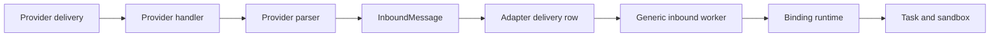
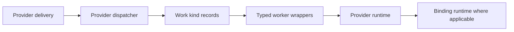
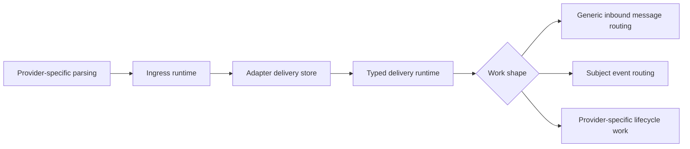
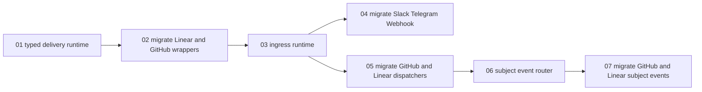

# Adapter integration runtime

> **Status:** shipped
> **Updated:** 2026-08-01
> **Vocabulary:** CONTEXT.md

## Current solution

Adapter behavior already has a strong durable execution seam.

The seam is not yet deep enough for adding integrations cheaply.

The affected code is split this way:

| Area | Current role | Cost when adding an integration |
|---|---|---|
| Adapter trait | Provider outbound behavior and optional provider hooks. | New adapters must understand a broad interface even when they only need a few capabilities. |
| HTTP handlers | Verify payloads, classify sender errors, choose metrics, build delivery records, and decide acknowledgment behavior. | Every adapter repeats the admission and acknowledgment policy in a slightly different form. |
| Delivery modules | Register delivery kinds, deserialize payloads, re-read connection state, and invoke provider work. | GitHub and Linear repeat the same handler wrapper pattern once per work kind. |
| Binding runtime | Creates bindings, creates tasks, resolves recipients, records duplicate receipts, and fans messages out. | The common router is strong for chat-style inbound messages, but subject-style integrations still collect recipients and route comments in provider modules. |
| Provider modules | Own provider parsing, provider API calls, destination mapping, and special lifecycle behavior. | Real provider differences are local, but repeated lifecycle scaffolding is mixed into those modules. |

The current inbound flow for chat-style integrations is:



GitHub PR and Linear use the same durable store, but they do not use only the generic inbound worker.

They admit several work kinds and execute provider-specific workers.



The repeated patterns are:

| Pattern | Existing examples | Why it matters |
|---|---|---|
| Admit then acknowledge | Slack, Telegram, Webhook, GitHub PR, Linear. | A new integration must reproduce the no-lost-delivery contract correctly. |
| One typed payload per work kind | GitHub PR close and CI work; Linear session, prompt, issue, comment, notification work. | A new subject integration adds boilerplate before it adds behavior. |
| Subject recipient routing | GitHub PR comments and Linear comments. | Provider modules can drift on who receives producer, responder, and parent-reply events. |

## Planned solution

Add an adapter integration runtime that deepens the existing adapter framework without forcing all providers through one generic model.

The first implementation phase has three modules:

| Module | Interface | Implementation it hides |
|---|---|---|
| Ingress runtime | Provider returns an ingress decision for each delivery. | Metrics, admission, duplicate logging, and acknowledgment classification. |
| Typed delivery runtime | Provider registers a typed delivery kind with a payload and execution function. | Payload deserialization, permanent payload failure, connection reload, handler wrapper structs, and registration boilerplate. |
| Subject event router | Provider asks to deliver one event to a bound external subject. | Binding collection, recipient resolution, self-echo exclusion, duplicate receipt checks, and sandbox notification for delivered messages. |

The target shape is:



### Problem

The current modules make the safe path too easy to copy imperfectly.

The affected maintainers are:

| Maintainer | Problem |
|---|---|
| Integration implementer | Must learn provider parsing and durable-delivery mechanics at the same time. |
| Reviewer | Must re-check admission, retry, and duplicate behavior in every provider module. |
| Operator | Needs every provider delivery to leave the same evidence when work is accepted, duplicated, retried, or abandoned. |
| Product engineer | Wants GitHub-like and Linear-like integrations to share recipient semantics rather than fork them per provider. |

The goal is less code in provider modules and a smaller implementation checklist for new integrations.

The goal is not to hide true provider differences.

### Behaviour

#### Integration developer adds a chat-style integration

| Given | When | Then |
|---|---|---|
| The integration can verify and normalize a provider message. | The developer wires the provider handler through the ingress runtime. | The runtime handles admission, duplicate logging, success metrics, and non-acknowledged failures. |
| The integration maps provider conversation data to a subject. | The normalized message is admitted. | The generic inbound worker routes it through the existing binding runtime. |
| The provider supports outbound replies. | The adapter implements only the outbound capabilities it needs. | The integration does not need custom delivery worker scaffolding. |

#### Integration developer adds a subject-style integration

| Given | When | Then |
|---|---|---|
| The provider event concerns a durable external subject. | The provider parser classifies the event. | The provider admits one or more typed delivery records. |
| The typed delivery executes. | The event should wake bound tasks. | The subject event router applies common recipient and duplicate rules. |
| The event is provider-specific lifecycle work. | The typed delivery executes. | Provider runtime code performs only that provider-specific work. |

#### Existing adapters keep behavior

| Given | When | Then |
|---|---|---|
| Slack receives a valid message. | It is admitted through the new ingress runtime. | The same task creation and thread reply behavior occurs. |
| Telegram polling receives an update. | The update is not admitted. | The polling offset is still not advanced. |
| GitHub receives one delivery that implies several work units. | The dispatcher admits each work unit. | Each work unit still has its own retry budget. |
| Linear receives a session-created event. | The dispatcher emits the current best-effort heartbeat. | Provisioning still runs as durable work. |
| Webhook receives a delivery without a caller identity. | The adapter creates a delivery identity. | The delivery is admitted once under that identity. |

## Decisions

| # | Decision | Chosen | Rejected because |
|---|---|---|---|
| [1](#1-where-the-new-runtime-sits) | Where the new runtime sits | Under the adapter layer beside existing delivery and binding modules. | Putting it inside each provider keeps duplication; putting it below the adapter layer hides provider terms from the code that owns them. |
| [2](#2-ingress-runtime-shape) | Ingress runtime shape | Provider returns an ingress decision; runtime owns admission and outcome classification. | A shared HTTP handler is too rigid for Telegram polling and Linear's heartbeat exception. |
| [3](#3-typed-delivery-registration) | Typed delivery registration | Add a generic typed registration helper for provider-owned payloads. | A macro hides control flow and is harder to debug; keeping wrapper structs preserves boilerplate. |
| [4](#4-subject-event-router-scope) | Subject event router scope | Cover subject-bound message delivery only. | Moving all provider lifecycle behavior into the router would make a large shallow module. |
| [5](#5-adapter-trait-changes) | Adapter trait changes | Do not split the broad trait in this phase. | Splitting first changes call sites before the repeated delivery code is under control. |

### 1. Where the new runtime sits

The new runtime sits under the adapter layer.

It is shared by provider modules.

It may call the existing delivery store and binding runtime.

It does not become a new external system seam.

| Option | Outcome |
|---|---|
| Adapter-layer runtime | Provider terms stay local; shared delivery mechanics move out of providers. |
| Per-provider helper modules | Each provider still carries its own version of the same mechanics. |
| Lower-level generic queue module | The code loses adapter vocabulary and callers still rebuild adapter-specific rules. |

### 2. Ingress runtime shape

The provider keeps parsing and route-specific facts.

The runtime owns common admission outcomes.

The interface should model these decisions:

| Decision result | Meaning |
|---|---|
| Ignore | The delivery carries no work and can be acknowledged. |
| Admit one | The delivery becomes one durable work record. |
| Admit many | The delivery fans out into several independent durable work records. |
| Refuse before admission | Nothing was written and the sender must not be told the backend owns the work. |
| Reject ingress | The delivery itself is invalid and redelivery will not fix it. |

This keeps Slack, Telegram, GitHub, Linear, and Webhook on the same admission policy.

It still allows Telegram polling to decide offset movement outside HTTP.

It still allows Linear to emit its current best-effort heartbeat before admission.

### 3. Typed delivery registration

The typed delivery runtime removes the repeated wrapper pattern.

The intended interface is a function-shaped seam, not a macro.

Example shape:

```rust
register_typed_delivery::<Payload>(
    handlers,
    KIND,
    state,
    DeliveryOptions::connection_id(|payload| payload.connection_id()),
    |state, connection, payload| async move {
        provider_runtime::execute(state, connection, payload).await
    },
);
```

The helper owns:

| Responsibility | Rule |
|---|---|
| Payload decoding | Decode once and treat malformed stored payloads as permanent failures. |
| Connection reload | Re-read the adapter connection by id using system scope. |
| Missing connection | Treat a deleted connection as permanent. |
| Handler registration | Register the generated handler under the provider-owned kind. |
| Error conversion | Convert provider errors into delivery failures consistently. |

The provider still owns:

| Responsibility | Rule |
|---|---|
| Payload type | The payload remains provider-defined and serializable. |
| Work kind name | The kind remains provider-owned and stable. |
| Runtime function | Provider behavior remains in the provider module. |

### 4. Subject event router scope

The subject event router covers delivery of an external subject event to tasks.

It should not cover every provider lifecycle action.

| Included | Excluded |
|---|---|
| Collect active bindings for a subject. | Creating provider comments. |
| Resolve audience against producer, responder, and parent-author roles. | Fetching provider status. |
| Drop self-echoes and duplicate receipts. | Closing tasks for provider-specific terminal events. |
| Send the message to task conversation flow. | Emitting provider activity heartbeats. |
| Ensure the sandbox is notified after delivery. | Provider-specific API polling. |

This creates leverage for GitHub-like and Linear-like integrations.

It avoids a generic workflow engine that would know too much about every provider.

### 5. Adapter trait changes

The broad adapter trait remains unchanged during this phase.

The new runtime should make provider modules smaller before changing the public adapter interface.

Capability traits can be considered later if call sites still need narrower seams.

| Deferred change | Reason |
|---|---|
| Split outbound sender, reaction, status, and context capabilities. | Useful later, but it does not remove the repeated ingress and delivery code first. |
| Remove default methods from the adapter trait. | Risky while existing providers still rely on the current trait object registry. |
| Make one integration trait for every provider. | Too shallow; providers differ in message, subject, and agent-session semantics. |

## Seams and testing

The primary new modules are:

| Module | Seam | Test strategy |
|---|---|---|
| Ingress runtime | Ingress decision to admitted delivery outcome. | Unit tests with fake delivery store outcomes and table-driven acknowledgment cases. |
| Typed delivery runtime | Typed payload plus execution function to registered handler behavior. | Unit tests with in-memory handler registry and fake payloads. |
| Subject event router | Subject event request to delivered task set. | Repository-backed tests using existing binding and receipt stores where available. |

The existing durable delivery store remains the persistence seam.

The provider modules remain adapters at true external system seams.

The binding runtime remains the task routing seam.

The interface of each new module should be the test surface.

Tests should not reach into generated handler internals.

Suggested coverage:

| Scenario | Expected proof |
|---|---|
| Duplicate admission | Runtime reports duplicate without executing provider work. |
| Admission failure | Runtime returns a non-acknowledged outcome. |
| Malformed stored payload | Typed delivery marks the record permanent. |
| Missing connection | Typed delivery marks the record permanent. |
| Provider runtime retryable failure | Typed delivery leaves the record retryable. |
| Subject event from producer | Subject router does not echo to the authoring task. |
| Parent reply | Subject router delivers to the parent author and the producer when present. |
| Duplicate subject event | Subject router records one delivery per task. |

## Out of scope

The first phase does not change provider features.

| Out of scope | Reason |
|---|---|
| Adding a new integration. | The phase builds the runtime first. |
| Splitting the adapter trait. | This is a later cleanup after runtime extraction. |
| Changing database schema. | Existing delivery, binding, and receipt tables are sufficient. |
| Changing Slack trigger filtering. | Provider parsing behavior should remain local. |
| Changing Telegram polling behavior. | Offset acknowledgment remains transport-owned. |
| Changing GitHub or Linear recipient semantics. | The refactor should preserve current behavior while moving it behind a common seam. |
| Removing provider-specific runtime modules. | Provider lifecycle behavior remains provider-specific. |

## Open questions

None.

The first implementation pass may discover naming details, but the seams and scope are settled.

| Question | Status |
|---|---|
| Should this phase split the adapter trait? | No. |
| Should the subject router own provider lifecycle work? | No. |
| Should typed delivery use a macro? | No. |

## Ticket breakdown

None.

Suggested implementation order if this later becomes tickets:


