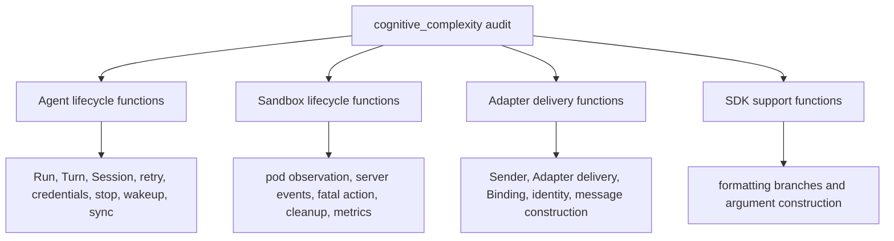

# Cognitive complexity refactor

> **Status:** shipped
> **Updated:** 2026-08-01
> **Vocabulary:** CONTEXT.md

## Current solution

The workspace treats `clippy::cognitive_complexity` as an audit-only lint.

The original pre-rebase audit reported 175 warnings.

Eight functions scored above 100 in that historical audit.

After the PR branch was rebased onto `origin/main`, `sandbox/src/agent/handle/actor.rs` was no longer present because `main` removed the legacy actor path.

The rebased implementation branch reports 168 warnings and zero functions above 100.

The table below records the historical pre-rebase audit context that drove the approved plan.

| Historical score | Historical location | Responsibility mix at the time of the audit |
|---|---|---|
| 331 | `sandbox/src/agent/handle/actor.rs:116` | Agent command admission, Run identity, Session resume, harness lifetime, retries, credential recovery, cancellation, wakeups, event publication, and workspace sync. |
| 279 | `backend/src/sandbox/k8s/pod_watcher.rs:376` | Sandbox observation, server status publication, fatal classification, node archive recording, log capture, metrics, cleanup, and recovery signals. |
| 180 | `crates/claude-agent-sdk/src/transport/subprocess.rs:547` | SDK stdout message logging and formatting for many message variants. |
| 152 | `sandbox/src/agent/coordinator.rs:673` | Agent command loop, harness signals, retry scheduling, credential recovery, Turn state, stop handling, cancellation, and workspace sync. |
| 146 | `backend/src/task/reaper.rs:139` | open Task close, idle Sandbox stop, orphaned Turn repair, activity floor calculation, live-agent safeguards, and cleanup. |
| 132 | `backend/src/adapters/providers/slack/adapter.rs:294` | Sender verification, delivery classification, trigger filtering, access policy, identity mapping, message extraction, and fallback attribution. |
| 105 | `crates/claude-agent-sdk/src/tmux/args.rs:20` | Claude tmux argument construction and warnings for ignored options. |
| 101 | `backend/src/adapters/providers/linear/agent_runtime.rs:1060` | Linear Binding lookup, sibling checks, origin checks, Task close decisions, comments, and external state updates. |

The current shape is:

The common defect is shallow module shape.

The largest functions expose many separate policies through one implementation body.

Tests must drive the whole loop or parser to cover a small policy branch.

That lowers locality and makes a future lint ratchet noisy.

## Planned solution

Refactor the highest cognitive-complexity functions by deepening modules at existing domain seams.

The implementation moves reusable policy into modules with small interfaces.

Runtime loops and external-system adapters stay thin.

The first pass targets the historical functions above 100 that still exist on the rebased branch.

The deleted legacy actor path is not restored.

The first pass does not set `clippy::cognitive_complexity` to deny.

The target system shape is:

```mermaid
flowchart TD
  subgraph AgentRuntime["Agent runtime inside a Sandbox"]
    AgentLoop["command and harness signal loop"] --> TurnModule["Run and Turn transition module"]
    TurnModule --> AgentIntent["ack, retry, publish, stop, upload, schedule wakeup"]
    AgentIntent --> AgentAdapters["AgentState, Agent harness adapter, event publisher, workspace sync"]
  end

  subgraph SandboxRuntime["Sandbox lifecycle observation"]
    PodWatch["pod watch adapter"] --> ObservationModule["Sandbox observation module"]
    ObservationModule --> SandboxIntent["Sandbox events, server events, fatal action, cleanup action"]
    SandboxIntent --> SandboxAdapters["runtime client, event publisher, metrics, log reader"]
  end

  subgraph ReaperRuntime["Task and Sandbox reaping"]
    Snapshot["Task, Turn, Sandbox, and activity snapshot"] --> ReaperModule["Reaper decision module"]
    ReaperModule --> ReaperIntent["close Task, stop Sandbox, repair Turn, skip"]
    ReaperIntent --> ReaperAdapters["repositories, Sandbox runtime, event publisher"]
  end

  subgraph DeliveryRuntime["Adapter delivery admission"]
    SenderPayload["Sender payload"] --> AdmissionModule["Adapter delivery admission module"]
    AdmissionModule --> DeliveryIntent["ignore, pair, route Binding, create inbound message"]
    DeliveryIntent --> DeliveryAdapters["Adapter API, identity lookup, Binding repository, message flow"]
  end

  subgraph SDKSupport["Claude SDK support code"]
    SDKInput["SDK message or options"] --> SDKModule["formatter and argument-builder modules"]
    SDKModule --> SDKOutput["log line or CLI argument vector"]
  end
```

The planned modules are:

| Area | Module interface | Implementation it hides |
|---|---|---|
| Agent runtime | Accept an Agent command or harness signal and return Run or Turn state transitions plus events to publish. | Retry decisions, credential recovery decisions, cancellation side effects, wakeup handling, Run identity, and terminal-state accounting. |
| Sandbox observation | Accept previous and current Sandbox observations plus a small context and return publication and cleanup intent. | error classification, duplicate suppression, server event fan-out, fatal message construction, startup timing, recovery signals, and cleanup decisions. |
| Task reaper | Accept a snapshot of Task, Turn, Sandbox, and activity state and return close, stop, repair, or skip decisions. | activity floors, inactive close policy, idle stop policy, live-agent safeguards, and orphaned Turn repair. |
| Adapter delivery | Accept a normalized Sender delivery and return an admission or ignore decision using Adapter delivery, Binding, and identity vocabulary. | trigger filtering, access policy, identity mapping, tracked Binding routing, fallback attribution, and inbound message construction. |
| SDK support | Accept an SDK message or option set and return a formatted log line or CLI argument vector. | large variant matches and repeated argument pushes. |

### Problem

Maintainers need to reduce cognitive complexity without losing lifecycle behavior.

The current complexity is concentrated in code that guards important domain invariants.

Simple helper extraction would lower the lint score but leave the real policy spread intact.

The problem differs by actor:

| Actor | Problem |
|---|---|
| Runtime maintainer | Small behavior changes require reading a large event loop or parser with unrelated branches. |
| Reviewer | Review must re-check retry, stop, delivery, and cleanup invariants inside broad functions. |
| Test author | Tests often need runtime wiring to exercise a policy branch. |
| Operator | Lifecycle mistakes produce confusing Task, Turn, Sandbox, or Adapter outcomes. |
| Future implementer | Enabling the lint as deny would still create 168 failures after this pass, but no remaining function is above the 100-point ratchet threshold. |

### Behaviour

#### Agent runtime maintainer changes Turn policy

| Given | When | Then |
|---|---|---|
| An Agent harness reports a successful Turn. | The signal reaches the Agent runtime. | The Run and Turn transition module returns the state change, event publication, wakeup handling, and workspace sync intent. |
| An Agent harness reports a retryable failure. | Retry budget remains. | The Run remains attached to the same Turn and the retry intent is returned without publishing a duplicate terminal error. |
| A credential failure is detected. | The current Turn fails. | Credential recovery owns the retry or reconnect-error decision and suppresses the generic failure publication. |
| A stop is requested. | The active Turn is cancelled. | Exactly one stopped outcome is published and the waiting caller is acknowledged after publication is queued. |

#### Sandbox runtime maintainer changes observation policy

| Given | When | Then |
|---|---|---|
| A Sandbox observation changes. | The watcher receives a new observation. | The observation module compares previous and current state and returns the Sandbox and server events to publish. |
| The Sandbox was intentionally stopped. | A terminating observation arrives. | The observation module does not classify the termination as an unexpected failure. |
| The Sandbox fails irrecoverably. | Logs and failure detail are available. | The observation module returns fatal publication intent that carries diagnostic context. |
| A Sandbox recovers after a failed sibling. | The watcher observes the replacement. | Recovery intent is returned without duplicating unrelated lifecycle events. |

#### Reaper maintainer changes cleanup policy

| Given | When | Then |
|---|---|---|
| A Task has been inactive beyond its configured lifetime. | The reaper evaluates the snapshot. | The planner returns a close-Task intent. |
| A Sandbox is idle beyond its configured lifetime. | The reaper evaluates live-agent state. | The planner returns a stop-Sandbox intent only when live work does not protect it. |
| A Turn is stuck active after its safety floor. | The reaper evaluates Sandbox and Agent evidence. | The planner repairs only Turns that are genuinely orphaned. |
| No close, stop, or repair applies. | The reaper evaluates the snapshot. | The planner returns skip or keep with a reason useful for debug logging. |

#### Adapter maintainer changes delivery admission

| Given | When | Then |
|---|---|---|
| A Sender delivers a message. | The Adapter normalizes it. | The admission module returns ignore, pair, route Binding, or create inbound message intent. |
| The delivery is from the Adapter itself. | The admission module evaluates identity and Binding state. | The delivery is ignored or marked as self-originated without creating duplicate Task input. |
| The Sender identity is known. | The delivery should become user input. | The admission module resolves the local user and returns message construction intent. |
| The Sender identity is not known. | The delivery is a top-level human message. | The module returns the existing pairing or rejection behavior. |

#### SDK maintainer changes support formatting

| Given | When | Then |
|---|---|---|
| A supported SDK message is logged. | The formatter receives the message. | One focused formatter branch returns the log detail without changing transport behavior. |
| Claude tmux options are converted to CLI arguments. | The builder receives options. | Local builder helpers produce the same argument vector and warning behavior. |

## Decisions

| # | Decision | Chosen | Rejected because |
|---|---|---|---|
| [1](#1-lint-adoption) | Lint adoption | Do not set `cognitive_complexity` to deny until the above-100 hotspots are handled. | Immediate deny creates broad audit failures and hides architecture work inside lint noise. |
| [2](#2-primary-fix-shape) | Primary fix shape | Deepen modules at existing domain seams. | Helper extraction alone lowers scores while preserving shallow, hard-to-test policy spread. |
| [3](#3-agent-seam) | Agent seam | Put Run and Turn transition policy behind a small state or planner interface. | Per-harness retry and terminal handling would let Claude, Codex, and tmux diverge. |
| [4](#4-sandbox-seam) | Sandbox seam | Make Sandbox observation produce intent before publishing or calling runtime adapters. | Testing through the watcher loop requires live adapter concerns for policy-only cases. |
| [5](#5-adapter-seam) | Adapter seam | Model delivery admission using Sender, Adapter delivery, Binding, and inbound message stages. | A single parse function keeps domain decisions hidden in JSON and early-return branches. |
| [6](#6-sdk-treatment) | SDK treatment | Use mechanical decomposition for formatting and argument construction. | A new trait-object seam would be shallow unless production variants or exercised test doubles justify it. |

### 1. Lint adoption

`clippy::cognitive_complexity` remains an audit lint during the refactor.

The first implementation pass lowers every remaining historical above-100 function on the rebased branch.

Reasoned `#[expect]` may be used only where the remaining function is intentionally a dispatcher and the expectation is self-checking.

| Option | Outcome |
|---|---|
| Audit first, refactor top scores, then ratchet | Keeps CI useful while reducing the highest-risk complexity. |
| Deny immediately | Creates 168 current audit failures and encourages broad suppressions. |
| Ignore the lint after audit | Leaves the same code-navigation and testability problem in place. |

### 2. Primary fix shape

The refactor deepens modules rather than only extracting local helpers.

A deep module has a small interface with meaningful behavior behind it.

The interface becomes the test surface.

| Option | Outcome |
|---|---|
| Deep modules at existing seams | Concentrates policy and makes behavior testable without broad runtime wiring. |
| Helper extraction only | Lowers scores but can keep policy fragmented and hard to reason about. |
| New broad traits for every area | Adds shallow seams before there are multiple real adapters. |

### 3. Agent seam

The Agent runtime uses existing domain terms.

Turn is the persisted lifecycle unit.

Run is the Sandbox runtime identity for one Turn.

Session is the agent CLI conversation that may span many Turns.

The new module owns transition policy across those terms.

It does not make Claude, Codex, and tmux own separate retry semantics.

| Option | Outcome |
|---|---|
| Shared Run and Turn transition module | One place owns retry, terminal states, cancellation, and publication intent. |
| Per-harness policy modules | Harnesses can drift on retry and terminal-event semantics. |
| Keep policy in the event loop | The highest-complexity functions remain the only practical test surface. |

### 4. Sandbox seam

Sandbox observation policy moves behind a module that returns intent.

Adapters execute the intent.

The module can be tested with previous and current observation fixtures.

| Option | Outcome |
|---|---|
| Observation module returns intent | Policy is testable without a live runtime client or event publisher. |
| Watcher loop continues to own policy | Failure, recovery, server event, and cleanup branches remain coupled. |
| Lower-level generic lifecycle module | The code loses Sandbox vocabulary and callers still rebuild the policy. |

### 5. Adapter seam

Adapter delivery admission uses domain terms from `CONTEXT.md`.

Sender is the external system delivering an inbound event.

Adapter delivery is durable work accepted before the Sender is acknowledged.

Binding is the live tie between a Task and an external subject.

| Option | Outcome |
|---|---|
| Delivery admission module | Parsing stays provider-specific while common admission policy becomes local. |
| One large parser per Adapter | Sender, delivery, Binding, identity, and message decisions remain mixed. |
| One generic parser for all Adapters | True Adapter differences become awkward and hidden. |

### 6. SDK treatment

The SDK hotspots are not domain lifecycle modules.

They should be reduced with local structure.

No new external seam is introduced unless a second adapter or exercised test double justifies it.

| Option | Outcome |
|---|---|
| Local formatter and argument-builder modules | Reduces large matches and repeated argument pushes without adding fake abstraction. |
| Trait-object seam | Adds interface surface without real production variation. |
| Leave unchanged | Keeps high lint scores that block the ratchet. |

## Seams and testing

Use the `/codebase-design` vocabulary for the implementation.

The interface is the test surface for each deep module.

| Module | Seam | Adapter | Test surface |
|---|---|---|---|
| Run and Turn transition module | Between Agent runtime loop and lifecycle policy. | AgentState, Agent harness, event publisher, workspace sync. | Feed commands and harness signals, assert returned transition and publication intent. |
| Sandbox observation module | Between runtime watch input and Sandbox lifecycle policy. | runtime client, event publisher, metrics, log reader. | Feed previous and current observations, assert events and cleanup intent. |
| Reaper decision module | Between state snapshot assembly and cleanup actions. | repositories, Sandbox runtime, event publisher. | Feed snapshots, assert close, stop, repair, keep, or skip decisions. |
| Adapter delivery admission module | Between provider-specific parsing and durable delivery or message flow. | Adapter API, identity lookup, Binding repository, message flow. | Feed normalized Sender deliveries, assert admission, ignore, pair, route, or message intent. |
| SDK formatter and argument builder | Inside SDK support code. | None unless existing subprocess or tmux paths require one. | Feed messages and options, assert formatted output or argument vector. |

Depth criteria:

| Criterion | Required result |
|---|---|
| Small interface | Callers do not need to know internal retry branches, fatal-classification branches, identity fallback branches, or formatting branch details. |
| Leverage | One implementation pays back across runtime call sites and tests. |
| Locality | Changing a policy changes the owning module and its tests, not every caller. |
| Real seam | New trait-object seams appear only when production variants or exercised test doubles justify them. |

Verification by area:

| Area | Minimum checks |
|---|---|
| Backend runtime changes | Run owning backend clippy and focused tests for changed modules. |
| Sandbox runtime changes | Run owning sandbox clippy and focused tests for changed modules. |
| Shared SDK changes | Run owning SDK clippy and focused tests for changed modules. |
| Workspace ratchet | Rerun `cargo clippy -q --workspace --message-format=short -- -W clippy::cognitive_complexity` and record the new count. |

## Out of scope

| Item | Reason |
|---|---|
| Setting `clippy::cognitive_complexity` to deny in the first pass | The rebased implementation branch still has 168 audit warnings below the 100-point ratchet threshold. |
| Refactoring every warning above 25 | The first pass targets the highest design pressure. |
| Changing Task, Turn, Run, Session, Sandbox, Adapter delivery, Binding, or Sender vocabulary | The current glossary is sufficient. |
| Rewriting all provider modules into one generic Adapter model | True Adapter differences should stay provider-owned. |
| Creating broad trait-object seams for SDK support code | The SDK hotspots can be reduced with local modules. |
| Ticket breakdown | No `/to-tickets` pass has run. |

## Open questions

None.

## Ticket breakdown

None.
