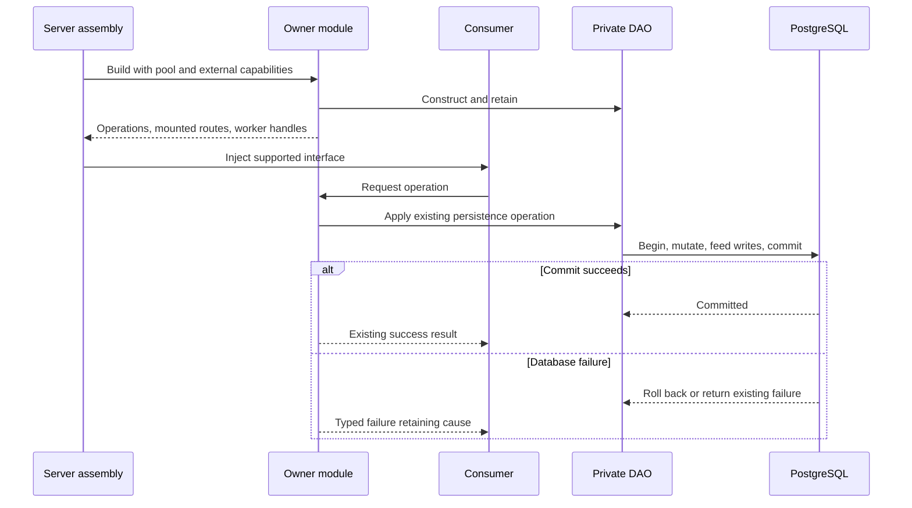
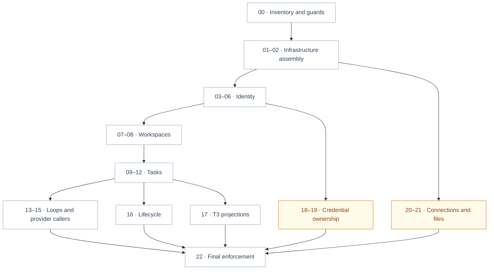

# Migrate persistence by concern across all Rust modules

> **Status:** shipped by PR #788
> **Updated:** 2026-09-09
> **Baseline:** `14a345eb7c975985037ae921d9bf9b5c436dc3d4` (main)
> **Vocabulary:** CONTEXT.md
> **Inventory:** `.plans/dao-persistence-migration-inventory.md`, which stays outside this
> directory because `arch-report --persistence-inventory` writes that path.
> **Implementation:** the task owner authorized slices 18–21 in task `ed4191f5` on 2026-09-08. The design gates on slice 19 and slice 21 stay in force: each one is measured and recorded before the slice lands.

After this ships, another crate cannot import a domain DAO, its PostgreSQL implementation, or its raw SQL helpers, including through test features.

Baseline: main `14a345eb7`, fetched 7 September 2026. Auth-session pilot #771 and privacy follow-up #773 are complete. The working branch was not changed.

#### In scope

- All eight PostgreSQL owners, the T3 projection, server composition and affected peer callers.

- Concern layout, owner assembly, private rows and helpers, test ownership and enforcement.

- Explicit closure of the current shared-DAO exceptions.

#### Out of scope

- New schemas, table drops, wire-format changes or new business behaviour.

- Runtime volumes, archive formats, SDK transcripts and local CLI configuration.

- Eliminating all cross-table SQL or redesigning the transaction model.

**One scope choice changes four ownership slices.** The proposed final target removes all shared domain DAOs. Existing guidance expressly permits four contracts: `FileDao`, `AdapterConnectionDao`, `ProviderTokenDao` and `SecretAuditDao`. Their PostgreSQL implementations can become private first. Removing their contracts needs the ownership changes in slices 18–21. Stopping before those slices is a useful intermediate state, but it does not meet the full target.

## Current solution

| Observed | Consequence | Evidence |
| --- | --- | --- |
| The auth-session module is private. | `Authentication::build` creates one session DAO shared by routes and middleware. The stronger test imports the real private module. | [crates/identity/src/auth/compose.rs:13](https://github.com/soaplabs/moatless/blob/14a345eb7c975985037ae921d9bf9b5c436dc3d4/crates/identity/src/auth/compose.rs#L13) [crates/identity/src/auth/authentication.rs:29](https://github.com/soaplabs/moatless/blob/14a345eb7c975985037ae921d9bf9b5c436dc3d4/crates/identity/src/auth/authentication.rs#L29) |
| Server still constructs the other stores. | `Ports`, `AppState`, public operation constructors and router bounds expose foreign DAOs. Moving only their files cannot enforce privacy. | [crates/server/src/compose/ports.rs:208](https://github.com/soaplabs/moatless/blob/14a345eb7c975985037ae921d9bf9b5c436dc3d4/crates/server/src/compose/ports.rs#L208) [crates/server/src/state.rs:147](https://github.com/soaplabs/moatless/blob/14a345eb7c975985037ae921d9bf9b5c436dc3d4/crates/server/src/state.rs#L147) |
| Concern layouts differ. | Tasks and workspaces largely pair trait and implementation. Identity has split auth files. Lifecycle declares its DAO beside orchestration. Free-function SQL and concrete-only stores also exist. | [crates/identity/src/auth/users.rs:59](https://github.com/soaplabs/moatless/blob/14a345eb7c975985037ae921d9bf9b5c436dc3d4/crates/identity/src/auth/users.rs#L59) [crates/sandbox-control/src/lifecycle/orchestrator.rs:142](https://github.com/soaplabs/moatless/blob/14a345eb7c975985037ae921d9bf9b5c436dc3d4/crates/sandbox-control/src/lifecycle/orchestrator.rs#L142) [crates/loops/src/loops/dao.rs:403](https://github.com/soaplabs/moatless/blob/14a345eb7c975985037ae921d9bf9b5c436dc3d4/crates/loops/src/loops/dao.rs#L403) |
| Privacy checks are narrower than Rust visibility. | The store rule checks `*Dao` references and skips backend and test records. It misses exported raw functions and differently named stores. | [tooling/arch-rules/src/store_privacy.rs:8](https://github.com/soaplabs/moatless/blob/14a345eb7c975985037ae921d9bf9b5c436dc3d4/tooling/arch-rules/src/store_privacy.rs#L8) [crates/tasks/src/event_ingress/outbox.rs:3](https://github.com/soaplabs/moatless/blob/14a345eb7c975985037ae921d9bf9b5c436dc3d4/crates/tasks/src/event_ingress/outbox.rs#L3) |
| Some cross-owner SQL is intentional. | T3 may read foreign tables. Task creation and Sandbox lifecycle share specific table access. Feed writes use the caller’s transaction. | [tooling/arch-rules/src/table_ownership.rs:75](https://github.com/soaplabs/moatless/blob/14a345eb7c975985037ae921d9bf9b5c436dc3d4/tooling/arch-rules/src/table_ownership.rs#L75) [crates/core/src/change_feed/conversation/dao.rs:25](https://github.com/soaplabs/moatless/blob/14a345eb7c975985037ae921d9bf9b5c436dc3d4/crates/core/src/change_feed/conversation/dao.rs#L25) |

The 28-crate research census covered PR #737 at `5b9c37f41`. This plan rechecked persistence paths, construction, public contracts, local guidance and enforcement against the current baseline. It also includes the auth-session privacy and error-test improvements from #773. This is source-based planning, not a runtime certification.

## Decisions

| # | Decision | Proposed choice | Alternative and cost |
| --- | --- | --- | --- |
| 1 | Final privacy target | Compiler-private domain persistence, including backend and test-support consumers. Include slices 18–21. | Retain four named shared contracts. Lower scope, but cross-crate DAO use remains legal. |
| 2 | Internal layout | One concern-owned `dao` module. Trait and Pg implementation share `dao.rs` by default. Use private children only when useful. | Separate global trait/Pg folders spread one concern across layers. A table-per-DAO split can divide atomic writes. |
| 3 | Published interface | Reuse existing operations and ports. Owner-mounted routes handle simple reads. Introduce a trait only with real variants or an exercised fake. | A one-for-one “service” over every DAO changes names without moving ownership. |
| 4 | Transaction and projection exceptions | Retain the explicit core transaction-feed interface and T3 read-only projection. Preserve existing Task/Sandbox SQL allowances. | Removing these changes consistency or ownership beyond this structural migration. |
| 5 | Delivery and approval | 23 bounded slices, one independently buildable PR per slice as a starting estimate. No implementation before the scope choice is approved. | One workspace-wide PR makes caller omissions and behavioural changes harder to isolate. |

Decision 1 changes the “leave these DAOs” instructions. The relevant evidence is below. These are proposals, not recorded user approvals.

| Current instruction or interface | Why closure is more than a rename | Proposed closure |
| --- | --- | --- |
| Workspaces names `ProviderTokenDao`. [crates/identity/AGENTS.md:12](https://github.com/soaplabs/moatless/blob/14a345eb7c975985037ae921d9bf9b5c436dc3d4/crates/identity/AGENTS.md#L12) | `CredentialService` owns persistence, per-key locks and refresh policy. Tasks already owns fan-out and in-flight guards. [crates/workspaces/src/credentials/service.rs:24](https://github.com/soaplabs/moatless/blob/14a345eb7c975985037ae921d9bf9b5c436dc3d4/crates/workspaces/src/credentials/service.rs#L24) [crates/workspaces/src/credentials/codex/refresh.rs:26](https://github.com/soaplabs/moatless/blob/14a345eb7c975985037ae921d9bf9b5c436dc3d4/crates/workspaces/src/credentials/codex/refresh.rs#L26) | Move the pure credential module into identity. Keep task orchestration in tasks. Slice 18. |
| Workspaces names `SecretAuditDao`. [crates/workspaces/src/workspace/credentials/service.rs:31](https://github.com/soaplabs/moatless/blob/14a345eb7c975985037ae921d9bf9b5c436dc3d4/crates/workspaces/src/workspace/credentials/service.rs#L31) | The workspace operation constructs audit rows and decides best-effort handling. A new generic `record(row)` trait would only duplicate the DAO. | Identity owns the typed credential-audit operation, event mapping and error policy. Workspace owns authorization and the pinned row. Slice 19. |
| `AdapterConnectionDao` is shared and driver-free. [crates/adapter-model/src/dao/connection.rs:13](https://github.com/soaplabs/moatless/blob/14a345eb7c975985037ae921d9bf9b5c436dc3d4/crates/adapter-model/src/dao/connection.rs#L13) | Routing and administration have different authority. Providers also own their installation protocol and credentials. | Separate connection lookup and administration from private persistence. Move existing common connection policy with them; retain provider-specific installation logic. Slice 20. |
| Core forbids adding a read port over `FileDao`. [crates/core/AGENTS.md:8](https://github.com/soaplabs/moatless/blob/14a345eb7c975985037ae921d9bf9b5c436dc3d4/crates/core/AGENTS.md#L8) | Metadata, upload compensation, access control and object operations currently have separate owners. [crates/server/src/file_storage/store.rs:31](https://github.com/soaplabs/moatless/blob/14a345eb7c975985037ae921d9bf9b5c436dc3d4/crates/server/src/file_storage/store.rs#L31) | Move the actual file-use workflows beside metadata in core. Add the permitted downward S3 dependency, keeping identity-aware HTTP adaptation in server. Slice 21. |

## Planned solution

#### New

- Owner assembly for every persistence concern.

- Export-aware privacy and positive consumer checks.

- Owned operations for the four shared-store cases.

#### Changes materially

- Rust visibility and cross-crate construction.

- Server state and route dependencies.

- Location of persistence tests and credential/file workflows.

#### Untouched

- HTTP, UI-RPC, gRPC and Adapter behaviour.

- Tables, IDs, serialization and stored data.

- Existing transaction, retry, lock and authorization semantics.

### Problem

Callers can currently depend on persistence details that an owner should be free to change. A private filename does not help when public constructors, re-exports or test features expose the same types.

### Behaviour

| Actor | After the migration | Acceptance |
| --- | --- | --- |
| Server assembly | Supplies infrastructure and foreign capabilities to owner builders. Receives operational handles, routers and supervised worker handles. | No foreign DAO construction or DAO fields. |
| HTTP, UI-RPC, gRPC and Adapter callers | Call the owning operation or an existing published capability. | Same successful result, refusal, side effects and retry policy. |
| Owner tests | Reach private DAO seams from owner-local tests and exercise real PostgreSQL behaviour. | No need to export persistence for testing. |
| Consumer tests | Use published capabilities, exercised fakes or the assembled owner. | Both default and test-support builds reject private persistence imports. |

### Architecture and key flows

#### Current exposed shape

```text
owner/src/concern/
  dao.rs            public trait + public Pg type
  service.rs        public constructor takes DAO
  routes.rs         public FromRef<Arc<dyn Dao>> bound

server/compose/
  constructs Pg type
server/state.rs
  stores Arc<dyn Dao>
```

#### Proposed concern shape

```text
owner/src/concern/
  mod.rs            declarations + supported exports
  compose.rs        builds private dependencies
  dao.rs            private trait, Pg implementation, SQL
  service.rs        or named operation files
  models.rs         domain values, not leaked SQL rows
  error.rs          typed domain error
  routes.rs         optional owner-mounted transport
  handlers.rs       optional transport adaptation

server/compose/
  connects owner handles and external capabilities
```

Files are optional. Small SQL-only concerns keep private free functions. A large DAO may become `dao/mod.rs` plus private named children. Its root contains only declarations and re-exports. A concrete-only DAO stays concrete unless a real test or implementation needs a trait.



- Use `pub(super)`, `pub(in crate::concern)` or `pub(crate)` according to real same-crate callers.

- Public builders may accept the shared pool as infrastructure. Public business operations do not accept a pool, SQL connection or DAO.

- Public operations may return domain values. Keep SQL decoders and persistence-only inputs private; do not rename every type containing `Row`.

- Owner HTTP routers return an already assembled router. Their public generic bounds must not require private DAO extraction.

- Build stateful objects once. Reuse the same caches, locks and notification channels across route and worker handles.

Task, Lifecycle and Binding assembly has a dependency cycle at runtime, not a licence for upward crate dependencies. Construct independent read capabilities first. Then assemble the workflows with the existing Sandbox and Binding ports. Keep any intermediate assembly object opaque; do not publish partially initialized operations or add mutable dependency setters.

### Architecture and key flows: all 28 existing crates

This inventory is included because the requested plan covers all modules. “No migration” means the crate has no application DAO to relocate, not that every unrelated module was reviewed again.

| Crate | Owned concern or role | Migration coverage |
| --- | --- | --- |
| identity | Users, auth sessions, API keys, passwords, account/OIDC transactions, pairing, provider tokens, teams, secrets/audit, Adapter Apps. | Pilot complete; 03–06, 18–19. |
| workspaces | Repositories, workspace placement and Git reconciliation, plugins/skills/activation, pinned credentials; current generic credential workflow. | 07–08; credential owner move in 18. |
| tasks | Task aggregate, follows/read receipts, relations/forks, messages/context/usage, activities, turns, events, ingress outbox, outbound IDs, tags, feedback. | 09–12; file consumer in 21. |
| loops | Loop/config/subscription/schedule aggregate, Bindings, event receipts, task-creation claims, delivery queue. | 13–15; connection/file consumers in 20–21. |
| sandbox-control | Lifecycle persistence, intent, reconciliation and advisory lock implementation. | 16; owner-based fixtures replace foreign test DAOs. |
| core | Pool, migrations, SQL access predicates, file metadata, transactional feeds and Redis infrastructure. | 01 and 21. Pool/migration/feed contracts remain explicit infrastructure. |
| adapter-model | Connection persistence and provider capability vocabulary. | 02 and 20. Preserve driver-free default build. |
| adapter-telegram | Private pairing-request SQL and provider callers. | 15 and 20. Preserve unmounted approval behaviour without enabling it. |
| t3code | Conversation/task/workspace/listing/usage read projections; Redis and memory preview tabs. | 17. Keep foreign reads read-only; consume owner operations for writes. |
| server / moatless-backend | Assembly, cross-domain transport, worker supervision and consumer tests. | Caller migration in every slice; final closure 22. |
| adapter-github-pr | Binding and connection consumer; provider-owned reactions. | 14 and 20. Preserve event and status ordering. |
| adapter-linear | Binding, installation and connection consumer. | 14 and 20. Preserve connection-before-credential setup and turn-gate ownership. |
| adapter-slack | Connection/App/identity/admission consumer; direct SQL in tests only. | 06, 15 and 20 consumer/test updates. |
| adapter-webhook | `LoopReader` and `DeliveryAdmission` consumer. | Retain current interfaces; verify 13 and 15. |
| ports | Cross-crate capabilities and supporting values. | Reuse first. New shared ports must meet the two non-implementing consumer rule and exercised-fake rule. |
| types | Pure shared domain values and `StoreError`. | Only proven shared values move here; no SQL decoder or database dependency. |
| api-schemas | Wire request and response definitions. | No persistence migration or wire change. |
| api-client | Remote HTTP consumer. | No DAO migration. Verify unchanged contracts where affected. |
| sandbox-runtime | Runtime capability declarations and shared storage keys. | No SQL migration. Keep contracts and keys stable. |
| sandbox-proto | gRPC and manifest formats. | No DAO migration. Keep serialized formats stable. |
| sandbox-docker | Docker resources, mount lifecycle and object cleanup. | No DAO migration or runtime behaviour change. |
| sandbox-k8s | Kubernetes resources, leases, PVCs and rescue operations. | No DAO migration or resource ownership change. |
| sandbox | Filesystem sync, transcripts, runtime and remote calls. | No SQL migration. Existing restore work remains outside this plan. |
| s3 | Object bytes and S3 client operations. | No DAO added. Used by core file operations in 21. |
| cli | Local credentials/configuration and remote APIs. | No DAO migration or local-file reorganization. |
| claude-agent-sdk | Agent execution and local transcript/resume behaviour. | No DAO migration. |
| codex-sdk | Excluded standalone SDK crate. | No local DAO migration. Upstream external internals remain unaudited. |
| arch-rules | Visibility, construction, table ownership and dependency checks. | 00, every ratchet step, and 22. |

## Work

Use these as PR-sized starting points, not a promise that all slices have equal cost. Slices 09–11 and 18–21 have the highest consistency or ownership risk. Split a slice if it mixes independent concerns, but keep each private store and all affected callers in the same compilable change.



Amber slices need approval to replace existing shared-store decisions. The graph groups work for navigation; the dependencies below determine merge order.

#### 00 · Establish the migration inventory and guard

**Depends on:** approved scope. **Owners:** arch-rules; no application behaviour change.

- Record each persistence root, actual exports, constructors, peer consumers, test-only consumers and owning SQL tables at the implementation base SHA.

- Keep existing zero-baseline rules at zero. Add a separate export-privacy rule or a migrated-concern ratchet; baseline only newly detected existing exposure.

- Resolve public modules, aliases, globs, re-export chains, traits, type aliases, functions and public signatures. The existing `public_api::exports` scans structs/enums, so it is insufficient unchanged.

- Cover differently named stores, public SQL helpers, tuple fields and public constructors that accept private persistence. Do not classify domain DTOs from suffixes alone.

- Add fixture failures and positive controls for owner assembly, foreign assembly, default features and test-support. Record the exact four temporary shared contracts with closure slices.

**Exit:** a new exposure fails without editing an exception. A concern marked migrated cannot regain its DAO through an alias or feature gate.

[tooling/arch-rules/src/public_api.rs:168](https://github.com/soaplabs/moatless/blob/14a345eb7c975985037ae921d9bf9b5c436dc3d4/tooling/arch-rules/src/public_api.rs#L168)

[tooling/arch-rules/src/composition_root.rs:65](https://github.com/soaplabs/moatless/blob/14a345eb7c975985037ae921d9bf9b5c436dc3d4/tooling/arch-rules/src/composition_root.rs#L65)

#### 01 · Core infrastructure and file-metadata construction

**Depends on:** 00.

- Keep `db/` as the single pool/migration/access-predicate owner. Do not move or duplicate migrations.

- Make `PgFileDao` and its pool field private. Add owner construction for the temporarily shared `FileDao`.

- Inventory and explicitly allow the conversation/listing transaction interface. Keep the caller’s connection and the conversation-before-listing lock order.

- Separate implementation-only feed helpers from the operations other owners actually use. Preserve feed position, retention and environment identity behaviour.

**Exit:** backend no longer constructs `PgFileDao`; feed rollback and lock-order coverage passes. `FileDao` remains a tracked exception until 21.

[crates/core/src/file_storage/dao.rs:23](https://github.com/soaplabs/moatless/blob/14a345eb7c975985037ae921d9bf9b5c436dc3d4/crates/core/src/file_storage/dao.rs#L23)

[crates/core/src/change_feed/listing/dao.rs:22](https://github.com/soaplabs/moatless/blob/14a345eb7c975985037ae921d9bf9b5c436dc3d4/crates/core/src/change_feed/listing/dao.rs#L22)

#### 02 · Adapter connection assembly

**Depends on:** 00.

- Group connection persistence under the connection concern. A private `dao/` split remains appropriate for feature isolation.

- Make `PgAdapterConnectionDao` and its constructor private. Build it inside a `postgres`-gated owner composition function.

- Keep the temporary shared connection contract driver-free. Migrate backend construction and database fixtures together.

- Preserve the default, HTTP, PostgreSQL and test-support feature separation.

**Exit:** the base adapter-model build needs no database driver; external Pg imports fail. The shared trait remains tracked until 20.

[crates/adapter-model/src/dao.rs:3](https://github.com/soaplabs/moatless/blob/14a345eb7c975985037ae921d9bf9b5c436dc3d4/crates/adapter-model/src/dao.rs#L3)

[crates/adapter-model/Cargo.toml:37](https://github.com/soaplabs/moatless/blob/14a345eb7c975985037ae921d9bf9b5c436dc3d4/crates/adapter-model/Cargo.toml#L37)

#### 03 · Identity users and teams

**Depends on:** 00.

- Pair `auth/users.rs` persistence declarations with `users_dao.rs` in a private concern DAO. Keep domain `User` values available where needed.

- Keep `team/dao.rs` private. Owner operations or owner-mounted routes handle administration and membership.

- Construct `UserDirectory` and existing identity capabilities inside identity. Remove public constructors that require `UserDao` or `TeamDao`.

- Migrate server users/teams fields, extractors, admin handlers and mock-based tests. Remove `AuthenticationPorts.users` in this slice; identity supplies the same user handle internally. Preserve bot identity and provider-account behaviour.

**Exit:** user/team DAO imports fail outside identity; existing `UserDisplay`, `UserResolver` and identity consumers still compile.

[crates/identity/src/auth/users.rs:24](https://github.com/soaplabs/moatless/blob/14a345eb7c975985037ae921d9bf9b5c436dc3d4/crates/identity/src/auth/users.rs#L24)

[crates/identity/src/team/dao.rs:13](https://github.com/soaplabs/moatless/blob/14a345eb7c975985037ae921d9bf9b5c436dc3d4/crates/identity/src/team/dao.rs#L13)

[crates/identity/src/ports.rs:1](https://github.com/soaplabs/moatless/blob/14a345eb7c975985037ae921d9bf9b5c436dc3d4/crates/identity/src/ports.rs#L1)

#### 04 · API keys, passwords, account creation, OIDC and device pairing

**Depends on:** 03.

- Give API keys and device pairing concern-local private DAO modules. Keep `DevicePairing` as the public operation, with owner construction.

- Keep password hashing/policy apart from credential SQL and throttling SQL. Move the latter under private password persistence.

- Keep local-account and bot-account multi-table writes together. Keep OIDC transaction consumption atomic and single-use.

- Remove these owner-owned dependencies from public `AuthenticationPorts`. Retain only genuinely external capabilities/configuration.

- Bring raw persistence tests into identity. Preserve HTTP composition tests for login, key auth, device redemption and logout.

**Exit:** API key, password and pairing DAOs are private; duplicate redemption, expired state, concurrent account creation and failed audit cases preserve their outcomes.

[crates/identity/src/auth/account_dao.rs:28](https://github.com/soaplabs/moatless/blob/14a345eb7c975985037ae921d9bf9b5c436dc3d4/crates/identity/src/auth/account_dao.rs#L28)

[crates/identity/src/auth/oidc_dao.rs:59](https://github.com/soaplabs/moatless/blob/14a345eb7c975985037ae921d9bf9b5c436dc3d4/crates/identity/src/auth/oidc_dao.rs#L59)

[crates/identity/src/auth/pairing.rs:98](https://github.com/soaplabs/moatless/blob/14a345eb7c975985037ae921d9bf9b5c436dc3d4/crates/identity/src/auth/pairing.rs#L98)

#### 05 · Provider-token persistence and authentication consumers

**Depends on:** 03–04.

- Colocate provider-token SQL, local row decoding and both current persistence views in one concern. Preserve the distinction between `ProviderTokenAuthDao` and `ProviderTokenDao` until callers prove it unnecessary.

- Make both Pg implementations private. Internalize `ProviderTokenAuthDao` and its auth-state consumers.

- Construct Git-host token resolution and auth refresh dependencies in identity. Keep the temporary workspace `ProviderTokenDao` exception narrowly enumerated.

- Preserve secret-ref PAT storage, App credential stash/restore, refresh token expiry, locks and compare-and-swap.

**Exit:** no external provider-token Pg constructor; no exposed auth-only DAO. Generic workspace credential persistence remains tracked for 18.

[crates/identity/src/auth/provider_token_dao.rs:64](https://github.com/soaplabs/moatless/blob/14a345eb7c975985037ae921d9bf9b5c436dc3d4/crates/identity/src/auth/provider_token_dao.rs#L64)

[crates/identity/src/auth/provider_tokens.rs:57](https://github.com/soaplabs/moatless/blob/14a345eb7c975985037ae921d9bf9b5c436dc3d4/crates/identity/src/auth/provider_tokens.rs#L57)

#### 06 · Secrets, audit assembly and Adapter Apps

**Depends on:** 02, 03 and 05 where credential assembly is shared.

- Build `SecretService` with private secret persistence and owner-private Pg audit construction. Preserve the temporary audit contract for workspace credentials.

- Pair audit trait/implementation under `secret/audit/dao` without exporting SQL row decoding.

- Group `adapter_apps/dao.rs` and `app_dao.rs` under one App persistence owner. Migrate public SQL-function re-exports to owned App operations.

- Keep `AdapterAppReader` and provider-owned installation protocols. Move server and provider database fixtures to owner assembly or owner-local tests.

- Keep cipher absence, encrypted values, audit failure policy and App credential lookup unchanged.

**Exit:** no foreign SecretDao, AdapterAppDao, Pg audit or raw App SQL access. Audit exception remains tracked for 19.

[crates/identity/src/secret/service.rs:202](https://github.com/soaplabs/moatless/blob/14a345eb7c975985037ae921d9bf9b5c436dc3d4/crates/identity/src/secret/service.rs#L202)

[crates/identity/src/adapter_apps/mod.rs:17](https://github.com/soaplabs/moatless/blob/14a345eb7c975985037ae921d9bf9b5c436dc3d4/crates/identity/src/adapter_apps/mod.rs#L17)

#### 07 · Repository and workspace aggregate

**Depends on:** 03 and 06.

- Keep repository/workspace traits and Pg implementations in their current concern DAO files, then narrow visibility.

- Internalize repository SQL convenience functions, shadow-workspace SQL and secret-migration SQL.

- Owner operations construct existing `WorkspaceProjection`, repository readers and provisioners. Keep workspace-plus-placement transactions together.

- Migrate create/update/delete, placement changes, Git sync/reset/override and branch-query entry paths, including backend tests and task creation callers.

- Keep caller-visible patch semantics unchanged. The deferred workspace control-filter/no-op issue needs a separate correctness decision; do not silently fix it during a move.

**Exit:** external callers hold operations or existing workspace ports; shadow creation, placement uniqueness and Git provenance tests pass.

[crates/workspaces/src/repository/dao.rs:27](https://github.com/soaplabs/moatless/blob/14a345eb7c975985037ae921d9bf9b5c436dc3d4/crates/workspaces/src/repository/dao.rs#L27)

[crates/workspaces/src/workspace/dao.rs:87](https://github.com/soaplabs/moatless/blob/14a345eb7c975985037ae921d9bf9b5c436dc3d4/crates/workspaces/src/workspace/dao.rs#L87)

[crates/workspaces/src/ports.rs:33](https://github.com/soaplabs/moatless/blob/14a345eb7c975985037ae921d9bf9b5c436dc3d4/crates/workspaces/src/ports.rs#L33)

#### 08 · Workspace credentials, plugins, skills and activation

**Depends on:** 06–07.

- Construct `WorkspaceCredentialService` inside its owner with private workspace and credential DAOs.

- Keep encryption additional-authenticated-data IDs stable across upsert. Keep metadata reads free of credential values.

- Internalize `PluginDao`; publish existing skill/activation operations and workspace-resolution outputs.

- Move backend plugin-skills and relevant workspace DAO tests into workspaces. Add a discovered `db-tests` feature if required.

- Preserve workspace-over-user-over-global precedence, frontloading, stored skills and missing-provider handling.

**Exit:** no foreign WorkspaceCredentialDao or PluginDao. The audit dependency is the only remaining persistence contract in pinned credentials.

[crates/workspaces/src/workspace/credentials/service.rs:31](https://github.com/soaplabs/moatless/blob/14a345eb7c975985037ae921d9bf9b5c436dc3d4/crates/workspaces/src/workspace/credentials/service.rs#L31)

[crates/workspaces/src/plugin/dao.rs:11](https://github.com/soaplabs/moatless/blob/14a345eb7c975985037ae921d9bf9b5c436dc3d4/crates/workspaces/src/plugin/dao.rs#L11)

#### 09 · Task aggregate, relations and forks

**Depends on:** 07–08.

- Build the private task graph inside tasks. Publish existing Task read/access/creation/closing capabilities from that graph.

- Move DAO-bearing task operation arguments into an owned operation handle. Migrate HTTP, T3 command adapters, Adapter creation, reaper and background consumers.

- Keep relations and fork persistence under their respective task concerns. Remove the Pg/DAO re-exports from `task/fork.rs` and relations facades.

- Preserve Task/Sandbox creation, workspace checks, follow/read receipts, relation semantics, fork cuts and same-Sandbox membership rules.

- Keep task creation’s non-atomic external provisioning and existing compensation explicit. Do not pretend the whole workflow is one database transaction.

**Exit:** no external TaskDao/TaskForkDao/TaskRelationDao. The Task graph can be composed with published Sandbox and Binding capabilities.

[crates/tasks/src/task/dao.rs:94](https://github.com/soaplabs/moatless/blob/14a345eb7c975985037ae921d9bf9b5c436dc3d4/crates/tasks/src/task/dao.rs#L94)

[crates/tasks/src/task/fork.rs:27](https://github.com/soaplabs/moatless/blob/14a345eb7c975985037ae921d9bf9b5c436dc3d4/crates/tasks/src/task/fork.rs#L27)

[crates/tasks/src/task/service.rs:132](https://github.com/soaplabs/moatless/blob/14a345eb7c975985037ae921d9bf9b5c436dc3d4/crates/tasks/src/task/service.rs#L132)

#### 10 · Messages, activities, transcript copies and outbound IDs

**Depends on:** 09.

- Keep message SQL, message-context/usage writes and fork-copy SQL private to their owning concerns.

- Internalize `task_activities/dao.rs` free functions and `task/outbound_events_dao.rs`. Remove public SQL re-export facades.

- Assemble `MessageSendService`, `Transcript` and `Activities` inside tasks. Migrate all public helpers that accept a MessageDao or a pool.

- Keep message/usage/activity/feed writes in their existing transaction. Preserve IDs, deduplication and position ordering.

- Move backend message persistence tests into tasks. Consumer tests use TranscriptAppend, MessageAcceptor and ActivitySource or the assembled owner.

**Exit:** a foreign caller cannot call activity/outbound SQL without a `Dao` suffix either. Duplicate events, empty blocks and partial writes retain their outcomes.

[crates/tasks/src/task_activities/dao.rs:62](https://github.com/soaplabs/moatless/blob/14a345eb7c975985037ae921d9bf9b5c436dc3d4/crates/tasks/src/task_activities/dao.rs#L62)

[crates/tasks/src/task/outbound_events.rs:3](https://github.com/soaplabs/moatless/blob/14a345eb7c975985037ae921d9bf9b5c436dc3d4/crates/tasks/src/task/outbound_events.rs#L3)

[crates/tasks/src/message/service.rs:1](https://github.com/soaplabs/moatless/blob/14a345eb7c975985037ae921d9bf9b5c436dc3d4/crates/tasks/src/message/service.rs#L1)

#### 11 · Turns, task events and durable ingress

**Depends on:** 09–10.

- Build private turn/event DAOs and publish existing TurnLedger capabilities and owned event operations.

- Group `outbox_dao.rs` beneath the ingress concern and internalize `PgIngressOutbox`, claims and persistence helpers.

- Replace backend outbox access with an owned admission/consumer operation. Keep supervision, cancellation and worker termination visible to server startup.

- Migrate gRPC admission, event-handler processing, reaper and reconciliation consumers. Preserve acknowledgement only after durable admission.

- Run claim, lease/retry, restart replay, poison-payload and duplicate-completion coverage.

**Exit:** server carries no IngressOutbox persistence contract, TaskTurnDao or TaskEventDao. Claim/ack/failure ordering is unchanged.

[crates/tasks/src/event_ingress/outbox.rs:3](https://github.com/soaplabs/moatless/blob/14a345eb7c975985037ae921d9bf9b5c436dc3d4/crates/tasks/src/event_ingress/outbox.rs#L3)

[crates/server/src/state.rs:220](https://github.com/soaplabs/moatless/blob/14a345eb7c975985037ae921d9bf9b5c436dc3d4/crates/server/src/state.rs#L220)

#### 12 · Tags and feedback

**Depends on:** 09–10.

- Keep tag/feedback DAOs private. Internalize pool convenience wrappers, including those not currently gated for tests.

- Use TagCatalog and owner-mounted tag routes. Retain feedback validation and latest-activity selection in the existing feedback operation.

- Migrate backend fields, extractor implementations, attachment/fork tag callers and direct DAO tests.

- Preserve scope checks, missing-target behaviour, feedback surface validation and best-effort tag propagation.

**Exit:** no foreign TagDao/FeedbackDao; owner tests cover domain behaviour and real persistence.

[crates/tasks/src/tag/dao.rs:1](https://github.com/soaplabs/moatless/blob/14a345eb7c975985037ae921d9bf9b5c436dc3d4/crates/tasks/src/tag/dao.rs#L1)

[crates/tasks/src/feedback/service.rs:1](https://github.com/soaplabs/moatless/blob/14a345eb7c975985037ae921d9bf9b5c436dc3d4/crates/tasks/src/feedback/service.rs#L1)

#### 13 · Loop aggregate, configuration, subscriptions and schedules

**Depends on:** 09 and 12.

- Keep the four-table Loop aggregate together. Make the concrete `LoopDao` private without adding a token trait.

- Move business-facing create/update/query/reconcile entry points behind owned Loop operations and existing LoopReader capabilities.

- Keep schedule firing, Git-declared sync, unmanaged overrides and source reconciliation in their existing operation owners.

- Migrate backend Loop state, cron/sync assembly and provider callers. Migrate Telegram's `pairing/approval.rs` caller to Loop-owned operations in this same slice. Remove persistence-only Loop row exports after mapping public results.

- Preserve aggregate write atomicity, ongoing-task reuse and partial-update model validation.

**Exit:** LoopDao is private, including its Telegram approval caller. Remove the Telegram LoopDao exception in this slice. Do not defer that caller change to slice 15.

[crates/loops/src/loops/dao.rs:403](https://github.com/soaplabs/moatless/blob/14a345eb7c975985037ae921d9bf9b5c436dc3d4/crates/loops/src/loops/dao.rs#L403)

[crates/loops/src/loops/sync/compose.rs:1](https://github.com/soaplabs/moatless/blob/14a345eb7c975985037ae921d9bf9b5c436dc3d4/crates/loops/src/loops/sync/compose.rs#L1)

#### 14 · Binding lifecycle and its provider callers

**Depends on:** 09, 13.

- Move the real common binding lifecycle work into owned Binding operations: upsert decisions, routing context, status persistence and deactivation.

- Keep provider-specific reactions in GitHub PR and Linear. Move their DAO access to those Binding operations in the same PR.

- Construct BindingDirectory and BindingProbe internally. Keep task-facing TaskBindings on its existing lower-band seam.

- Internalize `TaskBindingDao`, `PgTaskBindingDao`, row shapes and public functions that accept the DAO.

- Preserve Linear turn-gate ordering, GitHub close/merge audience rules, status refresh behaviour and multi-binding close semantics.

**Exit:** remove the GitHub PR and Linear TaskBindingDao exceptions. A renamed CRUD wrapper does not count as closure.

[crates/loops/src/bindings/ports.rs:1](https://github.com/soaplabs/moatless/blob/14a345eb7c975985037ae921d9bf9b5c436dc3d4/crates/loops/src/bindings/ports.rs#L1)

[crates/loops/src/bindings/runtime.rs:861](https://github.com/soaplabs/moatless/blob/14a345eb7c975985037ae921d9bf9b5c436dc3d4/crates/loops/src/bindings/runtime.rs#L861)

#### 15 · Delivery, event receipts, creation claims and Telegram pairing

**Depends on:** 02, 11 and 13–14. Slice 13 has already migrated Telegram's Loop interface.

- Keep `DeliveryAdmission` public, build its private persistence and worker inside loops, and remove AdapterDeliveryStore compatibility exports.

- Keep event receipts and task-creation claims beside their firing operation. Remove public EventReceiptDao assembly; a concrete internal implementation is sufficient if no exercised fake needs the trait.

- Keep Telegram pairing SQL as private free functions. Retain the Loop-owned operations for ownership/configuration changes introduced in slice 13.

- Retain the currently uncalled approval code without registering new routes or deleting it. Characterize its separate “mark approved” then “update allowlist” writes; do not claim atomicity.

- Move raw persistence fixtures to owners. Preserve durable admission, retry budgets, dedup keys, claim release and supervised worker shutdown.

**Exit:** no foreign delivery/receipt store, raw pairing helper or LoopDao. Existing admission fakes still test the public provider seam.

[crates/loops/src/adapters/delivery/mod.rs:1](https://github.com/soaplabs/moatless/blob/14a345eb7c975985037ae921d9bf9b5c436dc3d4/crates/loops/src/adapters/delivery/mod.rs#L1)

[crates/loops/src/loops/firing/receipts_dao.rs:7](https://github.com/soaplabs/moatless/blob/14a345eb7c975985037ae921d9bf9b5c436dc3d4/crates/loops/src/loops/firing/receipts_dao.rs#L7)

[crates/adapter-telegram/src/pairing/approval.rs:28](https://github.com/soaplabs/moatless/blob/14a345eb7c975985037ae921d9bf9b5c436dc3d4/crates/adapter-telegram/src/pairing/approval.rs#L28)

#### 16 · Sandbox Lifecycle and locking

**Depends on:** 09–11 and 07–08.

- Move LifecycleDao out of `orchestrator.rs` into private lifecycle persistence beside PgLifecycleDao.

- Keep advisory-lock SQL private under `lifecycle/dao/` or the existing private `db/` owner. Separate lock contract/guard from orchestration only where it improves responsibility.

- Move PgLifecycleDao/PgLifecycleLock construction, Lifecycle wiring and Reconciler dependency wiring into sandbox-control composition.

- Publish Lifecycle operations and existing observation/start/stop capabilities. Keep worker start/stop and task handles available to server supervision.

- Replace foreign DAO construction in provisioning tests with owner-built operations. Preserve missing-row refusal, operation-generation compare-and-clear, leases and detached operation context.

**Exit:** LifecycleDao and PgLifecycleLock cannot be imported by backend. Existing Task/Sandbox SQL allowances remain explicit; this slice does not redesign table ownership.

[crates/sandbox-control/src/lifecycle/orchestrator.rs:142](https://github.com/soaplabs/moatless/blob/14a345eb7c975985037ae921d9bf9b5c436dc3d4/crates/sandbox-control/src/lifecycle/orchestrator.rs#L142)

[crates/sandbox-control/src/lifecycle/db/lock.rs:26](https://github.com/soaplabs/moatless/blob/14a345eb7c975985037ae921d9bf9b5c436dc3d4/crates/sandbox-control/src/lifecycle/db/lock.rs#L26)

[crates/server/src/compose/ports.rs:392](https://github.com/soaplabs/moatless/blob/14a345eb7c975985037ae921d9bf9b5c436dc3d4/crates/server/src/compose/ports.rs#L392)

#### 17 · T3 read projections and preview tabs

**Depends on:** 08–11 and 16 for final assembly. Most private layout work can proceed independently.

- Put conversation/task/workspace projection contracts, SQL and decoders behind private T3 concern modules. Keep one PgConversationDao implementing the existing internal read views.

- Construct conversation, listing and usage persistence inside T3. Remove external PgConversationDao/PgUsageDao construction and DAO-valued fields from UiRpcDependencies.

- Keep ActivitySource reads on the published task capability. Keep T3-specific foreign SQL joins read-only.

- Make preview-tab DAO, Redis and memory implementations internal. The T3 builder selects the implementation and returns the subscriber handle for supervision.

- Keep public UI-RPC routes, snapshot/feed operations and startup-script handles. Any backend snapshot call gets an operational T3 handle, not a DAO.

**Exit:** no external T3 persistence imports. Transcript/listing output, authorization, reconnect cursors, usage buckets and Redis-fallback semantics are unchanged.

[crates/t3code/src/compose.rs:181](https://github.com/soaplabs/moatless/blob/14a345eb7c975985037ae921d9bf9b5c436dc3d4/crates/t3code/src/compose.rs#L181)

[crates/t3code/src/preview_tabs.rs:1](https://github.com/soaplabs/moatless/blob/14a345eb7c975985037ae921d9bf9b5c436dc3d4/crates/t3code/src/preview_tabs.rs#L1)

[crates/t3code/src/usage/dao.rs:9](https://github.com/soaplabs/moatless/blob/14a345eb7c975985037ae921d9bf9b5c436dc3d4/crates/t3code/src/usage/dao.rs#L9)

#### 18 · Close the provider-token exception through ownership

**Depends on:** 05, 08 and 11. **Approval required:** replace the identity instruction to leave ProviderTokenDao shared.

- Move `workspaces::credentials` persistence/refresh policy into a proposed `identity::credentials` concern, including per-key mutexes, Codex OAuth refresh logic, outcomes and errors.

- Keep `workspace::credentials` pinned-credential ownership in workspaces. These are different concerns.

- Keep CredentialSync’s in-flight guards, precedence and Sandbox broadcast in tasks. It calls identity’s credential operations.

- Internalize ProviderTokenDao and Codex persistence callback vocabulary. Re-export only non-persistence compatibility paths when needed during consumer migration.

- Verify one shared lock cache, cross-replica database locking/CAS, permanent refresh failure markers, transient stale fallback, malformed blobs and broadcast only on persisted rotation.

**Exit:** workspaces has no identity DAO dependency; remove the ProviderTokenDao exception and its stale local instruction in the same PR.

#### 19 · Close the secret-audit exception

**Depends on:** 06 and 08. **Approval required:** replace the instruction to leave SecretAuditDao shared.

- Move audit event construction, identity-owned fields and common error reporting into the existing identity secret concern.

- Publish a concrete typed audit operation for credential outcomes; input describes actor, subject, action and result, not a SQL row. Do not add a second generic `record(row)` trait.

- Keep workspace authorization, encryption binding to the pinned row ID and credential persistence in workspaces. Invoke audit at the same success/refusal points.

- Preserve best-effort audit where current operations tolerate failure. Preserve transactional audit where an operation already rolls back on audit failure.

- Move database audit assertions into identity; workspace integration coverage verifies emitted outcomes through the public operation.

**Exit:** SecretAuditDao, PgSecretAuditDao and audit row decoding are private. The public operation owns event semantics and failure handling, not just the DAO’s name.

Design review gate: if the proposed operation cannot absorb existing audit policy and becomes only a forwarding wrapper, stop this slice. Keep the explicit exception pending an approved owner change rather than declare it removed.

#### 20 · Close the connection-DAO exception

**Depends on:** 02, 06 and 14–15.

- Create a connection concern in adapter-model with private persistence and owner-built connection operations.

- Separate viewer-scoped administration from trusted Adapter routing lookups. Their inputs and authority must remain distinguishable.

- Move common connection selection and write policy out of callers where it already exists. Provider-specific configuration and installation orchestration remain in each provider.

- Use driver-free capability contracts only where providers need interchangeable implementations. Keep the Pg build gated; a fake must exercise any new trait.

- Migrate every provider and server connection consumer together. Preserve external-account/scope lookup distinctions and provider-specific connection-before-credential ordering.

**Exit:** remove the universal AdapterConnectionDao exception. The new interface must hide persistence inputs and caller ordering requirements, not reproduce its seven methods under another name.

#### 21 · Close the file-metadata exception with file operations

**Depends on:** 01, 10, 14 and 17. **Approval required:** replace core’s instruction to share FileDao directly.

- Move server’s existing upload/read/delete workflows into `core::file_storage`, beside private metadata persistence. Add core’s downward S3 dependency after checking feature/build cost.

- Keep identity-aware HTTP handlers and OpenAPI response adaptation in server. Core operations use ScopeContext and domain values, not AuthUser or API schema dependencies.

- Publish owned file operations and the batch attachment-resolution capability needed by tasks and loops. Move their shared metadata/authorization/object-key assembly with it.

- Separate private FileMetadata row decoding from the values callers need. Replace backend, task enrichment and binding outbound FileDao consumers and mocks.

- Preserve upload compensation, download/delete authorization, provided file IDs, no-S3 failures and existing partial-delete behaviour.

**Exit:** FileDao/PgFileDao are private; no read-port wrapper remains beside a public DAO. Metadata and object-use policy have one operational owner.

Build gate: core is widely shared. Compare the isolated dependency graph and clean build cost before accepting S3 there. If that cost is unacceptable, a dedicated file owner is a separate scope decision, not an unannounced new crate.

#### 22 · Remove compatibility paths and enforce the final target

**Depends on:** all preceding slices, including the four approved closures.

- Remove foreign DAO fields and FromRef implementations from Ports/AppState, old public DAO constructors and raw helper facades. Keep only supported owner interfaces.

- Remove backend’s blanket foreign-store exemption. Reject construction of foreign persistence anywhere, including inside a file named `dao.rs`.

- Bring the export-privacy migration baseline to zero. Keep exact infrastructure feed/pool and read-projection exceptions; do not clear unrelated architectural debt.

- Remove obsolete test-support mocks, feature forwarding, dependency edges and deferred entries that this work actually resolves.

- Run the full applicable local verification matrix and consumer compile controls. Compare the before/after public surface and contract outputs.

**Exit:** all 28 crates are accounted for; no domain DAO, SQL row decoder, raw domain SQL helper or concrete persistence implementation crosses crates. The only direct transaction interface is documented infrastructure. If any shared-DAO closure is deferred, report the target as incomplete.

[crates/server/src/state.rs:290](https://github.com/soaplabs/moatless/blob/14a345eb7c975985037ae921d9bf9b5c436dc3d4/crates/server/src/state.rs#L290)

[tooling/arch-rules/src/store_privacy.rs:50](https://github.com/soaplabs/moatless/blob/14a345eb7c975985037ae921d9bf9b5c436dc3d4/tooling/arch-rules/src/store_privacy.rs#L50)

## Interfaces and contracts

| Consumer | Current interface | Preserved promise / replacement | Status |
| --- | --- | --- | --- |
| server auth composition | `Authentication` [crates/identity/src/auth/authentication.rs:32](https://github.com/soaplabs/moatless/blob/14a345eb7c975985037ae921d9bf9b5c436dc3d4/crates/identity/src/auth/authentication.rs#L32) | Same routes and middleware. Move identity-owned inputs inside its builder. | Rust construction changes. |
| sandbox-control, loops and server | `WorkspaceResolver`, `TaskReader`, `ActivitySource` [crates/workspaces/src/ports.rs:63](https://github.com/soaplabs/moatless/blob/14a345eb7c975985037ae921d9bf9b5c436dc3d4/crates/workspaces/src/ports.rs#L63) [crates/tasks/src/ports.rs:51](https://github.com/soaplabs/moatless/blob/14a345eb7c975985037ae921d9bf9b5c436dc3d4/crates/tasks/src/ports.rs#L51) | Keep capability behaviour; their owner builds private adapters. | Contracts preserved. |
| GitHub PR and Linear | `TaskBindingDao` [crates/loops/src/bindings/ports.rs:7](https://github.com/soaplabs/moatless/blob/14a345eb7c975985037ae921d9bf9b5c436dc3d4/crates/loops/src/bindings/ports.rs#L7) | Owned Binding lifecycle operation replaces direct persistence access. Provider reactions stay local. | Rust interface breaks in one PR. |
| all inbound Adapters | `DeliveryAdmission` [crates/loops/src/adapters/delivery/dao.rs:353](https://github.com/soaplabs/moatless/blob/14a345eb7c975985037ae921d9bf9b5c436dc3d4/crates/loops/src/adapters/delivery/dao.rs#L353) | Acknowledged success means durable admission. Existing provider seam remains. | Contract preserved. |
| server T3 composition | `UiRpcDependencies` [crates/t3code/src/compose.rs:181](https://github.com/soaplabs/moatless/blob/14a345eb7c975985037ae921d9bf9b5c436dc3d4/crates/t3code/src/compose.rs#L181) | Database/projection construction moves inside T3; routes and startup-script supervision remain available. | Rust construction changes. |
| HTTP, CLI, T3 client, Sandbox gRPC | Existing transport requests, responses and events. | No route, payload, event string, protobuf discriminant or persisted ID change. | Unchanged. |

Proposed internal operation names and private file splits can change during implementation. Consumer behaviour, ownership, privacy and transaction promises are the acceptance criteria. Any new shared port must satisfy current dependency bands and `port-admission`; do not put a server-only operation in the ports crate.

[tooling/arch-rules/src/port_admission.rs:29](https://github.com/soaplabs/moatless/blob/14a345eb7c975985037ae921d9bf9b5c436dc3d4/tooling/arch-rules/src/port_admission.rs#L29)

## Failure, safety and recovery

| Condition | State and caller-visible result to preserve | Verification requirement |
| --- | --- | --- |
| PostgreSQL operation fails. | Atomic operations leave no partial rows. Non-atomic workflows keep their existing compensation. Preserve underlying error sources and transport redaction. | Force a failure after the first write; assert rollback or the exact existing partial state. Exercise a closed pool without a live database. |
| Concurrent credential refresh or store. | One shared per-key lock and current database/CAS protection prevent lost updates. Transient refresh can retain stale credentials; permanent failure keeps its marker. | Race two clients and two owner instances. Check rotation, dedup and broadcast outcomes. |
| Message/activity/turn mutation fails. | The domain write and its feed entry stay in the same transaction. Conversation counter precedes the global listing counter. | Rollback and concurrent writer tests; no visible feed entry without its domain write. |
| Ingress or delivery admission fails. | No success acknowledgement without durable admission. A retry remains real; claim release and duplicate semantics remain unchanged. | Database outage, duplicate delivery, worker crash/restart, expired claim and cancellation cases. |
| Sandbox state or operation generation differs. | Missing intent is an error where current Lifecycle requires it. An old completion cannot clear a replacement operation. | Missing-row, overlapping operation, lease loss and late-completion tests. |
| Upload metadata fails after S3 succeeds. | Attempt object cleanup; return the original metadata error even if cleanup also fails. | Exercise both metadata and cleanup failure. Retain the warning about leftover bytes. |
| Delete metadata fails after object deletion. | The current order can leave a metadata row pointing to missing bytes. Preserve the result during relocation; do not reverse the order from a contradictory comment. | Characterize the actual state and retry result. A semantic fix requires its own change. |
| Workspace credential audit fails. | Current best-effort paths still return their original operation result. Auth-session transactional audit remains fail-closed. | Separate these policies in tests; do not standardize them accidentally. |
| Telegram allowlist update fails after approval. | The current unmounted workflow can leave approved pairing without the config update. Do not describe it as atomic or enable it. | Characterize this failure at the replacement Loop operation. |
| Redis preview state is unavailable. | T3’s configured fallback and subscriber supervision remain unchanged. Other RPC operations continue to work. | Redis/memory conformance and startup fallback coverage. |
| Refactor needs rollback. | Each PR is a source-only deployment change with no data migration. Roll back its binary; when reverting source, revert dependent slices first. | Do not introduce dual-write formats, runtime cutover flags or background data rewrites. |

Authorization coverage must include missing, unreadable, readable-but-uncontrollable and fully authorized subjects. Include empty input, no-op patches, duplicate IDs, self-relations, expired credentials and equal timestamps where the owning operation distinguishes them.

## Testing and verification

#### Human review

- The public operation removes caller knowledge of persistence; it is not a DAO rename.

- Every old entry path appears in the slice’s caller map.

- A move preserves transaction, authorization and failure ownership.

- A new dependency or shared contract has an actual consumer and fits its band.

#### Executable acceptance

- Foreign DAO and raw helper access fails in default and test-support configurations.

- Positive examples compile against the supported interface.

- Owner PostgreSQL tests and cross-domain composition tests retain behaviour.

- Architecture violations do not grow; migration-specific exposure reaches zero.

- Wire and stored formats remain unchanged.

### Move tests with the owning slice

| Coverage | Where it belongs | Gate |
| --- | --- | --- |
| SQL mapping, transactions, uniqueness, CAS, claims and lock behaviour. | Owner-local test modules, including private DAO tests. Migrations stay in core. | Run the owning package’s real database tier, not only compilation. |
| Operation policy and error propagation. | Owner module tests at its published operational seam; private DAO fakes only when exercised. | Include denial, missing data, partial failure and concurrency relevant to the concern. |
| HTTP/RPC mounting, middleware and cross-domain orchestration. | Backend’s existing integration_data, integration_adapters and integration_surface targets. | Do not move genuine composition tests into a lower owner. |
| Foreign consumer privacy. | Compile-fail tests or small consumer fixtures plus positive controls. | Target a real private module or field. Verify the intended diagnostic; a missing obsolete path is not proof of privacy. |
| Driver/feature isolation. | Isolated core, ports and adapter-model configurations. | Do not rely on workspace dev-dependency feature unification. |

Current database coverage is split across owners and backend. Identity, tasks, loops, sandbox-control and Telegram declare database tiers. Add a `db-tests` tier to another owner only when moving real PostgreSQL coverage there. T3’s existing inline SQL tests must be inspected before selecting its tier. The CI metadata loop discovers features and compiles gated tests; its no-run step is not evidence that database assertions executed.

[docs/deferred-changes.md:342](https://github.com/soaplabs/moatless/blob/14a345eb7c975985037ae921d9bf9b5c436dc3d4/docs/deferred-changes.md#L342)

[.github/workflows/ci.yml:499](https://github.com/soaplabs/moatless/blob/14a345eb7c975985037ae921d9bf9b5c436dc3d4/.github/workflows/ci.yml#L499)

### Implementation verification protocol

For each slice, define the failing privacy fixture or reproducible public-surface check before editing. Run the root-mandated workspace Clippy floor and every prescribed package/feature line applicable to the changed crates. Run scoped package tests and real owner database tests. Follow the Rust skill’s exact invocation rules; do not use `cargo check`, workspace-wide tests or extra ad-hoc Clippy variants.

Keep a per-PR evidence record: base SHA, moved files, changed public paths, consumer list, command results, executed database-test count and any blocked tier. Check storage before full sandbox builds and between commits. Do not reuse one target directory across worktrees. Source-only moves still need verification.

### Final acceptance

| Given | When | Then |
| --- | --- | --- |
| A foreign crate with default or test-support features. | It imports a domain DAO, Pg implementation, SQL row or raw helper through any supported public path. | Compilation or the export rule rejects that persistence exposure; positive owner operations compile. |
| An owner-built operation shared by routes and workers. | Two consumers act concurrently. | They use the intended shared caches/locks and preserve database concurrency semantics. |
| A moved domain test suite. | The owner database tier runs. | It executes the transferred assertions without exporting the private DAO. |
| A backend assembled from all migrated owners. | Each transport and worker entry path runs. | It retains its previous success, refusal, acknowledgement and supervision behaviour. |
| The four shared-DAO closure slices are complete. | The architecture checks inspect the full workspace. | No backend exemption or shared domain DAO remains. Pool/feed infrastructure and T3 foreign reads are explicit, separate policies. |

## Open questions

**Approval gate:** include the four ownership changes in 18–21, or stop at the intermediate shared-contract state. The full target assumes they are included. Current local guidance must change with the corresponding approved implementation, not before it.

Slice-level design gates remain visible: typed audit depth, connection-operation depth and core’s S3 build cost. They require concrete interface review before those slices start. This is a full migration roadmap, not a claim that those new interfaces have already been implemented or validated.

Known unrelated correctness work stays separate: workspace control-filter/no-op responses, Telegram approval atomicity, file-delete partial state and existing Lifecycle test flakiness. Recheck and update only deferred entries whose actual anchor or status changes.

## Implementation procedure for every slice

1. Fetch current main and compare its persistence inventory with the pinned baseline.
2. Read the root and nearest AGENTS.md files, Rust file responsibilities and applicable deferred changes.
3. Build a caller matrix before editing: symbol, owning concern, production callers, test callers, constructors, exported paths and replacement interface.
4. Define the failing privacy fixture and the behaviour checks that must stay green.
5. Move implementation files by concern without changing queries or transaction order.
6. Build the private dependency graph inside the owning crate.
7. Migrate all public constructor arguments, route bounds, state fields, worker dependencies and peer callers that expose that concern.
8. Move persistence tests to the owner and replace foreign DAO mocks with public-interface tests.
9. Remove the old persistence re-exports in the same PR. An alias back to a DAO is not compatibility.
10. Narrow visibility and remove the exact migration-baseline or exception entries resolved by the slice.
11. Run the applicable commands below and record which tests actually executed.
12. Review the diff for behavioural changes, especially error mapping, row cardinality and access filters.
13. Submit one independently buildable PR. Its body distinguishes file moves from interface and behaviour-sensitive edits.

These procedure steps are the same for every slice. A slice may change several crates when its owner and consumers must migrate together.

### Visibility and public-surface review

| Surface | Allowed after its slice | Must remain private |
| --- | --- | --- |
| Owner assembly | Infrastructure/configuration inputs and foreign capability inputs | A public constructor taking or returning the owner's DAO |
| Owner routes | A router with owner state already assembled | A public generic bound requiring foreign state to yield a private DAO |
| Domain operations | Domain inputs, domain results and meaningful errors | SQL connections, transactions, persistence patch structs and raw row decoders |
| Cross-crate capabilities | Existing admitted contracts and supporting values | One shared generic CRUD trait per table |
| Tests | Published operations, capability fakes and owner-built fixtures | Public DAO mocks, Pg constructors or unrestricted raw-SQL helpers under test-support |
| Infrastructure | Explicit pool, migrations, access predicates and transactional feed primitives | An infrastructure exception used to expose unrelated domain persistence |

Keep same-crate SQL operations that share a transaction at a common private persistence owner.
Do not force a trait onto an existing free-function implementation.
Do not rename a concrete store merely to bypass the architecture rule.

### Construction-cycle handling

Task creation needs Sandbox and Binding capabilities, while their implementations can need Task reads.
Preserve the current downward Cargo dependencies.

1. The Task owner builds the persistent graph and returns the independent read/access capabilities.
2. Sandbox and Binding owners assemble against those capabilities.
3. Task workflow assembly consumes the resulting external capabilities.
4. The host starts workers only after all required operations exist.

An owner-specific assembly object may hold the private graph between these steps.
That object exposes neither persistence nor a callable partially initialized operation.
Use a consuming assembly method or separate complete handles, not mutable dependency setters.
The exact handle names are implementation details; preserve this initialization invariant.

## Verification commands

The root AGENTS.md is the authority if its commands change after this plan's baseline.
The following commands match the inspected baseline.
No Rust code changed when this plan was written, so these are implementation gates, not claimed results.

### Mandatory Clippy configurations

Every Rust implementation slice runs the workspace floor:

```bash
cargo clippy --workspace --all-targets -- -D warnings
```

Run both core lines when core changes:

```bash
cargo clippy -p moatless-core --all-targets --features openapi -- -D warnings
cargo clippy -p moatless-core --all-targets -- -D warnings
```

Run both ports lines when ports changes:

```bash
cargo clippy -p moatless-ports --all-targets --all-features -- -D warnings
cargo clippy -p moatless-ports --all-targets --no-default-features -- -D warnings
```

Run the backend gated line when backend changes:

```bash
cargo clippy -p moatless-backend --all-targets --features db-tests -- -D warnings
```

Do not add a different package-specific Clippy command to replace the floor.
Do not run `cargo check`.

### Scoped tests and architecture enforcement

Run tests for every package whose Rust code or test wiring changes.
Use one command per affected package; never `cargo test --workspace`.

```bash
cargo test -p moatless-arch-rules
cargo test -p moatless-core
cargo test -p moatless-ports
cargo test -p moatless-adapter-model
cargo test -p moatless-identity
cargo test -p moatless-workspaces
cargo test -p moatless-tasks
cargo test -p moatless-loops
cargo test -p moatless-sandbox-control
cargo test -p moatless-t3code
cargo test -p moatless-adapter-telegram
cargo test -p moatless-adapter-github-pr
cargo test -p moatless-adapter-linear
cargo test -p moatless-adapter-slack
cargo test -p moatless-adapter-webhook
cargo test -p moatless-backend
```

This is the eligible package list, not a requirement to rerun every package for every slice.
The workspace Clippy floor still checks all members.
Run arch-rules through libtest, never nextest, as its local guidance requires.
Do not use global `ARCH_STRICT=1` as the migration's gate while unrelated baseline debt remains.

### PostgreSQL tiers

Use a disposable PostgreSQL instance configured as the existing SQLx tests require.
Run the owning tier with a role allowed to create the isolated test databases.
Do not point failure-injection tests at shared deployment data.

These owners already declare the feature at the baseline:

```bash
cargo test -p moatless-identity --features db-tests
cargo test -p moatless-tasks --features db-tests
cargo test -p moatless-loops --features db-tests
cargo test -p moatless-sandbox-control --features db-tests
cargo test -p moatless-adapter-telegram --features db-tests
cargo test -p moatless-backend --features db-tests
```

Run the following workspace command only after slice 08 adds its database tier:

```bash
cargo test -p moatless-workspaces --features db-tests
```

Inspect core, adapter-model and T3 test declarations before moving database coverage.
If a moved suite needs a new feature, add `db-tests` and its CI-discoverable configuration in the same slice.
Do not issue a feature command for a feature the manifest does not define.
Keep the core migration directory as the only migration owner.
For SQLx tests moved into another crate, update the migration path explicitly, following the auth-session pilot.

### Feature and privacy controls

For every migrated owner:

- Run its positive public-operation example and negative private-module/field examples under default features.
- If the owner has test-support, repeat the doctest or consumer-fixture check with that feature enabled.
- Verify a negative result comes from the intended privacy restriction, not an unrelated missing type or removed old path.
- Include alias, re-export-chain and raw-helper fixtures in arch-rules.
- Confirm moved database tests run by recording their executed test count.

The auth-session precedent has these valid feature commands:

```bash
cargo test -p moatless-identity --doc
cargo test -p moatless-identity --features test-support --doc
```

Apply the same command shape only to owners with the corresponding feature and doctests.

Adapter-model additionally follows its local isolated-build instruction:

```bash
cargo build -p moatless-adapter-model
```

Check its base library dependency graph without workspace test feature unification.
CI already has an isolated adapter-model library gate and dynamically discovers database-tier packages.
Its `--no-run` step verifies compilation/linking, not database assertions.
Do not describe it as executed PostgreSQL coverage.

### Transport and end-to-end verification

Keep existing backend integration target partitioning:
`integration_data`, `integration_adapters` and `integration_surface`.
Inspect each target's feature gates before selecting a filtered invocation.

For slices that move routing or worker assembly, run the relevant existing scenarios:

| Slice group | Required scenario coverage |
| --- | --- |
| Identity | Login, authenticated request, key authentication, device pairing, logout/revocation and access refusal |
| Workspaces | Repository/workspace create, placement change, Git sync/reset/override, pinned-credential resolution and skill precedence |
| Tasks | Create, first message, append, turn completion, activity listing, relations, fork and close |
| Loops and Adapters | Duplicate inbound delivery, subject claim, Binding creation/status, schedule firing and provider outbound reaction |
| Lifecycle | Start, stop, remove, reconcile, stale generation and restart recovery |
| T3 | Snapshot, reconnect cursor, transcript/activity projection, preview-tab fallback and startup-script supervision |
| Files | Multipart upload, inline T3 attachment, raw attachment upload, authorized download, delete and compensation failure |

Read the repository's e2e-testing skill before choosing Docker or Kubernetes E2E commands.
Do not invent a new runner or silently substitute unit tests for a required integration scenario.
Existing full-stack tests remain in their current suite.

### Formatting, capacity and handoff

Format only touched Rust files:

```bash
rustfmt --edition 2021 --style-edition 2024 <file>...
```

A module-root argument can cause rustfmt to traverse children.
Inspect the diff and keep unrelated files unchanged.
Do not use `cargo fmt -p`.

In a sandbox, before the first full build and between commits:

```bash
df -h /opt/moatless
task rust:gc
```

Run the GC command when free space requires it; the disk check is sandbox-specific.
Keep each worktree's own Cargo target directory.

For the final handoff, record:

| Evidence | Required content |
| --- | --- |
| Base and scope | Main SHA, slice IDs, moved concerns and all changed crates |
| Public surface | Removed persistence paths and supported replacement operations |
| Verification | Exact commands, results, database-test count and any blocked tier |
| Architecture | Removed exceptions/baseline identities and any deliberate infrastructure permissions |
| Behaviour | Preserved transactions, locks, authorization and failure semantics |
| Remaining work | Specific unfinished slices and their blocking decisions; never label the full target complete with a shared DAO remaining |

## Planning-document verification

The source HTML report was checked before this Markdown document was requested:

- Its 73 pinned source links resolve against main at `14a345eb7`.
- Both diagrams rendered without Mermaid errors.
- Desktop and mobile layouts had no horizontal page overflow.

The Markdown document was checked separately:

- All 73 source links resolve and the relative `CONTEXT.md` link exists.
- Slices 00–22 are present, all 28 existing crates are covered, and all fenced blocks are balanced.
- No HTML-conversion placeholders or structural HTML tags remain.
- A read-only review checked coverage and merge order; Telegram's caller migration belongs to slice 13.
- The conventional commit title and the repository pre-push checks pass. The latter used cached results in the original worktree after confirming its checked frontend inputs match the plan branch.

The original working branch and application source remained unchanged.
No Rust build, database test or runtime certification was performed for this documentation task.
