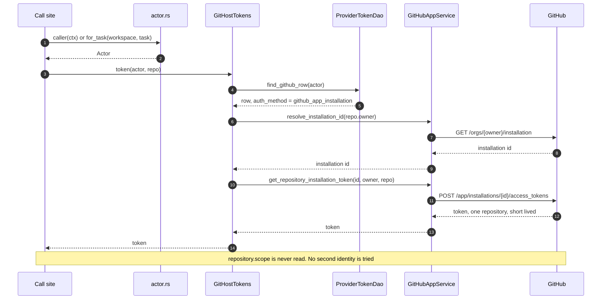
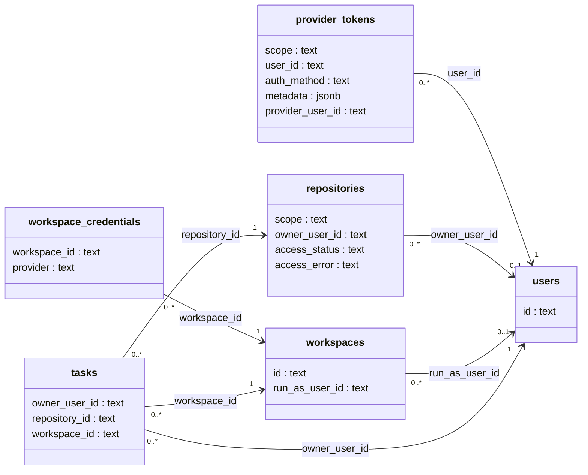

# One git-host access seam, always keyed on an identity

> **Status:** shipped
> **Updated:** 2026-08-16
> **Vocabulary:** CONTEXT.md
> **Base:** `main` at `9896f08d4`

## Current solution

### Anchors

Every place the change lands. Line numbers are on `main`.

| Anchor | What it is today |
|---|---|
| `crates/identity/src/auth/credentials.rs:50` | `resolve_user_github_token` — walks `user > global` |
| `crates/identity/src/auth/credentials.rs:87` | `resolve_github_token_for_scopes` — the same walk, returns `ResolvedGithubToken` |
| `crates/identity/src/auth/credentials.rs:147` | `resolve_github_row_token` — the `auth_method` dispatch every path funnels through |
| `crates/identity/src/auth/credentials.rs:189` | `resolve_repository_github_scope_token` — selects on a `GitHubScope`, validates the Global installation binding |
| `crates/identity/src/auth/credentials.rs:273` | `resolve_run_as_user_github_token` — user only, no walk. The shape the new module takes |
| `crates/identity/src/auth/credentials.rs:309` | `secret_scope_for` |
| `crates/identity/src/auth/credentials.rs:369` | `read_secret_ref_token` |
| `crates/identity/src/auth/credentials.rs:405` | `mint_installation_token` — the two-branch mint |
| `crates/identity/src/auth/github_scope.rs:21` | `GitHubScope` — `User(String)` and `Global` |
| `crates/identity/src/auth/provider_token_dao.rs:367` | `upsert_github_row`'s Global branch |
| `crates/identity/src/auth/provider_token_dao.rs:410` | `find_github_scope_presence` — the `user > global` presence walk, whose `OR` arm is at `:421` and whose ranking `ORDER BY` is at `:422` |
| `crates/identity/src/auth/github/service.rs:328` | `get_repository_installation_token` — repository-restricted mint, cached |
| `crates/identity/src/auth/github/service.rs:729` | `resolve_installation_id` — owner to installation, cached |
| `crates/identity/src/auth/github/service.rs:789` | `installation_token_for_owner` — the owner-wide mint |
| `crates/identity/src/git_host_access.rs` | `GitHostAccess` — credential *administration*: connect, disconnect, validate, status, for all three hosts |
| `crates/identity/src/setup/github.rs:24` | `GithubTokenRequirement` — reads the presence walk at `:31`; `GitHubScope::from_row` at `:82` |
| `crates/workspaces/src/repository/access.rs:20` | `github_credential_scope` — repository scope to credential scope |
| `crates/workspaces/src/repository/access.rs:39` | `RepositoryTokenResolver` |
| `crates/workspaces/src/repository/access.rs:105` | `resolve_repository_github_token_with` |
| `crates/workspaces/src/repository/access.rs:154` | `repository_token_resolution_error` |
| `crates/workspaces/src/repository/access.rs:173` | `parse_github_owner_repo` |
| `crates/workspaces/src/repository/access.rs:198` | `access_error_for` |
| `crates/workspaces/src/repository/handlers.rs:354` | `verify_access` |
| `crates/workspaces/src/repository/handlers.rs:401` | `persist_access_verification` |
| `crates/workspaces/src/repository/handlers.rs:568` | `list_branches`, and the comment at `:593` |
| `crates/workspaces/src/repository/handlers.rs:234,280-282` | `access_context_changed` and the reset it drives |
| `crates/workspaces/src/repository/models.rs:99-103` | the three stored reachability fields |
| `crates/workspaces/src/workspace/git_sync.rs:952` | `resolve_sync_token` — already uses `auth.user_id` for GitLab |
| `crates/workspaces/src/workspace/models.rs:104-118` | `WorkspaceCredentialProvider`, including its `Github` variant |
| `crates/workspaces/src/skill/service.rs:135` | the workspace skill cache key |
| `crates/workspaces/src/skill/service.rs:142` | workspace skill token resolution |
| `crates/workspaces/src/skill/service.rs:194` | `resolve_token_for_provider` |
| `crates/workspaces/src/plugin/sync.rs:183` | `platform_token` — hard-codes `GitHubScope::Global` |
| `crates/loops/src/loops/sync/mod.rs:71` | `sync_repo_loops` |
| `crates/adapter-github-pr/src/auth.rs:19` | `GithubPrAuth`, holding `global_bot_token` at `:20` |
| `crates/adapter-github-pr/src/auth.rs:126` | `reaction_token` |
| `crates/adapter-github-pr/src/auth.rs:156` | `client_for_user` |
| `crates/adapter-github-pr/src/auth.rs:193` | `client_for_run_as_user`, with its doc comment at `:167-192` |
| `crates/adapter-github-pr/src/auth.rs:222` | `resolve_token_for_user` — the `GITHUB_CHANNEL_TOKEN` fallback, reached through `global_token` at `:258` |
| `crates/adapter-github-pr/src/auth.rs:264` | `resolve_sender_user` |
| `crates/adapter-github-pr/src/auth.rs:290` | `outbound_user_id` — the identity precedence that already works |
| `crates/adapter-github-pr/src/auth.rs:309` | `binding_filter_user_id` |
| `crates/adapter-github-pr/src/shell_reconcile.rs:668` | `resolve_task_repository_github_token`, taking a resolver threaded from `:111,243,335,670` |
| `crates/sandbox-control/src/secrets.rs:26-27` | `GITLAB_TOKEN` and `GITNESS_TOKEN`, declared in the sandbox band |
| `crates/sandbox-control/src/secrets.rs:59-81` | the credential precedence the Workspace override sits at the top of |
| `crates/sandbox-control/src/secrets.rs:113` | `resolve_task_github_token` — the workspace short-circuit, then `fill_github` |
| `crates/sandbox-control/src/secrets.rs:321` | `fill_github` — already run-as only |
| `crates/sandbox-control/src/secrets.rs:420` | `fill_user_provider_tokens` — GitLab and Gitness resolved by a second route |
| `crates/sandbox-control/src/preflight.rs:58` | `PreflightCredentials` — the five threaded ports |
| `crates/sandbox-control/src/preflight.rs:232` | `preflight_validate_github_token` |
| `crates/backend/src/access_settings/handlers.rs:603` | `admin_get_global_github_installation` |
| `crates/backend/src/access_settings/handlers.rs:625` | `admin_put_global_github_installation` |
| `crates/backend/src/access_settings/handlers.rs:653` | `admin_delete_global_github_installation` |
| `crates/backend/src/app_administration.rs:465` | `global_github_installation` |
| `crates/backend/src/app_administration.rs:475` | `bind_global_github_installation` |
| `crates/backend/src/app_administration.rs:511` | `unbind_global_github_installation` |
| `crates/backend/src/app_administration.rs:540` | `mirror_github_connection` — the org `adapter_connections` upsert |
| `crates/backend/src/state.rs:184,323,336,343,541,706` | `RepositoryTokenResolver` construction and its `FromRef` wiring |
| `crates/core/src/config.rs:1250` | `bot_token: env_opt("GITHUB_CHANNEL_TOKEN")` |
| `crates/core/src/secret_keys.rs:11` | `GITHUB_TOKEN`, and the doc comment saying the other git-host keys stay in the sandbox band |
| `crates/api-schemas/src/enums.rs:361` | `RepositoryProvider` — the provider enum the seam dispatches on |
| `crates/core/migrations/0086_repository_access_status.sql` | added the three repository reachability columns |
| `crates/core/migrations/0131_workspace_credentials.sql` | added `workspace_credentials`, including its `github` row |
| `crates/core/migrations/0136_authentication_foundation.sql` | the highest migration on `main`; this change adds `0137` and `0138` |
| `apps/frontend/src/features/settings/components/github-installation-card.tsx` | the installation card |
| `apps/frontend/src/features/settings/hooks/use-admin-github-connection.ts` | its hook |
| `apps/frontend/src/features/settings/api/admin-github-connection.api.ts` | its client |
| `apps/frontend/src/features/settings/components/admin-github-integration-section.tsx` | mounts that card beside `GitHubAppsCard` |
| `apps/frontend/src/features/repositories/utils/access-status.ts` | the reachability badge helper |
| `apps/frontend/src/features/repositories/components/sections/access-settings-group.tsx:135` | renders the reachability badge |
| `apps/frontend/src/features/repositories/components/admin-repositories-sidebar.tsx:60` | renders it per row |
| `apps/frontend/src/features/settings/components/github-configuration-section.tsx:67,195` | copy naming the deleted behaviour |
| `tests/api/specs/setup-requirements.spec.ts:160` | AUTH-45, whose subject is the global installation |
| `tests/api/specs/auth-access-control.spec.ts:368-373` | AUTH-27's second half |
| `tests/shared/moat-api.ts:162` | the `verify-access` helper |

### What the code does not say

**The Sandbox already resolves this way, and the backend does not.** `fill_github`
always passes `Some(run_as_user_id)` (`sandbox-control/src/secrets.rs:321`), so
`resolve_repository_github_token_with` takes its run-as branch and never reads
`repository.scope`. Preflight turns a missing credential into a refusal to start
(`preflight.rs:232`). The backend read paths still resolve on repository scope, so
listing a Global repository's branches can succeed while a Task on it cannot start.
This change makes the backend agree with what already ships.

**Bot user credentials mint wider tokens than the org credential does.** The Global
row is written with `installation_id` and `account_login` in `metadata`
(`app_administration.rs:485`), so `mint_installation_token` takes its first branch:
it checks the owner against the binding and calls
`get_repository_installation_token`. A Bot user's row is written with no `metadata`
at all (`identity/src/auth/routes.rs`), so the same function falls through to
`installation_token_for_owner` and mints for every repository the App can reach.
Deleting the Global row without fixing this would widen every minted token.

**Narrowing them needs no stored state.** `resolve_installation_id` (`github/service.rs:729`)
already turns an owner into an installation id, cached per owner, and
`get_repository_installation_token` (`:328`) already mints restricted to one
repository with its own cache. Chaining them removes the need for `installation_id`
in `metadata` anywhere, and removes the owner-mismatch check with it — an
installation resolved *from* the owner cannot mismatch the owner.

**A Workspace credential is the one stored value not derived from an identity.**
`workspace_credentials` (`0131_workspace_credentials.sql`) pins a static credential
to a Workspace, and the GitHub row of that table outranks the Task's run-as user
(`secrets.rs:59-81,113`). It is the same class of problem as the org-wide row: a
credential that belongs to no person. Its precedence is right and its subject is
wrong — a Workspace should name the *account it runs as*, not a secret.

**GitLab and Gitness are resolved at the same call sites by a second route.**
`find_provider_token(user_id, provider)` returns `access_token` verbatim
(`secrets.rs:420-441`, `repository/handlers.rs`, `skill/service.rs:194`). Every one
of those sites branches on the provider and does two different things — and
`git_sync.rs:952` does both inside a single function, resolving GitLab from
`auth.user_id` while resolving GitHub from the repository. That duplication predates
this change and is what makes splitting the hosts the wrong move.

**Automated work already carries an identity, by invariant.** A Loop cannot fire
without an approved run-as user: `schedule_runner.rs` returns an error naming
"claimed schedule Loop has no approved run-as user", and
`SubscriptionMatch::effective_user_id` (`adapter-model/src/models.rs`) panics on
`None`. That user becomes `InboundMessage.user_id`, then the Task's `created_by` and
`owner_user_id` (`task/creation.rs`), and every Task is `Scope::User`. This is why a
Bot user never needs naming on a Repository.

**Plugin sync is not a background job.** `PluginSyncService::sync` runs only through
`skills` (`plugin/sync.rs:87`), reached from `list_plugin_skills`
(`plugin/handlers.rs`, where the caller is bound as `_auth` and ignored) and
`SkillService::plugin_skills` (`skill/service.rs:180`, which has `auth`). There is no
call site without an identity in scope.

**The Global installation binding does two jobs.** It writes a `provider_tokens` row
*and* upserts an `adapter_connections` row keyed on the account login
(`app_administration.rs:540`). Without the second, inbound GitHub webhooks reject the
org and pull requests opened from Tasks never resolve to a Binding. Unbinding already
leaves that row in place on purpose (`:511-518`).

**The installation fields on that Adapter connection are dead.**
`mirror_github_connection` writes `github_app_key` and `installation_id` into
`transport_config`. Nothing in the repository reads either. Recreating the connection
through `POST /api/v1/adapters/connections` therefore needs only
`external_account_id`, `connection_kind` and `webhook_secret`.

**`provider_tokens.scope` is shared with Codex, so `'global'` must stay legal.**
`CodexScope::Global` is a live feature and addresses a `scope = 'global'` row. The
migration deletes GitHub global rows only. `'team'` is a different case: `0097` moved
every team row off the value and its `provider_tokens_owner_scope_chk` has refused it
since, so the migration states the two-value set the column already holds.

**Git-sourced content does not vary by reader.** `fetch_moatless_workspaces`
(`git_sync.rs`) and the skill fetcher read files at a ref, so an identity decides only
whether a fetch succeeds. Plugin sync already serves the previous snapshot on failure
(`plugin/sync.rs:87-96`). A caller without access cannot store a wrong answer — only
fail to refresh.

**Five functions carry `#[allow(clippy::too_many_arguments)]` whose stated reason is
the dependency list.** Four in `credentials.rs`, one in `access.rs`. Each says that
bundling the ports "would only move the argument count to the call site". That is
true of a bundle passed per call and false of a struct built once in `state.rs`,
which is what this change does.

## Planned solution

**New**

- `crates/identity/src/git_host_tokens.rs` — `GitHostTokens`, the one way to obtain a git-host token. It is named for its counterpart: `git_host_access.rs` beside it *administers* a credential, and this module *issues* one. `GitHubAccess` would be three letters from that neighbour and cover only one of the three hosts
- `crates/identity/src/auth/actor.rs` — `Actor`, and the closed set of ways one is chosen
- `crates/identity/src/git_host_repo.rs` — `GitHostRepo`, a repository named on a host, parsed once
- `crates/core/migrations/0137_workspace_run_as_user.sql` — `workspaces.run_as_user_id`
- `crates/core/migrations/0138_identity_only_github_access.sql` — the deletions

**Changes materially**

- `crates/workspaces/src/repository/handlers.rs:568` — `list_branches` acts as the caller; `verify_access` (`:354`) is deleted outright
- `crates/workspaces/src/workspace/git_sync.rs:952` — workspace sync acts as the caller, for every host
- `crates/loops/src/loops/sync/mod.rs:71` — Loop sync acts as the caller
- `crates/workspaces/src/skill/service.rs:135,142,194` — skill reading acts as the caller, and the cache key gains the actor
- `crates/workspaces/src/plugin/sync.rs:183` — plugin sync acts as the caller
- `crates/workspaces/src/workspace/models.rs:104-118` — `WorkspaceCredentialProvider` loses `Github`
- `crates/adapter-github-pr/src/auth.rs:126,222` — reactions use the outbound identity precedence; the env-token fallback goes
- `crates/adapter-github-pr/src/shell_reconcile.rs:668` — the pull-request footer acts as the Task's owner
- `crates/identity/src/auth/credentials.rs:405` — a Bot user's token is restricted to the repository being worked on
- `crates/identity/src/auth/provider_token_dao.rs:410` — the presence walk stops reaching the global row
- `crates/sandbox-control/src/secrets.rs:113,321,420` — one call resolves every host for the run-as identity
- `crates/backend/src/access_settings/handlers.rs:603,625,653` — the three global installation routes are removed
- `apps/frontend` — the installation card, both reachability badges, verify-access and two copy strings

**Untouched**

- `crates/adapter-github-pr/src/api_routes.rs` — the typed `moat gh` surface already resolves this way
- Inbound webhook verification (`adapter-github-pr/src/ingress.rs`), and every existing `adapter_connections` row
- Sign-in, the login App, and `ensure_fresh_token`'s OAuth refresh
- GitHub App registration, stored signing keys, and `GitHubAppRegistry`
- `GitHostAccess` (`crates/identity/src/git_host_access.rs`) — how a user connects, disconnects and validates a credential, for all three hosts
- Codex credentials, including `CodexScope::Global`
- `workspace_credentials` for `gitlab`, `gitness`, `openai` and `anthropic`
- `repositories.owner_user_id` and `repositories.scope` as visibility and uniqueness

### Problem

A user cannot tell which git-host identity the product will act as, because it
depends on which code path they reach.

Eight functions obtain a GitHub token. Three of them fall through to a credential
belonging to somebody else — two to the org-wide row, one to a token in the
deployment's environment. Four select on a Repository row rather than on a person.
One more, `workspace_credentials`, reads a secret pinned to a Workspace. A user with
no GitHub credential of their own is reported as connected
(`provider_token_dao.rs:410` walks to the global row) and can browse repositories,
and then their first Task fails at preflight because the Sandbox resolves only their
own credential. The reachability badge on that Repository can read green throughout,
because it records whichever credential last checked.

For the maintainer, the same split means a credential rule cannot be changed in one
place. The Bot-user widening above is one rule diverging in exactly this way: the
narrowing applied to the org credential was never applied to the Bot rows, and
nothing made that visible.

### Behaviour

**A person using the app**

- Given I have connected GitHub, when I open a Repository anyone in the installation can use, then I see its branches, because my own credential reaches it.
- Given I have not connected GitHub, when I open any Repository, then I am told that I have not connected GitHub — not that the Repository is unreachable.
- Given I have not connected GitHub, when I sign in, then setup reports me as not set up, whether or not anyone else has a credential.
- Given my credential cannot reach a Repository, when I open it, then I am told my credential cannot reach it, which is a different message from not being connected.
- Given a Repository is public and I have no credential, when I open it, then it fails. No path fetches anonymously after this change.
- Given a Repository on GitLab or Gitness, when I open it, then my own credential for that host is used, resolved through the same seam.
- Given I open a Repository, then there is no stored reachability badge to read: reachability is answered by the action I take, and by nothing else.

**An administrator**

- Given I am an admin and a Repository is owned by another user, when I list its branches, then my own credential is used and I see a failure if I personally cannot reach it on GitHub.
- Given I am an admin, when I open the GitHub integration page, then I can register and rotate GitHub Apps, and there is no installation to bind.
- Given I am an admin and I need an org to receive webhooks, when I create an Adapter connection for it, then inbound events resolve against it exactly as before.
- Given I want a Workspace to act as a Bot, when I name that Bot as the Workspace's run-as user, then every Task on that Workspace reaches GitHub as the Bot, whoever started it.

**A Task, and the agent in its Sandbox**

- Given a Task whose owner is a Bot user, when it works on a Repository, then the token is minted from that Bot's App for that one Repository, and reaches no other.
- Given a Task on a Workspace with a run-as user, when it reaches a git host, then it acts as that user and not as the person who started the Task.
- Given a Task whose owner holds no credential for the Repository's host, when it starts, then preflight refuses and names the owner.
- Given a Loop fires a Task, when the work reaches GitHub, then it acts as the Loop's approved run-as user, because that user is the Task's owner.
- Given an agent opens a pull request, when the footer is added, then it is added as the Task's owner, not as the Repository or the deployment.
- Given a Workspace pins a `gitlab`, `gitness`, `openai` or `anthropic` credential, when a Task runs on it, then that credential is delivered exactly as before.

**An operator**

- Given a deployment that had an org credential bound, when it upgrades, then existing Adapter connections keep working and users without their own credential must connect one.
- Given a deployment that pinned a GitHub PAT to a Workspace, when it upgrades, then that credential stops being delivered and the Workspace must name a run-as user instead.
- Given `GITHUB_CHANNEL_TOKEN` is still set, when the backend starts, then nothing reads it.

### Architecture and key flows

#### `crates/identity/src/git_host_tokens.rs` — new

- **Proposed responsibility.** What token does this identity present to this git host for this repository, right now.
- **Proposed change.** New module beside `git_host_access.rs`. It owns `ProviderTokenDao`, `ProviderTokenAuthDao`, `Option<GitHubAppService>`, `GitHubAppRegistry` and `SecretService` as private fields, constructed once in `state.rs`. It exposes one constructor and one method.
- **Evidence.** The band is correct: `moatless-identity` depends only on `api-schemas`, `backend-core`, `core`, `adapter-model` and `t3code`, and `workspaces`, `adapter-github-pr`, `sandbox-control`, `loops` and `tasks` all depend on it.

```rust
pub struct Actor(String);

pub enum GitHostTokenError {
    NoCredential { actor: Actor, provider: RepositoryProvider },
    Forbidden    { actor: Actor, repo: GitHostRepo },
    Broken       { actor: Actor, detail: String },
    Database(sqlx::Error),
}

pub struct GitHostTokens { /* the five ports, private */ }

impl GitHostTokens {
    pub fn new(
        provider_tokens: Arc<dyn ProviderTokenDao>,
        provider_token_auth: Arc<dyn ProviderTokenAuthDao>,
        github_app_service: Option<Arc<GitHubAppService>>,
        github_apps: Arc<GitHubAppRegistry>,
        secrets: Arc<SecretService>,
    ) -> Self;

    pub async fn token(&self, actor: &Actor, repo: &GitHostRepo)
        -> Result<String, GitHostTokenError>;
}
```

The interface includes these facts, which callers may rely on:

- It performs no scope walk. `actor` is the sole authority.
- It never returns `SECRET_REF_TOKEN_PLACEHOLDER`, `APP_INSTALLATION_TOKEN_PLACEHOLDER`, or an empty string.
- `NoCredential` is the only "not connected" answer. A dangling `secret_ref`, an unknown App key, or an unusable stored key is `Broken`. Collapsing the two would send callers down an anonymous path instead of surfacing breakage — the rule `read_secret_ref_token` states today at `credentials.rs:364-368`, now enforced by the type.
- Freshness is handled inside. OAuth rows refresh through `ensure_fresh_token`; installation rows mint. Callers must not cache the returned string.

The body dispatches on `repo.provider()` first, then on the row's `auth_method`:

```rust
match repo.provider() {
    // resolve_github_row_token's dispatch (credentials.rs:159-183) plus
    // read_secret_ref_token (:369), moved in whole.
    Github => match row.auth_method.as_deref() { /* four arms */ },
    // What fill_user_provider_tokens does today at secrets.rs:434 — the row's
    // access_token, verbatim. One arm, because that is all these providers do.
    Gitlab | Gitness => Ok(row.access_token.clone()),
}
```

**No trait.** `AGENTS.md` forbids a new trait with a single implementation, and a
`GitHostProvider` trait would have exactly one arm worth implementing. Enum dispatch
matches how `RepositoryProvider` is already handled at every call site, and the
GitLab arm deepens in place when it earns it.

The GitHub mint reduces to one branch:

```rust
let installation = app.resolve_installation_id(repo.owner()).await?;
app.get_repository_installation_token(installation, repo.owner(), repo.name()).await
```

`installation_token_for_owner` (`github/service.rs:789`) loses its last caller and is
deleted with it.

#### `crates/identity/src/git_host_repo.rs` — new

- **Proposed responsibility.** Naming a repository on a git host.
- **Proposed change.** New module holding `GitHostRepo`. `parse_github_owner_repo` (`repository/access.rs:173`) moves in as the GitHub arm of `GitHostRepo::parse`, carrying its tests.

```rust
pub struct GitHostRepo {
    provider: RepositoryProvider,   // api-schemas/src/enums.rs:361
    owner: String,
    name: String,
    /// Host, where the provider does not have exactly one. Gitness stores a
    /// base URL on the credential row and reads it back in repository/handlers.rs.
    host: Option<String>,
}

impl GitHostRepo {
    pub fn parse(provider: RepositoryProvider, remote_url: &str) -> Option<Self>;
}
```

Today only the GitHub arm of `parse` is populated, from the moved function. The
GitLab and Gitness arms accept their own hosts rather than rejecting everything that
is not `github.com`. This is the one piece of provider generality built up front,
because retrofitting a field into a type that twelve call sites construct is the
expensive kind of change.

- **Evidence for the band.** The type carries `RepositoryProvider`, which lives in `moatless-api-schemas`. `moatless-core` does not depend on that crate and should not: `api-schemas` is transport-only, and pointing the lowest domain band at it would invert that. `moatless-identity` already depends on both, and every consumer — `workspaces`, `loops`, `sandbox-control`, `adapter-github-pr` — already depends on `moatless-identity`. So this placement reuses the existing provider enum and adds no crate edge at all.

#### `crates/identity/src/auth/actor.rs` — new

- **Proposed responsibility.** Which identity acts.
- **Proposed change.** New module holding `Actor` and every constructor for one. Three exist:

```rust
impl Actor {
    /// The caller of a request.
    pub fn caller(ctx: &ScopeContext) -> Self;
    /// A Task's owner. Falls back to `created_by` for rows predating
    /// `owner_user_id`, matching `Task::scoped_resource` at task/models.rs:98.
    pub fn owner_of(task: &Task) -> Option<Self>;
    /// The identity a Workspace runs as, falling back to the Task's owner.
    pub fn for_task(workspace: Option<&Workspace>, task: &Task) -> Option<Self>;
}
```

  This module is the point of the change: it is the one file that answers "how can an
  identity be chosen", so a reader can enumerate the ways without searching. The
  precedence currently spread across `outbound_user_id` (`auth.rs:290`),
  `resolve_sender_user` (`:264`) and `binding_filter_user_id` (`:309`) moves here as
  named functions rather than being collapsed — the webhook and outbound rules
  genuinely differ and both stay.

- **Evidence.** `Task::owner_user_id` is set from `created_by` in `task/creation.rs`, and `scope` is hardcoded `Scope::User`.

#### `crates/workspaces` — a Workspace names an identity, not a credential

- **Proposed responsibility.** A Workspace states the account its Tasks act as.
- **Proposed change.** `workspaces.run_as_user_id` (nullable, `REFERENCES users(id)`) replaces the `github` row of `workspace_credentials`. The name matches the Loop field that means the same thing. `Actor::for_task` returns it when set, otherwise `Actor::owner_of(task)` — the same precedence `workspace_credentials` has today, over a subject that is a person. `WorkspaceCredentialProvider` (`workspace/models.rs:104-118`) loses `Github`; the service already parses the stored provider and skips what it cannot map, so existing rows degrade rather than break, and the constraint and the rows go in `0138`. `moat workspaces credentials set github <pat>` is replaced by a command naming a user; the other four providers keep the existing command.
- **Evidence.** `gitlab`, `gitness`, `openai` and `anthropic` are static env-var credentials that never reach this seam, and a Bot user holding an `ANTHROPIC_API_KEY` is not a thing any flow creates. They keep working exactly as `0131` built them.

#### `crates/identity/src/auth/credentials.rs` — mostly deleted

- **Proposed responsibility.** The GitHub OAuth stash, and nothing else.
- **Proposed change.** `resolve_user_github_token`, `resolve_github_token_for_scopes`, `ResolvedGithubToken`, `resolve_github_row_token`, `resolve_repository_github_scope_token`, `resolve_run_as_user_github_token`, `secret_scope_for`, `read_secret_ref_token` and `mint_installation_token` all move into `git_host_tokens.rs` or are deleted. `GITHUB_OAUTH_STASH_KEY`, `stash_github_oauth_token` and `read_github_oauth_stash` stay — they belong to PAT-override handling and are called from `git_host_access.rs`.

#### `crates/identity/src/auth/github_scope.rs` — deleted

- **Proposed responsibility.** None. `GitHubScope::User(String)` and `Actor(String)` are the same type once `Global` is gone.
- **Proposed change.** Delete the module. `ProviderTokenDao::find_github_row`, `upsert_github_row` and `delete_github_row` take a user id. `upsert_github_row`'s Global branch (`provider_token_dao.rs:367`) goes with it.
- **Evidence.** `GitHubScope` is deliberately separate from `CodexScope`, so removing it does not touch Codex.

#### `crates/identity/src/auth/provider_token_dao.rs` and `crates/identity/src/setup/github.rs`

- **Proposed responsibility.** `find_github_scope_presence` answers whether *this user* has connected GitHub.
- **Proposed change.** Drop the `OR (scope = 'global' …)` arm and the `ORDER BY` that ranks it (`provider_token_dao.rs:421-422`). `GithubTokenRequirement` then reports a user with no credential as `Missing`, which is what their Sandbox will do. The `GitHubScope::from_row` call at `setup/github.rs:82` goes with the type.
- **Evidence.** The walk is why a user with no credential is `Satisfied` today while `fill_github` finds nothing for them.

#### `crates/workspaces/src/repository/access.rs` — deleted

- **Proposed responsibility.** Nothing credential-shaped remains.
- **Proposed change.** Delete `github_credential_scope`, `RepositoryTokenResolver`, `resolve_repository_github_token_with`, `repository_token_resolution_error` and `access_error_for`. Move `parse_github_owner_repo` (`:173`) into `GitHostRepo::parse`, keeping its tests.

#### `crates/workspaces/src/repository/handlers.rs`

- **Proposed responsibility.** `list_branches` answers reachability by doing the thing. Nothing stores it and no route reports it separately.
- **Proposed change.** `list_branches` (`:568`) resolves through `Actor::caller`; the comment at `:593` is replaced with the new rule. `verify_access` (`:354`), its route and `persist_access_verification` (`:401`) are deleted with no replacement. The `access_status`, `access_checked_at` and `access_error` fields leave `Repository`, `RepositoryPatch`, `RepositoryResponse` and `RepositoryDao`. `access_context_changed` (`:234`) and the reset it drives (`:280-282`) go with them.
- **Evidence.** `GET /repositories/{id}/branches` already returns 403 "Access denied — token lacks permissions" (`:538`), and preflight already refuses a Task by name. A stored per-repository answer cannot be right once the answer is per-person, and a live per-caller route would duplicate what listing branches already reports.

#### `crates/workspaces/src/workspace/git_sync.rs`

- **Proposed responsibility.** Unchanged. It reconciles git-declared Workspaces.
- **Proposed change.** `resolve_sync_token` (`:952`) drops its GitHub branch and uses `Actor::caller(auth)` for every provider. `GitSyncService` loses its `repo_token_resolver` field.
- **Evidence.** The function already uses `auth.user_id` for the non-GitHub branch, so this removes an inconsistency inside one function.

#### `crates/loops/src/loops/sync/mod.rs`

- **Proposed change.** `LoopSyncService` swaps `repo_token_resolver` for `GitHostTokens` and resolves through `Actor::caller`. `sync_repo_loops` (`:71`) already takes `auth`.

#### `crates/workspaces/src/skill/service.rs`

- **Proposed change.** The workspace branch (`:142`) and `resolve_token_for_provider` (`:194`) collapse into one call through `Actor::caller`. The anonymous fallback — `Err(AuthError::NotFound(_)) => Ok(None)` — is removed: a `NoCredential` error propagates. The cache key at `:135` becomes `format!("workspace:{}:{}", repo.id, actor)`.
- **Evidence.** The cache is `moka` with a TTL and `max_capacity(1024)`, so a per-actor key costs entries, not correctness.

#### `crates/workspaces/src/plugin/sync.rs`

- **Proposed change.** `platform_token` (`:183`) is replaced by an `Actor` threaded from `skills` and `sync`. Its callers — `list_plugin_skills` (`plugin/handlers.rs`) and `SkillService::plugin_skills` (`skill/service.rs:180`) — both have the caller already; the handler stops ignoring it. The unauthenticated fallback is removed.
- **Evidence.** A failed sync is already non-fatal (`:87-96`), so a caller without access degrades to the stored snapshot rather than erroring.

#### `crates/adapter-github-pr/src/auth.rs`

- **Proposed responsibility.** Which identity acts, for each of this Adapter's five use cases. It stops holding a credential of its own.
- **Proposed change.** `global_bot_token` (`:20`) and `global_token` (`:258`) are deleted. `resolve_token_for_user` (`:222`) becomes a call to `GitHostTokens::token`. `reaction_token` (`:126`) uses the same precedence as `outbound_user_id` (`:290`) rather than only `binding_filter_user_id`. `client_for_run_as_user` (`:193`) and `client_for_user` (`:156`) become one function, because they now differ in nothing.
- **Evidence.** `client_for_run_as_user`'s doc comment (`:167-192`) describes the strict behaviour as the exception. After this change it is the only behaviour, and the comment is rewritten to state the rule once.

#### `crates/adapter-github-pr/src/shell_reconcile.rs`

- **Proposed change.** `resolve_task_repository_github_token` (`:668`) takes an `Actor` instead of a `RepositoryTokenResolver`. It still reads the Repository for its remote URL, under the existing `ScopeContext::system()`. The four `repo_token_resolver` parameters threaded from `reconcile_shell_command` (`:111,243,335,670`, used at `:706`) become one `GitHostTokens`.

#### `crates/sandbox-control/src/secrets.rs` and `preflight.rs`

- **Proposed responsibility.** Unchanged.
- **Proposed change.** `fill_github` (`:321`) calls `GitHostTokens::token` with the `Actor` it already has. The git-host half of `fill_user_provider_tokens` (`:420-441`) folds into the same call: its `gitlab` and `gitness` entries move behind `GitHostTokens`, and `openai` stays because it is a model credential and not a git host. The comment at `:425` — *"GitHub is resolved through `fill_github`; intentionally not handled here"* — is the duplication this removes and is deleted. `PreflightCredentials` (`:58`) collapses its five credential fields into one `GitHostTokens`. `resolve_task_github_token` (`:113`) keeps its short-circuit shape and resolves the Workspace's run-as identity instead of reading a stored value. `GITLAB_TOKEN` and `GITNESS_TOKEN` (`:26-27`) move to `crates/core/src/secret_keys.rs` beside `GITHUB_TOKEN`, and that file's doc comment stops saying no lower band names them.
- **Evidence.** The observable behaviour of both is already what this change generalises, so a regression here would be visible immediately in the E2E chains that create Tasks.

#### `crates/backend/src/access_settings/handlers.rs` and `app_administration.rs`

- **Proposed change.** Delete `admin_get_global_github_installation` (`:603`), `admin_put_global_github_installation` (`:625`) and `admin_delete_global_github_installation` (`:653`), and their routes. Delete `global_github_installation` (`app_administration.rs:465`), `bind_global_github_installation` (`:475`), `unbind_global_github_installation` (`:511`), `mirror_github_connection` (`:540`) and `installation_binding`. `GitHubInstallationBindingRequest` and `GitHubInstallationBindingResponse` leave `api-schemas`. App registration, rotation and removal beside them are untouched.

#### `crates/backend/src/state.rs`

- **Proposed change.** `repo_token_resolver` (`:184,323,336,343,541,706`) is replaced by `Arc<GitHostTokens>`, with the same `FromRef` wiring. This is where the five ports are supplied, once.

#### `crates/core/src/config.rs`

- **Proposed change.** `GithubPrConfig::bot_token` (`:1250`) is deleted. `webhook_secret` stays. `adapter_installations.rs` stops passing it.

#### Key flows

**Work reaches a git host — the main success flow.**



Both GitHub calls are cached — by owner in `installation_by_owner` and by
`(installation_id, repository)` in `repository_token_cache` — so a warm path makes
neither.

**The actor holds no credential.** `find_github_row` returns `None`, and
`GitHostTokens` returns `NoCredential { actor, provider }`. Preflight maps it to
`PreflightError::NoGithubToken` and the Sandbox is never provisioned. An HTTP caller
receives a message naming that they have not connected that host. Nothing else is
attempted. This is the flow the change exists to make uniform: today it is the
Sandbox's behaviour and nobody else's.

**The credential cannot reach the repository.** `get_repository_installation_token`
or the REST call returns 403 or 404, and `GitHostTokens` returns `Forbidden`. The
caller reports that the credential exists and the Repository is out of its reach.
Distinguishing this from `NoCredential` is the point — the remedies differ, and
"connect GitHub" is wrong advice for someone already connected.

**The App is not installed on the owner.** `resolve_installation_id` returns
`AuthError::Config` naming the App and the owner, which becomes `Broken` naming the
App key and the account. An admin fixes it by installing the App, not by asking the
user to reconnect.

### Data model



The identity that acts on `tasks.repository_id` is `workspaces.run_as_user_id` when
the Task's Workspace sets it, and `tasks.owner_user_id` otherwise. That relationship
is enforced in code and not in the schema, and it is the one this change turns on.
`repositories.owner_user_id` continues to decide who may see the row and never which
credential reaches it. `adapter_connections` is not in the model: its org rows and
their `transport_config` are unchanged.

#### `provider_tokens`

One stored credential per identity and service. Unique on `(user_id, provider, team_id)`
with `NULLS NOT DISTINCT`, via `provider_tokens_scope_uq`.

| Column | Type | Null | What happens |
|---|---|---|---|
| `scope` | text | not null | **Meaning changes.** For `provider = 'github'` only `'user'` remains legal. A CHECK constrains the column to `('global','user')`; `'global'` stays legal for Codex rows |
| `metadata` | jsonb | nullable | **Meaning changes.** `installation_id` and `account_login` are no longer written or read. `login` and `refresh_failure` are unchanged |
| `auth_method` | text | nullable | Read, unchanged. Still the dispatch key |
| `provider_user_id` | text | nullable | Read, unchanged. Still the App key a Bot user mints from |
| `access_token` | text | not null | Read, unchanged. Still the verbatim value for plain rows and the sentinel for the other two |

The one row where `provider = 'github' AND scope = 'global'` is deleted by migration.
There is at most one: `provider_tokens_scope_uq` covers it uniquely.

#### `workspaces`

| Column | Type | Null | What happens |
|---|---|---|---|
| `run_as_user_id` | text | nullable, `REFERENCES users(id)` | **Added** by `0137`. When set, every Task on this Workspace reaches a git host as this user |

#### `workspace_credentials`

| Column | Type | Null | What happens |
|---|---|---|---|
| `provider` | text | not null | **Meaning narrows.** `'github'` rows are deleted and the CHECK constraint drops the value. `'gitlab'`, `'gitness'`, `'openai'` and `'anthropic'` are unchanged |

#### `repositories`

A git connection. Identified by `id`, unique on the normalised remote URL within a
scope.

| Column | Type | Null | What happens |
|---|---|---|---|
| `access_status` | text | not null, default `'unchecked'` | **Dropped.** Added by `0086_repository_access_status.sql:10` |
| `access_checked_at` | timestamptz | nullable | **Dropped.** `0086:11` |
| `access_error` | text | nullable | **Dropped.** `0086:12` |
| `scope` | text | not null | **Meaning narrows.** Decides visibility only. No credential is derived from it |
| `owner_user_id` | text | nullable | Read, unchanged. Visibility and the uniqueness key |

#### `crates/core/migrations/0137_workspace_run_as_user.sql`

```sql
ALTER TABLE workspaces
  ADD COLUMN IF NOT EXISTS run_as_user_id text REFERENCES users(id) ON DELETE SET NULL;
```

Ships with the code that reads it, in the same release.

#### `crates/core/migrations/0138_identity_only_github_access.sql`

```sql
DELETE FROM provider_tokens WHERE provider = 'github' AND scope = 'global';

ALTER TABLE provider_tokens DROP CONSTRAINT IF EXISTS provider_tokens_scope_chk;
ALTER TABLE provider_tokens ADD CONSTRAINT provider_tokens_scope_chk
  CHECK (scope IN ('global', 'user'));

DELETE FROM workspace_credentials WHERE provider = 'github';

ALTER TABLE workspace_credentials
  DROP CONSTRAINT IF EXISTS workspace_credentials_provider_chk,
  ADD CONSTRAINT workspace_credentials_provider_chk
    CHECK (provider IN ('gitlab', 'gitness', 'openai', 'anthropic'));

ALTER TABLE repositories
  DROP COLUMN IF EXISTS access_status,
  DROP COLUMN IF EXISTS access_checked_at,
  DROP COLUMN IF EXISTS access_error;
```

Ship this migration in a release *after* the one carrying the code. The code
tolerates the columns and the rows still being present; the migration is not
reversible.

### Interfaces and contracts

| Consumer | The interface it depends on | What it can rely on | Status |
|---|---|---|---|
| `apps/frontend` repository config section | `RepositoryResponse.accessStatus`, `.accessError` — `repository/schemas.rs:77,79`, rendered at `access-settings-group.tsx:135` | Nothing. Reachability is answered by listing branches, which already returns 403 with a message | **Breaking** |
| `apps/frontend` admin repositories sidebar | the same two fields, per row — `admin-repositories-sidebar.tsx:60` | Nothing. A per-row badge would need one request per Repository, so the badge is removed | **Breaking** |
| `apps/frontend` repository config edit section | `POST /api/v1/repositories/{id}/verify-access` — `repository/handlers.rs:354` | Nothing. The route is deleted with no replacement | **Breaking** |
| `apps/frontend` admin GitHub integration page | `GET`/`PUT`/`DELETE /api/v1/admin/settings/github/installation` — `access_settings/handlers.rs:603,625,653` | Nothing. The routes and `GitHubInstallationCard` are removed; `GitHubAppsCard` beside it is unchanged | **Breaking** |
| `apps/frontend` GitHub settings section | copy at `github-configuration-section.tsx:67,195` | That their own credential is used for every Repository. The sentence about Global repositories using a bound installation is false after this change | **Breaking** |
| `moat workspaces credentials set github` | `workspace_credentials` with `provider = 'github'` | Nothing. The command is replaced by one naming a run-as user | **Breaking** |
| Any deployment | `GITHUB_CHANNEL_TOKEN` — `core/src/config.rs:1250` | Nothing. Unset it; leaving it set has no effect | Removed |
| An operator whose org is already bound | that org's `adapter_connections` row | It stays, and inbound webhooks keep resolving against it. New orgs are added through `POST /api/v1/adapters/connections` | Unchanged |
| The agent in a Sandbox | `GITHUB_TOKEN` in its credential set — `sandbox-control/src/secrets.rs:321` | The run-as identity's own access, restricted to the Task's Repository when that identity is a Bot | Changed, compatibly |
| The agent in a Sandbox | `GITLAB_TOKEN`, `GITNESS_TOKEN` | The same values as today, resolved through the seam instead of a second route | Unchanged |
| A Workspace pinning `gitlab`, `gitness`, `openai` or `anthropic` | `workspace_credentials` | Unchanged delivery and precedence | Unchanged |
| The agent, via `moat gh` | `/api/v1/github/*` — `adapter-github-pr/src/api_routes.rs` | The identity that pushed the branch opens the pull request | Unchanged |
| `tests/api` chains | the `moat` CLI surface for repositories and tasks | Repository creation, branch listing and task start, with per-user credentials | Changed, compatibly |

The module boundaries introduced here — `GitHostTokens`, `Actor`, `GitHostRepo` — are
a plan, not a promise. They may be moved or renamed later without a spec change. The
rows above may not.

### Failure, safety and recovery

| Condition | State before | State after | What the caller sees | Retry safe | Cleanup |
|---|---|---|---|---|---|
| Actor holds no `provider_tokens` row | unchanged | unchanged | `NoCredential`, naming the actor and the host. Preflight refuses; HTTP callers get a message to connect that host | Yes, no effect until they connect | None |
| Credential cannot reach the repository | unchanged | unchanged | `Forbidden`, naming actor and repository | Yes | None |
| `secret_ref` row whose secret is gone | unchanged | unchanged | `Broken`. Never reported as not connected | Yes | Operator re-saves the PAT |
| App key on a Bot row is unregistered | unchanged | unchanged | `Broken`, naming the App key | Yes | Admin registers the App |
| App not installed on the repository owner | unchanged | unchanged | `Broken`, naming the App and the account | Yes | Admin installs the App on that account |
| GitHub unreachable during mint | unchanged | unchanged | `Broken` with the transport error | Yes | None |
| Workspace `run_as_user_id` names a deleted user | unchanged | unchanged | The FK sets it null, so the Task falls back to its owner | Yes | Admin names a live user |
| Plugin sync fails for the caller | previous snapshot stored | previous snapshot stored | The stored skills, and a logged warning | Yes | None |
| Workspace or Loop sync fails for the caller | last reconciled rows | last reconciled rows | A warning in the sync summary. Reconcile-delete does not run on a failed fetch | Yes | None |

**Partial writes.** None of the changed paths write across more than one row per
operation, and the two reconcilers already treat a failed fetch as "reconcile
nothing" rather than "reconcile to empty". Removing the stored reachability fields
removes the only place a credential result was persisted, so no write in this change
depends on a token.

**While a host is unreachable.** Stored credentials still resolve. Only installation
lookup and minting need GitHub, and both cache — by owner and by
`(installation, repository)`. A token already minted keeps working until it expires.
Plugin skills already stored are still served. Sign-in is unaffected, because it uses
the login App and not this module.

**Rolling back.** The code rolls back cleanly: every deleted function has a single
replacement and no data written by the new code is unreadable by the old. `0138` does
not roll back. Restoring the deleted global credential means an admin rebinding the
installation; restoring the deleted Workspace GitHub credentials means re-pinning
them; restoring the three repository columns means re-verifying each Repository. Ship
the code first and `0138` in a later release, so a rollback in the window between
them is a code-only rollback. `0137` is additive and ships with the code.

**The upgrade window.** Between the two releases, a user who has no credential of
their own and relied on the org row loses access at the moment the code ships, not at
the moment the migration runs. The same is true of a Workspace that pinned a GitHub
PAT. Setup reports such a user as `Missing` from that release onward, which is the
intended signal. Release notes must say so; there is no automated migration of an org
credential into per-user credentials, and there cannot be — the org credential is not
any user's. A Workspace GitHub PAT can be replaced by naming a run-as user, and that
is the documented path.

### Testing and verification

**Unit — `cargo test -p moatless-identity`**

- `GitHostTokens::token` returns the encrypted PAT for a `secret_ref` row and never the sentinel. Port of `credentials.rs:493`.
- A dangling `secret_ref` returns `Broken`, not `NoCredential`. Port of `credentials.rs:518`.
- An `env`-kind secret does not satisfy a `secret_ref` row. Port of `credentials.rs:549`.
- A plain row returns `access_token` verbatim. Port of `credentials.rs:572`.
- No row returns `NoCredential`. Port of `credentials.rs:581`.
- **New:** an actor with no row returns `NoCredential` even when another actor holds one. This is the deleted scope walk, asserted as absent.
- **New:** an installation row mints through `resolve_installation_id` then `get_repository_installation_token`, and never through `installation_token_for_owner`. Assert on the request path with a stubbed API base.
- **New:** `Actor::owner_of` falls back to `created_by` when `owner_user_id` is null, matching `Task::scoped_resource`.
- **New:** `Actor::for_task` prefers the Workspace's `run_as_user_id` over the Task's owner.
- **New:** `GitHostRepo::parse` accepts HTTPS and SCP-style SSH for GitHub, and accepts a self-hosted host for GitLab and Gitness. Port of `access.rs:296`, moving with the function.
- Delete `credentials.rs:654,674,698` — the three tests covering repository-scope selection and installation-binding validation, whose subjects are removed.

**Unit — `cargo test -p moatless-workspaces`**

- **New:** the workspace skill cache does not serve one actor's entry to another.
- Delete `access.rs:236,245,253,260` — the four tests covering `github_credential_scope` and the run-as/repository-scope difference.

**Unit — `cargo test -p moatless-adapter-github-pr`**

- Outbound identity precedence is task owner, then binding filter, then subscription run-as. Keep `auth.rs:407`.
- **New:** reaction identity uses that same precedence. Replaces `auth.rs:429`, whose second half asserts the env-token fallback.
- Delete `auth.rs:472` — `user_credentials_keep_non_empty_global_fallback` asserts the behaviour being removed.
- Rewrite `auth.rs:494` — installation resolution keeps repository-owner context. The owner is now mandatory in a different way, so the second assertion changes.

**Integration — `cargo test -p moatless-backend --features db-tests`**

- A user with no `provider_tokens` row is reported as not set up, with no global row present and with one present. The second case is the deleted walk.
- The three global installation routes return 404.
- `repository_dao_test.rs` no longer reads or writes the three reachability columns.

**End-to-end — `E2E_PROFILE=docker bun run test:e2e`**

- `tests/api/specs/repository.spec.ts` — branch listing under a user with their own credential.
- `tests/api/specs/setup-requirements.spec.ts` — the GitHub requirement for a user with no credential; AUTH-45 is deleted.
- `tests/api/specs/auth-access-control.spec.ts` — AUTH-27 keeps its first half only.
- **New:** a Task whose owner holds no credential is refused rather than falling through.

**Verification after changes, per `AGENTS.md`**

Most commits run one line:

```
cargo clippy --workspace --all-targets -- -D warnings
```

The `-p` lines are feature-pole checks for three named crates, so they run only on a
commit that touches one of them: the two `moatless-core` lines when `secret_keys.rs`
changes, and the `moatless-backend --features db-tests` line when a db-tests-gated
test changes. No commit here touches `moatless-backend-core`.

Scoped tests, only for the crate the commit changed: `cargo test -p moatless-identity`
· `-p moatless-workspaces` · `-p moatless-adapter-github-pr` ·
`-p moatless-sandbox-control` · `-p moatless-loops`.

After every frontend commit: `bun run type:check`, `bun run biome:check`, and
`bun run lint:ratchet:update` when a touched file carries baselined violations.

**Manual verification, which no test covers**

- Read the three failure messages as a user who has hit each one. They must read as three different problems.
- Confirm an admin who can no longer browse a colleague's Repository understands why from the message alone.
- Confirm the GitHub settings copy no longer describes a bound installation.
- Pin a Bot user as a Workspace's run-as identity, start a Task on it as a different person, and confirm from the sandbox that `GITHUB_TOKEN` is the Bot's and 404s on another repository in the same account.
- Confirm a Workspace with a `gitlab` credential pinned still receives it, unchanged.
- On a GitLab-backed repository, list branches and start a Task as a user holding a GitLab token, with no GitHub credential present anywhere.
- On that same repository as a user holding no GitLab token, confirm the failure names GitLab and not GitHub.
- Confirm an org bound before the upgrade still receives webhooks, by replaying a delivery from GitHub's delivery log.
- Leave `GITHUB_CHANNEL_TOKEN` set and confirm the same flows behave identically.

**Acceptance criteria**

- Given any code path that reaches a git host, when it obtains a token, then it named an `Actor` to do so. `grep` for `GitHostTokens::token` finds every one, and there is no other way in.
- Given an actor with no credential, when any path resolves a token for them, then it fails and no other credential is tried.
- Given a Task owned by a Bot user, when it works on a Repository, then the minted token reaches that Repository and returns 404 for another in the same org.
- Given a Workspace naming a run-as user, when any Task on it reaches a git host, then it acts as that user.
- Given a Repository with `scope = 'global'`, when a person browses it and when a Task runs on it, then both use the same identity's credential and agree on whether it is reachable.
- Given the backend starts, then `GITHUB_CHANNEL_TOKEN` is read by nothing and `provider_tokens` holds no GitHub row with `scope = 'global'`.
- Given `crates/identity/src/auth/actor.rs`, when a reader opens it, then every way an identity can be chosen is in that file.

## Preparing for other git hosts

**What this plan builds now**

- `GitHostRepo` carries the provider, so the seam's signature is already provider-shaped.
- `GitHostTokens::token` dispatches on it: GitHub takes the four-way `auth_method` branch, GitLab and Gitness take the plain-row arm — exactly what they do today, moved rather than invented.
- The provider branch at each of the four call sites disappears. A caller names an identity and a repository; which host it lives on stops being its problem.
- `Gitlab` and `Gitness` variants exist in the dispatch from day one, so adding OAuth refresh or an App-equivalent to one is an edit inside a match arm.

**What it deliberately does not build**

- No `GitHostProvider` trait. `AGENTS.md` forbids a new trait with one implementation, and only the GitHub arm has substance.
- No GitLab App or OAuth handling. There is none today; inventing an auth flow with no product behind it is the abstraction that rule exists to prevent.
- No change to how a user connects GitLab or Gitness. `GitHostAccess` already administers both and keeps that job.
- No Workspace run-as identity for GitLab or Gitness. Those keep `workspace_credentials`.

**What a second provider then costs.** Adding real GitLab resolution — refreshable
tokens, say — is one new arm in `GitHostTokens::token`, one `parse` arm already
present, and nothing at any call site. Adding a provider that does not exist yet is
that plus a `RepositoryProvider` variant. Neither touches a caller, which is the
point of doing the first part now.

## Out of scope

- **Per-user reachability caching.** Nothing caches it, because nothing stores it. If listing branches proves too slow it can be cached per `(repository, actor)` later, using the pattern the skill cache applies.
- **A badge on the admin repositories sidebar.** Restoring it would need one request per Repository, or a batch endpoint. Neither is built here.
- **Migrating an org credential into per-user credentials.** Not possible: the org credential belongs to no user. Affected users connect GitHub themselves.
- **The `team_id` column on `provider_tokens`.** It stays. `provider_tokens_scope_uq` is `UNIQUE NULLS NOT DISTINCT (user_id, provider, team_id)`, so every upsert in the repository names it in its conflict clause. Only the `'team'` scope value goes.
- **`GITHUB_APPS_JSON` carry-over.** `GitHubAppRegistry::carry_over_env_apps` is untouched.
- **Making the pull-request title check a required status check.** Named in `AGENTS.md` as a repository setting, and unrelated.
