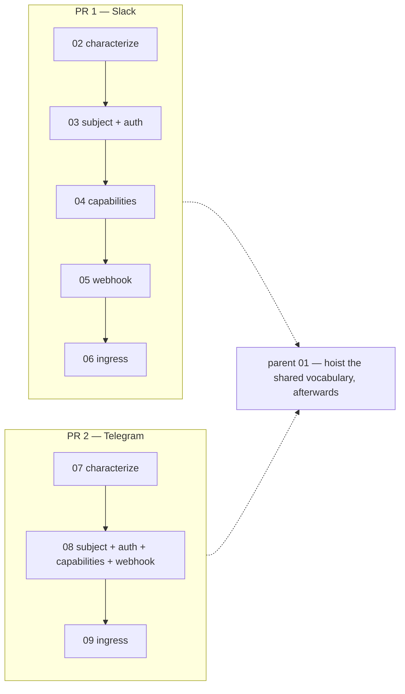

# Deepen the Slack and Telegram Adapters around workflow seams

> **Status:** shipped by PR #174
> **Updated:** 2026-08-01
> **Vocabulary:** CONTEXT.md
> **Predecessors:** `.plans/completed/smarter-github-pr-adapter-breakup.md` (delivered by PR #156),
> `.plans/remaining-adapter-breakup.md` (this document is the ticket-level expansion of its
> stages 02–09)
> **Related:** `.agents/skills/adapter-development`, `.plans/completed/adapter-capability-interfaces.md`

## Current solution

One Adapter has the architecture. `backend/src/adapters/providers/github_pr/` is a 213-line
composition-root `adapter.rs`, a `webhook::normalize` that returns a value, an `ingress::receive`
that owns admission, a 78-line transport-only handler, and 220 `pub(super)` items against 9 `pub`
ones.

Slack (3,443 lines) and Telegram (2,741 lines) have the shape the GitHub PR Adapter had before it.

Evidence below is against `766f416`, the current tip.

### Slack today — 3,443 lines across 10 files

| Responsibility | Where it lives now | Cost |
|---|---|---|
| Adapter identity, construction, workspace memoization | `slack/adapter.rs:154`–`:190` | The only part of the file that belongs there. |
| Webhook normalization | `slack/adapter.rs:298`–`:675`, 378 lines | Carries `#[expect(clippy::cognitive_complexity)]` at `:294` whose stated reason is this work. |
| Sender identity resolution | `slack/adapter.rs:232`, `:262`, `:772` | Raw `sqlx` inside the Adapter type; three entry points with different precedence. |
| Slack destination and reaction-target parsing | `slack/adapter.rs:686`, `:743` | Free functions with no owning type; each caller re-parses strings. |
| Reply instructions, sender labels, thread hints | `slack/adapter.rs:29`–`:95`, `:1109`–`:1146` | 67 lines of prompt text in the same file as ingress parsing. |
| Ten capability implementations | `slack/adapter.rs:765`–`:1224` | Eleven `impl` blocks (identity plus ten capabilities) in one file. |
| Ingress orchestration | `slack/handlers.rs`, 224 lines | Decodes JSON, answers `url_verification`, resolves connection and Subscription, reads Bindings for `is_tracked_thread`, normalizes, rebuilds the destination, derives the admission id, admits, classifies. |
| Slack Web API | `slack/api.rs`, 804 lines | Correct seam; `SlackApi::with_base_url` at `:139` already injects. |
| mrkdwn, access policy, config, signature, external ids | `format.rs`, `access.rs`, `config.rs`, `signature.rs`, `external_id.rs` | Support modules; keep. |
| Durable delivery registration | `slack/delivery.rs`, 41 lines | Already canonical: one kind, `slack.inbound_message`, on the shared `InboundMessageHandler`. |

### Telegram today — 2,741 lines across 10 files

| Responsibility | Where it lives now | Cost |
|---|---|---|
| Webhook normalization | `telegram/adapter.rs:61`–`:284`, 223 lines | Same shape as Slack, plus three Sender writes (below). |
| Ingress orchestration | `telegram/adapter.rs:671`–`:786`, 115 lines | A free function on the Adapter type, not a seam; two callers. |
| Webhook transport | `telegram/handlers.rs`, 103 lines | Performs its **own** connection and Subscription resolution at `:54` purely to find `secret_token`, then discards the result. |
| Long-poll transport | `telegram/poller.rs`, 252 lines | Second ingress entry point; skips the secret check entirely (correctly), by construction rather than by statement. |
| Sender identity resolution | `telegram/adapter.rs:293` | Raw `sqlx` against `provider_tokens` inside the Adapter type. |
| Destination and reaction-target parsing | `telegram/adapter.rs:373`, `:628` | As Slack. |
| Nine capability implementations | `telegram/adapter.rs:287`–`:622` | As Slack. |
| Bot API, access policy, pairing, config, external ids | `api.rs`, `access.rs`, `pairing.rs`, `config.rs`, `external_id.rs` | Support modules; keep. |
| Durable delivery registration | `telegram/delivery.rs`, 41 lines | Already canonical: `telegram.inbound_message`. |

### Behavior the current shape makes easy to get wrong

Each row was re-verified against `766f416`.

| Adapter | Observed behavior | Evidence |
|---|---|---|
| Slack | Normalization posts to Slack. An unmapped top-level sender triggers `chat.postMessage` from inside `parse_event`, before admission, with the result discarded. Normalization therefore cannot be exercised without a Slack endpoint. | `slack/adapter.rs:634` |
| Slack | Normalization **writes to the database**: an `INSERT … ON CONFLICT DO NOTHING` into `user_provider_ids` caching the Slack user id. This is past what the invariant allows even generously — a lookup is a read. | `slack/adapter.rs:571` |
| Slack | `SlackWebhookResult::Challenge` is unreachable from HTTP. The handler answers `url_verification` and returns at `:70`–`:86`; the arm at `handlers.rs:154` cannot run, and the challenge is parsed in two places against the same top-level `type` field. | `handlers.rs:70` vs `adapter.rs:323` |
| Slack | Signature verification has two call sites — `handlers.rs:79` for the challenge, `adapter.rs:316` for everything else. Exactly one runs per delivery, so the cost is duplication and the risk that a future branch reaches neither, not double work. | as cited |
| Slack | The binding destination is built twice per threaded delivery — once at `handlers.rs:126` to answer "is this a tracked thread", once at `:159` to admit — from two differently-shaped `thread_properties` literals. | as cited |
| Slack | Four `pub` methods on `SlackAdapter` have no caller in the crate: `auth_test` (`:195`), `list_channels` (`:200`), `post_message` (`:213`), `get_channel_name` (`:223`). `open_dm` (`:205`) is called only from `:1031`. `bootstrap.rs:121` reaches around the Adapter to `SlackApi::new` for the same `auth.test`. | `slack/adapter.rs:192`–`:229` |
| Telegram | Normalization performs three Sender effects before admission: the `/start` reply (`:121`), the `/help` reply (`:133`), and — through `access::enforce_dm_access` — a `pairing_requests` upsert (`access.rs:59`) plus a pairing message (`access.rs:72`). | as cited |
| Telegram | Every update resolves the connection and Subscription **twice, under different keys**: `handlers.rs:58` uses `"*"` for private chats and the chat id otherwise; `adapter.rs:719` always uses the chat id with the exact-then-wildcard fallback in `bindings/runtime.rs:105`. The `secret_token` verified belongs to the handler's Subscription, which need not be the one the delivery routes under. When the handler's resolution finds nothing, **no secret is verified at all** and the update can still be admitted. | `telegram/handlers.rs:54`–`:80` vs `telegram/adapter.rs:719` |
| Telegram | The same double resolution double-counts the `inbound` ignore metric: `resolve_chat_provider_event` meters its own rejections at `bindings/runtime.rs:99`, `:109`, `:127`. | as cited |
| Telegram | `update_id` is extracted and rejected-on-missing twice, in `adapter.rs:72` and `adapter.rs:691`, with two independently worded `BadRequest`s. | as cited |
| Both | `pub` is the default. Slack exports 46 `pub` items and 0 `pub(super)`; Telegram 44 and 0; the finished GitHub PR Adapter exports 9 and 220. | `providers/*/mod.rs` |
| Both | No test replays a signed envelope or drives ingress. `backend/tests/adapter_inbound_delivery_test.rs:11` records exactly why: "the webhook request itself is not replayed because that would need a signed Slack envelope and a live Slack API for `users.info`". | as cited |

## Planned solution

Apply the GitHub PR architecture to both chat Adapters, scaled to what they actually do: one durable
kind each, on the shared inbound handler, so neither grows workflow modules.

Keep every delivery kind, payload meaning, deduplication identity, audience rule, metric label, and
retry budget unchanged, with one named exception (Decision 5).

### Target trees

```text
slack/                      telegram/
├── mod.rs                  ├── mod.rs
├── adapter.rs   (~120)     ├── adapter.rs   (~90)
├── auth.rs                 ├── auth.rs
├── subject.rs              ├── subject.rs
├── ingress.rs              ├── ingress.rs
├── webhook.rs              ├── webhook.rs
├── outbound.rs             ├── outbound.rs
├── reactions.rs            ├── reactions.rs
├── context.rs              ├── delivery.rs      (unchanged)
├── text.rs                 ├── handlers.rs      (transport only)
├── delivery.rs (unchanged) ├── poller.rs        (transport only)
├── handlers.rs (transport) ├── api.rs           (unchanged)
├── api.rs      (unchanged) ├── access.rs        (policy only)
├── access.rs   (unchanged) ├── pairing.rs       (unchanged)
├── format.rs   (unchanged) ├── config.rs        (unchanged)
├── config.rs   (unchanged) └── external_id.rs   (unchanged)
├── external_id.rs
└── signature.rs
```

No new files beyond those. Telegram gets no `text.rs` or `context.rs`: it renders one task link and
implements no `fetch_context`.

### Slack move map

| Current | Lines | Target |
|---|---|---|
| `build_slack_reply_instructions` | `adapter.rs:29`–`:95` | `text.rs` |
| `is_ignored_message_subtype` + its three tests | `:108`–`:140`, `:1263`–`:1303` | `webhook.rs` |
| `SlackWebhookResult` | `:143`–`:151` | `webhook.rs`, as `Normalization` |
| `SlackAdapter`, `new`, `ensure_workspace_id`, `signing_secret` | `:154`–`:190` | stays in `adapter.rs`, plus `pub(super)` accessors and a `with_api` constructor |
| `auth_test`, `list_channels`, `post_message`, `get_channel_name` | `:192`–`:229` | **deleted** — no callers |
| `open_dm` | `:205` | inlined into `outbound.rs::dm_destination` as `self.api().open_dm(..)` |
| `resolve_user_by_slack_id`, `resolve_user_by_email`, `impl AdapterUserIdentity` | `:232`, `:262`, `:772` | `auth.rs` |
| `parse_event` | `:298`–`:675` | `webhook.rs::normalize`; its `users.info` + mapping + cache write move to `auth.rs`; its `chat.postMessage` becomes a returned effect |
| `parse_slack_destination`, `parse_slack_reaction_target`, `impl AdapterDestinationBuilder` | `:686`, `:743`, `:804` | `subject.rs` |
| `impl Adapter`, `impl AdapterOutboundContent` | `:765`, `:860` | stay |
| `impl AdapterBindingReply` / `MessageReply` / `DirectDestination` / `DirectMessage` / `NewThread` | `:866`–`:1081` | `outbound.rs` |
| `normalize_slack_emoji`, `impl AdapterReactions` | `:732`, `:1083` | `reactions.rs` |
| `impl AdapterInboundPresentation` | `:1109`–`:1224` | `context.rs`; the rendered strings it returns come from `text.rs` |
| `admission_event_id` | `handlers.rs:21` | `ingress.rs` |
| Everything else in `handlers.rs` | `:45`–`:224` | `ingress.rs::receive`; the handler keeps extraction, metrics, and response mapping |
| `resolve_slack_bot_user_id` | `registry/bootstrap.rs:112` | `auth.rs`, so `api.rs` can go private |

Three copies of `write!(text, "\n<{url}|View task>")` (`:887`, `:1046`, and the absent one on
`post_to_destination`) collapse into one `text.rs` helper. That the direct-send path does **not**
append the link today is existing behavior and is preserved, not unified.

### Telegram move map

| Current | Lines | Target |
|---|---|---|
| `TelegramWebhookResult` | `adapter.rs:24`–`:29` | `webhook.rs`, as `Normalization` |
| `TelegramAdapter`, `new`, `api` | `:32`–`:46` | stays, plus `with_api` and `pub(super)` accessors |
| `parse_update` | `:61`–`:284` | `webhook.rs::normalize`; `/start`, `/help`, and the pairing decision become returned effects |
| `strip_bot_mention` + its four tests | `:788`–`:802`, `:812`–`:842` | `webhook.rs` |
| `impl AdapterUserIdentity` | `:293`–`:317` | `auth.rs` |
| `parse_telegram_direct_destination`, `parse_telegram_reaction_target`, `impl AdapterDestinationBuilder` | `:373`, `:628`, `:319` | `subject.rs` |
| `impl AdapterBindingReply` / `MessageReply` / `DirectDestination` / `DirectMessage` / `NewThread` | `:387`–`:580` | `outbound.rs`; the four copies of the `[View task]` append collapse into one private helper |
| `impl AdapterReactions` | `:582`–`:615` | `reactions.rs` |
| `impl Adapter`, `impl AdapterOutboundContent`, `impl AdapterInboundPresentation` | `:287`, `:371`, `:617` | stay — the last is four lines forwarding to `external_id::aliases`, matching `github_pr/adapter.rs:129` |
| `TelegramUpdateOutcome`, `resolve_and_process_telegram_update` | `:652`–`:786` | `ingress.rs` |
| Resolution and secret check | `handlers.rs:40`–`:81` | `ingress.rs::receive` |
| Pairing effect (`upsert_pairing_request` + send) | `access.rs:59`–`:79` | the decision stays in `access.rs` and becomes pure; the effect is applied by `ingress.rs` |

### Target module interfaces

Slack:

```rust
// ingress.rs
pub(super) struct WebhookRequest<'a> { timestamp: &'a str, signature: &'a str, body: &'a [u8] }
pub(super) enum Outcome {
    Challenge(String),
    Processed { event_type: String },
    Ignored { event_type: String, reason: &'static str, rule_id: String, connection_id: String },
}
pub(super) async fn receive(
    state: &AppState, adapter: &SlackAdapter, request: WebhookRequest<'_>,
) -> Result<Outcome, IngressError>;

// webhook.rs — sender lookup is the only I/O; no writes, no posts to Slack
pub(super) struct NormalizeContext<'a> {
    config: &'a LoopContext, api: &'a SlackApi, db: &'a DbPool,
    bot_user_id: Option<&'a str>, is_tracked_thread: bool,
}
pub(super) enum Normalization {
    Message { message: Box<InboundMessage>, effects: Vec<Effect> },
    Ignored { reason: &'static str, effects: Vec<Effect> },
}
pub(super) enum Effect {
    /// `chat.postMessage` to `{channel, thread_ts}` — today's unmapped-sender notice.
    PostNotice { channel: String, thread_ts: String, text: String },
    /// The `user_provider_ids` upsert `parse_event` performs at adapter.rs:571.
    CacheProviderId { user_id: String, slack_user_id: String },
}

// auth.rs
pub(super) async fn resolve_inbound_sender(
    api: &SlackApi, db: &DbPool, slack_user_id: &str, allow_bot_messages: bool,
    already_bot: bool,
) -> Result<SenderIdentity, AdapterError>;   // one users.info, then provider-id then email
pub(super) async fn bot_user_id(api: &SlackApi, configured: Option<&str>) -> Option<String>;
pub(crate) async fn resolve_bot_user_id(bot_token: &str, configured: Option<&str>) -> Option<String>;
```

Two amendments made while implementing stage 03, both forced by behavior the interface above did not
account for:

- `resolve_inbound_sender` takes `already_bot`. The `bot_id` field on the event produces a bot
  verdict *before* the sender lookup, and today's code carries it into the lookup: a sender flagged
  there is never resolved by email and never cached, exactly like one `users.info` flags. Without the
  flag the two verdicts diverge and a `bot_id`-flagged sender would start resolving by email.
  `SenderIdentity::Unmapped` returns the merged verdict so the caller's `is_bot_message` — which the
  unmapped-sender branch reads — stays what it is today.
- `resolve_bot_user_id` keeps the composition root's signature (`&str` token) and delegates to a
  `bot_user_id(api, …)` seam that takes the client. `bootstrap.rs` naming `SlackApi` is what the move
  exists to remove, and the `&SlackApi` form is what makes the stub-backed test possible; both are
  wanted, so both exist.

Four more from stages 05–06, all in service of the no-behavior-change rule:

- `Outcome::Ignored` carries `rule_id` and `connection_id`. Slack's `record_webhook` labels the
  routing pair on every provider-raised ignore and leaves it empty for `no_channel` and `no_trigger`;
  with metrics moved to the handler, the outcome has to carry what the label needs or the labels
  change.
- `IngressError::Ingress` is propagated to the caller as its `AdapterError` rather than acknowledged.
  Slack's handler has never acknowledged a rejected delivery — a bad signature is a `401` today and
  stays one. (This is where Slack and GitHub PR genuinely differ: GitHub's `Ingress` is a metered
  `200`. The variant names still line up for the later hoist; only the transport treatment differs,
  and it differs today.)
- `receive` builds one `BindingDestination` per delivery, from the event's own coordinates, and uses
  it for both the tracked-thread lookup and the admitted payload. The handler used to build two —
  with different `ts` values — and the second build carried an unreachable failure arm that recorded
  an `error`/`internal` metric. No Slack destination can fail to be built, so `subject.rs` grew an
  infallible `thread_destination` and the metric label disappears with the arm. It was never emitted.
- The single signature-verification call site sits **below** the `no_channel` and `no_trigger`
  returns, not above them. Verifying first is one line shorter and reads better, but it moves an
  unsigned request to an unknown channel from `200` + `ignored`/`no_trigger` to a `401` with no
  metric, and this stage is not where that decision belongs. `receive` therefore reads the body,
  resolves, and *then* verifies — one call site, reached by both the endpoint check and a routed
  event, in the position the flat handler and `github_pr/ingress.rs` both put it. Whether an unsigned
  request should reach the routing tables at all is a real question; it is not this PR's.

`slack::delivery` stays `pub` where `github_pr`'s is `pub(crate)`, and the difference is not an
oversight: `backend/tests/adapter_inbound_delivery_test.rs:126` registers the handler by hand, and an
integration test is a separate crate. It narrows the day that test stops naming it.

One more, from stage 04: deleting `SlackAdapter::list_channels` and `get_channel_name` left
`SlackApi::list_conversations` and `get_channel_info` with no caller, and narrowing `mod.rs` in stage
06 made the compiler say so. Both are deleted, along with the four response types only they used.

Telegram:

```rust
// ingress.rs
pub(super) enum Transport<'a> {
    /// The webhook. The header is verified against the routing Subscription.
    Webhook { secret_header: Option<&'a str> },
    /// Long polling. Telegram sends no secret here; there is nothing to verify.
    Poll,
}
pub(super) enum Outcome { Admitted, Ignored { reason: &'static str } }
pub(super) async fn receive(
    state: &AppState, adapter: &TelegramAdapter, body: &[u8], transport: Transport<'_>,
) -> Result<Outcome, IngressError>;

// webhook.rs — sender lookup is the only I/O; no Bot API calls at all
// The update arrives decoded: `receive` needs the envelope to route on, and
// decoding the same bytes in both is what the split is supposed to end.
pub(super) async fn normalize(
    payload: &serde_json::Value, ctx: &NormalizeContext<'_>,
) -> Result<Normalization, AdapterError>;
pub(super) struct NormalizeContext<'a> {
    config: &'a LoopContext, tg_config: &'a TelegramAdapterConfig,
    db: &'a DbPool, is_private_chat: bool,
}
pub(super) enum Normalization {
    Message { message: Box<InboundMessage>, effects: Vec<Effect> },
    Ignored { reason: &'static str, effects: Vec<Effect> },
}
pub(super) enum Effect {
    /// `/start` and `/help`, today's inline answers.
    Reply { chat_id: String, text: String },
    /// The pairing upsert and message `access::enforce_dm_access` performs today.
    RequestPairing { chat_id: String, from_id: i64, meta: serde_json::Value },
}
```

Each `receive` returns its own Adapter-local error with the same three transport treatments
(Decision 1):

```rust
// slack/ingress.rs and telegram/ingress.rs — one copy each, pub(super)
pub(super) enum IngressError {
    NotAdmitted(AdmitError),   // nothing durable was written — do not acknowledge
    Unidentifiable(String),    // no retry supplies the missing field — 400
    Ingress(AdapterError),     // rejected here; logged, metered, acknowledged
}
```

### Problem

| Maintainer | Current cost | Planned leverage |
|---|---|---|
| Slack maintainer | Changing which senders are accepted means editing a 378-line function that verifies signatures, calls `users.info`, writes a row, posts to Slack, and constructs the message. | Edits `webhook.rs`, proven through one interface whose only reachable call is a stubbed `users.info`. |
| Telegram maintainer | The secret rule is in the handler, the routing rule is in the Adapter type, and the poller reaches a third entry point. No file states the policy. | Reads and edits one `ingress::receive` whose transport differences are an enum, not a call graph. |
| On-call | An unverified secret is invisible: the handler's `None` resolution silently skips verification while the delivery still routes. | One resolution, one secret, asserted by a test. |
| Reviewer | A diff touching outbound replies cannot be reviewed without re-reading inbound parsing — they share a file. | One capability, one module. |
| Test author | Neither Adapter's normalization can run without a live Sender: `SlackAdapter::new` and `TelegramAdapter::new` build their clients internally. | `with_api` plus `stub_provider`; normalization needs neither. |

### Behaviour

#### A chat Sender delivers an event

| Given | When | Then |
|---|---|---|
| The request names a configured Adapter connection. | The handler passes transport facts to `receive`. | Ingress verifies once, resolves connection and Subscription once, normalizes, applies effects, and admits before reporting success. |
| No connection or no Subscription matches. | Ingress evaluates the delivery. | The current ignore reason and metric label are emitted unchanged, once. |
| Normalization decides the event is not routable. | Ingress classifies it. | The same reason string reaches the same metric as today (Slack: `own_bot`, `system_subtype`, `trigger_filter`, `access_policy`, `empty_message`, `empty_after_format`, `bot_account`, `user_not_mapped`; Telegram: `not_routable`). |
| Admission fails. | The handler maps the result. | The request is not acknowledged, exactly as today. |
| The Sender re-delivers. | Admission runs. | The delivery collapses onto the same record under the same event id as today — Slack's envelope `event_id`, Telegram's `update_id`. |

#### A Slack event names an unmapped sender

| Given | When | Then |
|---|---|---|
| A top-level message arrives from a Slack user with no mapped account. | Normalization runs. | It returns `Ignored { reason: "user_not_mapped" }` carrying a `PostNotice` effect naming the channel, the reply target, and the same text — having spent its one `users.info` and written nothing to Slack. |
| Ingress receives that value. | It applies the effect. | It posts the same message to the same thread, best-effort, discarding the result — including on re-delivery, exactly as today. |

#### Telegram answers `/start`

| Given | When | Then |
|---|---|---|
| A private chat sends `/start`. | Normalization runs. | It returns `Ignored` carrying one `Reply` effect and makes no Bot API call. |
| Ingress applies it. | The reply is sent. | Same text, same chat, best-effort, and the update is still ignored — as today. |

#### A Telegram update arrives on the webhook

| Given | When | Then |
|---|---|---|
| The routing Subscription carries a `secret_token` and the header matches. | Ingress verifies. | The update proceeds. |
| The routing Subscription carries a `secret_token` and the header does not. | Ingress verifies. | `SignatureInvalid`, as today. |
| No Subscription matches the chat. | Ingress resolves. | Ignored before any secret question arises — and metered **once**, not twice (Decision 5). |
| The update arrives from the poller. | Ingress runs with `Transport::Poll`. | No secret is expected or verified, as today. |

## Decisions

### 1. The ingress vocabulary is copied now and hoisted later

Both Adapters get their own `receive` — every step inside it is Adapter policy — returning an
`Outcome`/`IngressError` pair. Neither invents a fourth transport treatment: the three are
"acknowledged", "not acknowledged", and "`400`, because no retry supplies the missing field".

The pair is declared **inside each Adapter**, not in `adapters/ingress.rs`, and that is a
concession to how this work is being executed rather than a design preference. The two stacks run as
two parallel tickets; a shared enum is one file both would create, and a merge conflict in the one
place where getting the acknowledgment class wrong loses deliveries is a bad trade for saving
fourteen lines.

Parent ticket 01 hoists all four Adapters onto one vocabulary afterwards, when GitHub PR, Linear,
Slack, and Telegram are all sitting on the same three variants and the hoist is a pure deletion.
Each `IngressError` here is therefore written to be *identical* to the one in the block above —
same variant names, same order, same meaning — so that hoist stays mechanical.

**Amended during stage 09.** The variants are what the hoist needs; the *transport treatment* of one
of them is not uniform, and the block's "rejected here; logged, metered, acknowledged" gloss on
`Ingress` describes GitHub PR, not Telegram. Telegram's handler answers every one of those rejections
with a non-2xx today — `401` for a refused secret, `400` for a malformed body, `500` for a database
read — so returning `200` for them would be a second behaviour change in a stage allowed exactly one
(Decision 5). Stage 09 therefore keeps Telegram's `Err` return and maps the three variants onto the
statuses they already produced: `NotAdmitted` through `AdapterError::from(AdmitError)`,
`Unidentifiable` to `BadRequest`, `Ingress` unchanged. Whoever hoists the enum must hoist the *type*,
not the handler policy — each Adapter keeps its own match on the three variants. Whether Telegram
should acknowledge the `Ingress` class is a real question, and it is a behaviour change that belongs
in its own change with its own test, not smuggled in under a refactor.

Two of those rejections were previously returned *before* the webhook metric was reached — a body
that is not JSON, and a refused secret, both of which today's handler answers ahead of the call it
meters. Under one `receive` they arrive at the same `Err` arm as everything else and are metered
`outcome="error", reason="delivery_failed"`. No label *value* is new; the two paths simply stopped
being invisible.

**Amended again during stage 09 review.** Neither `Ingress` nor `NotAdmitted` may carry a `#[from]`
on `AdapterError`, and the second variant is not reachable on the chat Adapters at all:

- **No blanket `#[from]` on `Ingress`.** It is the class the poller retries forever, so a `?` that
  reaches it by inference — rather than because someone decided this failure is worth another
  delivery — wedges the poller on one update. Every construction is written out
  (`.map_err(IngressError::Ingress)`), which makes the class a decision a new step has to type.
  `NotAdmitted` keeps its `#[from]`: `AdmitError` has one class and no such choice exists.
- **`NotAdmitted` is unreachable on this path.** GitHub PR admits through
  `adapters::ingress::admit_delivery`, which returns `AdmitError`; the chat Adapters admit through
  `inbound_delivery::admit_inbound_message`, which converts it to `AdapterError` first. Telegram's
  admission failures therefore land in `Ingress`. Nothing behaves differently — both classes hold
  the offset back and answer the webhook identically — but the variant is a promise the code does
  not keep. The hoist ticket should decide whether `admit_inbound_message` propagates `AdmitError`
  rather than flattening it; changing that helper touches Slack, Linear and Webhook, so it is not
  this plan's to change.

### 2. Normalization returns effects; it does not perform them

Slack's `chat.postMessage` (`adapter.rs:634`) and `user_provider_ids` write (`:571`), and Telegram's
`/start`, `/help`, and pairing writes, all become values in the returned `effects` vector, applied by
ingress immediately after normalization and before admission.

The re-delivery duplication documented at `slack/adapter.rs:352` is preserved exactly. Making the
notice deduplicated is a behavior change with its own design question and is out of scope.

`access::enforce_dm_access` splits: the policy decision stays in `access.rs` and becomes a pure
function; the pairing upsert and message become the `RequestPairing` effect. `enforce_group_access`
is already pure and does not move.

### 3. Sender resolution keeps its position in the sequence

Slack calls `users.info` only after the cheap filters have passed (`adapter.rs:528`, below the
own-bot, subtype, bot-id, trigger, access, and empty-text checks). Resolving the sender in ingress
*before* `normalize` would spend a `users.info` on every event those filters drop — a new API call on
unchanged behavior, which the skill counts as a regression.

So `webhook::normalize` takes the API client and the pool — as `github_pr`'s `NormalizeContext` takes
`db` — and calls `auth::resolve_inbound_sender` at the same point in the sequence it is called today.
Sender-to-user lookup is the one I/O the invariant permits inside normalization; the *write* that
follows it is not, and becomes an effect. Every ignore reason that precedes the lookup is therefore
still provable with no client at all.

Moving the lookup later — into the durable handler — is not on the table: it would change the
`InboundMessage.user_id` a retry observes.

### 4. Capability implementations live with behavior

Both Adapters' capability `impl` blocks move to the module that owns the behavior. `adapter.rs`
gains no delegating method. The registrars in `registry/mod.rs` are unchanged except for narrowing
to `pub(crate)`, matching `register_github_pr` at `:170`.

`ensure_workspace_id` (`slack/adapter.rs:175`) stays in `adapter.rs`: it is memoized construction
state over a `OnceCell` field, and moving it to `auth.rs` would mean exposing the cell through an
accessor that exists for one caller.

`impl AdapterInboundPresentation for SlackAdapter` lives in `context.rs` — a trait has one impl
block, and `fetch_context` is the only method of it with behavior. The strings the other four
methods return come from `text.rs`.

### 5. Telegram resolves once, and the secret belongs to the routing Subscription

This is the one intentional behavior change.

| Today | After |
|---|---|
| `handlers.rs:58` resolves with `"*"` for private chats, verifies that Subscription's `secret_token`, discards the result. | `ingress::receive` resolves once, with the chat id and the existing exact-then-wildcard fallback. |
| `adapter.rs:719` resolves again with the chat id and routes under whatever it finds. | The verified `secret_token` belongs to the Subscription the delivery routes under. |
| A handler resolution that finds nothing skips verification while the Adapter may still admit. | An update with no Subscription is ignored before any secret question arises. |
| `resolve_chat_provider_event` meters twice per ignored update. | Once. |

Consequence stated in the PR body: **the `inbound` ignore metric for Telegram halves on ignored
updates.** Accepted (Open question 1), with a deploy marker on the dashboard so the step reads as the
correction it is.

Characterize before changing: one test pinning today's two-resolution behavior, one pinning the
intended behavior, and the note above.

### 6. One `receive`, two transports

The poller's "no secret to verify" is true today because it calls a function that never looks for
one. After the move both entry points call the same `receive`, so the rule becomes an argument:
`Transport::Poll` carries no header and skips verification; `Transport::Webhook` carries the header
and verifies it against the routing Subscription. A rule that is data can be tested; a rule that is
a choice of call site cannot.

The poller's hold-back rule (`poller.rs:47`) is rewritten against the typed error rather than
against `AdapterError::BadRequest`:

| `IngressError` | Poller |
|---|---|
| `NotAdmitted` | Hold the offset back; back off. |
| `Ingress` (database read, transport) | Hold the offset back; back off. |
| `Unidentifiable` (missing `update_id`, malformed body) | Advance past it and log — no re-delivery fixes it. |

That is the same partition `is_worth_redelivering` implements today, stated once instead of inferred
from which errors the path happens to raise. The long comment at `poller.rs:36`–`:46` warning that a
fifth error kind would break the inference is deleted with the inference.

**Amended during stage 09 review.** The table only holds if the errors are *classified* on the way
in, and one step gets that wrong for free: `normalize` rejects a malformed envelope — a chat with no
id, a message with no `message_id` — as `AdapterError::BadRequest`, which lands in `Ingress` under a
blanket `#[from]`. Today's poller drops exactly those (`!matches!(error, BadRequest(_))`); a blanket
`Ingress` would retry them forever and block every update queued behind. So `receive` classifies the
normalization result rather than propagating it: `BadRequest` becomes `Unidentifiable`, everything
else stays `Ingress`. The webhook is unaffected — both produce the same `400` with the same message.
Slack's `receive` should classify at the same seam; a `#[from]` on this variant is a trap, because
"which error kinds are permanent" is exactly the inference the typed error was meant to replace.

### 7. Slack's challenge is answered in one place

`url_verification` moves entirely into `receive`, which returns `Outcome::Challenge(String)`; the
handler maps it to `200` with the challenge body. The duplicate parse at `handlers.rs:81` and the
unreachable arm at `:154` both disappear, and there is one signature-verification call site.

### 8. Injection points come before the characterization tests

`SlackAdapter::new` and `TelegramAdapter::new` build their API clients internally, so there is
nowhere to put a stub. Each Adapter gains a `#[cfg(test)] pub(super) fn with_api(..)` taking an
already-built client, added in the same ticket as its first characterization test and before it.
`SlackApi::with_base_url` (`api.rs:139`) and `TelegramApi::with_base_url` (`api.rs:28`) already
exist and need no change. No test reaches the real Sender; none sets a process-global.

### 9. Metric label vocabularies do not change

Slack's per-reason `ignored` labels are preserved string-for-string. Telegram keeps its single
`not_routable` reason even though `receive` now knows a more specific one — the typed reason is
logged, not metered. Enriching that label is a dashboard decision, not a refactor.

### 10. Dead public surface is deleted, not moved

`auth_test`, `list_channels`, `post_message`, and `get_channel_name` on `SlackAdapter` have no
caller and are removed rather than carried into a new module. `open_dm` is inlined at its one call
site. `bootstrap.rs:112` stops reaching around the Adapter into `SlackApi`, which is what lets
`slack/api.rs` become private.

**Amended during stage 08.** `AdapterUserIdentity::resolve_user` turns out to be a fifth piece of
dead surface, and this plan is what kills it. All four Adapters implement it and
`registry/mod.rs:97` registers every one, but nothing dispatches through `Adapters::user_identity`
— which already carries a `dead_code` allow saying so. Its one production caller anywhere was
`telegram/adapter.rs:214`, and Decision 3 moves that call to `telegram::auth::resolve_sender`,
because normalization resolves the sender without holding the Adapter; stage 03 does the same to
Slack. So after this plan the trait is registration-only.

Deleting it is registry shape, which the Out of scope table settles. Stage 08 therefore leaves the
trait, the four impls, and the registrations in place and adds an `allow(dead_code)` with the
reason, next to the identical one on the accessor. Whoever removes the capability should remove all
of it — trait, impls, `user_identities` map, accessor, and the two `registry/tests.rs` assertions —
in one change, and should confirm first that no out-of-tree Adapter is dispatching through it.

**Amended during stage 09.** Narrowing `telegram/mod.rs` reveals a seventh and eighth piece, and
neither is this plan's to delete. `pairing::{find_by_code, list_pending, list_pending_for_user,
approve_request, prune_expired}` — the entire *approval* half of pairing — and
`api::{send_chat_action, get_chat}` have no caller once the modules stop being `pub`; they were
reachable only from outside the Adapter, and nothing outside reaches for them. `telegram/api.rs`
internals and `telegram/pairing.rs` are both in the Out of scope table, so stage 09 marks them with
`allow(dead_code)` and the reason rather than touching them. The pairing half in particular should
not be deleted on a dead-code argument alone: pairing that hands a user a code no one can approve is
a dead end for that user, and the missing caller is more likely a missing UI than a dead feature.

## Seams and testing

### Seam test matrix

| Module | Dependencies | Seam | Required proof |
|---|---|---|---|
| `slack/webhook.rs` | Stubbed `users.info` and a lazy pool, for the sender-lookup branch only | `normalize` | Every event type and subtype, each ignore reason, bot attribution, thread-reply fallback, the unmapped-sender effect, tracked-thread bypass, DM bypass, blocks/attachments text precedence, external id, audience, and `provider_context`. Every reason raised before `adapter.rs:528` is asserted with **no** client reached at all. |
| `telegram/webhook.rs` | A lazy pool, for the sender-lookup branch only | `normalize` | Absent message, absent `from.id`, empty text, `/start` and `/help` effects, mention stripping, private versus group policy, forum-topic subjects, reply threading, and the wildcard `source_id` rule at `adapter.rs:240` — with no Bot API call on any path. |
| `slack/ingress.rs`, `telegram/ingress.rs` | Local database, stubbed Sender API | `receive` | Signature and secret policy, single resolution, ignore reasons and metric labels, admission identity, duplicate admission, effect application, and the acknowledgment class of each error variant. |
| `slack/auth.rs`, `telegram/auth.rs` | Stubbed API, local database | Use-case resolution | Provider-id-before-email precedence, bot and app accounts never resolved by email, absent email, absent user, and the `allow_bot_messages` interaction. |
| `slack/subject.rs`, `telegram/subject.rs` | None | Fallible parse and build | Every destination shape including the raw-channel fallback (`adapter.rs:722`), malformed input, canonical key, topic versus thread key, and reaction targets. |
| `slack/outbound.rs`, `telegram/outbound.rs`, `*/reactions.rs` | Stubbed API | The capability traits | Reply shape, thread targeting, task-link rendering, external id, and **request count**. |
| `slack/context.rs` | Stubbed API | `fetch_context` | Cursor filtering, the `slack:ts:` prefix strip, exclusion list, and the empty result. |
| `telegram/poller.rs` | Stubbed ingress outcome | The hold-back partition | One case per row of the Decision 6 table. |

### Characterization required before any move

| Risk | Characterization | Adapter |
|---|---|---|
| Admission identity | The same Sender event id admits one record; a re-delivery is a duplicate; Slack's fallback id (`handlers.rs:21`) is stable and distinct. | Both |
| Acknowledgment class | An ingress rejection stays acknowledged; an admission failure stays unacknowledged. | Both |
| Ignore reasons | Every current `record_webhook` and `record_inbound` reason string is asserted. | Both |
| Signature policy | Valid, invalid, absent header, absent secret. | Both |
| Challenge | A `url_verification` body returns `200` with the challenge and verifies the signature. | Slack |
| Unmapped sender | The notice is posted to the right thread with the right text and the outcome is `ignored:user_not_mapped`. | Slack |
| Tracked-thread bypass | A reply in a Binding-backed thread is accepted regardless of trigger mode. | Slack |
| Provider-id cache | A first mapping writes the row; a second delivery does not fail on the conflict. | Slack |
| Double resolution | Today's two resolutions and two metric emissions, pinned before Decision 5 changes them. | Telegram |
| Pairing | A `Pairing` policy upserts one request and sends one message, and the update is ignored. | Telegram |
| Poller acknowledgment | The offset advances only past updates whose routing was accepted. | Telegram |

### API-call budgets to preserve

| Workflow | Budget |
|---|---|
| Slack normalization, mapped sender | One `users.info`. |
| Slack normalization, unmapped top-level sender | One `users.info`, one `chat.postMessage`. |
| Slack event dropped by any filter before `:528` | **Zero** Slack calls. |
| Slack reply | One `chat.postMessage`, plus one `files.upload` per attachment. |
| Slack direct send | One `auth.test` on the first send only (memoized), one `chat.postMessage`. |
| Slack context fetch | One `conversations.replies`. |
| Telegram reply | One `sendMessage` (chunked as today). |
| Telegram reaction | One `setMessageReaction`. |
| Telegram `/start`, `/help`, pairing | One `sendMessage` each. |

## Staged migration and acceptance criteria

**The eight stages ship as two PRs, one per Adapter** (Open question 2, answered): stages 02–06 are
the Slack PR, stages 07–09 the Telegram PR. Within a PR the stages keep their order and become the
commit sequence — `refactor:` for each move, `feat:`/`fix:` for the one behavior change — because
the order is what keeps each move reviewable: characterize, then move behavior that is now pinned,
then change it.

The two PRs are independent and land in either order. They share three files, each touched in
disjoint places: `registry/mod.rs` (one registrar each), `providers/mod.rs` (nothing — each Adapter
owns its own `mod.rs`), and `bindings/runtime.rs` (Telegram only, and only if the metric change
needs it). Whoever lands second rebases.

Each stage runs:

```bash
cargo clippy -p moatless-vibe-backend --all-targets -- -D warnings
cargo test -p moatless-vibe-backend
task test:integration          # when anything under backend/tests/ changed
```

The first line **does not compile on `766f416`**, and not because of anything here: `--all-targets`
pulls in `github_pr/test_support.rs:84`, which trips the workspace-denied `clippy::type_complexity`,
and 55 further warnings follow it. Verified by running it for this document. Parent ticket 00 fixes
that; until it does, **the Slack PR carries that one-line fix** and the Telegram PR does not touch
`github_pr/test_support.rs` — one owner, no conflict.

| Stage | Change | Acceptance criteria |
|---|---|---|
| 02 | Slack: add `SlackAdapter::with_api`, then characterization tests for every Slack row of both tables above. | No production change beyond the constructor; every Slack row has an executable assertion; the unmapped-sender notice is asserted against a stubbed Slack API; no test reaches slack.com. |
| 03 | Slack: `subject.rs` and `auth.rs`. `bootstrap.rs` bot-id resolution moves to `auth.rs`. | All destination and reaction-target parsing goes through one module; identity precedence and bot attribution are covered; no raw `sqlx` in `adapter.rs`; `registry/bootstrap.rs` no longer names `SlackApi`. |
| 04 | Slack: `outbound.rs`, `reactions.rs`, `context.rs`, `text.rs`; delete the four dead `pub` methods; inline `open_dm`. | Traits implemented in owning modules; `adapter.rs` has no delegating method; request counts match the budgets; the deleted methods are gone, not moved. |
| 05 | Slack: `webhook.rs::normalize` with the effect vector. | Parsing exists only in `webhook.rs`; its only I/O is the sender lookup — no Slack write, no database write; the `cognitive_complexity` expectation at `:294` is deleted, not moved; effects are applied by the caller in the same order as today. |
| 06 | Slack: `ingress.rs`; handler becomes transport-only; challenge answered once; `mod.rs` narrows. | One verification and one resolution per delivery; the destination is built once; reasons and labels unchanged; `mod.rs` exports only `adapter`, `delivery`, and `handlers` beyond the module. |
| 07 | Telegram: add `TelegramAdapter::with_api`, then characterization tests — including today's double resolution and double metric. | As stage 02, for Telegram. |
| 08 | Telegram: `subject.rs`, `auth.rs`, `outbound.rs`, `reactions.rs`, `webhook.rs`; `access.rs` decision becomes pure. | As stages 03–05, for Telegram; `normalize` makes no Bot API call and no database write; the four `[View task]` copies become one. |
| 09 | Telegram: `ingress.rs` shared by the handler and the poller; Decision 5 applied; `poller.rs` hold-back rewritten against `IngressError`. | Both entry points call one `receive`; the secret is verified against the routing Subscription; the ignore metric fires once; the poller's partition matches the Decision 6 table; the metric halving is called out in the PR body. |

Stages 02–06 and 07–09 are independent stacks. Within each stack the order is load-bearing:
`webhook.rs` cannot become pure before `auth.rs` owns sender resolution, and `ingress.rs` cannot be
a seam before `webhook.rs` returns a value.

### What the Slack PR changes on purpose

Stages 02–06 are moves, and every metric label, ignore reason, admission identity, audience, delivery
kind, and payload field survives them byte for byte. One stage ships on top of them and is not a
move — it is the `fix:` commit the sequence above reserves:

- **`users.id` is read as the `uuid` it is.** Migration `0090_user_uuid_ids.sql:167` converted
  `users.id`, `team_members.user_id`, `user_provider_ids.user_id`, and `user_credentials.user_id` to
  native `uuid`; the Slack queries were never updated with it and decoded the column into a `String`,
  so a sender who *is* mapped failed their delivery with `ColumnDecode` — the mapping failed exactly
  when it succeeded — and the provider-id cache insert bound text into the same column and failed on
  every message, swallowed by a `warn!`. Both now use `Uuid` end to end inside `auth.rs`, rendered to
  a `String` once, where `InboundMessage` demands one. Two observable changes: a mapped Slack sender's
  message is attributed to them instead of failing, and the provider-id fast path starts hitting.
  Note what migration 0090 did *not* convert: `provider_tokens.user_id` is still `TEXT` holding uuid
  text (0090 rewrote its values at `:70` and left the column alone), which is why Telegram's
  identical-looking `(String,)` decode is correct and must not be "fixed".

There is no `UserId` newtype in this codebase, and neither PR introduces one; `uuid::Uuid` at the
query boundary, matching `auth/routes.rs:1820`, is as typed as this gets today.

### Dependencies on the parent plan

Neither PR blocks on a parent ticket. Both parent tickets that looked like gates were re-examined
for the two-PR split:

| Parent ticket | Relationship | Why |
|---|---|---|
| 01 — hoist `Outcome` / `IngressError` | **Not a gate.** Runs *after* both PRs. | Decision 1: each Adapter declares the pair locally, written identically, so the hoist becomes a deletion across four Adapters at once instead of a shared file two parallel tickets both create. |
| 00 — post-#156 cleanup and `--all-targets` in CI | **Not a gate.** One line of it is borrowed. | The Slack PR carries the `type_complexity` fix so its own `--all-targets` run is green; the rest of ticket 00 — 55 warnings across ~25 files, the `ci.yml` change — stays where it is. Until it lands, CI's clippy step still has no `--all-targets`, so the test code both PRs add is linted only by hand. |

## Out of scope

| Out of scope | Reason |
|---|---|
| Changing the capability interfaces or the registry shape | Settled by `.plans/completed/adapter-capability-interfaces.md`. |
| Making Slack's unmapped-sender notice deduplicated | A behavior change with its own design question (Decision 2). |
| Scoping Telegram's `update_id` dedup key by connection | Documented at `telegram/adapter.rs:679` and correct while Telegram is single-connection. |
| Slack's connection scope inconsistency — inbound resolves on `team_id` (`handlers.rs:106`) while outbound binding lookup uses the `"default"` scope (`capabilities.rs:133`, unoverridden) | Real, pre-existing, and not caused by flatness. `subject.rs` is where a fix would land, which is why it is named here. |
| Enriching Telegram's `not_routable` metric reason | Decision 9. |
| Changing any delivery kind, payload meaning, dedup identity, audience rule, or retry budget | This is an architecture refactor. |
| Refactoring `slack/format.rs`, `slack/api.rs`, `telegram/pairing.rs`, `telegram/api.rs` | Support modules that do not cause the flatness. |
| Adapters other than Slack and Telegram | Linear (stages 11–15) and Webhook (stage 10) stay in the parent plan. |

## Open questions

| # | Question | Status |
|---|---|---|
| 1 | Is the Telegram ignore-metric halving in Decision 5 acceptable to whoever reads those dashboards? | **Answered: accepted, with the dashboard annotated.** The metric fires twice today only because the update is resolved twice; one resolution means one emission, so a double-count is being corrected rather than data lost. No label value, reason string, admission identity or delivery kind changes. Keeping the second resolution to feed a number that was never right was rejected. Follow-up outside these PRs: a deploy marker on the Telegram inbound dashboard, and a check of any alert threshold whose baseline assumed the doubled count. |
| 2 | Should each stack land as one PR, or as five and three? | **Answered: two PRs, one per Adapter.** The stages become the commit sequence inside each. |
| 3 | Slack's tracked-thread lookup builds a `thread_properties` literal with no `ts` (`handlers.rs:129`) while the admission path passes the real one (`:161`). Both produce the same subject key today because `ts` is unused in it — should `subject.rs` take typed coordinates instead of a JSON bag? | **Answered: no change to the trait.** `AdapterDestinationBuilder` takes `&serde_json::Value` and stays that way; `subject.rs` parses it once into a private typed struct and every caller inside the Adapter goes through that. After stage 06 the bag is built in one place anyway, which is what made the divergence possible. |

## Ticket breakdown

Two tickets, no dependency between them.



| Ticket | Stages | Commits | Behavior change |
|---|---|---|---|
| 01 — Slack | 02–06 | characterize → `subject.rs` + `auth.rs` → capabilities → `webhook.rs` → `ingress.rs` and visibility | None. Plus the borrowed one-line `type_complexity` fix. |
| 02 — Telegram | 07–09 | characterize (incl. today's double resolution) → `subject.rs` + `auth.rs` + capabilities + `webhook.rs` → `ingress.rs` shared by handler and poller | One, named: Decision 5. |

Files the two tickets share: `registry/mod.rs` (one registrar each) and, for Telegram only,
`bindings/runtime.rs`. Whichever lands second rebases; nothing else overlaps.
