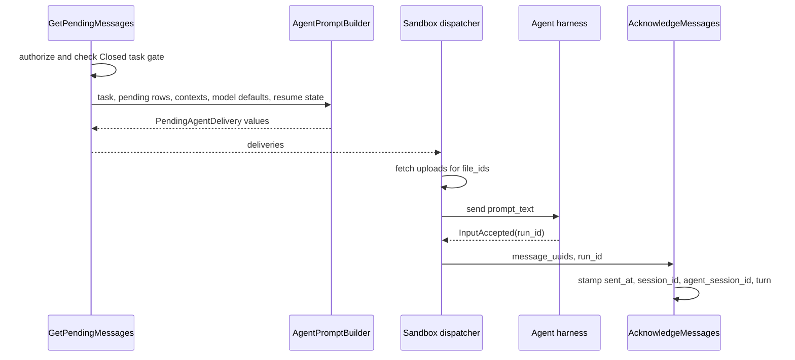
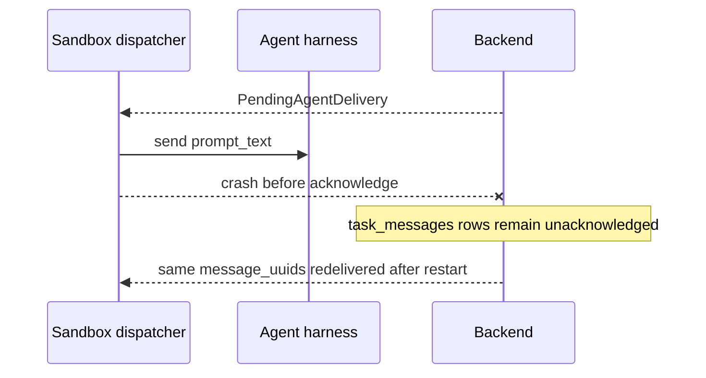
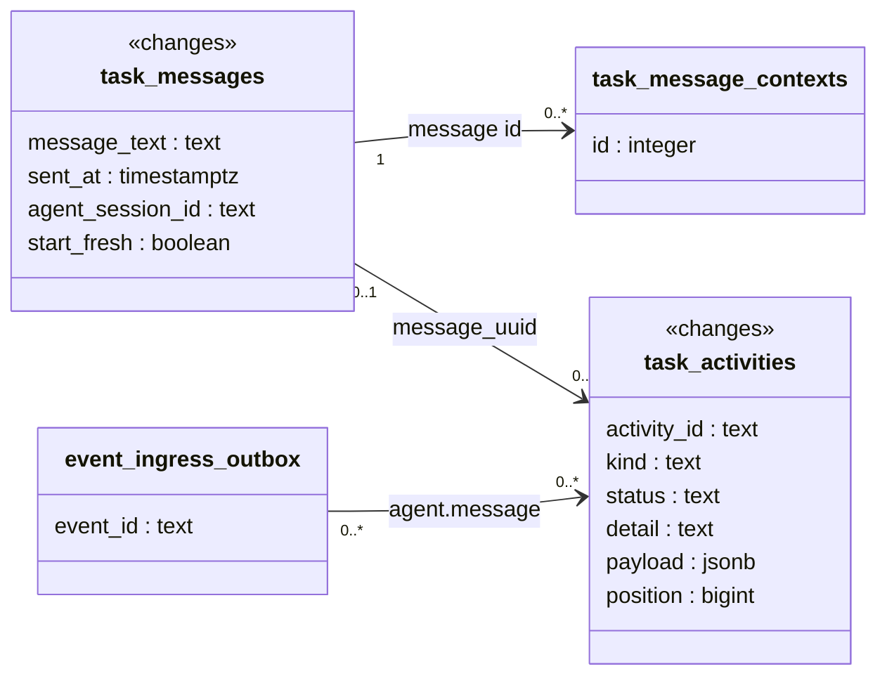

# Streamline messaging and activity formats

> **Status:** approved
> **Updated:** 2026-08-01
> **Vocabulary:** CONTEXT.md

## Current solution

This spec starts from the repository shape after PR 212, `feat: store a conversation as messages and activities`.

The current solution already separates what somebody said from what happened on the way there:

| Area | Current behaviour | Evidence |
|---|---|---|
| Stored user and assistant text | `task_messages.message_text` stores text. It is not the pre-rendered prompt sent to the agent. | `backend/migrations/0118_task_activities.sql:103`, `backend/src/message/models.rs:51` |
| Stored tool and runtime work | `task_activities` stores tool calls, thinking, sandbox status, sandbox errors, activity identity, status, payload, preview detail, and stream position. | `backend/migrations/0118_task_activities.sql:13`, `backend/src/task_activities/mod.rs:1` |
| Pending input durability | Pending user messages remain rows in `task_messages` until the sandbox acknowledges them after harness acceptance. | `backend/src/message/send.rs:261`, `backend/src/sandbox/grpc_server.rs:999`, `sandbox/src/agent/dispatcher.rs:180` |
| Agent event ingress | `agent.message` payload durability is the ingress outbox until the conversation write commits. `task_events` no longer carries message skeletons. | `backend/src/event_ingress/mod.rs:9` |
| T3 projection | T3 receives `thread.message-sent` and `thread.activity-appended` from `ui_rpc/projection.rs`. The wire contract is intentionally unchanged by PR 212. | `backend/src/ui_rpc/projection.rs:286`, `backend/src/ui_rpc/projection.rs:382` |

The remaining problem is not the storage model. It is the number of transient formats between the stored row and the harness input, and between the stored activity and the two client projections.

Current backend-to-sandbox delivery trace:

1. `backend/src/message/send.rs:261` persists a user `TaskMessage` with `message_text`, contexts, file ids, and pending delivery fields.
2. `backend/src/sandbox/grpc_server.rs:844` loads unacknowledged user rows with `get_pending_user`.
3. `backend/src/message/enricher.rs:108` rebuilds agent-facing content blocks from text, contexts, file ids, source task attribution, and backend config.
4. `backend/src/sandbox/grpc_server.rs:977` serializes those enriched blocks through `serde_json::Value`.
5. `backend/src/sandbox/grpc_server.rs:1968` parses that JSON through a local `DbContentBlock` enum and converts it into `sandbox_proto::ContentBlock`.
6. `sandbox/src/agent/dispatcher.rs:496` converts proto content blocks back into a prompt string.
7. `sandbox/src/agent/dispatcher.rs:182` sends that string to the agent handle and waits for the acceptance ack.
8. `backend/src/sandbox/grpc_server.rs:999` records acknowledgement with message uuids and run identity.

Current activity projection trace:

1. `backend/src/task_activities/mapping.rs:175` maps SDK content blocks into `ConversationWrite`.
2. `backend/src/message/dao.rs:471` writes messages and activities in one transaction.
3. `backend/src/message/transform.rs:238` maps activities back into Moatless `UiContentBlock` and `UiToolResult` shapes.
4. `backend/src/ui_rpc/projection.rs:663` maps activities into T3 work-log rows.
5. `backend/src/task_activities/dao.rs:12` exposes `Activity`, but client-specific projections still know too much about payload cleanup, detail, tone, status, and result extraction.

Dead or legacy paths that must not drive the new design:

| Path | Status |
|---|---|
| `task_message_content_blocks` | Legacy storage after PR 212. It is not the source of future prompt delivery. |
| `task_messages.message_content` | Legacy JSON document after PR 212. It must not be kept alive by a new sandbox contract. |
| REST `/api/v1/tasks/{task_id}/messages/pending` | Stays as a read/debug route. It is not the sandbox delivery contract. |

## Planned solution

- **New**
  - `PendingAgentDelivery` in `crates/sandbox-proto/proto/sandbox/v1/sandbox.proto`.
  - `AgentPromptBuilder` in `backend/src/message/enricher.rs` or a sibling module under `backend/src/message/`.
  - A canonical internal activity view in `backend/src/task_activities/` for Moatless UI and T3 projection.
  - Contract tests for T3 activity snapshot and incremental projection compatibility.

- **Changes materially**
  - `GetPendingMessagesResponse` returns typed deliveries rather than `PendingMessage` values with repeated content blocks.
  - Backend owns pending-message batching, source headers, sender attribution, context rendering, file prompt text, model defaults, agent type, agent mode, resume intent, and `start_fresh` splitting.
  - Sandbox dispatcher stops parsing content blocks and receives prompt text directly.
  - `grpc_server.rs` stops using JSON as an internal bridge from enriched content to proto content.
  - `ui_rpc/projection.rs` and `message/transform.rs` consume a shared internal activity projection rather than each re-deriving activity payload rules.

- **Untouched**
  - Durable pending rows in `task_messages`.
  - Acknowledgement after harness input acceptance.
  - Ingress outbox durability for `agent.message`.
  - PR 212 message/activity storage split.
  - T3 public wire payloads in the first implementation phase.
  - REST `/api/v1/tasks/{task_id}/messages/pending`, except for any compile-time type rename needed after shared schema cleanup.

### Problem

The codebase now has the right persistent concepts but still carries too many transient message formats.

Backend prompt delivery currently moves through this chain:

```text
TaskMessage + contexts
  -> message::enricher::ContentBlock
  -> serde_json::Value
  -> grpc_server::DbContentBlock
  -> sandbox_proto::ContentBlock
  -> sandbox::dispatcher prompt text
```

That chain is shallow. It makes callers know implementation detail they should not know:

| Caller | Detail it currently knows |
|---|---|
| `grpc_server.rs` | Which JSON block shapes are text, image, tool result, or ignorable. |
| `sandbox/agent/dispatcher.rs` | How to flatten proto content blocks into the prompt string the harness accepts. |
| Harness adapters | Receive one prompt string anyway, so prior block structure bought no depth. |

Activities have a related but smaller issue.

`task_activities` is now the durable source of work-log truth, but Moatless UI and T3 projection still each contain activity rendering decisions.

The change should make the backend/sandbox seam and the activity projection seam deeper:

| Module | Desired interface |
|---|---|
| Backend prompt builder | Given pending rows and contexts, produce the exact delivery unit the sandbox submits. |
| Sandbox dispatcher | Given a delivery, fetch uploads, send `prompt_text`, and acknowledge accepted uuids. |
| Activity projection | Given one `Activity`, produce one canonical internal render model that client-specific adapters can map without re-reading storage rules. |

### Behaviour

#### User message delivery

| Given | When | Then |
|---|---|---|
| A task has one pending user message with text only | A ready sandbox fetches pending deliveries | The sandbox receives one delivery with `message_uuids = [uuid]` and `prompt_text` equal to the enriched text. |
| A task has several pending user messages before the first `start_fresh` message | A ready sandbox fetches pending deliveries | The backend returns one delivery for the messages before `start_fresh`; the `start_fresh` message is left pending for the next fetch or returned as a separate delivery if it is first. |
| A task has a `start_fresh` pending message at the head | A ready sandbox fetches pending deliveries | The delivery has no `resume_session_id`, has `start_fresh = true`, and contains only that message uuid. |
| A pending message has an external adapter header or internal sender header | The backend builds the delivery | The header is already included in `prompt_text`; the sandbox does not build or prepend headers. |
| A pending message has preview context, selected element context, file contexts, or source task attribution | The backend builds the delivery | The prompt text includes the same agent-facing context currently produced by `build_pending_content_blocks`. |
| A pending message has file ids | The sandbox receives the delivery | The sandbox fetches uploads for `file_ids` before sending `prompt_text` to the harness. |
| The harness accepts the input | The sandbox receives the run ack | The sandbox acknowledges every uuid in `message_uuids` with the run id. |

#### Agent activities

| Given | When | Then |
|---|---|---|
| An assistant message contains text and tool calls | The backend persists `agent.message` | Text lands on `task_messages.message_text`; tool calls land in `task_activities`; both share one conversation position. |
| A later tool result arrives | The backend persists `agent.message` | The existing tool-call activity is settled by `(task_id, tool_use_id)`. |
| A turn only called tools and said no text | The backend persists the turn | No empty assistant message bubble is written; activities still project in order. |
| T3 subscribes to a thread snapshot or delta | The backend projects the conversation | T3 receives the same public `thread.activity-appended` shape as before this spec. |
| Moatless frontend reads the conversation | The backend transforms messages | Moatless receives text messages with tool calls and tool results assembled from activities. |

### Architecture and key flows

| Module | Observed | Proposed responsibility | Proposed change | Evidence |
|---|---|---|---|---|
| `backend/src/message/enricher.rs` | Builds `ContentBlock` values for agent requests and pending delivery. | Own the entire backend-side pending delivery assembly. | Replace `ContentBlock` JSON-oriented output with typed `PendingAgentDelivery` assembly or a backend `AgentDelivery` converted directly to proto. | `backend/src/message/enricher.rs:23`, `backend/src/message/enricher.rs:97` |
| `backend/src/sandbox/grpc_server.rs` | Loads pending rows, enriches them, parses JSON into proto blocks, computes resume values, and returns proto pending messages. | Present already-built deliveries over gRPC and handle auth, task status gate, and ack. | Move content parsing and batching decisions behind the prompt builder. Delete `DbContentBlock` and `parse_content_blocks`. | `backend/src/sandbox/grpc_server.rs:844`, `backend/src/sandbox/grpc_server.rs:977`, `backend/src/sandbox/grpc_server.rs:1968` |
| `crates/sandbox-proto/proto/sandbox/v1/sandbox.proto` | `PendingMessage` carries `repeated ContentBlock content`. | Carry the delivery unit the sandbox actually submits to the harness. | Replace `PendingMessage` with `PendingAgentDelivery`, or rename in place if generated code churn is acceptable. No backward compatibility path is required. | `crates/sandbox-proto/proto/sandbox/v1/sandbox.proto:163`, `crates/sandbox-proto/proto/sandbox/v1/sandbox.proto:167` |
| `sandbox/src/agent/dispatcher.rs` | Fetches proto pending messages, flattens content blocks, splits at `start_fresh`, fetches uploads, sends text, and acks after acceptance. | Deliver backend-assembled prompt text and preserve the ack invariant. | Consume `PendingAgentDelivery`, remove `content_blocks_from_proto` use for pending delivery, ack `message_uuids`. | `sandbox/src/agent/dispatcher.rs:110`, `sandbox/src/agent/dispatcher.rs:147`, `sandbox/src/agent/dispatcher.rs:496` |
| `backend/src/task_activities/` | Owns activity rows, mapping from content blocks, deterministic ids, result settlement, detail previews, and change positions. | Own canonical internal activity meaning for all readers. | Add a projection model or methods that expose `kind`, `tone`, `summary`, `status`, `detail`, input, result, typed result, sequence, and external claim consistently. | `backend/src/task_activities/mapping.rs:1`, `backend/src/task_activities/dao.rs:12` |
| `backend/src/ui_rpc/projection.rs` | Maps stored activities to T3 payload rows and strips detailed result fields. | Translate canonical activity view to unchanged T3 wire payload. | Replace local payload cleanup, tone, and kind derivation with calls into the canonical activity projection. | `backend/src/ui_rpc/projection.rs:663`, `backend/src/ui_rpc/projection.rs:677` |
| `backend/src/message/transform.rs` | Maps stored activities to Moatless UI content blocks and tool results. | Translate canonical activity view to Moatless UI message content. | Replace local tool call/result extraction with calls into the canonical activity projection. | `backend/src/message/transform.rs:238`, `backend/src/message/transform.rs:256` |

Successful pending-delivery flow:



Failure flow for crash before acceptance:



### Data model



#### `task_messages`

`task_messages` remains the durable queue for user input and the durable record of text.

| Column | Type | Meaning in this spec |
|---|---|---|
| `message_text` | text | **Meaning reinforced.** The text a person or assistant said. It must not store generated agent context, source headers, file prompts, or pre-rendered sandbox delivery content. |
| `sent_at` | timestamptz | **Read and unchanged.** Null means pending. Set only by acknowledgement after harness acceptance. |
| `agent_session_id` | text | **Read and unchanged.** The agent session that accepted the message. |
| `start_fresh` | boolean | **Meaning reinforced.** The backend builder uses it to split deliveries and suppress resume. |

#### `task_message_contexts`

`task_message_contexts` remains the stored context attached to a message.

No schema change is required.

The builder reads these rows and renders agent-facing context into `prompt_text`.

#### `task_activities`

`task_activities` remains the durable source for tool calls, thinking, sandbox lifecycle activity, and sandbox errors.

| Column | Type | Meaning in this spec |
|---|---|---|
| `activity_id` | text | **Read and unchanged.** Deterministic idempotency key. |
| `kind` | text | **Meaning reinforced.** Closed internal kind set. Unknown values are bugs, not extension points. |
| `status` | text | **Meaning reinforced.** Canonical internal status. Wire spellings are projection concerns. |
| `payload` | jsonb | **Meaning reinforced.** Full detail payload for Moatless UI detail reads. |
| `detail` | text | **Meaning reinforced.** Bounded preview for list and T3-style work-log projections. |
| `position` | bigint | **Read and unchanged.** Conversation order and replay position. |

#### New proto shape: `PendingAgentDelivery`

This is not persisted.

It is the gRPC serialization of a backend-built delivery.

```proto
message GetPendingMessagesResponse {
  repeated PendingAgentDelivery deliveries = 1;
}

message PendingAgentDelivery {
  repeated string message_uuids = 1;
  string prompt_text = 2;
  repeated string file_ids = 3;
  optional string model = 4;
  optional string agent_type = 5;
  optional string agent_mode = 6;
  optional string resume_session_id = 7;
  bool resume = 8;
  bool start_fresh = 9;
}
```

Field rules:

| Field | Rule |
|---|---|
| `message_uuids` | Every pending row consumed by this one harness input. The ack sends this exact list back. |
| `prompt_text` | Complete text submitted to the harness, including headers, attribution, context text, and file path prompts. |
| `file_ids` | Uploads the sandbox must pre-fetch before calling the harness. |
| `model` | Effective model after per-message and task defaults are resolved. |
| `agent_type` | Effective harness family. |
| `agent_mode` | Last applicable agent mode in the delivery. |
| `resume_session_id` | Present only when resume is allowed and known. |
| `resume` | False when backend has decided the sandbox must start fresh. |
| `start_fresh` | True when user intent explicitly asked for a fresh agent session. |

### Interfaces and contracts

External contracts:

| Consumer | Interface | Promise | Status |
|---|---|---|---|
| Sandbox dispatcher | `BackendSandboxService.GetPendingMessages` in `crates/sandbox-proto/proto/sandbox/v1/sandbox.proto` | Returns backend-assembled deliveries, not content blocks. | Breaking, no backward compatibility required |
| Sandbox dispatcher | `BackendSandboxService.AcknowledgeMessages` in `crates/sandbox-proto/proto/sandbox/v1/sandbox.proto` | Acknowledges `message_uuids` after harness input acceptance, with run identity. | Unchanged |
| Moatless REST clients | `GET /api/v1/tasks/{task_id}/messages/pending` in `backend/src/message/handlers.rs:519` | Returns pending row data for reading or diagnostics. It is not the sandbox delivery contract. | Unchanged |
| T3 client | `thread.message-sent` and `thread.activity-appended` from `backend/src/ui_rpc/projection.rs` | Payload shape stays compatible in phase one. | Unchanged |
| Moatless frontend | `UiMessage` in `crates/api-schemas/src/message.rs:13` | Messages contain text; tool details resolve from activities. | Compatible |

Internal interfaces:

| Caller | Interface | Promise | Status |
|---|---|---|---|
| `sandbox/grpc_server.rs` | `AgentPromptBuilder::build_pending_deliveries` | Returns zero or more typed deliveries and never requires the caller to parse content-block JSON. | New |
| `ui_rpc/projection.rs` | canonical activity view from `task_activities` | Provides T3-ready activity facts without exposing storage payload rules. | New |
| `message/transform.rs` | canonical activity view from `task_activities` | Provides Moatless UI tool-call and tool-result facts without reimplementing result extraction. | New |

The internal interfaces are implementation boundaries, not product promises.

The implementer may rename the concrete Rust types if the responsibilities remain intact.

### Failure, safety and recovery

| Condition | State before | State after | Caller sees | Retry safety | Mechanism |
|---|---|---|---|---|---|
| Sandbox crashes before harness acceptance | Pending rows have `sent_at IS NULL`. | Rows remain pending. | A later sandbox fetch receives the same `message_uuids`. | Safe | Ack is after `InputAccepted`; no ack was sent. |
| Sandbox crashes after harness acceptance but before backend ack commits | Harness may have accepted the input. Rows may still be pending. | Rows may redeliver. | The next run may receive duplicate prompt text. | Existing risk, bounded | Current dispatcher holds a single-flight guard and retries ack; this spec does not weaken it. |
| Backend cannot load contexts or files while building prompt | Pending rows exist. | Delivery still contains the user's text and logs the missing enrichment. | Harness receives a reduced prompt. | Safe | Builder follows existing `build_pending_content_blocks` best-effort behaviour. |
| Old sandbox image calls removed proto shape | Backend and sandbox are version-skewed. | Fetch fails. | Sandbox cannot process new work. | Not safe | No compatibility phase. Deploy backend and sandbox together. |
| Activity projection receives an unknown stored kind | Activity row exists with invalid `kind`. | Projection fails in tests or logs and skips only where forward compatibility is deliberate. | Client does not receive a malformed activity. | Depends on event idempotency | Closed-set parsing in `ActivityKind`. |
| T3 projection drifts from existing payload | Storage is correct, compatibility promise is broken. | Contract test fails. | No deploy if test is gating. | N/A | Snapshot and incremental golden tests. |

Rollback:

| Rollback target | Effect |
|---|---|
| Backend only | Not supported after proto replacement unless sandbox is rolled back with it. |
| Sandbox only | Not supported after proto replacement unless backend is rolled back with it. |
| Activity projection changes | Can roll back independently if storage schema is unchanged and canonical activity view remains source-compatible. |

Operational notes:

- There is no backward-compatibility phase for old sandbox images.
- Release tooling must deploy backend and sandbox together for this change.
- Existing pending rows survive a rollback because this spec does not change `task_messages` pending-state encoding.

### Testing and verification

Unit tests:

| Module | Cases |
|---|---|
| `AgentPromptBuilder` | Text only; external header; internal `sent_by`; source task attribution; preview URL; selected element; file ids; missing file metadata; model default; `start_fresh`; cut at first `start_fresh`. |
| `sandbox/agent/dispatcher.rs` | Consumes `PendingAgentDelivery`; fetches uploads; sends exact `prompt_text`; acks exact `message_uuids`; returns early on empty prompt. |
| `task_activities` canonical view | Tool call in progress; completed tool call; failed tool call; thinking; sandbox status; sandbox error; external claim; detail preview. |

Integration tests:

| Test area | Cases |
|---|---|
| Backend gRPC `GetPendingMessages` | Pending rows become deliveries with prompt text and metadata; Closed task returns empty; missing context degrades to text; `start_fresh` splits. |
| Backend gRPC `AcknowledgeMessages` | Ack stamps every uuid in the delivery and associates them with the accepted run. |
| `agent.message` persistence | Text-only assistant, tool-call assistant, tool-result user, tool-only turn, redelivery by same event id. |
| T3 UI-RPC projection | Snapshot preserves existing message and activity payloads; incremental change preserves sequence semantics and payload shape. |
| Moatless message transform | `UiMessage` text, tool calls, tool results, pending user input, external claim source chip. |

Contract tests:

| Contract | Assertion |
|---|---|
| Sandbox proto | Generated Rust compiles with `PendingAgentDelivery`; no code path still requires `PendingMessage.content`. |
| T3 activity payload | Golden JSON for representative `thread.activity-appended` events remains compatible. |
| T3 snapshot | Golden JSON for a transcript with text, tool call, tool result, thinking, and sandbox activity remains compatible. |

Manual verification:

| Scenario | Expected result |
|---|---|
| Send a message with attached file and preview context to a ready task. | Harness receives one readable prompt with file path and context. |
| Send another message while a turn is running. | Existing Moatless pending/ack behaviour remains unchanged. |
| Run a tool-only agent turn. | UI shows activity without an empty assistant bubble. |
| Open the same task in the T3 preview. | Messages and work log render as before this spec. |

Commands:

```bash
cargo test -p moatless-vibe-backend --lib
cargo test -p moatless-vibe-sandbox --lib
cargo test -p moatless-vibe-backend ui_rpc
cargo clippy -p moatless-vibe-backend --all-targets -- -D warnings
cargo clippy -p moatless-vibe-sandbox --all-targets -- -D warnings
task check:spec
```

Acceptance criteria:

| Given | When | Then |
|---|---|---|
| A pending user row has text, contexts, file ids, external header data, model, and `start_fresh = false` | The sandbox fetches work | One `PendingAgentDelivery` contains full prompt text and metadata. |
| The harness accepts the delivery | The sandbox acknowledges | Every uuid in `message_uuids` is stamped as sent for that run. |
| The sandbox crashes before acknowledgement | The task is fetched again | The same messages are redelivered. |
| A T3 client reads the task | It receives snapshot and deltas | Public message and activity payloads match the pre-change contract. |

## Decisions

| # | Decision | Chosen | Rejected because |
|---|---|---|---|
| [1](#1-backend-to-sandbox-seam) | Backend to sandbox seam | Replace pending content blocks with typed `PendingAgentDelivery`. | Keeping `PendingMessage.content` preserves the JSON-to-proto-to-text chain. |
| [2](#2-agent-input-ownership) | Agent input ownership | Backend owns batching, headers, attribution, context rendering, model defaults, and resume intent. | Sandbox ownership repeats backend state rules and makes every harness adapter learn pending-message semantics. |
| [3](#3-activity-format) | Activity format | Make `task_activities::Activity` the canonical internal activity and project it outward. | Separate Moatless and T3 builders drift on status, preview, payload, and sequence rules. |
| [4](#4-compatibility-phase) | Compatibility phase | Replace the sandbox gRPC shape directly. | A v1/v2 phase keeps the old content-block contract alive and is not required by the deployment model. |
| [5](#5-durability-boundary) | Durability boundary | Keep pending rows and ack after harness input acceptance. | T3-style pending-turn projection is a read model, not a durable delivery queue. |
| [6](#6-rest-pending-endpoint) | REST pending endpoint | Leave REST `/messages/pending` unchanged as a read/debug endpoint. | Removing it is unrelated to schema streamlining and risks diagnostics or lightweight clients. |
| [7](#7-t3-contract-verification) | T3 contract verification | Add T3 activity payload compatibility coverage. | UI smoke coverage would miss field-level drift. |

### 1. Backend to sandbox seam

The current gRPC `PendingMessage` shape carries content blocks, but the sandbox immediately flattens them to text before calling the harness.

The content-block shape is therefore not a useful seam.

The useful seam is the actual delivery unit:

- message uuids to ack
- prompt text to send
- file ids to pre-fetch
- model and harness metadata
- resume and `start_fresh` intent

Rejected alternative: keep `PendingMessage.content` and only delete the JSON middle hop.

That would reduce one conversion but would keep a block-oriented contract that no harness consumes.

### 2. Agent input ownership

Backend owns the data required to build the prompt:

- stored text
- external adapter metadata
- sender login lookup
- source task id
- contexts
- file metadata and upload mount path
- task model and agent type
- resume rules from turns and previous result rows

Sandbox owns process-local delivery:

- fetch uploads
- send text to the agent handle
- wait for acceptance
- acknowledge message uuids

Rejected alternative: move more assembly to the sandbox.

That would spread backend state rules into the sandbox and later into harness-specific code.

### 3. Activity format

`task_activities` already owns the durable activity row.

The next step is to give it a canonical internal projection interface so Moatless UI and T3 projection do not each re-derive:

- kind
- tone
- status spelling
- summary
- input
- result text
- typed result
- detail preview
- external claim source
- sequence and ordering facts

Rejected alternative: keep separate projection logic in `message/transform.rs` and `ui_rpc/projection.rs`.

That keeps two local interpretations of the same activity row.

### 4. Compatibility phase

No backward compatibility is required for old sandbox images.

The implementation may replace the proto shape directly.

Backend and sandbox must be deployed together for this change.

Rejected alternative: add v2 fields and keep v1 decoding until all sandboxes are upgraded.

That keeps the old contract alive and makes the implementation larger than the deployment model requires.

### 5. Durability boundary

Moatless keeps the stronger delivery model:

- durable pending rows before delivery
- sandbox fetch over gRPC
- acknowledgement only after harness acceptance
- retry by leaving rows unacknowledged

Rejected alternative: model this after T3's pending-turn projection.

T3's pending turn helps correlate UI state and provider turn start. It is not a durable queue.

### 6. REST pending endpoint

REST `/api/v1/tasks/{task_id}/messages/pending` remains a read/debug endpoint.

It returns pending row information, not harness delivery content.

Rejected alternative: remove it as part of this change.

Removal is not required to streamline sandbox delivery and could break diagnostics or lightweight clients.

### 7. T3 contract verification

T3 public payloads should stay compatible in the first implementation phase.

Add golden or field-level tests for representative snapshot and incremental payloads.

Rejected alternative: rely on UI smoke tests.

UI smoke tests can pass while subtle activity payload fields drift.

## Out of scope

- Client-side offline outbox.
- T3 public wire contract redesign.
- Harness-specific mid-turn steering behaviour.
- Dropping legacy `message_content` or `task_message_content_blocks` outside the PR 212 migration runbook.
- Reworking event ingress durability.
- Reworking adapter delivery outboxes.
- Removing REST `/messages/pending`.

## Open questions

None.

## Ticket breakdown

None.
