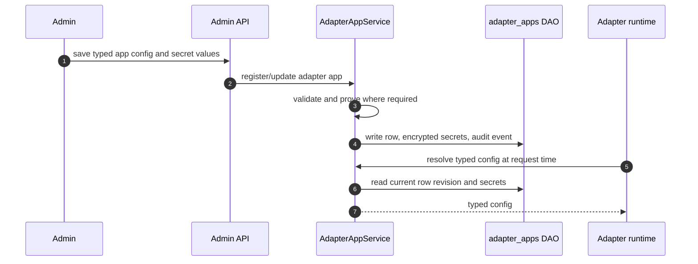
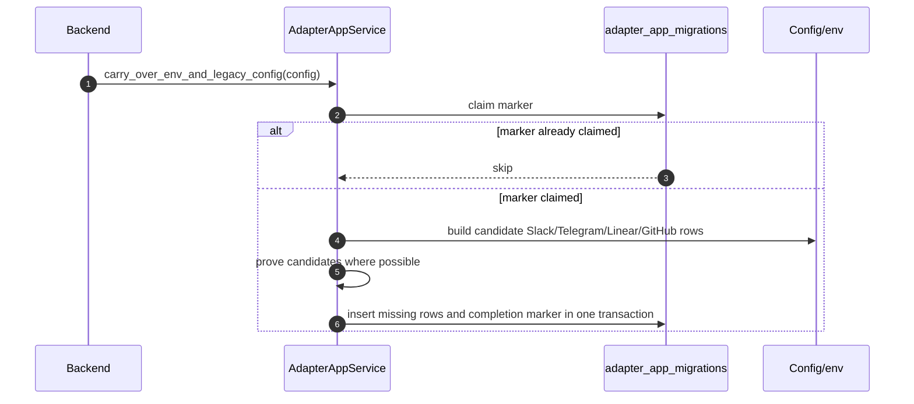
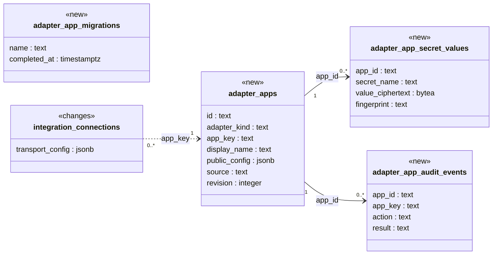

# DB-backed Adapter app config

> **Status:** approved
> **Updated:** 2026-08-01
> **Vocabulary:** CONTEXT.md

## Current solution

Adapter app/API config is split across two storage styles.

GitHub bot Apps already live in durable DB state, but in a provider-specific table.
Slack, Telegram, and Linear app/API credentials still live in process config populated from Helm/env.
Adapter connections already live in `integration_connections`, but those rows represent external workspace/org installs and routing identity, not the reusable app/client credentials that power an Adapter.

| Area | Current source of truth | Evidence | Consequence |
|---|---|---|---|
| GitHub bot Apps | `github_apps` and encrypted key columns | `backend/migrations/0111_github_apps.sql:14` | Admins can register/rotate/delete without a rollout, but GitHub is outside any shared Adapter app model. |
| GitHub login App | `GITHUB_APP_*` deployment env | `backend/src/auth/github/registry.rs:5` | Intentionally not admin-editable, so a UI mistake cannot break sign-in. |
| Slack app/API config | `SLACK_BOT_TOKEN`, `SLACK_SIGNING_SECRET`, `SLACK_BOT_USER_ID`, `SLACK_TEAM_ID` env | `backend/src/config.rs:1166` | Changing Slack credentials needs a Helm/env update and backend restart. Missing token or secret removes the Slack Adapter. |
| Telegram Bot API config | `TELEGRAM_BOT_TOKEN`, `TELEGRAM_MODE` env | `backend/src/config.rs:1172` | Changing the bot token needs a Helm/env update and backend restart. Polling mode is decided at process startup. |
| Linear app/API config | `LINEAR_CHANNEL_WEBHOOK_SECRET`, `LINEAR_OAUTH_CLIENT_ID`, `LINEAR_OAUTH_CLIENT_SECRET`, `LINEAR_OAUTH_CALLBACK_URL`, `LINEAR_API_BASE_URL` env | `backend/src/config.rs:1182` | Linear can register as an Adapter, but install and token refresh fail if app credentials are not present in process config. |
| Adapter connections | `integration_connections` | `backend/migrations/0051_integrations_triggers_bindings.sql:6` | Already suitable for workspace/org installs; not sufficient for app registration, proof, and secret lifecycle. |

The current trace through config and runtime:

1. `Config::from_env` reads GitHub App, Slack, Telegram, and Linear fields from env at process start in `backend/src/config.rs:1128`.
2. `GitHubAppRegistry` separates deployment login App state from durable bot App records in `backend/src/auth/github/registry.rs:1`.
3. `GitHubAppRegistry::carry_over_env_apps` imports `GITHUB_APPS_JSON` once and records a marker in `backend/src/auth/github/registry.rs:220`.
4. `Adapters::from_config` registers Slack only when token and signing secret exist in `backend/src/adapters/registry/bootstrap.rs:50`.
5. `Adapters::from_config` registers Telegram only when bot token exists in `backend/src/adapters/registry/bootstrap.rs:70`.
6. `LinearAdapter::new` copies webhook/OAuth/API config into the Adapter in `backend/src/adapters/providers/linear/adapter.rs:52`.
7. `linear_callback_handler` mirrors installed Linear workspaces into `integration_connections` and OAuth tokens into `provider_tokens` in `backend/src/auth/routes.rs:2333`.
8. `get_feature_flags` exposes Slack presence from `SLACK_TEAM_ID`, not DB state, in `backend/src/feature_flags.rs:43`.
9. `main` starts the Telegram poller only when `config.telegram.bot_token.is_some()` and `config.telegram.mode == "polling"` in `backend/src/main.rs:670`.

## Planned solution

**New**

- `adapter_apps`: one generic table for admin-managed Adapter app/client/bot config.
- `adapter_app_secret_values`: one encrypted named secret table for app secrets.
- `adapter_app_audit_events`: one audit table for register/update/rotate/remove/proof/carry-over actions.
- `adapter_app_migrations`: one marker table for one-time carry-over from env/provider-specific tables.
- A backend `adapter_apps` DAO and service that expose typed projections for Slack, Telegram, Linear, and GitHub bot Apps.
- Generic admin API routes with typed request/response payloads.
- Admin Integrations UI for listing, adding, editing, rotating, and deleting Adapter app config.
- Compatibility implementation for existing GitHub admin routes that delegates to the generic service.
- One-time carry-over for Slack, Telegram, Linear env config and legacy `github_apps` rows.

**Changes materially**

- `GitHubAppRegistry` reads admin-registered bot Apps from the generic store while preserving lookup by App key.
- Slack runtime config resolves through the Adapter app registry instead of being fixed on `SlackAdapter` construction.
- Telegram runtime config resolves through the Adapter app registry instead of being fixed on `TelegramAdapter` construction.
- Linear OAuth install, token refresh, webhook fallback secret, and API base URL resolve through the Adapter app registry.
- Adapter construction registers Slack, Telegram, and Linear code paths independently of whether app credentials are currently configured.
- Setup/status surfaces read DB readiness for Slack, Telegram, and Linear rather than env/startup feature flags.
- Admin navigation separates Adapter Apps, external Adapter Connections, and Task Connections.
- Existing GitHub admin components become the GitHub-specific workflow inside or adjacent to the shared Adapter Apps admin surface.
- Helm/env app/API values are carry-over inputs only; DB is authoritative after the marker lands.

**Untouched**

- GitHub login App remains deployment-controlled and resolved through `GitHubAppRegistry::default_service()`.
- GitHub OAuth login and Auth0 login provider config remain deployment-controlled.
- `integration_connections` remains the table for external workspace/org installs and routing identity.
- Task triggers remain the routing and task-creation defaults.
- Task bindings remain the outbound reply target.
- Linear workspace OAuth tokens stay in `provider_tokens` for this pass.
- Telegram remains a single default bot; update deduplication is not made multi-bot-safe.
- Telegram poller mode is startup-read; live poller start/stop on DB edits is not built in this pass.
- Adapter Connections UI remains about installed external workspaces/orgs/chats, not reusable app/client credentials.

### Problem

Admins who rotate Slack, Telegram, Linear, or GitHub bot App credentials should not need Helm access or a backend rollout.

Operators should not have to reason about two live sources of truth for Adapter app/API config.

Developers need one app-config lifecycle instead of four one-off credential stores.

### Behaviour

#### Admin

| Given | When | Then |
|---|---|---|
| An admin registers a Slack app config with bot token and signing secret | The backend proves the bot token with Slack `auth.test` | The stored row contains public Slack metadata and encrypted secret values; the secret values cannot be read back. |
| An admin registers a Telegram bot config with bot token and mode | The backend proves the token against Telegram Bot API | The stored row contains bot metadata and startup-read mode; the token cannot be read back. |
| An admin registers Linear app config with OAuth client credentials and callback URL | The backend validates the typed fields | Linear install and refresh can use the stored client credentials without `LINEAR_OAUTH_*` env vars. |
| An admin registers a GitHub bot App | The backend proves the signing key against GitHub | `GitHubAppRegistry` resolves the App key from generic storage, with the same bot identity semantics as today. |
| An admin rotates one secret value | The new value is proved before commit when the Adapter has a proof step | The row revision increments and only cached runtime clients for that app key are invalidated. |
| An admin lists app config | Any Adapter app exists | The response includes app identity, public config, timestamps, revision, and secret fingerprints/presence, never secret values. The UI derives readiness from required fields until the API exposes an explicit readiness field. |
| An admin removes app config | A row exists | Runtime lookup stops returning that app, and stale in-memory clients are discarded on next revision check or explicit forget. |

#### Admin UI

The admin UI lives under Admin -> Integrations and makes the distinction between reusable app credentials and installed external connections explicit.

| Surface | Route | Purpose | Notes |
|---|---|---|---|
| Adapter Apps list | `/admin/integrations/apps` | Shows Slack, Telegram, Linear, and GitHub bot App registrations with app key, display name, derived readiness, revision, updated time, public config summary, and secret fingerprints/presence. | This is the default place to answer "is the Adapter configured?". |
| Adapter App editor | `/admin/integrations/apps/$adapterKind/$appKey` or a dialog from the list | Edits the selected app config with provider-specific fields and write-only secret controls. | In the first API, Slack and Telegram saves require replacement secret values; partial secret preservation can be added before supporting blank secret fields on edit. |
| GitHub bot App workflow | Existing `/admin/integrations/github` route, folded into or linked from Adapter Apps | Keeps register, key rotation, bot user creation, installation refresh, and global installation binding. | GitHub has extra external install and bot-user lifecycle that the generic Slack/Telegram/Linear form does not need. |
| Connections list | Existing `/admin/integrations/connections` | Shows external workspace/org/account installs backed by `integration_connections`. | Connections can later show their selected `app_key`, defaulting to `default`. |

Provider forms:

| Adapter | Public fields | Secret fields | UI behavior |
|---|---|---|---|
| Slack | Bot user id, carried-over team metadata when present | Bot token, signing secret | Save proves the token and signing secret before commit; list shows token/signing fingerprints only. |
| Telegram | Mode: `webhook` or `polling`, carried-over bot metadata when present | Bot token | Save proves the bot token; choosing `polling` shows that backend restart is required for poller start/stop. |
| Linear | OAuth callback URL, API base URL, carried-over client metadata when present | OAuth client id if stored as secret in implementation, OAuth client secret, webhook secret | Save validates typed fields; install URL generation and refresh use the stored app config. |
| GitHub | App id, name/slug, bot login, default installation id | Private key | Existing GitHub forms keep proving the private key and offer bot user creation/install refresh. |

UI safety rules:

- Never render raw secret values returned from the API; the API should not return them.
- Show secret presence and fingerprints so admins can distinguish "missing", "configured", and "rotated".
- Keep entered form values client-side after a failed save so the admin can correct one field without retyping everything.
- Require confirmation before delete, and explain that existing Adapter Connections or bot users that reference the app key may stop working.
- Disable GitHub editing through the generic Slack/Telegram/Linear save route; link admins to the GitHub workflow for GitHub bot Apps.
- Surface carry-over source as status text or badge only if the API exposes it; do not make source a separate editing mode.

#### Operator upgrading an existing deployment

| Given | When | Then |
|---|---|---|
| `GITHUB_APPS_JSON` or legacy `github_apps` rows exist | The new backend starts | GitHub bot Apps are copied into `adapter_apps` once. |
| Slack env config exists | The new backend starts | A default Slack app config is created once if it can be proved. |
| Telegram env config exists | The new backend starts | A default Telegram app config is created once if it can be proved. |
| Linear env config exists | The new backend starts | A default Linear app config is created once. |
| Several backend replicas start together | Carry-over runs | A migration marker ensures exactly one durable outcome; other replicas observe completion. |
| An entry cannot be proved or encrypted | Carry-over runs | The entry is logged and skipped; startup continues; the marker is not recorded for a fully failed migration that should retry. |

#### Runtime

| Given | When | Then |
|---|---|---|
| Slack DB app config exists and env config is absent | Slack webhook or outbound send runs | The Adapter uses the stored token/signing secret and existing trigger/Binding behavior. |
| Telegram DB app config exists and env config is absent | Telegram webhook or outbound send runs | The Adapter uses the stored bot token and existing trigger/Binding behavior. |
| Telegram mode changes in DB while a backend is running | The backend is not restarted | Existing poller process state does not change until restart. |
| Linear DB app config exists and env config is absent | Linear install URL generation or token refresh runs | Stored client credentials and API base URL are used. |
| GitHub bot App has moved from `github_apps` | A bot user credential resolves by App key | The same installation-token behavior is available through `GitHubAppRegistry`. |

### Architecture and key flows

| Module | Observed | Proposed responsibility | Proposed change | Evidence |
|---|---|---|---|---|
| `backend/src/adapter_apps/dao.rs` | Owns Adapter app persistence, including typed GitHub bot App projections. | Persist generic Adapter app records, encrypted secret values, audit events, and carry-over markers. | Add `AdapterAppDao` and `PgAdapterAppDao`; GitHub no longer owns a DAO module. | `backend/src/adapter_apps/dao.rs:143` |
| `backend/src/adapter_apps/service.rs` | Does not exist. GitHub Registry owns proof/cache for GitHub only. | Own typed register/update/rotate/remove/list operations and runtime resolution for Slack, Telegram, Linear, GitHub bot Apps. | Add `AdapterAppService` with typed projection methods. | `backend/src/auth/github/registry.rs:80` |
| `backend/src/auth/github/registry.rs` | Reads login App from deployment config and bot Apps through `adapter_apps::dao::AdapterAppDao`. | Keep GitHub App lookup contract while reading bot App rows from generic storage. | Use the adapter-app DAO seam directly; no provider-specific GitHub DAO remains. | `backend/src/auth/github/registry.rs:50` |
| `backend/src/adapters/registry/bootstrap.rs` | Registers Slack/Telegram only when env credentials exist; Linear always registers with config copy. | Register code-capable Adapters while their credential lookup is deferred to runtime. | Construct Slack/Telegram/Linear with DB-backed app service, with startup readiness logged separately. | `backend/src/adapters/registry/bootstrap.rs:50` |
| `backend/src/adapters/providers/slack/*` | `SlackAdapter` owns token API client and signing secret. | Resolve default stored Slack app for each webhook/outbound/auth operation. | Move token/signing-secret access behind Slack typed projection; rebuild or cache `SlackApi` by app revision. | `backend/src/adapters/providers/slack/adapter.rs:12` |
| `backend/src/adapters/providers/telegram/*` | `TelegramAdapter` owns a token API client; ingress assumes one default bot. | Resolve single default stored Telegram bot for webhook/outbound/auth operations. | Move token access behind Telegram typed projection; preserve one-bot dedup assumption. | `backend/src/adapters/providers/telegram/ingress.rs:60` |
| `backend/src/adapters/providers/linear/*` | `LinearCredentials` copies OAuth fields from `LinearConfig`; webhook has env fallback secret. | Resolve Linear app config from DB for install, refresh, API base URL, and webhook fallback. | Replace copied credentials with registry-backed lookup. | `backend/src/adapters/providers/linear/auth.rs:32` |
| `backend/src/provider_settings/*` or new admin route module | GitHub admin routes manage `github_apps`; Adapter connection routes manage `integration_connections`. | Expose generic Adapter app admin API and keep GitHub compatibility aliases. | Add typed schemas and routes; make GitHub routes delegate to the generic service. | `backend/src/provider_settings/handlers.rs:275` |
| `apps/frontend/src/routes/admin/integrations/apps.lazy.tsx` | Does not exist. | Mount the Adapter Apps admin page in the existing Admin Integrations area. | Add a lazy route that composes feature components instead of route-local data fetching. | `apps/frontend/src/routes/admin/integrations/github.lazy.tsx:1` |
| `apps/frontend/src/features/integrations/api/adapter-apps.api.ts` | Does not exist. | Wrap generated `@moatless/api-client` provider-settings fetchers for list/save/delete. | Add TanStack Query hooks and invalidation through `queryKeys.integrations.adapterApps()`. | `apps/frontend/src/features/integrations/api/integrations.api.ts:1` |
| `apps/frontend/src/features/integrations/components/*` | Connections UI exists; app config UI does not. | Render list/detail or table/dialog UI for Adapter Apps, provider-specific forms, secret fingerprints, delete confirmation, and save errors. | Reuse shadcn controls and existing GitHub components where their workflow is GitHub-specific. | `apps/frontend/src/features/integrations/components/admin-connections-sidebar.tsx:1` |
| `apps/frontend/src/features/admin/components/admin-sidebar.tsx` | Integrations nav has GitHub, Connections, Task Connections. | Make Adapter Apps a first-class Integrations nav item. | Add "Apps" linking to `/admin/integrations/apps`; keep Connections and Task Connections separate. | `apps/frontend/src/features/admin/components/admin-sidebar.tsx:24` |

Key successful flow:

Carry-over flow:

### Data model

#### `adapter_apps`

Stores one admin-managed app/client/bot registration. Identity is `(adapter_kind, app_key)`.

| Column | Type | Null | What it holds |
|---|---|---|---|
| `id` | text | not null | New. Stable row id, used as encryption additional authenticated data prefix. |
| `adapter_kind` | text | not null | New. `slack`, `telegram`, `linear`, or `github`. |
| `app_key` | text | not null | New. Stable admin-chosen key unique per Adapter. `default` is used for single default Slack/Telegram/Linear configs. |
| `display_name` | text | nullable | New. Human-readable external app/bot/client name when known. |
| `public_config` | jsonb | not null | New. Typed non-secret fields. |
| `source` | text | not null | New. `admin`, `env_carry_over`, or `legacy_table_carry_over`. |
| `created_by` | text | not null | New. User id or migration actor. |
| `updated_by` | text | not null | New. User id or migration actor. |
| `created_at` | timestamptz | not null | New. Creation time. |
| `updated_at` | timestamptz | not null | New. Last update time. |
| `revision` | integer | not null | New. Bumped on every material change; runtime caches are keyed by row id and revision. |

Constraints:

- Unique `(adapter_kind, app_key)`.
- `app_key` matches `^[A-Za-z0-9][A-Za-z0-9_-]*$`.
- `revision > 0`.

Typed `public_config` contents:

| Adapter | Fields |
|---|---|
| Slack | `team_id`, `team_name`, `bot_user_id`, `bot_name` |
| Telegram | `mode`, `bot_id`, `bot_username`, `bot_first_name` |
| Linear | `oauth_client_id`, `oauth_callback_url`, `api_base_url` |
| GitHub | `app_id`, `name`, `slug`, `bot_login`, `default_installation_id` |

#### `adapter_app_secret_values`

Stores encrypted secret values owned by an `adapter_apps` row. A new entity; every row is new.

| Column | Type | Null | What it holds |
|---|---|---|---|
| `app_id` | text | not null | Parent `adapter_apps.id`. |
| `secret_name` | text | not null | Typed secret key. |
| `value_ciphertext` | bytea | not null | Encrypted secret value. |
| `value_nonce` | bytea | not null | Envelope nonce. |
| `value_data_key` | bytea | not null | Encrypted data key. |
| `kms_key_id` | text | not null | KMS key id from the existing cipher. |
| `encryption_version` | integer | not null | Cipher version. |
| `fingerprint` | text | not null | Non-reversible fingerprint. |
| `created_at` | timestamptz | not null | Creation time. |
| `updated_at` | timestamptz | not null | Last update time. |

Secret names:

| Adapter | Names |
|---|---|
| Slack | `bot_token`, `signing_secret` |
| Telegram | `bot_token` |
| Linear | `oauth_client_secret`, `webhook_secret` |
| GitHub | `private_key` |

Constraints:

- Primary key `(app_id, secret_name)`.
- `secret_name` matches `^[a-z][a-z0-9_]*$`.

#### `adapter_app_audit_events`

Stores app-config audit events. A new entity; every row is new.

| Column | Type | Null | What it holds |
|---|---|---|---|
| `id` | text | not null | Audit event id. |
| `app_id` | text | nullable | Parent app id when a row exists. |
| `adapter_kind` | text | not null | Adapter kind. |
| `app_key` | text | not null | App key. |
| `actor_id` | text | not null | User id or migration actor. |
| `action` | text | not null | `register`, `update`, `rotate_secret`, `remove`, `carry_over`. |
| `result` | text | not null | `success`, `skipped`, or `failure`. |
| `detail` | text | nullable | Redacted diagnostic detail. |
| `created_at` | timestamptz | not null | Event time. |

#### `adapter_app_migrations`

Stores one-time carry-over markers. A new entity; every row is new.

| Column | Type | Null | What it holds |
|---|---|---|---|
| `name` | text | not null | Marker name, such as `adapter_apps_env_carry_over_v1`. |
| `completed_at` | timestamptz | not null | Completion time. |
| `detail` | text | nullable | Redacted carry-over summary. |

#### `integration_connections`

This table is not replaced.

| Field | Change |
|---|---|
| `transport_config.app_key` | New optional convention. Points to `(adapter_kind, app_key)` where an Adapter connection needs a non-default app. |
| `credential_ref` | Unchanged. Not used for Adapter app config. |
| `webhook_secret` | Unchanged for per-connection webhook secrets. Adapter app webhook secrets are fallback/default credentials. |

### Interfaces and contracts

#### External contract

| Consumer | Interface | Promise | Status |
|---|---|---|---|
| Admin settings frontend | `GET /api/v1/admin/settings/adapter-apps` | Lists app identity, public config, revision, updated time, secret presence, and fingerprints. No raw secret values. | New |
| Admin settings frontend | `PUT /api/v1/admin/settings/adapter-apps/{adapter_kind}/{app_key}` | Saves a typed Slack, Telegram, or Linear app config. The current Slack/Telegram payloads require secret values; omitted-secret preservation needs an explicit API extension. | New |
| Admin settings frontend | `DELETE /api/v1/admin/settings/adapter-apps/{adapter_kind}/{app_key}` | Removes one Slack, Telegram, or Linear app config. | New |
| Existing GitHub settings frontend and generated client | `/api/v1/admin/settings/github/apps*` | Existing GitHub App routes keep their response shape while delegating to generic storage. | Changed compatibly |
| Slack Sender | `POST /api/v1/adapters/slack/webhook` | DB-backed Slack signing secret verifies incoming requests when env is absent. | Changed compatibly |
| Telegram Sender | `POST /api/v1/adapters/telegram/webhook` | DB-backed Telegram bot token powers webhook/outbound operations when env is absent. Per-rule `secret_token` verification is unchanged. | Changed compatibly |
| Linear install flow | `GET /api/v1/auth/linear/install` | DB-backed Linear app config can generate an OAuth install URL when env is absent. | Changed compatibly |
| GitHub bot credential resolver | `GitHubAppRegistry::get` and `GitHubAppRegistry::require` | Existing App keys resolve after migration into generic storage. | Changed compatibly |

#### Internal interface

These are implementation boundaries, not product promises.

| Interface | Consumer | Purpose |
|---|---|---|
| `adapter_apps::{upsert,list,find,delete}_adapter_app` | Admin settings routes, tests | Read/write generic app rows, secret values, audit events, and migration markers. |
| `adapter_apps::slack_app_config(app_key)` | Slack Adapter modules | Return typed Slack config plus decrypted bot token and signing secret. |
| `adapter_apps::telegram_app_config(app_key)` | Telegram Adapter modules | Return typed Telegram config plus decrypted bot token. |
| `adapter_apps::linear_app_config(app_key)` | Linear auth/OAuth/API modules | Return typed Linear config plus decrypted client/webhook secrets. |
| `adapter_apps::app_key_from_transport_config` | Slack, Linear, Telegram Adapter modules | Resolve `integration_connections.transport_config.app_key`, defaulting to `default`. |
| `AdapterAppService::github_app(app_key)` | `GitHubAppRegistry` or compatibility DAO | Return a GitHub bot App record compatible with `GitHubAppService::from_record`. |

Implementation note:

- Slack and Telegram register their adapters even when no Helm/env token is present; runtime calls fail with `AdapterNotConfigured` if the selected DB app is absent.
- Slack inbound verification resolves the routed connection's `transport_config.app_key` before checking the signature, and connection-aware outbound replies use the same app key.
- Telegram Bot API calls resolve the current app before inbound effects, outbound replies, reactions, and polling.
- Linear API clients resolve app config through the active `AdapterConnection`, so token refresh and outbound delivery use the selected DB app credentials.
- The first implemented admin API uses `PUT` for Slack/Telegram/Linear saves and keeps GitHub behind the existing GitHub App endpoints; the UI should not call the generic save endpoint for GitHub rows.

### Failure, safety and recovery

| Condition | State before | State after | Caller sees | Retry safe | Recovery |
|---|---|---|---|---|---|
| DB unavailable during runtime lookup | Existing app row may exist | No config read | Adapter-specific `AdapterNotConfigured` or retryable internal error depending path | Yes | Restore DB; retry request or Sender redelivers where applicable. |
| Stored secret cannot decrypt | App row exists | No secret exposed | Admin status reports broken; runtime fails loudly | Yes after repair | Rotate/re-save secret or repair encryption/KMS config. |
| Invalid Slack token on save | No write committed | No write committed | Bad request naming proof failure | Yes | Correct token and retry. |
| Invalid Telegram token on save | No write committed | No write committed | Bad request naming proof failure | Yes | Correct token and retry. |
| Invalid GitHub private key on save | No write committed | No write committed | Bad request naming proof failure | Yes | Correct key/app id and retry. |
| Linear OAuth client secret missing during refresh | Token row exists | Token not refreshed | Linear API call fails with configuration error | Yes after saving config | Save Linear app config. |
| Env carry-over races across replicas | Env vars exist, marker absent | One marker and one set of inserted rows | Non-winning replicas log skip | Yes | None. |
| Env carry-over partially cannot prove entries | Env vars exist, marker absent or partial summary | Valid entries inserted; invalid entries skipped and audited | Startup continues; logs name skipped entries | Yes for failed marker; admin can register manually | Fix env or register in UI. |
| Telegram mode changed at runtime | Poller running or not running | DB row changes | No live poller transition | Restart required | Restart backend to apply startup-read mode. |
| Rollback to pre-change build | Generic rows exist | Old build ignores generic rows | Old env config must still be present for rollback | N/A | Keep old env vars until rollback window ends. |

Rollback:

- During the first rollout, keep existing Helm/env values present.
- If rollback is needed before env removal, the old build reads those values.
- After operators remove env values, rollback to a pre-change build requires restoring env values.
- The migration must not drop `github_apps` in the same release; keep it until a later cleanup release after rollback window.

### Testing and verification

Unit tests:

- `AdapterAppRecord` sealing/decryption/fingerprint redaction.
- `AdapterAppDao` GitHub bot App insert/update/delete/list, plus unique `(adapter_kind, app_key)`.
- Typed projection parsing rejects missing required public fields or secret names.
- Omitted secret values preserve existing encrypted values on update where the API supports partial secret updates; with the current Slack/Telegram save schema, replacement secrets are required.
- Audit events are written for success, skipped carry-over, and failure.
- GitHub compatibility DAO/service maps generic rows to `GitHubAppRecord`.

Integration tests:

- Given Slack env config exists, when carry-over runs twice, then exactly one `adapter_apps` row exists and the migration marker exists.
- Given Telegram env config exists, when carry-over runs, then a default Telegram row exists with `mode`.
- Given Linear env config exists, when carry-over runs, then a default Linear row exists with client id/callback/API base URL and encrypted client secret.
- Given `github_apps` rows exist, when legacy carry-over runs, then `GitHubAppRegistry` resolves the same App keys from generic storage.
- Given no env config exists but DB Slack config exists, when Slack webhook arrives, then signature verification and routing use stored config.
- Given no env config exists but DB Telegram config exists, when Telegram outbound sends, then the Bot API request uses stored token.
- Given no env config exists but DB Linear config exists, when Linear install URL is requested, then the URL is generated.
- Given Linear token refresh is needed, when refresh runs, then stored app credentials are used and existing `provider_tokens` semantics are preserved.

Contract tests:

- `GET /api/v1/admin/settings/adapter-apps` never serializes raw secret values.
- Existing `GET /api/v1/admin/settings/github/apps` returns the expected `GitHubAppsResponse` shape while data comes from generic storage.
- Existing GitHub register/rotate/remove routes continue to work.

Frontend tests:

- `adapter-apps.api.ts` uses generated provider-settings fetchers and invalidates `queryKeys.integrations.adapterApps()`.
- Adapter Apps list renders loading, error, empty, carry-over/configured, and missing-secret states.
- Slack, Telegram, and Linear forms send the typed payload for their adapter kind and never prefill secret inputs from fingerprints; Slack/Telegram edit submit stays disabled until required replacement secrets are present unless partial secret updates are implemented.
- Failed saves keep the dialog open and preserve client-side form state.
- Delete requires confirmation and invalidates the app list.
- GitHub App buttons remain wired to the GitHub compatibility hooks, not the generic Slack/Telegram/Linear save route.

Manual verification:

- Review the admin UI copy for Slack, Telegram, Linear, and GitHub bot App concepts.
- Verify the page distinguishes app config from Adapter connections.
- Verify warnings explain one-time carry-over and DB authority.

Acceptance criteria:

- Given Slack env config exists, when the upgraded backend starts, then a DB-backed Slack app config is created once.
- Given no Slack env config exists but DB config does, when a Slack webhook arrives, then the request verifies and routes.
- Given Linear DB app config exists, when an admin starts install, then the OAuth URL is generated without Linear env vars.
- Given a Linear token refresh is needed, when refresh runs, then it uses stored app credentials and preserves the existing token row semantics.
- Given Telegram DB app config exists, when a webhook or outbound reply uses Telegram, then it uses the stored bot token without `TELEGRAM_BOT_TOKEN`.
- Given GitHub bot App rows exist in `github_apps`, when the migration runs, then `GitHubAppRegistry` resolves the same App keys from generic storage.
- Given an admin opens `/admin/integrations/apps`, when DB app configs exist, then Slack, Telegram, Linear, and GitHub app rows are visible with public config and secret fingerprints only.
- Given an admin saves Slack, Telegram, or Linear config from the UI, when the API succeeds, then the list refreshes and runtime uses DB config without new env vars.
- Given an admin opens the GitHub app workflow, when they register, rotate, create bot user, or bind installation, then the existing GitHub compatibility APIs still back those actions while rows are stored in `adapter_apps`.

## Decisions

| # | Decision | Chosen | Rejected because |
|---|---|---|---|
| [1](#1-storage-concept) | Storage concept | Generic `adapter_apps` plus encrypted named secret rows | Separate tables duplicate lifecycle; `integration_connections` mixes app registration with workspace installs. |
| [2](#2-config-families) | Config families | Adapter app/API config only | Auth-provider DB config can break sign-in. |
| [3](#3-github-bot-apps) | GitHub bot Apps | Move into `adapter_apps` | Keeping `github_apps` separate breaks the generic model. |
| [4](#4-slack-setup) | Slack setup | Manual credential registration | Slack OAuth is a new install product surface. |
| [5](#5-rollout) | Rollout | One-time carry-over, then DB authoritative | Permanent env fallback keeps Helm/env authoritative. |
| [6](#6-admin-api) | Admin API | Generic API with typed payloads and GitHub compatibility aliases | Provider-specific APIs duplicate contracts; raw JSON weakens validation. |
| [7](#7-admin-ui-placement) | Admin UI placement | Add Adapter Apps under Admin -> Integrations | Personal settings and Adapter Connections do not represent reusable app credentials. |
| [8](#8-secret-editing) | Secret editing | Write-only secret fields with fingerprints/presence | Prefilling secrets is impossible and unsafe; hiding presence leaves admins guessing. |
| [9](#9-github-ui-migration) | GitHub UI migration | Keep GitHub-specific workflow while sharing storage and navigation | GitHub has install refresh, bot user, and installation binding semantics that generic forms should not absorb. |

### 1. Storage concept

Generic `adapter_apps` plus encrypted named secret rows is the storage model.

Separate `slack_apps`, `telegram_apps`, `linear_apps`, and `github_apps` tables would duplicate proof, encryption, audit, carry-over, and cache-invalidation machinery.

Using only `integration_connections` would mix app registration with external workspace/org install rows. Linear proves the distinction: OAuth client credentials must exist before any workspace connection is installed.

### 2. Config families

This pass moves Adapter app/API config only.

GitHub login App, GitHub OAuth login config, and Auth0 config remain deployment-controlled because a DB-administered mistake there can make the UI unreachable.

### 3. GitHub bot Apps

Admin-registered GitHub bot Apps move into `adapter_apps`.

The deployment GitHub login App does not move.

`GitHubAppRegistry` remains the compatibility API for bot users, repository access, sandbox secrets, plugin sync, and GitHub Adapter paths.

The implementation must not drop `github_apps` in the same release. It remains rollback state until a later cleanup.

### 4. Slack setup

Slack uses manual credential registration first.

The admin enters the bot token and signing secret currently copied from Slack's app dashboard.

Full Slack OAuth install is out of scope for this migration.

### 5. Rollout

Carry-over is one-time, then DB is authoritative.

Env values are migration inputs, not a permanent fallback.

The marker must not infer completion from existing rows because an admin deletion after carry-over must not be resurrected by a restart.

### 6. Admin API

Expose one generic admin API with typed Adapter payloads.

Use compatibility aliases for existing GitHub admin routes so frontend hooks and generated clients do not all need to move in the same implementation ticket.

Typed payloads are required because each Adapter has different proof steps and secret names, while read responses must never return raw secrets.

### 7. Admin UI placement

Adapter Apps belong under Admin -> Integrations.

Personal `/settings` remains for a user's own provider tokens and device/API key setup.

`/admin/integrations/connections` remains for external workspace/org/chat installations in `integration_connections`.

The sidebar should expose Apps, GitHub, Connections, and Task Connections as distinct admin concepts until the GitHub workflow is fully folded into Apps.

### 8. Secret editing

Secrets are write-only in the UI.

The list/detail view shows presence and fingerprints from the API. Secret inputs are blank on edit. With the current generic API, Slack and Telegram edits require replacement secrets because their save payloads require them. If the backend adds partial secret updates, submitting no value should preserve the existing secret and submitting a value should replace it after proof/validation.

Deleting or clearing a required secret is not implicit. If the product needs that later, it should be an explicit "remove secret" action with confirmation.

### 9. GitHub UI migration

GitHub bot Apps use generic `adapter_apps` storage, but their admin workflow stays GitHub-specific.

The existing GitHub route can either remain as a sibling page or become the GitHub detail view inside `/admin/integrations/apps`. In both cases it should call the GitHub compatibility API for register/rotate/remove/bot-user/install actions.

The generic Slack/Telegram/Linear save endpoint should reject GitHub rows so the UI cannot bypass GitHub proof and bot-user semantics.

## Out of scope

- Moving GitHub login App config into DB.
- Moving GitHub OAuth login config into DB.
- Moving Auth0 config into DB.
- Building Slack OAuth installation.
- Supporting multiple Telegram bots.
- Starting or stopping the Telegram poller live after a DB config edit.
- Redesigning Linear workspace token cardinality.
- Dropping legacy `github_apps` table in the first release.
- Removing Helm/env entries from charts in a way that prevents rollback during the rollout window.

## Open questions

None.

## Ticket breakdown

1. Add frontend API and query keys for Adapter Apps.

   - Generate the API client after backend OpenAPI changes.
   - Add `apps/frontend/src/features/integrations/api/adapter-apps.api.ts`.
   - Add `queryKeys.integrations.adapterApps()` and mutation invalidation.

2. Add Admin -> Integrations -> Apps route and navigation.

   - Add `apps/frontend/src/routes/admin/integrations/apps.lazy.tsx`.
   - Add an Apps item to `apps/frontend/src/features/admin/components/admin-sidebar.tsx`.
   - Keep Connections and Task Connections unchanged.

3. Build Adapter Apps list and provider forms.

   - Add table/list rows for Slack, Telegram, Linear, and GitHub.
   - Add Slack, Telegram, and Linear save dialogs/forms using typed payloads.
   - Show secret presence/fingerprints, revision, updated time, derived readiness, and delete confirmation.

4. Wire GitHub into the shared admin concept without losing GitHub-specific workflow.

   - Keep `GitHubAppsCard` and `GitHubInstallationCard` backed by existing GitHub compatibility hooks.
   - Link GitHub rows from Apps to the GitHub workflow, or embed those cards in the GitHub detail state.
   - Do not call the generic Adapter Apps save endpoint for GitHub.

5. Add frontend tests.

   - Cover API wrappers, list states, provider form payloads, write-only secrets, failed save behavior, delete invalidation, and GitHub compatibility routing.
