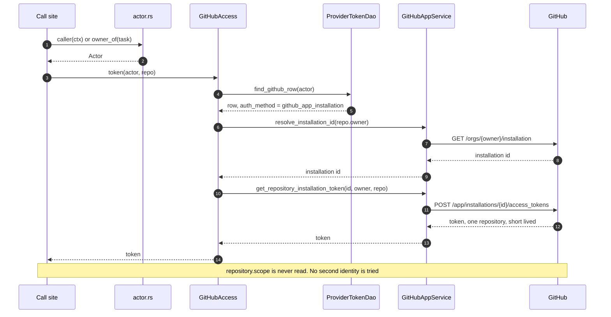
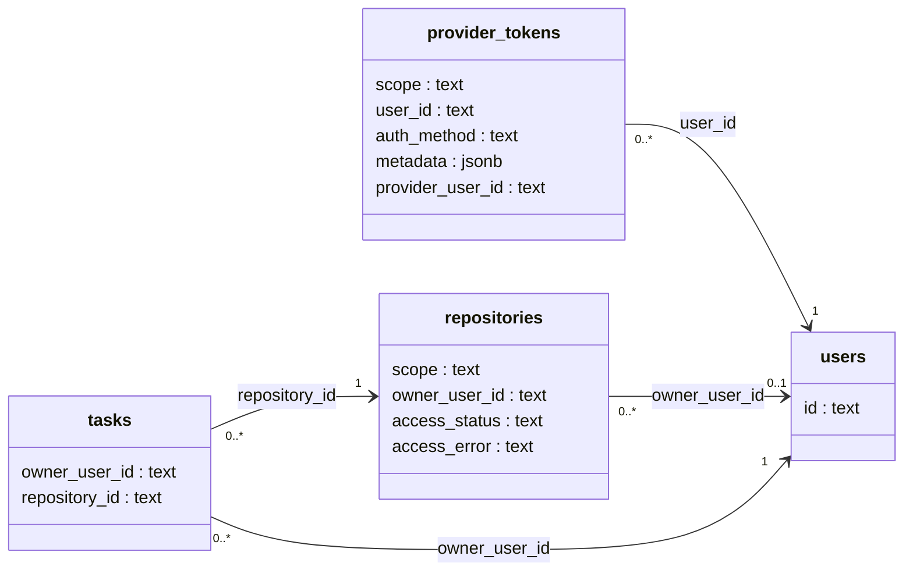

# One GitHub access seam, always keyed on an identity

> **Status:** approved
> **Updated:** 2026-08-16
> **Vocabulary:** CONTEXT.md

## Current solution

### Anchors

Every place the change lands.

| Anchor | What it is today |
|---|---|
| `crates/identity/src/auth/credentials.rs:50` | `resolve_user_github_token` — walks `user > global` |
| `crates/identity/src/auth/credentials.rs:87` | `resolve_github_token_for_scopes` — the same walk, returns `ResolvedGithubToken` |
| `crates/identity/src/auth/credentials.rs:147` | `resolve_github_row_token` — the `auth_method` dispatch every path funnels through |
| `crates/identity/src/auth/credentials.rs:189` | `resolve_repository_github_scope_token` — selects on a `GitHubScope`, validates the Global installation binding |
| `crates/identity/src/auth/credentials.rs:273` | `resolve_run_as_user_github_token` — user only, no walk. The shape the new module takes |
| `crates/identity/src/auth/credentials.rs:309` | `secret_scope_for` |
| `crates/identity/src/auth/credentials.rs:369` | `read_secret_ref_token` |
| `crates/identity/src/auth/credentials.rs:405` | `mint_installation_token` — the two-branch mint |
| `crates/identity/src/auth/github_scope.rs:20` | `GitHubScope` — `User(String)` and `Global` |
| `crates/identity/src/auth/provider_token_dao.rs:367` | `upsert_github_row`'s Global branch |
| `crates/identity/src/auth/provider_token_dao.rs:410` | `find_github_scope_presence` — the `user > global` presence walk |
| `crates/identity/src/auth/github/service.rs:328` | `get_repository_installation_token` — repository-restricted mint, cached |
| `crates/identity/src/auth/github/service.rs:729` | `resolve_installation_id` — owner to installation, cached |
| `crates/identity/src/auth/github/service.rs:789` | `installation_token_for_owner` — the owner-wide mint |
| `crates/identity/src/setup/github.rs:29` | `GithubTokenRequirement` — reads the presence walk |
| `crates/workspaces/src/repository/access.rs:20` | `github_credential_scope` — repository scope to credential scope |
| `crates/workspaces/src/repository/access.rs:39` | `RepositoryTokenResolver` |
| `crates/workspaces/src/repository/access.rs:105` | `resolve_repository_github_token_with` |
| `crates/workspaces/src/repository/access.rs:173` | `parse_github_owner_repo` |
| `crates/workspaces/src/repository/access.rs:198` | `access_error_for` |
| `crates/workspaces/src/repository/handlers.rs:353` | `verify_access` |
| `crates/workspaces/src/repository/handlers.rs:399` | `persist_access_verification` |
| `crates/workspaces/src/repository/handlers.rs:566` | `list_branches`, and the comment at `:592` |
| `crates/workspaces/src/workspace/git_sync.rs:937` | `resolve_sync_token` — already uses `auth.user_id` for GitLab |
| `crates/workspaces/src/skill/service.rs:135` | the workspace skill cache key |
| `crates/workspaces/src/skill/service.rs:142` | workspace skill token resolution |
| `crates/workspaces/src/skill/service.rs:204` | `resolve_token_for_provider` |
| `crates/workspaces/src/plugin/sync.rs:183` | `platform_token` — hard-codes `GitHubScope::Global` |
| `crates/loops/src/loops/sync/mod.rs:71` | `sync_repo_loops` |
| `crates/adapter-github-pr/src/auth.rs:19` | `GithubPrAuth` |
| `crates/adapter-github-pr/src/auth.rs:126` | `reaction_token` |
| `crates/adapter-github-pr/src/auth.rs:222` | `resolve_token_for_user` — the `GITHUB_CHANNEL_TOKEN` fallback |
| `crates/adapter-github-pr/src/auth.rs:290` | `outbound_user_id` — the identity precedence that already works |
| `crates/adapter-github-pr/src/shell_reconcile.rs:668` | `resolve_task_repository_github_token` |
| `crates/sandbox-control/src/secrets.rs:292` | `fill_github` — already run-as only |
| `crates/sandbox-control/src/preflight.rs:214` | `preflight_validate_github_token` |
| `crates/backend/src/provider_settings/handlers.rs:357` | `save_installation_binding` |
| `crates/backend/src/provider_settings/handlers.rs:415` | `upsert_github_org_connection` |
| `crates/backend/src/provider_settings/handlers.rs:951` | `admin_get_global_github_installation` |
| `crates/backend/src/provider_settings/handlers.rs:975` | `admin_put_global_github_installation` |
| `crates/backend/src/provider_settings/handlers.rs:1007` | `admin_delete_global_github_installation` |
| `crates/backend/src/state.rs:307` | `RepositoryTokenResolver` construction |
| `crates/core/src/config.rs:1346` | `bot_token: env_opt("GITHUB_CHANNEL_TOKEN")` |
| `crates/core/migrations/0086_repository_access_status.sql` | added the three repository reachability columns |
| `crates/core/migrations/0136_authentication_foundation.sql` | the prerequisite authentication branch's migration; choose the next free migration number when implementing this plan |
| `apps/frontend/src/features/settings/components/github-installation-card.tsx` | the installation card |
| `apps/frontend/src/features/settings/components/admin-github-integration-section.tsx:9` | mounts that card beside `GitHubAppsCard` |
| `apps/frontend/src/features/repositories/components/sections/access-settings-group.tsx:135` | renders the reachability badge |
| `apps/frontend/src/features/repositories/components/admin-repositories-sidebar.tsx:60` | renders it per row |
| `apps/frontend/src/features/settings/components/github-configuration-section.tsx:67` and `:195` | copy naming the deleted behaviour |

### What the code does not say

**The Sandbox already resolves this way, and the backend does not.** `fill_github`
always passes `Some(run_as_user_id)` (`sandbox-control/src/secrets.rs:292`), so
`resolve_repository_github_token_with` takes its run-as branch and never reads
`repository.scope`. Preflight turns a missing credential into a refusal to start
(`preflight.rs:240`). The backend read paths still resolve on repository scope, so
listing a Global repository's branches can succeed while a Task on it cannot start.
This change makes the backend agree with what already ships.

**Bot user credentials mint wider tokens than the org credential does.** The Global
row is written with `installation_id` and `account_login` in `metadata`
(`provider_settings/handlers.rs:370`), so `mint_installation_token` takes its first
branch: it checks the owner against the binding and calls
`get_repository_installation_token`. A Bot user's row is written with no `metadata`
at all (`identity/src/auth/routes.rs:2155`), so the same function falls through to
`installation_token_for_owner` and mints for every repository the App can reach.
Deleting the Global row without fixing this would widen every minted token.

**Narrowing them needs no stored state.** `resolve_installation_id` (`github/service.rs:729`)
already turns an owner into an installation id, cached per owner, and
`get_repository_installation_token` (`:328`) already mints restricted to one
repository with its own cache. Chaining them removes the need for `installation_id`
in `metadata` anywhere, and removes the owner-mismatch check with it — an
installation resolved *from* the owner cannot mismatch the owner.

**Automated work already carries an identity, by invariant.** A Loop cannot fire
without an approved run-as user: `schedule_runner.rs:147` returns an error naming
"claimed schedule Loop has no approved run-as user", and
`SubscriptionMatch::effective_user_id` (`adapter-model/src/models.rs:77`) panics on
`None`. That user becomes `InboundMessage.user_id` (`schedule_runner.rs:154`), then
the Task's `created_by` and `owner_user_id` (`task/creation.rs:260,280`), and every
Task is `Scope::User` (`creation.rs:281`). This is why a Bot user never needs naming
on a Repository.

**Plugin sync is not a background job.** `PluginSyncService::sync` runs only through
`skills` (`plugin/sync.rs:88`), reached from `list_plugin_skills`
(`plugin/handlers.rs:141`, where the caller is bound as `_auth` and ignored) and
`SkillService::plugin_skills` (`skill/service.rs:181`, which has `auth`). There is no
call site without an identity in scope.

**The Global installation binding does two jobs.** It writes a `provider_tokens` row
*and* upserts an `adapter_connections` row keyed on the account login
(`provider_settings/handlers.rs:415`). Without the second, inbound GitHub webhooks
reject the org and pull requests opened from Tasks never resolve to a Binding
(`handlers.rs:405-409`). Unbinding already leaves that row in place on purpose
(`:412-414`).

**The installation fields on that Adapter connection are dead.** `upsert_github_org_connection`
writes `github_app_key` and `installation_id` into `transport_config`
(`handlers.rs:441-446`). Nothing in the repository reads either. Recreating the
connection through `POST /api/v1/adapters/connections` (`backend/src/adapters/handlers.rs:77`)
therefore needs only `external_account_id`, `connection_kind` and `webhook_secret`.

**`provider_tokens.scope` is shared with Codex, and its CHECK constraint must
survive.** `0049_canonical_access_control.sql:335` constrains it to
`('global','team','user')`, and `CodexScope::Global` is a live feature
(`provider_token_dao.rs:271`, `provider_settings/handlers.rs:1503`). The migration
deletes GitHub global rows only. Dropping `'global'` from the constraint would break
Codex credentials.

**Git-sourced content does not vary by reader.** `fetch_moatless_workspaces`
(`git_sync.rs:267`) and the skill fetcher read files at a ref, so an identity decides
only whether a fetch succeeds. Plugin sync already serves the previous snapshot on
failure (`plugin/sync.rs:88-96`). A caller without access cannot store a wrong
answer — only fail to refresh.

**Five functions carry `#[allow(clippy::too_many_arguments)]` whose stated reason is
the dependency list.** Four in `credentials.rs`, one in `access.rs`. Each says that
bundling the ports "would only move the argument count to the call site". That is
true of a bundle passed per call and false of a struct built once in `state.rs`,
which is what this change does.

## Planned solution

**New**

- `crates/identity/src/auth/github_access.rs` — `GitHubAccess`, the one way to obtain a GitHub token
- `crates/identity/src/auth/actor.rs` — `Actor`, and the closed set of ways one is chosen
- `GitHubRepo` in `crates/core/src/github_client.rs` — an owner and a name, parsed once
- `crates/core/migrations/NNNN_drop_github_global_credential.sql` — allocate the next free migration number during implementation

**Changes materially**

- `crates/workspaces/src/repository/handlers.rs:353,566` — `verify_access` and `list_branches` act as the caller
- `crates/workspaces/src/workspace/git_sync.rs:937` — workspace sync acts as the caller
- `crates/loops/src/loops/sync/mod.rs:71` — Loop sync acts as the caller
- `crates/workspaces/src/skill/service.rs:135,142,204` — skill reading acts as the caller, and the cache key gains the actor
- `crates/workspaces/src/plugin/sync.rs:183` — plugin sync acts as the caller
- `crates/adapter-github-pr/src/auth.rs:126,222` — reactions use the outbound identity precedence; the env-token fallback goes
- `crates/adapter-github-pr/src/shell_reconcile.rs:668` — the pull-request footer acts as the Task's owner
- `crates/identity/src/auth/credentials.rs:405` — a Bot user's token is restricted to the repository being worked on
- `crates/identity/src/auth/provider_token_dao.rs:410` — the presence walk stops reaching the global row
- `crates/backend/src/provider_settings/handlers.rs:951,975,1007` — the three global installation routes are removed
- `apps/frontend` — the installation card, both reachability badges, and two copy strings

**Untouched**

- `crates/sandbox-control/src/secrets.rs:292` and `preflight.rs:214` — behaviour is already correct; only their dependencies change
- `crates/adapter-github-pr/src/api_routes.rs` — the typed `moat gh` surface already resolves this way
- Inbound webhook verification (`adapter-github-pr/src/ingress.rs`), and every existing `adapter_connections` row
- Sign-in, the login App, and `ensure_fresh_token`'s OAuth refresh
- GitHub App registration, stored signing keys, and `GitHubAppRegistry` (`identity/src/auth/github/registry.rs`)
- `save_github_pat`, `delete_github_config`, `delete_github_pat_override` — how a user connects GitHub
- Codex credentials, including `CodexScope::Global`
- GitLab and Gitness resolution
- `repositories.owner_user_id` and `repositories.scope` as visibility and uniqueness

### Problem

A user cannot tell which GitHub identity the product will act as, because it depends
on which code path they reach.

Eight functions obtain a GitHub token. Three of them fall through to a credential
belonging to somebody else — two to the org-wide row, one to a token in the
deployment's environment. Four select on a Repository row rather than on a person.
A user with no GitHub credential of their own is reported as connected
(`provider_token_dao.rs:410` walks to the global row) and can browse repositories,
and then their first Task fails at preflight because the Sandbox resolves only their
own credential. The reachability badge on that Repository can read green throughout,
because it records whichever credential last checked.

For the maintainer, the same split means a credential rule cannot be changed in one
place. The Bot-user widening above is one rule diverging in exactly this way: the
narrowing applied to the org credential was never applied to the Bot rows, and
nothing made that visible.

### Behaviour

**A person using the app**

- Given I have connected GitHub, when I open a Repository anyone in the installation can use, then I see its branches, because my own credential reaches it.
- Given I have not connected GitHub, when I open any Repository, then I am told that I have not connected GitHub — not that the Repository is unreachable.
- Given I have not connected GitHub, when I sign in, then setup reports me as not set up, whether or not anyone else has a credential.
- Given my credential cannot reach a Repository, when I open it, then I am told my credential cannot reach it, which is a different message from not being connected.
- Given a Repository is public and I have no credential, when I open it, then it fails. No path fetches anonymously after this change.

**An administrator**

- Given I am an admin and a Repository is owned by another user, when I list its branches, then my own credential is used and I see a failure if I personally cannot reach it on GitHub.
- Given I am an admin, when I open the GitHub integration page, then I can register and rotate GitHub Apps, and there is no installation to bind.
- Given I am an admin and I need an org to receive webhooks, when I create an Adapter connection for it, then inbound events resolve against it exactly as before.

**A Task, and the agent in its Sandbox**

- Given a Task whose owner is a Bot user, when it works on a Repository, then the token is minted from that Bot's App for that one Repository, and reaches no other.
- Given a Task whose owner holds no GitHub credential, when it starts, then preflight refuses and names the owner.
- Given a Loop fires a Task, when the work reaches GitHub, then it acts as the Loop's approved run-as user, because that user is the Task's owner.
- Given an agent opens a pull request, when the footer is added, then it is added as the Task's owner, not as the Repository or the deployment.

**An operator**

- Given a deployment that had an org credential bound, when it upgrades, then existing Adapter connections keep working and users without their own credential must connect one.
- Given `GITHUB_CHANNEL_TOKEN` is still set, when the backend starts, then nothing reads it.

### Architecture and key flows

#### `crates/identity/src/auth/github_access.rs` — new

- **Proposed responsibility.** What token does this identity present to GitHub for this repository, right now.
- **Proposed change.** New module. It owns `ProviderTokenDao`, `ProviderTokenAuthDao`, `Option<GitHubAppService>`, `GitHubAppRegistry` and `SecretService` as private fields, constructed once in `state.rs`. It exposes one constructor and one method.
- **Evidence.** The band is correct: `moatless-identity` depends only on `api-schemas`, `backend-core`, `core`, `adapter-model` and `t3code` (`crates/identity/Cargo.toml`), and `workspaces`, `adapter-github-pr`, `sandbox-control`, `loops` and `tasks` all depend on it.

```rust
pub struct Actor(String);

pub enum GitHubAccessError {
    NoCredential { actor: Actor },
    Forbidden    { actor: Actor, repo: GitHubRepo },
    Broken       { actor: Actor, detail: String },
    Database(sqlx::Error),
}

pub struct GitHubAccess { /* the five ports, private */ }

impl GitHubAccess {
    pub fn new(
        provider_tokens: Arc<dyn ProviderTokenDao>,
        provider_token_auth: Arc<dyn ProviderTokenAuthDao>,
        github_app_service: Option<Arc<GitHubAppService>>,
        github_apps: Arc<GitHubAppRegistry>,
        secrets: Arc<SecretService>,
    ) -> Self;

    pub async fn token(&self, actor: &Actor, repo: &GitHubRepo)
        -> Result<String, GitHubAccessError>;
}
```

The interface includes these facts, which callers may rely on:

- It performs no scope walk. `actor` is the sole authority.
- It never returns `SECRET_REF_TOKEN_PLACEHOLDER`, `APP_INSTALLATION_TOKEN_PLACEHOLDER`, or an empty string.
- `NoCredential` is the only "not connected" answer. A dangling `secret_ref`, an unknown App key, or an unusable stored key is `Broken`. Collapsing the two would send callers down an anonymous path instead of surfacing breakage — the rule `read_secret_ref_token` states today at `credentials.rs:364-368`, now enforced by the type.
- Freshness is handled inside. OAuth rows refresh through `ensure_fresh_token`; installation rows mint. Callers must not cache the returned string.

The body is `resolve_github_row_token`'s dispatch (`credentials.rs:159-183`) moved in
whole, with `mint_installation_token` reduced to one branch:

```rust
let installation = app.resolve_installation_id(repo.owner()).await?;
app.get_repository_installation_token(installation, repo.owner(), repo.name()).await
```

`installation_token_for_owner` (`github/service.rs:789`) loses its last caller and is
deleted with it.

#### `crates/identity/src/auth/actor.rs` — new

- **Proposed responsibility.** Which identity acts.
- **Proposed change.** New module holding `Actor` and every constructor for one. Two exist:

```rust
impl Actor {
    /// The caller of a request.
    pub fn caller(ctx: &ScopeContext) -> Self;
    /// A Task's owner. Falls back to `created_by` for rows predating
    /// `owner_user_id`, matching `Task::scoped_resource` at task/models.rs:98.
    pub fn owner_of(task: &Task) -> Option<Self>;
}
```

  This module is the point of the change: it is the one file that answers "how can an
  identity be chosen", so a reader can enumerate the ways without searching. The
  precedence currently spread across `outbound_user_id` (`auth.rs:290`),
  `resolve_sender_user` (`:264`) and `binding_filter_user_id` (`:309`) moves here as
  named functions rather than being collapsed — the webhook and outbound rules
  genuinely differ and both stay.

- **Evidence.** `Task::owner_user_id` is set from `created_by` at `task/creation.rs:260`, and `scope` is hardcoded `Scope::User` at `:281`.

#### `crates/identity/src/auth/credentials.rs` — mostly deleted

- **Proposed responsibility.** The GitHub OAuth stash, and nothing else.
- **Proposed change.** `resolve_user_github_token`, `resolve_github_token_for_scopes`, `ResolvedGithubToken`, `resolve_github_row_token`, `resolve_repository_github_scope_token`, `resolve_run_as_user_github_token`, `secret_scope_for` and `mint_installation_token` all move into `github_access.rs` or are deleted. `GITHUB_OAUTH_STASH_KEY`, `stash_github_oauth_token` and `read_github_oauth_stash` stay — they belong to PAT-override handling, not to token resolution.
- **Evidence.** The stash functions have one caller each, in `provider_settings/handlers.rs:1062,1201`.

#### `crates/identity/src/auth/github_scope.rs` — deleted

- **Proposed responsibility.** None. `GitHubScope::User(String)` and `Actor(String)` are the same type once `Global` is gone.
- **Proposed change.** Delete the module. `ProviderTokenDao::find_github_row`, `upsert_github_row` and `delete_github_row` take a user id. `upsert_github_row`'s Global branch (`provider_token_dao.rs:367`) goes with it.
- **Evidence.** `GitHubScope` is deliberately separate from `CodexScope` (`github_scope.rs:13-17`), so removing it does not touch Codex.

#### `crates/identity/src/auth/provider_token_dao.rs` and `crates/identity/src/setup/github.rs`

- **Proposed responsibility.** `find_github_scope_presence` answers whether *this user* has connected GitHub.
- **Proposed change.** Drop the `OR (scope = 'global' …)` arm and the `ORDER BY` that ranks it (`provider_token_dao.rs:420-422`). `GithubTokenRequirement` then reports a user with no credential as `Missing`, which is what their Sandbox will do. The `GitHubScope::from_row` call at `setup/github.rs:82` goes with the type.
- **Evidence.** The walk is why a user with no credential is `Satisfied` today while `fill_github` finds nothing for them.

#### `crates/workspaces/src/repository/access.rs` — mostly deleted

- **Proposed responsibility.** Nothing GitHub-credential-shaped remains.
- **Proposed change.** Delete `github_credential_scope`, `RepositoryTokenResolver`, `resolve_repository_github_token_with` and `repository_token_resolution_error`. Move `parse_github_owner_repo` (`:173`) to `crates/core/src/github_client.rs` as `GitHubRepo::parse`, keeping its tests. Delete `access_error_for` (`:198`) with the stored reachability fields.
- **Evidence.** `parse_github_owner_repo` is pure and has four callers across three crates that all depend on `moatless-core`.

#### `crates/workspaces/src/repository/handlers.rs`

- **Proposed responsibility.** `verify_access` answers reachability for the caller and returns it. It stores nothing.
- **Proposed change.** `verify_access` (`:353`) resolves through `Actor::caller` and returns the status in its response body instead of calling `persist_access_verification` (`:399`). `list_branches` (`:566`) resolves through `Actor::caller`; the comment at `:592` is replaced with the new rule. The `access_status`, `access_checked_at` and `access_error` fields leave `Repository`, `RepositoryPatch`, `RepositoryResponse` and `RepositoryDao`. `access_context_changed` (`:233`) and the reset it drives (`:279-281`) go with them.
- **Evidence.** The comment at `:592` states the behaviour this reverses, so the change must be explicit rather than incidental.

#### `crates/workspaces/src/workspace/git_sync.rs`

- **Proposed responsibility.** Unchanged. It reconciles git-declared Workspaces.
- **Proposed change.** `resolve_sync_token` (`:937`) drops its GitHub branch and uses `Actor::caller(auth)` for both providers. `GitSyncService` loses its `repo_token_resolver` field.
- **Evidence.** The function already uses `auth.user_id` for the non-GitHub branch at `:955`, so this removes an inconsistency inside one function.

#### `crates/loops/src/loops/sync/mod.rs`

- **Proposed change.** `LoopSyncService` swaps `repo_token_resolver` for `GitHubAccess` and resolves through `Actor::caller`. `sync_repo_loops` (`:71`) already takes `auth`.

#### `crates/workspaces/src/skill/service.rs`

- **Proposed change.** The workspace branch (`:142`) and `resolve_token_for_provider` (`:204`) collapse into one call through `Actor::caller`. The anonymous fallback at `:216-217` — `Err(AuthError::NotFound(_)) => Ok(None)` — is removed: a `NoCredential` error propagates. The cache key at `:135` becomes `format!("workspace:{}:{}", repo.id, actor)`.
- **Evidence.** The cache is `moka` with a TTL and `max_capacity(1024)` (`:65-68`), so a per-actor key costs entries, not correctness.

#### `crates/workspaces/src/plugin/sync.rs`

- **Proposed change.** `platform_token` (`:183`) is replaced by an `Actor` threaded from `skills` and `sync`. Its callers — `list_plugin_skills` (`plugin/handlers.rs:141`) and `SkillService::plugin_skills` (`skill/service.rs:181`) — both have the caller already; `handlers.rs:141` stops ignoring it. The unauthenticated fallback at `:186-197` is removed.
- **Evidence.** A failed sync is already non-fatal (`:88-96`), so a caller without access degrades to the stored snapshot rather than erroring.

#### `crates/adapter-github-pr/src/auth.rs`

- **Proposed responsibility.** Which identity acts, for each of this Adapter's five use cases. It stops holding a credential of its own.
- **Proposed change.** `global_bot_token` and `global_token` (`:257`) are deleted. `resolve_token_for_user` (`:222`) becomes a call to `GitHubAccess::token`. `reaction_token` (`:126`) uses the same precedence as `outbound_user_id` (`:290`) rather than only `binding_filter_user_id`. `client_for_run_as_user` (`:193`) and `client_for_user` (`:156`) become the same function, because they now differ in nothing.
- **Evidence.** `client_for_run_as_user`'s doc comment (`:167-192`) describes the strict behaviour as the exception. After this change it is the only behaviour, and the comment is rewritten to state the rule once.

#### `crates/adapter-github-pr/src/shell_reconcile.rs`

- **Proposed change.** `resolve_task_repository_github_token` (`:668`) resolves `Actor::owner_of(&task)` instead of taking a `RepositoryTokenResolver`. It still reads the Repository for its remote URL, under the existing `ScopeContext::system()` (`:678`). The four `repo_token_resolver` parameters threaded from `reconcile_shell_command` (`:111,243,335,670`, used at `:706`) become one `GitHubAccess`.

#### `crates/sandbox-control/src/secrets.rs` and `preflight.rs`

- **Proposed responsibility.** Unchanged.
- **Proposed change.** `fill_github` (`:292`) calls `GitHubAccess::token` with `Actor` built from the run-as user it already has. `PreflightCredentials` collapses its five credential fields into one `GitHubAccess`. `resolve_task_github_token` (`:96`) — which exists only to reach `fill_github` through a `HashMap` — is deleted, and `preflight_validate_github_token` calls `GitHubAccess` directly.
- **Evidence.** The observable behaviour of both is already what this change generalises, so a regression here would be visible immediately in the E2E chains that create Tasks.

#### `crates/backend/src/provider_settings/handlers.rs`

- **Proposed change.** Delete `admin_get_global_github_installation` (`:951`), `admin_put_global_github_installation` (`:975`), `admin_delete_global_github_installation` (`:1007`), `save_installation_binding` (`:357`), `upsert_github_org_connection` (`:415`) and `installation_binding_response` (`:313`). Their routes leave `provider_settings/routes.rs`. `GitHubInstallationBindingRequest` and `GitHubInstallationBindingResponse` leave `api-schemas`. `admin_list_github_apps` (`:482`), `admin_register_github_app` (`:646`), `admin_rotate_github_app_key` (`:737`) and `admin_remove_github_app` (`:818`) are untouched.

#### `crates/backend/src/state.rs`

- **Proposed change.** `repo_token_resolver` (`:173,307,634`) is replaced by `Arc<GitHubAccess>`, with the same `FromRef` wiring. This is where the five ports are supplied, once.

#### `crates/core/src/config.rs`

- **Proposed change.** `GithubPrConfig::bot_token` (`:1346`) is deleted. `webhook_secret` stays. `adapter_installations.rs:166` stops passing it.

#### Key flows

**Work reaches GitHub — the main success flow.**



Both GitHub calls are cached — by owner in `installation_by_owner`
(`github/service.rs:731`) and by `(installation_id, repository)` in
`repository_token_cache` (`:334`) — so a warm path makes neither.

**The actor holds no credential.** `find_github_row` returns `None`, and
`GitHubAccess` returns `NoCredential { actor }`. Preflight maps it to
`PreflightError::NoGithubToken` and the Sandbox is never provisioned
(`preflight.rs:240`). An HTTP caller receives a message naming that they have not
connected GitHub. Nothing else is attempted. This is the flow the change exists to
make uniform: today it is the Sandbox's behaviour and nobody else's.

**The credential cannot reach the repository.** `get_repository_installation_token`
or the REST call returns 403 or 404, and `GitHubAccess` returns `Forbidden`. The
caller reports that the credential exists and the Repository is out of its reach.
Distinguishing this from `NoCredential` is the point — the remedies differ, and
"connect GitHub" is wrong advice for someone already connected.

**The App is not installed on the owner.** `resolve_installation_id` returns
`AuthError::Config` naming the App and the owner (`github/service.rs:782-784`), which becomes `Broken` naming the App
key and the account. An admin fixes it by installing the App, not by asking the user
to reconnect.

### Data model



`tasks.owner_user_id` is the identity that acts on `tasks.repository_id`. That
relationship is enforced in code and not in the schema, and it is the one this change
turns on. `repositories.owner_user_id` continues to decide who may see the row and
never which credential reaches it. `adapter_connections` is not in the model: its org
rows and their `transport_config` are unchanged.

#### `provider_tokens`

One stored credential per identity and service. Unique on `(user_id, provider, team_id)`
with `NULLS NOT DISTINCT`, via `provider_tokens_scope_uq`.

| Column | Type | Null | What happens |
|---|---|---|---|
| `scope` | text | not null | **Meaning changes.** For `provider = 'github'` only `'user'` remains legal. The CHECK constraint from `0049_canonical_access_control.sql:335` is **not** altered — `'global'` stays legal for Codex rows |
| `metadata` | jsonb | nullable | **Meaning changes.** `installation_id` and `account_login` are no longer written or read. `login` and `refresh_failure` are unchanged |
| `auth_method` | text | nullable | Read, unchanged. Still the dispatch key — `credentials.rs:159` |
| `provider_user_id` | text | nullable | Read, unchanged. Still the App key a Bot user mints from — `auth/routes.rs:2165` |
| `access_token` | text | not null | Read, unchanged. Still the verbatim value for plain rows and the sentinel for the other two |

The one row where `provider = 'github' AND scope = 'global'` is deleted by migration.
There is at most one: `provider_tokens_scope_uq` covers it uniquely.

#### `repositories`

A git connection. Identified by `id`, unique on the normalised remote URL within a
scope.

| Column | Type | Null | What happens |
|---|---|---|---|
| `access_status` | text | not null, default `'unchecked'` | **Dropped.** Added by `0086_repository_access_status.sql:10` |
| `access_checked_at` | timestamptz | nullable | **Dropped.** `0086:11` |
| `access_error` | text | nullable | **Dropped.** `0086:12` |
| `scope` | text | not null | **Meaning narrows.** Decides visibility only. No credential is derived from it |
| `owner_user_id` | text | nullable | Read, unchanged. Visibility and the uniqueness key — `repository/dao.rs:164` |

#### `crates/core/migrations/NNNN_drop_github_global_credential.sql`

```sql
DELETE FROM provider_tokens WHERE provider = 'github' AND scope = 'global';

ALTER TABLE repositories
  DROP COLUMN IF EXISTS access_status,
  DROP COLUMN IF EXISTS access_checked_at,
  DROP COLUMN IF EXISTS access_error;
```

Ship this migration in a release *after* the one carrying the code. The code tolerates
the columns and the row still being present; the migration is not reversible, and
running it with the previous release deployed would break `verify_access`.

### Interfaces and contracts

| Consumer | The interface it depends on | What it can rely on | Status |
|---|---|---|---|
| `apps/frontend` repository config section | `RepositoryResponse.accessStatus`, `.accessError` — `workspaces/src/repository/schemas.rs:21`, rendered at `access-settings-group.tsx:135` | Reachability for the signed-in person, returned by `POST /api/v1/repositories/{id}/verify-access` when they ask for it. Not present on the repository payload | **Breaking** |
| `apps/frontend` admin repositories sidebar | the same two fields, per row — `admin-repositories-sidebar.tsx:60` | Nothing. A per-row badge would need one request per Repository, so the badge is removed | **Breaking** |
| `apps/frontend` admin GitHub integration page | `GET`/`PUT`/`DELETE /api/v1/admin/settings/github/installation` — `provider_settings/handlers.rs:951,975,1007` | Nothing. The routes and `GitHubInstallationCard` are removed; `GitHubAppsCard` beside it is unchanged | **Breaking** |
| `apps/frontend` GitHub settings section | copy at `github-configuration-section.tsx:67,195` | That their own credential is used for every Repository. The sentence about Global repositories using a bound installation is false after this change | **Breaking** |
| Any deployment | `GITHUB_CHANNEL_TOKEN` — `core/src/config.rs:1346` | Nothing. Unset it; leaving it set has no effect | Removed |
| An operator whose org is already bound | that org's `adapter_connections` row | It stays, and inbound webhooks keep resolving against it. New orgs are added through `POST /api/v1/adapters/connections` — `backend/src/adapters/handlers.rs:77` | Unchanged |
| The agent in a Sandbox | `GITHUB_TOKEN` in its credential set — `sandbox-control/src/secrets.rs:292` | The run-as user's own access, restricted to the Task's Repository when that user is a Bot | Changed, compatibly |
| The agent, via `moat gh` | `/api/v1/github/*` — `adapter-github-pr/src/api_routes.rs` | The identity that pushed the branch opens the pull request | Unchanged |
| `tests/api` chains | the `moat` CLI surface for repositories and tasks | Repository creation, branch listing and task start, with per-user credentials | Changed, compatibly |

The module boundaries introduced here — `GitHubAccess`, `Actor`, `GitHubRepo` — are a
plan, not a promise. They may be moved or renamed later without a spec change. The
nine rows above may not.

### Failure, safety and recovery

| Condition | State before | State after | What the caller sees | Retry safe | Cleanup |
|---|---|---|---|---|---|
| Actor holds no `provider_tokens` row | unchanged | unchanged | `NoCredential`, naming the actor. Preflight refuses; HTTP callers get a message to connect GitHub | Yes, no effect until they connect | None |
| Credential cannot reach the repository | unchanged | unchanged | `Forbidden`, naming actor and repository | Yes | None |
| `secret_ref` row whose secret is gone | unchanged | unchanged | `Broken`. Never reported as not connected | Yes | Operator re-saves the PAT |
| App key on a Bot row is unregistered | unchanged | unchanged | `Broken`, naming the App key | Yes | Admin registers the App |
| App not installed on the repository owner | unchanged | unchanged | `Broken`, naming the App and the account | Yes | Admin installs the App on that account |
| GitHub unreachable during mint | unchanged | unchanged | `Broken` with the transport error | Yes | None |
| Plugin sync fails for the caller | previous snapshot stored | previous snapshot stored | The stored skills, and a logged warning — `plugin/sync.rs:88-96` | Yes | None |
| Workspace or Loop sync fails for the caller | last reconciled rows | last reconciled rows | A warning in the sync summary. Reconcile-delete does not run on a failed fetch | Yes | None |

**Partial writes.** None of the changed paths write across more than one row per
operation, and the two reconcilers already treat a failed fetch as "reconcile
nothing" rather than "reconcile to empty" — `git_sync.rs:267` returns before `present`
is populated. Removing the stored reachability fields removes the only place a
credential result was persisted, so no write in this change depends on a token.

**While GitHub is unreachable.** Stored credentials still resolve. Only installation
lookup and minting need GitHub, and both cache — by owner and by
`(installation, repository)`. A token already minted keeps working until it expires.
Plugin skills already stored are still served. Sign-in is unaffected, because it uses
the login App and not this module.

**Rolling back.** The code rolls back cleanly: every deleted function has a single
replacement and no data written by the new code is unreadable by the old. The
migration does not roll back. Restoring the deleted global credential means an admin
rebinding the installation, and restoring the three repository columns means
re-verifying each Repository. Ship the code first and the migration in a later
release, so a rollback in the window between them is a code-only rollback.

**The upgrade window.** Between the two releases, a user who has no credential of
their own and relied on the org row loses access at the moment the code ships, not at
the moment the migration runs. Setup reports them as `Missing` from that release
onward, which is the intended signal. Release notes must say so; there is no
automated migration of an org credential into per-user credentials, and there cannot
be — the org credential is not any user's.

### Testing and verification

**Unit — `cargo test -p moatless-identity`**

- `GitHubAccess::token` returns the encrypted PAT for a `secret_ref` row and never the sentinel. Port of `credentials.rs:493`.
- A dangling `secret_ref` returns `Broken`, not `NoCredential`. Port of `credentials.rs:518`.
- An `env`-kind secret does not satisfy a `secret_ref` row. Port of `credentials.rs:549`.
- A plain row returns `access_token` verbatim. Port of `credentials.rs:572`.
- No row returns `NoCredential`. Port of `credentials.rs:581`.
- **New:** an actor with no row returns `NoCredential` even when another actor holds one. This is the deleted scope walk, asserted as absent.
- **New:** an installation row mints through `resolve_installation_id` then `get_repository_installation_token`, and never through `installation_token_for_owner`. Assert on the request path with a stubbed API base.
- **New:** `Actor::owner_of` falls back to `created_by` when `owner_user_id` is null, matching `Task::scoped_resource`.
- Delete `credentials.rs:654,674,698` — the three tests covering repository-scope selection and installation-binding validation, whose subjects are removed.

**Unit — `cargo test -p moatless-workspaces`**

- `GitHubRepo::parse` accepts HTTPS and SCP-style SSH and rejects other hosts. Port of `access.rs:296`, moving with the function to `moatless-core`.
- **New:** the workspace skill cache does not serve one actor's entry to another.
- Delete `access.rs:236,245,253,260` — the four tests covering `github_credential_scope` and the run-as/repository-scope difference.

**Unit — `cargo test -p moatless-adapter-github-pr`**

- Outbound identity precedence is task owner, then binding filter, then subscription run-as. Keep `auth.rs:407`.
- **New:** reaction identity uses that same precedence. Replaces `auth.rs:429`, whose second half asserts the env-token fallback.
- Delete `auth.rs:472` — `user_credentials_keep_non_empty_global_fallback` asserts the behaviour being removed.
- Rewrite `auth.rs:494` — installation resolution keeps repository-owner context. The owner is now mandatory in a different way, so the second assertion changes.

**Integration — `cargo test -p moatless-backend --features db-tests`**

- A user with no `provider_tokens` row is reported as not set up, with no global row present and with one present. The second case is the deleted walk.
- `verify-access` returns a status and writes no columns.
- The three global installation routes return 404.

**End-to-end — `E2E_PROFILE=docker bun run test:e2e`**

- `tests/api/specs/repository.spec.ts` — branch listing and access verification under a user with their own credential.
- `tests/api/specs/setup-requirements.spec.ts` — the GitHub requirement for a user with no credential.
- `tests/api/specs/provider-settings.spec.ts` — assertions against the installation routes are removed.

**Verification after changes, per `AGENTS.md`**

```
cargo clippy --workspace --all-targets -- -D warnings
cargo clippy -p moatless-core --all-targets --features openapi -- -D warnings
cargo clippy -p moatless-core --all-targets -- -D warnings
cargo clippy -p moatless-backend-core --all-targets --all-features -- -D warnings
cargo clippy -p moatless-backend-core --all-targets --no-default-features -- -D warnings
cargo clippy -p moatless-backend --all-targets --features db-tests -- -D warnings
cargo test -p moatless-identity
cargo test -p moatless-workspaces
cargo test -p moatless-adapter-github-pr
cargo test -p moatless-sandbox-control
cargo test -p moatless-loops
bun run type:check
bun run biome:check
bun run lint:ratchet:update
```

**Manual verification, which no test covers**

- Read the three failure messages as a user who has hit each one. They must read as three different problems.
- Confirm an admin who can no longer browse a colleague's Repository understands why from the message alone.
- Confirm the GitHub settings copy no longer describes a bound installation.
- Confirm an org bound before the upgrade still receives webhooks, by replaying a delivery from GitHub's delivery log.

**Acceptance criteria**

- Given any code path that reaches GitHub, when it obtains a token, then it named an `Actor` to do so. `grep` for `GitHubAccess::token` finds every one, and there is no other way in.
- Given an actor with no credential, when any path resolves a token for them, then it fails and no other credential is tried.
- Given a Task owned by a Bot user, when it works on a Repository, then the minted token reaches that Repository and returns 404 for another in the same org.
- Given a Repository with `scope = 'global'`, when a person browses it and when a Task runs on it, then both use that person's or that Task owner's credential and agree on whether it is reachable.
- Given the backend starts, then `GITHUB_CHANNEL_TOKEN` is read by nothing and `provider_tokens` holds no GitHub row with `scope = 'global'`.
- Given `crates/identity/src/auth/actor.rs`, when a reader opens it, then every way an identity can be chosen is in that file.

## Out of scope

- **Per-user reachability caching.** `verify-access` performs a live check per call. If that proves too slow it can be cached per `(repository, actor)` later, using the pattern decision 11 applies to skills.
- **A badge on the admin repositories sidebar.** Restoring it would need one request per Repository, or a batch endpoint. Neither is built here.
- **Migrating an org credential into per-user credentials.** Not possible: the org credential belongs to no user. Affected users connect GitHub themselves.
- **GitLab and Gitness.** They resolve through `find_provider_token` and are untouched. The same seam would suit them, and this change does not build it.
- **Team-scoped credentials.** `provider_tokens.scope` still admits `'team'` from `0049_canonical_access_control.sql:335`, and no GitHub code writes it. Removing that value is a separate change.
- **`GITHUB_APPS_JSON` carry-over.** `GitHubAppRegistry::carry_over_env_apps` (`registry.rs:234`) is untouched.
- **Making the pull-request title check a required status check.** Named in `AGENTS.md` as a repository setting, and unrelated.
