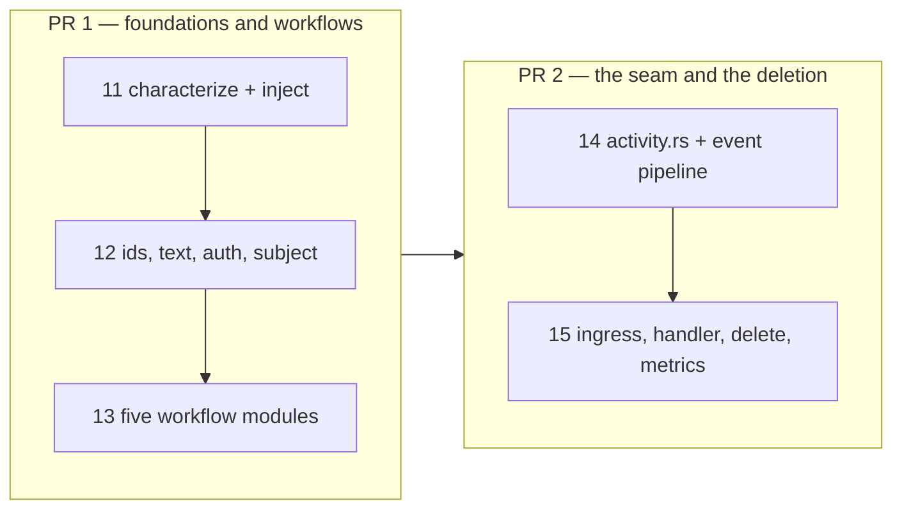

# Break up the Linear Adapter

> **Status:** draft
> **Updated:** 2026-07-31
> **Vocabulary:** CONTEXT.md
> **Parent:** `.plans/remaining-adapter-breakup.md` — stages 11–15. This document supersedes those
> five one-line rows; where the two disagree, this one wins.
> **Sibling:** `.plans/completed/slack-telegram-adapter-breakup.md` — the same work for Slack and
> Telegram, shipped in #174. Its decisions about effects, ingress vocabulary and characterization
> order are precedent here and are not re-argued.
> **Reference implementation:** `backend/src/adapters/providers/github_pr/`

Linear is the last flat Adapter and the largest: 8,111 lines, of which `agent_runtime.rs` is 2,515 —
larger than the `slack/adapter.rs` (1,397) and `telegram/adapter.rs` (1,134) that #174 broke up,
combined.

It is also the *least* broken of the three, and that shapes the whole plan. Linear's ingress already
admits before it acknowledges, already has the three-way error vocabulary the shared type will carry,
and already has integration tests proving its delivery identities. The problem is not that Linear
does the wrong thing; it is that one file does eleven things, and the event pipeline depends on it.

## Current solution

### Module ownership

Sizes and every line number in this document are Rust on `13b22b78`. Neither
`adapters/providers/linear/` nor `event_handler/` has changed since #174 landed at `41b63f8b`, so
they hold on both.

| Module | Lines | Owns | Cost |
|---|---|---|---|
| `agent_runtime.rs` | 2,515 | Five workflow entry points, the close path, task provisioning, outbound activity emission, external ids, inbound text, task links, rule lookup, session resolution, tool-result truncation | Eleven responsibilities, one file. Named after no domain concept. |
| `handlers.rs` | 743 | HTTP route, signature, envelope parse, dedup identity, per-event admission | Right ordering, right error vocabulary, not a seam: `receive` does not exist, so nothing can drive it without an HTTP request. |
| `delivery.rs` | 793 | Five kind constants, five payload types, registration, five executors | **Correct.** Documented to the standard the invariants ask for. Keep. |
| `agent_api.rs` | 1,151 | Agents GraphQL client, OAuth token refresh | No base-URL injection (`:26` hardcodes `LINEAR_GRAPHQL_URL`), so no test can reach it. |
| `api_routes.rs` | 953 | Typed operator routes (`/api/v1/linear/*`) | Support module. Out of scope, but it builds its own API clients. |
| `webhook_payloads.rs` | 581 | Envelope and payload types with `resolved_*` accessors | Support module. Keep. |
| `config.rs` | 513 | `LinearRuleConfig`, spawn-rule selection, project/label filters | Support module. Keep. |
| `adapter.rs` | 436 | Six capability impls, OAuth credentials, single-workspace fallback | Credentials and a raw `sqlx` workspace query inside the Adapter type. |
| `status.rs` | 215 | External status projection, binding status keys | Support module. Keep. |
| `active_turns.rs` | 129 | Turn gating (1-hour TTL) | Support module. Keep. |
| `signature.rs` | 61 | HMAC verification | Support module. Keep. |

### What `agent_runtime.rs` actually contains

| Range | Responsibility |
|---|---|
| `:42`–`:65` | `resolve_rules_for_team` — ingress-time Subscription lookup |
| `:78`–`:127` | `handle_session_created` — heartbeat, empty-rule guard, admission |
| `:135`–`:226` | `provision_selected_session_task`, `agent_api`, `select_session_spawn_rule` |
| `:234`–`:316` | `handle_session_prompted` — binding lookup, heartbeat, forward, sandbox notify |
| `:337`–`:507` | `handle_comment_created`, `comment_audience`, `comment_delivery_bindings` |
| `:509`–`:535` | Three external-id formats |
| `:549`–`:693` | `handle_issue_update`, `create_tasks_for_status_entry` |
| `:702`–`:889` | `provision_issue_task`, `transition_issue_state` |
| `:897`–`:1058` | `handle_issue_status_notification`, `persist_issue_status`, `notify_bindings_of_state_change` |
| `:1060`–`:1306` | The close path: eight functions from `close_active_bindings_for_issue` to `publish_linear_task_closed` |
| `:1308`–`:1511` | `provision_session_task` — 200 lines, the largest single function |
| `:1513`–`:1556` | Inbound text rendering |
| `:1557`–`:1665` | `insert_event_task`, task URLs, attachment titles |
| `:1666`–`:1757` | `rule_for_binding`, `resolve_linear_sessions_for_task` |
| `:1763`–`:2002` | Four `notify_linear_*` emitters — **the event pipeline's dependency** |
| `:2004`–`:2100` | Tool-input summarization and truncation |

### Verified defects

Each was read at the line cited, not inferred from the parent plan.

| # | Defect | Evidence | Consequence |
|---|---|---|---|
| D1 | **Linear meters no `ignored` outcome at all.** | `handlers.rs:67` records `success` for every benign rejection: missing signature (`:142`), unknown organization (`:147`, `:157`), unsupported event type (`:207`), a non-`update` Issue action (`:339`), a non-`create` Comment action (`:389`), every unparseable or absent payload (`:343`, `:348`, `:394`, `:399`, `:430`, `:435`), an empty prompt body (`:483`), an unsupported session action (`:500`), and a created session with no matching rule (`agent_runtime.rs:110`). `github_pr/handlers.rs:46` and `telegram/handlers.rs:53` both emit `ignored` with a reason. | The dashboard cannot separate "arrived and admitted" from "arrived and dropped" — the first question anyone asks when a Linear mention does nothing. Today both are `success`. |
| D2 | **Error rows carry no `event_type`.** | `handlers.rs:73`, `:83`, `:96` pass `""`; `github_pr/handlers.rs:55`, `:63` pass the real event type. | The one metric that fires when something breaks cannot say which kind of delivery broke. |
| D3 | **One external-id format is written five times; two have no function at all.** | `linear:comment:{id}` at `agent_runtime.rs:414`, `:510`, `adapter.rs:187`, `:221`, `:305`. `linear:issue:created:{id}` (`agent_runtime.rs:786`) and `linear:session:created:{id}` (`:1468`) are inline `format!`s. | External id formats are persisted and drive echo filtering and deduplication. Five copies are five chances to drift, and a drift is a message delivered twice or not at all. |
| D4 | **`LinearAgentApi` is constructed in three places from two credential sources.** | `agent_runtime.rs:170` and `:1747` read `state.config.linear.*`; `adapter.rs:69` reads `self.oauth_*`. `adapter.rs:84` runs a raw `sqlx` query inside the Adapter type to pick the single workspace. | Credential selection has no owner, so "which token does this call use?" is answered by whichever call site you happen to be reading. |
| D5 | **Two hand-written copies of the same `task_bindings` SELECT.** | `agent_runtime.rs:1093` and `:1692` — identical twelve-column list with `adapter_kind AS provider`, different `WHERE`. | A schema change has to find both, and one is inside a function about closing tasks. |
| D6 | **Dead parameters on the close path.** | `close_active_bindings_for_issue(_connection)` `:1063` and `rule_for_binding(_connection)` `:1668` take an `AdapterConnection` neither reads. | Small, but they make the close path look connection-scoped when it is not — which matters when deciding what a deleted connection does. |
| D7 | **The event pipeline depends on a 2,515-line workflow file.** | Seven call sites — `event_handler/consumer.rs` `:447`, `:459`, `:499`, `:532`, `:552`, `:569` and `event_handler/agent_handlers.rs:275` — name `notify_linear_status`, `notify_linear_action`, `notify_linear_message_activities` and `notify_linear_tool_results` through the full path `crate::adapters::linear::agent_runtime::*`. | Every compile of the event pipeline pulls in session provisioning, issue workflows and the close path. |
| D8 | **No Linear API call is testable.** | `agent_api.rs:26`–`:27` hardcode `LINEAR_GRAPHQL_URL` and `LINEAR_TOKEN_URL`; there is no `with_base_url`. Slack and Telegram both have one. | No characterization test can assert an API-call budget for any of the ~12 call sites, so a refactor that adds a round trip passes every test. |

### What is already right, and must survive

Stated so the migration is measured against it rather than against a blank slate.

| Property | Evidence |
|---|---|
| Admission precedes acknowledgment | `handlers.rs:1`–`:26` states the rule; `admit` (`:316`) is the single funnel; every kind admits before the `200`. |
| The three-way error vocabulary already exists | `delivery.rs:148` `LinearWebhookError::{NotAdmitted, Unidentifiable, Ingress}` — the same three transport treatments the shared type will carry. |
| `NotAdmitted` is reachable | `handlers.rs:322` admits through `adapters::ingress::admit_delivery`, which does not flatten `AdmitError`. |
| Delivery identity is thought through and tested | `dedup_key` (`:268`) with eleven unit tests, plus `backend/tests/linear_delivery_identity_test.rs` proving two prompts, a retried prompt, two state changes, a state re-entry and a retried state change all behave. |
| A refusal is preferred to a colliding identity | `Unidentifiable` (`delivery.rs:152`) and `backend/tests/linear_admission_test.rs`. |
| Payloads carry ids, not snapshots | `delivery.rs:168`–`:265`: every payload carries `connection_id`, and `updated_from` already has `#[serde(default)]`. |

## Planned solution

### Target tree

```text
linear/
  adapter.rs         ~120   type, construction, Adapter, AdapterOutboundContent, pub(super) accessors
  handlers.rs         ~80   HTTP extraction, metrics, response mapping
  ingress.rs         ~280   receive(): signature, connection, identity, admission, outcome
  webhook.rs         ~220   normalize(): envelope → typed plan + effects. No I/O.
  delivery.rs        ~793   unchanged
  sessions.rs        ~450   created + prompted workflows
  issues.rs          ~520   issue update, status entry, provisioning, state transitions
  comments.rs        ~260   comment routing and audience
  notifications.rs   ~150   AppUserNotification workflow
  close.rs           ~300   close eligibility and execution
  activity.rs        ~350   the four notify_* emitters, summarization, truncation
  auth.rs            ~140   every LinearAgentApi construction, credential selection, resolve_user
  subject.rs         ~190   both subject kinds, destination configs, binding queries
  external_id.rs      ~90   five formats, one function each, plus the comment parse
  text.rs            ~130   inbound text, issue read block, attachment titles
  (unchanged) agent_api.rs, api_routes.rs, webhook_payloads.rs, config.rs, status.rs,
              active_turns.rs, signature.rs
```

`mod.rs` narrows to `pub(crate) mod adapter; delivery; handlers; activity;` plus the
`SUBJECT_KIND_ISSUE` constant. `activity` is `pub(crate)` because the event pipeline consumes it;
everything else is private with `pub(super)` internals.

### Move map

| From `agent_runtime.rs` | To |
|---|---|
| `:42` `resolve_rules_for_team` | `ingress.rs` |
| `:78` `handle_session_created`, `:135` `provision_selected_session_task`, `:187` `select_session_spawn_rule`, `:234` `handle_session_prompted`, `:1308` `provision_session_task` | `sessions.rs` |
| `:337` `handle_comment_created`, `:469` `comment_audience`, `:481` `comment_delivery_bindings` | `comments.rs` |
| `:549` `handle_issue_update`, `:606` `create_tasks_for_status_entry`, `:702` `provision_issue_task`, `:843` `transition_issue_state`, `:942` `persist_issue_status`, `:996` `notify_bindings_of_state_change` | `issues.rs` |
| `:897` `handle_issue_status_notification` | `notifications.rs` |
| `:1060`–`:1306` the eight close functions | `close.rs` |
| `:509`, `:520`, `:533` the three id functions; the inline `format!`s at `:414`, `:786`, `:1468`; `adapter.rs:187`, `:221`, `:305` | `external_id.rs` |
| `:1513` `build_inbound_text`, `:1526` `build_issue_inbound_text`, `:1533` `issue_read_block`, `:1639` `format_attachment_title`, `:1646` `task_attachment_title` | `text.rs` |
| `:169` `agent_api`; `adapter.rs:68` `agent_api_for_org`, `:84` `api_for_single_workspace`, `:118` `impl AdapterUserIdentity` | `auth.rs` |
| `:1080` `load_issue_close_bindings`, `:1684` `resolve_linear_sessions_for_task`, `:481` binding queries, the two `destination_config` literals at `:748` and `:1421` | `subject.rs` |
| `:1604` `task_url`, `:1613` `attach_parent_task_link`, `:1557` `insert_event_task`, `:1666` `rule_for_binding` | `issues.rs` (`insert_event_task`, `attach_parent_task_link`), `sessions.rs`/`comments.rs` share `rule_for_binding` via `subject.rs` |
| `:1763`–`:2100` the four `notify_*`, `summarize_tool_input`, `truncate_chars`, `truncate_result_for_linear` | `activity.rs` |
| `handlers.rs:110`–`:510` everything below signature verification | `ingress.rs` and `webhook.rs` |

### Target module interfaces

```rust
// linear/ingress.rs — one copy of the vocabulary; see Decision 2
pub(super) enum Outcome {
    Admitted { event_type: String, kinds: Vec<&'static str> },
    Ignored { event_type: String, reason: &'static str },
}

pub(super) enum IngressError {
    NotAdmitted(AdmitError),   // nothing durable — do not acknowledge
    Unidentifiable(&'static str),  // no retry supplies the field — 400
    Ingress(AdapterError),     // rejected here; logged, metered, acknowledged
}

/// Decision 4 requires every error metric row to carry `event_type`, and an
/// error that has already discarded the envelope cannot supply one — so the
/// failure type is a pair, not the bare error.
pub(super) struct Rejection { error: IngressError, event_type: String }

pub(super) async fn receive(
    state: &AppState,
    adapter: &LinearAdapter,
    signature: Option<&str>,
    body: &[u8],
) -> Result<Outcome, Rejection>;

// linear/webhook.rs — pure. No database, no Linear call, no admission.
pub(super) enum Plan {
    /// One envelope fans into one or more admission requests, each already
    /// carrying the identity `ingress` derived.
    Admit {
        requests: Vec<AdapterDeliveryRequest>,
        effects: Vec<Effect>,
        requires: Option<Requirement>,
    },
    Ignored { reason: &'static str },
}

/// The one thing that must happen before the `200`, because Linear's panel
/// goes dark after ten seconds. Applied by `ingress`, never by `normalize`.
pub(super) enum Effect {
    SessionHeartbeat { session_id: String, text: &'static str },
}

/// A precondition only I/O can settle, described here so `normalize` stays pure
/// while `ingress` keeps the order Decision 3 pins down.
///
/// The created-session path checks for an active Subscription *before* it posts
/// the heartbeat, so preserving that order is not a preference — it is what
/// "every guard that runs before admission today runs before admission after"
/// requires. Without this variant, satisfying Decision 3 and keeping `normalize`
/// free of I/O are unsatisfiable together: the check has to happen somewhere,
/// and the only two places left are inside `normalize` (impure) or after the
/// effects (reordered). Describing the gate as a value and settling it in
/// `ingress` is what makes both hold. Ordering matters beyond bookkeeping — a
/// database lookup that fails costs Linear nothing, while a heartbeat posted
/// ahead of it spends an API call on a delivery that was never going to admit.
pub(super) enum Requirement {
    ActiveSubscription { team_id: String },
}

pub(super) fn normalize(
    envelope: &LinearWebhookEnvelope,
    connection_id: &str,
    event_id: &str,
) -> Result<Plan, IngressError>;

// linear/auth.rs — every construction of the client goes through here
pub(super) fn api_for_org(state: &AppState, org_id: &str) -> LinearAgentApi;
pub(super) async fn api_for_binding(state: &AppState, binding: &TaskBinding)
    -> Option<LinearAgentApi>;
pub(super) async fn api_for_single_workspace(state: &AppState)
    -> Result<LinearAgentApi, AdapterError>;

// linear/external_id.rs — one function per persisted format
pub(super) fn comment(comment_id: &str) -> String;          // linear:comment:{id}
pub(super) fn prompt(activity_id: &str) -> String;          // linear:prompt:{id}
pub(super) fn issue_state(issue_id: &str, at: i64) -> String;
pub(super) fn session_created(session_id: &str) -> String;
pub(super) fn issue_created(issue_id: &str) -> String;
pub(super) fn parse_comment(external_id: &str) -> Option<&str>;
```

### Behaviour

| Case | Today | After |
|---|---|---|
| Signed delivery, admitted | `200`, `success` | Unchanged. |
| Unsigned delivery | `200`, **`success`** | `200`, `ignored`/`no_signature` (Decision 4). |
| Unknown organization | `200`, **`success`** | `200`, `ignored`/`no_connection`. |
| Unsupported event type | `200`, **`success`** | `200`, `ignored`/`unsupported_event`. |
| Non-`update` Issue, non-`create` Comment | `200`, **`success`** | `200`, `ignored`/`unsupported_action`. |
| Unparseable inner payload | `200`, **`success`** | `200`, `ignored`/`malformed_payload`. |
| Session created, no matching rule | `200`, **`success`**, heartbeat only | `200`, `ignored`/`no_subscription`, heartbeat still posted. |
| Bad signature | `200`, `error`/`delivery_failed` | Unchanged, plus the `event_type` label (Decision 4). |
| Missing `webhookTimestamp` on an Issue update | `400`, `error`/`unidentifiable` | Unchanged, plus the `event_type` label. |
| Admission failure | non-2xx, `error`/`not_admitted` | Unchanged, plus the `event_type` label. |
| Every delivery identity, kind string and payload field | — | Byte-identical. |

## Decisions

**1. `agent_runtime.rs` is deleted, not renamed.** It is named after no concept in CONTEXT.md, and
half its contents are not runtime and not agent-specific. Every line moves to a module named for what
it owns; the file must not exist at the end of stage 15.

**2. Ingress gets the shared vocabulary, not a private copy.** By the time this work starts, the hoist
ticket (parent stage 01) owns one `Outcome`/`IngressError` in `adapters/ingress.rs`, and Linear's
existing `LinearWebhookError` is the type it was modelled on. Linear moves onto the shared type. If
the hoist has not landed, declare the copy locally and say so in the PR — do not block. Two rules
carry over from #174: the retryable variant takes **no blanket `From<AdapterError>`**, and a
provider-raised rejection is classified where it is raised.

**3. The admission line does not move.** Every guard that runs before admission today runs before
admission after, and every guard that runs in the worker stays there. This refactor changes where
code lives, not when it commits. The one exception is Decision 4, which adds a metric label and no
control flow.

**4. Add the `ignored` outcome, with a permanent reason list.** D1 is the only defect here worth
fixing during the move, because the metric is how anyone will verify the rest of the move. The reasons
are `no_signature`, `no_connection`, `unsupported_event`, `unsupported_action`, `malformed_payload`,
`no_subscription`, `empty_body`. That list is a public contract from the day it ships — adding to it
later is fine, renaming is not. The error rows also gain the `event_type` label they should always
have had (D2). **This changes what the `linear` webhook dashboards count** — see Open question 1.

**5. One module per delivery kind, plus `close.rs` for the one behavior two kinds share.**
`delivery.rs` already names five kinds; `sessions.rs`, `issues.rs`, `comments.rs` and
`notifications.rs` own four of them, and `sessions.rs` owns two (`session_provision`,
`session_prompt`) because they are the same workflow at two moments. The close path is reached from
both `issues.rs` and `notifications.rs`, so it is its own module rather than a dependency between two
peers.

**6. `activity.rs` is the event pipeline's only Linear import, and it depends on nothing above it.**
It may import `auth.rs`, `subject.rs` and `agent_api.rs`. It must not import `ingress`, `webhook`,
`delivery`, or any workflow module — that direction is what makes it safe for `event_handler` to
depend on. `event_handler/consumer.rs` and `agent_handlers.rs` change their import path and nothing
else.

**7. `LinearAgentApi` gains `with_base_url`, and `auth.rs` owns every construction.** D8 is what
makes the API-call budgets in this document assertable, so it lands in the first stage, before any
move. The three current construction sites (D4) collapse into `auth.rs`; `api_routes.rs` keeps its
routes but calls `auth.rs` to build clients.

**8. External ids move to `external_id.rs` before anything that uses them moves.** They are persisted
and drive echo filtering, so the five formats become five functions with one caller each, and the
duplicated `linear:comment:` literal (D3) has exactly one definition. No format string changes.

**9. `delivery.rs` is not touched.** Kinds, payload types, `#[serde(default)]` placement, the
`Unidentifiable` policy and the five executors are already correct; the executors change only which
module they call into. Kind strings are permanent — a rename is a data migration, not a refactor.

**10. `api_routes.rs` stays out of scope.** 953 lines of typed operator routes are support, not the
cause of the flatness. It changes in exactly one way: its API-client construction goes through
`auth.rs`.

## Seams and testing

### Seam matrix

| Seam | Driven by | Covers |
|---|---|---|
| `webhook::normalize` | Table-driven, in-process, no database | Every event type × action, each ignore reason, the fan-out of one envelope into requests, the heartbeat effect, and the identity carried into each request. |
| `ingress::receive` | Local database + stubbed Linear API | Signature policy, connection resolution, every metric label and reason, the admission identity, duplicate admission, and the acknowledgment class of each error variant. |
| Each of the five registered handlers | Local database + stubbed API | Payload round trip, restart recovery, re-read of connection and Subscription, missing-connection permanent failure, transient retry. |
| `close.rs` | Local database | Eligibility: sole binding, matching origin and trigger, task not already closed. Each rejection separately. |
| `activity.rs` | Stubbed API | One activity per bound session; block-type filtering; truncation boundaries; a task with no session emits nothing and makes no call. |
| `auth.rs` | Local database | Per-org selection, the single-workspace fallback and both its failure modes, and `resolve_user`. |
| `external_id.rs` | Pure | Every format round-trips through its parse; the comment format matches what `adapter.rs` writes on the outbound side. |

### Characterization required before any move

Linear starts from a better place than Slack or Telegram did: `backend/tests/linear_admission_test.rs`
and `linear_delivery_identity_test.rs` already pin admission and identity end to end, and
`handlers.rs` has eleven `dedup_key` tests. Those stay untouched and are the regression net for
stages 12–15. What is missing and must exist first:

- Every current `record_webhook` call and its labels, including the ones Decision 4 changes — pinned
  **before** the change, so the diff shows exactly which rows move from `success` to `ignored`.
- The session-created heartbeat: posted before the response, once, even when no rule matches.
- The prompted path: one heartbeat per session, one forwarded message per active binding, closed
  bindings skipped.
- Comment audience: threaded reply versus issue-level, the self-echo drop via the footer task id,
  and the de-duplication when one task holds both a session and an issue binding.
- Issue update: the no-transition guard, status persistence on every transition, close only on a
  terminal state with `close_task_on_close`, and status-entry creation with its project/label filters.
- Close eligibility: each of the four rejections, separately.
- The five external-id formats, asserted as literal strings.

### API-call budgets

Assert the count *and* the order. A refactor that adds a round trip is a regression that passes every
existing test today (D8 is why).

| Workflow | Budget |
|---|---|
| `AgentSessionEvent.created` (response path) | Exactly **one** `agentActivityCreate`. No `get_issue`, no `attachment`. |
| `session_provision` (worker) | One `get_issue` **only if** a rule is project- or label-scoped (`config::rules_need_issue_fetch`); one `agentSessionUpdateExternalUrls`; one `attachmentLinkURL`; one `issueUpdate` only when `start_state` differs from the current state. |
| `AgentSessionEvent.prompted` | One `agentActivityCreate` per session binding; no issue fetch. |
| `Comment.create` | One `agentActivityCreate` per *session* binding; none for issue-only bindings. |
| `Issue.update` | Zero `get_issue` when no candidate rule filters on labels and the payload carries the project; otherwise exactly one, shared across all candidate rules. |
| Status-entry provisioning | One `commentCreate` only on preflight failure; one `attachmentLinkURL`; one `issueUpdate` only when the state differs. |
| Close | One `agentActivityCreate` per session binding; none for issue-only bindings. |
| `activity.rs` emitters | One call per block per bound session, and **zero** database or API calls when the task has no Linear binding. |

## Staged migration and acceptance criteria

Each stage is one commit. The stage numbers continue the parent plan's.

| Stage | Change | Acceptance |
|---|---|---|
| 11 | `test:` characterization, plus `LinearAgentApi::with_base_url` and a `#[cfg(test)]` constructor for `LinearAdapter`. | No production behavior change beyond the injection points; every row of the characterization list above has an executable assertion; no test reaches api.linear.app. |
| 12 | `refactor:` `external_id.rs`, `text.rs`, `auth.rs`, `subject.rs`. | Five id formats with one definition each; no raw `sqlx` in `adapter.rs` or in any workflow module; one `LinearAgentApi` construction path; the two duplicated `task_bindings` SELECTs (D5) are one query with a parameter. |
| 13 | `refactor:` `sessions.rs`, `issues.rs`, `comments.rs`, `notifications.rs`, `close.rs`. | `delivery.rs`'s five executors call the five modules directly; kinds, payloads, dedup identities and retry budgets unchanged; the dead `_connection` parameters (D6) are gone. |
| 14 | `refactor:` `activity.rs`, and the event pipeline imports it instead of `agent_runtime`. | `event_handler` imports only `linear::activity`; `activity.rs` imports no ingress, delivery or workflow module; turn gating and truncation are covered. |
| 15 | `refactor:` + `fix:` `ingress.rs`, transport-only `handlers.rs`, `agent_runtime.rs` deleted, visibility narrowed, and Decision 4's metric change. | `agent_runtime.rs` does not exist; `handlers.rs` is ~80 lines; `receive` is drivable from a test without an HTTP request; `mod.rs` exports four modules; every `ignored` reason from Decision 4 is emitted and asserted; no coverage is lost. |

Stages 11–15 are strictly sequential: each moves code the next one moves again, all of it out of one
file. There is no parallel decomposition of this Adapter that does not conflict in `agent_runtime.rs`.

## Out of scope

| Out of scope | Reason |
|---|---|
| `api_routes.rs` internals | Operator routes; support, not cause (Decision 10). |
| `agent_api.rs` beyond `with_base_url` | Correct seam already. |
| Changing any kind string, delivery identity, payload field or subject kind | This is an architecture refactor (Decision 9). |
| Making the no-rule session case durable | A real question, but a behavior change — Open question 2. |
| `config.rs`, `status.rs`, `signature.rs`, `active_turns.rs`, `webhook_payloads.rs` | Support modules that do not cause the flatness. |
| Anything under `event_handler/` beyond the import path | Its dependency on Linear is the problem; its own shape is not. |

## Open questions

| # | Question | Status |
|---|---|---|
| 1 | Decision 4 moves roughly ten rejection paths from `outcome="success"` to `outcome="ignored"` on the `linear` webhook metric. Anything counting Linear success rate will step down at deploy. | **Answered: accepted, with the dashboard annotated.** Asked before the change this time rather than after, which is the one thing #174 got backwards. Stage 15 ships the `ignored` outcome and its seven reasons; the deploy marker on the Linear inbound dashboard, and a check that no alert threshold is baselined on the inflated success count, are owned outside this work — the same follow-up the Telegram change carries. |
| 2 | A `session.created` with no matching Subscription posts a heartbeat and admits nothing (`agent_runtime.rs:110`), so nothing durable records that Linear asked and we declined. Should it admit a record that no-ops? **The module already argues that it should**: `delivery.rs:245`–`:253` says `NotificationDelivery` carries `action` rather than filtering at the route, "because whether an action is one this adapter acts on is a decision, and every decision belongs behind admission. Filtering at the route would leave a whole class of Linear delivery with no durable record of having arrived." The no-rule session case is that filtering, in the same Adapter. | **Deferred, but it is a real inconsistency, not a style preference.** It is still a behavior change, and folding it into a refactor is how the last two Adapters nearly lost their reviewability. Decide it as its own ticket, with Decision 4's `no_subscription` reason as the interim answer — the metric records the drop even while nothing durable does. |
| 3 | `api_routes.rs` is 953 lines and builds its own API clients. Does it get the same treatment later? | **Open, low priority.** Stage 12 routes its construction through `auth.rs`; whether the routes themselves deserve a breakup is a separate call. |

## Ticket breakdown

Two tickets, sequential — the second branches from the first, because both move code out of
`agent_runtime.rs` and would otherwise conflict on every hunk.



| Ticket | Scope | Review boundary |
|---|---|---|
| 01 | Stages 11–13. Characterization, injection points, the four support modules, the five workflow modules. | No behavior change at all. `agent_runtime.rs` still exists and still holds `activity` and the ingress helpers. |
| 02 | Stages 14–15. `activity.rs`, the `event_handler` import change, `ingress.rs`, transport-only `handlers.rs`, the deletion, and Decision 4's metric change. | One named behavior change (the metric), gated on Open question 1. Touches `event_handler/`, which ticket 01 must not. |
