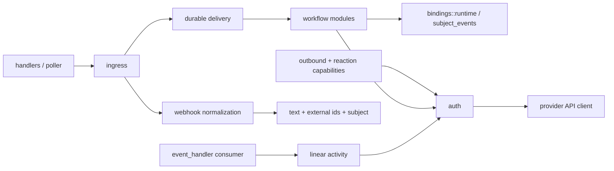
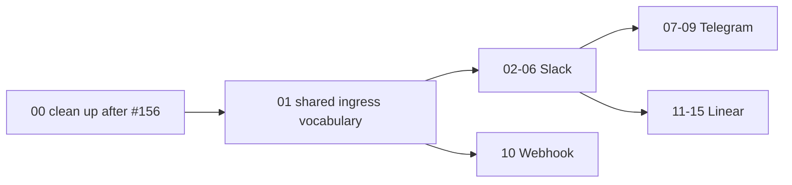

# Deepen the remaining Adapters around workflow seams

> **Status:** draft
> **Updated:** 2026-07-31
> **Vocabulary:** CONTEXT.md
> **Predecessor:** `.plans/smarter-github-pr-adapter-breakup.md` (delivered by PR #156)
> **Related:** `.plans/cognitive-complexity-refactor.md`, `.plans/adapter-capability-interfaces.md`
> **Expanded by:** `.plans/slack-telegram-adapter-breakup.md` — stages 02–09 (Slack and Telegram) at
> ticket level: move maps, target module interfaces, and the effect vocabulary. Read that document
> before starting any of those stages; it supersedes their one-line rows below.

## Current solution

PR #156 applied one architecture to one Adapter.

The GitHub PR Adapter now has a type-and-composition-root `adapter.rs`, a workflow module per
durable effect, and a transport-only HTTP handler.

The other four Adapters — Slack, Telegram, Linear, and Webhook — still have the shape the GitHub
PR Adapter had before that PR.

### What PR #156 established

The merged tree matches the target directory the predecessor plan specified.

| Claim | Evidence on `a015864` |
|---|---|
| `adapter.rs` is a composition root | 213 lines, of which 79 are tests; holds construction, `Adapter` identity, one static content limit, and static presentation. |
| Capability implementations live with behavior | `outbound.rs`, `reactions.rs`, `status.rs`, `subject.rs`, and `auth.rs` implement their traits directly; `adapter.rs` has no delegating methods. |
| Ingress owns admission | `ingress::receive` runs verification, resolution, filtering, normalization, projection scheduling, planning, and sequential admission; `handlers.rs` is 78 lines. |
| Normalization is a value | `webhook::normalize` returns `NormalizedWebhook` and touches the database only for sender lookup. |
| Internals are private | 220 `pub(super)` items against 9 `pub` ones; `mod.rs` exports six modules, four of them `pub(crate)`. |
| Integration tests drive the seam | `backend/tests/github_webhook_redelivery_test.rs` builds `adapter_router` and posts requests; it imports no GitHub PR internals. |

Verification run on the merged tree for this review:

- `cargo test -p moatless-vibe-backend --lib adapters::` — 452 passed, 0 failed, 2 `dead_code` warnings.
- `cargo clippy -p moatless-vibe-backend --all-targets` — **fails**: 1 error, 55 warnings.

### Carry-over defects from PR #156

These are small and are folded into Ticket 00 rather than left implicit.

| Defect | Evidence | Why it survived |
|---|---|---|
| Test support that violates a denied lint | `providers/github_pr/test_support.rs:84` trips `clippy::type_complexity`, which `Cargo.toml:26` sets to deny through `clippy::all = deny`. `cargo clippy --all-targets` does not compile. | See the next row. |
| Orphaned test support | `backend/src/bindings/metrics.rs:111` and `:127` — `InboundSample` and `captured_inbound` have no caller; the lib test build emits two `dead_code` warnings. | Their last caller was in the deleted `adapter_tests.rs`. |
| CI cannot see either | `.github/workflows/ci.yml:133` runs `cargo clippy -p moatless-vibe-backend -- -D warnings` with no `--all-targets`, so no `#[cfg(test)]` code is ever linted — not even for lints the workspace denies. | The predecessor plan's own verification commands inherit the same blind spot. |
| Unused injected dependency | `providers/github_pr/adapter.rs:27` keeps `_db: DbPool` "for future per-pool DB needs". | Nothing enforces the repository's no-speculative-code rule at review time. |
| Test isolation regressed against the rest of the tree | `providers/github_pr/test_support.rs` stubs GitHub by setting the process-global `GITHUB_API_BASE_URL` behind a global mutex, serializing every GitHub stub test. Slack and Telegram already inject a base URL through `SlackApi::with_base_url` / `TelegramApi::with_base_url`. | The predecessor plan named "a local HTTP stub" without naming the injection point. |
| `shell_reconcile.rs` was excluded | 1,836 lines — now the largest file in `github_pr/`, larger than the `adapter.rs` the breakup targeted. | Explicitly out of scope in the predecessor plan; the exclusion was never revisited. |

### Current module ownership, by Adapter

Sizes are lines of Rust on `a015864`.

#### Slack — 3,443 lines

| Responsibility | Current module | Cost |
|---|---|---|
| Adapter identity, construction, workspace memoization | `adapter.rs` | Mixed with everything below. |
| Webhook normalization | `adapter.rs:298` `parse_event`, ~376 lines | Carries `#[expect(clippy::cognitive_complexity)]` with a reason that names this work as the fix. |
| Ingress orchestration | `handlers.rs`, 224 lines | Decodes JSON, answers `url_verification`, resolves connection and Subscription, reads Bindings to compute `is_tracked_thread`, calls normalization, builds the destination, derives the admission id, admits, and classifies the outcome. |
| Identity resolution | `adapter.rs` — Slack id lookup, email fallback, bot attribution | Raw `sqlx` queries inside the Adapter type. |
| Destination and reaction parsing | `adapter.rs` free functions | No subject type; each caller re-parses strings. |
| Outbound replies, direct sends, new threads, reactions, context fetch | `adapter.rs` | Eleven `impl` blocks (identity plus ten capabilities) in the same file as inbound parsing. |
| Slack Web API | `api.rs`, 804 lines | Correct seam; already injectable via `with_base_url`. |
| mrkdwn rendering, access policy, config, signature, external ids | `format.rs`, `access.rs`, `config.rs`, `signature.rs`, `external_id.rs` | Support modules; keep. |

#### Telegram — 2,741 lines

| Responsibility | Current module | Cost |
|---|---|---|
| Webhook normalization | `adapter.rs:61` `parse_update`, 226 lines | Same shape as Slack. |
| Ingress orchestration | `adapter.rs:671` `resolve_and_process_telegram_update`, 118 lines | Lives in the Adapter type rather than a seam, and is called from two entry points. |
| Transport | `handlers.rs`, 103 lines | Performs its *own* connection and Subscription resolution to find `secret_token`, then discards it. |
| Long-poll transport | `poller.rs`, 252 lines | Second ingress entry point; bypasses the handler's secret check entirely, correctly. |
| Capability implementations, destination and reaction parsing | `adapter.rs` | As Slack. |
| Bot API, access policy, pairing, config, external ids | `api.rs`, `access.rs`, `pairing.rs`, `config.rs`, `external_id.rs` | Support modules; keep. |

#### Linear — 8,111 lines

| Responsibility | Current module | Cost |
|---|---|---|
| Every durable workflow | `agent_runtime.rs`, 2,515 lines | Session creation, prompt routing, comment routing, issue-update workflow, status persistence, Task close, outbound activity emission, external ids, text rendering, and tool-result truncation in one file. |
| Ingress | `handlers.rs`, 743 lines | Already has the right *error* vocabulary (`NotAdmitted` / `Unidentifiable` / `Ingress`) and the right ordering; it is simply not a seam. |
| Durable admission and execution | `delivery.rs`, 793 lines | Correct and well documented; five stable kinds. Keep as is. |
| Outbound activity emission | `agent_runtime.rs:1763`–`2072` | Reached directly from `event_handler/consumer.rs` and `event_handler/agent_handlers.rs`, so a 2,515-line file is a public dependency of the event pipeline. |
| Credentials | `adapter.rs` and `agent_api.rs` | OAuth client credentials, workspace token selection, and single-workspace fallback are spread across both. |
| Agents GraphQL client | `agent_api.rs`, 1,151 lines | Correct seam. No base-URL injection point. |
| Typed operator routes | `api_routes.rs`, 953 lines | Support module; keep. |
| Payload decoding, config, status, signature, turn gating | `webhook_payloads.rs`, `config.rs`, `status.rs`, `signature.rs`, `active_turns.rs` | Support modules; keep. |

#### Webhook — 779 lines

| Responsibility | Current module | Cost |
|---|---|---|
| Normalization | `adapter.rs` `parse_inbound` | Sits beside the capability implementations, but the file is 530 lines and readable. |
| Ingress | `handlers.rs`, 106 lines | Resolves the Subscription, verifies, normalizes, formats the subject key inline, and admits. |
| Subject key | `handlers.rs:67` | `format!("{}:{thread_id}", message.source_id)` with no owning type. |

This Adapter is close to correct already. Applying the full eight-stage treatment to it would cost
more than it returns.

### Behavior the current shape makes easy to get wrong

Each row is a defect that exists today and that the target shape removes by construction.

| Adapter | Observed behavior | Where |
|---|---|---|
| Slack | Normalization posts to Slack. An unmapped top-level sender triggers `chat.postMessage` from inside `parse_event`, before admission, with the result discarded. The comment at `adapter.rs:352` records this as a known, accepted cost of removing the in-process cache. It also means normalization cannot be exercised without a Slack endpoint. | `providers/slack/adapter.rs:634` |
| Slack | The signature is verified twice per delivery — once in the handler for `url_verification` only, once inside `parse_event`. | `handlers.rs:79`, `adapter.rs:316` |
| Slack | `SlackWebhookResult::Challenge` is unreachable from HTTP: the handler answers `url_verification` and returns before normalization runs. The handler still carries a match arm for it. | `handlers.rs:70` vs `adapter.rs:323` |
| Telegram | Every update resolves the connection and Subscription **twice**, under two different source keys: the handler uses `"*"` for private chats, and the ingress function always uses the chat id with exact-then-wildcard fallback. The `secret_token` verified is therefore the one on the Subscription the *handler* found, which is not necessarily the Subscription the delivery is routed under. When the handler's resolution finds nothing, no secret is verified at all and the update can still be admitted. | `telegram/handlers.rs:55` vs `telegram/adapter.rs:719` |
| Telegram | The same double resolution double-counts the `inbound` ignore metrics, because `resolve_chat_provider_event` meters its own rejections. | `bindings/runtime.rs:100` |
| Slack | Five `pub` methods on `SlackAdapter` have no caller anywhere in the crate: `list_channels`, `get_channel_name`, `auth_test`, and the `post_message` / `open_dm` wrappers are used only from inside the same file. | `slack/adapter.rs:195`–`:227` |
| All four | `pub` is the default. Slack exports 46 `pub` items and 0 `pub(super)`; Telegram 44 and 0; Linear 100 and 29; the finished GitHub PR Adapter exports 9 and 220. | `providers/*/mod.rs` |

## Planned solution

Apply the predecessor plan's architecture to the remaining four Adapters, scaled to each one.

Keep the cross-Adapter capability interfaces unchanged.

Keep every delivery kind, payload meaning, deduplication identity, audience rule, and retry budget
unchanged, with one named exception (Decision 6).

### Target trees

```text
slack/                    telegram/                 linear/                   webhook/
├── mod.rs                ├── mod.rs                ├── mod.rs                ├── mod.rs
├── adapter.rs            ├── adapter.rs            ├── adapter.rs            ├── adapter.rs
├── auth.rs               ├── auth.rs               ├── auth.rs               ├── inbound.rs
├── subject.rs            ├── subject.rs            ├── subject.rs            ├── subject.rs
├── ingress.rs            ├── ingress.rs            ├── ingress.rs            ├── delivery.rs
├── webhook.rs            ├── webhook.rs            ├── webhook.rs            ├── handlers.rs
├── delivery.rs           ├── delivery.rs           ├── delivery.rs           ├── external_id.rs
├── outbound.rs           ├── outbound.rs           ├── sessions.rs           └── signature.rs
├── reactions.rs          ├── reactions.rs          ├── issues.rs
├── context.rs            ├── api.rs                ├── comments.rs
├── text.rs               ├── access.rs             ├── notifications.rs
├── api.rs                ├── pairing.rs            ├── close.rs
├── access.rs             ├── poller.rs             ├── activity.rs
├── format.rs             ├── config.rs             ├── status.rs
├── config.rs             ├── external_id.rs        ├── text.rs
├── handlers.rs           └── handlers.rs           ├── external_id.rs
├── external_id.rs                                  ├── agent_api.rs
└── signature.rs                                    ├── api_routes.rs
                                                    ├── webhook_payloads.rs
                                                    ├── active_turns.rs
                                                    ├── config.rs
                                                    ├── handlers.rs
                                                    └── signature.rs
```

New modules are the workflow seams. Everything else is an existing support module that keeps its
current role.

Linear's `agent_runtime.rs` does not exist in the target tree. Its contents distribute as:

| Current range | Target module |
|---|---|
| `handle_session_created`, `select_session_spawn_rule`, `handle_session_prompted`, `provision_session_task`, `build_inbound_text` | `sessions.rs` |
| `handle_issue_update`, `create_tasks_for_status_entry`, `provision_issue_task`, `transition_issue_state`, `handle_issue_status_notification`, `persist_issue_status`, `notify_bindings_of_state_change` | `issues.rs` |
| `handle_comment_created`, `comment_audience`, `comment_delivery_bindings` | `comments.rs` |
| `close_active_bindings_for_issue` through `publish_linear_task_closed` | `close.rs` |
| `notify_linear_status`, `notify_linear_action`, `notify_linear_message_activities`, `notify_linear_tool_results` | `activity.rs` |
| `linear_comment_external_id`, `linear_prompt_external_id`, `linear_issue_state_external_id` | `external_id.rs` |
| `build_issue_inbound_text`, `issue_read_block`, `summarize_tool_input`, `truncate_chars`, `truncate_result_for_linear` | `text.rs` |
| `resolve_rules_for_team`, `rule_for_binding`, `resolve_linear_sessions_for_task` | `subject.rs` and `config.rs` |
| `insert_event_task`, `task_url`, `attach_parent_task_link`, `task_attachment_title` | `sessions.rs` (shared private helper) |

### Problem

| Maintainer | Current cost | Planned leverage |
|---|---|---|
| Slack maintainer | Changing which senders are accepted means editing a 376-line function that also verifies signatures, calls `users.info`, posts to Slack, and constructs the message. | Edits `webhook.rs` and proves the change through one normalization interface with no network. |
| Telegram maintainer | The secret-token rule lives in the handler and the routing rule lives in the Adapter type, so neither file states the policy. | Reads and edits one `ingress::receive`. |
| Linear maintainer | Any change to session, issue, comment, close, or activity behavior lands in the same 2,515-line file. | Edits one workflow module per durable kind. |
| Event-pipeline maintainer | `event_handler/consumer.rs` depends on four functions inside Linear's largest file. | Depends on `activity.rs`, whose whole surface is outbound emission. |
| Reviewer | A diff touching one workflow cannot be reviewed without re-checking the invariants of the others. | Reviews one workflow module and its seam tests per stage. |
| Test author | Slack and Telegram normalization cannot be tested without a live API, and no test replays a signed envelope. `backend/tests/adapter_inbound_delivery_test.rs:11` records exactly this gap. | Injects a stub base URL and drives `ingress::receive` with a real signed body. |

### Behaviour

#### A chat Sender delivers an event

| Given | When | Then |
|---|---|---|
| The request names a configured Adapter connection. | The handler passes transport facts to ingress. | Ingress verifies the signature exactly once, resolves the connection and Subscription exactly once, normalizes, and admits before reporting success. |
| The Subscription is missing or inactive. | Ingress evaluates the delivery. | The current ignore reason and metric label are preserved unchanged. |
| Normalization decides the event is not routable. | Ingress classifies it. | The same `ignored` reason string reaches the same metric as today. |
| Admission fails. | The handler maps the result. | The request is not acknowledged, exactly as today. |
| The Sender re-delivers. | Admission runs. | The delivery collapses onto the same record under the same event id as today. |

#### A Slack event names an unmapped sender

| Given | When | Then |
|---|---|---|
| A top-level message arrives from a Slack user with no mapped account. | Normalization runs. | Normalization returns an ignore value naming the reply target and the resolved email, and performs no Slack call. |
| Ingress receives that ignore value. | It applies the value. | It posts the same message, to the same thread, best-effort, with the same discarded result — the observable behavior is unchanged, including on re-delivery. |

#### A Telegram update arrives

| Given | When | Then |
|---|---|---|
| An update arrives over the webhook. | Ingress resolves the delivery. | One connection and Subscription resolution happens, and the `secret_token` verified is the one on the Subscription the delivery is routed under. |
| An update arrives over the long poller. | Ingress resolves the delivery. | No secret is verified, as today, because the transport is authenticated by the bot token. |
| No Subscription matches. | Ingress evaluates the update. | The update is ignored, once, with one ignore metric rather than two. |

#### A Linear delivery executes

| Given | When | Then |
|---|---|---|
| A worker claims a `linear.session_provision` record. | `delivery.rs` decodes and resolves. | It calls `sessions::execute`; the payload, kind, dedup identity, and retry budget are unchanged. |
| An agent Turn produces output. | The event consumer emits activity. | It calls `activity.rs`, whose interface is the four existing emission entry points. |
| An issue reaches a closing state. | `issues.rs` executes. | `close.rs` owns the Binding, sibling, and origin checks the historical complexity audit flagged at `agent_runtime.rs:1060`. |

### Target module interfaces

| Module | Small interface | Implementation hidden behind it |
|---|---|---|
| `adapter.rs` (each) | Construction, `Adapter` identity, static content limits, and `pub(super)` accessors for sibling modules. | Nothing else. |
| `ingress.rs` (each) | `receive(state, adapter, Request) -> Result<Outcome, IngressError>`. | Signature policy, connection and Subscription resolution, filtering, normalization, effect application, admission, and outcome classification. |
| `webhook.rs` (Slack, Telegram, Linear) | `normalize(request, context) -> Normalization`. | Event and action parsing, sender mapping, access policy, message construction, audience, external ids, and ignore reasons. |
| `inbound.rs` (Webhook) | `parse(config, body, signature) -> Delivery`. | Signature policy, payload shape, user-id precedence, delivery identity, and external event id. |
| `subject.rs` (each) | Fallible parse from Binding or thread data; format the key; build a destination. | The storage shape and the destination capability implementation. Linear owns both `linear_agent_session` and `linear_issue`. |
| `auth.rs` (each) | Use-case-specific identity resolution and authenticated client acquisition. | Slack id and email precedence, bot attribution, Telegram bot-token selection, Linear workspace OAuth and single-workspace fallback. |
| `outbound.rs` / `reactions.rs` / `context.rs` | The existing capability traits, implemented directly. | Target parsing, actor selection, API calls, and returned external ids. |
| `sessions.rs` / `issues.rs` / `comments.rs` / `notifications.rs` / `close.rs` (Linear) | Execute one durable delivery of that kind. | Everything the kind does, including its Task and Binding writes. |
| `activity.rs` (Linear) | The four existing `notify_linear_*` entry points. | Session resolution, turn gating, rendering, and truncation. |
| `text.rs` (Slack, Linear) | Private render functions over typed inputs. | Exact user-facing text. |

### Dependency direction



`ingress.rs` may depend on `webhook.rs` and `delivery.rs`.

`webhook.rs` may depend on `auth.rs` for sender resolution only, and may not depend on `AppState`,
`delivery.rs`, or any workflow module.

Workflow modules may not depend on `ingress.rs`.

No module outside an Adapter may reach past that Adapter's `mod.rs` exports.

## Decisions

| # | Decision | Chosen | Rejected because |
|---|---|---|---|
| [1](#1-one-adapter-per-stack-slack-first) | Order of work | Slack, then Telegram, then Webhook, then Linear. | Linear first is the biggest single win but settles the shared ingress vocabulary against the least representative Adapter, and its five kinds make the first stack the riskiest to review. |
| [2](#2-the-ingress-vocabulary-is-shared-the-policy-is-not) | Ingress reuse | Hoist `Outcome` and `IngressError` into `adapters/ingress.rs`; every Adapter keeps its own `receive`. | Copying the enums a fifth time repeats the classification bug surface; a shared generic `receive` driver would need a callback per Adapter-specific step and become a shallow interface with five configurations. |
| [3](#3-normalization-returns-effects-it-does-not-perform-them) | Slack's unmapped-sender notice | Normalization returns an ignore value carrying the reply target; ingress performs the post, best-effort, unchanged. | Leaving the call in normalization keeps normalization untestable offline; making it a durable delivery kind changes observable behavior during a refactor. |
| [4](#4-capability-implementations-live-with-behavior) | Trait implementation placement | Implement capability traits directly in the owning module. | Delegating from `adapter.rs` preserves two places to edit. |
| [5](#5-api-clients-are-concrete-and-injected) | Test technique at the external seam | Keep the concrete client; inject a stub base URL through the constructor. | One mock trait per API mirrors every endpoint; the process-global env var GitHub PR uses serializes tests and leaks across them. |
| [6](#6-telegrams-double-resolution-is-fixed-deliberately) | Telegram's two resolutions | Collapse to one, and verify the `secret_token` of the Subscription the delivery routes under. | Preserving the split would carry a security-relevant inconsistency through a refactor whose whole point is that the policy has one home. |
| [7](#7-webhook-gets-a-reduced-treatment) | Webhook Adapter scope | Extract `inbound.rs` and `subject.rs`, narrow visibility, and stop. | A full eight-stage treatment of a 779-line Adapter is the speculative-abstraction failure the repository's coding rules name. |
| [8](#8-shell_reconcilers-is-decided-not-deferred-again) | GitHub PR leftovers | Ticket 00 records an explicit verdict on `shell_reconcile.rs`, with evidence, rather than deferring it a second time. | Silent deferral is how it became the largest file in a directory that was just refactored. |

### 1. One Adapter per stack, Slack first

Slack, Telegram, and Webhook share one inbound shape: ingress → `inbound_delivery` →
`bindings::runtime::route_inbound_message`.

Slack is the largest of the three and carries the historical complexity hotspot, so it is the
honest template.

Telegram becomes a near-mechanical repeat once Slack lands, and it inherits the fix in Decision 6.

Linear is last because it shares almost nothing with the other three: five delivery kinds, its own
agent-session model, and an outbound path reached from the event pipeline.

The cost of this ordering is that the worst file in the tree — `agent_runtime.rs` — is fixed last.
That is accepted: it is also the file where an unproven vocabulary would do the most damage.

### 2. The ingress vocabulary is shared, the policy is not

GitHub PR and Linear independently invented the same three-way classification.

| Variant | Transport treatment | Invented by |
|---|---|---|
| Processed / Ignored | Acknowledged, metered with a stable reason. | Both. |
| Not admitted | Not acknowledged; the delivery is still the Sender's. | Both. |
| Unidentifiable | Not acknowledged; `400`, because no retry adds the missing field. | Linear only. |

`adapters/ingress.rs` is 38 lines today and owns only `admit_delivery` and `log_admission`.

It gains the two enums and nothing else.

Each Adapter's `receive` stays its own function, because every step inside it is Adapter policy.

**The shared type must not carry a blanket `#[from] AdapterError` on its retryable variant.** Telegram
shipped one and it silently reclassified a permanently malformed envelope — no `chat.id`, no
`message_id` — from the class its poller drops into the class its poller holds the offset back for,
which wedges the poller on that update and blocks every update queued behind it. The conversion has
to be a `.map_err` at each call site so the class is a decision someone types, and the mapping from a
provider-raised `AdapterError` belongs at the raise site (Telegram's `ingress::classify_normalization`)
rather than inside the poller's redelivery rule, which must stay a match on the three variants and
nothing else. Slack and GitHub PR are immune today only because neither polls: with no offset to
hold back, both classes reach the same status code. The hoist is what would spread the trap.

**`NotAdmitted` is unreachable for every Adapter that admits through `admit_inbound_message`, and the
hoist must fix that before it ships the variant.** Two admission paths exist. GitHub PR, Linear and —
after ticket 01 — Slack call `adapters::ingress::admit_delivery`, which returns `AdmitError` and so
reaches the variant. Telegram and Webhook call `inbound_delivery::admit_inbound_message`, which does
`.admit(..).await?` internally (`inbound_delivery.rs:218`) and converts `AdmitError` into
`AdapterError` before any ingress sees it — so their admission failures land in the retryable variant
instead. Nothing behaves differently today: `AtCapacity` becomes `Overloaded` and `Store` becomes
`Db` (`delivery/mod.rs:153`), both non-2xx, and both classes hold a poller's offset back. But a
shared `IngressError` whose `NotAdmitted` is dead for some of its Adapters is worse than no variant
at all, because the next reader will assume admission failures are typed when they are not — and a
test that constructs the variant by hand to assert its status mapping will read as coverage of a path
that cannot happen. Fix it upstream, in the same ticket as the hoist: have `admit_inbound_message`
propagate `AdmitError` and let each `receive` convert, or move its two remaining callers onto
`admit_delivery`. The helper is shared, which is why neither Adapter ticket could do it.

### 3. Normalization returns effects, it does not perform them

The predecessor plan allowed exactly one I/O call during normalization: sender lookup.

Slack currently makes two more: `users.info` and a `chat.postMessage`.

`users.info` is sender resolution and is allowed, moving to `auth.rs`.

The notice post is an effect. Normalization returns it; ingress applies it.

The re-delivery duplication documented at `slack/adapter.rs:352` is preserved exactly. Removing it
needs its own decision about a durable, deduplicated notice, and is out of scope here.

### 4. Capability implementations live with behavior

Unchanged from the predecessor plan's Decision 3.

Slack and Telegram each carry eleven `impl` blocks in `adapter.rs` — the `Adapter` identity plus ten capabilities.

They move to `outbound.rs`, `reactions.rs`, `subject.rs`, `context.rs`, and `auth.rs`.

### 5. API clients are concrete and injected

`SlackApi::with_base_url` and `TelegramApi::with_base_url` already exist and are already used by
tests in `api.rs`.

`LinearAgentApi` gains the same constructor.

`GithubPrApi` gains one too, and `github_pr/test_support.rs` stops writing `GITHUB_API_BASE_URL`;
that removes a global mutex from the GitHub test path.

The shared recording stub — request method, URI, and authorization header, with a caller-supplied
responder — moves to `adapters/test_support.rs` and is parameterized by nothing but the responder.

### 6. Telegram's double resolution is fixed deliberately

This is the one intentional behavior change in the plan.

| Today | After |
|---|---|
| The handler resolves with `"*"` for private chats and with the chat id otherwise, verifies that Subscription's `secret_token`, and discards the result. | Ingress resolves once, with the chat id and the existing exact-then-wildcard fallback. |
| The Adapter resolves again with the chat id and routes under whatever it finds. | The `secret_token` verified belongs to that same Subscription. |
| A handler resolution that finds nothing skips verification while the Adapter may still admit. | A delivery with no Subscription is ignored before any secret question arises. |
| `resolve_chat_provider_event` meters its own rejections twice per ignored update. | Once. |

The change must be characterized before it is made: a test that pins today's behavior, a test that
pins the intended behavior, and a note in the ticket that the ignore-metric count for Telegram
halves on ignored updates.

### 7. Webhook gets a reduced treatment

Two files move, visibility narrows, and the Adapter is done.

No `ingress.rs`, no `auth.rs`, no workflow modules: it has one kind, no credentials beyond an
optional HMAC secret, and no outbound API.

### 8. `shell_reconcile.rs` is decided, not deferred again

Ticket 00 answers one question with evidence: does `shell_reconcile.rs` contain workflows that
belong in `routing.rs`, `outbound.rs`, or `external_id.rs`, or is it one coherent workflow that is
merely long?

The answer is recorded in this document, and either a ticket is added or the exclusion is restated
with a reason.

## Seams and testing

### Seam test matrix

| Module | Dependency category | Highest useful seam | Required proof |
|---|---|---|---|
| `webhook.rs` (Slack) | In-process plus sender lookup | `normalize` | Every event type and subtype, ignored subtypes, bot attribution, thread-reply fallback, unmapped-sender ignore value, tracked-thread bypass, access policy, external id, and provider context — with no network. |
| `webhook.rs` (Telegram) | In-process plus sender lookup | `normalize` | Missing `update_id`, absent message, absent sender, mention stripping, private versus group policy, and topic subjects. |
| `webhook.rs` (Linear) | In-process | `normalize` | All five event kinds, the dedup-key fallback chain, and the unidentifiable case. |
| `ingress.rs` (each) | Local-substitutable database plus stubbed API | `receive` | Signature policy, single resolution, ignore reasons and metric labels, admission identity, duplicate admission, and acknowledgment class per error variant. |
| `auth.rs` (each) | Repository fakes | Use-case-specific resolution | Every identity precedence rule, and the empty and absent credential cases. |
| `subject.rs` (each) | In-process | Fallible parse and build | Every supported Binding and thread shape, malformed input, canonical key, and destination fields. |
| `outbound.rs` / `reactions.rs` | Stubbed API via injected base URL | Existing capability traits | Reply shape, thread targeting, identity, exact external id, and request count. |
| `sessions.rs` / `issues.rs` / `comments.rs` / `notifications.rs` / `close.rs` | Local database plus stubbed GraphQL | Execute one durable delivery | Idempotent re-execution, Binding guards, close eligibility, and the exact call sequence. |
| `activity.rs` | Stubbed GraphQL | The four emission entry points | Turn-gate suppression, truncation boundaries, and one call per activity. |

### Characterization required before any move

| Risk | Characterization | Adapter |
|---|---|---|
| Admission identity | The same Sender event id admits one record; a re-delivery is a duplicate. | All |
| Acknowledgment class | Ingress rejection stays acknowledged; admission failure stays unacknowledged; Linear's unidentifiable stays `400`. | All |
| Ignore reasons | Every current `record_webhook` and `record_inbound` reason string is asserted. | All |
| Signature policy | Valid, invalid, absent, and absent-secret cases per Adapter. | All |
| Unmapped Slack sender | The notice is posted to the right thread with the right text, and the outcome is `ignored:user_not_mapped`. | Slack |
| Tracked-thread bypass | A reply in a Binding-backed thread is accepted regardless of trigger mode. | Slack |
| Telegram resolution | Today's two-resolution behavior, pinned before Decision 6 changes it. | Telegram |
| Linear kinds | Each of the five kinds admits under its documented key and executes once. | Linear |
| Close eligibility | Sibling Bindings, origin, and sole-Binding rules. | Linear |
| Audience | Every current audience value per event class. | Slack, Linear |

### API-call budgets to preserve

| Workflow | Current budget |
|---|---|
| Slack normalization of a mapped sender | One `users.info`. |
| Slack normalization of an unmapped top-level sender | One `users.info` and one `chat.postMessage`. |
| Slack reply | One `chat.postMessage`. |
| Slack context fetch | One `conversations.replies`. |
| Telegram reply | One `sendMessage`, plus the existing retry on failure. |
| Telegram reaction | One `setMessageReaction`. |
| Linear activity emission | One `agentActivityCreate` per activity. |
| Linear session provisioning | The current sequence, unchanged and asserted in order. |

## Staged migration and acceptance criteria

Each stage is one PR. Each runs `cargo clippy -p moatless-vibe-backend --all-targets -- -D warnings`
and `cargo test -p moatless-vibe-backend`, and `task test:integration` when anything under
`backend/tests/` changes.

| Stage | Change | Acceptance criteria |
|---|---|---|
| 00 | Clean up after PR #156 and make CI able to see test code: fix the `type_complexity` error and the 55 `--all-targets` warnings (11 `unreadable_literal`, 11 `duration_suboptimal_units`, 6 `manual_string_new`, 4 `unchecked_time_subtraction`, the rest singletons across ~25 files), delete the orphaned `bindings/metrics.rs` test support or restore its caller, drop the unused `_db` field, add `--all-targets` to the backend Clippy step in `ci.yml`, move the recording HTTP stub into `adapters/test_support.rs` with constructor injection, and record the `shell_reconcile.rs` verdict in this document. | `cargo clippy -p moatless-vibe-backend --all-targets -- -D warnings` is green and runs in CI; the lib test build emits no `dead_code` warnings; no GitHub test sets a process-global env var; the verdict is written down. |
| 01 | Hoist the shared ingress `Outcome` and `IngressError`, migrate all four Adapters onto them, and make `admit_inbound_message` propagate `AdmitError` so `NotAdmitted` is reachable from every one of them. | No behavior change; every Adapter's acknowledgment classes and metric labels are unchanged; the enums have exactly the three transport treatments named above; the retryable variant has no blanket `From<AdapterError>`, so each construction names its class; `NotAdmitted` is produced by all four `receive`s, not just GitHub PR's. |
| 02 | Slack: characterization tests. | No production change; every Slack row in both tables above has an executable assertion; the unmapped-sender notice is asserted against a stubbed Slack API. |
| 03 | Slack: `subject.rs` and `auth.rs`. | All destination and reaction parsing goes through one fallible type; identity precedence and bot attribution are covered; no raw `sqlx` in `adapter.rs`. |
| 04 | Slack: capability implementations into `outbound.rs`, `reactions.rs`, `context.rs`, `text.rs`. | Traits implemented in owning modules; `adapter.rs` has no delegating methods; request counts match the budgets. |
| 05 | Slack: `webhook.rs` normalization. | Parsing exists only in `webhook.rs`; it makes no Slack write call; the `cognitive_complexity` expectation is deleted, not moved. |
| 06 | Slack: `ingress.rs`, handler becomes transport-only, dead public methods and the unreachable `Challenge` arm are removed, visibility narrows. | One signature verification and one resolution per delivery; reasons and labels unchanged; `mod.rs` exports only what the route composition root and registry need. |
| 07 | Telegram: characterization tests, including today's double-resolution behavior. | As stage 02, for Telegram. |
| 08 | Telegram: `subject.rs`, `auth.rs`, capability implementations, `webhook.rs`. | As stages 03–05, for Telegram. |
| 09 | Telegram: `ingress.rs` shared by the handler and the poller; Decision 6 applied. | Both entry points call one `receive`; the secret is verified against the routing Subscription; the ignore metric fires once; the behavior change is called out in the PR body. |
| 10 | Webhook: `inbound.rs`, `subject.rs`, visibility. | The subject key has one owner; `adapter.rs` holds only the type and its capability implementations; no new modules beyond the two. |
| 11 | Linear: characterization tests across all five kinds, close eligibility, and activity emission. | As stage 02, for Linear; `LinearAgentApi` gains base-URL injection so the tests can run offline. |
| 12 | Linear: `subject.rs`, `auth.rs`, `external_id.rs`, `text.rs`. | Both subject kinds parse through one type; credential selection has one home; no external id is formatted inline. |
| 13 | Linear: `sessions.rs`, `issues.rs`, `comments.rs`, `notifications.rs`, `close.rs`. | `delivery.rs` calls the five workflow modules directly; kinds, payloads, dedup identities, and retry budgets are unchanged. |
| 14 | Linear: `activity.rs`, and the event pipeline depends on it rather than on `agent_runtime`. | `event_handler` imports only `activity`; turn gating and truncation are covered by tests. |
| 15 | Linear: `ingress.rs`, handler becomes transport-only, `agent_runtime.rs` is deleted, visibility narrows. | `agent_runtime.rs` does not exist; `mod.rs` exports only real crate consumers; no coverage is lost. |

Stages 02–06, 07–09, 10, and 11–15 are independent stacks. Stages 00 and 01 gate all of them.

## Out of scope

| Out of scope | Reason |
|---|---|
| Changing the cross-Adapter capability interfaces or the registry shape | Settled by `.plans/adapter-capability-interfaces.md`. |
| Making Slack's unmapped-sender notice deduplicated | A behavior change with its own design question (Decision 3). |
| Scoping Telegram's `update_id` dedup key by connection | Documented at `telegram/adapter.rs:679` and correct while Telegram is single-connection; making Telegram multi-connection is its own change. |
| Changing any delivery kind, payload meaning, dedup identity, audience rule, or retry budget | This is an architecture refactor. |
| Refactoring `linear/api_routes.rs`, `slack/format.rs`, or `telegram/pairing.rs` | Support modules that do not cause the flatness. |
| Replacing any API client with a third-party SDK | Expands scope and changes error and rate-limit behavior. |
| Enabling `clippy::cognitive_complexity` as deny | Owned by `.plans/cognitive-complexity-refactor.md`. |
| Changing external id formats or aliases | They are persisted and participate in echo filtering. |

## Open questions

| # | Question | Needed before |
|---|---|---|
| 1 | Does `shell_reconcile.rs` contain workflows owned by `routing.rs` / `outbound.rs`, or is it one long coherent workflow? | Ticket 00 answers it; nothing else depends on it. |
| 2 | Is the Telegram ignore-metric halving in Decision 6 acceptable to whoever reads those dashboards? | Stage 09. |
| 3 | Should stages 02–06 land as one consolidated PR, as #156 did, or as five? #156 consolidated seven stacked PRs into one 6,434-line merge, which delivered the architecture but collapsed the per-stage review boundary the predecessor plan promised. | Stage 02. |

## Ticket breakdown



The recommended first ticket is 00. It removes what PR #156 left behind, and `--all-targets` Clippy
is the check that would have caught all of it.

Ticket 00 is the one ticket that reaches outside `backend/src/adapters/`: the 55 warnings are spread
across roughly 25 files, including `sandbox/`, `file_storage/`, and `auth/`. Split it if that
breadth makes it hard to review — the Adapter cleanup and the crate-wide lint fix are independent,
and only the lint fix gates the `ci.yml` change.

| Ticket | Scope | Review boundary |
|---|---|---|
| 00 | Post-#156 cleanup and `--all-targets` Clippy in CI. | Lints, dead code, and test support only; no production behavior. |
| 01 | Shared ingress outcome and error vocabulary. | Two enums and two call sites; no behavior. |
| 02–06 | Slack: characterize, then subject/auth, capabilities, normalization, ingress. | One Adapter; no shared-module changes. |
| 07–09 | Telegram: the same sequence, plus the deliberate resolution fix. | One Adapter; one named behavior change. |
| 10 | Webhook: `inbound.rs` and `subject.rs`. | Two file moves and visibility. |
| 11–15 | Linear: characterize, then subject/auth/ids/text, five workflow modules, activity, ingress, delete `agent_runtime.rs`. | One Adapter; the event-pipeline import change is its own stage. |
