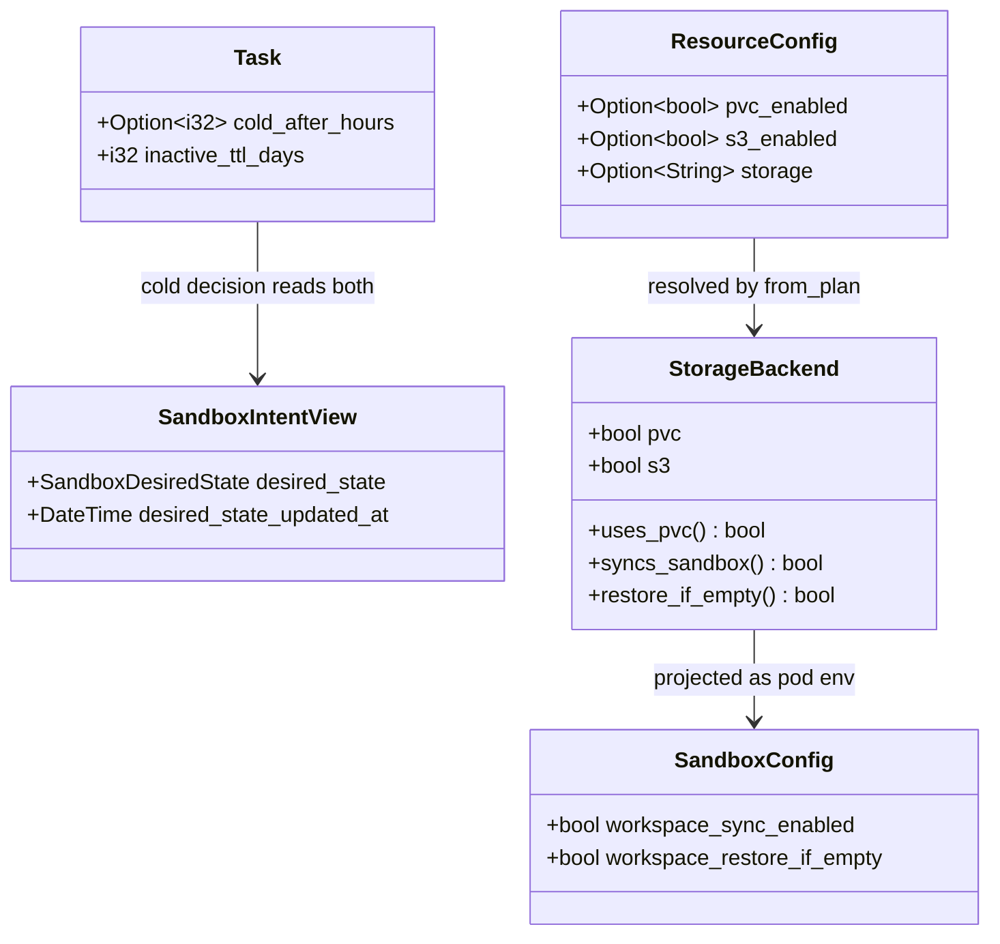

# PVC and S3 as independent switches, with a cold tier that reclaims idle claims

> **Status:** approved; the cold tier is implemented on PR 510's branch (`feat/sandbox-pvc-plus-s3`)
> **Updated:** 2026-08-15
> **Vocabulary:** CONTEXT.md
>
> Where the build departed from the approved shape, the section that owns the decision carries a
> **Deviation** note rather than being rewritten in place, so the reasoning that moved is visible
> next to the reasoning that did not. The five are: a rescue **Pod** instead of a `batch/v1` Job (so
> the RBAC contract row goes away); a new `sandboxes.storage_reclaimed_at` column and the
> `stopped_with_storage` / `mark_storage_reclaimed` pair, so the cold branch is not O(stopped tasks)
> every cycle; **two** new `SandboxLifecycle` methods rather than one; the status sentinel being the
> surviving Service rather than an intent read, with `fleet_observer.rs` needing no change at all;
> and `archive_storage` writing neither intent nor events.

## Current solution

A repo picks exactly one storage backend. `resources.storageMode` resolves to a single
`StorageBackend`, and every downstream question — is there a PVC, is there an emptyDir, does the
sandbox sync to S3 — is answered by reading that one value.

A sandbox has two lifecycle transitions that touch storage, and neither reclaims a claim without
also destroying the durable copy. The idle reaper stops a sandbox after `idle_timeout_minutes` by
scaling its Deployment to 0, keeping the PVC. The same reaper auto-closes a task after
`inactive_task_timeout_days`, which removes everything — Deployment, Service, IngressRoutes, PVC,
and (at the shipped default) the S3 archive too.

### Anchors

| Anchor | What it does |
|---|---|
| `crates/sandbox-control/src/storage.rs:32` | `StorageBackend` enum: `Ebs` / `Ephemeral` / `S3` / `Node` |
| `crates/sandbox-control/src/storage.rs:63` | `from_plan` — per-repo mode wins, else deployment default, else `Ebs` |
| `crates/sandbox-control/src/storage.rs:74` | `uses_pvc()` — true only for `Ebs` |
| `crates/sandbox-control/src/storage.rs:80` | `syncs_sandbox()` — true only for `S3` |
| `crates/sandbox-control/src/metrics.rs:74,84` | `record_provision` / `record_restart`, labelled by backend |
| `crates/sandbox-k8s/src/pod_builder.rs:176` | backend resolved for volume choice |
| `crates/sandbox-k8s/src/pod_builder.rs:181` | PVC volume when `pvc_name` is `Some` |
| `crates/sandbox-k8s/src/pod_builder.rs:190` | hostPath volume for `Node` |
| `crates/sandbox-k8s/src/pod_builder.rs:205` | emptyDir for `Ephemeral` / `S3` |
| `crates/sandbox-k8s/src/pod_builder.rs:231` | `build_node_sandbox_setup_container` init container for `Node` |
| `crates/sandbox-k8s/src/pod_builder.rs:947` | `WORKSPACE_SYNC_ENABLED=true` when `syncs_sandbox()` |
| `crates/sandbox-k8s/src/pod_builder.rs:327` | `termination_grace_period_seconds: 30` |
| `crates/sandbox-k8s/src/pod_builder.rs:1111` | `workspace-data` mounted at `/opt/moatless` |
| `crates/sandbox-k8s/src/provider.rs:209` | `create_or_find_pvc` on provision |
| `crates/sandbox-k8s/src/provider.rs:993` | `create_or_find_pvc` — returns empty for non-`Ebs` |
| `crates/sandbox-k8s/src/provider.rs:975` | `deployment_storage_backend` — infers the mode from cluster state |
| `crates/sandbox-k8s/src/provider.rs:644` | PVC deleted on remove, unconditionally |
| `crates/sandbox-k8s/src/provider.rs:351` | `stop` — scale to 0, no sync step |
| `crates/sandbox-k8s/src/deployment.rs:273` | `delete_deployment` |
| `crates/sandbox-k8s/src/deployment.rs:345` | `redeploy_with_plan` — `find_task_pvc` only, never creates |
| `crates/sandbox-k8s/src/deployment.rs:493` | `wait_for_deployment_deleted` |
| `crates/sandbox-k8s/src/pvc.rs:127,143,164` | `task_pvc_is_bound`, `delete_task_pvc`, `wait_for_pvc_deleted` |
| `crates/sandbox-k8s/src/node_archive.rs` | node-local archive tracking (workspace + docker + build cache) |
| `crates/sandbox-k8s/src/pod_watcher.rs:77,1692,1852` | 60s Pending threshold, event-cause lookup, `scheduling_blocked` |
| `crates/sandbox-k8s/src/status_resolver.rs:387` | no Deployment → `PodPhase::NotFound` |
| `crates/sandbox-k8s/src/fleet_observer.rs:42` | `desired_replicas == 0` → Stopped |
| `crates/sandbox-k8s/src/sandbox_resources.rs:53` | `list_running_sandbox_ids` filters `desired_replicas > 0` |
| `crates/tasks/src/task/reaper.rs:169,395` | `run_reap_cycle`, `apply_reaper_decisions` |
| `crates/tasks/src/task/reaper.rs:464` | `stop_idle_sandbox` — the idle transition |
| `crates/tasks/src/task/reaper.rs:663` | `SandboxResources` port |
| `crates/tasks/src/task/reaper.rs:1013` | `ArchiveRetention::on_close` at auto-close |
| `crates/tasks/src/task/sandbox_lifecycle.rs:49` | `SandboxLifecycle` — the whole tasks-band surface |
| `crates/tasks/src/task/dao.rs:33,150,784` | `SandboxIntentView`, `get_sandbox_intents` |
| `crates/tasks/src/task/dao.rs:808` | `get_inactive_ttl_days_map` — the per-task-knob pattern |
| `crates/tasks/src/task/models.rs:150` | `ArchiveRetention` |
| `crates/tasks/src/file_storage/s3.rs:133,160,216` | `presign_put`, `presign_get`, `delete_objects_by_prefix` |
| `crates/sandbox-control/src/lifecycle/runtime.rs:137` | `SandboxRuntime` — five methods |
| `crates/sandbox-control/src/lifecycle/orchestrator.rs:1025` | `impl SandboxLifecycle for Lifecycle` |
| `crates/sandbox-control/src/handlers.rs:288` | hard delete passes `DeleteArchives` explicitly |
| `crates/sandbox-control/src/grpc_server.rs:97,1544` | `<prefix>/<task_id>/workspace.tar`, presign mint |
| `sandbox/src/init/mod.rs:604` | `restore_on_start`, gated on `workspace_sync_enabled` |
| `sandbox/src/init/mod.rs:721` | `download_on_start` overlay when no full restore |
| `sandbox/src/init/mod.rs:263` | periodic `run_workspace_sync` spawn |
| `sandbox/src/init/workspace_sync.rs:117` | `restore_on_start` |
| `sandbox/src/init/workspace_sync.rs:674` | `workspace_fingerprint` |
| `sandbox/src/agent/coordinator.rs:961,1015,1075` | `upload_after_turn` call sites |
| `sandbox/src/shutdown.rs:104` | `flush_on_shutdown` |
| `sandbox/src/main.rs:53` | binary entrypoint — no argument parsing, config is env-only |
| `crates/api-schemas/src/repository.rs:61,80,90` | `storage_mode` field, `STORAGE_MODES`, validator |
| `crates/core/src/config.rs:326,335` | `storage_enabled`, `default_storage_mode` |
| `crates/core/src/config.rs:1069,1080,1083` | `retain_storage_on_close` (false), idle minutes (15), inactive days (7) |
| `crates/core/migrations/0050_task_inactive_ttl_days.sql:1` | the per-task-knob column precedent |
| `k8s/helm/moatless-vibe/values.yaml:645-666` | `sandboxStorage` block |
| `k8s/helm/moatless-vibe/values.yaml:813` | `nodeArchive.retentionHours: 168` — the archive-TTL precedent |
| `k8s/helm/moatless-vibe/values.yaml:1097-1118` | `rbac.rules` — no `batch` / `jobs` rule |
| `docker/Dockerfile.sandbox:44,50` | `HOME=/home/moatless`, `CODEX_HOME=/opt/moatless/.codex` |

### What research turned up that the code does not say

- **The two persistence stores cover different trees.** The PVC backs all of `/opt/moatless`
  (`pod_builder.rs:1111`); the S3 tar covers only `WORKSPACE_DIR` = `/opt/moatless/workspace`. The
  Claude/Codex homes, the `/tmp` subPath and the opt-in cargo caches ride the PVC and are in no
  snapshot.
- **The PVC's unique content is cache-shaped, not work-shaped.** The tar enumerates each repo with
  `git ls-files -c -o --exclude-standard` plus its `.git`, so gitignored output is excluded;
  `buildCacheMode: "node"` puts cargo/target on a node hostPath; `HOME=/home/moatless`
  (`docker/Dockerfile.sandbox:44`) is container-local and dies with the pod whatever the volume is.
  What a PVC holds and a snapshot does not is `node_modules`-class output, `/tmp`, and — on the
  shipped image only — `CODEX_HOME=/opt/moatless/.codex` (`docker/Dockerfile.sandbox:50`), which is
  already ephemeral on today's default emptyDir tier.
- **Transcript sync is not gated on storage mode.** `transcript_sync::download_on_start`
  (`init/mod.rs:715`) and `flush_on_shutdown` (`shutdown.rs:98`) run unconditionally, gated only on
  the backend having S3 configured. A PVC-tier sandbox already syncs transcripts today, so the
  workspace snapshot does not need to carry them.
- **Redeploy cannot turn a PVC on.** `redeploy_with_plan` calls `find_task_pvc`, never `create`
  (`deployment.rs:345`), so a repo flipped onto PVC keeps running without one until a fresh provision.
- **Remove deletes the PVC unconditionally.** The `retain_storage` branch (`provider.rs:658`) only
  spares S3 and node archives; the PVC delete at `provider.rs:644` runs either way. Retention today
  already means "S3 only", and reopen already restores from S3 — half of this feature exists, unnamed.
- **A failed PVC is already a silent downgrade.** `provider.rs:213-221` warns `storage_degraded` and
  proceeds with an emptyDir that has no persistence at all.
- **There is a second, independent PVC switch.** `config.sandbox.storage_enabled`
  (`core/config.rs:326`) short-circuits `create_task_pvc` (`pvc.rs:54`) whatever the mode says.
- **The shutdown budget cannot cover a real upload.** The pod gets 30s of grace
  (`pod_builder.rs:327`); the budget table (`shutdown.rs:20-42`) already spends 29 of them and gives
  the workspace flush 10s (`workspace_sync.rs:87`), while one HTTP transfer is allowed 5 minutes
  (`workspace_sync.rs:96`).
- **The attach-stall detector already exists.** The watcher reads the pod's newest Warning event —
  `FailedAttachVolume`, `Multi-Attach` — after 60s Pending and emits `scheduling_blocked`
  (`pod_watcher.rs:77,1692,1852`). Nothing acts on it.
- **The tar is not a working-tree diff.** It carries each repo's `.git`, which is what lets a restore
  skip the clone entirely (`workspace_sync.rs:1-40`).
- **Three independent axes are all called "node".** Workspace storage (`storageMode: "node"`),
  build cache (`buildCacheMode: "node"`, used by every workspace in `.moatless/workspaces.json:24,49,96`),
  and dind (`dockerStorageMode: "node"`, the default at `pod_builder.rs:585`). Only the first is
  removed by this change.
- **No committed repo config sets `storageMode`.** Every task follows the deployment default
  (`values.yaml:666`, currently `s3`), so there is no config migration. This also means production
  runs **zero** sandbox PVCs today: turning `defaultPvc` on is a 0 → 1-claim-per-task change, not an
  adjustment.
- **`ResourceConfig` has one definition.** `crates/workspaces` re-exports the api-schemas type
  (`repository/models.rs:12`), and `is_valid_storage_mode` has no production callers — only tests.
- **The Docker runtime ignores storage mode entirely.** `sandbox-docker` bind-mounts host paths
  (`container_builder.rs:161-190`); this change is Kubernetes-only.
- **The stop clock is already persisted.** `sandboxes.desired_state` and
  `sandboxes.desired_state_updated_at` are batch-loaded as `SandboxIntentView`
  (`dao.rs:33,150,784`), so "stopped since" needs no new column and no cluster scan. Postgres, not
  Kubernetes, is already the inventory of stopped work.
- **Deleting a claim under a live Deployment wedges the next start.** The Deployment's pod template
  still names the claim, so a scale back to 1 produces a pod that stays Pending on a PVC that no
  longer exists. Any reclaim must remove or rewrite the compute object in the same operation.
- **Nothing in the repo creates a `batch/v1` Job**, and the backend Role has no `batch` rule
  (`values.yaml:1097-1118`). A rescue Job is a new workload kind and a new RBAC rule — which is why
  the implementation runs a one-shot Pod instead, against the `pods` rule the Role already has, the
  same way `node_archive.rs` already does.
- **The S3 helper cannot read object metadata.** `file_storage/s3.rs` exposes put, get, presign and
  delete-by-prefix only (`:47,68,133,160,216`) — there is no head/last-modified call, so proving an
  archive is fresh needs a new helper.
- **Close is normally machine-initiated.** `SANDBOX_RETAIN_STORAGE_ON_CLOSE` defaults to `false`
  (`config.rs:1069`) and the chart never sets it, while the reaper auto-closes after 7 days
  (`config.rs:1083`, `reaper.rs:1013`). A person deleting a task takes a different path, which
  passes `DeleteArchives` explicitly (`handlers.rs:288`), so retention-on-close and hard delete are
  already separable.
- **There is a precedent for expiring archives on a clock:** `nodeArchive.retentionHours: 168`
  (`values.yaml:813`). The uploads bucket has no expiry rule in the chart, and there is no
  Terraform in this repository.
- **The sandbox binary parses no arguments** (`main.rs:53`); everything comes from env, and it
  builds a backend gRPC client unconditionally at startup. A one-shot rescue mode therefore has to
  be an env switch that runs before that client is required.

## Planned solution

**New**

- `SyncWorkspace` RPC on `SandboxService` (`crates/sandbox-proto/proto/sandbox/v1/sandbox.proto`),
  its sandbox handler (`sandbox/src/grpc_server.rs`), and a `WorkspaceSyncPort`
  (`crates/sandbox-control/src/lifecycle/orchestrator.rs:169`) lifecycle calls before
  `runtime.stop` / `runtime.remove`.
- The pvc+s3 behaviour: a live PVC that also snapshots to S3 and pulls back only into a volume with
  nothing usable on it.
- An attach-failure fallback that rebuilds the deployment as emptyDir + S3 restore
  (`crates/sandbox-k8s/src/provider.rs`).
- `WORKSPACE_RESTORE_IF_EMPTY` env, telling the sandbox its volume is durable so restore is
  conditional (`crates/sandbox-k8s/src/pod_builder.rs`, `sandbox/src/config.rs`).
- **A cold transition**: a third reaper threshold that deletes a stopped task's Deployment and PVC
  while the task stays Open, leaving the S3 snapshot as the only copy
  (`crates/tasks/src/task/reaper.rs`, `SandboxLifecycle::archive_storage`,
  `SandboxRuntime::reclaim_storage`).
- **A freshness proof** — `head_object_modified_at` in `crates/tasks/src/file_storage/s3.rs`, read
  before any claim is deleted.
- **A rescue Pod** (`crates/sandbox-k8s/src/rescue_pod.rs`) that mounts an orphaned claim, tars the
  workspace and uploads it when the proof fails, plus the one-shot `SANDBOX_ONESHOT=sync` mode in
  the sandbox binary it runs.
- `cold_after_hours`: deployment default (`SANDBOX_COLD_AFTER_HOURS`) and a nullable per-task
  column (`crates/core/migrations/0133_task_cold_after_hours.sql`).
- `sandboxes.storage_reclaimed_at` (`crates/core/migrations/0134_sandbox_storage_reclaimed_at.sql`)
  — the marker that keeps the cold candidate set shrinking instead of re-proving every stopped task
  forever.

**Changes materially**

- `crates/api-schemas/src/repository.rs:61` — `storage_mode: Option<String>` is replaced by
  `pvc_enabled: Option<bool>` and `s3_enabled: Option<bool>`.
- `crates/sandbox-control/src/storage.rs:32` — `StorageBackend` becomes a two-bool struct.
- `crates/core/src/config.rs:335` — `default_storage_mode: String` becomes
  `default_pvc_enabled: bool` + `default_s3_enabled: bool`.
- `crates/core/src/config.rs:1069` — `retain_storage_on_close` defaults to `true`.
- `crates/sandbox-k8s/src/pod_builder.rs:176-235` — volume choice loses the hostPath branch and the
  node setup init container.
- `crates/sandbox-k8s/src/provider.rs:975` — `deployment_storage_backend` reports both switches.
- `crates/sandbox-k8s/src/deployment.rs:345` — redeploy creates the PVC when one is wanted.
- `crates/sandbox-k8s/src/status_resolver.rs:387` — a missing Deployment is no longer conclusive.
- `crates/tasks/src/task/reaper.rs:395` — the decision loop gains the cold branch.
- `sandbox/src/init/mod.rs:604` — restore becomes conditional on the volume being empty/broken.
- `sandbox/src/init/workspace_sync.rs` — `upload_after_turn` becomes fingerprint-gated; the periodic
  loop is skipped when the volume is durable.
- `crates/sandbox-k8s/src/node_archive.rs` — drops workspace-hostPath tracking, keeps docker and
  build-cache.
- `k8s/helm/moatless-vibe/values.yaml:645-666` — `sandboxStorage` gains `coldAfterHours` and
  `retainOnClose`; `rbac.rules` is **not** touched, because the rescue workload is a Pod and the
  backend Role already carries `pods`.

**Untouched**

- The storage class and the CSI driver behind it. `pvc.rs` still requests `ReadWriteOnce` from
  `config.sandbox.storage_class`.
- The warm transition. Idle stop stays scale-to-zero (`provider.rs:351`); the Deployment, Service,
  IngressRoutes and PVC all survive it.
- Transcript sync (`sandbox/src/init/transcript_sync.rs`) — already unconditional on every tier.
- The Docker runtime's bind mounts (`crates/sandbox-docker/src/container_builder.rs`). Its
  `SandboxRuntime::reclaim_storage` is a no-op.
- `buildCacheMode: "node"` and `dockerStorageMode: "node"` — separate axes, unchanged.
- `config.sandbox.storage_enabled` — the global PVC kill switch stays and still wins.
- The S3 object key and archive format (`<prefix>/<task_id>/workspace.tar`), and what the tar
  contains.
- The hard-delete path (`handlers.rs:288`), which still passes `DeleteArchives` and still purges.

### Problem

An operator picking storage for a sandbox has to trade two things that should be independent. A PVC
gives a fast local volume that survives pod restarts, but it dies with the deployment: closing a
task deletes it (`provider.rs:644`), and a failed attach strands it. S3 gives a copy that outlives
the deployment, but only on the emptyDir tier, which pays a full restore on every restart and tars
the workspace after every turn.

The result is that a task on `ebs` cannot be reopened after close with its work intact, and a task
on `s3` re-downloads its workspace on every ordinary restart. Neither tier expresses "fast local
volume, with a durable copy for when the volume is gone".

Making that combination the default exposes a second problem. Provisioned block storage is billed on
capacity, not on use, so a claim per task means provisioned storage grows with the number of tasks
touched in the auto-close window rather than with the number running. The only transition that
reclaims a claim today is close, and close also destroys the durable copy: at the shipped
`SANDBOX_RETAIN_STORAGE_ON_CLOSE=false`, seven quiet days delete both the volume and the snapshot.
There is no state that means "the work is safe and the volume is gone", which is exactly the state a
stopped sandbox should be in.

### Behaviour

**As a repo author configuring a workspace**

- Given `pvcEnabled: true` and `s3Enabled: true`, when a task starts fresh, then a per-task PVC is
  created and mounted at `/opt/moatless` and the repo is cloned into it.
- Given a running pvc+s3 task, when an agent turn finishes and tracked files changed, then the
  workspace is uploaded to S3; when no tracked file changed, then no upload happens.
- Given a stopped pvc+s3 task, when it starts again and the PVC still holds the primary repo, then
  the volume is used as-is and nothing is downloaded.
- Given a closed-and-reopened pvc+s3 task, when it starts with a freshly created PVC, then the S3
  snapshot is restored into it and the clone is skipped.
- Given `pvcEnabled: false` and `s3Enabled: true`, then behaviour is exactly today's `s3` tier,
  including the periodic upload loop.
- Given both false, then behaviour is exactly today's `ephemeral` tier.
- Given `storageMode` set to anything, then the field is ignored and the deployment defaults apply.

**As a user returning to a task**

- Given a task stopped less than `cold_after_hours` ago, when it starts, then it comes back on its
  own PVC with gitignored build output intact and no download.
- Given a task that went cold, when it starts, then a new PVC is created, the snapshot is restored
  into it, the clone is skipped, and gitignored build output is rebuilt by the setup commands.
- Given a task that went cold, when it is viewed without being started, then it reads as Stopped,
  not as missing or errored.

**As an operator**

- Given `defaultPvc` / `defaultS3` set on the deployment, when a repo sets neither switch, then the
  deployment default applies.
- Given a pvc+s3 task whose PVC will not attach, when 60s of Pending elapse, then the deployment is
  rebuilt without the PVC, the workspace is restored from S3, and a degradation warning is recorded.
- Given a pvc-only task whose PVC will not attach, when 60s of Pending elapse, then an environment
  error is surfaced and no storage swap happens.
- Given `storage_enabled: false` on the deployment, then no PVC is created regardless of the
  per-repo switch.
- Given a stopped pvc+s3 task whose archive is newer than its stop, when `cold_after_hours` elapse,
  then its Deployment and PVC are deleted and the task stays Open.
- Given a stopped pvc+s3 task whose archive is older than its stop or absent, when
  `cold_after_hours` elapse, then a rescue Pod uploads the volume first and the claim is deleted
  only after that Job succeeds.
- Given a stopped pvc-only task, when any amount of time elapses, then it never goes cold, because
  there is nothing to archive to.
- Given a task closed by the reaper, when it is reopened, then its workspace is restored, because
  close retains the archive by default.

### Architecture and key flows

#### `crates/api-schemas/src/repository.rs`

- **Observed:** `ResourceConfig` carries `storage_mode: Option<String>` (`:61`) validated against
  `STORAGE_MODES` (`:80`) by `is_valid_storage_mode` (`:90`), which has no production callers.
- **Proposed responsibility:** express the two storage switches as data, with no notion of a mode.
- **Proposed change:** delete `storage_mode`, `STORAGE_MODES` and `is_valid_storage_mode`; add
  `pvc_enabled: Option<bool>` and `s3_enabled: Option<bool>`, both `#[serde(default,
  skip_serializing_if = "Option::is_none")]`, serialized camelCase as `pvcEnabled` / `s3Enabled`.
  Update the `storage` doc comment, which names the removed tiers.
- **Evidence:** `crates/workspaces/src/repository/models.rs:12` re-exports this type, so there is one
  definition to change.

#### `crates/core/src/config.rs`

- **Observed:** `default_storage_mode: String` (`:335`) from `K8S_SANDBOX_DEFAULT_STORAGE_MODE`
  (`:1062`), alongside `storage_enabled` (`:326`) and `retain_storage_on_close` (`:1069`).
- **Proposed responsibility:** hold the deployment-wide default for each switch and for the cold
  clock.
- **Proposed change:** replace `default_storage_mode` with `default_pvc_enabled: bool` (env
  `K8S_SANDBOX_DEFAULT_PVC`, default `true`) and `default_s3_enabled: bool` (env
  `K8S_SANDBOX_DEFAULT_S3`, default `true`). Add `cold_after_hours: u64` (env
  `SANDBOX_COLD_AFTER_HOURS`, default `24`); `0` disables the cold transition entirely, matching how
  `inactive_task_timeout_days: 0` is already used to disable auto-close in test fixtures
  (`config.rs:1449`). Flip `retain_storage_on_close` to default `true`.
- **Evidence:** three test fixtures set `default_storage_mode` and must be updated:
  `crates/backend/tests/integration/common/mod.rs:267`,
  `crates/sandbox-docker/src/container_builder.rs:512`, `crates/core/src/config.rs:1427`.

#### `crates/sandbox-control/src/storage.rs`

- **Observed:** a four-variant enum with `from_plan`, `uses_pvc`, `syncs_sandbox`,
  `as_metric_label`.
- **Proposed responsibility:** resolve the two switches for a plan and answer what each implies.
- **Proposed change:** replace the enum with

  ```rust
  pub struct StorageBackend { pub pvc: bool, pub s3: bool }
  ```

  `from_plan(plan, default_pvc, default_s3)` reads `resources.pvc_enabled` / `resources.s3_enabled`,
  falling back per field to the deployment default. `uses_pvc()` returns `self.pvc`;
  `syncs_sandbox()` returns `self.s3`; `restore_if_empty()` returns `self.pvc && self.s3` — the
  durable-volume case where restore is conditional, and the same predicate that makes a task
  eligible to go cold. `as_metric_label` returns one of the four stable strings `pvc+s3`, `pvc`,
  `s3`, `none`, keeping metric cardinality at four.
- **Evidence:** the module doc block describes four tiers and is rewritten; the `Node` variant has no
  replacement.

#### `crates/sandbox-k8s/src/pod_builder.rs`

- **Observed:** `:176` resolves the backend; `:181` PVC branch, `:190` hostPath branch, `:205`
  emptyDir branch; `:231` pushes `build_node_sandbox_setup_container`; `:947` sets
  `WORKSPACE_SYNC_ENABLED`.
- **Proposed responsibility:** build the pod from the two switches.
- **Proposed change:** drop the hostPath branch and the node setup init container, leaving PVC-or-
  emptyDir. Keep `WORKSPACE_SYNC_ENABLED` gated on `syncs_sandbox()`. Add
  `WORKSPACE_RESTORE_IF_EMPTY=true` when `restore_if_empty()`. Delete `node_sandbox_host_path` and
  `build_node_sandbox_setup_container` once unreferenced.
- **Evidence:** `resolve_sandbox_size` already sizes the emptyDir from `resources.storage`, so the
  fallback path needs no new sizing rule.

#### `crates/sandbox-k8s/src/provider.rs`

- **Observed:** `create_or_find_pvc` (`:993`) short-circuits for non-`Ebs`;
  `deployment_storage_backend` (`:975`) infers the mode from a PVC, a hostPath volume, or the sync
  env; `cleanup` (`:644`) deletes the PVC unconditionally; `stop` (`:351`) scales to 0.
- **Proposed responsibility:** own PVC lifecycle from the switches, own the attach-failure fallback,
  and own the cold reclaim as a runtime effect.
- **Proposed change:**
  - `create_or_find_pvc` gates on `uses_pvc()` (unchanged in shape).
  - `deployment_storage_backend` returns `StorageBackend { pvc: <PVC exists>, s3: <sync env set> }`;
    delete `deployment_has_sandbox_host_path`.
  - Add `rebuild_without_pvc(task_id)`: redeploy from the current plan with `pvc_name: None`, then
    delete the orphaned PVC only if it was never bound. Guard with a marker so it runs once per
    task per generation.
  - Implement `reclaim_storage(task_id)`: `delete_deployment` (`deployment.rs:273`) then
    `wait_for_deployment_deleted` (`:493`) then `delete_task_pvc` (`pvc.rs:143`) then
    `wait_for_pvc_deleted` (`:164`). Service, IngressRoutes and the preview NetworkPolicy are left
    alone — the preview URL must survive a cold task, and only `cleanup` owns them.
    The Deployment goes first and is waited on: deleting the claim while a pod template still names
    it is what wedges the next start.
- **Evidence:** rebuild must go through `redeploy_with_plan`, which needs a `ProvisionRequest`; the
  plan-carrying path is `require_plan()` (`:70`), already available on the adapter. `ensure_running`
  already creates a Deployment when none is found, so a cold task needs no separate start path.

#### `crates/sandbox-k8s/src/rescue_pod.rs` (new)

- **Observed:** nothing in the repository creates a `batch/v1` Job, and the backend Role carries no
  `batch` rule (`values.yaml:1097-1118`). It does carry `pods` with `create`/`delete`/`get`/`list`,
  and `node_archive.rs` already runs a one-shot cleanup Pod against that grant.
- **Proposed responsibility:** get the bytes off an orphaned claim when the sandbox never answered
  the pre-stop RPC.
- **Proposed change:** build and run a single `v1` Pod in the sandbox namespace, named
  `sandbox-rescue-<task_id>`, that mounts the task's PVC at `/opt/moatless`, runs the sandbox image
  with `SANDBOX_ONESHOT=sync`, and carries the presigned PUT URL as `WORKSPACE_SYNC_PUT_URL`.
  `restartPolicy: Never`, `automountServiceAccountToken: false`, and the caller waits for a terminal
  pod phase, reads success from `Succeeded`, and deletes the pod either way.
  **Deviation from the approved shape:** a Pod, not a `batch/v1` Job. A Job buys retry and TTL
  cleanup, both of which this caller already owns — the reaper retries the whole transition next
  cycle, and the caller deletes the pod itself — while costing a new API group in the backend Role
  that an `rbac.create: false` install would have to add by hand. Matching `node_archive.rs` keeps
  the RBAC contract row off this change entirely.
  The pod receives a presigned URL rather than gRPC credentials, so it needs no task token and no
  AWS credentials — the same reason the sandbox transfers directly to S3 (`config.rs:719`).
- **Evidence:** the presign helpers already exist (`grpc_server.rs:1544`, `file_storage/s3.rs:133`),
  and the object key is built by `sandbox_key` (`grpc_server.rs:97`), now `pub(crate)` so the
  archive port and the sync URLs cannot drift apart.

#### `sandbox/src/main.rs` and `sandbox/src/init/workspace_sync.rs`

- **Observed:** `main.rs:53` parses no arguments and builds a backend gRPC client unconditionally
  before anything else runs; `upload_workspace` already tars `WORKSPACE_DIR` and PUTs it to a
  presigned URL.
- **Proposed responsibility:** offer the tar-and-upload half of the sandbox without the rest of the
  sandbox.
- **Proposed change:** when `SANDBOX_ONESHOT=sync` is set, `run()` reads `WORKSPACE_SYNC_PUT_URL`,
  performs one upload of `WORKSPACE_DIR`, and exits with the transfer's outcome as the process exit
  code — before the backend gRPC client is constructed, since the Job has no token.
- **Evidence:** the upload path already takes a URL rather than a client
  (`workspace_sync.rs`, the presigned-PUT design at `config.rs:719`).

#### `crates/tasks/src/file_storage/s3.rs`

- **Observed:** `put_object` (`:47`), `get_object` (`:68`), `get_object_opt` (`:102`),
  `presign_put` (`:133`), `presign_get` (`:160`), `delete_objects_by_prefix` (`:216`). No metadata
  read.
- **Proposed responsibility:** answer when an object was last written without downloading it.
- **Proposed change:** add `head_object_modified_at(client, bucket, key) -> Result<Option<DateTime<Utc>>>`,
  returning `None` for a missing key and an error only for a transport or permission failure — the
  caller must be able to tell "no archive" from "cannot tell", because those take different
  branches.
- **Evidence:** `get_object_opt` (`:102`) already establishes the not-found-is-`None` convention to
  follow.

#### `crates/sandbox-control/src/lifecycle/runtime.rs` and `orchestrator.rs`

- **Observed:** `SandboxRuntime` has five methods (`runtime.rs:137`); `run_stop` calls
  `agent_stop.stop_agent` then `runtime.stop` (`orchestrator.rs:630-634`); `run_remove` does the
  same before `runtime.remove` (`:697-704`); `WorkspaceSyncPort` is at `:169`.
- **Proposed responsibility:** make the durable copy current before the runtime effect destroys the
  live one, and expose reclaim as a sixth runtime effect.
- **Proposed change:**
  - Call `WorkspaceSyncPort` after `stop_agent` and before the runtime effect on both `stop` and
    retention-keeping `remove`. Best-effort: every failure is logged and swallowed, exactly like
    `stop_agent`. Skipped on `run_remove` when the retention is a hard delete.
  - Add `SandboxRuntime::reclaim_storage(task_id, ctx)`, returning `RuntimeOutcome` like its
    siblings. The Docker adapter returns `RuntimeEffect::NoOp`.
  - Add `Lifecycle::archive_storage(task_id)`, which performs the freshness proof, mints a rescue
    PUT URL when the proof fails, calls `runtime.reclaim_storage`, and stamps
    `sandboxes.storage_reclaimed_at`. Desired state stays `Stopped` throughout — a cold task is a
    stopped task whose volume is gone, not a fourth desired state, so nothing that reads intent
    needs to learn a new value.
    **Deviation:** the operation writes **no intent row and publishes no lifecycle event**. Every
    other operation here writes intent because it changes what the sandbox should be; this one does
    not change that at all, and an intent write would move `desired_state_updated_at` — the very
    clock the cold decision reads. It takes the `Stop` lock, re-reads intent under it, and skips if
    intent moved to `Running` or the task closed while it queued. The freshness proof and the
    rescue-URL mint are the port's two failure modes and both map to
    `LifecycleError::ArchiveUnproven` (transient, cause `archive_unproven`): a backend that cannot
    say whether the archive is there has not said no, so the volume survives to the next cycle.
  - The freshness proof reaches S3 through a new `WorkspaceArchivePort`
    (`archived_at` / `presign_upload`), implemented by `S3WorkspaceArchive`
    (`crates/sandbox-control/src/lifecycle/workspace_archive.rs`) and wired in
    `crates/backend/src/main.rs` only when both an S3 client and a bucket name are configured. With
    no port bound, `archive_storage` is a no-op — the s3-off deployment cannot go cold, which is
    already the rule.
- **Evidence:** `agent_stop.rs` is the shape to copy for a best-effort port. `provider.rs:351`'s
  `stop` shows the `RuntimeOutcome`/`RuntimeEffect` shape a new method returns.

#### `crates/tasks/src/task/sandbox_lifecycle.rs`

- **Observed:** the trait carries exactly four methods and its doc block calls them "the whole
  tasks-band cross-boundary surface" (`:49-67`).
- **Proposed responsibility:** unchanged — it stays the only surface the reaper drives a sandbox
  through.
- **Proposed change:** add `archive_storage(task_id) -> Result<(), SandboxOpError>` and update the
  doc block's count. The reaper must not name a `sandbox` type, which is why the cold transition is
  a method here rather than the reaper calling the runtime.
  **Deviation:** the trait gains **two** methods, not one. `stopped_with_storage(task_ids) ->
  HashMap<String, DateTime<Utc>>` is the candidate read: which of these tasks have a stopped sandbox
  that still owns storage, and when each stopped. It lives here for the same boundary reason — the
  reaper cannot read the `sandboxes` table itself without naming sandbox types — and it is what
  keeps the cold branch from re-proving every stopped task every cycle. The doc block now says the
  port is sized to the tasks-band surface rather than quoting a count.

#### `crates/tasks/src/task/reaper.rs`

- **Observed:** `apply_reaper_decisions` (`:395`) walks every task id once, closing first
  ("close supersedes stop"), then reaping only ids present in `sandbox_ids` — which
  `list_running_sandbox_ids` filters to `desired_replicas > 0` (`sandbox_resources.rs:53`).
  `ReaperSnapshot` (`:220`) holds the activity times and the two TTL maps.
- **Proposed responsibility:** decide all three transitions from one snapshot.
- **Proposed change:** extend `ReaperSnapshot` with a `cold_map` loaded like `inactive_map` and a
  `stopped_since` map. Add a third branch after the stop branch, ordered close → stop → cold, and
  reached only when the task is not in `sandbox_ids`:

  ```
  open, not running, stopped_since holds the task,
  now - stopped_since >= cold_after_hours
      → sandbox.archive_storage(task_id)
  ```

  A task that is already cold has no PVC, so `archive_storage` must be idempotent rather than
  re-run each cycle; the runtime reports `RuntimeEffect::NoOp` when there is no Deployment and no
  claim, and the reaper counts only `Applied` in its stats.
  **Deviation:** the candidate map is `SandboxLifecycle::stopped_with_storage`, not the full
  `SandboxIntentView` map. Two reasons. First, `LifecycleDao::load` reads a *missing* sandbox row as
  converged Stopped-at-epoch, so an intent-shaped map would make every never-started open task look
  like a decades-stale cold candidate; `stopped_with_storage` is an inner read on `sandboxes` and a
  task with no row is simply absent from it. Second, the approved shape accepted that
  `archive_storage` re-runs and NoOps forever — which is an S3 HEAD, a generation-allocating DB
  write and two Kubernetes reads *per stopped task per cycle*, O(stopped tasks) with no ceiling.
  Filtering on `storage_reclaimed_at IS NULL` makes each reclaimed task leave the candidate set for
  good. `decide_cold` is a pure `(cold_after_hours, stopped_at, now) -> bool`, tested directly.
  `ReaperStats` gains `reclaimed` (and its siblings lose their `_count` suffixes, which clippy's
  `struct_field_names` rejects once there are three of them); the log fields keep the old names.
- **Evidence:** the branch order matters and the existing code says why — `auto_close_task` calls
  `cleanup`, which tears down the Deployment regardless of replicas (`:414`), so a task that is
  ready for both close and cold must close.

#### `crates/sandbox-k8s/src/status_resolver.rs`

- **Observed:** `resolve_pod_phase_and_error` returns `PodPhase::NotFound` when no Deployment exists
  (`status_resolver.rs:387`); the fleet observer reads Stopped from `desired_replicas == 0`
  (`fleet_observer.rs:42`) and sees nothing for a task with no Deployment.
- **Proposed responsibility:** report a task whose compute objects were reclaimed as Stopped.
- **Proposed change:** on the no-Deployment path, answer from the task's *own* desired state plus a
  cluster sentinel: with intent `Stopped`, look for the task's Service — which `reclaim_storage`
  deliberately leaves standing — and report `PodPhase::Stopped` if it is there, `NotFound` if it is
  not. A read failure degrades to `NotFound`, the pre-change answer.
  **Deviation:** the approved shape had this consult *persisted intent*, which cannot work from
  this band — `desired_state == Stopped` is equally the answer for "never created" and "reclaimed",
  and band 7 must not reach into the `sandboxes` table anyway. The surviving Service is the one
  cluster-visible fact that separates them, and it costs one extra GET on the no-Deployment path
  only. Gating on `Stopped` (rather than any intent) keeps a mid-remove task, whose intent is
  `Removed`, rendering as Removed.
  **`fleet_observer.rs` needs no change at all:** `converged(Stopped, Absent)` is already `true`, so
  a reclaimed task is already converged from the reconciler's point of view, and the reconciler is
  `observe_fleet`'s only consumer.
- **Evidence:** `Lifecycle::desired_state` (`sandbox_lifecycle.rs:66`) treats a missing row as
  converged `Stopped`, which is exactly why intent alone cannot be the sentinel.

#### Key flow — a task goes cold

1. The reaper's cycle loads `stopped_with_storage` for the open tasks alongside the activity times
   and the per-task `cold_map` (`reaper.rs:244`).
2. A task is Open, absent from `sandbox_ids`, present in `stopped_since`, and stopped longer ago
   than its `cold_after_hours`.
3. `Lifecycle::archive_storage` takes the task's `Stop` lock, re-reads intent under it, then heads
   `<prefix>/<task_id>/workspace.tar` and compares its last-modified with
   `desired_state_updated_at`.
4. Archive newer than the stop → the pre-stop sync landed; no rescue URL is minted; skip to step 6.
5. Archive older or absent → mint a presigned PUT; the runtime runs the rescue Pod, waits for it,
   and fails the transition if it does not succeed. The claim survives to the next cycle.
   A head that *errors*, or a presign that fails, is `ArchiveUnproven` and stops here too.
6. `runtime.reclaim_storage` deletes the Deployment, waits for it, deletes the PVC, waits for it.
7. `storage_reclaimed_at` is stamped, so the task leaves the candidate set. It stays Open and
   `Stopped`; the UI reads Stopped from the surviving Service.

#### Key flow — starting a cold task

1. `ensure_running` finds no Deployment and provisions from the plan (`provider.rs:209`).
2. `create_or_find_pvc` creates a fresh claim, because `uses_pvc()` is still true.
3. The pod mounts an empty volume, sees `WORKSPACE_RESTORE_IF_EMPTY`, finds no primary `.git`, and
   restores the snapshot (`workspace_sync.rs:117`), skipping the clone.
4. Setup commands rebuild gitignored output. This is the cost the cold tier trades for the storage,
   and it is the same cost today's default `s3` tier pays on every single start.

#### Key flow — attach failure

1. The pod stays Pending; the watcher passes 60s and reads `FailedAttachVolume` / `Multi-Attach`
   (`pod_watcher.rs:1692`).
2. With `s3` on, the provider rebuilds the Deployment with `pvc_name: None` and records a
   `storage_degraded` diagnostic.
3. The replacement pod mounts an emptyDir, finds no primary `.git`, and restores from S3.
4. With `s3` off, no rebuild happens and the existing environment error surfaces.

### Data model

One migration, one new config shape, one new pod env var. The S3 object is unchanged.



#### `ResourceConfig` (modified)

Per-repository resource and storage configuration, identified by the owning repository.

| Field | Type | Change | Notes |
|---|---|---|---|
| `storage_mode` | `Option<String>` | removed | No committed config sets it; unknown fields are ignored on deserialize, so a stale value is inert rather than an error |
| `pvc_enabled` | `Option<bool>` | new | `pvcEnabled`; `None` → deployment default |
| `s3_enabled` | `Option<bool>` | new | `s3Enabled`; `None` → deployment default |
| `storage` | `Option<String>` | unchanged meaning | Sizes the PVC when `pvc_enabled`, the emptyDir otherwise |

#### `tasks` (modified)

| Field | Type | Change | Notes |
|---|---|---|---|
| `cold_after_hours` | `INTEGER NULL` | new | Per-task override of the cold clock. **Nullable**, unlike `inactive_ttl_days INTEGER NOT NULL DEFAULT 7` (`0050_task_inactive_ttl_days.sql:1`): a `NOT NULL DEFAULT` bakes the default into every row, so a later change to `SANDBOX_COLD_AFTER_HOURS` would not reach any existing task. `NULL` means "follow the deployment" |

Migration `crates/core/migrations/0133_task_cold_after_hours.sql`:
`ALTER TABLE tasks ADD COLUMN cold_after_hours INTEGER;`

#### `sandboxes` (modified — deviation, not in the approved spec)

| Field | Type | Change | Notes |
|---|---|---|---|
| `storage_reclaimed_at` | `TIMESTAMPTZ NULL` | new | When the cold transition last reclaimed this sandbox's storage. `NULL` means "still owns storage" and is the only state that makes a stopped sandbox a cold candidate. Cleared back to `NULL` whenever intent moves to `Running`, so a restarted-then-restopped task is a candidate again |

Migration `crates/core/migrations/0134_sandbox_storage_reclaimed_at.sql` adds the column and the
partial index the candidate query runs on:

```sql
ALTER TABLE sandboxes ADD COLUMN storage_reclaimed_at TIMESTAMPTZ;
CREATE INDEX sandboxes_reclaimable_idx
    ON sandboxes (desired_state_updated_at)
    WHERE desired_state = 'stopped' AND storage_reclaimed_at IS NULL;
```

Without it the cold branch is O(stopped tasks) *per cycle*, forever: every already-cold task pays an
S3 HEAD, a generation-allocating intent write and two Kubernetes reads to conclude `NoOp` once a
minute. `persist_intent` clears the column on a `Running` intent and otherwise leaves it, so the
marker tracks storage rather than the transition that removed it.

#### `SandboxIntentView` (unchanged, newly load-bearing)

Read-only projection of `sandboxes` (`dao.rs:33`). `desired_state_updated_at` currently feeds the
task response; it becomes the clock the cold transition is decided on, so its meaning — "when intent
last changed", not "when the pod actually went away" — is now load-bearing. The gap between the two
is bounded by how long `runtime.stop` takes, which is minutes at worst against a threshold of hours.

#### `StorageBackend` (modified)

Resolved storage decision for one provisioning plan. Not persisted; derived per call.

| Field | Type | Change | Notes |
|---|---|---|---|
| enum variants | — | removed | `Ebs` / `Ephemeral` / `S3` / `Node` all go |
| `pvc` | `bool` | new | Drives PVC creation and the pod volume |
| `s3` | `bool` | new | Drives `WORKSPACE_SYNC_ENABLED`, the pre-stop sync, and cold eligibility |

#### `SandboxConfig` (modified)

Sandbox-process configuration read from pod env at startup.

| Field | Type | Change | Notes |
|---|---|---|---|
| `workspace_sync_enabled` | `bool` | unchanged | `WORKSPACE_SYNC_ENABLED` |
| `workspace_restore_if_empty` | `bool` | new | `WORKSPACE_RESTORE_IF_EMPTY`; when set, restore only into an empty/broken volume and skip the periodic loop |

### Interfaces and contracts

**External contracts.**

| Consumer | Interface | Can rely on | Status |
|---|---|---|---|
| Repo authors, `.moatless/workspaces.json` | `resources.pvcEnabled`, `resources.s3Enabled` (`api-schemas/src/repository.rs`) | Two independent switches; unset falls back to the deployment default | changed |
| Repo authors | `resources.storageMode` | Nothing — removed; no committed config sets it | breaking |
| Operators | `K8S_SANDBOX_DEFAULT_PVC`, `K8S_SANDBOX_DEFAULT_S3`, helm `kubernetes.sandboxStorage.defaultPvc` / `.defaultS3` | Deployment-wide default per switch | changed |
| Operators | `K8S_SANDBOX_DEFAULT_STORAGE_MODE`, helm `.defaultMode` | Nothing — removed | breaking |
| Operators | `SANDBOX_COLD_AFTER_HOURS`, helm `kubernetes.sandboxStorage.coldAfterHours` | Hours a stopped sandbox keeps its claim; `0` disables the transition | new |
| Operators | `SANDBOX_RETAIN_STORAGE_ON_CLOSE`, helm `kubernetes.sandboxStorage.retainOnClose` | Now defaults `true`; a deployment relying on close to purge must set it to `false` | breaking |
| Operators | The uploads bucket | Workspace archives now outlive close, so an S3 lifecycle rule on `<prefix>/*/workspace.tar` is what bounds their cost. There is no Terraform in this repository, so the chart documents the rule in `values.yaml` and an operator applies it out of band | new |
| Cluster administrators | The backend Role (`values.yaml:1097`) | Unchanged. The rescue workload is a Pod, and the Role already carries `pods` with `create`/`delete`/`get`/`list` — an `rbac.create: false` install needs no edit | unchanged |
| `apps/frontend` via `packages/api-client/src/sandbox/model/resourceConfig.ts:87` | The generated `ResourceConfig` type | Regenerated to two optional booleans | changed |
| `apps/frontend` task views | Sandbox status for a task with no Deployment | Reads `stopped`, not `not_found` | changed |
| Prometheus dashboards | `storage_backend` label on `moatless_sandbox_provision_duration_seconds` and `moatless_sandbox_restart_duration_seconds` | Values become `pvc+s3` / `pvc` / `s3` / `none` | breaking |

`k8s/helm/moatless-vibe/dashboards` must be checked for panels keyed on the old label values.

**Internal interfaces** — a plan, not a promise; changing one later needs no spec update.

- `WorkspaceSyncPort::sync(task_id) -> ()` (`crates/sandbox-control/src/lifecycle/orchestrator.rs:169`),
  implemented over `SandboxConnector` in `crates/sandbox-control/src/lifecycle/workspace_sync.rs`,
  mirroring `agent_stop.rs`.
- `SyncWorkspace` RPC on `SandboxService`
  (`crates/sandbox-proto/proto/sandbox/v1/sandbox.proto`): empty request beyond `task_id`, response
  carrying `synced: bool` and `bytes: i64` for logging.
- `SandboxLifecycle::archive_storage(task_id) -> Result<(), SandboxOpError>` and
  `SandboxLifecycle::stopped_with_storage(&[String]) -> HashMap<String, DateTime<Utc>>`
  (`crates/tasks/src/task/sandbox_lifecycle.rs:49`).
- `SandboxRuntime::reclaim_storage(task_id, rescue_put_url: Option<&str>, ctx) ->
  Result<RuntimeOutcome, RuntimeError>` (`crates/sandbox-control/src/lifecycle/runtime.rs:137`).
  The URL is `Some` exactly when the freshness proof failed, so the provider runs the rescue pod
  without needing to know why.
- `WorkspaceArchivePort::{archived_at, presign_upload}`
  (`crates/sandbox-control/src/lifecycle/orchestrator.rs`), implemented by `S3WorkspaceArchive`
  (`lifecycle/workspace_archive.rs`). Both return `Result<_, String>` — the port is a seam over one
  storage backend, and the orchestrator's only question is "did it answer".
- `LifecycleDao::{stopped_with_storage, mark_storage_reclaimed}`
  (`crates/sandbox-control/src/lifecycle/dao.rs`).
- `LifecycleOptions { events, workspace_archive }` (`crates/backend/src/compose.rs`) — the optional
  collaborators `build_lifecycle` takes, introduced because an eighth positional parameter trips
  clippy's `too_many_arguments`.
- `head_object_modified_at` (`crates/tasks/src/file_storage/s3.rs`).
- `redeploy_with_plan` gains an explicit `pvc_name: Option<&str>` parameter.
- `SANDBOX_ONESHOT=sync` and `WORKSPACE_SYNC_PUT_URL` on the sandbox binary — read only by the
  rescue Pod, not by any sandbox pod. `workspace_sync::rescue_upload` is the one path in that module
  that is *not* best-effort: its `Err` is the pod's non-zero exit, which is the whole protocol.

### Failure, safety and recovery

| Condition | State before | State after | Caller sees | Retry safe | Policy |
|---|---|---|---|---|---|
| Pre-stop `SyncWorkspace` fails, times out, or the sandbox is unreachable | PVC current, S3 stale | unchanged | nothing; stop proceeds | yes | Best-effort, bounded by an RPC deadline. Logged at debug like `stop_agent`. The volume still holds the work, and the cold transition will not delete it until the rescue Pod has read it |
| Pre-stop sync partially uploads | S3 holds the previous tar | previous tar intact | nothing | yes | The PUT is a single whole-object write; a failed PUT leaves the prior object |
| `head_object_modified_at` errors (transport, permissions) | PVC holds the work | unchanged | reaper warning | yes | Cannot tell is not proof. No reclaim; retried next cycle |
| Archive older than the stop, rescue Pod succeeds | S3 stale | S3 current, then reclaimed | nothing | yes | The pod is the only reader of an orphaned claim; RWO is free because no pod holds it |
| Archive older than the stop, rescue Pod fails or times out | S3 stale, PVC holds the work | unchanged | `storage_reclaim_blocked` warning | yes | The claim is kept. A claim whose contents cannot be proven safe is never deleted on a timer |
| Deployment deleted, PVC delete fails | Deployment gone, claim orphaned | claim orphaned, task Open | reaper warning | yes | The next cycle retries the delete; `reclaim_storage` is idempotent and a missing Deployment is `NoOp` |
| Reclaim races a user start | Cold transition in flight | start wins or reclaim wins | possible one-off start failure | yes | The lifecycle lock (`lifecycle/lock.rs`) serialises them; a start that lands after a reclaim provisions fresh and restores |
| PVC won't attach, `s3` on | Empty volume, snapshot in S3 | emptyDir pod, workspace restored | `storage_degraded` degradation warning | yes | Rebuild once per generation; PVC retried on the next clean start |
| PVC won't attach, `s3` off | Empty volume, no snapshot | unchanged, pod Pending | existing environment error | yes | No storage swap — there is nothing to restore |
| Start finds an empty volume, no S3 snapshot | Empty volume | fresh clone | normal start | yes | Existing behaviour; `restore_on_start` returns `false` and the clone runs |
| Start finds a populated volume | Volume holds the repo | unchanged | normal start | yes | Never overwritten; no S3 fetch is issued |
| Start finds a corrupt repo (`git rev-parse` fails) | Broken working tree | restored from S3, else cloned | normal start | yes | Partial state is cleared before extraction, as `restore_on_start` already does on extract failure |
| Involuntary kill mid-turn, PVC also lost | Work since last turn boundary | reverts to last fingerprint-gated upload | restart note | yes | No periodic loop on the PVC tier — this is the accepted bound |
| Involuntary kill, PVC survives | Work since last turn boundary on the volume | preserved until the rescue Pod reads it | restart note | yes | This is why the cold transition proves freshness rather than trusting the pre-stop RPC |
| Hard delete | PVC + S3 archive | both deleted | task removed | yes | Pre-stop sync skipped; pushing bytes on the way to deleting them wastes the stop budget |
| Close (default retention) | PVC + S3 archive | PVC deleted, archive kept | task closed, reopenable | yes | The archive's lifetime is then the bucket's expiry rule, not the close |

**What a cold task loses.** Everything outside `WORKSPACE_DIR` on the volume: gitignored build
output, the `/tmp` subPath, and `CODEX_HOME=/opt/moatless/.codex` on the shipped image
(`docker/Dockerfile.sandbox:50`). None of this is a regression against what runs in production
today, where the default `s3` tier gives every start an empty emptyDir — it is a regression only
against the warm state the same task had an hour earlier, and the setup commands rebuild it.
Claude transcripts are unaffected: `transcript_sync` is independent of storage mode and its home is
container-local either way.

**Degraded operation.** With S3 unreachable the pvc+s3 tier behaves as pvc-only: uploads fail
best-effort, restores return `false`, the clone runs, and no task can go cold — the freshness proof
never succeeds, so claims accumulate until S3 returns. That is the intended direction to fail in.
With the PVC unavailable and S3 reachable the tier behaves as the emptyDir+S3 tier. Both switches
off is the ephemeral tier, which needs neither.

**Rollback.** Reverting the change restores the mode string. Because no committed repo config sets
either surface, rollback needs only the helm value returned to `defaultMode`. Tasks whose PVC was
already reclaimed keep their S3 snapshot, which the old `s3` tier reads at the same key — a
reverted deployment starts them on an emptyDir and restores them, which is that tier's normal path.
The `cold_after_hours` column is left in place; an unused nullable column costs nothing and dropping
it would break a re-apply.

### Testing and verification

**Unit — `cargo test -p moatless-api-schemas`**

- `ResourceConfig` round-trips `pvcEnabled` / `s3Enabled` as camelCase and omits them when `None`.
- A config carrying a stale `storageMode` deserializes without error.

**Unit — `cargo test -p moatless-sandbox-control`**

- `from_plan` resolves each field independently: repo-set wins, unset falls back per field.
- `uses_pvc`, `syncs_sandbox`, `restore_if_empty` for all four combinations.
- `as_metric_label` returns the four expected strings.

**Unit — `cargo test -p moatless-sandbox-k8s`**

- pvc+s3 builds a pod with a PVC volume, `WORKSPACE_SYNC_ENABLED=true` and
  `WORKSPACE_RESTORE_IF_EMPTY=true`.
- pvc-only builds a PVC volume and neither env var.
- s3-only builds an emptyDir with `WORKSPACE_SYNC_ENABLED=true` and no restore-if-empty.
- Neither builds an emptyDir with no sync env.
- No pod spec contains a `workspace-data` hostPath volume for any combination.
- `deployment_storage_backend` reports both switches from a Deployment.
- The rescue Pod spec mounts the task PVC at `/opt/moatless`, sets `SANDBOX_ONESHOT=sync` and
  `WORKSPACE_SYNC_PUT_URL`, and carries no AWS credentials.
- `resolve_pod_phase_and_error`'s no-Deployment branch — Stopped when the sandbox Service survives,
  `NotFound` when it does not or when the intent is not `Stopped` — has **no unit test**:
  `status_resolver.rs` carries no test module and every path on it needs a live client. It is
  covered by the k8s E2E profile instead, which is where the rest of that file's behaviour is
  covered today.

**Unit — `cargo test -p moatless-sandbox`**

- `restore_on_start` returns `false` without fetching when restore-if-empty is set and the primary
  repo has a valid `.git`.
- It restores when the primary repo directory is empty.
- It restores when `git rev-parse` fails in the primary repo.
- `upload_after_turn` skips when the fingerprint is unchanged and uploads when it changes.
- `rescue_upload` errors — rather than reporting an empty success — when the workspace yields no
  archive, and errors when the PUT cannot land. Those two are what stand behind `SANDBOX_ONESHOT`'s
  exit code; the `main.rs` switch itself is a process-level path the E2E profile exercises.

**Unit — `cargo test -p moatless-tasks`**

- The cold branch fires for an Open, non-running, `Stopped` task past `cold_after_hours`.
- It does not fire for a running task, a closed task, a task inside the window, or a task whose
  `cold_after_hours` is `0`.
- A per-task `cold_after_hours` overrides the deployment default; `NULL` falls back to it.
- Close still supersedes cold when both thresholds are met in the same cycle.

**Contract — `cargo test -p moatless-sandbox-control`**

- Lifecycle stop calls the workspace-sync port before `runtime.stop`.
- Lifecycle remove with retention calls it; hard delete does not.
- A failing port does not fail the transition.
- `archive_storage` calls `reclaim_storage` with no rescue URL when the archive is newer than the
  stop, and stamps `storage_reclaimed_at`.
- `archive_storage` hands the runtime a rescue URL when the archive is older or absent, and reports
  the failure when the rescue does not succeed.
- `archive_storage` does not call `reclaim_storage` when the freshness read errors, nor when the
  rescue URL cannot be presigned — both are `ArchiveUnproven`, and `ArchiveUnproven` is retriable.
- `archive_storage` skips a task whose intent moved back to `Running` while it queued behind the
  lock, and no-ops when no archive port is configured.

**Verification commands** (the floor, plus the per-crate lines from `AGENTS.md`)

```
cargo clippy --workspace --all-targets -- -D warnings
cargo clippy -p moatless-core --all-targets --features openapi -- -D warnings
cargo clippy -p moatless-core --all-targets -- -D warnings
cargo clippy -p moatless-backend-core --all-targets --all-features -- -D warnings
cargo clippy -p moatless-backend-core --all-targets --no-default-features -- -D warnings
cargo clippy -p moatless-backend --all-targets --features db-tests -- -D warnings
cargo test -p moatless-api-schemas
cargo test -p moatless-sandbox-control
cargo test -p moatless-sandbox-k8s
cargo test -p moatless-sandbox
cargo test -p moatless-tasks
bun run type:check && bun run biome:check
```

**Manual verification.** Only a person can judge that the pre-stop push does not visibly slow
idle-down on a large workspace, that a fallback-restored sandbox is one an agent can resume without
surprise, and that a cold task's start latency — new claim, restore, setup commands — is one a
returning user accepts rather than reads as a failure.

**Acceptance criteria**

- Given a pvc+s3 task with work on its volume, when it is stopped and its PVC deleted out of band,
  then a start restores the workspace from S3 and skips the clone.
- Given a pvc+s3 task with a populated volume, when it restarts, then no S3 download is issued and
  the volume is used as-is.
- Given a pvc+s3 task whose PVC cannot attach, when 60s of Pending elapse, then the deployment is
  rebuilt as emptyDir, the workspace is restored, and a degradation warning is recorded.
- Given a pvc-only task whose PVC cannot attach, then no storage swap happens.
- Given a repo config setting `storageMode`, when it is loaded, then the field is ignored and the
  deployment defaults apply.
- Given a pvc+s3 task stopped longer than `cold_after_hours` with a fresh archive, when the reaper
  runs, then its Deployment and PVC are gone, the task is still Open, and the UI reads Stopped.
- Given the same task with a stale archive, when the reaper runs, then a rescue Pod uploads the
  volume and the claim is deleted only after it succeeds.
- Given a cold task, when a user starts it, then a new PVC is created, the snapshot is restored, the
  clone is skipped, and the primary repo is at its previous HEAD, index and dirty working tree.
- Given a pvc-only task stopped indefinitely, then it never goes cold.

## Out of scope

- Changing the storage class, or adopting Longhorn, Ceph, NFS or any other CSI driver. This change
  is about what happens when the volume is gone, not about making the volume portable.
- Making the S3 snapshot cover the agent homes or gitignored build output.
- Deleting the Deployment on the ordinary idle stop. The warm tier keeps it, so a returning user
  pays a scale-up rather than a provision; only the cold transition removes compute objects.
- Periodic uploads on the pvc+s3 tier. The accepted bound is the last turn boundary, backed by the
  rescue Pod.
- Applying the S3 lifecycle rule that bounds archive cost. There is no Terraform in this repository;
  the chart documents the rule and an operator applies it.
- Any change to the Docker runtime or to `buildCacheMode` / `dockerStorageMode`.
