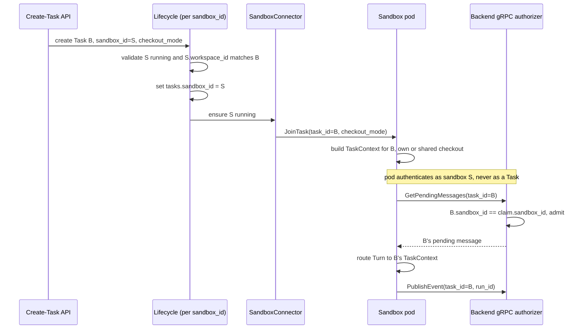
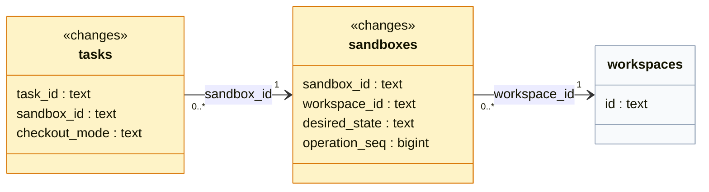

# Run more than one Task in one warm Sandbox

> **Status:** approved
> **Updated:** 2026-08-15
> **Vocabulary:** CONTEXT.md

## Current solution

A Sandbox is one per Task — structurally, not by convention. The pod exists for, is
addressed as, is authenticated as, and hard-codes exactly one `task_id` for its whole
life. No code path, flag, or data model lets a Task run in a Sandbox created for a
different Task.

### Anchors — every place this change lands

**Naming and provisioning**

- `crates/sandbox-k8s/src/naming.rs:37` — `generate_service_name(task_id)` → `moatless-ws-{task_id}`
- `crates/sandbox-k8s/src/naming.rs:62` — `generate_preview_network_policy_name(task_id)`
- `crates/sandbox-k8s/src/naming.rs:73` — `generate_secret_name(task_id)`
- `crates/sandbox-k8s/src/naming.rs:83` — `generate_pvc_name(task_id)`
- `crates/sandbox-k8s/src/naming.rs:96` — `generate_pod_name(repository_name, task_id)`
- `crates/sandbox-docker/src/naming.rs:34` — `generate_container_name(task_id)`
- `crates/sandbox-docker/src/naming.rs:44` — `generate_server_container_name(task_id, server_name)`
- `crates/sandbox-docker/src/naming.rs:60,72,84,97` — host paths `{data_dir}/tasks/{task_id}/…`
- `crates/sandbox-k8s/src/pod_builder.rs:96` — pod label `moatless.io/task-id`
- `crates/sandbox-k8s/src/pod_builder.rs:843` — `TASK_ID` env on the sandbox container
- `crates/sandbox-k8s/src/service.rs:36,78` — Service name and `moatless.io/task-id` selector
- `crates/sandbox-control/src/auto_provision.rs:216` — `build_provision_request(task_id)`, the one plan builder
- `crates/sandbox-control/src/auto_provision.rs:344` — comment: *"Each task is its own pod, so the pod-level flag is exactly the right granularity."*

**Durable lifecycle**

- `crates/core/migrations/0092_sandboxes_table.sql:20` — `sandboxes.task_id` is the PRIMARY KEY
- `crates/sandbox-control/src/lifecycle/dao.rs:82` — `load`: no row means never requested, converged Stopped
- `crates/sandbox-control/src/lifecycle/dao.rs:134` — `reconcile_candidates` selects `s.task_id`
- `crates/sandbox-control/src/lifecycle/dao.rs:149` — `allocate_generation` upserts on `task_id`
- `crates/sandbox-control/src/lifecycle/orchestrator.rs:234` — `acquire(task_id, kind)` per-Task advisory lock
- `crates/sandbox-control/src/lifecycle/orchestrator.rs:394` — every public op takes `task_id: &str`
- `crates/sandbox-control/src/lifecycle/lock.rs:1` — per-Task session advisory locks
- `crates/sandbox-control/src/lifecycle/plan.rs:59` — `ProvisionDeps::build_request(task_id)`

**Addressing**

- `crates/backend-core/src/sandbox/mod.rs:208` — `SandboxConnector::sandbox_client(task_id)`, the single seam
- `crates/sandbox-k8s/src/provider.rs:993` — K8s resolves `generate_service_name(task_id)` → cluster DNS
- `crates/sandbox-docker/src/provider.rs:660` — Docker resolves `generate_container_name(task_id)` → hostname
- `crates/sandbox-proto/proto/sandbox/v1/sandbox.proto:319` — `service SandboxService`
- `crates/sandbox-proto/proto/sandbox/v1/sandbox.proto:557` — `ExecuteAgentRequest`, no `task_id` field

**Authorization**

- `crates/sandbox-control/src/jwt.rs:36` — `UserTokenClaims.task_id`
- `crates/sandbox-control/src/jwt.rs:68` — *"the token is re-minted on every `GetCredentials` response, so a short TTL is fine"*
- `crates/sandbox-control/src/jwt.rs:143` — `mint_sandbox_tokens(user_id, login, task_id, …)`
- `crates/sandbox-control/src/grpc_server.rs:342` — `VerifiedToken` enum (`TaskBound` / `Claimless` / `DevBypass`)
- `crates/sandbox-control/src/grpc_server.rs:374` — in-band `task_id` vs claim exact-match rejection
- `crates/sandbox-control/src/grpc_server.rs:420` — `resolve_control`, the DB-backed grace path
- `crates/sandbox-control/src/grpc_server.rs:533` — `mint_user_auth_token`, called per `GetCredentials`
- `crates/sandbox-k8s/src/pod_builder.rs:55` — provision-time mint
- `crates/sandbox-docker/src/provider.rs:193` — Docker provision-time mint

**Sandbox process**

- `sandbox/src/config.rs:456` — `env::var("TASK_ID").expect("TASK_ID is required")`, panics at boot
- `sandbox/src/config.rs:551` — `initial_auth_token_candidates`, the token fallback chain
- `sandbox/src/state.rs:35` — one `agent: Arc<AgentState>`, one `agent_handle: AgentHandle`
- `sandbox/src/state.rs:78` — one `dispatch_lock`, single-flight for the pod
- `sandbox/src/main.rs:75,165,223` — one `Config`, one `AgentState`, one `SandboxState` per process
- `sandbox/src/agent/dispatcher.rs:111` — `let task_id = &state.config.task_id;`
- `sandbox/src/grpc_server.rs` — every handler instruments `task_id = %self.state.config.task_id`
- `sandbox/src/init/refresher.rs:24` — 900s default credential refresh interval

**Reaper**

- `crates/tasks/src/task/reaper.rs:1` — stops idle Deployments, auto-closes tasks, reclaims cold volumes
- `crates/tasks/src/task/reaper.rs:467` — activity drives the idle decision

### What the code does not say

- **Every generated resource name survives the migration unchanged.** Backfilling
  `sandbox_id = task_id` for existing rows makes `generate_pod_name`/`service`/`pvc`/
  `secret` produce byte-identical output. No pod churn, no reconnection, no PVC rebind.
  This is what makes the identity inversion cheap, and it is the single most important
  fact in this spec.
- **The JWT claim is not fixed for a pod's lifetime**, despite `jwt.rs:36` reading as
  though it is. `mint_user_auth_token` re-mints on every `GetCredentials`
  (`grpc_server.rs:533`) and the pod's refresher calls that every 900s
  (`refresher.rs:24`). Claim-shape changes therefore roll over on live pods with no
  restart.
- **The lifecycle advisory lock currently serializes the wrong noun** for any sharing
  model that keeps per-Task pod intent. It is per Task (`lock.rs:1`) but protects
  operations on a pod. Once two Tasks share a pod, two different locks guard one
  resource. Re-keying it to the Sandbox is a correctness fix, not a rename.
- **Warm reuse already half-exists, differently.** The Workspace is tar'd to S3 and
  restored into a fresh per-Task pod on boot (PVC + S3 storage switches, `#510`).
  Today's answer to "reuse the warm workspace" is "make a new pod and rehydrate it".
- **A Task already has one-or-more Sessions, but sequentially.** At most one Agent
  process is active in a Sandbox at a time (`CONTEXT.md`, "Agent"). Concurrent members
  are a second axis on top of multi-Task.
- **Parent/child lineage exists and touches no infrastructure.** `task_relations`
  (`crates/tasks/src/task/relations.rs:36`) feeds only system-prompt text
  (`crates/tasks/src/agent/prompt.rs:141`). It is not wired to provisioning, and this
  change does not wire it.
- `ApplyServerConfigRequest`, `GetServerConfigRequest` and `RefreshCredentialRequest`
  carry a vestigial `task_id` field (`sandbox.proto:507,517,539`) that is not used for
  routing. Do not mistake it for existing per-Task addressing.

## Planned solution

**New**

- Sandbox identity independent of any Task — `sandboxes.sandbox_id`
- `sandbox_id` + `checkout_mode` on the create-Task request
- A per-Task agent context inside the sandbox process, replacing the singletons
- An optional `task_id` on `SandboxService` verbs, selecting which member
- A `JoinTask` RPC so a Task can enter a pod that is already running
- A per-Task isolated checkout directory inside a shared pod
- The `sandboxId` JWT claim and a `VerifiedToken::SandboxBound` variant

**Changes materially**

- `crates/sandbox-k8s/src/naming.rs`, `crates/sandbox-docker/src/naming.rs` — every
  generator keys off `sandbox_id`
- `crates/sandbox-control/src/lifecycle/*` — intent, generation counter, operation
  marker and advisory lock move to the Sandbox
- `crates/sandbox-control/src/auto_provision.rs:216` — plan is built for a Sandbox
- `crates/backend-core/src/sandbox/mod.rs:208` — resolves a Task to its Sandbox's endpoint
- `crates/sandbox-control/src/grpc_server.rs:357` — authorization becomes a membership check
- `sandbox/src/state.rs`, `sandbox/src/config.rs`, `sandbox/src/agent/dispatcher.rs`,
  `sandbox/src/grpc_server.rs` — per-Task keying throughout
- `crates/tasks/src/task/reaper.rs` — evaluates every member before stopping a pod
- `CONTEXT.md` — the Sandbox glossary entry

**Untouched**

- Every existing Sandbox's generated names, running pods, and bound PVCs
- A Task created without `sandbox_id` — identical provisioning, addressing,
  authorization and reaping to today
- Workspace and WorkspaceRepo entities, and workspace sync
- The S3 snapshot and PVC storage switches
- Turn / Run / Session semantics within one Task
- Adapters, Loops, Bindings, and the `task_relations` lineage model
- The frontend's task page, preview panel and file explorer

### Problem

Starting a Task pays for a cold Sandbox every time: pod scheduling, image pull, clone,
and the Workspace's configured setup commands. For a person running several related
Tasks against one repository — an orchestrator and its tickets, a follow-up to work
just finished, a second attempt at the same change — that cost is paid again per Task,
against a workspace that was already materialized minutes ago on a pod that is still
running.

The existing mitigation rehydrates a snapshot into a *new* pod, which removes the clone
but not the pod, the image pull, or setup. Nothing lets a Task use a Sandbox that is
already warm.

### Behaviour

**Someone creating a Task**

- Given a running Sandbox, when I create a Task with its `sandbox_id`, then my Task
  runs in that Sandbox and no new pod is provisioned.
- Given I create a Task with no `sandbox_id`, then a Sandbox is minted for it and
  everything behaves exactly as it does today.
- Given I pass a `sandbox_id` for a Sandbox that is not running, then the request is
  rejected and tells me to start it or omit the field.
- Given I pass a `sandbox_id` whose Workspace differs from my Task's, then the request
  is rejected — a Sandbox materializes one Workspace.
- Given I pass `checkout_mode = shared`, then my agent works in the same directory and
  git state as the Sandbox's other members.
- Given I pass `checkout_mode = isolated`, then my agent works in its own checkout, and
  the other members' uncommitted edits and branch are not visible to it.

**Someone whose Task shares a Sandbox**

- Given another member Task is running a Turn, when I send a message, then my Turn runs
  in its own agent context and neither Turn's output appears in the other's conversation.
- Given the Sandbox stops, then every member's session ends together and each member
  shows Stopped rather than errored.
- Given my Task is the only active member and the others are idle, then the pod stays
  warm and is not reaped.

**An operator**

- Given a Sandbox with several members, when I stop it, then all members stop; when I
  stop one member's agent, the others keep running.
- Given the migration runs, then no running pod is recreated and no Service or PVC is
  renamed.

### Architecture and key flows

#### `crates/sandbox-control/src/lifecycle` — the durable intent owner

- **Observed:** every operation is addressed by `task_id` and serialized by a per-Task
  advisory lock (`orchestrator.rs:234,394`; `lock.rs:1`). Intent, generation counter and
  operation marker live on the `sandboxes` row keyed by `task_id`
  (`dao.rs:149`, `migrations/0092_sandboxes_table.sql:20`).
- **Proposed responsibility:** should this *pod* be running, and does its observed state
  match?
- **Proposed change:** every public op takes a `sandbox_id`. The advisory lock, the
  generation counter and the operation marker re-key to it. `reconcile_candidates`
  returns sandbox ids; a Sandbox is a candidate when it is desired-Running and has at
  least one member Task in `open`/`error`, or when its operation marker is incomplete.
  The "no row means never requested, converged Stopped" rule is preserved verbatim,
  now per Sandbox.
- **Evidence:** `crates/sandbox-control/src/lifecycle/dao.rs:82,134,149`;
  `orchestrator.rs:234`.

#### `crates/sandbox-control/src/auto_provision.rs` — the plan builder

- **Observed:** `build_provision_request(task_id)` reads one Task row (`:229`), resolves
  one Workspace (`:297`), and produces one plan. The comment at `:344` states the
  one-pod-per-task assumption outright.
- **Proposed responsibility:** given a Sandbox, produce the plan that materializes its
  Workspace.
- **Proposed change:** takes a `sandbox_id`, resolves the Workspace from
  `sandboxes.workspace_id` rather than through a Task, and drops the per-Task framing.
  The headless flag and preview-server stripping become Sandbox-level; where a per-Task
  input is genuinely needed for the *first* member, it is passed explicitly by the
  caller that mints the Sandbox.
- **Evidence:** `auto_provision.rs:216,229,297,344`.

#### `crates/sandbox-k8s/src/naming.rs`, `crates/sandbox-docker/src/naming.rs`

- **Observed:** every generator is a pure function of `task_id`.
- **Proposed responsibility:** deterministic resource names for a Sandbox.
- **Proposed change:** the parameter becomes `sandbox_id`. **The functions themselves do
  not otherwise change**, and because `sandbox_id` backfills to `task_id` for existing
  rows, every live resource keeps its current name. The K8s pod label and Service
  selector `moatless.io/task-id` become `moatless.io/sandbox-id`; this *does* change
  live pods' labels, so the Service selector and the label must be cut over together —
  see Failure below.
- **Evidence:** `naming.rs:37,62,73,83,96`; `pod_builder.rs:96`; `service.rs:78`.

#### `crates/backend-core/src/sandbox/mod.rs` — the addressing seam

- **Observed:** `sandbox_client(task_id)` turns a Task id into a DNS or container name
  (`:208`; K8s `provider.rs:993`, Docker `provider.rs:660`). The channel *is* the Task.
- **Proposed responsibility:** given a Task, hand back a client for the Sandbox it runs in.
- **Proposed change:** resolve the Task's `sandbox_id` first, then build the endpoint
  from that. Callers keep passing a Task id, so their call sites do not change; a
  `sandbox_client_for_sandbox(sandbox_id)` overload serves lifecycle paths that already
  hold a Sandbox.
- **Evidence:** `crates/backend-core/src/sandbox/mod.rs:208`.

#### `crates/sandbox-proto` + `sandbox/src/grpc_server.rs` — in-pod routing

- **Observed:** `SandboxService` verbs carry no task id; the pod reads identity off
  `self.state.config.task_id` on every handler.
- **Proposed responsibility:** execute a verb against a named member of this pod.
- **Proposed change:** every `SandboxService` request gains an optional `task_id`. A new
  `JoinTask(task_id, checkout_mode)` RPC registers a member and builds its agent context.
  A `LeaveTask(task_id)` tears one down. Handlers resolve the request's `task_id` against
  the member map; **an absent `task_id` resolves to the pod's sole member**, which keeps
  every existing caller and every single-member pod working unchanged. A `task_id` naming
  a non-member is `NOT_FOUND`.
- **Evidence:** `sandbox.proto:319,557`; `sandbox/src/grpc_server.rs` handler
  instrumentation.

#### `sandbox/src/state.rs` — the per-Task agent context

- **Observed:** one `AgentState`, one `AgentHandle`, one `dispatch_lock`, one
  `system_prompt_cache`, one `scheduled_jobs` registry for the process (`:35,43,77,87`).
- **Proposed responsibility:** hold one independent agent context per member Task, and
  the pod-wide resources they share.
- **Proposed change:** the per-Task fields move into a `TaskContext` held in a
  `Map<task_id, Arc<TaskContext>>` — `AgentState`, `AgentHandle`, `dispatch_lock`,
  `system_prompt_cache`, `scheduled_jobs`, `credential_failures`, and the Task's checkout
  directory. Pod-wide fields stay on `SandboxState`: `config`, `events`, `backend_client`,
  `credentials`, `lifecycle_cancel`, `credential_dispatcher`, `supervisor_health`,
  `terminals`, `workspace_sync`, `heartbeat`, `init_phase`.
  `SandboxState::is_live` becomes "the supervisor is healthy **and** no member's agent
  context is wedged".
- **Evidence:** `sandbox/src/state.rs:29-104`.

#### `sandbox/src/config.rs` — boot configuration

- **Observed:** `TASK_ID` is required and panics when absent (`:456`); `repo_dir` and
  `workspace_dir` are single values (`:131,139`).
- **Proposed responsibility:** describe the Sandbox, not one Task.
- **Proposed change:** `SANDBOX_ID` becomes the required env; `TASK_ID` becomes the
  optional initial member (still set, so a pod created for one Task starts with that
  member already registered). `workspace_dir` and `repo_dir` keep their meaning as the
  *shared* checkout; an isolated member's directory is derived per Task and lives on its
  `TaskContext`.
- **Evidence:** `sandbox/src/config.rs:131,139,456`.

#### `sandbox/src/agent/dispatcher.rs` — pending-message dispatch

- **Observed:** `dispatch_pending_messages(state)` reads `state.config.task_id` (`:111`)
  and holds the single `dispatch_lock` across fetch → submit → ack (`:79`).
- **Proposed responsibility:** dispatch one member Task's pending messages.
- **Proposed change:** takes a `task_id`, uses that member's `dispatch_lock`, and calls
  `get_pending_messages(task_id)` for it. The single-flight guarantee is preserved *per
  member*, which is what its doc comment actually argues for. Init dispatches for each
  member registered at boot; `NotifyMessages` dispatches for the named member.
- **Evidence:** `sandbox/src/agent/dispatcher.rs:59,79,111,330`.

#### `crates/sandbox-control/src/grpc_server.rs` — authorization

- **Observed:** `VerifiedToken::TaskBound` requires the in-band `task_id` to equal the
  claim, else `permission_denied` (`:342,374`).
- **Proposed responsibility:** decide whether this pod may act for the Task it names.
- **Proposed change:** a `SandboxBound { sandbox_id }` variant admits the request iff the
  requested Task's `sandbox_id` equals the claim. `TaskBound` keeps today's exact match
  during rollout. On a membership-lookup failure the request is **denied**, never
  admitted.
- **Evidence:** `grpc_server.rs:342,374,420`.

#### `crates/tasks/src/task/reaper.rs` — idle reaping

- **Observed:** stops idle sandbox Deployments on a per-Task TTL, reclaims cold volumes
  (`:1-13`), driven by per-Task activity (`:467`).
- **Proposed responsibility:** stop a pod when nobody in it is working.
- **Proposed change:** idle is evaluated across every member Task; the pod is stopped
  only when all are idle past TTL. `cold_after_hours` reclamation is per Sandbox.
- **Evidence:** `crates/tasks/src/task/reaper.rs:1,467,523`.

#### Key flow — a second Task's first Turn in a warm Sandbox



#### Other flows, and the rule that admits each

- **Backend-initiated `ExecuteAgent(task_id=B)`** — same routing, opposite direction.
  Admitted because it crosses a process boundary and duplicates are possible.
- **Sandbox stop with several members** — tears down every `TaskContext` and closes each
  member's open Turn. Admitted as a material failure flow.
- **Reaper idle evaluation** — reads every member's activity before one stop decision.
  Admitted because the consistency boundary changed from Task to Sandbox.
- **Membership check on every cross-Task RPC** — a trust boundary, admitted for that reason.

### Data model



A Sandbox materializes exactly one Workspace, so every member Task must run against that
Workspace — validated at join, because nothing in the schema can express it.
`tasks.sandbox_id` is `ON DELETE SET NULL`: deleting a Sandbox record must never delete
the Tasks that ran in it, and a Task's conversation outlives the pod by design.

#### `sandboxes`

Durable lifecycle intent for one pod. Identity moves from the Task it was created for to
the Sandbox itself.

| Column | Key / null | What it holds |
|---|---|---|
| `sandbox_id` | new PK | **New.** The Sandbox's own identity. Backfilled from the existing `task_id`, which is what keeps every generated resource name byte-identical |
| `workspace_id` | not null | **New.** The one Workspace this pod materializes. Backfilled from the creating Task's workspace. A join for a Task on another Workspace is refused |
| `task_id` | was PK | **Removed.** Replaced by the reverse reference on `tasks` |
| `desired_state` | not null | **Meaning changes.** The pod's desired state, not a Task's. Absence of a row still means never requested and converged Stopped |
| `stop_reason` | nullable | **Meaning changes.** Why this pod was stopped. Existing values and CHECK constraint unchanged |
| `operation_seq`, `operation_kind`, `operation_generation`, `operation_started_at` | — | **Re-keyed.** Allocated and acknowledged per Sandbox. The advisory lock follows, which is the correctness fix noted above |
| `archive_retention`, `started_at`, `desired_state_updated_at`, `updated_at` | — | Read and written as today, per Sandbox |

#### `tasks`

Gains the Task's membership in a Sandbox.

| Column | Null | What it holds |
|---|---|---|
| `sandbox_id` | nullable | **New.** Which Sandbox this Task runs in. Null means it has never been started. Set at create when given explicitly, otherwise when a Sandbox is first minted for it |
| `checkout_mode` | nullable | **New.** `shared` or `isolated` — how this Task's files relate to co-members'. Null is read as `shared`, which is the only possible meaning for a sole member |

The per-Task agent context inside the pod is an in-memory map keyed by `task_id`. It is
not persisted and is therefore not in this model: a pod restart rebuilds it from the
member set.

#### Migration

One migration, in this order:

1. `ALTER TABLE sandboxes ADD COLUMN sandbox_id text`, `ADD COLUMN workspace_id text`.
2. `UPDATE sandboxes SET sandbox_id = task_id`, and `workspace_id` from the Task's workspace.
3. `ALTER TABLE tasks ADD COLUMN sandbox_id text`, `ADD COLUMN checkout_mode text`.
4. `UPDATE tasks t SET sandbox_id = s.sandbox_id FROM sandboxes s WHERE s.task_id = t.task_id`.
5. Drop the `sandboxes.task_id` PK, make `sandbox_id` the PK, set `workspace_id NOT NULL`,
   add `tasks_sandbox_id_fkey … ON DELETE SET NULL` and an index on `tasks.sandbox_id`.
6. `ALTER TABLE sandboxes DROP COLUMN task_id`.

Step 2 is what preserves every resource name. Do not generate fresh ids for existing rows.

Keep the partial index from `0092` (`task_messages_pending_user_idx`) as is — pending-message
scanning is still per Task.

### Interfaces and contracts

**External contract** — behaviour something outside this change relies on.

| Consumer | The interface it depends on | What it can rely on | Status |
|---|---|---|---|
| `crates/cli`, `apps/frontend`, orchestrating agents | `POST /api/v1/tasks` body — `crates/api-schemas/src/task.rs` | Optional `sandbox_id` and `checkout_mode`; omitting both mints a Sandbox exactly as today | **New**, additive |
| Backend callers of `SandboxConnector` | `SandboxService` verbs — `sandbox.proto:319` | Optional `task_id` per verb; absent means the pod's sole member, so existing callers are unchanged | Changed, compatibly |
| Sandbox pod | Auth claim — `jwt.rs:36`, `grpc_server.rs:357` | A pod may act for any Task whose `sandbox_id` matches its claim; a `taskId`-only token stays valid for its own Task until it rolls over | Changed, compatibly |
| Running pods across the deploy | Pod / Service / PVC names — `sandbox-k8s/src/naming.rs` | Names unchanged, because `sandbox_id` backfills from `task_id` | Unchanged |
| K8s Service → pod routing | Label `moatless.io/task-id` — `pod_builder.rs:96`, `service.rs:78` | The selector matches the pods it is meant to match, across the rename | **Breaking** if label and selector are not cut over together |
| A Task with no `sandbox_id` | Its own Sandbox lifecycle | Identical provisioning, addressing, authorization and reaping to today | Unchanged |
| Anyone driving the CLI, agents included | `moat tasks create --same-sandbox [<TASK_ID>] [--checkout-mode shared\|isolated]` | Joining is expressed in **task** ids, never sandbox ids; a bare `--same-sandbox` means the ambient `TASK_ID`, so an agent can spawn a sibling into its own warm Sandbox with no argument at all | **New**, additive |

The CLI takes a *task* id because that is the only identifier a caller has: sandbox
ids appear in no listing anyone reads, and `moat tasks list` does not print them. The
CLI resolves task → `sandbox_id` (and the Sandbox's Workspace) through `GET
/api/v1/tasks/{id}` and sends the `sandbox_id` the API already takes, so the wire
contract above is unchanged. Because a Sandbox materializes exactly one Workspace,
`--same-sandbox` settles where the task runs and therefore conflicts with `--repo` and
`--workspace` rather than silently overriding them.

Promises this change makes:

- A Task created without `sandbox_id` is byte-for-byte today's behaviour. This is the
  regression bar for the whole change.
- No running pod is recreated, renamed, or reconnected by the migration.
- A cross-Task RPC is admitted only while membership holds, and denied when membership
  cannot be confirmed.
- Members never see each other's conversation: events, messages and Turns are keyed by
  Task throughout.

**Internal interfaces** — implementation boundaries, not promises. They may change later
without a spec update: `TaskContext` and the member map in `sandbox/src/state.rs`; the
`sandbox_client_for_sandbox` overload; the shape of `reconcile_candidates`' return.

### Failure, safety and recovery

| Condition | State before | State after | What the caller sees | Retry safe | Handling |
|---|---|---|---|---|---|
| Create names a Sandbox that is not running | Sandbox Stopped | unchanged | Rejected, naming the Sandbox and that it is not running | Yes | Validate before writing `tasks.sandbox_id` |
| Create names a Sandbox on another Workspace | — | unchanged | Rejected, naming the Workspace mismatch | Yes, with a different Sandbox | Validate at create and again at `JoinTask` |
| `JoinTask` fails after `tasks.sandbox_id` was written | Task points at S, no context in pod | Task is startable but not joined | Task shows not running | Yes — `JoinTask` is idempotent per Task | Reconciler re-issues `JoinTask` for members with no context |
| Membership lookup fails (DB unavailable) | — | unchanged | `permission_denied` | Yes | **Fail closed.** Never admit on an unconfirmed lookup |
| Sandbox stops or the pod is evicted | N members running | all members Stopped | Each member Stopped, not errored; snapshots survive | Yes — a later start re-provisions | Close every member's open Turn; publish per member |
| RPC arrives for a Task that has left | Task not a member | unchanged | `permission_denied` | No | Same rejection as a wrong-sandbox token |
| Two agents collide on a `shared` checkout | — | files or git index raced | Agent-visible git errors | — | Not prevented. `shared` is for cooperating Tasks; the platform does not lock the tree |
| One member wedges or OOMs the pod | N members running | all members' Turns end | Each member sees its Turn interrupted | Yes | Shared blast radius is inherent to sharing; surface it per member rather than only on the culprit |

Two that are not routine:

**The K8s label rename is the one genuinely breaking step.** The Service selects pods by
`moatless.io/task-id` (`service.rs:78`), and pods carry it (`pod_builder.rs:96`). Renaming
one without the other silently strands every running pod: the Service matches nothing, the
backend's gRPC dial fails, and no error names the cause. A Service's `spec.selector` is
mutable, so the safe order is: (1) add `moatless.io/sandbox-id` to newly built pods while
keeping the old label, (2) leave existing Services selecting the old label, (3) once every
pod carries both, switch selectors to the new label, (4) drop the old label from the pod
builder. Alternatively, accept a rolling replacement of running pods and cut over in one
step — a deliberate choice, not a default. **This ordering is not optional; getting it
wrong is a full outage of sandbox connectivity.**

**The JWT claim rollout is expand → migrate → contract**, and its cheapness rests on the
token being re-minted every refresh:

1. **Expand.** Add the optional `sandboxId` claim and the `SandboxBound` variant doing the
   membership check. `TaskBound` keeps today's exact match. **Deploy this before anything
   mints the new claim** — the backend must accept it first.
2. **Migrate.** Switch both mint sites to stamp `sandboxId`: provision-time
   (`pod_builder.rs:55`, Docker `provider.rs:193`) and per-refresh (`grpc_server.rs:533`).
   Every live pod rolls over within one refresh interval (900s default), with no restart.
3. **Contract.** Once no live token can still carry a `taskId`-only claim — bounded by
   `user_token_ttl_secs` — delete the `TaskBound` branch. Its own ticket.

The pod-spec bootstrap token and `USER_AUTH_TOKEN` are minted at provision, when the
`sandbox_id` is already known, so the fallback chain in `config.rs:551` carries the new
claim too. A pod that loses `RUNTIME_DIR` and falls back to its creation-time token does
not fall back to a stale binding.

**Degraded mode.** With the backend unreachable, a running pod behaves as today: the
outbox buffers events and the refresher retries. Membership is checked backend-side, so an
outage cannot admit a request that should be denied.

**Rollback.** The schema change is additive plus a primary-key move; a Task created without
`sandbox_id` follows today's path exactly, so the feature is dark until first used. Rolling
back code after the migration is safe as long as the label cutover has not begun. After
step 3 of the label cutover, roll forward rather than back.

### Testing and verification

**Unit**

- `naming.rs` (both providers): a `sandbox_id` equal to a task id produces the same names
  the current tests assert. Keep the existing assertions and re-point the parameter.
- `sandbox/src/state.rs`: member registration, lookup, absent-`task_id` resolving to a sole
  member, and `NOT_FOUND` for a non-member.
- `dispatcher`: two members dispatch independently; one member's `dispatch_lock` does not
  block the other's.
- `jwt.rs`: `sandboxId` round-trips; a `taskId`-only token still verifies.
- `grpc_server.rs` authorizer: `SandboxBound` admits a member, denies a non-member, and
  denies when the lookup errors.

**Integration (`--features db-tests`)**

- The migration against a seeded database: every `sandboxes` row keeps its resource names,
  `tasks.sandbox_id` is backfilled for all of them, and no Task is orphaned.
- `lifecycle` contract tests re-pointed at `sandbox_id`, including intent-before-effect,
  strict removal, and generation allocation under a concurrent second member.
- Reaper: a Sandbox with one active and one idle member is not stopped; with all idle, it is.

**End-to-end (`tests/api`, both profiles)**

- New chain: start Task A, create Task B with A's `sandbox_id`, B runs a full Turn, and
  the runtime reports one pod. Assert on the pod/container count, not on timing.
- New chain: B with `checkout_mode = isolated` writes a file A cannot see, and vice versa.
- Regression: the existing single-Task chains pass unchanged. This is the bar.

**Commands**

```bash
cargo clippy --workspace --all-targets -- -D warnings
cargo clippy -p moatless-backend-core --all-targets --all-features -- -D warnings
cargo clippy -p moatless-backend --all-targets --features db-tests -- -D warnings
cargo test -p moatless-sandbox
cargo test -p moatless-backend-core
cargo test -p moatless-tasks
cargo test -p moatless-backend --features db-tests
task test:compose:e2e -- --suite api
```

Scope each `cargo test` to the crate changed; the clippy floor already covers every
workspace member.

**Manual verification, because no test settles it**

- Whether warm reuse saves meaningful wall-clock time against a real repository.
- Whether a `shared` checkout's races are tolerable for the orchestration use it exists for.
- Whether a shared blast radius — one pod, several Tasks — is an acceptable trade in practice.
- Whether the label cutover is safe against the live cluster, run by someone watching it.

**Acceptance criteria**

- Given a running Sandbox, when a Task is created with its `sandbox_id`, then it runs a
  full Turn and the runtime reports no new pod.
- Given a Task created with no `sandbox_id`, then its provisioning, addressing,
  authorization and reaping are unchanged from today.
- Given the migration runs against existing data, then every generated resource name is
  byte-identical and no pod is recreated.
- Given a member Task, when its pod calls the backend, then the RPC is admitted; given a
  non-member, it is denied.
- Given a Sandbox with one active member and others idle, when the reaper runs, then the
  pod is not stopped.
- Given a member with `checkout_mode = isolated`, then its files and git state are
  independent of the other members'.

## Out of scope

- **Migrating a running Task between Sandboxes.** Membership is set at create and does not
  move.
- **Re-homing members when a Sandbox stops.** Every member stops with the pod; there is no
  promotion or pod migration.
- **Density packing of unrelated Tasks** purely to reduce pod count. The driver is warm
  workspace reuse; a scheduler that assigns Tasks to pods for efficiency is a different
  feature.
- **Cross-task file or git locking** on a `shared` checkout. Coordination is the callers'.
- **Concurrency limits or scheduling inside a Sandbox.** Nothing caps how many members run
  Turns at once, and nothing queues them.
- **Implicit Sandbox selection from `task_relations`.** Lineage stays lineage; a child Task
  gets a Sandbox the same way anything else does.
- **Per-member preview servers.** The pod runs the Sandbox's configured servers. A `shared`
  member reaches them; an `isolated` member gets none of its own in this change, because
  server ports are pod-wide and allocating per member needs a port-assignment scheme this
  spec does not design.
- **Isolated checkout via `git worktree`.** An isolated member gets a fresh clone into its
  own subdirectory. A worktree would share the object store and save disk, but cannot check
  out a branch another worktree already has, which is exactly the collision isolation is
  meant to remove.
