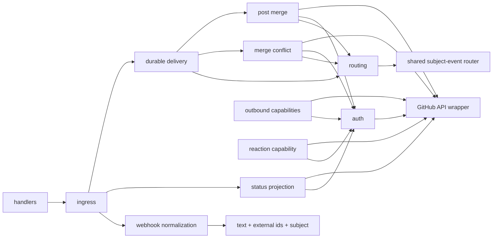
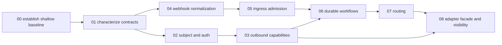

# Deepen the GitHub PR adapter around workflow seams

> **Status:** approved
> **Updated:** 2026-07-30
> **Vocabulary:** CONTEXT.md

## Current solution

The GitHub PR Adapter has a small cross-Adapter interface but a flat internal implementation.

The capability split already limits what shared callers can ask of an Adapter.

The GitHub PR implementation still places unrelated workflows in `adapter.rs`.

At the start of this research, remote `main` was commit `9eff67b`.

That tree has a 3,504-line `backend/src/adapters/providers/github_pr/adapter.rs`.

The parent task records a later mechanical cleanup that moved rendering to `text.rs`, post-merge work to `post_merge.rs`, and the embedded tests to `adapter_tests.rs`.

That cleanup reduces `adapter.rs` to about 2,109 lines without changing its responsibilities.

The parent review confirmed that current `main` at `aa7f4048` still has the 3,504-line file and does not contain those three extracted files.

Stage 00 establishes the mechanical cleanup as the implementation baseline before characterization or architectural work begins.

### Current module ownership

| Responsibility | Current module | Current interface and coupling |
|---|---|---|
| Adapter identity and construction | `adapter.rs` | `GithubPrAdapter::new` stores webhook, database, token, GitHub App, and secret dependencies on the Adapter type. |
| Adapter capability implementations | `adapter.rs` | Implements identity, user identity, destination construction, outbound content, Binding replies, message replies, reactions, inbound presentation, and Binding status in one file. |
| Inbound webhook event normalization | `adapter.rs` | `parse_webhook` dispatches to event-specific handlers that parse raw JSON, apply Subscription filters, resolve senders, render text, assign audience, recover echo provenance, create external ids, and trigger status writes. |
| Delivery admission | `adapter.rs` | `resolve_and_process_github_webhook` verifies the request, resolves the Adapter connection and optional Subscription, applies a second preflight filter, builds up to three delivery records, and classifies acknowledgment failures. |
| Durable delivery execution | `delivery.rs` | Owns the four stable delivery kinds, serialized payloads, sender delivery key, connection and Subscription reload, handler registration, and retry/permanent failure conversion. |
| Outbound replies | `adapter.rs` | Selects an acting user, resolves a token, parses the Binding target, appends the Task footer, calls GitHub, and returns a namespaced external id. |
| Reactions | `adapter.rs` | Parses comment ids, maps emoji, selects credentials, lists/authenticates/deletes reactions, and calls the GitHub wrapper. |
| Status persistence | `adapter.rs` | Extracts PR state and review decisions from webhook payloads, then starts detached best-effort database writes. |
| Status normalization and display | `status.rs` | Converts GitHub PR fields to `ExternalStatus`, parses Binding coordinates, builds the shared status cache key, determines terminal states, and produces the display label and URL. |
| Status fetching | `adapter.rs` | Resolves an acting user's token, performs one PR read, normalizes it through `status.rs`, and degrades failures to no live status. |
| Merge-conflict checks | `adapter.rs` and `runtime.rs` | Extracts a candidate PR, skips unbound subjects, resolves credentials, polls mergeability, persists transitions, and routes a producer notice. |
| Post-merge CI | `post_merge.rs` after the shallow cleanup; `adapter.rs` on researched `main` | Parses a completed base-branch run, resolves its merged PR with GitHub calls, skips inactive subjects, renders a producer notice, and routes it best-effort. |
| Text rendering | `text.rs` after the shallow cleanup; `adapter.rs` on researched `main` | Renders opened, synchronized, comment, review, conflict, and post-merge messages. |
| Token and actor resolution | `adapter.rs` | Combines sender-to-user lookup, outbound actor precedence, reaction actor precedence, canonical Provider token resolution, GitHub App refresh/installation minting, secret-backed PAT lookup, and global-token fallback. |
| GitHub external-system access | `api.rs` | `GithubPrApi` owns HTTP request construction, response/error mapping, comment and PR operations, reaction operations, mergeability polling, and post-merge correlation calls. |
| External ids | `external_id.rs` | Encodes/decodes namespaced ids, legacy aliases, comment targets, pushed commits, CI runs, and conflict notices. |
| Runtime routing | `runtime.rs` | Resolves connection/Subscription state, assembles Bindings, identifies the authoring Task, creates review Tasks, calls the shared audience router, closes Tasks, updates cursors, and currently hosts notification wrappers. |
| HTTP transport | `handlers.rs` | Extracts state, headers, and bytes; records metrics; maps admission failure to non-acknowledgment; acknowledges other ingress rejection classes. |
| GitHub-originated shell reconciliation | `shell_reconcile.rs` | Reconciles GitHub activity observed from Task shell commands and shares external-id and footer conventions with webhook routing. |

The shallow extraction improves navigation but not depth.

`adapter.rs` still knows the ordering constraints and failure behavior of ingress, normalization, durable admission, credentials, outbound operations, status, and GitHub-specific background workflows.

Deleting `text.rs`, `post_merge.rs`, or `adapter_tests.rs` would mostly move their code back into `adapter.rs`.

Deleting the proposed ingress or routing module would instead force workflow rules back across the handler, parser, delivery executor, and capability implementations.

That deletion test distinguishes the target deep modules from pass-through files.

### Current inbound trace

| Hop | Current location | Responsibility |
|---|---|---|
| 1 | `backend/src/adapters/providers/github_pr/handlers.rs:19` | Accept the HTTP request and preserve the special acknowledgment policy. |
| 2 | `backend/src/adapters/providers/github_pr/adapter.rs:2177` | Resolve connection and Subscription, verify the signature, and coordinate all ingress work. |
| 3 | `backend/src/adapters/providers/github_pr/adapter.rs:496` | Normalize one GitHub event into a message, close instruction, or ignore result while starting status writes. |
| 4 | `backend/src/adapters/providers/github_pr/adapter.rs:2441` and `delivery.rs:276` | Serialize and admit each independent delivery kind under GitHub's delivery id. |
| 5 | `backend/src/adapters/providers/github_pr/delivery.rs:292` | Reload current connection and Subscription state and execute the typed delivery. |
| 6 | `backend/src/adapters/providers/github_pr/runtime.rs:136` | Assemble active Bindings, attach an authoring Task, create a review Task when allowed, and determine echo provenance. |
| 7 | `backend/src/adapters/subject_events.rs:27` | Apply audience routing, event-receipt deduplication, self-echo filtering, message delivery, and sandbox notification. |

### Behavior that is easy to change accidentally

| Behavior | Current rule |
|---|---|
| Connection without Subscription | Existing Bindings still receive events; only new review-Task creation is disabled. |
| Inactive Subscription | The whole delivery is ignored. |
| Event and sender filters | They gate the primary event, merge-conflict work, and post-merge work together. |
| Invalid payload or signature | Logged and metered, then acknowledged because redelivery cannot repair it. |
| Failed durable admission | Not acknowledged because no durable owner exists for that work. |
| Multi-kind delivery | Each kind is admitted independently under `(adapter, kind, sender delivery id)`. |
| Partial admission | A later failed admission returns an error; redelivery deduplicates earlier committed kinds and retries the missing kind. |
| Missing delivery header | A body digest becomes the sender delivery key. |
| Duplicate delivery | Pre-admission reads and idempotent status projections repeat; durable effects deduplicate. |
| Partially malformed PR event | A status observation already derivable from the PR payload can be scheduled before a later primary-event parse error is acknowledged. |
| Comment echo filtering | A Task footer, recorded external id, or pushed-commit claim identifies only the authoring Task; sibling Tasks still receive the event. |
| Audience routing | Reviews and PR comments reach everyone, threaded review replies can target the parent author, and build/conflict/post-merge notices target the subject producer with shared-router fallback. |
| Outbound reply identity | Task owner, then Binding filter user, then Subscription run-as user. |
| Reaction identity | Binding filter user, then the global GitHub token. |
| Inbound sender identity | Mapped GitHub login, then Subscription effective user. |
| Status refresh identity | The acting user supplied by the status caller. |
| GitHub App identity | Repository owner is passed when minting installation credentials. |
| Durable execution context | Payloads store connection and optional Subscription ids, then reload current state at execution time. |
| Deleted connection | Permanent delivery failure. |
| Deleted Subscription | Existing-Binding delivery remains possible; trigger-created behavior is skipped. |

## Planned solution

Reorganize the GitHub PR Adapter around workflow modules with deep internal interfaces.

Keep the cross-Adapter capability interfaces unchanged.

Keep GitHub-specific behavior behind the GitHub PR Adapter module.

Make `adapter.rs` the type and composition root.

Move capability implementations into the modules that own their behavior without adding delegation methods back to `adapter.rs`.

The target directory is:

```text
backend/src/adapters/providers/github_pr/
├── mod.rs
├── adapter.rs
├── auth.rs
├── subject.rs
├── ingress.rs
├── webhook.rs
├── delivery.rs
├── routing.rs
├── outbound.rs
├── reactions.rs
├── status.rs
├── merge_conflict.rs
├── post_merge.rs
├── text.rs
├── api.rs
├── external_id.rs
├── handlers.rs
├── api_routes.rs
├── config.rs
├── shell_reconcile.rs
├── signals.rs
└── signature.rs
```

The existing support modules remain support modules.

They are intentionally not new deep seams in this breakup:

| Support module | Role retained by this specification |
|---|---|
| `handlers.rs` | HTTP transport extraction, metrics, and response mapping. |
| `api_routes.rs` | Typed GitHub action routes outside webhook delivery. |
| `config.rs` | Subscription configuration parsing and filter policy values. |
| `shell_reconcile.rs` | Reconciliation of GitHub activity observed from Task shell commands. |
| `signals.rs` | GitHub signal value normalization. |
| `signature.rs` | Webhook signature verification. |

Later tickets may touch one of these modules only when the owning workflow requires a shared route, codec, or transport change.

`runtime.rs` is replaced by `routing.rs`.

`adapter_tests.rs` is temporary migration scaffolding and does not exist in the target tree.

Tests move beside the module interface they exercise.

### Problem

Maintainers cannot change one GitHub PR workflow locally.

The current file shape requires them to learn unrelated invariants before making a safe edit.

| Maintainer | Current cost | Planned leverage |
|---|---|---|
| Webhook maintainer | Must understand capability implementations, token fallback, status fetch, merge checks, post-merge work, and routing while editing event parsing. | Changes raw event interpretation in `webhook.rs` and proves it through one normalization interface. |
| Delivery maintainer | Must trace admission from the handler through `adapter.rs` into `delivery.rs`. | Changes acknowledgment and planning in `ingress.rs`; durable execution remains in `delivery.rs`. |
| Outbound maintainer | Must share helpers and fields with unrelated inbound workflows. | Changes replies in `outbound.rs` and identity/token policy in `auth.rs`. |
| Routing maintainer | Must distinguish GitHub event classification from Binding and Task orchestration. | Changes Task/Binding orchestration behind the two-entry `routing.rs` interface. |
| Reviewer | Must detect behavior drift across a file with several unrelated state machines. | Reviews one workflow module and its seam tests per migration stage. |

### Behaviour

#### GitHub sends a webhook

| Given | When | Then |
|---|---|---|
| The request names a configured Adapter connection. | The handler passes transport facts to GitHub ingress. | Ingress verifies the request, normalizes the event, starts the same best-effort projections, and admits every planned durable delivery before reporting success. |
| The connection has no matching Subscription. | The event concerns an existing Binding. | The event is normalized and routed to existing Bindings without creating a Task. |
| The Subscription is inactive or filters the event or sender. | Ingress evaluates the event. | No primary, merge-conflict, or post-merge delivery is admitted. |
| One sender delivery implies several independent effects. | Ingress admits its plan. | Each effect retains its own stable kind, retry budget, and deduplication identity. |
| Any admission fails before ownership is durable. | The handler maps the result. | The request is not acknowledged. |
| The payload or signature is invalid. | Ingress rejects it. | The rejection retains the existing acknowledged, logged, and metered behavior. |

#### A durable GitHub delivery executes

| Given | When | Then |
|---|---|---|
| A process restarts after admission. | A worker claims the record. | `delivery.rs` reloads the current connection and optional Subscription and calls the owning workflow module. |
| The connection was deleted. | The record executes. | The record fails permanently. |
| The Subscription was deleted. | A message record executes. | Existing Bindings can still receive the event and no new trigger-created Task is created. |
| The GitHub call or database operation fails transiently. | The owning workflow returns an error. | The delivery retains the current retry classification and budget. |

#### A Task receives a GitHub event

| Given | When | Then |
|---|---|---|
| A comment contains a Moatless Task footer. | Webhook normalization records provenance and routing runs. | The authoring Task does not receive its own echo; sibling Tasks bound to the PR still receive it. |
| A synchronized commit matches a Task's recent push claim. | Routing resolves provenance. | That Task does not receive the push echo. |
| An inline review reply names a parent comment. | Normalization assigns the parent-author audience. | The shared subject-event router applies the existing parent-author and fallback rules. |
| A build, conflict, or post-merge notice concerns the pull request's producer. | The notice is routed. | The shared subject-event router applies the existing producer and fallback rules. |

#### A Task sends GitHub activity

| Given | When | Then |
|---|---|---|
| A Task owner, Binding filter user, and Subscription run-as user all exist. | The Task sends a reply. | The Task owner's GitHub identity authors the reply. |
| A Task owner is absent. | The Task sends a reply. | The Binding filter user wins before the Subscription run-as user. |
| A reaction is added or removed. | Credentials are selected. | The Binding filter user wins and the global token remains the fallback. |
| A bot user uses GitHub App installation authentication. | A client is created for repository work. | The repository owner remains part of installation-token selection. |

### Target module interfaces

| Module | Small interface | Implementation hidden behind it |
|---|---|---|
| `adapter.rs` | `GithubPrAdapter::new`, wiring accessors for sibling modules, universal Adapter identity, and small static presentation/content capability methods. | Construction of the GitHub auth module and storage of the global webhook secret and frontend URL. |
| `auth.rs` | Resolve sender identity; create an authenticated GitHub client for inbound work, outbound replies, reactions, and status refresh. | User-selection precedence, Provider token lookup, secret-backed PATs, GitHub App refresh and installation minting, empty-token handling, repository-owner context, and global fallback. |
| `subject.rs` | Fallibly parse a PR subject from Binding data or thread properties; format its key; build a Binding destination. | The `owner`, `repo`, and PR-number storage shape plus the Adapter destination capability implementation. |
| `ingress.rs` | `receive(state, adapter, WebhookRequest) -> Result<WebhookOutcome, WebhookError>`. | Connection and Subscription resolution, signature policy, global filtering, normalization, best-effort projection scheduling, delivery planning, sequential admission, acknowledgment classification, metrics reasons, and missing-header digest fallback. |
| `webhook.rs` | `normalize(event, context) -> Normalization`. | Supported event/action parsing, ignored-title rules, sender mapping, message construction, audience assignment, external ids, Task-footer provenance, close metadata, status observations, merge-check candidates, and post-merge candidates. |
| `delivery.rs` | Register GitHub delivery handlers; accept GitHub-owned delivery requests from ingress. | Stable kinds and payload schemas, current-state reload, permanent versus retryable execution failures, and dispatch to routing/merge/post-merge workflows. |
| `routing.rs` | Route one normalized inbound message; close trigger-created Tasks for one PR. | Binding assembly, active filtering, provenance lookup, connected-thread Binding creation, review-Task creation, Task relation creation, shared audience-router invocation, message append, cursor updates, and close behavior. |
| `outbound.rs` | Existing outbound capability interfaces implemented directly for `GithubPrAdapter`. | Reply target parsing, actor/client acquisition, footer composition, top-level versus threaded reply choice, GitHub calls, and returned external ids. |
| `reactions.rs` | Existing reaction capability interface implemented directly for `GithubPrAdapter`. | Emoji mapping, reaction target parsing, actor/client acquisition, add/remove lookup behavior, and GitHub calls. |
| `status.rs` | Existing Binding-status capability plus apply-one-webhook-observation. | Status normalization/display, live fetch, PR/review projection extraction result application, Binding fan-out, detached best-effort persistence, and failure logging. |
| `merge_conflict.rs` | Derive a conflict candidate; execute one durable conflict check. | Active-Binding short-circuit, credential selection, mergeability polling, settled-state rule, transition persistence, notice construction, and producer routing. |
| `post_merge.rs` | Derive a post-merge candidate; execute one durable post-merge check. | Workflow filtering, default-branch confirmation, commit-to-merged-PR correlation, active-Binding rule, notice construction, and producer routing. |
| `text.rs` | GitHub PR-private render functions accepting typed inputs. | Exact user-facing Markdown and live-read instructions. |
| `api.rs` | Concrete GitHub operations needed by GitHub PR workflows. | HTTP headers, endpoint construction, response decoding, source-preserving transport errors, GitHub rejection mapping, comment limits, and mergeability polling. |
| `external_id.rs` | Encode and parse GitHub PR-private external ids and aliases. | Stable namespaces, legacy numeric aliases, and comment/reaction target rules. |

The `Normalization` result is a GitHub PR-private envelope.

It contains:

| Field | Meaning |
|---|---|
| Event identity | Event type, sender login, repository, and sender delivery facts already validated by ingress. |
| Status observations | Zero or more idempotent PR-status or review-decision projections to schedule before admission. |
| Primary result | Route one `InboundMessage`, close trigger-created Tasks, ignore with a stable reason, or reject with the current ingress error. |
| Merge-conflict candidate | The PR number when the event should schedule a conflict check. |
| Post-merge candidate | The parsed workflow-run facts when the event should schedule post-merge correlation. |

Status observations remain available when a later primary parse rejects a partially malformed event.

Ingress schedules those observations before propagating the primary rejection.

This preserves the current ordering in `handle_pull_request_event`.

The normalization envelope does not write the database.

The normalization envelope does not call GitHub.

The normalization envelope does not admit work.

The normalization envelope does not decide which Binding recipients receive an audience.

### `adapter.rs` target

`adapter.rs` remains the owner of `GithubPrAdapter`.

It keeps:

- Construction and dependency wiring.
- The universal `Adapter` identity implementation.
- `AdapterOutboundContent` because its one static size limit belongs to the Adapter's interface.
- `AdapterInboundPresentation` because its static instructions and alias hook do not justify another module.
- GitHub PR-private accessors used by sibling modules for auth, webhook secret, and frontend URL.

It does not keep:

- Raw webhook parsing or admission.
- Database-backed sender lookup.
- Token or actor selection.
- Binding destination parsing.
- Outbound GitHub calls.
- Reaction logic.
- Status persistence or fetch.
- Merge-conflict or post-merge workflows.
- Durable execution.
- Task/Binding routing.
- Tests for behavior owned by another module.

No capability implementation in `adapter.rs` delegates to a same-named function solely to make the file smaller.

Capability implementations live directly in `auth.rs`, `subject.rs`, `outbound.rs`, `reactions.rs`, and `status.rs`.

### Dependency direction



`ingress.rs` may depend on `webhook.rs`, `status.rs`, and `delivery.rs`.

`webhook.rs` may depend on `auth.rs` only for sender-to-user resolution.

`webhook.rs` may not depend on `delivery.rs`, `routing.rs`, or `AppState`.

`delivery.rs` may depend on workflow modules.

Workflow modules may depend on `auth.rs`, `api.rs`, `subject.rs`, `text.rs`, `external_id.rs`, and shared repositories.

Workflow modules may not depend on `ingress.rs`.

`routing.rs` may depend on shared Binding and Task modules.

`routing.rs` may not parse raw GitHub webhook JSON or select GitHub credentials.

### Visibility rules

| Item | Visibility |
|---|---|
| `GithubPrAdapter` and its composition-root constructor | `pub(crate)` where production callers permit it; keep `pub` only if the backend library's external integration tests require the type during migration. |
| HTTP handler and typed route definitions | The minimum visibility required by the crate route composition root. |
| Delivery handler registration | `pub(crate)` to the backend composition root. |
| Delivery kind strings | GitHub PR-private in production; test through admitted records rather than importing constants from an external integration test. |
| `WebhookRequest`, `WebhookOutcome`, and `WebhookError` | `pub(crate)` between handler and ingress. |
| `NormalizedWebhook` and all normalized effect types | `pub(super)` within `github_pr`. |
| Delivery payload types | Private to `delivery.rs`; ingress uses constructors rather than struct fields. |
| `GithubPrApi` operations | `pub(super)` within `github_pr`, except `api_base`, which remains `pub(crate)` because GitHub App and settings modules use it. |
| Auth and subject types | `pub(super)` within `github_pr`. |
| Text renderers and external-id codecs | `pub(super)` within `github_pr`. |
| Test-only constructors such as an alternate GitHub base URL | `#[cfg(test)]` unless a database integration test genuinely requires feature-gated access. |
| Submodules in `mod.rs` | Private by default; expose only the route/composition items used outside `github_pr`. |

External database integration tests should drive the HTTP handler or a crate-level test fixture.

They should not force all GitHub PR internals to remain public.

## Decisions

| # | Decision | Chosen | Rejected because |
|---|---|---|---|
| [1](#1-ingress-is-the-admission-seam) | Where webhook ownership sits | A deep `ingress.rs` module owns request policy through durable admission. | Leaving orchestration in `adapter.rs` preserves the flat implementation; moving it into the HTTP handler couples behavior to Axum. |
| [2](#2-normalization-is-side-effect-free-except-sender-resolution) | How raw events become work | `webhook.rs` returns one normalization envelope and performs no persistence, GitHub calls, admission, or routing. | Event-specific modules would repeat message/audience/external-id construction; returning delivery rows would couple normalization to durability. |
| [3](#3-capability-implementations-live-with-behavior) | How trait implementations are split | Implement capability traits directly in their owning modules. | Delegating every trait method from `adapter.rs` creates pass-through modules and preserves two places to edit. |
| [4](#4-auth-is-selected-by-use-case) | How token identity is centralized | `auth.rs` exposes use-case-specific client acquisition and hides actor/token precedence. | A generic `resolve_token(user)` helper leaves every caller responsible for selecting the correct user and repository owner. |
| [5](#5-durable-delivery-contract-does-not-change) | What happens to admission and execution | Keep kinds, payload meaning, dedup keys, sequential admission, state reload, and failure classification unchanged. | Combining kinds or changing persistence during a file breakup creates behavior and migration risk. |
| [6](#6-routing-is-a-deep-taskbinding-module) | Where Task and Binding orchestration lives | `routing.rs` exposes route-event and close-subject entry points. | Splitting Task creation, Binding creation, provenance, and fan-out into separate public helpers creates a shallow cluster with ordering constraints exposed to callers. |
| [7](#7-the-concrete-github-wrapper-remains-the-external-adapter) | How GitHub calls are tested | Keep `GithubPrApi` concrete and test workflows against a local HTTP stub or injected concrete client. | One broad mock trait would mirror every endpoint and become a shallow interface with only one production implementation. |
| [8](#8-status-owns-both-projection-and-refresh) | Where Binding status behavior lives | `status.rs` owns webhook projection application and live refresh. | Separate write-status and read-status modules duplicate subject parsing and normalized-state knowledge. |
| [9](#9-migration-proves-behavior-before-moving-it) | How the breakup lands | Characterization tests first, then one workflow seam per PR. | A single file-move PR makes admission, routing, identity, and API-call drift difficult to locate or review. |

### 1. Ingress is the admission seam

`handlers.rs` remains a transport adapter.

It extracts the four transport facts: event type, sender delivery id, signature, and body.

It calls one ingress interface.

Ingress owns the ordering below:

1. Validate the event type and decode the body.
2. Resolve repository, Adapter connection, and optional Subscription.
3. Reject an inactive Subscription.
4. Verify the signature against connection secret then global fallback.
5. Build the delivery-only Subscription when no real Subscription exists.
6. Apply event and ignored-sender filters to the whole delivery.
7. Normalize the event into observations, candidates, and a primary result.
8. Schedule the same best-effort status projections even when a later primary parse rejected the event.
9. Propagate a primary parse rejection with the existing acknowledgment class.
10. Build the primary, post-merge, and merge-conflict delivery requests.
11. Admit each request sequentially.
12. Report processed only after every planned admission returns admitted or duplicate.

This ordering is part of the interface.

It must be pinned by tests before code moves.

### 2. Normalization is side-effect-free except sender resolution

Raw webhook JSON belongs in `webhook.rs`.

Normalization may use the auth module to map a GitHub login to a Moatless user.

That lookup is the only I/O allowed during normalization.

All other outputs are values.

| Output | Owner after normalization |
|---|---|
| Message, audience, external id, and echo provenance | `routing.rs` consumes them after durable execution. |
| Close metadata | `routing.rs` consumes it after durable execution. |
| Status observation | `status.rs` applies it best-effort from ingress, including when a later primary parse rejects the event. |
| Merge-conflict candidate | `delivery.rs` persists it; `merge_conflict.rs` executes it. |
| Post-merge candidate | `delivery.rs` persists it; `post_merge.rs` executes it. |
| Ignore reason | `ingress.rs` turns it into the existing metric and acknowledgment outcome. |

The exception for sender lookup is deliberate.

Moving it after admission would change the serialized `InboundMessage.user_id`.

Moving it into routing would make a retry observe a different identity than the request accepted.

### 3. Capability implementations live with behavior

Rust permits trait implementations for `GithubPrAdapter` in sibling modules.

Use that property directly.

`outbound.rs` implements Binding and message reply traits.

`reactions.rs` implements reaction traits.

`status.rs` implements Binding status.

`subject.rs` implements destination construction.

`auth.rs` implements external-user identity lookup.

`adapter.rs` does not mirror those methods.

This gains locality without widening the cross-Adapter interface.

### 4. Auth is selected by use case

The auth module hides both identity choice and credential materialization.

Its internal interface should express these use cases:

| Use case | Identity rule |
|---|---|
| Inbound sender | Mapped GitHub login, then Subscription effective user. |
| Durable GitHub work | Resolved inbound sender user and repository owner. |
| Outbound reply | Task owner, then Binding filter user, then Subscription run-as user. |
| Reaction | Binding filter user, then non-empty global token. |
| Live Binding status | Caller-supplied acting user. |

The return should pair the selected user id when the caller needs message authorship with an authenticated `GithubPrApi`.

The module must continue using the canonical credential resolver.

The module must continue passing repository owner for GitHub App installation tokens.

The module must distinguish absent and empty global tokens.

### 5. Durable delivery contract does not change

The refactor keeps these stable kinds:

| Kind | Durable effect |
|---|---|
| `github.pr_message` | Route a normalized event and possibly create a review Task. |
| `github.close` | Close only Tasks created by the matching Subscription for the PR. |
| `github.post_merge` | Correlate a completed base-branch run to a merged PR and notify. |
| `github.merge_conflict` | Poll mergeability and persist/notify a conflict transition. |

The sender delivery identity remains GitHub's delivery header or the body digest fallback.

Deduplication remains per Adapter, kind, and sender delivery identity.

One sender delivery may still produce several unordered Adapter deliveries.

The delivery context continues storing ids rather than credential or Subscription snapshots.

No database migration is part of this refactor.

### 6. Routing is a deep Task/Binding module

`routing.rs` owns the complete GitHub-to-Task workflow.

Its route interface accepts a normalized `InboundMessage`.

It does not accept raw webhook JSON.

It hides:

- Existing active-Binding lookup.
- Authoring-Task discovery from footer, external-id receipt, or pushed commit.
- Connected-thread Binding attachment.
- Review-Task idempotency and creation.
- Related-Task recording.
- Delivery-only Subscription construction for metrics and message labeling.
- Shared subject-event routing.
- Message cursor updates.

Its close interface hides origin and Subscription checks.

The shared `subject_events` and Binding runtime remain the audience and self-echo seam.

GitHub routing assembles facts for that seam.

GitHub routing does not duplicate recipient logic.

### 7. The concrete GitHub wrapper remains the external adapter

GitHub is a true external dependency.

`GithubPrApi` remains the concrete adapter at that seam.

Workflow modules should accept an already constructed `GithubPrApi` in private helpers where that makes local-stub testing possible.

Production entry points acquire the client from `auth.rs`.

Do not introduce one trait containing every GitHub endpoint.

A narrower port is allowed only if a workflow needs two real adapters, normally production plus a fake used by seam tests.

The default test technique is a local HTTP stub with request counting.

### 8. Status owns both projection and refresh

`status.rs` already owns normalized state and display rules.

Deepen it rather than add `status_persistence.rs` and `status_fetch.rs`.

It gains:

- Typed PR-status and review-decision observations.
- Best-effort Binding lookup and writes.
- The Binding-status capability implementation.
- Live status fetch through `auth.rs` and `GithubPrApi`.

It keeps one external capability interface.

Projection application remains GitHub PR-private.

### 9. Migration proves behavior before moving it

Every stage has a behavioral checkpoint.

No stage changes a delivery kind, stored payload meaning, audience classification, credential precedence, status policy, or GitHub call budget.

Tests move only after the new seam test replaces their coverage.

The temporary `adapter_tests.rs` is deleted last.

## Seams and testing

The interface of each deep module is the primary test surface.

Tests should not reach through the interface to assert private helper calls or internal struct layout.

### Seam test matrix

| Module | Dependency category | Highest useful seam | Required proof |
|---|---|---|---|
| `webhook.rs` | In-process plus sender lookup | `normalize` | Table-driven event/action results, text, audience, external id, parent id, source Task, filters, close/status/candidate outputs, and observations retained across later primary rejection. |
| `ingress.rs` | Local-substitutable database | `receive` | Signature and resolution policy, no-Subscription delivery, global filtering, multi-kind plans, acknowledgment classes, duplicate admission, partial admission recovery, and body-digest fallback. |
| `delivery.rs` | Local-substitutable database | Registered typed handler execution | Payload round trips, restart recovery, current-state reload, missing-connection permanent failure, transient failure retry, and one retry budget per kind. |
| `auth.rs` | Repository fakes plus canonical resolver | Use-case-specific client acquisition | Every identity precedence rule, empty-token behavior, global fallback, App installation owner, refresh persistence, and causal errors. |
| `subject.rs` | In-process | Fallible parse/build interface | All supported Binding/thread shapes, malformed data errors, canonical key, and destination fields. |
| `outbound.rs` | True external GitHub via local stub | Existing outbound capability | Top-level and threaded reply behavior, footer inclusion, identity precedence, exact external id, comment length behavior, and one GitHub write per reply. |
| `reactions.rs` | True external GitHub via local stub | Existing reaction capability | Emoji mapping, issue/review targets, add, remove ownership filtering, not-found behavior, and exact request sequence. |
| `status.rs` | Local database plus local GitHub stub | Existing Binding-status capability and projection function | Normalization, display fallback, terminal states, idempotent replay, live-fetch degradation, and one PR call per uncached refresh. |
| `routing.rs` | Local-substitutable database | Route-event and close-subject interfaces | Existing-Binding delivery, no-Subscription delivery, review-Task idempotency, closed Binding exclusion, origin attachment, echo filtering, audience handoff, and close origin/Subscription rules. |
| `merge_conflict.rs` | Local database plus local GitHub stub | Execute one durable check | No-Binding zero-call skip, mergeability poll budget, unsettled skip, state transition persistence, one notice per transition/head, and producer audience. |
| `post_merge.rs` | Local database plus local GitHub stub | Execute one durable check | Candidate filtering, default-branch check, merged-PR correlation, inactive-Binding skip, run-id dedup, producer audience, and exact call sequence. |
| `api.rs` | True external GitHub via local stub | Concrete operation methods | Headers, endpoints, response decoding, truncation, mergeability retry budget, source-preserving transport/decode errors, and GitHub rejection mapping. |

### Characterization tests required before architectural moves

Ticket 01 adds tests for the rules most likely to drift after Stage 00 establishes the mechanical baseline.

| Risk | Characterization |
|---|---|
| Delivery admission | A valid event reports processed only after every planned kind is admitted or already duplicate. |
| Partial admission | Force the second planned admission to fail; redelivery leaves the first at one record and admits the missing kind. |
| Acknowledgment | Malformed/signature ingress rejection stays acknowledged; admission failure stays unacknowledged. |
| Connection without Subscription | A comment reaches an existing Binding and an opened PR creates no new Task. |
| Echo filtering | A footer echo skips only its authoring Task; a commit claim skips only its pusher; sibling Bindings receive both. |
| Audience | Inline parent reply, review, issue comment, build result, conflict, and post-merge event preserve current audience values and fallback routing. |
| Token identity | Outbound, reaction, inbound, status, and GitHub App installation precedence are pinned separately. |
| Retry and deduplication | Same sender id and kind is one record; same sender id across kinds is several records; restart executes each once. |
| Status replay | A redelivery repeats the pre-admission projection and converges on the same stored value. |
| Partial payload projection | A payload with enough PR state to project status but too little data for its primary effect still schedules the same projection before acknowledged rejection. |
| GitHub calls | Stub counters pin the workflow budgets listed below. |

### GitHub API-call budgets

The migration must not increase calls on unchanged behavior.

| Workflow | Current budget to preserve |
|---|---|
| Post a top-level reply | One comment write. |
| Post a threaded review reply | One review-reply write. |
| Add a reaction | One create call. |
| Remove a reaction | One authenticated-user read, one reaction-list read, and one delete when found. |
| Live status fetch | One PR read per status refresh invocation; shared status caching remains outside the GitHub PR module. |
| Merge-conflict check with no active Binding | Zero GitHub calls. |
| Merge-conflict check with active Binding | One PR read plus at most three mergeability retry reads, with the current delay and early-stop behavior. |
| Post-merge candidate rejection during normalization | Zero GitHub calls. |
| Post-merge durable execution | One repository-default-branch read and, only on that branch, one commit-to-PR list read. |
| Status webhook projection | Zero GitHub calls. |

Tests should assert request counts and request order where order affects rate use.

They should not assert that a newly shared HTTP client exists.

Client pooling is a separate performance change.

### Staged migration and acceptance criteria

| Stage | Change | Acceptance criteria |
|---|---|---|
| 00 | Establish the shallow-cleanup baseline. Confirm whether `text.rs`, `post_merge.rs`, and `adapter_tests.rs` exist. If absent, recreate the parent task's mechanical extraction as its own PR. If present, record the verification and make no code change. | The three files exist before Ticket 01 starts; rendering, post-merge logic, and tests are moved without behavior or test changes; no delivery kind, interface, visibility, or workflow rule changes; backend Clippy and unit tests pass. |
| 01 | Add characterization tests at current seams. | No production behavior changes; every risk row above has an executable assertion; the existing backend unit suite and database integration tier pass. |
| 02 | Add `subject.rs` and `auth.rs`; migrate shared parsing and credential selection without moving workflows. | All subject parsing call sites use one fallible type; all five identity rules pass; no caller invokes the canonical token resolver directly outside `auth.rs`; GitHub App owner selection and global fallbacks are unchanged. |
| 03 | Move outbound, reactions, and live status capability implementations. | Capability traits are implemented directly in `outbound.rs`, `reactions.rs`, and `status.rs`; `adapter.rs` has no delegating compatibility methods; stub request counts match the budget; registry capability tests are unchanged. |
| 04 | Extract `webhook.rs` normalization and relocate its tests. | Raw event/action parsing exists only in `webhook.rs`; normalized outputs preserve text, audience, external ids, provenance, status observations, workflow candidates, and partial-payload observation ordering; normalization performs no database writes, GitHub calls, admission, or routing. |
| 05 | Extract `ingress.rs` and make the handler transport-only. | `handlers.rs` contains extraction, metrics, and response mapping only; processed/ignored/error reasons remain stable; multi-kind and partial admission tests pass; delivery schema and kind strings are unchanged. |
| 06 | Deepen `post_merge.rs` and add `merge_conflict.rs`. | Each workflow owns candidate/execute behavior; `delivery.rs` calls those modules directly; no-active-Binding and candidate-rejection zero-call tests pass; call budgets, audiences, retry classification, and best-effort notification policy are unchanged. |
| 07 | Replace `runtime.rs` with `routing.rs`. | Only route-event and close-subject are callable from sibling workflow modules; Adapter connection resolution lives in ingress; merge/post-merge wrappers no longer live in routing; echo, audience, Binding origin, Task creation, and close tests pass. |
| 08 | Reduce `adapter.rs`, narrow visibility, and retire `adapter_tests.rs`. | `adapter.rs` contains only the target responsibilities; behavioral tests live with owning modules; external integration tests no longer import GitHub PR internals; `mod.rs` exposes only real crate consumers; no test coverage is lost. |

Each stage is independently reviewable and revertible.

Each stage should move tests with behavior only after the replacement seam tests are green.

Each stage runs:

- `cargo clippy -p moatless-vibe-backend -- -D warnings`
- `cargo test -p moatless-vibe-backend`
- `task test:integration` when any database integration test or database-backed workflow changes.

## Out of scope

| Out of scope | Reason |
|---|---|
| Changing the cross-Adapter capability interfaces or registry shape | The capability breakup already landed and is not the source of GitHub PR internal flatness. |
| Changing user-visible GitHub PR behavior | This is an architecture refactor with characterization-first migration. |
| Changing event, sender, or title filtering semantics | These rules are moved, not redesigned. |
| Making status projections durable | Current projections are detached and best-effort; changing that contract needs its own design. |
| Making multi-kind admission atomic | Sequential partial admission plus deduplicating redelivery is existing behavior. |
| Changing delivery retention or the 30-day GitHub redelivery exposure | Retry and retention policy belongs to the shared Adapter delivery module. |
| Fixing the Task-creation timeout window between Task insert and Binding write | This is a known delivery-runtime consistency problem, not a module breakup. |
| Reordering post-merge calls to check Bindings before GitHub correlation | That changes rate-limit behavior and the information needed to identify the subject. |
| Sharing or pooling `reqwest::Client` instances | This is a performance change and should be measured separately. |
| Adding pagination for reaction removal | That changes behavior for comments with more than the current page size. |
| Replacing the concrete GitHub wrapper with Octocrab or another client | It expands scope and changes error/rate-limit behavior. |
| Refactoring `shell_reconcile.rs` or `api_routes.rs` | They share codecs and GitHub operations but do not cause `adapter.rs` to mix inbound, outbound, and delivery workflows. |
| Changing external-id formats or legacy aliases | They are persisted and participate in echo filtering and deduplication. |
| Changing audience semantics | The shared subject-event router remains authoritative. |

## Open questions

None.

## Ticket breakdown



| Ticket | Scope | Review boundary |
|---|---|---|
| 00 — Establish the shallow-cleanup baseline | Confirm the three extracted files exist. On current `main`, mechanically move rendering to `text.rs`, post-merge work to `post_merge.rs`, and embedded tests to `adapter_tests.rs`. | Mechanical moves only; no behavior, interface, visibility, or test-content changes. |
| 01 — Characterize GitHub PR contracts | Add the missing admission, echo, audience, identity, retry/dedup, status-replay, and request-count tests. | Tests only. |
| 02 — Centralize GitHub PR subject and auth | Add the canonical PR subject type and use-case-specific authenticated-client acquisition. | Pure/storage parsing and credentials only. |
| 03 — Move outbound capability implementations | Move replies, reactions, and Binding status behind their existing capability interfaces. | No inbound or durable delivery changes. |
| 04 — Normalize webhooks into one GitHub result | Move event parsing, rendering inputs, audience, provenance, and observations into `webhook.rs`. | No admission or routing changes. |
| 05 — Make ingress own admission | Move request verification, resolution, planning, admission, and outcome classification into `ingress.rs`. | Handler and ingress only; delivery payloads remain compatible. |
| 06 — Isolate durable GitHub workflows | Deepen post-merge and extract merge-conflict execution. | Durable workflow calls and their GitHub/database effects only. |
| 07 — Deepen Task and Binding routing | Rename/reduce runtime to the two-entry routing module. | Task/Binding orchestration only. |
| 08 — Contract the facade | Remove migration exports, distribute remaining tests, delete `adapter_tests.rs`, and narrow module visibility. | Structural cleanup after all behavior has moved. |

The recommended first implementation ticket is Ticket 00.

It makes the implementation base match the architecture assumed by every later ticket.

Ticket 01 is the first behavior-focused ticket.

It creates the safety net needed to review every architectural move and contains no production refactor.
