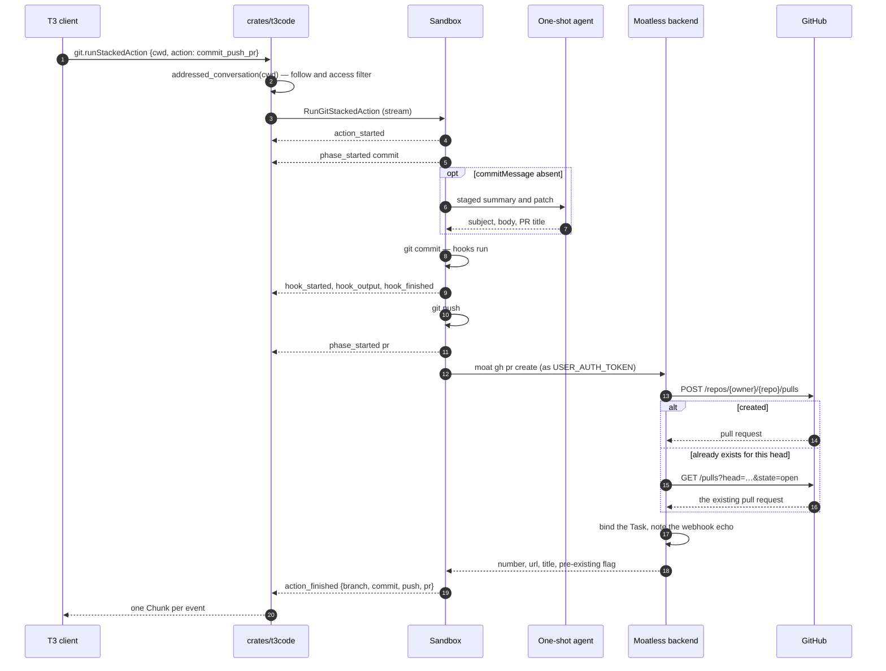
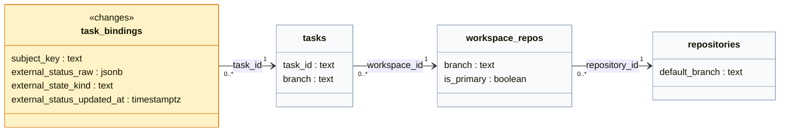

# Git actions on the T3 Code surface

> **Status:** approved
> **Updated:** 2026-08-03
> **Vocabulary:** CONTEXT.md

## Current solution

### Anchors

**The T3 compatibility surface — `crates/t3code`**

| Anchor | What is there |
|---|---|
| `crates/t3code/src/lib.rs:1672` | The RPC dispatch table. Every new method arm goes here |
| `crates/t3code/src/lib.rs:1712` | `server.discoverSourceControl`, answering `{"versionControlSystems": [], "sourceControlProviders": []}` |
| `crates/t3code/src/lib.rs:1719` | `vcs.listRefs` — the Sandbox's refs, or the git host's branches for a draft thread |
| `crates/t3code/src/lib.rs:1757` | `vcs.refreshStatus` |
| `crates/t3code/src/lib.rs:1780` | `vcs.switchRef` — answered for a draft thread only; a thread with a Sandbox is refused because its branch is fixed at creation |
| `crates/t3code/src/lib.rs:1792` | `review.getDiffPreview` |
| `crates/t3code/src/lib.rs:2451` | `subscribeVcsStatus`, and `start_produced_stream` — the mechanism a streaming method uses |
| `crates/t3code/src/lib.rs:2472` | `_ => vec![unsupported_exit(&id, &tag)]`, where every git write currently lands |
| `crates/t3code/src/lib.rs:2489` | `watch_vcs_status`; the snapshot dedupe at `:2505` |
| `crates/t3code/src/lib.rs:3013` | The tag → sandbox-method map used to classify gRPC errors |
| `crates/t3code/src/lib.rs:3196` | `unsupported_exit` |
| `crates/t3code/src/lib.rs:236` | `UiRpcState`. `commands` at `:275` carries the doc comment "The one thing this module does that is not a read", which this change makes untrue |
| `crates/t3code/src/review.rs:432` | `status` — the snapshot form |
| `crates/t3code/src/review.rs:448` | `status_snapshot` — `{_tag: "snapshot", local, remote}` |
| `crates/t3code/src/review.rs:474` | `flat_status` — the same two halves merged, as `vcs.refreshStatus` returns them |
| `crates/t3code/src/review.rs:483` | `read_status` — resolves `cwd` to a `task_id`, then one `GetGitStatus` |
| `crates/t3code/src/review.rs:501` | `local_status` |
| `crates/t3code/src/review.rs:540` | `remote_status`, where `"pr": Value::Null` is hardcoded. **The central anchor** |
| `crates/t3code/src/workspace.rs:1` | "A `cwd` is a claim, not a capability" — every workspace-addressed call re-reads the Task through the follow-and-access filter |
| `crates/t3code/src/ports.rs:84` | `NewThread { branch: Option<String>, … }` — how a draft thread's branch reaches Task creation |

**The Sandbox**

| Anchor | What is there |
|---|---|
| `crates/sandbox-proto/proto/sandbox/v1/sandbox.proto:337-340` | The only git RPCs: `GetGitDiffPreview`, `GetGitStatus`, `ListGitRefs`. All read-only |
| `crates/sandbox-proto/proto/sandbox/v1/sandbox.proto:754` | `GetGitStatusResponse`. Fields 1–9; no ahead-of-default count, no PR |
| `sandbox/src/grpc_server.rs:545` | "Branch state and refs answer for the primary repository, whose HEAD and ref namespace are the only ones those questions have" |
| `sandbox/src/grpc_server.rs:581` | `get_git_status`, mapping `files::review::status` onto the proto message |
| `sandbox/src/files/review.rs:287` | `status()` — one `git status --porcelain=2 --branch` |
| `sandbox/src/files/review.rs:318` | `branch.ab` parsed into `ahead_count` / `behind_count`. **These are ahead/behind of the upstream, not of the default branch** |
| `sandbox/src/files/review.rs:508` | `default_branch(repo_dir)` — already resolved and already called by `status()` |
| `sandbox/src/init/git.rs:19` | `configure_git`. The commit identity is resolved from `gh api user`, so it is the Task's run-as user |
| `sandbox/src/init/git.rs:42` | The broker-backed credential helper, prepended ahead of `gh auth git-credential` so a push always pulls a freshly rotated token |
| `crates/claude-agent-sdk/src/query.rs:205` | `query(prompt, options)` — a one-shot prompt that spawns its own subprocess |

**The GitHub half, on the backend**

| Anchor | What is there |
|---|---|
| `backend/src/adapters/providers/github_pr/api_routes.rs:12` | Module doc: "the identity that pushed the branch is the identity that opens the PR" |
| `backend/src/adapters/providers/github_pr/api_routes.rs:54` | `create_pr` — resolves the default base, builds the body with the task footer, creates, binds, notes the webhook echo |
| `backend/src/adapters/providers/github_pr/api_routes.rs:280` | `bind_pr` — bind an existing PR to a Task by number |
| `backend/src/adapters/providers/github_pr/api_routes.rs:329` | `resolve_github_api` — the caller's own GitHub token for one repository |
| `backend/src/adapters/providers/github_pr/api.rs:30` | `PrInfo`; `head: PrRef` at `:67`, already deserialised and then dropped |
| `backend/src/adapters/providers/github_pr/api.rs:226` | `create_pr`; the non-success path at `:251` returns `AdapterError::AdapterApi("GitHub create_pr returned {status}: {text}")` — this is where a 422 "A pull request already exists" surfaces raw |
| `backend/src/adapters/providers/github_pr/api.rs:305` | `get_pulls_for_commit` — the nearest existing lookup |
| `backend/src/adapters/providers/github_pr/api.rs:383` | `get_pr` |
| `backend/src/adapters/providers/github_pr/status.rs:86` | `github_external_status` — **the one function that builds the detail blob**, currently `{title, url, state, merged, draft}` |
| `backend/src/adapters/providers/github_pr/status.rs:113` | `status_from_pr_info` |
| `backend/src/adapters/providers/github_pr/status.rs:78` | `TERMINAL_STATE_KINDS = ["merged", "closed"]` |
| `backend/src/adapters/providers/github_pr/status.rs:158` | `status_raw_url` — the only reader of the blob outside the adapter's own module |
| `backend/src/adapters/providers/github_pr/shell_reconcile.rs:1` | Catches a PR the agent opened straight through the shell and binds it after the fact |
| `backend/src/adapters/providers/github_pr/routing.rs:574` | `create_provider_event_task` — the inbound direction, a PR event creating a bound Task |
| `backend/src/bindings/status_service.rs:39` | `should_refresh` — pure, and where the staleness rule lives |
| `backend/src/bindings/status_service.rs:61` | The process-global moka cache, 2-minute TTL, keyed by external subject |
| `backend/src/bindings/status_service.rs:78` | `get_or_fetch` — write-through onto the binding's persisted columns |
| `backend/src/adapters/models.rs:203` | `TaskBinding` |
| `backend/src/loops/firing/listen.rs:297` | `connect_github_binding` |
| `backend/src/task/connections_handlers.rs:337` | The write-through into the task-connections response |
| `backend/src/repository/access.rs:89` | Delegates straight to `resolve_run_as_user_github_token` when a run-as user is named |
| `backend/src/auth/credentials.rs:273` | `resolve_run_as_user_github_token` — the user's own row, no scope walk, no global fallback |
| `backend/src/auth/credentials.rs:77` | The provider-token row's `login` |
| `backend/src/sandbox/grpc_server.rs:1123` | `mint_user_auth_token` → `USER_AUTH_TOKEN` in the Sandbox |
| `crates/cli/src/config.rs:52` | `AuthMode::Sandbox` — inside a Sandbox the CLI authenticates as `USER_AUTH_TOKEN`, i.e. the Task's run-as user |
| `crates/cli/src/commands/gh.rs:17` | Module doc: a typed-path failure never falls back to raw `gh`, to avoid double-posting |
| `crates/cli/src/commands/gh.rs:36` | `PrCreateArgs`, `--title` required |
| `crates/api-schemas/src/github.rs:37` | `GithubCreatePrResponse` |
| `backend/migrations/0064_task_binding_external_status.sql` | Why status lives in dedicated columns: `upsert()` overwrites `destination_config` wholesale |
| `backend/migrations/0076_task_binding_pr_signals.sql` | Why the review decision and mergeable state got their own columns: **the webhook path writes them independently and a wholesale blob write would clobber them** |

**The T3 client's contract**

| Anchor | What is there |
|---|---|
| `packages/contracts/src/rpc.ts:580` | `WsGitRunStackedActionRpc`, declared `stream: true` |
| `packages/contracts/src/rpc.ts:385` | `WsServerDiscoverSourceControlRpc` — payload is an empty struct, so the call is environment-scoped |
| `packages/contracts/src/git.ts:11` | `GitStackedAction = commit \| push \| create_pr \| commit_push \| commit_push_pr` |
| `packages/contracts/src/git.ts:19` | `GitActionProgressPhase = branch \| commit \| push \| pr` |
| `packages/contracts/src/git.ts:21` | `GitActionProgressKind` — the seven frame kinds |
| `packages/contracts/src/git.ts:33-44` | Per-step statuses, including `skipped_no_changes`, `skipped_up_to_date` and `opened_existing` |
| `packages/contracts/src/git.ts:45` | `VcsStatusChangeRequestState = open \| closed \| merged` — **no draft** |
| `packages/contracts/src/git.ts:48` | `GitPreparePullRequestThreadMode = local \| worktree` |
| `packages/contracts/src/git.ts:90` | `GitResolvedPullRequest { number, title, url, baseBranch, headBranch, state }` |
| `packages/contracts/src/git.ts:112` | `GitRunStackedActionInput { actionId, cwd, action, commitMessage?, featureBranch?, filePaths? }` |
| `packages/contracts/src/git.ts:146` | `GitPullRequestRefInput { cwd, reference }` |
| `packages/contracts/src/git.ts:152` | `GitPreparePullRequestThreadInput { cwd, reference, mode, threadId? }` |
| `packages/contracts/src/git.ts:193` | `VcsStatusChangeRequest` — `baseRef` and `headRef` both **non-optional** |
| `packages/contracts/src/git.ts:275` | `GitPreparePullRequestThreadResult { pullRequest, branch, worktreePath }` |
| `packages/contracts/src/git.ts:287` | `GitRunStackedActionResult` — the terminal payload, with a per-phase sub-object |
| `packages/contracts/src/git.ts:431` | `GitActionFailedEvent { phase, message }` |
| `packages/contracts/src/git.ts:438` | `GitActionProgressEvent` — the union every frame is one of |
| `packages/contracts/src/sourceControl.ts:106` | `SourceControlDiscoveryStatus = available \| missing` |
| `packages/contracts/src/sourceControl.ts:116` | `SourceControlProviderAuth { status, account, host, detail }` |
| `packages/contracts/src/sourceControl.ts:147` | `SourceControlDiscoveryResult` |
| `apps/web/src/components/GitActionsControl.logic.ts:84` | `"Generating commit message..."` — the client already expects the surface to generate one |
| `apps/web/src/components/GitActionsControl.logic.ts:106` | `hasDefaultBranchDelta = (gitStatus.aheadOfDefaultCount ?? gitStatus.aheadCount) > 0`, repeated at `:190` |
| `apps/web/src/components/GitActionsControl.logic.ts:108` | `canCommit = !isBusy && hasChanges` |
| `apps/web/src/components/GitActionsControl.logic.ts:204` | `resolveQuickAction`'s `hasChanges` branch, returning `commit_push_pr` with no dialog and no message |
| `apps/web/src/components/GitActionsControl.tsx:1260` | The default-branch confirmation, and `:1504` / `:1522` where declining it re-runs the action with `featureBranch: true` |
| `apps/web/src/components/chat/ChatHeader.tsx:165` | Where the control is mounted |
| `apps/web/src/components/ChatView.tsx:1765` | `openOrReuseProjectDraftThread` — carries `{branch, worktreePath, envMode}` only |
| `apps/web/src/components/ChatView.tsx:1842` | `handlePreparedPullRequestThread` — the prepared result opens or reuses a **draft** thread, not the current one |
| `apps/server/src/textGeneration/TextGeneration.ts:73` | The four generators |
| `apps/server/src/textGeneration/ClaudeTextGeneration.ts:47` | `CLAUDE_TIMEOUT_MS = 180_000`; spawns `claude -p --output-format json` |
| `apps/server/src/git/GitManager.ts:1400` | A typed commit message short-circuits generation |
| `apps/server/src/git/GitManager.ts:1418` | Staged summary capped at 8k, staged patch at 50k |
| `apps/server/src/git/GitManager.ts:1600` | Pull-request template detection |
| `apps/server/src/git/GitManager.ts:1608` | PR generation context at 20k / 20k / 60k |
| `apps/server/src/git/GitManager.ts:619` | Repo-conventions mode reads recent commit subjects out of the log |

**This repository's own hooks** — `.husky/commit-msg` runs `bunx commitlint --edit $1`; `.husky/pre-commit` runs `bun lint-staged`, which can rewrite the files being committed.

### What the code does not say

- **Create PR would be dead even after the write path lands.** The client gates it on `aheadOfDefaultCount ?? aheadCount` (`GitActionsControl.logic.ts:106`). Moatless never sends `aheadOfDefaultCount`, and `aheadCount` comes from `branch.ab`, which is ahead of the **upstream** — so it drops to zero the moment a branch is pushed and the button greys out. The Sandbox has to learn to count against the default branch. `sandbox/src/files/review.rs:318`.

- **The Binding cannot answer T3's `pr` field as it stands.** `VcsStatusChangeRequest` requires `baseRef` and `headRef`, both non-optional (`packages/contracts/src/git.ts:193`), and what is persisted is `{title, url, state, merged, draft}` (`github_pr/status.rs:86`). `PrInfo` already deserialises the head ref from GitHub and drops it (`github_pr/api.rs:67`).

- **T3's PR state has no `draft`.** `VcsStatusChangeRequestState` is `open | closed | merged` (`git.ts:45`), while `external_state_kind` is `open | draft | merged | closed`. A draft has to report as `open` on that surface, and draftness is not carried.

- **Two identities are in play, on one rule.** The Sandbox pushes as the Task's run-as user; the PR endpoint acts as whoever called it. Both read that person's own GitHub row and nothing else — the Sandbox's resolver delegates straight to `resolve_run_as_user_github_token` (`backend/src/repository/access.rs:89`). Inside a Sandbox the CLI authenticates as `USER_AUTH_TOKEN` (`crates/cli/src/config.rs:52`), which is minted for the Task's user (`backend/src/sandbox/grpc_server.rs:1123`). That is what makes "the identity that pushed the branch is the identity that opens the PR" hold when the Sandbox runs the PR phase itself.

- **Moatless has no server-side text generation.** No backend path anywhere asks a model for a string — Task names are `Option<String>` supplied by the caller (`backend/src/task/creation.rs:104`). The one-shot primitive exists only inside the Sandbox (`crates/claude-agent-sdk/src/query.rs:205`).

- **The status stream is a poll, and it dedupes.** `watch_vcs_status` re-reads on an interval and only sends a frame when the snapshot differs (`lib.rs:2505`). A PR that appears on the Binding without the Sandbox snapshot changing reaches no client unless the PR half is part of that snapshot.

- **`remote_status` cannot see a Binding.** It takes `&GetGitStatusResponse` and nothing else (`review.rs:540`). The Task id is resolved one level up in `read_status` (`review.rs:483`), which is where the PR has to be joined in.

- **"A pull request already exists for this branch" surfaces as a raw GitHub 422** (`github_pr/api.rs:251`) while the client's contract has a first-class `opened_existing` (`git.ts:44`). There is no way today to find the open PR for a head branch; the nearest thing is `get_pulls_for_commit` (`api.rs:305`). That same lookup is what binding a PR-reference thread needs.

- **`featureBranch: true` is reachable, not hypothetical.** It is what the client sends when someone on the default branch declines the confirmation and picks "work on a new branch instead" (`GitActionsControl.tsx:1504`, `:1522`).

- **Mid-action failure is ordinary in this repository.** `pre-commit` rewrites the files being committed and `commit-msg` rejects a non-conventional subject, so a stacked action that gets part-way through is the common case, not the edge.

- **The 0076 precedent does not reach base and head.** Its own migration comment says the review decision and mergeable state got dedicated columns because the webhook path writes them on their own and a wholesale blob write would clobber them. Base and head have no second writer — the same function builds the whole blob — so they belong in the blob, and `task_bindings` stays adapter-neutral.

- **`external_status_raw` is already the per-adapter blob.** GitHub and Linear each write their own shape into it, and the only reader outside `providers/github_pr/` is that module's own `status_raw_url` (`status.rs:158`) plus a wholesale pass-through to clients (`task/connections_handlers.rs:337`).

## Planned solution

**New**

- `crates/t3code/src/git_actions.rs` — the `git.runStackedAction` relay and the pull-request-thread methods
- `crates/t3code/src/ports.rs` — a pull-request port (resolve a reference, find the open PR for a head branch) and a bound-PR port
- `crates/sandbox-proto/proto/sandbox/v1/sandbox.proto` — `RunGitStackedAction`, server-streaming
- `sandbox/src/git/actions.rs` — the stacked action itself, beside the checkout
- `sandbox/src/git/generate.rs` — the one-shot commit-message and PR-title generation
- `sandbox/src/files/review.rs` — `ahead_of_default_count`
- `backend/src/adapters/providers/github_pr/api.rs` — `find_open_pr_for_head`

**Changes materially**

- `crates/t3code/src/review.rs:540` — the PR field stops being null
- `crates/t3code/src/review.rs:432` and `:474` — status assembly gains the Binding
- `crates/t3code/src/lib.rs:1712` — source-control discovery stops answering with two empty arrays
- `backend/src/adapters/providers/github_pr/status.rs:86` — the detail blob gains `baseRef` and `headRef`
- `backend/src/bindings/status_service.rs:39` — staleness is no longer age alone
- `backend/src/adapters/providers/github_pr/api_routes.rs:54` — a 422 for an existing PR becomes a lookup, not a failure

**Untouched**

- Inbound PR webhooks, routing, delivery and the reviewer loop
- `moat gh` and `github_pr/shell_reconcile.rs` — how the agent opens PRs is unchanged
- `review.getDiffPreview` and its two scopes
- `vcs.listRefs`, and branch selection on a draft thread
- Moatless's own frontend, including the task-connections view
- The sidebar listing feed and every other T3 method
- The `task_bindings` schema — no migration is written

### Problem

Someone watching a Task in T3 Code can see the agent's work and cannot do anything with it. The git toolbar in the chat header is fully drawn — Commit, Push, Create PR, a progress toast, a dialog that turns a PR reference into a thread — and every button on it reaches a Moatless surface that answers `UnsupportedMethodError` (`lib.rs:2472`). The only way work leaves a Task is to ask the agent to do it in its own turn, which costs a round-trip through a model to run three git commands.

The same person cannot see whether the Task already has a pull request. The status the toolbar reads reports `"pr": null` for every thread in the deployment (`review.rs:540`), so the one fact that says whether the work has left the Sandbox is missing from the surface that would show it.

Meanwhile the whole GitHub half exists and works — opening a PR as a named user, the task footer, the webhook echo dedup, the Task↔PR Binding, live PR status, and the reconciliation that catches a PR opened out of band. It is reachable from `moat gh pr create` and from the Moatless API, and not from T3.

### Behaviour

**Someone watching a Task in T3**

| | |
|---|---|
| **Given** a Task whose worktree is dirty, **when** they open the chat header, **then** Commit, Push and Create PR are enabled according to the same rules T3 applies anywhere else |
| **Given** a Task whose branch is ahead of the default branch, **when** it has already been pushed, **then** Create PR stays enabled — the count that gates it is measured against the default branch, not the upstream |
| **Given** they press the quick action with nothing typed, **when** the worktree is dirty, **then** the work is committed with a generated message, pushed, and a pull request is opened, and the toast reports each phase as it happens |
| **Given** they type a commit message, **when** the action runs, **then** no model is asked for one |
| **Given** a hook rewrites the files being committed or rejects the subject, **when** the commit phase runs, **then** the hook's own output appears in the toast and the action fails naming the phase |
| **Given** an action failed after committing, **when** they press the button again, **then** the commit phase reports `skipped_no_changes` and the action resumes from the push |
| **Given** the branch already has an open pull request, **when** the pull-request phase runs, **then** that pull request is reported as `opened_existing` and no error is shown |
| **Given** the Task is bound to a pull request, **when** the status stream next reports, **then** the toolbar shows that pull request with its base and head branch and one of open, closed or merged |
| **Given** they are on the default branch, **when** they press an action, **then** T3's own confirmation appears; declining it and choosing a new branch creates one and continues |
| **Given** they only follow the Task, **when** they press any action, **then** it is refused |
| **Given** the Sandbox is stopped, **when** they press any action, **then** it is refused and the Sandbox is not started |
| **Given** they open Settings → Source Control, **when** the panel loads, **then** git reports available and GitHub reports available with their own login, or unauthenticated |

**Someone starting from a pull request**

| | |
|---|---|
| **Given** a pull-request reference, **when** they resolve it, **then** its number, title, url, base branch, head branch and state come back |
| **Given** a resolved pull request, **when** they prepare a thread in local mode, **then** a draft thread opens on the pull request's head branch with no worktree |
| **Given** they prepare a thread in worktree mode, **then** it is refused as unsupported |
| **Given** a draft thread prepared from a pull request, **when** its Task is created, **then** the Task is bound to that pull request |
| **Given** a Task bound that way, **when** somebody comments on the pull request, **then** the comment is delivered into that Task |

**The agent, unchanged**

| | |
|---|---|
| **Given** the agent runs `moat gh pr create`, **then** the same endpoint, footer, echo dedup and Binding apply as before |
| **Given** the agent opens a pull request straight through `gh`, **then** shell reconciliation still catches and binds it |

### Architecture and key flows

#### `sandbox/src/files/review.rs`

- **Observed** — `status()` at `:287` runs one `git status --porcelain=2 --branch`, parses `branch.ab` into ahead/behind of the upstream at `:318`, and already resolves the repository's default branch at `:508` to answer `is_default_ref`.
- **Proposed responsibility** — the primary repository's branch state, including how far HEAD has moved past the default branch.
- **Proposed change** — add `ahead_of_default_count: u32` to `RepoStatus`, filled from `git rev-list --count <default>..HEAD` when a default branch resolved and HEAD is not it, and `0` otherwise. It is a second command rather than a second parse because `branch.ab` only ever describes the upstream.
- **Evidence** — `sandbox/src/files/review.rs:98` (`RepoStatus`), `:318`, `:508`.

#### `sandbox/src/git/actions.rs` (new)

- **Proposed responsibility** — run one stacked action beside the checkout and emit one event per step, in order.
- **Proposed change** — a new module owning the phase machine: optional `branch`, then `commit`, `push`, `pr`, each reporting a contract-shaped status. Hook output is relayed line by line as it is produced. The pull-request phase shells out to `moat gh pr create`, which is already installed in the Sandbox image and already authenticates as the Task's run-as user.
- **Evidence** — `crates/cli/src/config.rs:52`, `crates/cli/src/commands/gh.rs:36`, `sandbox/src/init/git.rs:19`.

Phase rules, each of which is what makes a retry resume rather than repeat:

| Phase | Runs when | Statuses |
|---|---|---|
| `branch` | `featureBranch` is true | `created`, `skipped_not_requested` |
| `commit` | the action includes a commit **and** something is staged | `created`, `skipped_no_changes`, `skipped_not_requested` |
| `push` | the action includes a push **and** HEAD is not already on the upstream | `pushed`, `skipped_up_to_date`, `skipped_not_requested` |
| `pr` | the action includes a pull request | `created`, `opened_existing`, `skipped_not_requested` |

`filePaths`, when given, is the set staged; otherwise everything is. `featureBranch` creates a branch off HEAD and continues on it, and the Task's recorded branch is updated to match — the alternative is that the only path T3 offers off the default branch fails, since declining the default-branch confirmation is what sends `featureBranch: true` (`GitActionsControl.tsx:1504`). This does not reopen `vcs.switchRef`, which stays refused for a Task with a Sandbox: branching off HEAD and continuing is not the same act as moving a checkout to a ref it was never created on.

#### `sandbox/src/git/generate.rs` (new)

- **Proposed responsibility** — produce a commit subject, a commit body and a pull-request title and body from the staged change, when the caller supplied none.
- **Proposed change** — a one-shot `claude_agent_sdk::query` in its own subprocess with a JSON output schema, mirroring T3's own design (`ClaudeTextGeneration.ts:47`). Context is the staged summary and the staged patch, capped as T3 caps them. Style follows the repository's recent commit subjects, read from the log — the only mode that can satisfy a `commitlint` config stricter than any preset assumes. A repository pull-request template is passed in when one exists.
- **Not counted, not gated** — the result never touches `total_cost_usd`, and nothing stops it running while the thread's Agent is mid-turn. Minting a turn-shaped result event for a one-shot call would open a second cost path beside the one `backend/src/event_handler/agent_handlers.rs:95` owns, and gating would fail a one-click action because of work the person is not waiting on.
- **Evidence** — `crates/claude-agent-sdk/src/query.rs:205`, `apps/server/src/git/GitManager.ts:1400`, `:1418`, `:1600`, `:619`.

#### `crates/sandbox-proto`

- **Proposed responsibility** — carry one stacked action and its progress.
- **Proposed change** — `rpc RunGitStackedAction(RunGitStackedActionRequest) returns (stream GitActionEvent);` beside the three read-only git RPCs, with request fields mirroring `GitRunStackedActionInput` minus `cwd` (the Sandbox addresses its own primary repository) plus an optional repository selector, so multi-repo is not walled off even though the T3 wire only offers the primary one. `GetGitStatusResponse` gains `uint32 ahead_of_default_count = 10;`.
- **Evidence** — `sandbox.proto:337-340`, `:754`, `sandbox/src/grpc_server.rs:545`.

#### `crates/t3code/src/git_actions.rs` (new)

- **Proposed responsibility** — turn one `cwd` into one Task, refuse what the viewer may not reach, and relay the Sandbox's stream onto the socket. It composes nothing and sequences nothing.
- **Proposed change** — three method arms registered in the dispatch table at `lib.rs:1672`:
  - `git.runStackedAction` — resolve `cwd` through `workspace::addressed_conversation`, check write access, open the Sandbox stream, and relay each event as a `Chunk`, using `start_produced_stream` exactly as `subscribeVcsStatus` does.
  - `git.resolvePullRequest` — a read through the pull-request port.
  - `git.preparePullRequestThread` — `local` mode answers `{pullRequest, branch: <head branch>, worktreePath: null}`; `worktree` mode answers `UnsupportedMethodError`.
- **Evidence** — `lib.rs:2451`, `lib.rs:2472`, `crates/t3code/src/workspace.rs:1`.

Following the port pattern this module already uses (`lib.rs:275`), GitHub is reached through new ports rather than directly, so `crates/t3code` still holds no adapter knowledge. That module's doc comment — "The one thing this module does that is not a read" — stops being true and is updated in the same change.

#### `crates/t3code/src/review.rs`

- **Observed** — `read_status` at `:483` already resolves `cwd` to a `task_id` before calling the Sandbox; `remote_status` at `:540` sees only the proto response.
- **Proposed responsibility** — the branch state *and* the pull request the Task is bound to, reported together.
- **Proposed change** — `read_status` also reads the Task's bound pull request through the new port and returns it beside the status; `remote_status` takes both and fills `pr` from the Binding, mapping `draft` to `open` for T3's three-value set, and `aheadOfDefaultCount` from the new proto field. `status`, `status_result` and `watch_vcs_status` thread the port through.
- **Evidence** — `review.rs:432`, `:474`, `:483`, `:540`, `lib.rs:2489`.

Because the PR is part of the snapshot, the dedupe at `lib.rs:2505` sends a frame when a pull request appears even though nothing in the checkout changed — which is the only way the toolbar learns about it.

#### `crates/t3code/src/lib.rs` — `server.discoverSourceControl`

- **Observed** — `:1712` answers two empty arrays; the payload carries no `cwd`, so the call is environment-scoped and per viewer.
- **Proposed responsibility** — what this deployment can do and who the viewer is signed in as.
- **Proposed change** — one `versionControlSystems` entry for `git`, `implemented: true`, `status: "available"`; one `sourceControlProviders` entry for GitHub with `auth.status` and `auth.account` from the viewer's own provider-token row, or `unauthenticated` when they hold none. No Sandbox is consulted.
- **Evidence** — `packages/contracts/src/rpc.ts:385`, `packages/contracts/src/sourceControl.ts:116`, `backend/src/auth/credentials.rs:77`.

#### `backend/src/adapters/providers/github_pr/api.rs`

- **Proposed responsibility** — also answering "which open pull request has this head branch".
- **Proposed change** — `find_open_pr_for_head(owner, repo, head) -> Option<PrInfo>` over `GET /repos/{owner}/{repo}/pulls?head={owner}:{head}&state=open`, alongside `get_pulls_for_commit`. One method serves two callers: the `opened_existing` path and the endpoint's 422 recovery. It no longer binds a Task created from a PR-prepared draft thread — that inference bound every thread opened on a pull request's head branch (#978), so the criteria at :219 and :525 are met by the client calling `thread.linkPullRequest` after create instead (`docs/deferred-changes.md`, _A thread prepared from a pull request arrives unbound_).
- **Evidence** — `github_pr/api.rs:305`, `:383`.

#### `backend/src/adapters/providers/github_pr/api_routes.rs`

- **Observed** — `create_pr` at `:54` passes a non-success GitHub response through as `AdapterError::AdapterApi` (`api.rs:251`).
- **Proposed responsibility** — unchanged, plus not reporting an existing pull request as a failure.
- **Proposed change** — when GitHub rejects creation because the head branch already has an open pull request, look that pull request up, bind it exactly as a created one would be, and answer with it plus a flag saying it pre-existed. Every other non-success response passes through as today.
- **Evidence** — `api_routes.rs:54`, `api.rs:251`, `crates/api-schemas/src/github.rs:37`.

#### `backend/src/adapters/providers/github_pr/status.rs`

- **Proposed responsibility** — the detail blob also carries where the pull request sits.
- **Proposed change** — `github_external_status` gains `base_ref` and `head_ref` parameters and writes `baseRef` and `headRef` into the blob; `status_from_pr_info` passes them from `PrInfo`, whose head ref is already deserialised. The webhook normalisation path passes them from the event payload. A small typed reader beside `status_raw_url` reads them back out, so nothing outside this module touches the json.
- **Evidence** — `github_pr/status.rs:86`, `:113`, `:158`, `github_pr/api.rs:67`.

#### `backend/src/bindings/status_service.rs`

- **Observed** — `should_refresh` at `:39` refuses to re-poll a terminal state kind, permanently.
- **Proposed responsibility** — unchanged, plus recognising a blob that predates this change as stale.
- **Proposed change** — a binding whose adapter reports its persisted blob incomplete is refreshed once regardless of terminal state. The predicate stays pure; the completeness question is asked through the status capability, so the shared service still knows nothing about pull requests.
- **Evidence** — `backend/src/bindings/status_service.rs:39`, `:78`.

#### Key flow — the one-click action

#### Key flow — a failure part-way through

The commit phase runs `pre-commit`, which rewrites two files, and then `commit-msg`, which rejects the generated subject. `hook_output` frames carry commitlint's own text, `action_failed` names phase `commit`, and the push and pull-request phases never run. The worktree keeps the rewritten files, staged. Pressing the button again re-stages, generates again against the rewritten content, and proceeds. Nothing is rolled back: a rollback would delete work a hook had already done, and refusing a retry would strand a Task holding a commit the surface that made it can no longer push.

#### Key flow — a pull request appearing on the status stream

`watch_vcs_status` polls, `read_status` reads the Task's Binding beside the Sandbox status, and the snapshot now differs because `remote.pr` went from null to a pull request. The dedupe at `lib.rs:2505` therefore sends a frame, and the toolbar updates. This is the only path by which a pull request opened by the agent, or by anyone else, reaches a watching client — the checkout itself does not change when a pull request is opened.

### Data model

`tasks`, `workspace_repos` and `repositories` are read and unchanged. The branch a push targets is `tasks.branch` (`backend/src/task/models.rs:56`), and `featureBranch` is the one path that writes it. The branch `ahead_of_default_count` is measured against is `workspace_repos.branch` when the primary placement overrides it, and `repositories.default_branch` otherwise (`backend/src/workspace/models.rs:69`).

#### `task_bindings`

One live tie between a Task and an external subject, identified by `id` and looked up by `(adapter_kind, subject_kind, subject_key)`. **No column is added and no migration is written** — every field below already exists, and the change is inside the adapter-shaped blob one of them carries.

| Column | Type | State | What changes |
|---|---|---|---|
| `external_status_raw` | jsonb | **Meaning widens** | Already the per-adapter detail blob; GitHub writes `{title, url, state, merged, draft}` into it at `github_pr/status.rs:86`. It gains `baseRef` and `headRef`, written by that same function and read back through a typed helper beside `status_raw_url` |
| `external_state_kind` | text | **Meaning widens** | Still `open \| draft \| merged \| closed`. It now also feeds a client whose own set is `open \| closed \| merged` (`packages/contracts/src/git.ts:45`), so a draft reports as open on that surface and draftness is not carried there |
| `external_status_updated_at` | timestamptz | **Meaning widens** | Staleness is no longer age alone: a blob written before this change holds no `headRef` and counts as stale regardless of when it was written, so each old binding refreshes once and then answers |
| `subject_key` | text | Read, unchanged | The pull request's identity, and what both creation paths converge on |
| `destination_config` | jsonb | Read, unchanged | Where `GithubPrSubject` is parsed from (`github_pr/status.rs:154`) |

Base and head are keys in the blob rather than columns because `task_bindings` is shared by every adapter and two branch names are a fact only pull requests have. The precedent in `0076_task_binding_pr_signals.sql` — dedicated columns for the review decision and the mergeable state — exists because a webhook writes those independently and a wholesale blob write would clobber them; base and head have no second writer.

The cost is that a binding whose pull request reached a terminal state before this shipped is never re-polled by the ordinary rule (`status_service.rs:39`), which the staleness clause above is what answers.

### Interfaces and contracts

#### External contracts

| Consumer | The interface it depends on | What it can rely on | Status |
|---|---|---|---|
| T3's git toolbar — `apps/web/src/components/GitActionsControl.tsx` | `git.runStackedAction` — `packages/contracts/src/rpc.ts:580` | One `GitActionProgressEvent` per step in phase order, terminating in `action_finished` with a full `GitRunStackedActionResult` or `action_failed` naming the phase; hook output relayed as produced | **New** |
| T3's git toolbar | `VcsStatusResult.remote.pr` — `crates/t3code/src/review.rs:540` | `number`, `title`, `url`, `baseRef`, `headRef` and one of `open \| closed \| merged` for the Task's bound pull request; `null` when it has none | **Changed** — was unconditionally null |
| T3's git toolbar | `VcsStatusResult.aheadOfDefaultCount` — read at `GitActionsControl.logic.ts:106` | Commits on HEAD that are not on the default branch, so Create PR stays enabled after a push | **New** |
| T3's pull-request dialog — `apps/web/src/components/ChatView.tsx:1842` | `git.resolvePullRequest`, `git.preparePullRequestThread` — `packages/contracts/src/git.ts:146`, `:152` | A reference resolves to `GitResolvedPullRequest`; `local` mode answers with the head branch and `worktreePath: null`; `worktree` mode answers `UnsupportedMethodError` | **New** |
| T3's Source Control settings panel — `apps/web/src/components/settings/SourceControlSettings.tsx:512` | `server.discoverSourceControl` — `packages/contracts/src/rpc.ts:385` | Git reported `available` and `implemented`; GitHub reported `available` with the viewer's own `auth.status` and `auth.account` | **Changed** — was two empty arrays |
| The backend's Sandbox client — `backend/src/sandbox/access.rs:125` | `SandboxService.RunGitStackedAction` — `crates/sandbox-proto/proto/sandbox/v1/sandbox.proto` | A server stream of step events for one repository-addressed action, terminating on success or failure; every step is a no-op when already satisfied | **New** |
| The backend's Sandbox client | `GetGitStatusResponse.ahead_of_default_count` — `sandbox.proto:754` | Commits on HEAD not on the default branch; `0` when no default branch resolved or HEAD is it | **New** |
| `crates/cli`'s `moat gh pr create` — `crates/cli/src/commands/gh.rs:36` | `POST /api/v1/github/repos/{owner}/{repo}/pulls` — `backend/src/adapters/providers/github_pr/api_routes.rs:54` | Every field of `GithubCreatePrResponse` as today, plus: when the head branch already has an open pull request, that pull request is returned and flagged rather than GitHub's 422 passing through | **Changed, compatibly** — `crates/api-schemas/src/github.rs:37` |
| Moatless's task-connections view | `TaskBinding` — `backend/src/adapters/models.rs:203` | Every column it reads today, unchanged. A GitHub binding's blob carries two more keys; a reader that does not know them is unaffected | Unchanged |
| The GitHub adapter's webhook path | `github_external_status` — `backend/src/adapters/providers/github_pr/status.rs:86` | The same normalised state kinds, with two more keys in the blob | **Changed** — the signature gains two parameters, and every caller must supply them |

Promises:

- A pull request opened from T3 and one opened by the agent are indistinguishable afterwards: same endpoint, same `Moatless task:` footer, same Binding, one webhook echo suppressed.
- Every write is addressed by `cwd` and re-checked against the Task through the same filter the sidebar uses. Following a Task is not permission to write from it.
- Nothing the agent does through `moat gh` changes, including shell reconciliation.
- An unsupported step is refused by name — `UnsupportedMethodError` — rather than reported as a failure of the action.
- No git write ever starts a Sandbox.

#### Internal interfaces

These are implementation boundaries, not promises; changing one later needs no spec update.

- `crates/t3code/src/ports.rs` gains a pull-request source (resolve a reference, find the open pull request for a head branch) and a bound-pull-request reader, following the existing port pattern so `crates/t3code` holds no adapter knowledge.
- `sandbox/src/git/` becomes a module: the existing read helpers stay in `sandbox/src/files/review.rs`, and the action machine and generation are new files beside it.
- The status capability trait gains a "is this persisted blob complete" question so `backend/src/bindings/status_service.rs` can stay adapter-agnostic.

Blast radius worth naming: `github_external_status` has callers in the webhook normalisation path and in `status_from_pr_info`; both are inside `backend/src/adapters/providers/github_pr/`.

### Failure, safety and recovery

| Condition | State before | State after | What the caller sees | Retry safe | Recovery |
|---|---|---|---|---|---|
| `pre-commit` rewrites files, `commit-msg` rejects the subject | dirty worktree | worktree still dirty, files rewritten by the hook, nothing committed | `hook_output` frames with the hook's own text, then `action_failed` with phase `commit` | Yes | Press again — staging and generation re-run against the rewritten content |
| Generation times out or returns nothing usable | dirty worktree | unchanged | `action_failed` with phase `commit` and a message saying no message could be generated | Yes | Press again, or type a message, which skips generation entirely |
| Push rejected because the remote branch moved | commit landed | commit landed, not pushed | `action_failed` with phase `push` and git's own reason | Yes | Bring the branch up to date, then press again; the commit phase reports `skipped_no_changes` |
| The run-as user holds no GitHub row | commit and push landed | unchanged from that point | `action_failed` with phase `pr` naming whose credential is missing | Yes, once connected | Connect GitHub for that user and press again |
| GitHub rejects creation because the head already has a pull request | commit and push landed | the existing pull request is bound | `action_finished` with `pr.status = "opened_existing"` | n/a | None needed |
| GitHub unreachable | commit and push landed | unchanged from that point | `action_failed` with phase `pr` | Yes | Press again |
| Sandbox stopped or unreachable | any | unchanged — nothing ran | The call is refused before any phase starts | Yes | Start the Sandbox |
| The viewer may not write to the Task | any | unchanged | Refused by the access filter, no frames | n/a | None |
| `featureBranch` requested and branch creation fails | dirty worktree | unchanged | `action_failed` with phase `branch` | Yes | Press again |
| A binding predates this change and holds no `headRef` | bound, blob incomplete | refreshed once, blob complete | The toolbar shows no pull request until that refresh, never a wrong one | n/a | Automatic on the next status read |

No step is rolled back on failure. Rolling back would delete work a hook had already done, and every step is a no-op when already satisfied, so pressing the button again resumes rather than repeats. That idempotence is the whole recovery mechanism; there is no compensation path.

Failures are logged at the Sandbox, where the command ran and its output exists; the surface relays and does not re-interpret. Exact user-visible wording is not fixed here except where the contract fixes it — the step statuses and the phase names are contract values, and `opened_existing` is what carries "this already existed" rather than any string.

Degraded modes:

- GitHub unreachable — commit and push still work; only the pull-request phase fails.
- A Sandbox stopped — every git action is refused and nothing else about the Task is affected.
- The status service unable to reach GitHub — the toolbar shows the last persisted pull request, which is what `get_or_fetch` already falls back to (`status_service.rs:78`).

Rolling the change back returns the toolbar to refusing every write and the pull-request field to null. The two extra keys sit unread in blobs already written, no schema is touched, and no commit, push or pull request made in the meantime is undone.

### Testing and verification

**Unit**

- `sandbox/src/files/review.rs` — `ahead_of_default_count` is `0` on the default branch, `0` when no default branch resolves, and counts correctly on a branch that is both ahead of the default branch and up to date with its upstream. This is the case that decides whether Create PR is reachable at all, and it is the one `branch.ab` cannot answer. The existing tests at `review.rs:924` are the pattern.
- `sandbox/src/git/actions.rs` — each phase's skip condition: nothing staged → `skipped_no_changes`; upstream already at HEAD → `skipped_up_to_date`; action not requesting a phase → `skipped_not_requested`.
- `backend/src/adapters/providers/github_pr/status.rs` — the blob round-trips `baseRef` and `headRef`; a blob written without them reads back as incomplete.
- `backend/src/bindings/status_service.rs` — `should_refresh` is `false` for a terminal binding with a complete blob and `true` for a terminal binding with an incomplete one. It is a pure function and takes no database.
- `crates/t3code/src/review.rs` — `remote_status` maps a `draft` binding to `open`, and answers `null` when the Task has no binding.

**Integration**

- `crates/t3code` — `git.runStackedAction` against a stub `SandboxConnector` relays every event in order and terminates. The existing doubles are `UnreachableSandboxes` at `crates/t3code/src/lib.rs:3265` and `MockSandboxConnector` at `backend/tests/common/mod.rs:98`; a streaming stub is new. `SandboxAt` at `crates/t3code/src/files.rs:446` is not one of these — it is behind `#[cfg(feature = "live-sandbox-tests")]` and talks to a real Sandbox.
- `crates/t3code` — a viewer who only follows a Task is refused before any Sandbox call is made.
- `crates/t3code` — `git.preparePullRequestThread` in `worktree` mode answers `UnsupportedMethodError`, and in `local` mode answers the head branch with `worktreePath: null`.
- `backend` — `create_pr` against a GitHub stub returning 422 for an existing head binds and returns that pull request.

**Contract**

- The frames `crates/t3code` emits validate against `GitActionProgressEvent` (`packages/contracts/src/git.ts:438`), and the status snapshot validates against `VcsStatusResult`. The repository already runs T3 wire-compliance checks; these join them.

**End-to-end** — the `/e2e-testing` suite, api profile: create a Task, dirty its worktree, run `commit_push_pr` through the surface, assert a Binding exists with the same subject key a `moat gh pr create` run produces, and assert the next status read reports that pull request.

**Manual, in a sandbox with the T3 client** — per `/t3-development`: the toolbar's enabled states before and after a push, the toast through a hook failure, and the pull-request chip appearing without a page reload.

**What only a person can judge**

- Whether a generated commit subject reads like something a person would have written, and gets past this repository's own commitlint.
- Whether the progress toast tells a truthful story while hooks run, rather than sitting on one phase.
- Whether pressing the button again after a failure feels like resuming rather than starting over.
- Whether the pull request the toolbar shows is the one the person thinks the Task is about.

**Acceptance criteria**

- **Given** a Task with a dirty worktree and a branch ahead of the default branch, **when** the toolbar renders, **then** Commit, Push and Create PR are enabled — and stay enabled after a push.
- **Given** no commit message is typed, **when** the quick action runs, **then** a commit, a push and a pull request all land, and the toolbar shows that pull request.
- **Given** a pull request opened from T3 and one opened with `moat gh pr create`, **then** both produce one Binding with the same subject key, the same footer, no duplicate, and one suppressed webhook echo.
- **Given** the branch already has an open pull request, **when** the pull-request phase runs, **then** it reports `opened_existing` and the action succeeds.
- **Given** a hook fails mid-action, **when** the button is pressed again, **then** the already-satisfied phases skip and the action resumes.
- **Given** a pull-request reference, **when** a thread is prepared and its Task created, **then** the Task is bound to that pull request and a review comment on it is delivered into that Task.
- **Given** a viewer who only follows a Task, **when** they run any git action, **then** it is refused.
- **Given** a Task whose Sandbox is stopped, **when** any git action is pressed, **then** it is refused and no Sandbox starts.

## Out of scope

- Commit and pull-request controls in Moatless's own frontend. T3 draws them already; a second implementation doubles the surface every decision here has to hold.
- Worktrees — `vcs.createWorktree`, `vcs.removeWorktree`, `vcs.init`, and `worktree` mode on `git.preparePullRequestThread`. A Moatless Sandbox holds one checkout per repository.
- Publishing a new repository to a git host, and cloning one — `sourceControl.publishRepository`, `sourceControl.cloneRepository`. Discovery reports GitHub as available, so these dialogs will open and their RPCs will refuse.
- `vcs.pull` and `vcs.createRef` as standalone methods. The stacked action's own branch phase covers the one path T3 offers off the default branch.
- GitLab, Bitbucket and Azure DevOps. Only GitHub has the adapter, the Binding and the reconciliation this reuses.
- Turn checkpoints and revert. Moatless has no equivalent to restore to.
- Fanning a git action across every repository in a Workspace. The Sandbox capability stays repository-addressable so this is not walled off, but the T3 wire carries one `cwd` and offers the primary repository only.
- A settings surface for commit-message style. Generation follows the repository's recent subjects and nothing is configurable.
- Counting or gating the cost of generation.
