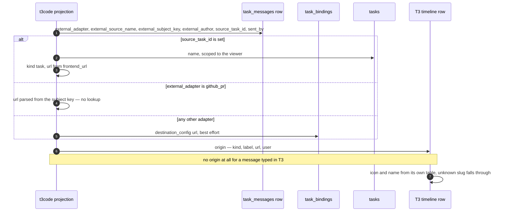
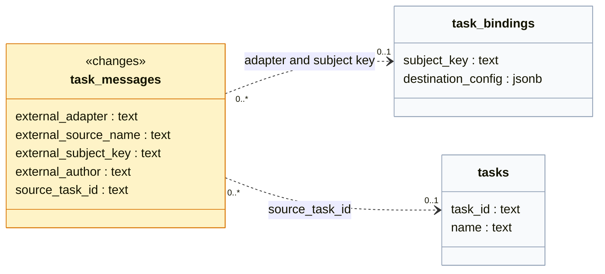

# Show where a message came from, in the T3 thread view

> **Status:** approved
> **Updated:** 2026-08-02
> **Vocabulary:** CONTEXT.md

## Current solution

A message that reached a Task from Slack, from a pull request, from Linear, or from another Task is
projected to the T3 client as `role: "user"` and nothing else — the same eight fields a message typed
into T3's own composer carries. The provenance exists on the row and is dropped one layer below the
projection, in a `SELECT` list.

This spec spans two repositories. Unprefixed paths are `soaplabs/moatless`; paths prefixed `t3code/`
are `soaplabs/t3code`. Both are ours.

### Anchors

| Anchor | What it does today |
|---|---|
| `crates/t3code/src/dao.rs:105` | `TranscriptMessage` — nine fields, no provenance |
| `crates/t3code/src/dao.rs:824` | The transcript `SELECT` list. **The gap.** |
| `crates/t3code/src/dao.rs:912` | `changed_messages` — the same `SELECT` list, for live deltas. **The gap.** |
| `crates/t3code/src/projection.rs:724` | `message_bubble` — matches on `MessageType`, picks one of three roles |
| `crates/t3code/src/projection.rs:818` | `message_row` — the seven-key JSON object that is a bubble |
| `crates/t3code/src/projection.rs:526` | `message_sent_payload` — the live event, rewritten from the bubble rather than re-derived |
| `crates/t3code/src/projection.rs:2258` | The test asserting the bubble's exact field set; `MESSAGE_ROLES` at `:2266` |
| `crates/t3code/src/lib.rs:365` | `UiRpcDependencies` — the injection seam; `session_cookie_name` at `:367` is the precedent for a scalar config value |
| `backend/src/main.rs:479` | The one construction site of `UiRpcDependencies` |
| `backend/src/config.rs:558` | `frontend_url`, defaulted at `:1203` from `FRONTEND_URL` |
| `t3code/packages/contracts/src/orchestration.ts:229` | `OrchestrationMessage` — id, role, text, attachments, turnId, streaming, createdAt, updatedAt |
| `t3code/packages/contracts/src/orchestration.ts:375` | `snoozedUntil` — the convention for a field older servers do not send |
| `t3code/apps/web/src/components/chat/MessagesTimeline.tsx:860` | The row fork: `user` and `assistant` only |
| `t3code/apps/web/src/components/chat/MessagesTimeline.tsx:870` | `UserTimelineRow` |
| `t3code/apps/web/src/components/chat/MessagesTimeline.tsx:934` | The element-context chip strip, immediately above the body — where the origin chip goes |
| `t3code/apps/web/src/components/chat/MessagesTimeline.tsx:1416` | `CollapsibleUserMessageBody`, which also takes a `footer` node |
| `t3code/apps/web/src/components/chat/MessagesTimeline.tsx:566` | `deriveTimelineMinimapItems` — one minimap tick per `user` message |
| `t3code/apps/web/src/components/chat/MessagesTimeline.logic.ts:305` | `deriveTurnFolds` — a `user` message is skipped as an entry and carried forward as the turn's start boundary |
| `t3code/apps/web/src/components/chat/MessagesTimeline.logic.ts:185` | `computeMessageDurationStart` — every `user` message resets the boundary; the `durationStart` it produces is not read by any component today |
| `t3code/apps/web/src/types.ts:40` | `ChatMessage extends Omit<OrchestrationMessage, "attachments">` — the client type follows the contract automatically |
| `t3code/apps/mobile/src/features/threads/ThreadFeed.tsx:884` | The mobile fork on `role`, same two branches |
| `backend/src/adapters/models.rs:317` | `InboundMessage` — `user_id` at `:327` is the *resolved moatless* user, not the author |
| `backend/src/message/send.rs:60` | `send_message_flow` — eighteen positional arguments, five of them external provenance |
| `backend/src/message/dao.rs:503` | The `task_messages` insert column list |
| `backend/src/message/models.rs:95` | `TaskMessage.external_source_name`; `source_task_id` at `:96` |
| `backend/src/bindings/runtime.rs:756` | Inbound persist for Slack, Telegram, Linear, Webhook |
| `backend/src/adapters/providers/github_pr/routing.rs:621` | Inbound persist for GitHub PR |
| `backend/src/adapters/providers/github_pr/webhook.rs:670` | `inbound_message` — `context.sender_login` is in scope and discarded |
| `backend/src/adapters/providers/github_pr/text.rs:76` | `issue_comment_text` — where that login goes instead |
| `backend/src/adapters/providers/github_pr/subject.rs:107` | `key()` → `owner/repo#42` |
| `backend/src/adapters/providers/slack/auth.rs:19` | `SenderIdentity` — carries `handle` on `Rejected` only |
| `backend/src/adapters/providers/slack/webhook.rs:377` | Where `SenderIdentity` is consumed and the handle is dropped |
| `backend/src/adapters/providers/slack/subject.rs:64` | `subject_key` → `team:channel:thread_ts` |
| `backend/src/adapters/providers/telegram/webhook.rs:282` | Telegram's `InboundMessage` construction |
| `backend/src/adapters/providers/linear/comments.rs:123` | Linear's comment ingress |
| `backend/src/adapters/providers/linear/adapter.rs:295` | Where the Linear issue `url` and `identifier` are written to `destination_config` |
| `crates/adapter-webhook/src/adapter.rs:194` | The Webhook Adapter's `InboundMessage` |
| `backend/migrations/0052_external_message_metadata.sql` | The provenance columns' current names |
| `backend/migrations/0063_external_subject_key.sql:1` | `external_subject_key` |
| `backend/migrations/0051_integrations_triggers_bindings.sql:295` | `task_bindings_task_subject_idx` on `(task_id, adapter_kind, subject_kind, subject_key)` |
| `crates/cli/src/commands/send.rs:92` | `moat send --task <id>` — the only writer of `source_task_id` |
| `backend/src/message/handlers.rs:63` | The HTTP path that carries it through |
| `backend/src/message/enricher.rs:266` | `<message_id>` / `<source>` / `<sent_by>` headers, built at delivery — never stored |
| `apps/frontend/src/features/tasks/components/chat/message-history/message-history.tsx:437` | The Moatless frontend's variant fork — the prior art |
| `apps/frontend/src/features/tasks/components/chat/message-history/external-source-meta.tsx` | `getAdapterIcon` / `getAdapterLabel` — the tables T3 gets its own version of |
| `backend/src/message/transform.rs:474` | `external_source` on the Moatless payload; `format_external_label` at `:684` |

### What research turned up that the code does not say

**`sent_by` is not who sent it, and how wrong it is depends on the adapter.** Every adapter resolves
its external sender to a *moatless* user and falls back to the subscription's owner. Nothing on the
row records that the fallback happened.

| Adapter | Resolves by | When it fails |
|---|---|---|
| Slack | Cached Slack id (`user_provider_ids`), then email | A top-level message from an unmapped human is **rejected** — `slack/webhook.rs:437` posts a notice and returns `Ignored { reason: "user_not_mapped" }`, so no row is ever written. Only thread replies (`:425`) and permitted foreign bots (`:414`) fall back. |
| GitHub PR | A `provider_tokens` row for that GitHub login — `github_pr/auth.rs:227` | Silently attributes to the rule owner (`:224`). Any reviewer who has not signed into Moatless with GitHub, and every bot, lands here. |
| Linear | A `provider_tokens` row for that Linear login — `linear/auth.rs:186` | The doc comment above it says it: *"most issue commenters have never signed into Moatless"*. |
| Telegram | A `provider_tokens` row for that Telegram id — `telegram/auth.rs:16` | Same shape as Linear. |

**The author each adapter does hold is thrown away after being formatted into the body.** GitHub PR
composes `**@alice** commented on #42 (comment id: 123456):` (`github_pr/text.rs:76`); Slack fetches
`SlackUserInfo.handle` and uses it only on the reject path; Linear has the actor. None of it is
stored in a column.

**There are two kinds of external message and they arrive through different doors.** Adapter-
originated messages come through `route_inbound_message` (`bindings/runtime.rs:143`) and carry
`external_adapter`, `external_subject_key` and `external_event_id`. Task-originated messages come
from `moat send --task <id>` inside a sandbox (`crates/cli/src/commands/send.rs:92`) through the HTTP
send path, and carry only `source_task_id` — no adapter, no subject key, no external event id. The
`source_task_id` field on `InboundMessage` is a *different* thing: it is provenance recovered from a
`Moatless task:` footer, used to skip delivery back to the authoring task, and both inbound persist
sites pass `None` for the column (`bindings/runtime.rs:779`, `github_pr/routing.rs:634`).

**Slack has no permalink anywhere.** `chat.getPermalink` is never called, and `subject_key` is
`team:channel:thread_ts` — a team *id*, not the workspace domain a permalink needs.

**The Linear URL is on the Binding, not the message.** `linear/adapter.rs:295-313` writes `url` and
`issue_identifier` into `destination_config` when the issue Binding is created. Session Bindings
(`SUBJECT_KIND_SESSION`) may carry neither, so the lookup is best-effort by construction.

**T3 has no adapter vocabulary at all.** No `slack`, `telegram`, `linear` or `github_pr` string
appears in `t3code/apps/web/src/components/chat/` or `ChatView.tsx`.

**A `system`-role message is projected and never drawn.** `message_bubble` emits `system` for a run's
closing line and for the elision notice; `TimelineRowContent` (`MessagesTimeline.tsx:840`) has no
`system` branch, so the row renders as an empty `pb-4` div. This is a live bug and is out of scope
here — see below — but an implementer who routes anything through `system` will find it invisible.

**A `user` bubble is load-bearing beyond its own row**: it is one minimap tick
(`MessagesTimeline.tsx:566`), and it is where a turn's "Worked for …" duration starts —
`deriveTurnFolds` carries the preceding user message forward as `pendingUserBoundary`
(`MessagesTimeline.logic.ts:305`, consumed at `:326`) because entry timestamps alone undercount.
`computeMessageDurationStart` (`:185`) derives a per-row `durationStart` from the same boundary, but
nothing under `apps/web/src/components/chat/` reads that field today. The revert affordance
(`MessagesTimeline.tsx:970`) is inert on a Moatless thread: it is gated on
`revertTurnCountByUserMessageId` (`ChatView.tsx:2418`), which is built from checkpoints, and the
projection emits `checkpoints: []` unconditionally (`crates/t3code/src/projection.rs:304`). This
change keeps external messages in the `user` role so the minimap and the fold boundary keep working.

**The two client projections are separate code.** `backend/src/message/transform.rs` builds the
Moatless frontend's `UiMessage`; `crates/t3code/src/projection.rs` builds T3's. They read the same
columns and share nothing. Changing one does not change the other.

**`#` breaks Mermaid labels.** `owner/repo#42` inside a `sequenceDiagram` message renders as
`owner/repo` with the `#42` silently eaten. Relevant only to anyone redrawing the diagrams below.

## Planned solution

**New**

- `task_messages.external_author` — the handle the external system knows the writer by.
- `OrchestrationMessage.origin` on the wire — `kind`, `label`, `url`, `user`.
- An origin chip in T3's user bubble, and the adapter icon/name table behind it.
- `UiRpcDependencies.frontend_url`, so the projection can build a Task URL.

**Changes materially**

- `crates/t3code/src/dao.rs` — both `SELECT` lists widen, and gain a `LEFT JOIN` on `task_bindings`.
- `crates/t3code/src/projection.rs` — `message_row` gains a field; a new origin assembler.
- Five adapter ingress paths — each records the author it already holds.
- `backend/src/message/send.rs` and `backend/src/message/dao.rs` — one more value carried and written.
- `t3code/apps/web/src/components/chat/MessagesTimeline.tsx` — `UserTimelineRow` renders the chip.

**Untouched**

- The bubble's side, shape and colour. An external message stays the person's right-aligned bubble.
- The minimap tick and the turn's fold start boundary, both keyed off `user` messages.
- What the agent is sent. `message/enricher.rs` is unchanged; provenance stays a display concern.
- What adapters store elsewhere and the text they compose into the body.
- The Moatless frontend's chat view, and `backend/src/message/transform.rs`.
- Activities, proposed plans, checkpoints, the work log, and the shell listing.
- Assistant messages. `origin` is null on every one of them.
- The T3 mobile app's rendering. It decodes the new field and ignores it.

### Problem

Someone reading a Moatless thread in T3 sees their own messages and messages nobody in that room
wrote, drawn identically. The turn that starts "fix the flaky test" may have been typed by them in
the composer, said by a colleague in Slack, left as a review comment on a pull request, or written by
another Task's agent — and the thread gives them nothing to tell those apart with. The information
exists, on the row, four columns wide, and the Moatless frontend has rendered it for two years.

### Behaviour

Actor: a person reading a Moatless thread in the T3 web client.

| # | Given | When | Then |
|---|---|---|---|
| 1 | A message with `external_adapter = "github_pr"` | the thread renders | the bubble carries a chip: a pull-request icon, "GitHub PR", the repository and PR number, the commenter's GitHub login, and a link to the comment |
| 2 | A message with `external_adapter = "slack"` | the thread renders | the chip carries a channel icon, "Slack", the channel name, and the author where one was recorded — and no link |
| 3 | A message with `external_adapter = "linear"` and a live issue Binding | the thread renders | the chip links to the Linear issue |
| 4 | A message with `external_adapter = "linear"` whose Binding has been deleted | the thread renders | the same chip, without a link |
| 5 | A message with `source_task_id` set | the thread renders | the chip names that Task and links to it in the Moatless UI |
| 6 | A message with `source_task_id` naming a Task the viewer cannot read | the thread renders | the chip says the message came from a task, and carries neither name nor link |
| 7 | A message with an adapter slug T3 does not know | the thread renders | a generic icon and the raw slug, rather than a failure to render |
| 8 | A message typed in T3's composer | the thread renders | no chip; the bubble is byte-identical to today |
| 9 | Any assistant message | the thread renders | no chip |
| 10 | An external message arriving while the thread is open | the delta lands | the chip is present on the first frame, identical to a reload |
| 11 | A message row written before this change shipped | the thread renders | the chip renders without an author; every other part is present |

Actor: a T3 client older than the backend, or newer.

| # | Given | When | Then |
|---|---|---|---|
| 12 | A client that predates `origin` | it decodes a thread | decoding succeeds and the field is ignored |
| 13 | A client that expects `origin` against a backend that does not send it | it renders a thread | no chip on any message; nothing throws |

### Architecture and key flows

#### `backend/src/adapters/providers/*`

- **Observed** — each adapter builds an `InboundMessage` (`adapters/models.rs:317`) whose `user_id`
  is the *resolved moatless* user. The external author is formatted into `text` and discarded.
- **Proposed responsibility** — record the author the external system knows, verbatim, alongside the
  resolved user rather than instead of it.
- **Proposed change** — `InboundMessage` gains `author: Option<String>`, set at each construction
  site. Slack's `SenderIdentity` (`slack/auth.rs:19`) gains the handle on its `Mapped` and `Unmapped`
  variants, which today carry it only on `Rejected`.
- **Evidence** — `github_pr/webhook.rs:679` already has `context.sender_login` in scope;
  `slack/auth.rs:49` already fetches `SlackUserInfo` and reads `info.handle` at `:60`;
  `telegram/webhook.rs:282`; `linear/comments.rs:123`. The Webhook Adapter
  (`webhook/adapter.rs:193`) has no author and passes `None`.

#### `backend/src/message/send.rs`

- **Observed** — `send_message_flow` takes eighteen positional arguments, five of which are external
  provenance (`external_event_id`, `external_adapter`, `external_subject_key`,
  `external_source_name`, `source_task_id`), under `#[allow(clippy::too_many_arguments)]`.
- **Proposed responsibility** — unchanged; it carries one more provenance value to the DAO.
- **Proposed change** — a nineteenth positional argument is the wrong answer. Group the five existing
  provenance arguments plus the new author into an `ExternalOrigin` struct in this module and pass
  one value. This is an internal interface, not a promise — see below.
- **Evidence** — twelve call sites, listed by `rg 'send_message_flow\('`; nine of them pass `None`
  for every provenance argument.

#### `crates/t3code/src/dao.rs`

- **Observed** — two `SELECT` lists (`:824`, `:912`) read nine columns from `task_messages` and no
  other table. `Transcript` (`:128`) is what the projection sees.
- **Proposed responsibility** — carry provenance out of the database, including the one piece that
  lives on a neighbouring table.
- **Proposed change** — both lists gain `external_adapter`, `external_source_name`,
  `external_subject_key`, `external_author`, `source_task_id`, `sent_by`. Both gain a `LEFT JOIN
  LATERAL` on `task_bindings` yielding `destination_config->>'url'` as `binding_url`.
  `TranscriptMessage` gains the matching fields.
- **Evidence** — `task_bindings_task_subject_idx` on `(task_id, adapter_kind, subject_kind,
  subject_key)` covers the join's leading columns
  (`backend/migrations/0051_integrations_triggers_bindings.sql:295`). The transcript query already
  sets a statement timeout (`dao.rs:587`).

The join omits `subject_kind`, which the message does not carry, so it is not unique by index. Use
`LEFT JOIN LATERAL (… ORDER BY created_at DESC LIMIT 1)` so the result is deterministic rather than
whichever row the planner returns first.

#### `crates/t3code/src/projection.rs`

- **Observed** — `message_row` (`:818`) emits seven keys; `message_bubble` (`:724`) chooses the role;
  `message_sent_payload` (`:526`) rewrites the bubble into the live event's key names.
- **Proposed responsibility** — assemble one origin from four sources: the message row, the joined
  Binding, the `tasks` table, and the deployment's frontend URL.
- **Proposed change** — a new `message_origin(message, conversation, frontend_url) -> Option<Value>`;
  `message_row` emits `origin` when it is `Some` and omits the key otherwise;
  `message_sent_payload` copies `bubble["origin"]` the same way it copies the other seven.
- **Evidence** — the field-set test at `:2258` enumerates the bubble's keys and must be extended in
  the same change.

Origin assembly, in order — the first arm that matches wins:

| Condition | `kind` | `label` | `url` | `user` |
|---|---|---|---|---|
| `source_task_id` is set | `"task"` | the Task's `name`, else `None` | `{frontend_url}/tasks/{source_task_id}` | `None` |
| `external_adapter = "github_pr"` | `"github_pr"` | `external_subject_key`, else `external_source_name` | derived — see below | `external_author`, else the display name of `sent_by` |
| `external_adapter` is anything else | the slug | `external_source_name` | `binding_url` from the join | `external_author`, else the display name of `sent_by` |
| none of the above | — | — | — | `None` — emit no `origin` at all |

GitHub PR URL derivation, from `external_subject_key` of the form `owner/repo#N`:

- base: `https://github.com/{owner}/{repo}/pull/{N}`
- with `external_event_id = github:ic:{id}` → append `#issuecomment-{id}`
- with `external_event_id = github:rc:{id}` → append `#discussion_r{id}`
- anything else, or a subject key that does not parse → the base URL

Hard-coding `github.com` is correct here and not elsewhere: the GitHub PR Adapter is GitHub-only, and
its subject key carries no host. A GitLab or Gitness Adapter would be a different `kind` with its own
arm.

The `tasks` lookup for a task-origin label is a second query, batched once per transcript over the
distinct `source_task_id` values, scoped through the viewer's `ScopeContext` — the same read
`T3TaskDao` already performs. A Task the viewer cannot read yields no label and no URL (behaviour 6);
it must not yield a link that 404s or a name they are not entitled to.

#### `crates/t3code/src/lib.rs`

- **Observed** — `UiRpcDependencies` (`:365`) carries scalar configuration alongside its `Arc<dyn …>`
  ports; `session_cookie_name` (`:367`) is one.
- **Proposed responsibility** — unchanged.
- **Proposed change** — gains `frontend_url: String`, populated at `backend/src/main.rs:479` from
  `config.frontend_url`.
- **Evidence** — `backend/src/config.rs:558`, defaulted from `FRONTEND_URL` at `:1203`.

#### `t3code/packages/contracts/src/orchestration.ts`

- **Observed** — `OrchestrationMessage` (`:229`) is a closed eight-field struct.
- **Proposed responsibility** — unchanged.
- **Proposed change** — a new `OrchestrationMessageOrigin` struct and an optional nullable `origin`
  field, following the `snoozedUntil` convention at `:375`.
- **Evidence** — `t3code/apps/web/src/types.ts:40` derives `ChatMessage` from this type, so the
  client type follows with no edit.

#### `t3code/apps/web/src/components/chat/`

- **Observed** — `UserTimelineRow` (`MessagesTimeline.tsx:870`) renders attachment images, preview
  annotations, an element-context chip strip (`:934`), then `CollapsibleUserMessageBody`.
- **Proposed responsibility** — rendering the chip, and owning the mapping from an adapter slug to an
  icon and a display name.
- **Proposed change** — a new `messageOrigin.ts` beside `MessagesTimeline.logic.ts` holding
  `resolveOriginPresentation(origin)`; a `MessageOriginChip` component rendered immediately above the
  element-context strip, inside the bubble.
- **Evidence** — the chip strip at `:934` is the established position for per-message metadata inside
  the bubble; `apps/frontend/…/external-source-meta.tsx` is the icon and label table to port,
  including its `default` arms.

The chip goes *above* the body rather than in `CollapsibleUserMessageBody`'s `footer` slot: the footer
sits below a collapsed body and behind the fade mask, so on a long PR comment the attribution would
be the last thing read rather than the first.

#### Key flow — assembling one origin

The other flow, named and not drawn: a message arriving live travels `changed_messages` →
`message_bubble` → `message_sent_payload`, so the snapshot and the delta produce one shape or neither
does. That is the whole reason `message_sent_payload` rewrites the bubble instead of re-deriving it
(`projection.rs:521`), and the reason the second `SELECT` list must be widened in the same change.

### Data model

Both edges are dotted because neither is a foreign key and neither becomes one — a Binding can be
deleted while the messages it explained remain, and a Task can be referenced across a visibility
boundary. `task_bindings` contributes `destination_config->>'url'`; `tasks` contributes `name`.

#### `task_messages`

One message in a Task's transcript, identified by `uuid`. One column is added; five existing ones are
read where they were previously ignored.

| Column | Type | Null | What it holds |
|---|---|---|---|
| `external_author` | text | nullable | **New.** The handle the external system knows the writer by — a GitHub login, a Slack display name, a Linear actor. Not a moatless identity, and never resolved to one. Null on every row written before this ships, and not backfillable: nothing retains the value |
| `external_adapter` | text | nullable | **Newly read.** Becomes the origin's `kind` |
| `external_source_name` | text | nullable | **Newly read.** Becomes the origin's `label` for every adapter but GitHub PR |
| `external_subject_key` | text | nullable | **Newly read.** `owner/repo#N` yields a pull-request URL outright; otherwise the join key to the Binding |
| `source_task_id` | text | nullable | **Newly read.** Present means `kind` is `task`, and wins over `external_adapter` |
| `sent_by` | text | nullable | Read, unchanged. The fallback for `user` only where no `external_author` was recorded |

Migration: `backend/migrations/0127_message_external_author.sql`, a single
`ALTER TABLE task_messages ADD COLUMN external_author TEXT;`. No index — the column is read by row,
never searched.

#### `OrchestrationMessage.origin`

The wire shape, new in its entirety. Optional and nullable, so a client older than the server decodes.

| Field | Type | What it holds |
|---|---|---|
| `kind` | `TrimmedNonEmptyString` | An adapter slug, or `task` |
| `label` | nullable string | The channel, repository, issue or Task name a reader recognises |
| `url` | nullable string | Where to open the thing |
| `user` | nullable string | Who wrote it, in the external system's own words |

`kind` is a free string rather than a `Schema.Literals` union, deliberately: a deployment that adds an
Adapter should degrade to a generic icon in an older client, not fail to decode the whole thread.
`OrchestrationMessageRole` next to it *is* a closed union because clients switch on it exhaustively
and there is no fourth role coming; `kind` has the opposite property.

`url` and `user` are null often enough that the client must treat null as ordinary — three of the six
origins have no URL under this plan.

### Interfaces and contracts

**External contract.**

| Consumer | The interface it depends on | What it can rely on | Status |
|---|---|---|---|
| `t3code/apps/web` timeline | `OrchestrationMessage.origin` — `t3code/packages/contracts/src/orchestration.ts:229` | Present on a message that arrived from outside T3, absent otherwise. Every field but `kind` may be null; `kind` is never empty | **New** |
| `t3code/apps/mobile` `ThreadFeed` | The same field — `ThreadFeed.tsx:884` | Decodes and is ignored. Nothing it renders today changes | Unchanged |
| `apps/frontend` conversation view | `UiMessage.externalSource` and `UiMessage.sourceTaskId` — `backend/src/message/transform.rs:474`, `:576` | Exactly what they carry today. `external_author` is not surfaced there by this change | Unchanged |
| The agent in the Sandbox | The delivered message text — `backend/src/message/enricher.rs:266` | The same `<message_id>` / `<source>` / `<sent_by>` headers and the same body | Unchanged |
| `moat send --task <id>` | `SendMessageRequest.source_task_id` — `crates/api-schemas/src/message.rs:63` | Same field, same meaning. It now also drives a chip | Changed, compatibly |

Ship order: t3code first, backend second. The contract field is optional on decode and the client
renders nothing without it, so a backend that already sends `origin` to a client that does not know
it would also be harmless — but the stated order needs no argument.

**Internal interfaces.** These are implementation boundaries, not promises, and may be changed later
without a spec update:

- `ExternalOrigin` in `backend/src/message/send.rs`, grouping the six provenance values.
- `InboundMessage.author` in `backend/src/adapters/models.rs`.
- `SenderIdentity::Mapped { user_id, handle }` and `Unmapped { is_bot, email, handle }` in
  `backend/src/adapters/providers/slack/auth.rs`.
- `TranscriptMessage`'s new fields and `binding_url` in `crates/t3code/src/dao.rs`.
- `message_origin` in `crates/t3code/src/projection.rs`.
- `resolveOriginPresentation` in `t3code/apps/web/src/components/chat/messageOrigin.ts`.

`InboundMessage` is serialized into `adapter_delivery` payloads and executed later by the
`adapter-delivery-worker`, so a record written by the old build is executed by the new one during a
rolling deploy. `author` must therefore be `#[serde(default)]`, exactly as `audience` is
(`adapters/models.rs:352`).

### Failure, safety and recovery

Nothing here is a write path on the read side, and the write side adds one nullable column to an
insert that already happens. There is no partial state to recover from and no new retry to make safe.

| Condition | State before | State after | What the reader sees | Retry safe |
|---|---|---|---|---|
| The Binding a Linear message named has been deleted | row present, Binding gone | unchanged | The chip, with a label and no link | n/a — read only |
| The Binding is a session Binding with no `url` in `destination_config` | row present | unchanged | The chip, with a label and no link | n/a |
| `external_subject_key` does not parse as `owner/repo#N` | row present | unchanged | The chip, with the raw subject key as the label and no link | n/a |
| The Task named by `source_task_id` is deleted, or outside the viewer's scope | row present | unchanged | "from a task", with neither name nor link | n/a |
| A row predates the migration | row present, `external_author` null | unchanged | Everything except the author | n/a |
| The `tasks` batch lookup fails | row present | unchanged | Log at `warn`, emit the origin without a label or URL. A failed lookup must never drop the whole message | n/a |
| The Binding join times out | — | — | The statement timeout already on the transcript query applies; the request fails as it does today for any transcript read | Yes, idempotent |
| T3 newer than the backend | — | — | No chip on any message | n/a |
| T3 older than the backend | — | — | The field decodes and is ignored | n/a |
| An adapter recorded an author that is a bot | row present | unchanged | The handle verbatim. It is not resolved, hidden or annotated | n/a |

**What stays available while a dependency is down.** The Binding and Task lookups are both inside the
same database as the transcript; there is no new external dependency and no new failure domain. A
`frontend_url` that is unset falls back to the config default (`http://localhost:3000`,
`config.rs:1203`), which produces a wrong-looking but harmless link in a misconfigured deployment —
the same exposure the adapters' `Moatless task:` footers already carry.

**Rollback.** Rolling the backend back leaves `external_author` populated and unread. Rolling t3code
back leaves `origin` sent and ignored. The migration is additive and is not reversed on rollback.

**Security.** `external_author` is attacker-controlled text — a GitHub display name, a Slack handle.
It is rendered by React as a text node, never as markdown or HTML, and never used to build a URL. The
Task label and URL are gated on the viewer's `ScopeContext`; a `source_task_id` naming a Task outside
it yields neither.

### Testing and verification

**Rust, `cargo test -p moatless-vibe-backend`** (dev profile; the first run in a fresh sandbox is a
cold codegen of the whole graph, several minutes):

- `crates/t3code/src/projection.rs` test module — extend the field-set assertion at `:2258` to
  include `origin`; add cases for each arm of the assembly table, for a message with no provenance
  (no `origin` key at all), and for `message_sent_payload` carrying it. Assert field-for-field
  against `t3code/packages/contracts/src/orchestration.ts`, as the module's existing tests do.
- New unit tests for GitHub PR URL derivation: `soaplabs/repo#42` with `github:ic:1`, with
  `github:rc:1`, with neither, and with a subject key that does not parse.
- `#[sqlx::test]` over the widened `transcript` and `changed_messages` queries — a Linear message with
  a live Binding, one whose Binding was deleted, and one with two Bindings of different subject kinds,
  asserting the lateral join picks deterministically.
- Adapter webhook tests already assert `InboundMessage` fields
  (`github_pr/webhook_tests.rs:113`, `slack/ingress.rs:1150`, `telegram/webhook.rs`) — extend each to
  assert `author`. Add a Slack case where the sender is `Unmapped` and the handle is still recorded.
- `backend/src/adapters/inbound_delivery.rs:288` round-trips a persisted `InboundMessage`; extend it
  so the `#[serde(default)]` on `author` is exercised against a payload written without it.

**Lint, `cargo clippy -p moatless-vibe-backend -- -D warnings`.** `send_message_flow` already carries
`#[allow(clippy::too_many_arguments)]`; the `ExternalOrigin` grouping should let that allow be
removed, and removing it is the check that the grouping was worth doing.

**TypeScript, in `t3code/`** — `pnpm test` per that repo's `AGENTS.md`:

- `messageOrigin.test.ts` — the icon and name table, including the unknown-slug default arm and the
  `task` arm; null `label`, null `url`, null `user` each rendering without a crash.
- A `MessagesTimeline.test.tsx` case per behaviour row 1, 2, 5, 7, 8 and 9, asserting on the chip's
  presence, its text, and the absence of an anchor where `url` is null.
- Contract decode tests: a message payload with no `origin` key, with `origin: null`, and with an
  `origin` whose `label`, `url` and `user` are all null.

**Manual verification**, using the `t3-development` skill's harness — the shadow backend on `:8080`,
T3's Vite server on `:5733`, reached through the preview URL, never `localhost:5733`:

1. `bash scripts/shadow/rebuild.sh`, then `curl -s http://localhost:8080/health`.
2. Bind a task to a pull request, comment on it as a GitHub user with no moatless account, and
   confirm the chip shows that login and links to the comment.
3. Send a message from another task with `moat send --task <id>` and confirm the task chip.
4. Type a message in the T3 composer and confirm the bubble is unchanged.
5. With the thread open, post a Slack message into the bound thread and confirm the chip appears on
   the delta without a reload.
6. `node .agents/skills/t3-development/references/rpc.mjs orchestration.subscribeThread
   "{\"threadId\":\"$THREAD_ID\"}" --stream` and confirm the reported frame size has not grown
   materially — the origin is a handful of short strings per message and must not push a busy thread's
   snapshot into a new size class.

**Acceptance criteria.**

- **Given** a pull-request comment written by someone with no Moatless account, **when** the thread is
  opened in T3, **then** the bubble shows the GitHub PR icon, the repository and PR number, that
  person's GitHub login, and a link that opens the comment.
- **Given** a Slack message, **when** the thread is opened, **then** the bubble shows the Slack icon
  and the channel name, and no link.
- **Given** a message from another Task, **when** the thread is opened, **then** the bubble names that
  Task and links to it.
- **Given** a message typed in T3, **when** the thread is opened, **then** the bubble renders exactly
  as it does today.
- **Given** an external message arriving live, **when** it lands, **then** its chip is identical to
  the one a reload produces.

## Out of scope

- **The outbound direction.** An assistant message the agent posted to Slack or a pull request carries
  no chip. The claim is recorded in two places — on the message row (`bindings/reply.rs:208`) and, for
  a turn that wrote no message, on the activity (`message/transform.rs:305`,
  `github_pr/shell_reconcile.rs:544`) — and covering both roughly doubles the change for a half the
  reader can already infer from the work log.
- **The empty `system` row.** `TimelineRowContent` (`t3code/apps/web/src/components/chat/MessagesTimeline.tsx:840`)
  has no `system` branch, so the elision notice and a run's closing line render as blank padded divs.
  A real bug, one branch to fix, and unrelated to provenance. Its own ticket.
- **Slack permalinks.** `chat.getPermalink` would give Slack messages a URL at one API call per
  inbound message. Not taken on here.
- **`external_author` in the Moatless frontend.** `apps/frontend` keeps reading the attribution line
  the adapters compose into the body, so the two apps will disagree about the author until someone
  closes that.
- **The T3 mobile app's rendering.** It decodes `origin` and ignores it.
- **Backfilling `external_author` on existing rows.** Nothing retains the value; the column stays null
  for every message written before this ships.
- **Changing what adapters compose into the message body.** The GitHub PR prefix and the Slack sender
  label stay exactly as they are, which means the author is briefly shown twice on those two adapters.
  Removing the prefix changes what the agent reads and is a separate decision.
- **Restyling the external bubble.** It stays the person's right-aligned bubble, which is what keeps
  the minimap tick and the turn's fold start boundary working unchanged.
