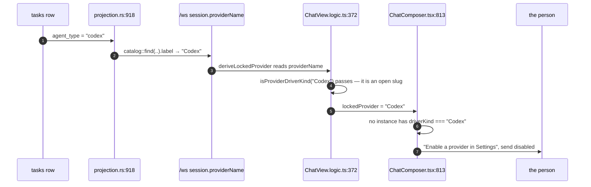
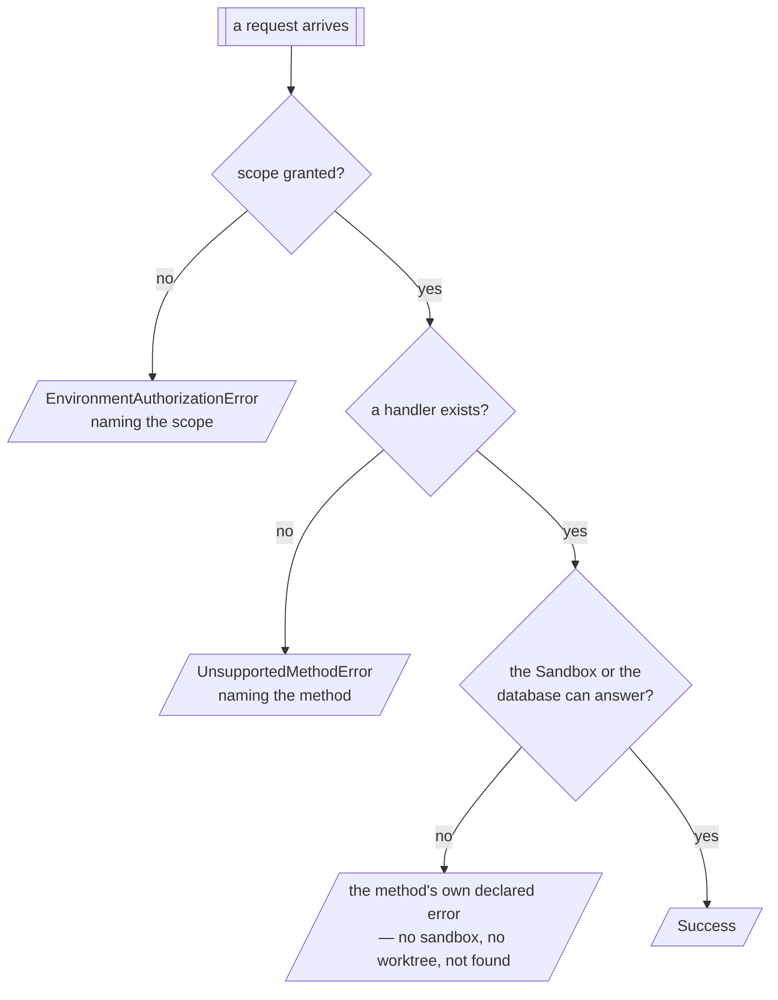

# T3 RPC compliance — closing the gaps in `ui_rpc`

> **Status:** approved
> **Updated:** 2026-08-01
> **Vocabulary:** CONTEXT.md

After this ships, a person opening a Codex conversation in T3 Code can type in the composer — and every
method the client can still reach either answers or refuses in words the panel can render, instead of
arriving as *unexpected server error*.

This change spans two repositories. The bulk of it is `backend/src/ui_rpc/` in this one. Three edits land
in `t3code`: a new error type added to every RPC's declared error union in `packages/contracts`, the
switch that maps it in `client-runtime`, and one flag split in the fork's feature register.

## Current solution

`backend/src/ui_rpc` is an anti-corruption layer: it answers T3 Code's contract from Moatless rows, and it
is the only place T3 vocabulary is allowed to appear. Its *shapes* are sound — every payload captured on
the wire during the audit decoded cleanly against the real Effect schemas, including a 1.09 MB thread
snapshot. What is wrong is **semantic**: one field carries the wrong kind of value, and refusals arrive in
a form no panel can render.

### The trace that disables the composer



`"Claude Code (CLI)"` escapes this only by accident: spaces and parentheses fail the slug pattern at
`t3code/packages/contracts/src/providerInstance.ts:40`, so the lock falls through and the composer works.
The reference server puts a *driver kind* in this field and decodes it as one
(`t3code/apps/server/src/provider/Layers/ProviderSessionDirectory.ts:27`), and the provider list Moatless
itself publishes already uses the slugs `claudeAgent` / `codex` (`backend/src/ui_rpc/providers.rs:248`).
Reproduced on six conversations across four projects.

### Anchors — every place this change lands

| Anchor | What it does today |
|---|---|
| `backend/src/ui_rpc/projection.rs:918` | `session()` — sets `providerName` from `catalog::find(..).label`, the display label |
| `backend/src/ui_rpc/projection.rs:1069` | `provider_instance()` — already returns the driver slug, for `providerInstanceId` |
| `backend/src/ui_rpc/mod.rs:1425` | `handle_request` — the whole dispatch table, one `match tag.as_str()` |
| `backend/src/ui_rpc/mod.rs:1894` | The silent-stream fallthrough for three `subscribe*` tags |
| `backend/src/ui_rpc/mod.rs:1897` | `_ => vec![unsupported_exit(&id, &tag)]` — the dispatch fallthrough |
| `backend/src/ui_rpc/mod.rs:2309` | `failure_exit` — builds a `Die` cause from a string |
| `backend/src/ui_rpc/mod.rs:2328` | `typed_failure_exit` — builds a `Fail` cause, and argues the distinction in its doc comment |
| `backend/src/ui_rpc/mod.rs:2422` | `review_failure_exit` — emits `cwd: ""` and `command: "git"` |
| `backend/src/ui_rpc/mod.rs:2481` | `servers_failure_exit` — `ServersError::NotFound` becomes a `Die` |
| `backend/src/ui_rpc/mod.rs:2494` | `unsupported_exit` — the one refusal every unimplemented method takes |
| `backend/src/ui_rpc/mod.rs:2240` | `"scopes": auth::GRANTED_SCOPES` — the only place granted scopes are read |
| `backend/src/ui_rpc/auth.rs:36` | `GRANTED_SCOPES: [&str; 3]` |
| `backend/src/ui_rpc/auth.rs:43` | `KNOWN_SCOPES: [&str; 8]` |
| `backend/src/ui_rpc/auth.rs:177` | `granted_scopes()` — intersects request with grant |
| `backend/src/ui_rpc/files.rs:46` | `list_entries` — the model the two new file methods follow |
| `backend/src/ui_rpc/workspace.rs` | `addressed_conversation` — re-applies follow-and-access to a client `cwd` |
| `backend/src/ui_rpc/review.rs:329` | `status()` — already reads `GetGitStatus` and projects it |
| `backend/src/ui_rpc/review.rs:355` | `status_snapshot()` — the tagged stream event shape |
| `backend/src/ui_rpc/dao.rs:154` | `trait ConversationDao` — where a search method is added |
| `backend/src/ui_rpc/dao.rs:312` | `PgConversationDao::list` — the follow-and-access listing query to copy the filter from |
| `backend/src/sandbox/client.rs:252` | `write_file` — already on the client, unused by `ui_rpc` |
| `backend/src/sandbox/client.rs:418` | `search_files_by_name` — same |
| `t3code/packages/contracts/src/rpc.ts` | 82 `Rpc.make` declarations; 57 union errors, 25 bare `EnvironmentAuthorizationError` |
| `t3code/apps/web/src/fork/features.ts` | The fork's register of surfaces it hides; 8 flags, all `false` |
| `t3code/apps/server/src/auth/RpcAuthorization.ts:23` | `RPC_REQUIRED_SCOPES` — the per-method map to port |

### What research turned up that the code does not say

**Every RPC in the contract already declares at least one typed error.** All 82 carry
`EnvironmentAuthorizationError` (`t3code/packages/contracts/src/rpc.ts`), so there is no method for which
`Die` is the only legal failure. 57 declare a `Schema.Union([...])`; 25 declare
`EnvironmentAuthorizationError` alone.

**The reference server enforces a per-method scope map.** `RPC_REQUIRED_SCOPES`
(`t3code/apps/server/src/auth/RpcAuthorization.ts:23`) is `satisfies Readonly<Record<WsRpcMethod,
AuthEnvironmentScope>>` — exhaustive by type — and is checked before dispatch in `ws.ts:441`. Moatless
enforces nothing and grants three scopes, **two of which contradict what it actually serves**: it serves
`orchestration.dispatchCommand` without `orchestration:operate`, and `review.getDiffPreview` without
`review:write`.

**The narrowing a pairing asks for is neither carried nor checked.** `granted_scopes`
(`backend/src/ui_rpc/auth.rs:177`) intersects the request with `GRANTED_SCOPES`, reports the intersection,
and then the exchange hands back **an ordinary full-power Moatless API key**. A client that asked for
`orchestration:read` alone is told it got exactly that and holds a credential that can do everything the
surface does. This is the security-relevant half of the change and the reason Decision 3 went the way it
did.

**The right helper already exists and is already documented.** `typed_failure_exit`
(`backend/src/ui_rpc/mod.rs:2328`) carries the whole `Die`-vs-`Fail` argument in its doc comment. Four
call sites use it; the dispatch fallthrough does not. This change extends an established pattern rather
than inventing one.

**The Sandbox gRPC surface is exactly 27 RPCs, eight of which touch a workspace**: `GetFileTree`,
`ListFiles`, `ReadFile`, `WriteFile`, `SearchFilesByName`, `GetGitDiffPreview`, `GetGitStatus`,
`ListGitRefs` (`crates/sandbox-proto/proto/sandbox/v1/sandbox.proto:300-334`). **There is no exec or PTY
RPC.** Terminals are not merely unimplemented here — they are unbackable, and no amount of work in
`ui_rpc` changes that.

**`search_files_by_name` returns files only, and an empty query returns nothing.** The sandbox walker
skips anything that is not a file (`sandbox/src/files/search.rs:69`) and short-circuits on an empty query
(`:49`). The contract's `ProjectSearchEntriesInput` explicitly allows an empty query and calls it "a
bounded browse … which the file picker uses for its initial results"
(`t3code/packages/contracts/src/project.ts:19`). The empty case therefore cannot be forwarded and has to be
answered from `ListFiles` instead.

**`vcs.refreshStatus` returns a *flat* result, not the stream's tagged snapshot.** `VcsStatusResult` is
`{...VcsStatusLocalShape, ...VcsStatusRemoteShape}` (`t3code/packages/contracts/src/git.ts:236`), while
`review::status_snapshot` builds `{_tag: "snapshot", local, remote}`. The projection is the same; the
envelope is not.

**The reference `searchThreads` searches messages, not titles.** One match per thread, user-role matches
ranked above assistant, capped at 50 (`t3code/apps/server/src/orchestration/Layers/ProjectionSnapshotQuery.ts:725`).
Its snippet builder normalises whitespace and windows 236 characters around the match (`:180`).
`OrchestrationThreadSearchMatch.messageCreatedAt` is `Schema.NullOr(IsoDateTime)`, which is what makes a
title-only match expressible here.

**Two audit findings were the probe's error, not defects.** `servers.subscribeLogs` correctly wants `name`
(`t3code/packages/contracts/src/servers.ts:101`) and Moatless reads `name`
(`backend/src/ui_rpc/mod.rs:1604`). The missing `/api/auth/pairing-*` and `/api/auth/clients` routes are
unreachable by design, because the client gates them on `access:write`
(`t3code/apps/web/src/components/settings/ConnectionsSettings.tsx:1862`), which this deployment
deliberately does not grant.

**Empty transcripts are not an `ui_rpc` problem.** Probed live against the deployment through the REST
API: *Review outbox complexity* holds 64 `task_messages` rows and Moatless's own
`GET /api/v1/tasks/{id}/messages` returns `content: []` for every one; *Review PR 202* is the same at 87
rows. Neither has a single activity. The Moatless UI renders these as empty too, so the T3 thread view is
faithful and the defect is upstream in message ingestion for those Codex runs.

**`orchestration.getFullThreadDiff` looked implementable and is not.** Both clients build its
`toTurnCount` from an active checkpoint (`t3code/apps/mobile/src/features/review/useReviewSections.ts:129`,
`t3code/apps/web/src/state/queries.ts:355`) and disable the query when there is none. Moatless projects no
checkpoints, so the input can never be formed, and the patch it would return — `base…HEAD` — is already
what `review.getDiffPreview`'s branch scope serves to the Diff panel.

### Every gap, and what backs it

Reach = whether any surface in the fork's build can call it today. Under the capability rule the last
column decides, not reach; reach only says how loudly a gap is felt meanwhile.

| Method or behaviour | Today | Reach | What backs it in Moatless |
|---|---|---|---|
| `session.providerName` | wrong value | every thread | The driver slug is one function call away — `projection::provider_instance` |
| `projects.searchEntries` | `Die` | @-mention | Sandbox `SearchFilesByName`; output shape identical to `listEntries` |
| `projects.writeFile` | `Die` | Files editor | Sandbox `WriteFile`. The save control exists at `FilePreviewPanel.tsx:401` |
| `servers.list`, `subscribeServerStatus` | `Die` | draft threads | Implemented; only the not-found path is untyped |
| `review.getDiffPreview` | typed, blank | Diff panel | `cwd: ""` and `command: "git"` render as empty parentheses |
| `subscribeTerminalMetadata` | silent stream | ungated atom | Nothing — no terminal exists, and no exec RPC could back one |
| `subscribeVcsStatus` | often silent | Diff panel | Works; says nothing at all when the Sandbox is down |
| `orchestration.searchThreads` | `Die` | ⌘K palette | `tasks.name` + `task_messages`, under the listing's own filters |
| `vcs.refreshStatus` | `Die` | gated off | `review::status` already reads exactly this |
| `projects.searchContents` | `Die` | gated off | Nothing — the Sandbox has no content-search RPC |
| `getTurnDiff`, `getFullThreadDiff` | `Die` | no surface | Nothing — no per-turn worktree snapshot is recorded |
| 5 diagnostics + telemetry methods | `Die` | gated off | Nothing — they describe the client's own machine |
| `filesystem.browse`, `projects.list` | `Die` | gated off | Nothing — no host filesystem, and projects are Workspaces |
| `subscribeBackgroundPolicy`, `subscribePreviewEvents`, `subscribeDiscoveredLocalServers`, `subscribeTerminalEvents` | silent | no surface | Nothing to emit |
| `runtime-mode.set`, `interaction-mode.set` | discarded | dropdowns | Deliberate and argued at `commands.rs:9`; the toggle is carried on the turn |
| Empty transcript on 3 of 20 conversations | faithful | thread view | Not a compliance gap. Ingestion, not `ui_rpc` |
| Granted scopes | inconsistent | every request | Writes served without `orchestration:operate`; diffs without `review:write` |

## Planned solution

**New**

- `projects.searchEntries` — finding workspace files by path, from Sandbox `SearchFilesByName`.
- `projects.writeFile` — saving an edited workspace file, through Sandbox `WriteFile`.
- `vcs.refreshStatus` — branch status on demand, from the projection the subscription already builds.
- `orchestration.searchThreads` — searching conversations by title and message text.
- `UnsupportedMethodError` in `t3code/packages/contracts/src/rpc.ts`, added to all 82 error unions.
- A per-method required-scope map in `backend/src/ui_rpc/auth.rs`, and a gate ahead of dispatch.

**Changes materially**

- `backend/src/ui_rpc/projection.rs:918` — `providerName` becomes the driver slug, not the display label.
- `backend/src/ui_rpc/mod.rs:2494` — `unsupported_exit` emits a `Fail`, not a `Die`.
- `backend/src/ui_rpc/mod.rs:1894` — three silent `subscribe*` streams become typed refusals.
- `backend/src/ui_rpc/auth.rs:36` — `GRANTED_SCOPES` goes from three to five.
- `backend/src/ui_rpc/mod.rs:2422` — `review_failure_exit` populates `cwd` and drops the fictional `command`.
- `backend/src/ui_rpc/mod.rs:2481` — `ServersError::NotFound` stops being a defect.
- `t3code/apps/web/src/fork/features.ts` — `workspaceSearch` splits in two.

**Untouched**

- The sidebar listing, its sequence and its feed (`dao.rs`, `feed.rs`).
- Turn diffs and checkpoints — `getTurnDiff` and `getFullThreadDiff` stay unsupported.
- The command table's refusals and its two deliberate discards (`commands.rs`).
- Which providers and models are published (`providers.rs`).
- Preview servers and the preview surface (`preview.rs`, `preview_tabs.rs`).
- Pairing, tickets and the auth boundary — token exchange, WebSocket tickets, the API key it issues.
- `orchestration.replayEvents`, which still answers with nothing, for the reason its comment gives.

### Problem

Three different things are wrong, and they are worth separating because only one of them is a bug in the
ordinary sense.

**A field carries the wrong kind of value.** `session.providerName` publishes a human-readable label where
the contract expects a driver-kind slug. On Codex conversations that label happens to be a *valid* slug —
`ProviderDriverKind` is an open branded pattern, not an enum — so it decodes, locks the composer to a
driver no published instance has, and the person is told to "Enable a provider in Settings" for a provider
that is already enabled. There is no way to send a message. Six conversations across four projects
reproduce it.

**Refusals are indistinguishable from breakage.** Fifty of the contract's 82 methods reach
`unsupported_exit`, which produces a `Die` cause carrying a string. Effect's client matches a `Fail`
cause against the method's declared error union and renders it; a `Die` never decodes into an `Error` at
all, so the panel shows *unexpected server error* with no message. The fork's `features.ts` states the
consequence outright: *"a surface we cannot serve therefore has to be absent, not merely broken."* The
fork's answer has been to hide surfaces at build time — which works for the eight it knows about, and
leaves every reachable one (`projects.searchEntries` from an @-mention, `projects.writeFile` from the
Files panel's save control) dying in the open. It also means `Die` no longer distinguishes *not built* from
*this server broke*, so a genuine defect reads exactly like a missing feature.

**The advertised authorization is fiction.** Three scopes are granted, two of which the server contradicts
on every request; five are withheld and none is enforced. A pairing that asks for a narrow subset is told
it received that subset and is handed a full-power API key. Nothing on the credential, and nothing at
dispatch, honours the narrowing.

### Behaviour

**As a person using T3 Code against this backend**

- Given a started Codex conversation, when I open it, then the composer is enabled and the model picker
  shows Codex models.
- Given a conversation with a running Sandbox, when I type `@` and two characters in the composer, then
  matching file paths from that conversation's worktree are listed.
- Given the same conversation, when I open the file picker without typing, then a bounded listing of its
  files appears rather than an empty list.
- Given a file open in the Files panel, when I edit it and save, then the file is written into that
  conversation's worktree.
- Given a conversation whose Sandbox is not running, when I search paths or save a file, then I am told
  the Sandbox is not running — in the file panel, in words, not as an unexpected server error.
- Given the ⌘K palette, when I type two or more characters, then conversations whose title or messages
  contain them are listed, and no conversation I do not follow ever appears.
- Given any surface that reaches a method this server does not implement, then I am told the feature is
  not available on this server, naming the method.
- Given a method whose scope this deployment does not grant, then I am told which scope is missing.

**As a person using a T3 client whose build does not hide terminals**

- Given the terminal metadata subscription opening on connect, then it fails promptly naming
  `terminal:operate`, instead of holding a stream open that never speaks.

**As an operator**

- Given a client that pairs asking for `orchestration:read` alone, then it is granted
  `orchestration:read`, and every method requiring another scope refuses.
- Given the diff panel failing, then the message names the operation and the working copy it was against.
- Given the new code deployed and rolled back, then nothing needs unwinding: no schema changes, no stored
  state, and the two grants that widen are additive.

**As someone reading the logs**

- Given any refusal above, then the cause is logged once at the boundary and the person is shown a
  sentence written for them, not the sqlx or gRPC error behind it.

### Architecture and key flows

Eight components, each named as the thing it is.

- **The frame dispatcher** (`mod.rs:1425`) — answers whether a method is granted, served, or refused.
  Gains a scope gate ahead of the match and a typed refusal at the fallthrough.
- **The scope register** (`auth.rs`) — what this deployment grants, and which scope each method needs.
  The per-method map is new.
- **The workspace-files surface** (`files.rs`) — gains finding files by path and writing one back. Both
  reach the conversation's Sandbox through the `cwd` `workspace::addressed_conversation` already resolves.
- **The review surface** (`review.rs`) — its branch-status projection becomes answerable as a request, not
  only as a subscription tick.
- **The conversation reader** (`dao.rs`) — gains a search over titles and message text, under the same
  follow-and-access filter the sidebar uses.
- **The session projection** (`projection.rs`) — reports the driver kind a provider is published under.
- **The contracts package** (`t3code/packages/contracts`) — every RPC's declared error union also admits a
  refusal.
- **The fork's feature register** (`t3code/apps/web/src/fork/features.ts`) — one flag splits; the other
  seven keep naming surfaces with nothing behind them.

#### The one flow that matters — how a request ends



Every leaf is a declared outcome, and no path reaches `Die`. That is the whole design: `Die` stops meaning
"not built yet" and goes back to meaning what it should — this server broke.

#### `t3code/packages/contracts/src/auth.ts` — `UnsupportedMethodError`

- **Observed:** 82 `Rpc.make` declarations in `rpc.ts`. 57 carry `error: Schema.Union([...])`, 25 carry
  `error: EnvironmentAuthorizationError,` alone.
- **Proposed responsibility:** the contract admits that a peer may not implement a method, as a *declared*
  outcome of every method.
- **Proposed change:** a new tagged error beside `EnvironmentAuthorizationError`, and its addition to all
  82 unions. The 25 bare declarations become two-member unions.

```ts
export class UnsupportedMethodError extends Schema.TaggedErrorClass<UnsupportedMethodError>()(
  "UnsupportedMethodError",
  {
    method: Schema.String,
    message: Schema.String,
  },
) {}
```

It lives beside `EnvironmentAuthorizationError` in `packages/contracts/src/auth.ts`, for the same reason
that one does: it is not any single method's failure, it is the environment's answer about itself.

`method` is on it because the client needs to name the thing that is absent without parsing the message,
and because a surface that fans out several calls needs to know which one came back missing.

**This is additive.** The reference server never emits it, so nothing there changes; a client built with
the new contract simply gains the ability to decode a cause it currently treats as a defect.

One consumer must follow, and it is the one that proves the type is doing its job:
`client-runtime/src/rpc/session.ts:47` exhaustively switches on the errors `server.probe` and
`server.getConfig` can return. An environment that does not serve those two is not one this client can
talk to at all, and no reconnect will change that — so it maps to `ConnectionBlockedError` with the
`"unsupported"` reason the model already declares, not to a transient one.

#### `backend/src/ui_rpc/mod.rs` — `unsupported_exit`

- **Observed:** `unsupported_exit` (`:2494`) delegates to `failure_exit`, producing a `Die`.
- **Proposed change:** it produces a `Fail` carrying the new error.

```rust
fn unsupported_exit(request_id: &RequestId, tag: &str) -> Value {
    typed_failure_exit(
        request_id,
        json!({
            "_tag": "UnsupportedMethodError",
            "method": tag,
            "message": format!("{tag} is not available on this server."),
        }),
    )
}
```

The message is written for the person in front of the client and says *not available* rather than *not
implemented*: from where they are standing those are the same fact, and only one of them reads as
something they should wait for.

#### `backend/src/ui_rpc/mod.rs` — the silent streams

- **Observed:** `"subscribeTerminalEvents" | "subscribeTerminalMetadata" | "subscribeDiscoveredLocalServers"
  => self.start_stream(&id, None)` (`:1894`) — a stream is opened and never speaks.
- **Proposed change:** the arm is deleted, so all three fall through to `unsupported_exit`.

A stream that never emits is the worst of the three answers: the client cannot distinguish it from one
that has not spoken *yet*, so a spinner stays up forever. `client-runtime/src/state/terminal.ts:54` opens
the metadata subscription on connect regardless of the fork's gate, which makes this the one silent
stream that is reached in the fork's own build.

`subscribeVcsStatus` keeps its silent-stream behaviour for an unaddressable `cwd` and that is deliberate —
the comment at `:1878` gives the reason, and it is a different case: the client opens it for every thread
it shows including ones with no Sandbox, and *nothing to report* is a true answer there.

#### `backend/src/ui_rpc/auth.rs` — the scope register

- **Observed:** `GRANTED_SCOPES` (`:36`) names three; `KNOWN_SCOPES` (`:43`) names all eight; nothing maps
  a method to a scope and nothing checks one.
- **Proposed responsibility:** what this deployment can do, said once, honestly, and enforced.
- **Proposed change:** the grant widens to five, and a per-method map is added and consulted.

```rust
pub(super) const GRANTED_SCOPES: [&str; 5] = [
    "orchestration:read",
    "orchestration:operate",
    "review:write",
    "access:read",
    "relay:read",
];
```

`orchestration:operate` and `review:write` are added because the server already serves what they cover:
`orchestration.dispatchCommand` is a write, and `review.getDiffPreview` is what `review:write` gates in
the reference server's map. Advertising a read-only grant while serving both was the inconsistency.

The three that stay withheld each name something with nothing behind it: `terminal:operate` (no exec RPC
exists in the Sandbox proto), `access:write` (no pairing administration on this surface), `relay:write`
(`cloud.getRelayClientStatus` answers `"unsupported"`).

```rust
/// The scope each method requires, ported from the reference server's
/// `RPC_REQUIRED_SCOPES` (`apps/server/src/auth/RpcAuthorization.ts:23`).
pub(super) fn required_scope(tag: &str) -> &'static str;
```

A `match` on the tag rather than a table, because the dispatcher's own arms are a `match` on the same
strings and the two have to be read against each other. Every method the *contract* declares is listed,
not only the ones this server dispatches — that is what lets a terminal call be refused for the scope
rather than for not existing, and only one of those two answers is actionable.

Its default is `"orchestration:read"` — the reference server's own default for everything unclassified,
and the narrowest scope this deployment grants — so a method added to dispatch without a thought about
scope gets the least authority rather than an accidental pass.

#### `backend/src/ui_rpc/mod.rs` — the gate

- **Proposed change:** a check at the top of `handle_request`, after the request-id validation and before
  the `match`.

```rust
let required = auth::required_scope(&tag);
if !auth::GRANTED_SCOPES.contains(&required) {
    return vec![typed_failure_exit(&id, json!({
        "_tag": "EnvironmentAuthorizationError",
        "message": format!("This server does not grant {required}."),
        "requiredScope": required,
    }))];
}
```

It sits ahead of the `match` and not inside each arm, because a scope refusal must not depend on whether
the method happens to be implemented: a client asking for a terminal should be told the scope is not
granted whether or not this server would otherwise have a handler.

The check is against `GRANTED_SCOPES`, the deployment's grant, not against the scopes on the caller's
credential — the credential is a full-power Moatless API key and carries none. That is the honest half of
what this change can do without touching key issuance, and the gap it leaves is named in *Out of scope*.

#### `backend/src/ui_rpc/projection.rs` — `providerName`

- **Observed:** `session()` (`:918`) reads the catalog's `label`; `provider_instance()` (`:1069`) already
  returns the slug the provider list publishes, and is already used two lines below for
  `providerInstanceId`.
- **Proposed change:**

```rust
"providerName": provider_instance(conversation),
```

The two fields now carry the same string, and that is correct rather than redundant: Moatless publishes
exactly one instance per driver (`providers.rs:10`), so on this deployment an instance id *is* a driver
kind. A deployment with two Codex instances would need them to diverge; this one does not have that.

#### `backend/src/ui_rpc/files.rs` — `search_entries`

- **Observed:** `list_entries` (`:46`) is the shape to follow — resolve the conversation from `cwd`, reach
  its Sandbox, project the answer, cap it.
- **Proposed responsibility:** answering "which files here are called something like this", including the
  empty-query case the Sandbox will not answer.
- **Proposed change:** one function, with two paths.

```rust
pub async fn search_entries(
    conversations: &dyn ConversationDao,
    sandboxes: &dyn SandboxConnector,
    viewer: &ScopeContext,
    cwd: &str,
    query: &str,
    limit: usize,
    kind: Option<&str>,
) -> Result<Value, WorkspaceAccessError>;
```

A non-empty query goes to `search_files_by_name(query, false, limit)`. Case-insensitive always: the
contract's input has no case flag, and the file picker is a person typing a fragment of a name.

An **empty query is a bounded browse** and cannot be forwarded — the sandbox walker returns nothing for it
(`sandbox/src/files/search.rs:49`). It is answered from `list_files(".", true, true)` truncated to
`limit`, which is the same call `list_entries` makes. The reference server orders that browse by frecency;
Moatless records no per-file access history and inventing one for a picker's first paint is not worth a
table, so the order is the walk's own. It is a *bounded browse*, and the contract asks for nothing more.

Every entry from the search path is `kind: "file"` — the walker skips directories
(`sandbox/src/files/search.rs:69`) — and the browse path reuses `files::entry`, which reads the trailing
slash. The optional `kind` filter on the input is applied after projection.

`truncated` is `matches.len() >= limit` on the search path, and the browse path's own overflow on the
other.

#### `backend/src/ui_rpc/files.rs` — `write_file`

```rust
pub async fn write_file(
    conversations: &dyn ConversationDao,
    sandboxes: &dyn SandboxConnector,
    viewer: &ScopeContext,
    cwd: &str,
    relative_path: &str,
    contents: &str,
) -> Result<Value, WorkspaceAccessError>;
```

The same resolve-then-reach shape as `read_file`, calling `SandboxClient::write_file`
(`backend/src/sandbox/client.rs:252`). The result carries the path and nothing else, which is all
`ProjectWriteFileResult` declares (`packages/contracts/src/project.ts:271`).

**This is the first write this surface makes to a worktree**, and it is the one new effect with a
consequence outside this server. Two things follow from that and both are deliberate:

- **No conflict detection.** The contract's input carries no expected-version or hash field, so there is
  nothing to check against, and inventing a check the client cannot participate in would refuse writes
  for a reason the person could not act on. A person and a running agent editing the same file race, and
  last-writer-wins. This is the same guarantee the reference server gives on a local checkout.
- **Path containment is the Sandbox's.** The path is passed through as the client sent it; the Sandbox's
  own file handler is what resolves it against the workspace root. `ui_rpc` does not get a second, drifting
  copy of that rule — but the Sandbox is the trust boundary here and this is the call that leans on it
  hardest, so it is called out in *Failure, safety and recovery* rather than left implicit.

#### `backend/src/ui_rpc/review.rs` — the flat status

- **Observed:** `status()` (`:329`) reads `GetGitStatus`; `status_snapshot()` (`:355`) wraps the
  projection in the stream's `{_tag: "snapshot", local, remote}` envelope.
- **Proposed change:** `status_snapshot` splits into `status_local` and `status_remote`, and two callers
  compose them differently — the subscription keeps its tagged envelope, and a new `status_result` merges
  the two halves flat for `vcs.refreshStatus`.

The split is what stops there being two projections of one `GetGitStatusResponse` to keep in step. There
is exactly one place each field is read off the proto, and two envelopes around it.

#### `backend/src/ui_rpc/dao.rs` — `search_conversations`

- **Observed:** `PgConversationDao::list` (`:312`) holds the three filters that make this a sidebar —
  follow, access, open — as one query, and `list_followed_by_ids` narrows the *same* query rather than
  writing a second one, precisely so the filters cannot drift.
- **Proposed responsibility:** the same three filters, over a different projection.
- **Proposed change:** a fourth trait method, whose `WHERE` reuses `viewer.access_filter` and the follow
  join verbatim.

```rust
async fn search_conversations(
    &self,
    viewer: &ScopeContext,
    query: &str,
    limit: i64,
) -> Result<Vec<ConversationMatch>, sqlx::Error>;
```

The match carries `task_id`, `workspace_id`, whether a person or the agent wrote it, the matched text and
its timestamp. Ranking follows the reference: user messages above assistant, then newest, one row per
conversation via `ROW_NUMBER() OVER (PARTITION BY task_id)`.

**A title match is expressible and the reference has no equivalent.** `tasks.name` is Moatless's own
handle for a Task and is frequently the only text a person remembers. It is reported with
`source: "user"` — the contract's literal set is `user | assistant` and a title is the person's — and
`messageCreatedAt: null`, which the contract allows precisely so a match need not be a message. A
conversation matching in both places reports the message match, because it is the more specific one.

Subagent rows (`parent_uuid IS NOT NULL`) are excluded, for the same reason the transcript excludes them:
they are never rendered inline and would otherwise be the bulk of what a long conversation matches.

The `LIKE` pattern escapes `%`, `_` and the escape character itself. Matching is case-insensitive via
`ILIKE`.

#### `backend/src/ui_rpc/mod.rs` — the four new dispatch arms

Each follows the existing arms exactly: pull the input off the payload, refuse an unaddressable one with
the method's own declared error, call the module, map the result.

The workspace three (`projects.searchEntries`, `projects.writeFile`, `vcs.refreshStatus`) all pass through
`workspace_cwd` and then `workspace::addressed_conversation`, which is what re-applies follow-and-access to
a client-supplied `cwd`. `orchestration.searchThreads` never touches a Sandbox — it is a single database
read, and a query below the contract's two-character floor answers with no matches rather than scanning
every Message this viewer follows for something that will match most of them.

`file_failure_exit`'s tag map (`:2366`) gains the two new methods, since the client decodes each cause
against that method's own union and a mismatched `_tag` lands back as an undecodable defect:

```rust
"projects.readFile" => "ProjectReadFileError",
"projects.searchEntries" => "ProjectSearchEntriesError",
"projects.writeFile" => "ProjectWriteFileError",
_ => "ProjectListEntriesError",
```

#### `backend/src/ui_rpc/mod.rs` — the two blank failures

`review_failure_exit` (`:2422`) currently emits `cwd: ""` and `command: "git"`, which the client renders as
`Git command failed in review.getDiffPreview (): …`. It gains the `cwd` the request carried. `command`
becomes the Sandbox RPC actually attempted rather than the literal `"git"`, which was never true — this
backend runs no `git` binary and asks a Sandbox instead, so `git` sent anyone reading it looking for a
shell invocation that does not exist.

`servers_failure_exit` (`:2481`) maps `ServersError::NotFound` to a `Die`, which reaches a draft thread's
panel as *unexpected server error* on every open. **This method declares no domain error to carry a
not-found** — `ServersListResult` is the only shape besides the two environment-level refusals — and it
does not need one: the contract already says a thread whose environment was never provisioned answers
with its declared servers rather than with nothing (`packages/contracts/src/servers.ts:70`), and a
conversation with no Sandbox declares none. So it answers with an empty list and `sandboxStatus:
"not_created"`, undifferentiated from a conversation this viewer may not read, for the reason the listing
is undifferentiated: naming a Task someone cannot see is itself the disclosure.

This is the one place the *empty-but-truthful success* Decision 2 rejected is nonetheless right, and the
difference is that the method is served: an empty list is this method's real answer for a conversation
with no Sandbox, not a stand-in for one it cannot give.

#### `t3code/apps/web/src/fork/features.ts` — the split

- **Observed:** eight flags, all `false`, with a deletion rule at `:11`: remove the entry and every gate,
  never flip to `true`.
- **Proposed change:** `workspaceSearch` becomes `workspaceSearchContents`, keeping only the
  content-search palette action. The path-search call sites —
  `apps/web/src/lib/composerPathSearchState.ts:8` and
  `apps/web/src/components/files/projectFilesQueryState.ts:154` — are already ungated and stay that way,
  which is now correct rather than an oversight, and the file-picker palette action loses its gate.

The register survives because it answers a question typed refusals cannot: *should this surface be on the
screen at all?* A typed refusal is the right answer to a call that happens; it is the wrong answer to a
Terminal tab that should never have been rendered, because nothing renders a refusal until someone
reaches for the feature, and by then they have already been told it exists. The module doc changes to say
that, since its current wording rests on the defect this change removes.

### Interfaces and contracts

#### External contract

| Consumer | Interface it holds | What it can rely on | Status |
|---|---|---|---|
| The composer's provider lock — `t3code/apps/web/src/components/ChatComposer.tsx:813` | `OrchestrationSession.providerName` — `contracts/src/orchestration.ts:276` | A driver-kind slug matching a published provider's `driver` | **breaking** |
| Every RPC caller — `t3code/packages/client-runtime/src/rpc/client.ts` | Each RPC's declared error union — `contracts/src/rpc.ts` | A refusal decodes as `UnsupportedMethodError` and carries a message for the person | new |
| Session bootstrap — `t3code/packages/client-runtime/src/authorization/service.ts:114` | `/api/auth/session` → `scopes` | The scopes listed are exactly the ones that will be honoured | changed |
| The `@`-mention and the Files filter — `t3code/apps/web/src/lib/composerPathSearchState.ts:8` | `projects.searchEntries` | Path matches from the conversation's Sandbox; an empty query is a bounded browse | new |
| The Files editor — `t3code/apps/web/src/components/files/FilePreviewPanel.tsx:401` | `projects.writeFile` | The file is written into that conversation's worktree, or the call fails | new |
| The command palette — `t3code/apps/web/src/components/CommandPalette.tsx:571` | `orchestration.searchThreads` | Matches only in conversations this viewer follows and may still read | new |
| The Diff panel — `t3code/apps/web/src/state/queries.ts` | `vcs.refreshStatus` | The same branch state the status subscription reports, on demand | new |
| The terminal surfaces — `t3code/packages/client-runtime/src/state/terminal.ts:54` | Eight `terminal.*` methods | A refusal naming `terminal:operate`, promptly, instead of a stream that never speaks | changed |
| The Moatless web UI and the `moat` CLI | `GET /api/v1/tasks` and the REST surface | Unchanged. Nothing in this change touches it | unchanged |

**`providerName` is the one breaking change on the wire, and it is breaking in the direction of the
contract.** A client that was reading it as a label — none does; both the web and mobile clients decode it
as a driver kind — would now see a slug.

Promises:

- A method this server does not implement always *fails*. It never returns an empty success that reads as
  an answer, and never opens a stream that says nothing.
- Every refusal carries text written for the person in front of the client, not a log line. Causes are
  logged at the boundary and are not shipped to the browser.
- Search never widens what a viewer can see. It is filtered by the rule the sidebar already applies, and
  a conversation absent from the sidebar is absent from search results.
- The scopes reported by `/api/auth/session` and by the token exchange are the scopes enforced at
  dispatch. There is no third list.

#### Internal interfaces

Implementation boundaries, not promises, and may change without a spec update:

- `files::search_entries` and `files::write_file`.
- `review::status_local`, `review::status_remote`, `review::status_result`.
- `ConversationDao::search_conversations`, `ConversationMatch`, `dao::escape_like`.
- `projection::thread_matches` and its snippet builder.
- `auth::required_scope`.

### Failure, safety and recovery

| When this happens | What the person must be able to work out | Wording |
|---|---|---|
| The Sandbox is down, on any workspace method | That waiting for it to start will resolve this | already settled — `WorkspaceAccessError::NotRunning` |
| The Sandbox is up and did not answer | That waiting will *not* resolve this, so they look elsewhere | already settled — `WorkspaceAccessError::Sandbox` |
| The `cwd` names a conversation this viewer cannot read | That the path is not one they can address — undifferentiated from *no such conversation* | already settled — `Unaddressable` |
| A save lands while the agent is writing the same file | Nothing. It is last-writer-wins and neither side is told | deliberate — see below |
| A method this server does not implement | That the feature is not available *on this server* — not that something broke | new — `UnsupportedMethodError` |
| A method whose scope is not granted | Which scope is missing, so an operator can act on it | new — `EnvironmentAuthorizationError.requiredScope` |
| The diff panel cannot reach a Sandbox | Which operation failed and against which working copy | changes — populate `cwd` |
| A conversation has no Sandbox and servers are asked for | That there is nothing running there yet | changes — an empty list, not a defect |

**The write race is unresolved and that is the decision.** The contract carries no version or hash on
`ProjectWriteFileInput`, so there is nothing to compare and no way for the client to participate in a
check. A person saving a file an agent is mid-edit on will silently win or silently lose. The alternative
— refusing writes while a turn is open — would make the save control useless in exactly the situation
someone reaches for it. If this proves wrong in use, the fix is a contract change, not a server-side
heuristic.

**Path containment is the Sandbox's boundary, not this surface's.** `write_file` passes the client's
`relativePath` through to the Sandbox's file handler, which resolves it against the workspace root. That
is the same trust `read_file` already places, and it is a real boundary — a Sandbox is per-conversation
and holds only that conversation's checkout, so the blast radius of a traversal is the worktree the caller
already has read and write access to. What makes it safe is not the path check but
`workspace::addressed_conversation`, which is what stops a caller addressing a *different* conversation's
Sandbox at all.

**Search is the one new read that spans conversations**, and it is the one place a filter mistake is a
disclosure rather than a bug. It reuses `viewer.access_filter` and the `task_follows` join from the
listing query rather than restating them, so the two cannot drift; a test asserts a non-followed Task with
a matching title is absent.

**While a Sandbox is down**, everything read from Postgres keeps working: the sidebar, the listing feed,
settle and snooze, thread search, and the conversation view. Exactly the four workspace methods and the
branch-status subscription degrade, and each says so in its own words.

**Degraded operation.** No migration, no stored state, no schema change. A deployment running the new
`ui_rpc` against an old Sandbox loses nothing it had — `SearchFilesByName` and `WriteFile` have been in
the proto since before this change, and a Sandbox that does not implement them answers `Unimplemented`,
which `classify_grpc_error` already maps.

**Rollback** costs nothing stored. The scope gate and the typed refusals are additive and revert to
today's behaviour; the two widened grants can be narrowed back. The one asymmetry is `projects.writeFile`:
a file written before a rollback stays written. That is a normal edit to a worktree and needs no unwinding.

**A client on the old contract sees no regression.** `UnsupportedMethodError` arrives as a `Fail` it
cannot decode, which Effect surfaces as a decode failure rather than a defect — the same class of "this
did not work" the `Die` produced, with more information rather than less. Clients are expected to ship
with the new contract, and nothing depends on the order.

### Testing and verification

#### Unit — `cargo test -p moatless-vibe-backend`

In `backend/src/ui_rpc/mod.rs` tests:

- `unsupported_exit` produces a `Fail` cause with `_tag: "UnsupportedMethodError"`, carrying the method
  name — and, explicitly, **no `Die` anywhere in the frame**.
- Every tag the dispatcher does not handle takes that path, including the three formerly-silent
  `subscribe*` tags.
- A method whose required scope is not in `GRANTED_SCOPES` refuses with `EnvironmentAuthorizationError`
  naming that scope, and the handler is never reached.
- A method whose required scope *is* granted reaches its handler.
- `review_failure_exit` carries the request's `cwd`.
- `servers.list` on a conversation with no Sandbox succeeds with an empty list.

In `backend/src/ui_rpc/auth.rs` tests:

- `required_scope` returns a scope in `KNOWN_SCOPES` for every tag the dispatcher handles — enumerated
  against the dispatch table, so a new arm without a scope fails the tests rather than shipping.
- Every terminal method maps to `terminal:operate`, and `terminal:operate` is not granted.
- The existing four `granted_scopes` tests are updated for the five-scope grant; the mobile client's
  verbatim request now yields four rather than two.

In `backend/src/ui_rpc/projection.rs` tests:

- `session().providerName` equals `providerInstanceId` for both agent kinds, and is one of the two
  published driver slugs.
- A search match with no Workspace is dropped rather than projected.
- A snippet is never longer than the contract's cap and never cuts inside a character.

In `backend/src/ui_rpc/files.rs` tests:

- An empty query takes the browse path and never calls `search_files_by_name`.
- A search result is projected with `kind: "file"` on every entry.
- The `kind` filter drops what it names.
- `truncated` is true exactly when the cap was reached.

In `backend/src/ui_rpc/review.rs` tests:

- `status_result` and `status_snapshot` project the same `GetGitStatusResponse` to the same field values,
  in their two envelopes.

In `backend/src/ui_rpc/dao.rs` tests:

- The `LIKE` escaper leaves `%`, `_` and the escape character literal.

#### Integration — `task test:integration`

This is the only tier that builds `backend/tests/` — everything there except `supervisor_test.rs` is
behind `#![cfg(feature = "db-tests")]`, so a plain `cargo test` compiles almost none of it.

In `backend/tests/ui_rpc_search_test.rs` (new):

- A Task the viewer follows, whose title contains the query, is returned with `source: "user"` and
  `messageCreatedAt: null`.
- A Task the viewer follows, whose message text contains the query, is returned with the message's
  timestamp, and **takes precedence over that Task's title match** — one row per conversation.
- A user-message match ranks above an assistant-message match.
- **A Task the viewer does not follow is absent, even with a matching title.**
- **A Task the viewer follows but may no longer read is absent.**
- A closed Task is absent.
- A subagent message does not produce a match.
- `%` in the query matches a literal percent and does not wildcard.
- `limit` is honoured and defaults to 50.

#### Manual verification

Against the preview server pointed at the deployment:

1. Open a Codex conversation. The composer is enabled and the model picker lists Codex models. This is
   the whole point of the change and it is the first thing to check.
2. Type `@` and two characters. Paths from that conversation's worktree appear.
3. Open the file picker without typing. A bounded listing appears, not an empty one.
4. Open a file in the Files panel, edit it, save. Re-read it and confirm the change is there.
5. Open a conversation whose Sandbox is stopped and repeat 2–4. Each says the Sandbox is not running, in
   the panel, in words.
6. Search the ⌘K palette for a word in a conversation title, and for one in a message body.
7. From a browser console on a paired session, call a terminal method and confirm the refusal names
   `terminal:operate` rather than hanging.
8. Confirm no frame on the socket carries a `Die` cause during any of the above.

#### What only a person can judge

- Whether the composer is actually usable on a Codex conversation, end to end, including sending.
- Whether an `@`-mention finds the file they meant, at the fragment length people really type.
- Whether a refusal reads as a feature this server does not have, rather than as a fault.
- Whether saving a file feels safe while an agent is running in the same worktree — and whether the
  unresolved race is tolerable in practice or needs a contract change.

#### Acceptance criteria

- A started Codex conversation opens with an enabled composer and a model picker.
- Typing `@` and two characters lists matching paths from that conversation's worktree.
- **No method, called any way, answers with `Die`.**
- A terminal method refuses naming `terminal:operate` instead of opening a stream.
- A conversation the viewer does not follow never appears in a search result.
- The scopes at `/api/auth/session` are exactly the scopes enforced at dispatch.

#### Verification commands

```bash
cargo clippy -p moatless-vibe-backend -- -D warnings
cargo test -p moatless-vibe-backend
task test:integration            # requires DATABASE_URL; builds backend/tests/
```

In `t3code`:

```bash
vp run --filter @t3tools/contracts typecheck
vp run --filter @t3tools/web typecheck
vp run --filter t3 --filter @t3tools/mobile typecheck
```

## Out of scope

- **Terminals.** The Sandbox gRPC surface is 27 RPCs and none of them executes anything
  (`crates/sandbox-proto/proto/sandbox/v1/sandbox.proto`). Eight `terminal.*` methods stay unsupported and
  `terminal:operate` stays withheld. This is not deferred work; it needs a new Sandbox RPC first.
- **Turn diffs and checkpoints.** `getTurnDiff` and `getFullThreadDiff` need a per-turn worktree snapshot
  Moatless does not record, and `review.rs:13` already argues this. `getFullThreadDiff` additionally
  cannot be *called*, since its `toTurnCount` comes from a checkpoint this server never projects.
- **Content search.** `projects.searchContents` needs a Sandbox RPC that does not exist. It stays hidden
  behind `workspaceSearchContents`.
- **Host diagnostics and resource telemetry.** Five methods describing the client's own machine. Moatless
  is not it.
- **Creating, adding or removing projects from T3.** A project is a Workspace, whose lifecycle is
  Moatless's own and is not exposed through this surface.
- **Scopes on the credential itself.** This change enforces the *deployment's* grant per method. It does
  not carry a per-client scope narrowing on the issued API key, which is a change to Moatless's own key
  issuance (`crate::auth::pairing`) and not to `ui_rpc`. Until that lands, a client that pairs asking for
  less than the full grant is still handed a full-power key — it is simply no longer told that the
  narrowing means anything. **This wants its own ticket and it is the more serious half of the problem.**
- **The empty-transcript defect.** Three of twenty probed conversations hold `task_messages` rows whose
  content is empty, and Moatless's own REST API returns them empty too. The T3 projection is faithful.
  Its own ticket, in message ingestion.
- **The `Thread → Task` rename and shell pagination.** Both are named in
  `docs/t3-code-current-state.md` and neither is a compliance gap.
- **Settle and snooze.** Landing separately, under `.plans/t3-settle-snooze.md`.
