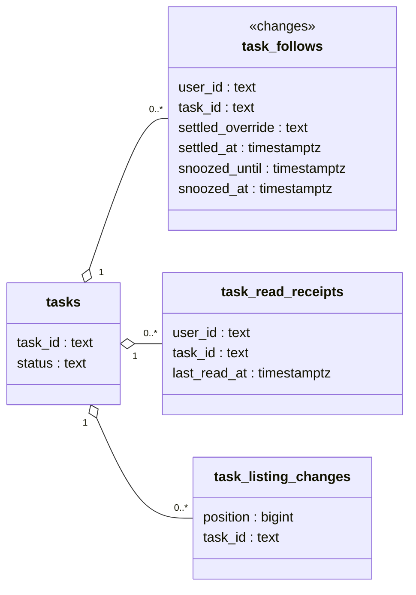

# Settle and snooze, per follower, exposed to T3

> **Status:** approved
> **Updated:** 2026-08-01
> **Vocabulary:** CONTEXT.md

## Current solution

T3's half of this feature is complete and needs no change. All four commands, all four shell fields, and every classification rule already exist in `t3code` and are switched off from this side by two `false`s in the capability descriptor.

### Anchors — every place this change lands

| Anchor | What it does today |
|---|---|
| `crates/t3code/src/commands.rs:91` | Refuses `thread.settle`, `thread.unsettle`, `thread.snooze`, `thread.unsnooze` as `CommandRefusal::Unsupported` with the reason `"Settling and snoozing are not part of this server."` |
| `crates/t3code/src/lib.rs:2072` | `descriptor()` reports `"threadSettlement": false, "threadSnooze": false` |
| `crates/t3code/src/projection.rs:449` | Doc comment listing the six fields deliberately omitted from the row |
| `crates/t3code/src/projection.rs:456` | `conversation_row()` — the `json!` literal both shell and detail rows are built from |
| `crates/t3code/src/dao.rs:36` | `struct Conversation` — the listing row struct |
| `crates/t3code/src/dao.rs:325` | The listing CTE: `FROM task_follows tf JOIN tasks t … WHERE tf.user_id = $follower AND t.status = 'open'` |
| `crates/t3code/src/dao.rs:352` | The tail of the outer `SELECT` list, where new columns are added |
| `crates/t3code/src/ports.rs:100` | `trait ThreadCommandSink` — the write port |
| `backend/src/t3code/backend.rs:56` | `impl ThreadCommandSink for AppStateCommands` |
| `backend/src/task/dao.rs:765` | `follow_task` — the `ON CONFLICT DO NOTHING` insert, the precedent for these writes |
| `backend/src/message/service.rs:82` | Auto-follow on send; holds `sender.user_id` |
| `backend/src/message/dao.rs:51` | `moves_a_listing_row(msg, conversation)` |
| `backend/src/task_turn/dao.rs:417` | Turn allocation; records the listing change last |
| `backend/migrations/0069_task_follows.sql:7` | `task_follows`, `PRIMARY KEY ("user_id", "task_id")`, no payload columns |

### What research turned up that the code does not say

**Two migrations already share version `0118`.** `0118_loop_adapter_domain_rename.sql` and `0118_task_activities.sql` both landed in commit `11abcc7`. sqlx 0.9 parses the numeric prefix as the version and performs no duplicate check when resolving (`sqlx-core-0.9.0/src/migrate/source.rs`); `_sqlx_migrations` is keyed on that version, so the second file collides on insert during a fresh run and fails `MigrateError::VersionMismatch(118)` on any subsequent run (`sqlx-core-0.9.0/src/migrate/migrator.rs:274`). **This blocks every new migration.** Rename `0118_task_activities.sql` to `0119_task_activities.sql` as its own commit before this work starts. This spec's migration is then `0120`.

**Three of T3's four wake signals already arrive, so no classification logic moves to the server.** The shell projects `session` (`projection.rs:482`), `latestTurn` (`projection.rs:764`), and maps `hasPendingUserInput` to an unanswered `AskUserQuestion` (`projection.rs:220`). T3's `threadRaisedHandWhileSnoozed` (`t3code/packages/client-runtime/src/state/threadSettled.ts:118`) therefore works untouched.

**The fourth is permanently off.** `hasPendingApprovals` is hardcoded `false` (`projection.rs:218`) because this backend has no approval queue. One of T3's three blockers can never fire here. Do not add a server-side approval check to the settle path — there is nothing to check.

**Only one of T3's two auto-settle rules can fire against this backend.**

- *Inactive for N days* **fires**, at 3 days by default. `DEFAULT_SIDEBAR_AUTO_SETTLE_AFTER_DAYS = 3` in `t3code/packages/contracts/src/settings.ts:50`, applied as a decoding default at `:105`. The Beta settings toggle only turns it off. It needs nothing but shell timestamps already projected.
- *Pull request merged or closed* **cannot fire**. It is fed by `vcsEnvironment.status({cwd})` (`t3code/apps/web/src/components/SidebarV2.tsx:524`), and this surface implements no `vcs.status` method; `server.discoverSourceControl` answers with two empty arrays (`crates/t3code/src/lib.rs:1455`).

The consequence: once `threadSettlement` is true, **every Task quietly leaves a T3 user's inbox after three days of inactivity**. That is the intended T3 behaviour and it is why `settled_override` needs a third state rather than being a boolean.

**The change feed re-reads each changed row through the viewer's own listing query** (`crates/t3code/src/feed.rs:119`), so per-follower columns are delivered correctly with no feed change at all.

**`record_change` is per Task, not per viewer** (`task_listing/dao.rs:53`). A settle by one person wakes every follower's subscription; each re-read returns that follower's own unchanged row. This costs a redelivery and is otherwise harmless. Do not try to scope the change record by user — the feed's cursor is a single global sequence and narrowing it would break resume.

**`TaskMessage` carries no sender identity** (`message/models.rs:35`). The insert transaction in `message/dao.rs` cannot scope a write by `user_id`. Anything per-sender must happen in `message/service.rs`, which holds `Sender { user_id, scope, is_agent_context }` (`message/service.rs:51`).

**A closed Task leaves the listing entirely.** The CTE filters `t.status = '{open}'` (`crates/t3code/src/dao.rs:328`), and the reaper closes a Task `close_after_settled_days` after it is settled (`crates/server/src/reaper.rs`), default 7 days. Auto-settle (`settle_after_hours`) skips a follower who pinned or unsettled it, but a snooze does not protect a Task.

**Moatless already stores per-user view state at this exact grain.** `task_read_receipts` is `PRIMARY KEY ("user_id", "task_id")` (`migrations/0067_task_read_receipts.sql:5`) with a monotonic upsert (`task/dao.rs:729`). It is the precedent for a per-person column set, and it is deliberately not where these four columns go — see the Data model.

**There is no event store on this side.** T3's server makes settle idempotent by re-emitting an event carrying the original timestamp (`t3code/apps/server/src/orchestration/decider.ts:489`). Here idempotency is whatever the `UPDATE` does, which is why the writes below are specified as conditional updates rather than blind ones.

## Planned solution

**New**

- Four nullable columns on `task_follows` (`backend/migrations/0120_task_follows_settled_snoozed.sql`).
- Four methods on `ThreadCommandSink` (`crates/t3code/src/ports.rs:100`) and their implementations (`backend/src/t3code/backend.rs:56`).
- Four DAO methods on `TaskDao` (`backend/src/task/dao.rs`).
- Three clearing writes: `backend/src/message/service.rs:82`, `backend/src/message/dao.rs:677`, `backend/src/task_turn/dao.rs:417`.

**Changes materially**

- `crates/t3code/src/commands.rs:91` — four refusals become four dispatched writes.
- `crates/t3code/src/lib.rs:2072` — both capability flags become `true`.
- `crates/t3code/src/projection.rs:456` — `conversation_row` emits four fields it currently omits.
- `crates/t3code/src/projection.rs:449` — the doc comment shrinks from six omitted fields to two.
- `crates/t3code/src/dao.rs:36` and `:352` — `Conversation` and the listing `SELECT` carry the follower's own state.

**Untouched**

- `backend/src/task/reaper.rs` — both reapers, and `tasks.status`.
- `backend/src/task/dao.rs:765` and `:788` — `follow_task` and `unfollow_task` themselves.
- `backend/src/task_read_receipts` usage and `t3code/apps/web/src/uiStateStore.ts` — read and unread on both sides.
- `apps/frontend/src/features/navigation/components/sidebar-tasks.tsx` — the Moatless web sidebar.
- `crates/t3code/src/feed.rs` — the listing feed and its cursor numbering.
- `crates/t3code/src/commands.rs:73` — `thread.archive`, `thread.unarchive`, `thread.delete` stay refused.
- Every T3 classification rule: `effectiveSettled`, `effectiveSnoozed`, `threadWokeAt`, `canSettle`, `canSnooze` stay client-side and unmodified.

### Problem

A person using T3 Code against this backend has no way to clear a Task out of their sidebar short of switching to the Moatless UI and closing it, which stops it for everyone. There is no way at all to defer one until later. Both controls exist in T3 and are hidden, because this server reports `threadSettlement: false` and `threadSnooze: false`.

`thread.archive` and `thread.delete` are refused (`crates/t3code/src/commands.rs:73`), and unfollow is not reachable from T3, so the sidebar only ever grows.

### Behaviour

**As a person using T3 against this backend**

- Given a Task I follow that is not blocked on me, when I settle it, then it moves to the Settled section of my sidebar and stays out of my inbox.
- Given a Task I settled, when anybody sends it a message, when a turn starts, or when the agent asks a question, then it returns to my inbox.
- Given a Task I settled, when I un-settle it, then it returns to my inbox and stays there past the three-day auto-settle window until real activity occurs.
- Given a Task I follow, when I snooze it until a time in the future, then it moves to the snoozed shelf and returns to my inbox at that time.
- Given a Task I snoozed, when its agent fails or a turn completes after I snoozed it, then T3 surfaces it early without the server changing anything.
- Given a Task I snoozed, when I send it a message, then my snooze is cleared.
- Given a Task with a pending `AskUserQuestion`, when I try to settle or snooze it, then the command is refused and the Task stays in my inbox.
- Given a wake time that is not in the future, when I snooze, then the command is refused and nothing is stored.
- Given a Task I settled twice, then `settled_at` still reports the first settle.

**As another person following the same Task**

- Given a Task I follow, when a colleague settles or snoozes it, then my sidebar is unchanged.
- Given a Task I snoozed, when a colleague sends it a message, then my settle is cleared but my wake time stands; T3 raises the hand when that turn completes.

**As a person using the Moatless web UI**

- Given any Task, when a colleague settles or snoozes it in T3, then my Moatless sidebar is unchanged. These controls do not appear in the Moatless UI.

**As an operator**

- Given a deployment that has run migration `0120` but not the new code, then behaviour is identical to today.
- Given the two capability flags set back to `false`, then T3 hides every control and the stored state stops being read. No data needs unwinding.

### Architecture and key flows

#### `backend/migrations/0120_task_follows_settled_snoozed.sql` (new)

- **Proposed responsibility:** adding the four columns.
- **Proposed change:** four `ALTER TABLE … ADD COLUMN` statements, each guarded the way `0034` guards its adds in `t3code` — here, follow the existing repository style of `IF NOT EXISTS` used throughout `backend/migrations`.
- **Evidence:** `backend/migrations/0069_task_follows.sql:7` for the table; the file must be `0120` because two files already occupy `0118`.

#### `backend/src/task/dao.rs`

- **Observed:** `TaskDao` owns `follow_task` (`:765`) and `unfollow_task` (`:788`), both wrapping their write plus a guarded `task_listing::record_change` in one transaction.
- **Proposed responsibility:** the durable state of a person's interest in a Task, not just its existence.
- **Proposed change:** four new trait methods, each following `follow_task`'s transaction shape exactly — write, guard on `rows_affected`, `record_change` last, commit.

```rust
async fn settle_task(&self, user_id: &str, task_id: &str, at: DateTime<Utc>) -> Result<(), sqlx::Error>;
async fn unsettle_task(&self, user_id: &str, task_id: &str) -> Result<(), sqlx::Error>;
async fn snooze_task(&self, user_id: &str, task_id: &str, until: DateTime<Utc>, at: DateTime<Utc>) -> Result<(), sqlx::Error>;
async fn unsnooze_task(&self, user_id: &str, task_id: &str) -> Result<(), sqlx::Error>;
```

Plus three clearing methods, called from the activity hooks:

```rust
/// Clear `settled_override`/`settled_at` for every follower of `task_id`.
async fn clear_settled_for_all_followers(tx: &mut PgConnection, task_id: &str) -> Result<(), sqlx::Error>;
/// Clear `snoozed_until`/`snoozed_at` for one follower.
async fn clear_snoozed_for_follower(&self, user_id: &str, task_id: &str) -> Result<(), sqlx::Error>;
```

The settle write is conditional so a repeat settle does not move the timestamp — this is what makes the command idempotent in the absence of an event store:

```sql
UPDATE task_follows
   SET settled_override = 'settled',
       settled_at = $3
 WHERE user_id = $1 AND task_id = $2
   AND settled_override IS DISTINCT FROM 'settled'
```

The snooze write is conditional on the wake time differing, for the same reason:

```sql
UPDATE task_follows
   SET snoozed_until = $3,
       snoozed_at = $4
 WHERE user_id = $1 AND task_id = $2
   AND snoozed_until IS DISTINCT FROM $3
```

`unsettle_task` sets `settled_override = 'active'` and `settled_at = NULL`. It does not set `NULL` — `'active'` is the keep-visible pin, and a user-initiated unsettle is always a pin. Only the activity hooks write `NULL`.

`unsnooze_task` sets both snooze columns to `NULL`.

All four guard `record_change` on `rows_affected > 0`, matching `follow_task:780`. A repeat settle therefore records no change and does not advance the listing position.

#### `crates/t3code/src/ports.rs`

- **Observed:** `ThreadCommandSink` (`:100`) carries five methods, each taking a `&ScopeContext` and a narrow struct.
- **Proposed responsibility:** unchanged — carrying T3's verbs across the boundary without teaching the compatibility layer how Moatless writes.
- **Proposed change:** four methods, following the existing signature style.

```rust
async fn settle(&self, viewer: &ScopeContext, task_id: &str) -> Result<(), CommandRefusal>;
async fn unsettle(&self, viewer: &ScopeContext, task_id: &str) -> Result<(), CommandRefusal>;
async fn snooze(&self, viewer: &ScopeContext, task_id: &str, snoozed_until: DateTime<Utc>) -> Result<(), CommandRefusal>;
async fn unsnooze(&self, viewer: &ScopeContext, task_id: &str) -> Result<(), CommandRefusal>;
```

`ScopeContext` carries `user_id`, so no separate user parameter is needed; `stop` (`:120`) is the precedent for a `task_id`-only method.

#### `backend/src/t3code/backend.rs`

- **Observed:** `impl ThreadCommandSink for AppStateCommands` (`:56`); `stop` (`:164`) is the shortest existing implementation and the closest model.
- **Proposed change:** four implementations. Each resolves the Task through the same readability check the other methods use and maps a missing or unreadable Task to `CommandRefusal::NotWritable`, then calls the DAO method. A `sqlx` error maps to `CommandRefusal::Failed`.

#### `crates/t3code/src/commands.rs`

- **Observed:** the four verbs share one match arm returning `Unsupported` (`:91`).
- **Proposed responsibility:** validating what can be checked without a database read, then dispatching.
- **Proposed change:** replace the arm with four arms. `thread.snooze` parses and validates `snoozedUntil` before dispatching:

```rust
"thread.snooze" => {
    let until = command.get("snoozedUntil").and_then(Value::as_str)
        .ok_or_else(|| missing("snoozedUntil"))?;
    let until = DateTime::parse_from_rfc3339(until)
        .map_err(|_| CommandRefusal::Rejected { message: format!("`{until}` is not a timestamp.") })?
        .with_timezone(&Utc);
    if until <= Utc::now() {
        return Err(CommandRefusal::Rejected {
            message: "A snooze must wake in the future.".to_string(),
        });
    }
    ctx.sink.snooze(viewer, thread_id(command)?, until).await?;
}
```

The comparison is written as `until <= Utc::now()` rather than a negated `>`, because `DateTime` parsing has already rejected anything unparseable — unlike T3's server, where `IsoDateTime` is structurally a string and the negation is load-bearing (`t3code/apps/server/src/orchestration/decider.ts:549`).

No blocked-on-you check is performed here. `hasPendingApprovals` is always `false` on this surface, and `hasPendingUserInput` is derived in the listing query rather than stored (`crates/t3code/src/dao.rs:352`), so a server-side check would cost a second read to reproduce a guard T3's `canSnooze` already applies before the round trip (`t3code/packages/client-runtime/src/state/threadSettled.ts:149`).

#### `crates/t3code/src/dao.rs`

- **Observed:** `struct Conversation` (`:36`); the listing `SELECT` tail (`:352`); the CTE already joins `task_follows tf` on `tf.user_id = ${follower}` (`:326`).
- **Proposed responsibility:** carrying the follower's own state on the row it already reads for them.
- **Proposed change:** four fields on `Conversation`, and four columns on the `SELECT`. The CTE selects `t.*` from the join, so `tf`'s columns must be added explicitly:

```sql
tf.settled_override,
tf.settled_at,
tf.snoozed_until,
tf.snoozed_at
```

The CTE at `:325` selects `SELECT t.*` — widen it to `SELECT t.*, tf.settled_override, tf.settled_at, tf.snoozed_until, tf.snoozed_at` and reference them from `listed` in the outer query, rather than re-joining `task_follows`.

#### `crates/t3code/src/projection.rs`

- **Observed:** `conversation_row` (`:456`) builds the `json!` literal shared by shell and detail rows; its doc comment (`:449`) lists six deliberately-absent fields.
- **Proposed responsibility:** reporting the four fields honestly instead of letting the contract default them.
- **Proposed change:** add four entries to the `json!` literal using the existing `nullable_instant` helper for the three timestamps, and `Value::Null` / `Value::String` for the override. Update the doc comment to name the two fields that remain absent — `interactionMode` and `archivedAt` — and say why settlement and snoozing are no longer among them.

These go in `conversation_row`, not in `thread`, because T3's `ChatView` resolves settled and snoozed state from the same fields on the thread-detail row (`t3code/apps/web/src/components/ChatView.tsx:3911` and `:3926`). Putting them only on the shell would leave the open thread's banner disagreeing with its sidebar row.

#### `crates/t3code/src/lib.rs`

- **Observed:** `descriptor()` (`:2063`) hardcodes both flags to `false`.
- **Proposed change:** both to `true`. This is the switch that makes the controls appear in T3; nothing else in the client is gated on it.

#### `backend/src/message/service.rs`

- **Observed:** auto-follow at `:82`, guarded by `!sender.is_agent_context`, best-effort with a `warn!` on failure.
- **Proposed responsibility:** clearing the sender's own snooze when they re-engage.
- **Proposed change:** a second best-effort call inside the same `if !sender.is_agent_context` block, after `follow_task`. This is the only place with both `sender.user_id` and the Task id.

It is best-effort for the same reason the follow is: a failure must never block sending. If it fails, the sender's own snooze survives their own message, and T3 raises the hand when that turn completes (`t3code/packages/client-runtime/src/state/threadSettled.ts:130`) — degraded, not broken.

#### `backend/src/message/dao.rs`

- **Observed:** `moves_a_listing_row` (`:51`) returns true for a user message or an interactive tool call; the guarded `record_change` at `:677`.
- **Proposed responsibility:** clearing every follower's settle when the Task moves.
- **Proposed change:** where `moves_a_listing_row` is true, call `clear_settled_for_all_followers` on the same transaction, immediately before `record_change`. The predicate is already exactly right: `msg.message_type == MessageType::User` covers a person writing, and the `INTERACTIVE_TOOLS` branch covers the agent asking.

Snooze is not touched here. This transaction has no sender identity, and clearing snooze for every follower is the behaviour that was rejected — it would stop snooze holding on a Task two people work through.

#### `backend/src/task_turn/dao.rs`

- **Observed:** turn allocation at `:417`, and `record_turn_change` at `:110`, both calling `record_change` last.
- **Proposed responsibility:** clearing every follower's settle when a turn starts.
- **Proposed change:** call `clear_settled_for_all_followers` in `allocate` (`:417`) immediately before `task_activities::record_session_change`. Not in `record_turn_change` — that fires on every turn transition including completion, and a completed turn must not clear a settle placed after it.

#### Key flow — a colleague replies to a Task two people have snoozed

```mermaid
sequenceDiagram
  autonumber
  participant A as Alice
  participant Svc as message::service
  participant DAO as message::dao
  participant DB as task_follows
  participant Feed as ShellFeed
  participant B as Bob's T3 sidebar

  A->>Svc: send_user_message
  Svc->>DB: follow_task (idempotent)
  Svc->>DB: clear_snoozed_for_follower(alice)
  Svc->>DAO: insert message
  DAO->>DB: clear_settled_for_all_followers
  DAO->>Feed: record_change(task_id) — last in the transaction
  Feed->>DB: re-read the row as Bob
  Feed-->>B: thread-upserted
  Note over B: settle cleared, Bob's wake time intact;<br/>T3 raises the hand when the turn completes
```

#### Key failure flow — the sender-scoped snooze clear fails

The `clear_snoozed_for_follower` call at `message/service.rs:82` is outside the message transaction. If it fails, the message is still sent and the settle is still cleared. Alice's own snooze survives her own message until either she wakes it explicitly or the turn she started completes and T3 raises the hand. Log at `warn!` with `task_id` and `user_id`, matching the auto-follow's existing handler.

#### Ordering rule

`record_change`'s "call this last" (`task_listing/mod.rs:10`) holds for all three clearing writes: the `UPDATE` must land before the position that publishes it, or a subscriber can read the row at a position that claims to include a change the row does not yet carry.

### Data model



#### `task_follows`

One person's durable interest in one Task, identified by `(user_id, task_id)`. It gains the *state* of that interest: whether they have filed the Task away, and until when they do not want to see it. All four fields are null for a plain follow, which every existing row is.

| Field | Type | Null | Change | What it holds |
|---|---|---|---|---|
| `user_id` | `text` | no | unchanged | Primary key, first component. |
| `task_id` | `text` | no | unchanged | Primary key, second component. |
| `settled_override` | `text` | yes | **new** | `'settled'`, `'active'`, or `NULL`. |
| `settled_at` | `timestamptz` | yes | **new** | When the server accepted the settle. `NULL` whenever `settled_override` is not `'settled'`. |
| `snoozed_until` | `timestamptz` | yes | **new** | The wake time. |
| `snoozed_at` | `timestamptz` | yes | **new** | When the snooze was set. |

No new index. Every read of these fields is reached through the primary key by the listing's existing join, and no query filters on them.

No `CHECK` constraint on `settled_override`. The repository's existing enum-valued text columns carry none — `tasks.status` is plain `text` (`crates/t3code/src/dao.rs:311` notes this explicitly) — and adding one here would be the only such constraint in the schema.

**Why `settled_override` is tri-state and not a boolean.** Settling also happens on its own, so there has to be a way to say no. A boolean cannot distinguish "not settled yet" from "explicitly keep this visible": un-settling an auto-settled row would be futile, because the rule that settled it would settle it again on the next render. Against this backend the inactivity rule fires at three days by default and the pull-request rule cannot fire at all — see Current solution — so `'active'` is the only way to hold a Task in a T3 inbox past three quiet days.

**Why these are not on `tasks`.** The state is one person's. On `tasks`, one follower settling would hide the Task from every other follower with nothing on screen saying who did it.

**Why these are not in their own table**, despite `task_read_receipts` being exactly that shape. A read receipt is meaningful without a Follow, because a person can read a Task they do not follow. A settle or a snooze only affects the sidebar, and the sidebar is follow-gated (`crates/t3code/src/dao.rs:325`, `task/dao.rs:412`), so neither means anything without one. Keeping them on the Follow means membership and view state cannot disagree, and costs no second join on the busiest query in the surface.

**Lifecycle.** The columns are created null by `follow_task`'s insert, which names only `(user_id, task_id)` and needs no change. `unfollow_task` deletes the row, taking both states with it; re-following through a later message starts clean. This is intended — unfollow is a stronger statement than settle.

#### `task_read_receipts`, `tasks`, `task_listing_changes`

Read and written exactly as they are today. They appear in the diagram to place the Follow record among them.

### Interfaces and contracts

#### External contract

| Consumer | Interface it holds | What it can rely on | Status |
|---|---|---|---|
| T3's sidebar partition — `t3code/apps/web/src/components/SidebarV2.tsx:1474` | `settledOverride`, `settledAt`, `snoozedUntil`, `snoozedAt` on `OrchestrationThreadShell` — `t3code/packages/contracts/src/orchestration.ts:359` | The values are this viewer's own. An absent field still means never settled and never snoozed. | changed |
| T3's thread banner — `t3code/apps/web/src/components/ChatView.tsx:3911` | The same four fields on the thread-detail row — `t3code/packages/contracts/src/orchestration.ts:415` | Identical values to the shell row for the same Task and viewer. | changed |
| T3's action hooks — `t3code/apps/web/src/hooks/useThreadActions.ts:475` | `capabilities.threadSettlement` and `capabilities.threadSnooze` — `crates/t3code/src/lib.rs:2072` | `true` means all four commands are accepted. The controls render only then. | changed |
| T3's command dispatch — `t3code/packages/client-runtime/src/operations/commands.ts:180` | `thread.settle`, `thread.unsettle`, `thread.snooze`, `thread.unsnooze` over `orchestration.dispatchCommand` | A refusal arrives as `OrchestrationDispatchCommandError` with a renderable message — `crates/t3code/src/lib.rs:1445` — never as a transport failure. | changed |
| Any T3 client holding a listing cursor | The feed position — `task_listing/dao.rs:53` | Unchanged numbering. A settle or snooze is an ordinary row change delivered as `thread-upserted`. | unchanged |
| `apps/frontend`'s sidebar — `sidebar-tasks.tsx:97` | The `task_follows` row it joins on, and `lastReadAt` — `task/handlers.rs:278` | Unchanged. The four columns are additive and it selects none of them. | unchanged |
| `apps/frontend` and the `moat` CLI | `GET /api/v1/tasks` and its `TaskResponse` | Unchanged. No settle or snooze field is added to the REST surface. | unchanged |

Promises:

- A wake time not strictly in the future is refused and nothing is stored. It is never normalised forward.
- All four commands are idempotent. Settling twice leaves `settled_at` at the first settle; re-snoozing to the same wake time leaves `snoozed_at` at the first snooze. A repeat records no listing change and does not advance the feed position.
- `thread.unsettle` always pins: it writes `'active'`, never `NULL`. Only activity writes `NULL`.
- A wake time passing produces no event and no write. T3 derives the wake from `snoozedUntil` alone (`t3code/packages/client-runtime/src/state/threadSettled.ts:168`), and the stale timestamp is what feeds its Woke indicator (`:191`). **Do not add a job that nulls expired snoozes** — it would delete the signal the client reads.
- No classification is performed server-side. Settled, snoozed and woke stay derived in T3.

#### Internal interfaces

These are implementation boundaries, not promises, and may change without a spec update:

- The four `ThreadCommandSink` methods (`crates/t3code/src/ports.rs:100`).
- The four `TaskDao` methods and the two clearing helpers (`task/dao.rs`).
- The four fields on `Conversation` (`crates/t3code/src/dao.rs:36`).

### Failure, safety and recovery

| Condition | State before | State after | What the caller sees | Retry safe | Mechanism |
|---|---|---|---|---|---|
| `snoozedUntil` is absent, unparseable, or not in the future | any | unchanged | `OrchestrationDispatchCommandError` with a message naming the problem | yes | Validation precedes dispatch; nothing is written |
| Task is closed, deleted, or not readable by the viewer | any | unchanged | `CommandRefusal::NotWritable`, deliberately undifferentiated | yes | The three are not distinguished — naming a Task the viewer cannot read is itself a disclosure (`crates/t3code/src/ports.rs:29`) |
| The `UPDATE` fails | any | unchanged | `CommandRefusal::Failed`; the cause is logged, not sent | yes | Single-statement transaction; nothing partial |
| A repeat settle or identical re-snooze | already set | unchanged | success | yes | `IS DISTINCT FROM` guard; `rows_affected = 0` skips `record_change` |
| `clear_snoozed_for_follower` fails at `message/service.rs:82` | sender snoozed | sender still snoozed; message sent; settle cleared | nothing — the send succeeds | n/a | Best-effort with `warn!`, matching the auto-follow beside it. T3 raises the hand when the turn completes |
| A settle races an incoming message | settled | settle cleared by the message | the Task stays in the inbox | n/a | T3 adjudicates the race on `settled_at` (`t3code/packages/client-runtime/src/state/threadSettled.ts:248`), which is why `settled_at` must stamp server accept time and not client time |
| The reaper closes a snoozed Task | snoozed, open | snoozed, closed | the Task leaves the T3 sidebar | n/a | Deliberate. The reaper does not read these columns |
| A follower unfollows | settled or snoozed | row deleted | the Task leaves their sidebar | n/a | Deliberate. Re-following starts clean |

**Degraded operation.** The four columns are nullable and additive, so a deployment that has run `0120` without the new code behaves exactly as today. A deployment running the new code against a database without `0120` fails at the listing query — deploy the migration first, which is the existing ordering.

**Rollback.** Set both capability flags in `descriptor()` back to `false`. T3 hides every control, the stored state stops being read, and no data needs unwinding. The columns can stay.

**Security.** All four writes are scoped by `viewer.user_id` from `ScopeContext`; a caller cannot settle or snooze on another person's behalf. Readability is checked before the write, using the same helper the existing sink methods use, so these commands disclose nothing that the listing does not already disclose.

### Testing and verification

#### Unit — `cargo test -p moatless-vibe-backend`

In `crates/t3code/src/commands.rs` tests (the existing module at `:595` onward is the model):

- `thread.snooze` with a past `snoozedUntil` is `Rejected`, and the sink is not called.
- `thread.snooze` with an unparseable `snoozedUntil` is `Rejected`.
- `thread.snooze` with no `snoozedUntil` is the `missing` refusal.
- Each of the four verbs reaches the corresponding sink method with the viewer and task id it was given.
- `thread.archive`, `thread.unarchive` and `thread.delete` are still `Unsupported` — the existing test at `:859` must keep passing with the settle and snooze tags removed from its list.

In `crates/t3code/src/projection.rs` tests:

- The shell row and the detail row both carry all four fields for the same conversation.
- A conversation with no state set carries four JSON nulls.
- The existing key-set assertions at `:1218` and `:1782` gain the four keys.

#### Integration — `task test:integration`

This is the only tier that builds `backend/tests/`. Everything there except `supervisor_test.rs` is behind `#![cfg(feature = "db-tests")]`, so a plain `cargo test` compiles almost none of it and CI will not catch what a run without the feature missed.

In `backend/tests/ui_rpc_command_test.rs`:

- Settling as one follower leaves a second follower's row untouched.
- Settling twice leaves `settled_at` at the first value and records one listing change, not two.
- Snoozing twice to the same wake time leaves `snoozed_at` at the first value.
- Snoozing to a different wake time stamps fresh.
- `thread.unsettle` writes `'active'`, not `NULL`.
- A settle on a Task the viewer cannot read is `NotWritable`.

In `backend/tests/ui_rpc_shell_test.rs`:

- Two followers of one Task, one settled, receive different rows from the same listing.
- A user message clears settle for both followers and snooze only for the sender.
- A turn start clears settle for every follower and leaves both snoozes intact.
- An `AskUserQuestion` clears settle for every follower and leaves both snoozes intact.
- A completed turn clears nothing.

In `backend/tests/task_dao_test.rs`:

- `unfollow_task` on a settled and snoozed row removes all four values with the row.
- `follow_task` on a Task the person previously settled and unfollowed produces four nulls.

#### Manual verification

Against the T3 preview server, with the capability flags on:

1. Settle a Task; confirm it moves to the Settled section and its sidebar row and open-thread banner agree.
2. Snooze a Task for one hour; confirm the shelf shows the countdown and the row returns at the wake time without a reload.
3. Snooze a Task, then trigger a turn from another client; confirm it surfaces early with the Woke badge.
4. Settle a Task, then send it a message from the Moatless UI; confirm it returns to the T3 inbox.
5. With two accounts following one Task, settle as one and confirm the other's sidebar does not move.

#### What only a person can judge

- That a snoozed row leaves the inbox and returns at the time it said it would.
- That the wake reads as a wake — the Woke badge is legible in the row's original position, which the static sort makes load-bearing.
- That a colleague's reply resurfacing a settled Task without cancelling a snooze feels correct rather than inconsistent.
- That the refusal on a past wake time reads as a mistake the person made, not as a broken server.

#### Verification commands

```bash
cargo clippy -p moatless-vibe-backend -- -D warnings
cargo test -p moatless-vibe-backend
task test:integration            # requires DATABASE_URL; builds backend/tests/
```

## Out of scope

- **Settle and snooze controls in the Moatless web UI.** The state is per-follower and sits in a table that sidebar already joins, so this is straightforward later; it is not part of this change.
- **Read and unread.** Both sides already have it, on separate rails, and they stay separate. T3 keeps `threadLastVisitedAtById` in browser storage per device (`t3code/apps/web/src/uiStateStore.ts:5`), where "mark unread" rewinds the marker to one millisecond before the turn completed (`:261`). Moatless keeps `task_read_receipts` per user and has no way to un-read. A person working in T3 therefore leaves their Moatless sidebar permanently unread. Closing that gap needs a shell field and a mark-read command the T3 contract does not have, plus a decision about what "mark unread" means server-side.
- **Auto-settle on a merged or closed pull request.** T3 computes it from `vcsEnvironment.status`, which this surface does not implement.
- **Approvals.** There is no approval queue here; `hasPendingApprovals` stays `false`.
- **A server-side wake timer.** T3 derives the wake client-side, and a job that nulled expired snoozes would delete the Woke signal.
- **Protecting a snoozed Task from the inactive reaper.** A pending wake time is one person's view state and must not hold a deployment resource open for everyone.
- **`thread.archive`, `thread.unarchive`, `thread.delete`.** Still refused. Unfollow is not exposed to T3.
- **Fixing the duplicate `0118` migration.** Required before this work and landed as its own commit.
