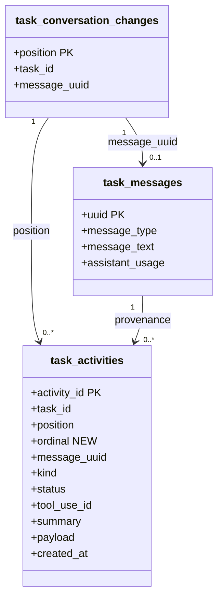

# Answering the agent from T3, and the three panels beside it

> **Status:** approved
> **Updated:** 2026-08-01
> **Vocabulary:** CONTEXT.md

Depends on `.plans/streamline-messaging-activity-formats.md` — approved, not implemented. That spec
introduces the canonical activity view both client projections read, and the `PendingAgentDelivery`
shape this one extends. Land it first. At the time of writing its branch
(`agent/streamline-messaging-activity-formats`) is not on `origin`; find it before starting, and do
not reconstruct it from this file.

## Current solution

Four controls in T3's thread view render and are permanently dead. They fail for one reason: each
panel is derived from a *named* activity kind, and the whole vocabulary Moatless puts on the wire is
three values — `tool.updated`, `tool.completed`, `task.progress`
(`backend/src/ui_rpc/projection.rs:720`).

### Anchors

Every place the change lands.

| What | Anchor |
|---|---|
| Wire kind vocabulary | `backend/src/ui_rpc/projection.rs:677-724`, kinds at `:720` |
| Thread detail, hard-coded empties | `backend/src/ui_rpc/projection.rs:262` — `proposedPlans: []`, `checkpoints: []` |
| Sidebar flags (already correct) | `backend/src/ui_rpc/projection.rs:218-225` — `hasPendingUserInput`, `hasActionableProposedPlan` |
| Activity row projection | `backend/src/ui_rpc/projection.rs:677-712`; `"sequence": activity.position` at `:696` |
| Change → events enumeration | `backend/src/ui_rpc/projection.rs:329-355`; `map_while` at `:350` |
| Snapshot envelope | `backend/src/ui_rpc/mod.rs:621` — `"snapshotSequence": head.sequence()` |
| Environment descriptor | `backend/src/ui_rpc/mod.rs:356`, body at `:2063-2078` |
| Respond command | `backend/src/ui_rpc/commands.rs:68`, `respond()` at `:260-280` |
| Interaction mode mapping | `backend/src/ui_rpc/commands.rs:369-375` |
| Unanswered-question query | `backend/src/ui_rpc/dao.rs:423-443` |
| Answer → message with tool response | `backend/src/ui_rpc/backend.rs:170-192` |
| Tool-response send flow | `backend/src/message/send.rs:369-386`, `:411`, `:441-459` |
| Interactive tool names | `backend/src/message/dao.rs:34` |
| Position allocation | `backend/src/message/dao.rs:627`; activities written at `:640-642` |
| Streaming / subagent write path | `backend/src/message/dao.rs:704-710`; `append_activities` at `:684-687` |
| Sandbox activity write path | `backend/src/message/dao.rs:737-750` |
| Block mapping, tool call | `backend/src/task_activities/mapping.rs:246`, `:265-273` |
| `BlockContext.block_index` | `backend/src/task_activities/mapping.rs:24-26` |
| `ActivityRow` | `backend/src/task_activities/mapping.rs:49-61` |
| Block index is arrival-shape independent | `backend/src/task_activities/mapping.rs:168-174` |
| `activity_id` | `backend/src/task_activities/mapping.rs:391-394` |
| Activity insert (upsert) | `backend/src/task_activities/dao.rs:128-150`; conflict clause at `:138-141` |
| Activity insert (sandbox) | `backend/src/task_activities/dao.rs:216-250`; `DO NOTHING` at `:245` |
| `admit_usage` | `backend/src/task_activities/dao.rs:267-272` |
| Read ordering, four sites | `backend/src/task_activities/dao.rs:297`, `:318`, `:333`, `:351` |
| Sequence arithmetic | `backend/src/task_activities/models.rs:40`, `:53-60`, `:103-110` |
| Idle reaper | `backend/src/task/reaper.rs:449-467` |
| Agent status parsing | `backend/src/sandbox/live_status.rs:16-30` |
| Usage capture | `backend/src/event_handler/agent_handlers.rs:781-792`, reduction at `:837-846` |
| `blockIndex` on the wire | `backend/src/event_handler/agent_handlers.rs:657-669` |
| Activities table | `backend/migrations/0118_task_activities.sql:13-40` |
| Usage table | `backend/migrations/0118_task_activities.sql:142-149` |
| Raw usage column | `backend/migrations/0075_message_assistant_usage.sql:10` |
| Deny list | `sandbox/src/agent/options.rs:132-136`; comment at `:118-124`; tests at `:626-638` |
| Plan mode from agent mode | `sandbox/src/agent/options.rs:41`, `:98` |
| Permission handler | `sandbox/src/agent/permission_handler.rs:54-98`; `rx.await` at `:68`; `:110`, `:114` |
| Prompt set / taken | `sandbox/src/agent/permission_handler.rs:66`, `sandbox/src/agent/dispatcher.rs:368` |
| Dispatcher routing | `sandbox/src/agent/dispatcher.rs:105`, `:343`, `:378-397` |
| Prompt response types | `sandbox/src/agent/prompt.rs:41-53` |
| Pending prompt state | `sandbox/src/agent/agent_state.rs:28`, `:79` |
| Codex token usage | `sandbox/src/agent/codex_app_server/protocol.rs:241-269` |
| Codex approval policy | `sandbox/src/agent/codex_app_server/mod.rs:584`, `:602` |
| SDK context window field | `crates/claude-agent-sdk/src/types/content.rs:129` |
| SDK control requests | `crates/claude-agent-sdk/src/types/control.rs:63-136` |
| Question API shape | `crates/api-schemas/src/message.rs:288-305` |
| CLI version | `docker/Dockerfile.sandbox-base:179` — `2.1.220` |
| Moatless tool renderers | `apps/frontend/src/features/conversation/components/tool-call.tsx:44-49` |
| Moatless answer panel | `apps/frontend/.../use-pending-user-input.ts:21-39`, `ask-user-question-input.tsx:33` |

T3 side, in `/opt/moatless/workspace/t3code`:

| What | Anchor |
|---|---|
| Activity contract — open `kind`, unknown `payload` | `packages/contracts/src/orchestration.ts:313` |
| `ProviderUserInputAnswers` | `packages/contracts/src/orchestration.ts:138` |
| Proposed plan is server→client only | `packages/contracts/src/orchestration.ts:825` |
| Environment capabilities | `packages/contracts/src/environment.ts:39-54`; version-skew note at `:43-45` |
| Question parser | `apps/web/src/session-logic.ts:410-458` |
| Plan deriver | `apps/web/src/session-logic.ts:461-505` |
| Context-window deriver | `apps/web/src/session-logic.ts:510` |
| Activity comparator | `apps/web/src/session-logic.ts:1299-1323`; sequence branch at `:1303-1310` |
| Answer accumulation | `apps/web/src/pendingUserInput.ts:49-63`, `:103-117` |
| Claude adapter, plan update | `apps/server/src/provider/Layers/ClaudeAdapter.ts:2224` |
| Claude adapter, header fallbacks | `apps/server/src/provider/Layers/ClaudeAdapter.ts:3219-3227` |
| Claude adapter, pending user inputs | `apps/server/src/provider/Layers/ClaudeAdapter.ts:3192`, `:3268`, `:3270-3280`, `:3283` |
| Claude adapter, unknown request | `apps/server/src/provider/Layers/ClaudeAdapter.ts:3874-3879` |
| Claude adapter, denies ExitPlanMode | `apps/server/src/provider/Layers/ClaudeAdapter.ts:3350-3369` |
| Codex adapter, context window | `apps/server/src/provider/Layers/CodexAdapter.ts:157-190` |
| Stale-request clearing | `apps/server/src/orchestration/decider.ts:42-53` |
| Proposed plan card | `apps/web/src/components/chat/ProposedPlanCard.tsx:162-167` |
| Read-model cap | `apps/server/src/orchestration/Layers/projector.ts:721` |

### What research turned up that the code does not say

**`AskUserQuestion` is denied to the agent, in both transports.** `disallowed_tools` carries it in
subprocess mode and in tmux mode (`sandbox/src/agent/options.rs:132-136`), and a bare tool name in
that list removes the tool from the CLI's context entirely — the agent never sees it. Two tests pin
the lists, one per mode (`:626-638`).

The deny landed 2026-06-09 in `b318677c`, "feat: disallow AskUserQuestion tool in sandbox agent
(#105)", with one stated reason: "we don't surface the CLI's multiple-choice question UI; the agent
should ask in plain text instead" (`options.rs:118-124`). That premise was already false. Moatless's
own answer panel and its response API landed 2026-01-21 in `c6301732`, five months earlier. PR #105's
body carries no second rationale — no hang, no misuse report.

**Only the question half of Moatless's own panel died.** `use-pending-user-input.ts:32-39` handles
`ExitPlanMode` as well, and that tool was never denied. So the plan branch of the answer path has run
in production throughout and the question branch has never run at all. That asymmetry decides test
strategy: the plan branch has production exposure, the question branch has none, and every defect
below is in code that no traffic has ever reached.

**Everything downstream of a question is untested by use.** The unanswered-question query
(`backend/src/ui_rpc/dao.rs:423-443`), the handler's interception
(`sandbox/src/agent/permission_handler.rs:54`), `thread.user-input.respond`
(`backend/src/ui_rpc/commands.rs:260`) and the sidebar's "Input needed" badge all hang off a tool that
never fires. That is why none of the three answer-path defects had been noticed.

**Per-client re-allow is not available.** The deny list is fixed when the session is built
(`options.rs:132`), and one Task can be watched from the Moatless UI and from T3 at the same time —
the run cannot know which client will render the question.

**Codex has no equivalent.** Its protocol has no question-to-user notification, and Moatless sets
`approval_policy: Never` (`codex_app_server/mod.rs:584`, `:602`). The question surface is Claude-only.
This is also why no approval panel is synthesised.

**A parked run pins its sandbox.** The blocked call is a bare `rx.await` with no timeout
(`permission_handler.rs:68`). The prompt is set in one place (`:66`) and taken in one
(`dispatcher.rs:368`); nothing clears it when a run ends or is cancelled. The idle reaper asks the
agent before stopping anything and skips when the status is not `idle` or `stopped` — "Idle floor
expired but agent reports running, skipping stop" (`task/reaper.rs:458-467`). A run parked on a prompt
reports `Running`, so the Task holds its pod past every TTL. This leak predates this work; this spec
would multiply it, because it puts a question in front of every proposed plan.

**Probed, not reasoned: a resumed session tolerates a dangling `tool_use`.** A transcript ending in an
unanswered `AskUserQuestion` was resumed against a request-capturing proxy on CLI `2.1.220` — the
version `docker/Dockerfile.sandbox-base:179` pins. The CLI built a valid request: it *dropped* the
unanswered call rather than erroring or synthesising a result. A control transcript, identical but
with the `tool_result` present, kept the call and its result — so the repair is the CLI's, not a
rejected fixture.

In the same probe the assistant turn's prose went with the dropped call, replaced by "No response
requested." The resumed model therefore has no memory of having asked. That is what the answer
delivery has to repair, and it is why the delivery restates the question.

**T3's reasoning about waiting does not transfer.** T3 blocks on a `Deferred` with no timeout either
(`ClaudeAdapter.ts:3283`) and never expires a question. What it holds while waiting is a map entry in
one long-lived local process shared by every thread (`:3192`) — waiting costs it nothing, so the
question never arose there. In Moatless the same wait holds a pod. What does transfer is that T3 has
releases: the turn's abort signal resolves the pending answer as empty and deletes the entry
(`:3270-3280`), and an answer for a request the process has forgotten is refused as unknown, which
clears the thread's blocked flag (`:3874-3879`, `decider.ts:42-53`).

**Three live defects on the answer path, none of them noticed because nothing exercises it.**

1. `respond()` hard-codes `tool_name: "AskUserQuestion"` (`ui_rpc/commands.rs:270-275`), so a plan
   answer is labelled as a question answer.
2. `send_tool_response_flow` serialises the answers object into `message_text`
   (`message/send.rs:369-386`), and the dispatcher takes `proto_messages.first()` and wraps it as
   `{"text": blob}` (`dispatcher.rs:378-397`) — so a multi-question ask cannot be answered per
   question.
3. The dispatcher decides a plan rejection by substring: `contains("reject") || contains("no")`
   (`dispatcher.rs:378-397`). "No, use the second approach" approves the plan. A rejection reaches the
   agent as an approval.

**The snapshot and the stream number the same activity differently, and the reads are ordered by
text.** `ConversationChange::sequence(index)` is `position * EVENTS_PER_CHANGE + index`
(`models.rs:106-109`), and `ConversationHead::sequence()` is `position * EVENTS_PER_CHANGE`
(`:58-60`) with the invariant stated at `:54-57`: "a snapshot's sequence and an event's sequence have
to be the same kind of number for that to mean anything". The envelope obeys it
(`ui_rpc/mod.rs:621`); each activity inside it carries the raw `position`
(`projection.rs:696`).

`position` is the *change* position, allocated once from `task_conversation_position`
(`0118_task_activities.sql:22-25`, `message/dao.rs:627`) and written to every activity of that change
(`:640-642`). So every activity of a turn carries the identical number and ties in the client's
comparator, which falls through to `createdAt` — identical, it is the Message's — then a lifecycle
rank, then `id.localeCompare` (`session-logic.ts:1299-1323`).

The reads are ordered the same way: `ORDER BY position, activity_id` at `dao.rs:297`, `:318`, `:333`
and `:351`. Both sides are lexicographic within a change, so **a turn with ten or more blocks renders
`…:10` before `…:2` today.** That bug is live and predates this spec.

**No maximum context window is persisted anywhere.**
`grep -rn 'context_window\|max_tokens\|context_length' backend/migrations/*.sql` returns nothing. Not
"the usage table lacks one" — no migration defines one at all. The maximum only ever exists on the
provider's wire: `ModelUsage.context_window` on the Claude SDK
(`crates/claude-agent-sdk/src/types/content.rs:129`), and `modelContextWindow` on the Codex wire,
which `ThreadTokenUsage` does not deserialize (`codex_app_server/protocol.rs:241-269`). There is no
`getContextUsage` control request to ask for it either — the SDK has twelve outgoing subtypes and
none of them is that (`crates/claude-agent-sdk/src/types/control.rs:63-136`).

**The used half is occupancy, not throughput, and nothing stored measures it.** What fills a context
window is what the *next* request would carry: the last response's own input — prompt plus both cache
halves — and the tokens it wrote. That is one response's usage, and it goes down when the harness
compacts. Everything on the persisted paths is a sum instead. `task_messages.assistant_usage` holds a
raw usage object per Message (`0075_message_assistant_usage.sql:10`, `agent_handlers.rs:789-792`);
the activities path narrows even that, reducing usage to a 2-tuple before `admit_usage`
(`agent_handlers.rs:837-846`), whose signature is `(input_tokens, output_tokens)`
(`task_activities/dao.rs:267-272`), against a `task_message_usage` with those two columns and nothing
else (`0118_task_activities.sql:142-149`). Adding across a turn measures how much traffic the turn
moved, which only rises; a meter driven by it pins at full on any turn that is not trivial.

The same trap sits on the Claude wire. `ResultMessage.model_usage` accumulates its token fields across
the whole run while carrying `context_window` as a maximum, so the per-model entry is a throughput
total beside a capacity — the two are not a fraction of each other. The maximum is the half worth
reading there; the used half comes from the last assistant message's own `usage`, sub-agent responses
(`parent_tool_use_id` set) excluded, since those occupy a window nobody is looking at. That is what T3
does on the same harness: it reads the last usage iteration (`ClaudeAdapter.ts:456-459`) and clamps
the count to the window (`:423`). Codex reports the distinction on its own wire, as `last` beside
`total`, and T3 reads occupancy off `last` there (`CodexAdapter.ts:159-161`) — but passes it through
unclamped, the one adapter of the two that does.

**Both harnesses clamp used to the maximum.** A reading that cannot be right shows as full rather than
as impossible, and the clamp belongs on the count rather than only on what is derived from it: the web
layer computes `remainingTokens` as `Math.max(0, maxTokens - usedTokens)` beside a percentage capped
at 100 (`contextWindow.ts:66-69`), so an unclamped count renders "0 remaining" next to a used figure
larger than the maximum — a readout contradicting itself. Clamping the count is what keeps the bar and
the numbers telling one story. Before any response has arrived there is no occupancy to report and no
reading is published.

So both halves come from the harness together, and neither is recoverable from what is stored.

**T3's question parser is stricter than the Moatless API shape.** It drops any option without a string
`description` (`session-logic.ts:410-458`) and requires `payload.requestId`. In
`crates/api-schemas/src/message.rs:288-305`, `QuestionOption.description` and `Question.header` are
both `Option<String>` and there is no `id` field. The Claude adapter fills both with fallbacks
(`ClaudeAdapter.ts:3219-3227`) — reasoning that transfers directly.

**T3 needs no activity-contract change.** An activity's `kind` is an open `TrimmedNonEmptyString` and
its `payload` is `Schema.Unknown` (`orchestration.ts:313`). Every kind below is already legal on the
wire. The environment descriptor is a different contract and does gain one optional key.

**T3's proposed-plan card cannot answer.** `thread.proposed-plan.upsert` is server→client only
(`orchestration.ts:825`), and the card offers copy, download and save-to-workspace
(`ProposedPlanCard.tsx:162-167`) — no approve, no reject. T3's own adapter denies `ExitPlanMode`
outright (`ClaudeAdapter.ts:3350-3369`), so read-only is a consequence of that denial, not a considered
position. Moatless does not deny it, so the same shape would leave a turn parked on a blocked call
that only an approval releases.

**T3's Plan toggle is real harness plan mode, not prompting.** It calls `setPermissionMode("plan")`
(`ClaudeAdapter.ts:3759-3763`); Moatless maps `"plan"` to `AgentMode("plan")`
(`ui_rpc/commands.rs:369-375`) and the sandbox turns that into the CLI's plan permission mode
(`sandbox/src/agent/options.rs:41`, `:98`).

**T3 stores activities; Moatless does not have to.** T3 keeps a per-client read model capped at the
newest 500 rows (`projector.ts:721`) and prunes stale context-window rows per turn on the way out.
Moatless projects from the durable log on every read, so the equivalent pruning is a projection rule,
not a storage rule.

## Planned solution

**New**

- `backend/migrations/0119_activity_ordinal.sql` — the `ordinal` column on `task_activities`
- `ActivityKind::UserInputRequested`, `::UserInputResolved`, `::PlanUpdated`,
  `::ContextWindowUpdated` in `backend/src/task_activities/mapping.rs:63`
- `ActivityRow.ordinal` in `backend/src/task_activities/mapping.rs:49-61`
- A context-window signal published by both harnesses in `sandbox/src/agent/`
- `proposedPlans[]` built in `backend/src/ui_rpc/projection.rs:262`
- A synthetic `user-input.requested` beside every proposed plan
- A prompt-response variant on `PendingAgentDelivery` in `sandbox/proto/sandbox/v1/sandbox.proto`
- The restated question on that delivery, read from the stored call's `payload.input`
- `AgentStatus::Waiting` in `backend/src/sandbox/live_status.rs:16`
- A `userInputResponse` capability on the environment descriptor,
  `backend/src/ui_rpc/mod.rs:2063-2078`

**Changes materially**

- `backend/migrations/0118_task_activities.sql:32-36` — the closed kind set grows; it stays closed
- `backend/src/ui_rpc/projection.rs:720` — the wire kind vocabulary, today three values
- `backend/src/ui_rpc/projection.rs:696` — an activity's projected `sequence`
- `backend/src/task_activities/dao.rs:297`, `:318`, `:333`, `:351` — read ordering
- `backend/src/task_activities/dao.rs:128-150` — the insert and its conflict clause
- `backend/src/task_activities/mapping.rs:391-394` — the id rule gains a suffix for the joined row
- `backend/src/ui_rpc/commands.rs:270-275` — the hard-coded tool name
- `backend/src/message/send.rs:369-386` — the answers object stops being serialised into prose
- `sandbox/src/agent/dispatcher.rs:378-397` — the `{"text": blob}` wrap and the substring rejection
- `sandbox/src/agent/options.rs:132-136` and its two tests at `:626-638` — the deny list
- `sandbox/src/agent/permission_handler.rs:54-98` — the parked run reports waiting
- `backend/src/task/reaper.rs:449-467` — waiting is reclaimable
- `sandbox/src/agent/codex_app_server/protocol.rs:241-269` — `modelContextWindow` is deserialized;
  the plan's three step states stop being flattened
- T3 golden tests gain a case per kind

**Untouched**

- `apps/frontend/src/features/conversation/` — every interactive call still arrives as a tool call
  with its input, and the five tool-name-keyed renderers at `tool-call.tsx:44-49` keep working
- `backend/src/ui_rpc/commands.rs:85-90` — `thread.approval.respond` stays refused
- `packages/contracts/src/orchestration.ts` — no change; `kind` is open and `payload` unknown
- The durable pending-message queue and its acknowledgement rule
- `backend/src/ui_rpc/projection.rs:218-225` — the two sidebar flags are already correct
- `backend/src/task_activities/dao.rs:216-250` — the Sandbox insert keeps `DO NOTHING`
- How a tool call's result is stored and settled — `backend/src/message/send.rs:441-459`
- Checkpoints, turn diffs, file search, git actions — every other dead surface in the gap map

### Problem

A person watching a Task from T3 cannot answer the agent. The agent asks; the sidebar lights up
"Input needed" — that flag is correct (`projection.rs:218-225`) — the person opens the thread, and
the panel that would take the answer never appears. The same person cannot see the plan the agent is
working through, cannot see how much context is left, and cannot read a plan the agent proposed.

Today that is hypothetical for questions, because the agent is not allowed to ask one at all
(`options.rs:132-136`). It is not hypothetical for plans: `ExitPlanMode` is live, and a plan proposal
parks the run on a call with no timeout that only an approval releases — an approval T3 has no way to
send.

The operator's problem is the other half. A parked run reports `Running`, so its sandbox is never
reclaimed (`task/reaper.rs:458-467`). One unanswered question holds a pod indefinitely.

### Behaviour

**A person in T3**

- Given the agent asked a question, when the person opens the thread, then the question and its
  options render, including questions with no header and options with no description.
- Given a question with several parts, when the person answers, then each answer is attached to its
  own question and none of them is a blob.
- Given a multi-select question, when the person picks two options, then the agent receives one
  `", "`-joined string.
- Given a proposed plan, when the person opens the thread, then the plan card renders and offers
  approve and reject.
- Given the person rejects a plan with feedback, then the agent is told no, and the feedback reaches
  it as feedback.
- Given the agent is working through a plan, when the person opens the thread, then the plan panel
  shows each step's real state, including in-progress, on Codex as well as Claude.
- Given the harness reported a maximum, then the meter shows a percentage; given it reported none,
  then the meter shows a count and no percentage.
- Given the sandbox was reclaimed while a question stood, when the person answers, then the answer
  is accepted and the agent acts on it.
- Given a question the person never answers, then nothing is held open on their behalf.

**The agent**

- Given it asks a question, then the run reports waiting rather than running.
- Given an answer arrives while the prompt is still parked, then the same turn continues.
- Given an answer arrives with no prompt parked, then it receives the question and the answer
  together.
- Given a plan it proposed is rejected, then it receives a rejection and the feedback.

**The operator**

- Given a Task parked on an unanswered question past its idle TTL, when the reaper runs, then the
  sandbox is stopped.
- Given a T3 client connecting to this server, then the descriptor says whether the server can be
  answered.

### Architecture and key flows

#### `sandbox/src/agent/options.rs`

- **Observed** — `disallowed_tools` is `["AskUserQuestion"]` in tmux mode and
  `["Monitor", "AskUserQuestion"]` in subprocess mode (`:132-136`), with the rationale at `:118-124`
  and a test per mode at `:626-638`.
- **Proposed responsibility** — which tools the CLI is not offered, for reasons that are still true.
- **Proposed change** — remove `AskUserQuestion` from both lists; update both tests. `Monitor` stays.
- **Evidence** — the rationale's premise is refuted by `c6301732` (2026-01-21), five months before the
  deny landed in `b318677c` (2026-06-09).

#### `sandbox/src/agent/permission_handler.rs`

- **Observed** — intercepts the two interactive tools, parks on `rx.await` with no timeout (`:68`),
  merges the response into the tool input unread (`:110`), clears `plan_mode_active` on approval
  (`:114`), and auto-allows everything else.
- **Proposed responsibility** — turn an interactive tool call into a durable question, and report that
  the run is waiting on a person while it is parked.
- **Proposed change** — publish the question as its own signal before parking, and set the agent
  status to waiting for the duration of the park. The `rx.await` stays: a person who answers while the
  sandbox is alive continues the same turn, which is the cheapest path and the best experience.
- **Evidence** — the prompt is set at `:66` and taken only at `dispatcher.rs:368`; nothing else clears
  it (`agent_state.rs:28`, `:79`).

#### `sandbox/src/agent/dispatcher.rs`

- **Observed** — routes to `resolve_pending_prompt` only when a prompt is pending (`:105`), takes
  `proto_messages.first()` (`:343`), wraps the body as `{"text": blob}` and decides a rejection by
  `contains("reject") || contains("no")` (`:378-397`).
- **Proposed responsibility** — deliver an answer as an answer.
- **Proposed change** — read the prompt-response variant off the delivery and build
  `AskUserAnswer { answers }` or `PlanRejected { feedback }` from its fields
  (`sandbox/src/agent/prompt.rs:41-53`). No substring matching. Where no prompt is pending, dispatch
  the delivery as a normal message whose text carries the restated question and the answer.
- **Evidence** — `:105` is one door with two causes: the run was reclaimed, or the prompt was consumed
  by a racing message. One handling covers both.

Where a delivery carries no structured answer — someone typed into the chat box while a question was
parked — the prose travels as `AskUserResponse { response }` and reaches the CLI as `input.response`,
not as an entry in `input.answers`. The CLI's `AskUserQuestion` takes both: `answers` is
`record(string, string)` keyed on each question's own full text ("multi-select answers are
comma-separated"), and `response` is "freeform text the user typed instead of selecting a structured
option". Its result renderer reads `answers[question]` per question and **drops any question it finds
no answer for**, then prefers `response` over the rendered answers when telling the model what
happened — `The user responded: …`. So prose under a key no question matches does not degrade: every
question drops, nothing remains, and the model is told `The user did not answer the questions.` One
freeform field also removes the question of which of several questions a single typed message
answers: it belongs to the call, which is the shape the message actually has.

T3 has no counterpart to this path — `respondToUserInput` is structured-only and refuses an unknown
request (`ClaudeAdapter.ts:3869-3884`), so a message typed while a question is parked resolves
nothing there. It agrees on the key that matters: `id` is the full question text
(`ClaudeAdapter.ts:3212-3220`), and answers are sent keyed that way (`:3319-3326`). It differs on
multi-select, sending `string[]` (`pendingUserInput.ts:58-62`) where the schema says a
comma-separated string; the CLI accepts both, and this backend sends the joined string with the
`", "` separator its own validator splits on.

#### `sandbox/src/agent/codex_app_server/`

- **Observed** — `ThreadTokenUsage` does not deserialize `modelContextWindow`
  (`protocol.rs:241-269`), and the plan's three step states are flattened before storage.
- **Proposed responsibility** — report the same four signals from a different wire.
- **Proposed change** — deserialize `modelContextWindow`; keep the three step states.
- **Evidence** — T3's own Codex adapter reads `usage.modelContextWindow` for the maximum and
  `usage.last.totalTokens` for the used figure (`CodexAdapter.ts:157-190`), so the field is on the wire
  and is the right one.

#### `backend/src/task_activities/mapping.rs`

- **Observed** — `map_content` maps a content array with each block at its own index and the
  arrival-shape independence stated at `:168-174`; `activity_id` is `{message_uuid}:{block_index}`
  (`:391-394`); a tool call stores its whole input under `payload.input` (`:265-273`).
- **Proposed responsibility** — turn each recognised signal into a stored row under its own kind, with
  an id that cannot collide with the next block's and an ordinal that orders it.
- **Proposed change** — `ActivityRow` gains `ordinal`, set from `BlockContext.block_index`
  (`:24-26`); the four new kinds are mapped; the joined row's id gains a suffix.
- **Evidence** — `block_index` is one line from where `activity_id` is built out of the same value, so
  nothing is parsed back out of an id.

#### `backend/src/ui_rpc/projection.rs`

- **Observed** — emits three kinds (`:720`), hard-codes `proposedPlans: []` (`:262`), and projects an
  activity's `sequence` as the raw `position` (`:696`).
- **Proposed responsibility** — put the named kinds on the wire, number each row the way its own event
  numbers it, and fill the proposed-plan list.
- **Proposed change** — the four new kinds; `sequence` becomes
  `position * EVENTS_PER_CHANGE + ordinal + 1`; `proposedPlans[]` read from unanswered `ExitPlanMode`
  calls; only the newest context-window reading per turn survives into a snapshot.
- **Evidence** — the invariant is already stated at `models.rs:54-57` and already broken.

#### `backend/src/task/reaper.rs`

- **Observed** — `stop_idle_sandbox` asks the agent and returns false for any status other than
  `idle` or `stopped` (`:449-467`).
- **Proposed responsibility** — reclaim a sandbox nobody is using, including one nobody has answered.
- **Proposed change** — waiting is reclaimable, on the ordinary idle TTL. No timer of its own.
- **Evidence** — the leak is `"Idle floor expired but agent reports running, skipping stop"` at
  `:458-467`, reached because a parked run reports `Running`.

#### `backend/src/message/send.rs` and `backend/src/ui_rpc/commands.rs`

- **Observed** — `respond()` maps `requestId` to `tool_use_id` and hard-codes
  `tool_name: "AskUserQuestion"` (`commands.rs:270-275`); `send_tool_response_flow` serialises the
  answers object into `message_text` (`send.rs:369-386`) and settles the call's activity itself with
  the real object as result (`:441-459`).
- **Proposed responsibility** — carry an answer to the sandbox with its structure intact.
- **Proposed change** — the tool name comes from the stored call, not from a literal; the answers
  object travels on the delivery rather than inside prose. Settling stays exactly as it is.
- **Evidence** — `INTERACTIVE_TOOLS` (`message/dao.rs:34`) is the set the stored call is matched
  against.

#### Key flow — a question asked and answered

```mermaid
sequenceDiagram
  participant Agent as CLI
  participant Handler as permission_handler
  participant Store as task_activities
  participant Backend
  participant T3

  Agent->>Handler: AskUserQuestion(questions)
  Handler->>Store: user-input.requested (kind, payload.input)
  Handler->>Handler: status = waiting; park on rx.await
  Store-->>T3: thread.activity-appended
  T3->>Backend: thread.user-input.respond(requestId, answers)
  Backend->>Store: user-input.resolved, settle the call
  Backend->>Handler: PendingAgentDelivery(prompt-response)
  alt prompt still parked
    Handler->>Agent: AskUserAnswer(answers)
  else no prompt parked
    Handler->>Agent: new turn — question restated with the answer
  end
```

The other flows are named rather than drawn: the plan panel and the context-window meter are
one-way — harness signal, stored row, projected kind — and the proposed-plan card is the question flow
above with a synthetic two-option question in front of it.

### Data model



`position` is the change position, allocated once from `task_conversation_position` and shared by
every activity written in that change (`0118_task_activities.sql:22-25`, `message/dao.rs:627`,
`:640-642`). It cannot order two rows in one change, which is what `ordinal` is for.

No new table. All four surfaces are activity rows, and the proposed-plan list is read back out of
them.

#### `task_activities`

The durable work log. Identified by `activity_id`; ordered by `position` then `ordinal`, where today
it is ordered by `position` then `activity_id`.

| Column | Type | Change |
|---|---|---|
| `ordinal` | `int NOT NULL` | **New.** The activity's place in its change: `block_index` for a block activity, `0` for a Sandbox activity, which has no block and is alone in its change. Read off the source block rather than counted while mapping, so it is the same value on every pass — which makes it stable for exactly as long as `activity_id` is. |
| `kind` | `text NOT NULL` | **Meaning changes.** The closed set grows past its four values to `user_input_requested`, `user_input_resolved`, `plan_updated`, `context_window_updated`. It stays closed and stays a `text` column with a comment rather than an enum type, for the reason already at `0118_task_activities.sql:32-36`: adding a value must be a code change that fails to compile, not a migration. |
| `activity_id` | `text PRIMARY KEY` | **Meaning changes.** A joined row shares its call's block, so `{message_uuid}:{block_index}` gains a suffix. It must stay unique and deterministic — redelivery recomputes it — but it no longer decides order. |
| `payload` | `jsonb NOT NULL` | **Meaning changes.** Carries each new kind's own shape. The question text on a call's `input` becomes load-bearing: it is what an answer restates when no prompt is waiting (`mapping.rs:265-273`). |
| `position` | `bigint NOT NULL` | Read, unchanged. No longer projected as the client's sort key on its own. |

`ordinal` is **excluded from `ON CONFLICT DO UPDATE`**, alongside `position`, for the reason already
written at `dao.rs:138-141`: a redelivered block must not move where it already sits in the stream.
Extend that comment rather than adding a second one — the two columns are load-bearing for the same
reason. `record_sandbox` needs none of this: it is `DO NOTHING` (`dao.rs:245`) because a Sandbox
activity's id is its event id, so a conflict is the same event redelivered.

The column is added to both insert statements — `dao.rs:134` and `:241` — and supplied from three call
sites: `message/dao.rs:641`, the streaming and subagent path at `:710`, and the Sandbox path at
`:737-750`.

#### Sequence numbering

An activity's projected `sequence` becomes `position * EVENTS_PER_CHANGE + ordinal + 1` — the number
`ConversationChange::sequence(index)` already computes for the same row (`models.rs:106-109`). This is
not a new formula; it is the stream's existing one applied to the snapshot, which is what the comment
at `models.rs:54-57` asks for.

**Slot 0 is reserved for the Message's bubble whether or not one is emitted.** This is the part that
makes the number independent of the caller. A change's events are enumerated over a list that begins
with the bubble only when the Message produced one (`projection.rs:329-353`), and `message_bubble`
returns nothing for a tool-only turn — so an index counted while walking shifts by one depending on
whether the caller's slice contained that Message at all. Reserving the slot removes the dependency. A
change with nothing to say leaves a gap, which costs one slot of the 1,024 and nothing else: a
sequence is a cursor, never a count, and the client's only use of it is a numeric difference
(`session-logic.ts:1305`). Ordinals skip for the same harmless reason wherever a block became prose
instead of an activity.

There is a second rule in that client which reads sequences as strictly consecutive:
`orchestrationRecovery.ts:126,133` ignores `sequence <= latest` and treats anything other than
`latest + 1` as a gap to recover from. Nothing routes through it —
`createOrchestrationRecoveryCoordinator` is imported nowhere outside its own test — so this change
meets no live consumer. But our sequences are not consecutive and never were: the ~1,024 between
changes predates all of this, the reserved slot leaves a hole in every tool-only turn, and ordinals
skip wherever a block became prose. Whoever wires that coordinator up has to reconcile it with the
comparator at `session-logic.ts:1305` first, and the T3 side should hear it from us rather than find
it.

A Sandbox activity falls out of the same rule with no special case: alone in its change, names no
Message (`message/dao.rs:737-743`), ordinal 0, sequence `position * 1024 + 1`, reserved slot empty.

The `+1` lives in the projection and not in the stored column. Folding it in would force either a
Sandbox special case or the rule written twice.

Ties are impossible for a block activity: `append_activities` takes one `message_uuid`
(`message/dao.rs:684-687`), so a change is one Message, and a block index is unique within one. The
stability this rests on is already load-bearing — "the same block computes the same key"
(`0118_task_activities.sql:16-19`) is what redelivery already stakes `activity_id` on, and it rests on
ADR-0002's decision that the Sandbox forwards one event per content block and does not coalesce. The
same number is reached from both arrival shapes:
`mapping.rs:168-174` states it on the read side, `event_handler/agent_handlers.rs:657-669` on the write
side, where a coalesced event carrying no `blockIndex` starts its array at 0. If that ever failed,
`activity_id` would have failed first.

At the boundary, `sequence(index)` returns `None` past `EVENTS_PER_CHANGE` and the stream's `map_while`
truncates silently (`projection.rs:350`). The snapshot truncates at the same point. Two routes reach
it now — a change of more than 1,024 events, and a Message of more than 1,023 blocks — and both are
short in both projections.

#### Activity payloads

| Kind | Payload | Notes |
|---|---|---|
| `user_input_requested` | `{ requestId, questions[] }` | `requestId` **must** be the tool-use id: the respond command reads it straight into `tool_use_id` (`commands.rs:270-275`). Each question carries `header`, `question`, `multiSelect`, `options[]`. |
| `user_input_resolved` | `{ requestId, answers }` | `answers` is `Record<questionText, string>`. Keyed on the full question text, not an index — see below. |
| `plan_updated` | `{ steps[] }` | Each step carries its own state, including in-progress. |
| `context_window_updated` | `{ usedTokens, maxTokens? }` | `maxTokens` absent where the harness reported none. |

Every option is emitted with a `description` and every question with a `header`, filling from the
question text where the source has none. T3's parser drops any option without a string `description`
(`session-logic.ts:410-458`) while the Moatless API shape leaves both `Option<String>`
(`crates/api-schemas/src/message.rs:288-305`). T3's Claude adapter fills the same fallbacks
(`ClaudeAdapter.ts:3219-3227`).

**A question is identified by its full text, not by an index.** The Claude CLI looks an answer up by
question text, and Moatless's own answer panel is already keyed that way
(`ask-user-question-input.tsx:33`). A synthetic index answers nothing, silently.

**A multi-select answer is joined into one `", "` string before the sandbox sees it.** T3 accumulates
`string | string[]` per question (`pendingUserInput.ts:49-63`); the join happens on the way in.
Moatless's own input already builds the joined string, and the sandbox merges the value into the tool
input unread (`permission_handler.rs:110`), so a second answer shape would buy nothing.

### Interfaces and contracts

#### External contracts

| Consumer | Interface | What it can rely on | Status |
|---|---|---|---|
| T3 client, work log and panels | `thread.activity-appended` and the snapshot's `activities[]` — `backend/src/ui_rpc/projection.rs:677` | Four named kinds beside the three it sees today, each with the payload its own deriver already parses; and one `sequence` per activity, the same whether the row arrived in a snapshot or as an event | New kinds, compatible; `sequence` renumbered |
| T3 client, answer panel | `thread.user-input.respond` — `backend/src/ui_rpc/commands.rs:260` | An answer per question reaches the waiting agent, and a rejection is not read as an approval | Reachable at last |
| T3 client, plan card | `proposedPlans[]` on the thread detail — `backend/src/ui_rpc/projection.rs:262` | One entry per proposed plan, with a stable id across re-reads | New |
| T3 client, environment bootstrap | `GET /.well-known/t3/environment` — `backend/src/ui_rpc/mod.rs:356`, `:2063-2078` | That this server understands an answer to a user-input request, discoverable before any thread is opened | One key added |
| Sandbox dispatcher | the pending-delivery gRPC surface — `sandbox/proto/sandbox/v1/sandbox.proto` | An answer arrives as a prompt-response delivery with its tool-use id, tool name and per-question structure intact, acknowledged like any other delivery | New |
| `apps/frontend` conversation view | the stored tool call and its result — `tool-call.tsx:44-49` | Every interactive call still arrives as a tool call with its input, and the five tool-name-keyed renderers keep working | Unchanged |
| Operator, via the idle reaper | `stop_idle_sandbox` — `backend/src/task/reaper.rs:449` | A Task waiting on a person is reclaimed on the ordinary idle TTL | Behaviour changed |

The descriptor gains one optional boolean, `userInputResponse`, beside `threadSettlement`. T3's own
convention is that a server-understands-this-command capability is advertised here so clients behave
under version skew (`packages/contracts/src/environment.ts:43-45`), and after this change a client
cannot otherwise tell this server from one where `thread.user-input.respond` is refused. The four
values reported today stay as they are, and all four are honest: `threadSettlement` and
`threadSnooze` are `true` and both commands are handled (`backend/src/ui_rpc/commands.rs:70`, `:76`).
Adding the key on the Moatless side is safe ahead of the T3 side: `Schema.Struct` ignores excess
properties on decode.

No flag per surface. The four panels are derived from stored activities, not gated on a capability, so
a client never branches on them.

#### Internal interfaces

These are an implementation plan, not promises, and may change without a spec update.

- The canonical activity view from `.plans/streamline-messaging-activity-formats.md` answers what kind
  a row is, once, for both client projections. Both the snapshot and the change projection consume it,
  so the two cannot drift.
- One function produces a change's ordered payload list, and both the snapshot and the stream consume
  it. Even with the ordinal stored, having one producer is what keeps the bubble-first rule from being
  written twice.
- The context-window signal is normalised per harness inside the sandbox and published as one shape.
  Neither the backend nor either client learns the difference between the Claude and Codex wires.

### Failure, safety and recovery

| When | State before | State after | What the caller sees | Retry safe | Recovery |
|---|---|---|---|---|---|
| The sandbox restarts while a question is open | Question stored, call unsettled | Same rows; no run | Answering still works — the stored question is what is being answered, not the run that asked | Yes | The answer starts a fresh turn carrying the question |
| Nobody ever answers | Run parked, status waiting | Sandbox stopped on the ordinary idle TTL | The Task is idle, the question still stands | Yes | Answering later starts a fresh turn |
| The waiting Task is reclaimed before it is answered | Question stored, call unsettled | Same rows; sandbox stopped | The panel still takes input | Yes | As above |
| An answer arrives for a question already answered | Call settled | Unchanged | That it was already answered, not that the send failed | Yes | None needed |
| A prompt-response delivery arrives with no prompt outstanding | Question stored | Delivery dispatched as a normal message | Nothing user-visible | Yes | The delivery restates the question, so the answer is not a bare "Option A" against nothing |
| A plan is rejected with feedback | Run parked on `ExitPlanMode` | `PlanRejected { feedback }` delivered | The agent was told no | Yes | None needed |
| The harness reports a used figure and no maximum | — | `context_window_updated` without `maxTokens` | A count with no percentage, rather than a wrong percentage | Yes | None needed |
| A question carries no header, or an option no description | — | Filled from the question text before storage | The question renders | Yes | None needed |
| An activity reaches the client with no number | — | — | Nothing, which is the problem | — | Prevented, not explained: `NOT NULL` in the column and emitted by every projection |

Two of these need more than a row.

**A prompt-response delivery with no prompt outstanding** has two causes and one door
(`dispatcher.rs:105`): the run was reclaimed, or the prompt was consumed by a racing message. In both
the agent must receive the question with the answer, because a bare "Option A" against nothing is not
an answer — and the probe showed the resumed model has no memory of asking, since the CLI drops the
unanswered call *and* the prose around it. The question text is on the stored call's `payload.input`
(`mapping.rs:265-273`) and the tool-use id the delivery already carries finds it. This is a
requirement of the delivery, not a branch of the waiting policy.

**An activity with no number** fails silently rather than loudly: T3's comparator sorts an activity
that *has* a sequence **after** one that does not (`session-logic.ts:1307-1310`), so the work log
quietly reorders instead of raising anything. Keep the column `NOT NULL` and keep it non-null
everywhere on the path out.

**While the sandbox is down**, all four surfaces keep rendering what was already stored: they read the
work log, not the agent.

**Rolling back** leaves stored rows with kinds no projection names. The projection must skip a kind it
does not know rather than fail the snapshot — one unknown row must not blank a conversation.

### Testing and verification

**Seams.** The highest available seam for the projection work is `thread_detail` and the change
projection in `backend/src/ui_rpc/projection.rs`, which are pure over a `Transcript` and a
`ConversationChange` — the existing tests at `:1884-2075` are the pattern. The answer path is tested at
the command seam (`backend/src/ui_rpc/commands.rs`) and the dispatcher seam
(`sandbox/src/agent/dispatcher.rs`). The deny-list change is pinned by the two tests already at
`sandbox/src/agent/options.rs:626-638`.

**Sequencing, and it matters.** `activities_are_numbered_in_transcript_order`
(`projection.rs:2019`) asserts *strictly* ascending sequences, and passes only because its fixture
(`:1918-1928`) gives three activities of `msg-2` the positions 2, 3 and 4. The writer never does that:
`message/dao.rs:627` allocates one position for the Message and every activity on it. So the assertion
is unsatisfiable against real data and passes on fiction. Do the work in this order:

1. Correct the fixture — all three activities of `msg-2` at position 2.
2. Confirm `:2019` now **fails**. This is the bug being fixed; if it never goes red, nothing
   demonstrated it.
3. Add `ordinal`, order the four reads by it, and renumber the projection.
4. Confirm `:2019` passes again.

Changing the fixture together with the fix is the failure mode to avoid.

**The fixture needs one more row.** `an_activitys_number_does_not_depend_on_the_transcript_it_was_read_with`
(`:2038`) is the test that would catch a bubble-dependent index — it re-reads the activities with
`transcript(Vec::new(), …)` at `:2053`. As written it cannot, because every activity in the fixture is
on `msg-2`, which the fixture's own doc comment (`:1892-1894`) describes as the turn that said nothing
at all. No bubble either way, so the index does not move. Add an activity on `msg-4`, which does
produce a bubble. Then reading it alone versus with the conversation must give the same number.

**Cases**

- Unit, `backend/src/task_activities/mapping.rs` — each new kind maps to its row; the joined row's id
  is unique and recomputed identically on redelivery; `ordinal` comes from the block index.
- Unit, `backend/src/ui_rpc/projection.rs` — each new kind reaches the wire; an unknown kind is skipped
  rather than failing the snapshot; `proposedPlans[]` is built from an unanswered `ExitPlanMode` call;
  only the newest context-window reading per turn survives a snapshot; the two numbering tests above.
- Unit, `backend/src/task_activities/dao.rs` — a redelivery does not move a stored `ordinal`; reads
  return a ten-block turn in block order.
- Unit, `backend/src/ui_rpc/commands.rs` — the tool name comes from the stored call; a plan answer is
  not labelled as a question answer.
- Unit, `sandbox/src/agent/dispatcher.rs` — a rejection whose text contains "no" is delivered as a
  rejection; a multi-question answer arrives per question; a delivery with no pending prompt is
  dispatched as a message carrying the question.
- Unit, `sandbox/src/agent/options.rs` — both mode tests no longer expect `AskUserQuestion`; `Monitor`
  still denied in subprocess mode.
- Unit, `backend/src/task/reaper.rs` — a waiting agent is stopped once the idle floor expires.
- Contract, T3 golden tests — one case per new kind against the real client derivers.
- End-to-end, `tests/api` — ask, answer from the T3 surface, assert the call settles and the turn
  continues.

**Commands.** `cargo test -p moatless-backend`, `cargo test -p moatless-sandbox`,
`pnpm --filter @t3tools/web test` for the golden cases, and the `docker` profile of the e2e suite for
the end-to-end chain.

**Acceptance criteria**

- Given an unanswered question, when a person opens the thread in T3, then a panel raises it, and
  answering it settles the call.
- Given a Task parked on an unanswered question past its idle TTL, when the reaper runs, then the
  sandbox is stopped — and the question is still answerable afterwards.
- Given a conversation whose sandbox was reclaimed while a question stood, when the person answers,
  then the agent receives the question and the answer together and the stored activity settles.
- Given a multi-question ask, when it is answered, then each answer is attached to its own question.
- Given a rejection, then it reaches the agent as a rejection.
- Given a Codex plan with an in-progress step, then the plan panel shows it as in-progress.
- Given a harness that reported a maximum, then the meter shows a percentage.
- Given an unanswered plan proposal, then the plan card renders.
- Given a turn that said nothing and only called tools, when the same activity is read from a snapshot
  and from a replayed event, then both report the same `sequence`.
- Given an activity on a Message that did speak, when it is read with none of the conversation around
  it, then it reports the number it reported with the conversation.
- Given a turn of ten or more blocks, then it renders in the order it happened.
- Given any path, then no `approval.requested` is emitted.

**What only a person can judge**

- Whether the answer panel reads as answerable rather than as a transcript of a question.
- Whether the plan card's approve and reject read as consequential — a rejection restarts the agent's
  thinking.
- Whether the meter's percentage is legible at the widths T3 actually renders.
- Whether "waiting on you" reads differently enough from "working" to stop someone assuming the agent
  is stuck.

## Out of scope

- Checkpoints, turn diffs and the changed-files card.
- File search, file write, the branch selector, git actions.
- Attachments, terminal, preview, slash commands.
- Turning the 53 dying unary methods into typed refusals.
- Any change to T3's activity or thread contracts. The environment descriptor gains one optional key;
  nothing else in `packages/contracts` changes.
- An approval panel. No `approval.requested` is emitted on any path, and
  `thread.approval.respond` stays refused (`backend/src/ui_rpc/commands.rs:85-90`). Synthesising
  approvals from tool calls would offer a choice that changes nothing: every tool but the two
  interactive ones is auto-allowed (`sandbox/src/agent/permission_handler.rs:54-98`), and Codex runs
  with `approval_policy: Never` (`codex_app_server/mod.rs:584`, `:602`).
- Backward compatibility. No migration path, no backfill; a conversation written before this change
  does not have to keep rendering.
