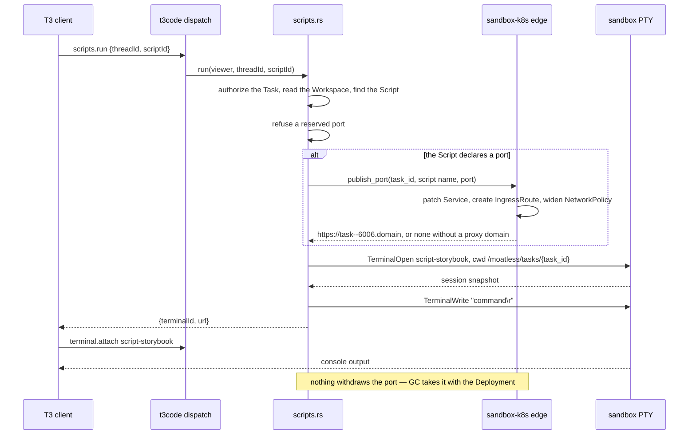
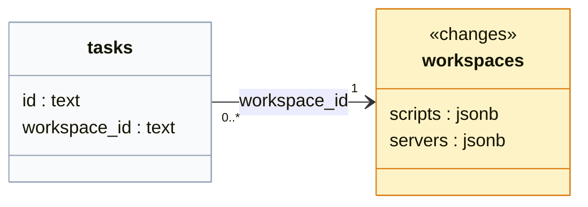

# Workspace Scripts

> **Status:** approved
> **Updated:** 2026-08-13
> **Vocabulary:** CONTEXT.md

A **Script** is a named command declared on a Workspace that a person runs on demand inside the
Sandbox, hosted by a terminal session rather than a container. It may declare a port, which is
published at the Task's preview hostname while it runs. It is not a Server (long-lived, supervised,
own container), not a setup command (provisioning), and not a background process (any OS process in
the sandbox).

This reproduces T3 Code's **Actions** — which the T3 UI calls Actions and the T3 wire calls
`scripts` — on the Moatless side, so a T3 client paired with a Moatless deployment can run them.

## Current solution

### Anchors

**Workspace run-configuration — where a Script is declared**

| Anchor | What is there |
|---|---|
| `crates/core/migrations/0079_workspaces.sql:22` | The `workspaces` table. `servers jsonb DEFAULT '[]'::jsonb` at `:35` is the column the new one copies |
| `crates/core/migrations/0130_task_listing_task_only.sql` | The highest-numbered migration. The new one is `0131` |
| `crates/api-schemas/src/repository.rs:124` | `ServerConfig` — the run-config entry shape `ScriptConfig` sits beside. Note it lives in `repository.rs` even though the Workspace owns run-config |
| `crates/api-schemas/src/workspace.rs:12` | `use crate::repository::{ResourceConfig, ServerConfig}` — the import the new type joins |
| `crates/api-schemas/src/workspace.rs:65` | `CreateWorkspaceRequest.servers` |
| `crates/api-schemas/src/workspace.rs:96` | `UpdateWorkspaceRequest.servers` |
| `crates/api-schemas/src/workspace.rs:157` | `WorkspaceResponse.servers` |
| `crates/workspaces/src/workspace/models.rs:29` | `pub servers: Option<serde_json::Value>` on the row model |
| `crates/workspaces/src/workspace/dao.rs:48` | `servers: Option<Option<serde_json::Value>>` on the patch struct — the double `Option` is "absent vs explicitly null" |
| `crates/workspaces/src/workspace/dao.rs:229` | The insert column list |
| `crates/workspaces/src/workspace/dao.rs:247` | `.bind(&row.servers)` |
| `crates/workspaces/src/workspace/dao.rs:364` | `push_set!(servers)` in the update builder |
| `crates/workspaces/src/workspace/dao.rs:409` | `bind_opt!(servers)` |
| `crates/workspaces/src/workspace/dao.rs:618` | The select column list |
| `crates/workspaces/src/workspace/dao.rs:625` | `COALESCE(r.servers, '[]'::jsonb)` — the default-workspace derivation from a Repository |
| `crates/workspaces/src/workspace/schemas.rs:42` | Row → response mapping, `serde_json::from_value(...).ok()` |
| `crates/workspaces/src/workspace/handlers.rs:206` | Create — `servers: to_json(req.servers)` |
| `crates/workspaces/src/workspace/handlers.rs:357` | Update |
| `crates/workspaces/src/workspace/handlers.rs:461` | The second update path |
| `crates/workspaces/src/workspace/git_sync.rs:58` | The git-declared run-config struct — `.moatless/workspaces.json` |
| `crates/workspaces/src/workspace/git_sync.rs:102` | The second git-declared form (`.moatless/config.json`) |
| `crates/workspaces/src/workspace/git_sync.rs:574` | Where a git entry's `servers` becomes the row value |
| `crates/workspaces/src/workspace/git_sync.rs:713` | `servers: desired.run.servers.clone()` in the reconcile |

**The T3 compatibility surface — `crates/t3code`**

| Anchor | What is there |
|---|---|
| `crates/t3code/src/lib.rs:246` | `UiRpcState`. `servers: ServersState` at `:271` is the pattern the new `scripts: ScriptsState` follows |
| `crates/t3code/src/lib.rs:2005` | `"servers.list" =>` in the dispatch table — where the new `"scripts.run"` arm goes |
| `crates/t3code/src/lib.rs:2582` | `_ => vec![unsupported_exit(&id, &tag)]`, where `scripts.run` lands today |
| `crates/t3code/src/lib.rs:2894` | The `capabilities` object. `userInputResponse` and `sandboxDiagnostics` are precedent for a Moatless-only capability key that is not in T3's own schema |
| `crates/t3code/src/projection.rs:1562` | `fn scripts(workspace)` — **the fake this change replaces**. It maps `servers[]` onto T3 `scripts[]` |
| `crates/t3code/src/projection.rs:1547` | `"scripts": if listed.readable { scripts(workspace) } else { Vec::new() }` — the call site |
| `crates/t3code/src/projection.rs:77` | `NOMINAL_ROOT_PREFIX = "/moatless/workspaces"` |
| `crates/t3code/src/projection.rs:104` | `NOMINAL_WORKTREE_PREFIX = "/moatless/tasks"` — the per-Task synthetic path a Script's `cwd` uses |
| `crates/t3code/src/terminal.rs:205` | `open` — builds `TerminalOpenRequest`, resolves the task from `cwd`, calls the sandbox |
| `crates/t3code/src/terminal.rs:278` | `write` |
| `crates/t3code/src/terminal.rs:414` | `forward_attach_stream` — only runs while a client is attached |
| `crates/t3code/src/servers.rs:38` | `ServersState` — the state-struct shape `ScriptsState` copies |
| `crates/t3code/src/workspace.rs:148` | `addressed_conversation` — resolves a `cwd` to an authorized `task_id`, and refuses a Sandbox that is neither running nor stopped |

**The Sandbox and the Kubernetes edge**

| Anchor | What is there |
|---|---|
| `sandbox/src/terminal.rs:412` | `resolve_cwd` — **maps any `/moatless/tasks/...` path to the sandbox's own `workspace_dir`**. This is why a Script can pass a nominal path as `cwd` |
| `crates/sandbox-proto/proto/sandbox/v1/sandbox.proto:362` | `TerminalOpen` … `:368` `TerminalClose` |
| `crates/backend-core/src/sandbox/mod.rs:169` | `SandboxObserver` — the trait group the new port joins |
| `crates/backend-core/src/sandbox/mod.rs:208` | `SandboxConnector` — `sandbox_client(task_id)` |
| `crates/sandbox-k8s/src/service.rs:28` | `create_sandbox_service`. `targetPort == port` at `:54`, and the selector is the **pod**, not a container |
| `crates/sandbox-k8s/src/ingress.rs:42` | `create_task_ingress_routes`. The hostname `{task_id}--{port}.{proxy_domain}` at `:69` |
| `crates/sandbox-k8s/src/ingress.rs:134` | `list_ingress_route_task_ids` — the read the heal's port union extends |
| `crates/sandbox-k8s/src/networkpolicy.rs:125` | `create_task_preview_network_policy`. Create-only, 409-reuse at `:150` |
| `crates/sandbox-k8s/src/pod_builder.rs:1566` | `reserved_sandbox_ports` — HTTP 8001, the gRPC port, the dind port |
| `crates/sandbox-k8s/src/pod_builder.rs:1573` | `admitted_server_ports` — the filter a Script port must also pass |
| `crates/sandbox-k8s/src/provider.rs:254` | Provision: build the port map, then Service, routes and policy |
| `crates/sandbox-k8s/src/provider.rs:904` | `heal_network_resources` — rebuilds from the **declared** plan |
| `crates/sandbox-k8s/src/status_resolver.rs:430` | `build_proxy_url` — the one place the preview URL string is formed |

**The T3 client — `/opt/moatless/workspace/t3code`**

| Anchor | What is there |
|---|---|
| `packages/contracts/src/t3ProjectFile.ts:27` | `T3ProjectFileScript` — `t3.json`'s `scripts[]` entry |
| `packages/contracts/src/orchestration.ts:194` | `ProjectScript` — `{id, name, command, icon, runOnWorktreeCreate, previewUrl?, autoOpenPreview?}` |
| `packages/contracts/src/orchestration.ts:184` | `ProjectScriptIcon` — the closed set `play test lint configure build debug` |
| `packages/contracts/src/orchestration.ts:231` | `OrchestrationProject.scripts` |
| `packages/contracts/src/environment.ts:48` | `ExecutionEnvironmentCapabilities` — every optional key documents "absent means unsupported, the client hides the control" |
| `packages/contracts/src/rpc.ts:230` | `WS_METHODS` — the method-name map |
| `packages/contracts/src/rpc.ts:266` | `serversList` / `serversSubscribeLogs` — the Moatless-driven group the new method joins |
| `packages/contracts/src/rpc.ts:917` | `WsServersListRpc` — the `Rpc.make` shape |
| `apps/web/src/components/ChatView.tsx:2960` | `runProjectScript` — **the function this change forks**. Today: `terminal.open` then `terminal.write` of `` `${script.command}\r` `` |
| `apps/web/src/components/ProjectScriptsControl.tsx:48` | `onRunScript` — the split button and its dropdown |
| `apps/web/src/components/chat/ChatHeader.tsx:317` | Where the control is mounted |
| `apps/server/src/ws.ts:2145` | How T3's own server answers Moatless-only methods — an inert success |
| `apps/server/src/preview/PortScanner.ts` | `lsof` port discovery. Not used by Moatless and not changed |

### What research turned up that the code does not say

1. **T3's `previewUrl` and `autoOpenPreview` are dead fields.** They are declared, persisted,
   editable in the dialog and importable from `t3.json` — and nothing reads them at run time. There
   is no T3 behaviour to copy for the URL half of this feature; only a field name.

2. **Moatless already answers `OrchestrationProject.scripts`, wrongly.**
   `crates/t3code/src/projection.rs:1562` maps `servers[]` onto T3 `scripts[]`, and its own comment
   says running one "would put a second process on the same bound port". A T3 client on a Moatless
   Task shows Actions today, and pressing one is a bug. This change removes that mapping.

3. **The sandbox Service selects the pod, not a container** (`service.rs:54`, `targetPort == port`).
   This is what makes the feature possible at all: a port bound by a PTY child inside the *agent*
   container is reachable through the same edge a Server's sidecar uses. Without this the design
   would need a container per Script.

4. **`sandbox/src/terminal.rs:412` maps `/moatless/tasks/...` to the sandbox's workspace dir.** So
   `scripts.run` does not need to know the real checkout path — it passes the nominal per-Task path
   and the sandbox resolves it. Do not try to compute a real path in the backend.

5. **Nothing server-side observes a terminal exit unless a client is attached.**
   `forward_attach_stream` (`terminal.rs:414`) is driven by a client's `terminal.attach`, and
   `TerminalHub` is an in-memory, per-replica map. This is why nothing withdraws a Script's port.

6. **`heal_network_resources` rebuilds the Service and routes from the declared plan**
   (`provider.rs:904`), so a dynamically added port is dropped from the Service. The preview
   NetworkPolicy is create-only with 409-reuse (`networkpolicy.rs:150`), so a widened policy is
   *not* reverted — the two go out of sync in the safe direction. The heal must union in the ports
   of the task's existing IngressRoutes.

7. **A Server's logs are container logs**, read from the container named `{server}-server`
   (`provider.rs:775`). A Script has no container, so `servers.subscribeLogs` can never carry its
   console. The PTY is not merely convenient; it is the only path.

8. **Kubernetes Service port names are capped at 15 characters** and must be DNS-1123 labels. The
   existing code uses the server name verbatim (`service.rs:54`), which is safe for short declared
   names and is not safe for an arbitrary Script name. Script ports use a derived name instead.

9. **T3's own server stubs Moatless-only methods with an inert success** (`apps/server/src/ws.ts:2145`
   answers `servers.list` with `{servers: []}`). `scripts.run` cannot do that — it must fail with
   `UnsupportedMethodError`, because there is no honest empty answer for "start this".

## Planned solution

**New**

- `ScriptConfig` and the `workspaces.scripts` column — `crates/api-schemas/src/repository.rs`,
  `crates/core/migrations/0131_workspace_scripts.sql`
- `crates/t3code/src/scripts.rs` — resolving a Script and starting it
- The `scripts.run` RPC — `packages/contracts/src/scripts.ts`, `packages/contracts/src/rpc.ts`,
  dispatched at `crates/t3code/src/lib.rs:2005`
- `SandboxPortPublisher` — `crates/backend-core/src/sandbox/mod.rs`, implemented in
  `crates/sandbox-k8s/src/provider.rs`
- `publish_task_port` — `crates/sandbox-k8s/src/edge.rs` (new), the three-write port opening
- The `workspaceScripts` capability — `crates/t3code/src/lib.rs:2894`,
  `packages/contracts/src/environment.ts:48`

**Changes materially**

- `crates/t3code/src/projection.rs:1562` — `scripts()` reads `workspace.scripts`, and Servers stop
  appearing in the T3 script list
- `crates/sandbox-k8s/src/provider.rs:904` — `heal_network_resources` unions in the ports of
  existing IngressRoutes before rebuilding the Service
- `crates/sandbox-k8s/src/service.rs:28` — port entries take an explicit name, so a Script port can
  carry a derived one
- `apps/web/src/components/ChatView.tsx:2960` — `runProjectScript` calls `scripts.run` when the
  environment advertises the capability
- Workspace create/update/response/git-sync — every path that carries `servers` also carries
  `scripts`

**Untouched**

- Preview Servers end to end — `crates/sandbox-control/src/server_runner.rs`, the sidecar
  containers, per-server overrides (`ApplyServerConfig`), restart, and `servers.subscribeLogs`
- `apps/frontend` — the Moatless preview panel, its server picker, and the run-config editor
- `sandbox/src/terminal.rs` — the PTY manager is used exactly as it is
- Setup commands and every provisioning path
- Sandbox lifecycle, TTL, the reaper, `SandboxRuntime`'s five verbs
- The agent and every agent-facing surface
- `apps/server/src/preview/PortScanner.ts` and `subscribeDiscoveredLocalServers` — T3's own
  discovery, unused against Moatless
- Docker execution mode. `crates/sandbox-docker` implements the new port publisher as a refusal

### Problem

Someone working a Task in the T3 client has two ways to run a command against the checkout, and
both are wrong for "run the tests" or "bring up Storybook".

Asking the agent spends a turn and a model call on something deterministic, and puts the output in
a transcript rather than a console. Declaring a Server gets a supervised sidecar container with its
own image, restart budget, crash-loop detection and readiness timeout — machinery built for a
process that is supposed to stay up, applied to one that is supposed to exit. A test run that exits
0 looks, to that machinery, exactly like a dev server that died.

Between them there is nothing, so the commands a person repeats most often are the ones the product
has no place for. T3 solved this with Actions; Moatless has the terminal that would host them and
no concept that names them.

### Behaviour

**Someone on a Task, in the T3 client**

- **Given** a Workspace declaring a Script named `test`, **when** they open a Task on that
  Workspace, **then** it appears in the top-bar control alongside any other Scripts.
- **Given** that Script, **when** they press it, **then** the terminal panel opens on a session
  named `script-test` and the command's output streams into it.
- **Given** a Script declaring port 6006, **when** it starts, **then** the result carries a URL at
  `{task_id}--6006.{proxy_domain}` and the client may open it in the in-app browser.
- **Given** a Script declaring a port, **when** the deployment has no `PROXY_DOMAIN`, **then** the
  Script still runs and no URL is offered.
- **Given** a Script whose command exits non-zero, **when** it exits, **then** the terminal shows
  the output and is marked exited. No separate error surface, and no failed-run record.
- **Given** a Script that is already running, **when** they press it again, **then** they are
  attached to the running session rather than a second one being started.
- **Given** a Sandbox that is stopped or still starting, **when** they press a Script, **then** they
  are told the sandbox is not running, distinctly from the Script having failed.
- **Given** a Script naming port 8001, the gRPC port or the dind port, **when** they press it,
  **then** it is refused with the reason, and nothing is started.

**Whoever owns the repository**

- **Given** `scripts` in `.moatless/workspaces.json`, **when** the Workspace syncs from git, **then**
  everyone running a Task on it has the same Scripts with nothing to configure.
- **Given** a git-declared Workspace, **when** they edit its Scripts through the API, **then** the
  same override/reset provenance that governs `servers` governs `scripts`.

**An older T3 client**

- **Given** a client built before this shipped, **when** it connects, **then** the descriptor omits
  `workspaceScripts`, the client hides the control, and it never sends `scripts.run`.

**A T3 client paired with a T3 server (not Moatless)**

- **Given** T3's own server, **when** a client calls `scripts.run`, **then** it fails with
  `UnsupportedMethodError`. The capability is absent there, so a current client does not call it.

### Architecture and key flows

| Module | Observed | Proposed responsibility | Proposed change |
|---|---|---|---|
| `crates/api-schemas/src/repository.rs` | `ServerConfig:124` is the run-config entry shape | Also declares what a Script is on the wire | Add `ScriptConfig` |
| `crates/workspaces/src/workspace/*` | `servers` threaded through model, dao, schema, handlers, git sync | Carries `scripts` on every path that carries `servers` | Mirror the `servers` plumbing |
| `crates/t3code/src/projection.rs` | `scripts():1562` derives T3 scripts from `servers[]` | Reports the Workspace's declared Scripts, and only those | Rewrite the function; Servers no longer contribute |
| `crates/t3code/src/scripts.rs` | — | Resolving a Script for a viewer and starting it: authorize, validate the port, publish it, open the PTY, write the command | New module |
| `crates/t3code/src/lib.rs` | Dispatch table `:2005`, capabilities `:2894` | Routes `scripts.run`; advertises `workspaceScripts` | One arm, one state field, one capability key |
| `crates/backend-core/src/sandbox/mod.rs` | `SandboxObserver:169`, `SandboxConnector:208` | Also declares the narrow port for opening one port on a live sandbox | Add `SandboxPortPublisher` |
| `crates/sandbox-k8s/src/edge.rs` | — | The three writes that make one port reachable, and the port-name derivation | New module |
| `crates/sandbox-k8s/src/provider.rs` | Provision `:254`, heal `:904` | Heal preserves dynamically opened ports | Union route ports into the rebuilt Service |
| `sandbox/src/terminal.rs` | PTY manager, `resolve_cwd:412` | Unchanged — a Script terminal is an ordinary terminal | None |
| `t3code` contracts (`packages/contracts`) | `WS_METHODS:230`, capabilities `:48` | Declares `scripts.run` and the capability | New `scripts.ts`, two edits |
| `apps/web/src/components/ChatView.tsx` | `runProjectScript:2960` writes into a terminal | Calls the server when the server can run Scripts, and keeps the old path otherwise | Fork on the capability |

#### The main flow — running a Script that declares a port



#### The failure flow — the edge half-applies

The Service patch succeeds and the IngressRoute create fails. The Script must still run: the URL is
a secondary product of the call and the console is the primary one. `publish_port` therefore returns
`Ok(None)` with a warning rather than an error for any *route* failure, and only an error the caller
must surface — a reserved port — fails the call before the terminal is opened. The order in the
diagram is deliberate: the port is published **before** the PTY starts, so a Script that binds
instantly is never briefly unreachable.

#### The consistency flow — a heal after a Script has opened a port

`heal_network_resources` runs when the Deployment lives and the Service does not. It rebuilds the
Service from `admitted_server_ports(build_servers_map(plan))`, which knows nothing about Script
ports. Before building, it lists the task's IngressRoutes and unions their ports in. The routes are
separate objects that survive a missing Service, so they are the record of what was published —
which is why no Script port needs to be stored anywhere.

### Data model



A **running** Script is not stored anywhere. It is a PTY session inside an ephemeral Sandbox, plus —
when it has a port — three Kubernetes objects owned by the Task's Deployment. None outlives the
Sandbox, so none is a row. `tasks` is context: the Task is what resolves a Script to a Workspace, a
Sandbox and a preview hostname.

#### `workspaces`

Run-configuration for the composition a Task runs against. One new column, following `servers`
exactly — including the `'[]'::jsonb` default, so a row that predates the migration reads as "no
Scripts" rather than as null.

| Column | Type | Null | What it holds |
|---|---|---|---|
| `scripts` | jsonb | default `'[]'::jsonb` | **New.** The Scripts this Workspace declares, as a JSON array of `ScriptConfig` with camelCase keys |
| `servers` | jsonb | default `'[]'::jsonb` | Read, unchanged — `0079_workspaces.sql:35`. Stops being the source of the T3 script list |

Migration `crates/core/migrations/0131_workspace_scripts.sql`:

```sql
ALTER TABLE "workspaces" ADD COLUMN IF NOT EXISTS "scripts" jsonb DEFAULT '[]'::jsonb;
```

No backfill. An existing Workspace has no Scripts, and deriving them from its Servers is the exact
mistake `projection.rs:1562` already makes.

#### `ScriptConfig`

The wire and storage shape, in `crates/api-schemas/src/repository.rs` beside `ServerConfig`, with
`#[serde(rename_all = "camelCase")]` to match it and migration `0030`'s key convention.

| Field | Type | What it holds |
|---|---|---|
| `name` | `String` | The identity, unique within the Workspace. Used as the T3 `id`, in the terminal id `script-{name}`, and in the IngressRoute name |
| `label` | `Option<String>` | Display name. Falls back to `name` |
| `command` | `String` | The shell command, written into the PTY verbatim followed by `\r` |
| `icon` | `Option<String>` | One of T3's closed six. Anything else is reported as `play` rather than refused, because an icon is not worth failing a listing over |
| `port` | `Option<u16>` | The port the Script serves on, if any |
| `env_vars` | `Option<HashMap<String, String>>` | Extra environment, passed as `TerminalOpenRequest.env`. Mirrors `ServerConfig::env_vars` |

`name` is the identity rather than a generated id because it has to survive a git round trip: the
Workspace is reconciled from `.moatless/workspaces.json` on every sync, so an id allocated by the
backend would be regenerated on each reconcile and every client-side reference — a keybinding, a
last-invoked marker — would break.

### Interfaces and contracts

#### External contracts

| Consumer | The interface it depends on | What it can rely on | Status |
|---|---|---|---|
| The paired T3 client, top bar | `OrchestrationProject.scripts` — `packages/contracts/src/orchestration.ts:231`, produced at `crates/t3code/src/projection.rs:1547` | One entry per declared Script, `id` stable across reads. No entry for a Server | **Breaking** — Servers leave the list |
| The paired T3 client, top bar | `scripts.run` — `packages/contracts/src/rpc.ts`, dispatched `crates/t3code/src/lib.rs` | `{terminalId, url, previewTabId}`. `terminalId` is attachable immediately; `url` is null unless the Script declares a port and the deployment has a proxy domain; `previewTabId` names the browser tab the backend opened on `url`, and is null when it could not | **New** |
| The paired T3 client | `ExecutionEnvironmentCapabilities.workspaceScripts` — `packages/contracts/src/environment.ts:48`, emitted `crates/t3code/src/lib.rs:2894` | Absent means the server cannot run Scripts. The client hides the control and never sends `scripts.run` | **New**, compatibly |
| The paired T3 client, terminal panel | `terminal.attach`, `subscribeTerminalEvents` — `crates/t3code/src/terminal.rs:244` | Unchanged event shapes. A Script terminal is an ordinary terminal, distinguished only by its id | Unchanged |
| Whoever writes `.moatless/workspaces.json` | The git-declared run-config schema — `crates/workspaces/src/workspace/git_sync.rs:58` | A `scripts` array beside `servers`. An older backend ignores it rather than failing the sync | **New**, compatibly |
| `apps/frontend` run-config editor | `WorkspaceResponse.scripts` — `crates/api-schemas/src/workspace.rs:157` | The field round-trips through create and update without being dropped, while nothing renders it | Changed, compatibly |
| `POST/PUT /api/v1/workspaces` callers | `CreateWorkspaceRequest.scripts`, `UpdateWorkspaceRequest.scripts` | Optional. Absent leaves the stored value alone; `[]` clears it | **New**, compatibly |

The breaking row is the point of the change and not a regression: the list it breaks is the
`projection.rs:1562` fake, whose entries cannot be run correctly. There is no deprecation window,
because there is no correct current behaviour to preserve.

#### Internal interfaces

These are an implementation plan, not promises. Changing one later needs no spec update.

```rust
// crates/backend-core/src/sandbox/mod.rs
#[async_trait]
pub trait SandboxPortPublisher: Send + Sync {
    /// Make `port` reachable on a running sandbox, returning its external URL
    /// when the deployment publishes one.
    ///
    /// Idempotent. Returns `Ok(None)` when there is no proxy domain, when the
    /// runtime does not publish ports, or when the edge write failed in a way
    /// that costs the caller only the URL.
    async fn publish_port(
        &self,
        task_id: &str,
        name: &str,
        port: u16,
    ) -> Result<Option<String>, SandboxError>;
}
```

`SandboxPortPublisher` is its own trait rather than a sixth verb on `SandboxRuntime`
(`crates/sandbox-control/src/lifecycle/runtime.rs:137`) because that trait's five verbs all move the
whole sandbox through its desired-state machine and all take a `RuntimeOperationContext` carrying an
operation generation. Publishing a port is neither: it does not change desired state, does not bump
a generation, and must not be mistaken for something the reconciler drives.

```rust
// crates/sandbox-k8s/src/edge.rs
pub async fn publish_task_port(
    k8s: &K8sClient, task_id: &str, name: &str, port: u16, config: &Config,
) -> Result<Option<String>, kube::Error>;

/// The ports of every IngressRoute the task currently has. The record of what
/// has been published, used by the heal.
pub async fn published_task_ports(k8s: &K8sClient, task_id: &str) -> BTreeSet<u16>;

/// A Service port name for a dynamically published port: `scr-{port}`.
/// DNS-1123 and within the 15-character cap for any u16.
fn script_port_name(port: u16) -> String;
```

```rust
// crates/t3code/src/scripts.rs
pub struct ScriptsState {
    pub workspaces: Arc<dyn T3WorkspaceDao>,
    pub conversations: Arc<dyn ConversationDao>,
    pub sandboxes: Arc<dyn SandboxConnector>,
    pub ports: Arc<dyn SandboxPortPublisher>,
}

pub async fn run(
    state: &ScriptsState, viewer: &ScopeContext, payload: &Value,
) -> Result<Value, ScriptsError>;
```

`crates/sandbox-k8s/src/service.rs`'s port loop gains an explicit name per entry so a Script port can
carry `scr-{port}` while declared Servers keep their own names. That is a signature change to a
private helper, not to `create_sandbox_service`.

### Failure, safety and recovery

| Condition | State before | State after | What the caller sees | Retry safe |
|---|---|---|---|---|
| Script names a reserved port (8001, gRPC, dind) | Nothing started | Unchanged | A refusal naming the port and that it is reserved | Yes — refused before any write |
| Script id is not on the Workspace | Nothing started | Unchanged | A refusal naming the Script | Yes |
| Task not readable by the viewer, or absent | — | Unchanged | Not found. The two are deliberately not distinguished, as in `servers.rs:52` | Yes |
| Sandbox not running | Nothing started | Unchanged | The sandbox is not running — distinct from the Script failing | Yes |
| Service patch fails | Nothing started | Unchanged | The URL could not be published. The Script is **not** started, because the port write is first | Yes — the patch is idempotent |
| IngressRoute create fails after the Service patch | Service has the port | Service has the port, no route | Script runs, `url` is null. Logged at warn | Yes — 409 on the retry is reuse |
| NetworkPolicy widen fails (no RBAC) | Route exists | Route exists, Traefik not admitted | Script runs, `url` is returned and does not answer. Same degradation Servers already have (`networkpolicy.rs:150`) | Yes |
| PTY open fails after the port was published | Port published | Port published, nothing running | The terminal could not be opened | Yes — the port write is idempotent, and an orphan port routes to nothing |
| Script exits | Route live | Route live, nothing listening | The terminal is marked exited. The URL stops answering | n/a |
| Heal rebuilds the Service | Port published | Port preserved via the route union | Nothing | n/a |
| Same Script run twice in one Task | Session running | Same session | The running session's id, and its scrollback on attach | Yes — idempotent by design |

**Partial writes.** The port publish is three writes and is not transactional. Each is individually
idempotent (`patch`, `create` with 409-reuse, `create` with 409-reuse), and the union is
re-established by running the Script again. There is no compensating delete: an orphaned Service
port or route reaches nothing and is collected with the Deployment.

**What stays available while a dependency is down.** With no `PROXY_DOMAIN`, Scripts run and no URL
is offered — the same degradation Servers have. With the Kubernetes API unreachable, a Script that
declares no port runs normally, because that path never touches it; a Script that declares one fails
on the Service patch and starts nothing.

**Recovery and rollback.** Rolling the backend back leaves `workspaces.scripts` in place and unread;
the T3 script list reverts to the Server-derived fake. Published ports are collected with the
Deployment. No migration needs reversing.

**Safety.** A Script port passes `reserved_sandbox_ports` (`pod_builder.rs:1566`) before any write,
so a Script cannot route the authenticated preview edge onto the control plane, the gRPC channel or
the Docker socket. This is the same filter `admitted_server_ports` applies to declared Servers, and
it is applied for the same reason — see `backend/src/sandbox/CLAUDE.md`. Preview routes carry the
Traefik auth middleware from `config.proxy.traefik_auth_middleware_name`, which a Script's route
inherits by being built the same way.

### Testing and verification

**Unit — `cargo test -p moatless-api-schemas -p moatless-workspaces -p moatless-t3code -p moatless-sandbox-k8s`**

| Seam | Case |
|---|---|
| `ScriptConfig` serde | camelCase round trip; `port` and `envVars` absent decode to `None`; an unknown `icon` decodes and is reported as `play` |
| `projection::scripts` | A Workspace with `scripts` reports them; a Workspace with only `servers` reports **none** (the regression guard for the removed fake); an unreadable Workspace reports none; a Script with an empty command is left out rather than emitted malformed; `autoOpenPreview` is true exactly when the Script declares a port |
| `edge::script_port_name` | Within 15 characters and DNS-1123 for `u16::MAX` |
| `edge::publish_task_port` | Refuses each reserved port; returns `None` with no proxy domain; is idempotent against 409 on both creates |
| `scripts::run` | Refuses an unknown script id; refuses a reserved port before any port write; opens the terminal with cwd `/moatless/tasks/{task_id}` and writes `command\r`; returns the running session when the Script is already running |
| Heal | The port union includes an existing route's port and excludes a reserved one |
| Workspace dao | `scripts` round-trips create, update and the git reconcile; an absent field leaves the stored value alone and `[]` clears it |

**Contract — `bun test` in `t3code`**

| Seam | Case |
|---|---|
| `packages/contracts/src/scripts.test.ts` | `ScriptsRunInput` and `ScriptsRunResult` encode and decode; `url` accepts null |
| `packages/contracts/src/environment.test.ts` | A descriptor without `workspaceScripts` decodes, and reads as unsupported |

**Integration — `tests/api`**

A chain that creates a Workspace with a Script, starts a Task, calls `scripts.run` over the T3
socket, and asserts the terminal id comes back and the console carries the command's output. The
existing T3 chains authenticate with an API key plus a WebSocket ticket; follow whichever one
already opens a socket rather than inventing a second way in.

**Manual, in a sandbox — what only a person can judge**

- Pressing a Script feels immediate: the panel opens before output arrives, not after.
- A Script's terminal is distinguishable in the terminal list from a shell opened by hand.
- The URL appears close enough to the port binding that it reads as connected to it.
- A refused reserved port reads as a configuration mistake, not as a bug.

**Acceptance criteria**

- **Given** a Workspace declaring `test`, **when** a T3 client opens a Task on it, **then** `test`
  appears in the top bar and no Server does.
- **Given** that Script, **when** it is pressed, **then** output appears in a terminal named
  `script-test`.
- **Given** a Script declaring port 6006, **when** it is pressed, **then** the result carries
  `{task_id}--6006.{proxy_domain}` and that URL serves what the Script serves.
- **Given** a Script declaring port 8001, **when** it is pressed, **then** it is refused with the
  reason and nothing starts.
- **Given** a client whose descriptor lacks `workspaceScripts`, **when** it connects, **then** it
  shows no Scripts and sends no `scripts.run`.
- **Given** a Script already running, **when** it is pressed again, **then** no second session is
  created.

## Out of scope

- **A Moatless-UI surface for Scripts.** `apps/frontend` has no terminal, so showing a Script's
  console there means a new SSE route and a new panel. The preview panel's server picker is the
  natural later home, and `WorkspaceResponse.scripts` is carried from day one so nothing blocks it.
- **Authoring Scripts in the run-config editor.** Day one, they arrive from git or the API.
- **Docker execution mode.** The agent container publishes only 8001 and the gRPC port
  (`crates/sandbox-docker/src/container_builder.rs:141`), so a PTY-bound port has no way out. The
  Docker provider implements `SandboxPortPublisher` as `Ok(None)`.
- **Exit codes as first-class records.** The terminal's exited event carries the code; nothing
  persists it, and there is no run history.
- **Withdrawing a port when a Script exits.** No trigger exists — see research note 5. Garbage
  collection with the Deployment is the whole lifecycle.
- **Stopping a Script.** The terminal can be closed, which kills it; there is no `scripts.stop`.
- **`runOnWorktreeCreate`.** Moatless has no worktrees — a Sandbox is the isolation — and setup
  commands already own provisioning. The projection reports `false`.
- **Agent-invoked Scripts.** The agent has a shell; giving it a second way to run the same command
  is not the problem this solves.
- **Scheduling or chaining.** Loops own recurring work.
