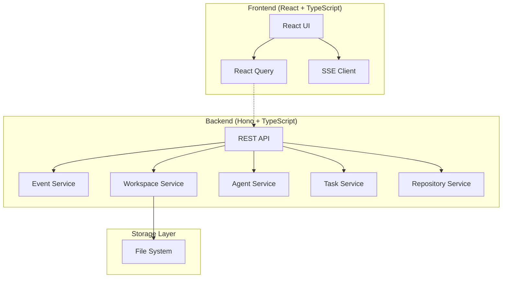
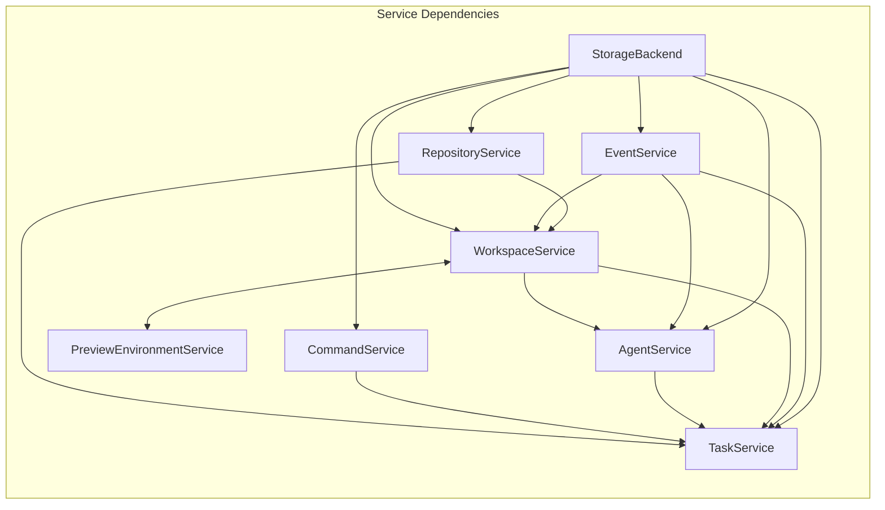

# Moatless Swarm UI Architecture Overview

## Quick Navigation

| Core Components | Development Guides | Architecture Docs |
|----------------|-------------------|------------------|
| [📋 Tasks](#1-tasks---the-core-unit-of-work) | [🔌 API Reference](./api-reference.md) | [🏗️ System Architecture](#system-architecture) |
| [📡 Events](#2-events---real-time-communication) | [🧪 Testing Guide](./testing-guide.md) | [💾 Service Layer](#service-layer-architecture) |
| [📦 Repositories](#3-repositories---codebase-configuration) | [🎨 Styling Guide](./styling-guide.md) | [🔄 Data Flow](#data-flow-patterns) |
| [🏭 Workspaces](#4-workspaces---isolated-execution) | [🔀 Git Operations](./git-operations-guide.md) | [🛡️ Security](#security-considerations) |
| [👁️ Preview](#5-preview-environments---live-testing) | [📚 All Guides](#development-guides) | [⚡ Performance](#performance-optimizations) |
| [🤖 Agents](#6-agents---ai-task-processors) | [📖 Improvement Plan](./documentation-improvement-plan.md) | [🚀 Deployment](#deployment-considerations) |

## Introduction

Moatless Swarm UI is a web application that enables AI agents to safely execute code modifications in isolated environments. This document provides a high-level overview of the system architecture and references detailed documentation for specific components.

## System Architecture



## Technology Stack

### Frontend
- **Framework**: React 19 with TypeScript
- **Build Tool**: Vite
- **Routing**: TanStack Router (file-based)
- **State Management**: React Query (TanStack Query)
- **Styling**: Tailwind CSS v4
- **UI Components**: Shadcn/ui
- **Real-time Updates**: Server-Sent Events (SSE)

### Backend
- **Framework**: Hono (lightweight web framework)
- **Runtime**: Node.js with TypeScript
- **Architecture**: Service-oriented with dependency injection
- **Real-time**: Server-Sent Events
- **Storage**: File system-based

### Monorepo Structure
- **Tool**: Turborepo
- **Package Manager**: pnpm workspaces
- **Shared Code**: `@moatless/shared` package

## Core Components

The system is built around six core architectural components, each with dedicated documentation:

### 1. Tasks - The Core Unit of Work
Tasks represent AI-powered coding sessions that coordinate all other components.

**Key Responsibilities:**
- Manage task lifecycle (open → running → completed/error)
- Track iterations and agent progress
- Coordinate workspace operations
- Emit events for real-time updates

**Key Features:**
- Tri-context pattern for optimal performance
- Optimistic UI updates
- Smart cache invalidation
- Git integration

📖 **[Task Architecture Documentation](./task-management-architecture.md)**

### 2. Events - Real-time Communication
Server-Sent Events (SSE) provide unidirectional real-time updates from backend to frontend.

**Key Responsibilities:**
- Stream task progress events
- Broadcast system-wide updates
- Maintain persistent connections
- Handle reconnection gracefully

**Key Features:**
- Dual emission pattern (task-specific and global)
- Automatic reconnection with exponential backoff
- Event deduplication
- Type-safe event system

📖 **[Event Architecture Documentation](./event-architecture.md)**

### 3. Repositories - Codebase Configuration
Repositories define how codebases are accessed and executed within the system.

**Key Responsibilities:**
- Store repository metadata and paths
- Configure execution environments
- Detect frameworks automatically
- Define preview settings

**Key Features:**
- Git integration
- Framework auto-detection
- Custom execution commands
- Preview environment configuration

📖 **[Repository Architecture Documentation](./components/repositories.md)**

### 4. Workspaces - Isolated Execution
Workspaces provide safe, isolated environments for code modifications.

**Key Responsibilities:**
- Create git worktrees for isolation
- Execute commands safely
- Manage file operations
- Track workspace state

**Key Features:**
- Git worktree isolation
- Capability-based permissions
- Command execution with timeouts
- File operation APIs

📖 **[Workspace Architecture Documentation](./workspace-architecture.md)**

### 5. Preview Environments - Live Testing
Preview environments allow testing changes in real-time with development servers.

**Key Responsibilities:**
- Manage development server lifecycle
- Stream server logs
- Handle port allocation
- Provide live preview URLs

**Key Features:**
- Framework-specific server support
- Console log capture
- Live reload integration
- DOM inspection capabilities

📖 **[Preview Environment Documentation](./components/preview-environments.md)**

### 6. Agents - AI Task Processors
Agents are the AI models that process tasks and generate code modifications.

**Key Responsibilities:**
- Process user messages
- Execute tool calls
- Generate code changes
- Emit progress events

**Key Features:**
- Claude Code integration
- Tool execution framework
- Streaming responses
- Error recovery

📖 **[Agent Architecture Documentation](./components/agents.md)**

### Frontend Architecture
The frontend implements sophisticated patterns for performance and developer experience.

**Key Patterns:**
- Tri-context pattern for performance isolation
- React Query for server state management
- Optimistic updates for responsiveness
- Type-safe API integration

📖 **[Frontend Task Architecture](./frontend-task-architecture.md)**

## API Architecture

### REST API Endpoints

The backend exposes the following API routes under `/api/v1`:

#### Task Management
- `POST /tasks` - Create new task
- `POST /tasks/vibe` - Create task from template
- `GET /tasks` - List tasks
- `GET /tasks/:taskId` - Get task details
- `POST /tasks/:taskId/messages` - Send message to task
- `DELETE /tasks/:taskId` - Delete task
- `POST /tasks/:taskId/close` - Close task
- `POST /tasks/:taskId/stop` - Stop agent
- `POST /tasks/:taskId/merge` - Merge task changes

#### Workspace Operations
- `GET /tasks/:taskId/workspace-status` - Get workspace status
- `GET /tasks/:taskId/files` - List files
- `GET /tasks/:taskId/files/*` - Read file
- `PUT /tasks/:taskId/files/*` - Write file
- `POST /tasks/:taskId/search-files` - Search files
- `GET /tasks/:taskId/git-diff` - Get git diff
- `POST /tasks/:taskId/execute` - Execute command

#### Preview Environment Server Management
- `POST /tasks/:taskId/server/start` - Start dev server
- `POST /tasks/:taskId/server/stop` - Stop dev server
- `POST /tasks/:taskId/server/restart` - Restart dev server
- `GET /tasks/:taskId/server/status` - Get server status
- `GET /tasks/:taskId/server/logs` - Get server logs

#### Repository Management
- `POST /repositories` - Create repository
- `GET /repositories` - List repositories
- `GET /repositories/:id` - Get repository
- `PUT /repositories/:id` - Update repository
- `DELETE /repositories/:id` - Delete repository

#### Other APIs
- `GET /events` - List events
- `GET /events/stream` - Global event stream
- `POST /uploads` - Upload files
- `GET /commands` - List available commands

### Service Layer Architecture



## Data Flow Patterns

### 1. Task Creation Flow
1. User submits task via UI
2. Frontend makes optimistic update
3. Backend creates task and workspace
4. Events stream back to update UI
5. Agent processes task asynchronously

### 2. Real-time Update Flow
1. Agent performs action
2. Event emitted to EventService
3. Event broadcast via SSE
4. Frontend receives and processes event
5. React Query cache invalidated
6. UI updates automatically

## Security Considerations

### Workspace Isolation
- Each task operates in isolated git worktree
- File access restricted to workspace boundaries
- Command execution sandboxed

### API Security
- CORS configuration for cross-origin requests
- Request ID tracking for debugging
- Error handling without exposing internals

## Performance Optimizations

### Frontend
- React Query caching strategy
- Optimistic updates for better UX
- Efficient re-render patterns
- Code splitting and lazy loading

### Backend
- Event deduplication
- Connection pooling for SSE
- Efficient file operations
- Smart workspace lifecycle management

## Development Workflow

### Local Development
```bash
# Install dependencies
pnpm install

# Run development servers
pnpm dev

# Run type checking
pnpm type:check

# Run linting
pnpm biome:check
```

### Testing Strategy
- Unit tests for services and components
- Integration tests for API routes
- E2E tests for critical user flows

**Documentation**: [Testing Guide](./testing-guide.md)

## Deployment Considerations

### Environment Variables
- `NODE_ENV` - Development/production mode
- `PORT` - Server port configuration
- `CORS_ORIGIN` - CORS configuration
- `DATA_DIR` - Data storage directory

## Future Enhancements

### Planned Features
1. Docker-based workspace isolation
2. Enhanced authentication and authorization

## Glossary

- **Task**: A unit of work performed by an AI agent
- **Iteration**: A single attempt at completing a task
- **Workspace**: Isolated execution environment for a task
- **Repository**: Configuration for a codebase
- **Agent**: AI model that processes tasks
- **Event**: Real-time notification of system activity