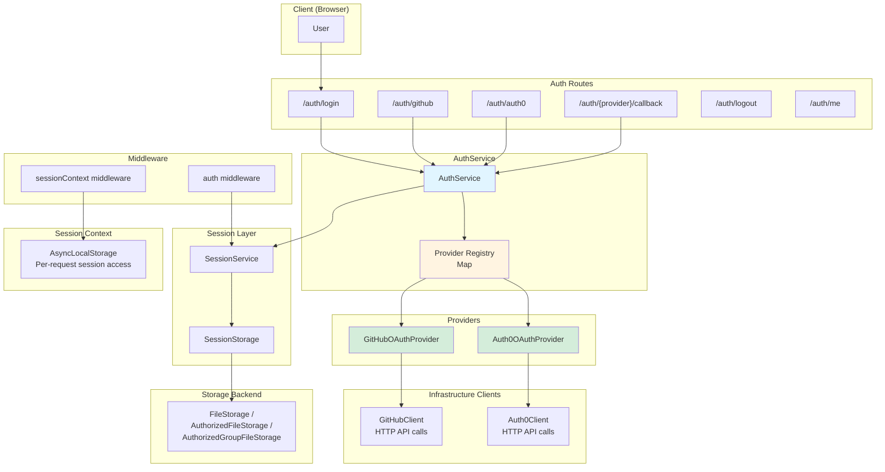
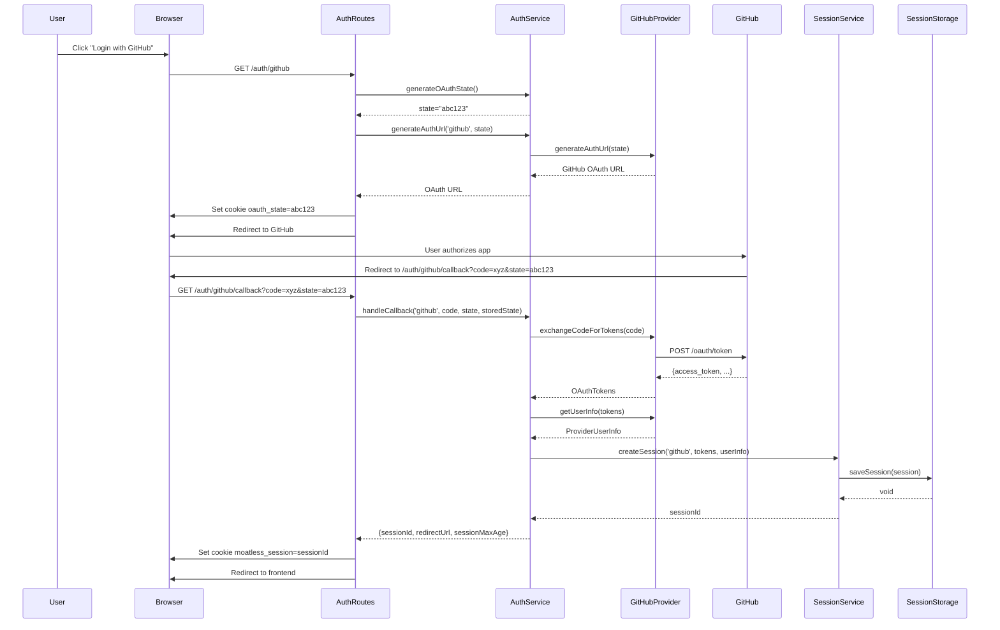
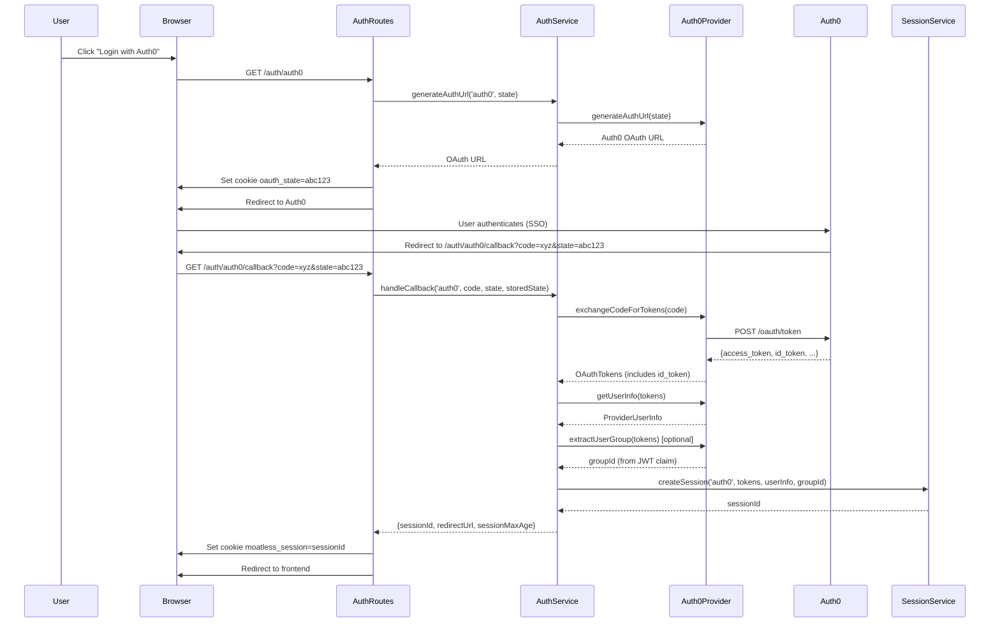
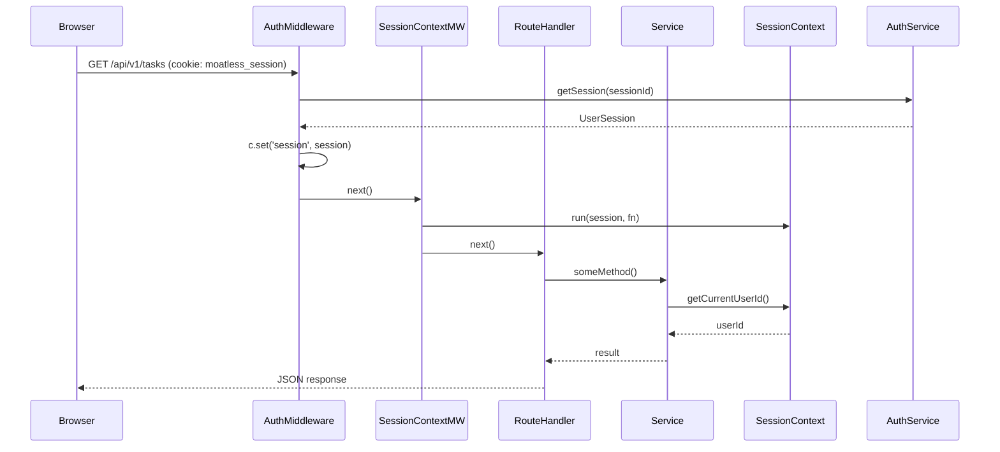
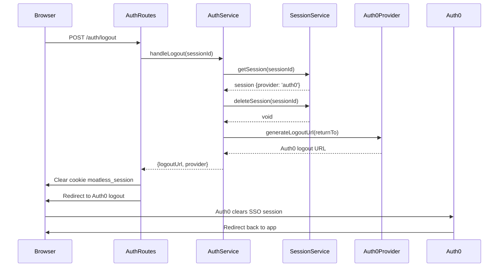

# Auth Feature Architecture

## Introduction

The authentication feature provides OAuth-based user authentication and session management for the Moatless Vibe application. It implements a provider abstraction pattern that allows supporting multiple OAuth providers (GitHub, Auth0, Google, Okta, etc.) without coupling the core authentication logic to any specific provider.

### Key Capabilities

- **Multi-Provider OAuth**: Supports any OAuth 2.0 / OpenID Connect provider
- **Session Management**: Secure cookie-based sessions with configurable expiration
- **Access Control**: User-scoped and group-scoped storage backends
- **Provider Abstraction**: Add new providers by implementing a simple interface
- **CSRF Protection**: State parameter validation for all OAuth flows
- **Async Session Context**: Access session data anywhere in request lifecycle without explicit passing

### Supported Providers

Currently implemented:
- **GitHub OAuth**: User authentication with repository access
- **Auth0**: Enterprise SSO with group-based access control

Extensible to any OAuth 2.0 provider by implementing the `OAuthProvider` interface.

## Architecture Diagram



## Directory Structure

```
apps/backend/src/
  features/auth/
    api/
      auth.routes.ts              # HTTP route handlers
    providers/
      oauth-provider.interface.ts # OAuthProvider interface
      github.provider.ts          # GitHub implementation
      auth0.provider.ts           # Auth0 implementation
    services/
      auth.service.ts             # Provider orchestration
      session.service.ts          # Session lifecycle
      oauth.service.ts            # Legacy (deprecated)
      session-context.ts          # AsyncLocalStorage wrapper
    storage/
      session.storage.ts          # Feature-scoped storage adapter
    types/
      oauth.types.ts              # OAuth token and user info types
    utils/
      cookie.utils.ts             # Cookie configuration helpers
    index.ts                      # Feature exports

  infrastructure/clients/
    github.client.ts              # GitHub HTTP API client
    auth0.client.ts               # Auth0 HTTP API client

  shared/http/middleware/
    auth.middleware.ts            # Session validation
    session-context.middleware.ts # AsyncLocalStorage integration

packages/types/src/
  types/auth.ts                   # Shared auth types
  schemas/auth.schemas.ts         # Zod validation schemas

packages/api-contract/src/
  auth.ts                         # OpenAPI route definitions
```

## Core Components

### 4.1 Provider Abstraction Layer

The authentication system uses a Strategy Pattern to decouple OAuth logic from specific providers.

#### OAuthProvider Interface

```typescript
export interface OAuthProvider {
  /**
   * Unique identifier for this provider (e.g., "github", "auth0", "google")
   */
  getProviderId(): string

  /**
   * Generate the OAuth authorization URL
   */
  generateAuthUrl(state: string): string | null

  /**
   * Exchange OAuth authorization code for access tokens
   */
  exchangeCodeForTokens(code: string): Promise<OAuthTokens>

  /**
   * Get authenticated user information
   */
  getUserInfo(tokens: OAuthTokens): Promise<ProviderUserInfo>

  /**
   * Optional: Extract user's group from tokens (Auth0 only)
   */
  extractUserGroup?(tokens: OAuthTokens): Promise<string | undefined>

  /**
   * Optional: Generate provider logout URL (Auth0 only)
   */
  generateLogoutUrl?(returnTo: string): string | null
}
```

**Key Design Decisions:**

- **Implementation-Agnostic**: Interface knows nothing about specific providers
- **Optional Methods**: Providers opt-in to features like group extraction
- **String Provider ID**: Allows any provider without code changes to core system
- **Normalized Types**: `OAuthTokens` and `ProviderUserInfo` abstract provider differences

#### Provider Implementations

**GitHubOAuthProvider** (`features/auth/providers/github.provider.ts`)
- Standard OAuth 2.0 flow
- Does NOT support group extraction (GitHub limitation)
- Does NOT require custom logout URL
- Scope: `user:email repo` (for repository cloning)

**Auth0OAuthProvider** (`features/auth/providers/auth0.provider.ts`)
- OpenID Connect flow (includes ID token)
- DOES support group extraction via JWT claims
- DOES support custom logout URL
- Extracts groups from configurable claim path
- Scope: `openid profile email`

### 4.2 Services

#### AuthService (`features/auth/services/auth.service.ts`)

**Purpose**: Orchestrate OAuth flows using the provider registry.

**Key Responsibilities:**
- Manage provider registry (`Map<string, OAuthProvider>`)
- Generate OAuth URLs for any provider
- Handle OAuth callbacks (code exchange, session creation)
- Handle logout with optional provider logout URLs
- Get current user session

**Constructor Dependencies:**
```typescript
constructor(
  private providers: Map<string, OAuthProvider>,
  private sessionService: SessionService,
)
```

**Public API:**
```typescript
generateOAuthState(): string
generateAuthUrl(providerId: string, state: string): string | null
handleCallback(providerId: string, code: string, state: string, storedState: string): Promise<{...}>
handleLogout(sessionId: string): Promise<{...}>
getCurrentUserSession(sessionId: string): Promise<SessionResponse>
```

#### SessionService (`features/auth/services/session.service.ts`)

**Purpose**: Manage session lifecycle independent of OAuth providers.

**Key Responsibilities:**
- Create sessions from provider tokens
- Validate and retrieve sessions
- Delete sessions
- Clean up expired sessions
- Convert sessions to API response format

**Constructor Dependencies:**
```typescript
constructor(
  private sessionStorage: SessionStorage,
  private userStorage: StorageBackend,
)
```

**Public API:**
```typescript
async createSession(
  providerId: string,
  tokens: OAuthTokens,
  userInfo: ProviderUserInfo,
  groupId?: string
): Promise<string | null>

async getSession(sessionId: string): Promise<UserSession | null>
async deleteSession(sessionId: string): Promise<void>
sessionToResponse(session: UserSession): SessionResponse
async cleanupExpiredSessions(): Promise<void>
```

**Session Creation Flow:**
1. Check if user exists in storage
2. Update existing user OR create new user
3. Generate cryptographically secure session ID
4. Calculate expiration time (SESSION_MAX_AGE)
5. Store session with all token data
6. Return session ID for cookie

#### OAuthService (`features/auth/services/oauth.service.ts`)

**Status**: DEPRECATED - kept for backward compatibility

**Note**: This service contains provider-specific OAuth logic that is being migrated to the provider implementations. New code should use the provider abstraction instead.

### 4.3 Storage

#### SessionStorage (`features/auth/storage/session.storage.ts`)

**Purpose**: Feature-scoped storage adapter that encapsulates session persistence.

**Design Pattern**: Storage Adapter (see `docs/patterns/feature-storage-adapters.md`)

**Key Structure:**
```typescript
export class SessionStorage {
  private readonly sessionsPrefix = 'sessions/'

  constructor(private readonly storage: StorageBackend) {}

  async saveSession(session: UserSession): Promise<void>
  async getSession(id: string): Promise<UserSession | null>
  async deleteSession(id: string): Promise<void>
  async exists(id: string): Promise<boolean>
  async listSessions(prefix?: string): Promise<string[]>
}
```

**Key Benefits:**
- Hides raw storage keys from services
- Type-safe operations
- Consistent key structure (`sessions/{sessionId}`)
- Single responsibility: persistence only

**Storage Backend Selection:**

The application selects storage backend based on environment variables:

| STORAGE_TYPE | AUTH_PROVIDER | Backend Used | Access Control |
|--------------|---------------|--------------|----------------|
| (not set) | (any) | FileStorage | None (storage is unscoped) |
| `user` | Required | AuthorizedFileStorage | Per-user isolation |
| `group` | Required | AuthorizedGroupFileStorage | Per-group isolation |

Storage backends are configured in `service-container.ts` based on these environment variables.

### 4.4 Infrastructure Clients

#### GitHubClient (`infrastructure/clients/github.client.ts`)

**Purpose**: Pure HTTP client for GitHub API v3.

**Key Methods:**
```typescript
async getAuthenticatedUser(token: string): Promise<GitHubUser | null>
async getUserEmails(token: string): Promise<GitHubEmail[] | null>
async validateToken(token: string): Promise<boolean>
// ... repository methods ...
```

**Design Principles:**
- No business logic
- Returns null on errors (with logging)
- Handles GitHub-specific quirks (private emails)

#### Auth0Client (`infrastructure/clients/auth0.client.ts`)

**Purpose**: Pure HTTP client for Auth0 API.

**Key Methods:**
```typescript
async getAuthenticatedUser(accessToken: string): Promise<Auth0User | null>
async validateToken(accessToken: string): Promise<boolean>
```

**Design Principles:**
- No JWT decoding (handled by Auth0Provider)
- No business logic
- Simple userinfo endpoint access

### 4.5 Middleware

#### auth middleware (`shared/http/middleware/auth.middleware.ts`)

**Purpose**: Validate session cookies and inject session into request context.

**Behavior:**
```typescript
// 1. Allow auth endpoints and static files
if (skipPaths.includes(path)) return next()

// 3. Require session cookie
const sessionId = getCookie(c, 'moatless_session')
if (!sessionId) throw 401

// 4. Validate session
const session = await services.auth.getSession(sessionId)
if (!session) throw 401

// 5. Inject session into context
c.set('session', session)
await next()
```

**Skip Paths:**
- `/api/v1/auth/*` (all auth endpoints)
- `/api/v1/tasks/{taskId}/mcp` (MCP server-to-server)
- Non-API paths (static files, SPA routes)

#### sessionContext middleware (`shared/http/middleware/session-context.middleware.ts`)

**Purpose**: Store session in AsyncLocalStorage for request lifecycle.

**Behavior:**
```typescript
export const sessionContext = (c: Context, next: Next) => {
  const session = c.get('session')
  return SessionContext.run(session, async () => {
    await next()
  })
}
```

**Middleware Order:**
```
1. auth middleware          # Validates and sets c.set('session')
2. sessionContext middleware # Stores in AsyncLocalStorage
3. Route handlers            # Access via SessionContext.getCurrentSession()
```

### 4.6 Session Context

#### SessionContext (`features/auth/services/session-context.ts`)

**Purpose**: Provide access to session data anywhere in request without explicit passing.

**Implementation**: Node.js `AsyncLocalStorage` API

**Public API:**
```typescript
export const SessionContext = {
  run: (session, fn) => void,           // Run function with session context
  getCurrentSession: () => UserSession | undefined,
  getCurrentSessionId: () => string | undefined,
  getCurrentUserId: () => string | undefined,
  getCurrentGroupId: () => string | undefined,
  hasSession: () => boolean,
  getAccessToken: () => string | undefined,
}
```

**Usage Example:**
```typescript
// In any service or utility (no need to pass session explicitly)
const userId = SessionContext.getCurrentUserId()
const accessToken = SessionContext.getAccessToken()

if (SessionContext.hasSession()) {
  // User is authenticated
}
```

**Benefits:**
- No explicit parameter passing through layers
- Works across async boundaries
- Type-safe access to session data
- Simplifies service signatures

## Request Lifecycle

### GitHub Login Flow



### Auth0 Login Flow



### Authenticated Request Flow



### Logout Flow



## Provider Pattern Deep Dive

### Why Provider Abstraction?

**Problem**: Different OAuth providers have different:
- Authorization URL structures
- Token exchange endpoints
- User info formats
- Optional features (groups, logout URLs)

**Solution**: Strategy Pattern with optional capabilities

**Benefits:**
- Add new providers without changing core auth logic
- Test providers in isolation
- Provider-specific features are opt-in
- Type safety maintained across all providers

### Adding a New Provider (Example: Google OAuth)

#### Step 1: Create Provider Implementation

```typescript
// apps/backend/src/features/auth/providers/google.provider.ts
import type { OAuthProvider } from './oauth-provider.interface.js'
import type { OAuthTokens, ProviderUserInfo } from '../types/oauth.types.js'

export class GoogleOAuthProvider implements OAuthProvider {
  constructor(private readonly client: GoogleClient) {}

  getProviderId(): string {
    return 'google'
  }

  generateAuthUrl(state: string): string | null {
    const clientId = process.env['GOOGLE_CLIENT_ID']
    const redirectUri = process.env['GOOGLE_REDIRECT_URI']

    if (!clientId || !redirectUri) {
      return null
    }

    const params = new URLSearchParams({
      client_id: clientId,
      redirect_uri: redirectUri,
      response_type: 'code',
      scope: 'openid email profile',
      state,
    })

    return `https://accounts.google.com/o/oauth2/v2/auth?${params.toString()}`
  }

  async exchangeCodeForTokens(code: string): Promise<OAuthTokens> {
    // Call Google token endpoint
    const response = await fetch('https://oauth2.googleapis.com/token', {
      method: 'POST',
      body: JSON.stringify({
        code,
        client_id: process.env['GOOGLE_CLIENT_ID'],
        client_secret: process.env['GOOGLE_CLIENT_SECRET'],
        redirect_uri: process.env['GOOGLE_REDIRECT_URI'],
        grant_type: 'authorization_code',
      }),
    })

    const data = await response.json()

    return {
      accessToken: data.access_token,
      idToken: data.id_token,
      tokenType: data.token_type,
      scope: data.scope,
    }
  }

  async getUserInfo(tokens: OAuthTokens): Promise<ProviderUserInfo> {
    const user = await this.client.getUserInfo(tokens.idToken!)

    return {
      id: user.sub,
      login: user.email,
      email: user.email,
      name: user.name,
      avatarUrl: user.picture,
    }
  }

  // Google does NOT support group extraction (omit method)
  // Google does NOT need custom logout URL (omit method)
}

export function createGoogleOAuthProvider(client: GoogleClient): GoogleOAuthProvider {
  return new GoogleOAuthProvider(client)
}
```

#### Step 2: Create Infrastructure Client

```typescript
// apps/backend/src/infrastructure/clients/google.client.ts
export class GoogleClient {
  async getUserInfo(idToken: string): Promise<GoogleUser> {
    // Decode JWT or call userinfo endpoint
  }
}

export function createGoogleClient(): GoogleClient {
  return new GoogleClient()
}
```

#### Step 3: Register in Service Container

```typescript
// apps/backend/src/services/service-container.ts
import { createGoogleOAuthProvider } from '../features/auth/providers/google.provider.js'
import { createGoogleClient } from '../infrastructure/clients/google.client.js'

// In createServiceContainer():
const googleClient = createGoogleClient()

const providers = new Map()
providers.set('github', createGitHubOAuthProvider(githubClient))
providers.set('auth0', createAuth0OAuthProvider(auth0Client))
providers.set('google', createGoogleOAuthProvider(googleClient)) // ← Add this

container.auth = createAuthService(providers, sessionService)
```

#### Step 4: Add Routes (Optional)

```typescript
// apps/backend/src/features/auth/api/auth.routes.ts

// Add route for /auth/google
app.openapi(initiateGoogleOAuthRoute, (c) => {
  const services = c.get('services')
  const state = services.auth.generateOAuthState()
  const authUrl = services.auth.generateAuthUrl('google', state) // ← Generic method

  setCookie(c, 'oauth_state', state, {...})
  return c.redirect(authUrl)
})

// Add route for /auth/google/callback
app.openapi(authGoogleCallbackRoute, async (c) => {
  const { code, state } = c.req.valid('query')
  const storedState = getCookie(c, 'oauth_state')
  const services = c.get('services')

  const result = await services.auth.handleCallback('google', code, state, storedState) // ← Generic method

  setCookie(c, SESSION_COOKIE_NAME, result.sessionId, {...})
  return c.redirect(result.redirectUrl)
})
```

#### Step 5: Update Environment Variables

```bash
# .env
GOOGLE_CLIENT_ID=your-client-id
GOOGLE_CLIENT_SECRET=your-client-secret
GOOGLE_REDIRECT_URI=http://localhost:8000/api/v1/auth/google/callback
```

**That's it!** The core auth system automatically works with the new provider.

### Optional Feature Handling

#### Example: Group Extraction (Auth0 Only)

```typescript
// In AuthService.handleCallback():
const groupId = provider.extractUserGroup
  ? await provider.extractUserGroup(tokens)
  : undefined

// Only called if provider implements the optional method
```

#### Example: Custom Logout URL (Auth0 Only)

```typescript
// In AuthService.handleLogout():
if (providerId) {
  const provider = this.providers.get(providerId)
  if (provider?.generateLogoutUrl) {
    const logoutUrl = provider.generateLogoutUrl(frontendUrl)
    return { logoutUrl, provider: providerId }
  }
}
```

## Type System

### AuthProvider Type

```typescript
// packages/types/src/types/auth.ts
export type AuthProvider = string
```

**Why string instead of enum?**
- Allows adding new providers without modifying type definitions
- No code changes needed in consuming code
- Maintains backward compatibility
- Provider names are runtime values, not compile-time constraints

### Zod Schemas

```typescript
// packages/types/src/schemas/auth.schemas.ts
export const authProviderSchema = z.string()

export const userSessionSchema = z.object({
  id: z.string(),
  provider: authProviderSchema,  // ← Accepts any string
  userId: z.string(),
  userLogin: z.string(),
  // ...
})

export const sessionResponseSchema = z.object({
  user: z.object({
    id: z.string(),
    login: z.string(),
    email: z.string().email().nullable(),
    name: z.string().nullable(),
    avatarUrl: z.string().url().nullable(),
    provider: authProviderSchema,  // ← Accepts any string
  }).nullable(),
  expiresAt: z.string().nullable(),
})
```

### Feature-Internal Types

```typescript
// apps/backend/src/features/auth/types/oauth.types.ts

/**
 * OAuth tokens returned by provider
 * Normalized format supporting OAuth 2.0 and OpenID Connect
 */
export interface OAuthTokens {
  accessToken: string
  tokenType: string
  scope?: string | undefined
  idToken?: string | undefined  // For OpenID Connect (Auth0, Google)
  [key: string]: unknown        // Allow provider-specific fields
}

/**
 * Normalized user information from provider
 */
export interface ProviderUserInfo {
  id: string          // Provider's unique user ID
  login: string       // Username or email
  email: string | null
  name: string | null
  avatarUrl: string | null
}
```

**Why separate from packages/types?**
- Feature-internal implementation details
- Not exposed via API contracts
- Allows evolution without affecting consumers
- Follows backend feature architecture pattern

### Shared Types

```typescript
// packages/types/src/types/auth.ts

export interface User {
  id: string
  login: string
  email: string | null
  name: string | null
  avatarUrl: string | null
  provider: AuthProvider  // ← string, not enum
  createdAt: Date
  lastLoginAt: Date
}

export interface UserSession {
  id: string
  provider: AuthProvider  // ← string, not enum
  userId: string
  userLogin: string
  userEmail: string | null
  userName: string | null
  avatarUrl: string | null
  accessToken?: string | undefined
  idToken?: string | undefined
  tokenType?: string | undefined
  scope?: string | undefined
  groupId?: string | undefined
  createdAt: Date
  expiresAt: Date
}

export interface SessionResponse {
  user: {
    id: string
    login: string
    email: string | null
    name: string | null
    avatarUrl: string | null
    provider: AuthProvider  // ← string, not enum
  } | null
  expiresAt: string | null
}
```

## Environment Variables

### GitHub OAuth

| Variable | Required | Description | Example |
|----------|----------|-------------|---------|
| `GITHUB_CLIENT_ID` | Yes (for GitHub auth) | GitHub OAuth app client ID | `Iv1.abc123...` |
| `GITHUB_CLIENT_SECRET` | Yes (for GitHub auth) | GitHub OAuth app client secret | `ghp_abc123...` |
| `GITHUB_CALLBACK_URL` | Yes (for GitHub auth) | OAuth callback URL | `http://localhost:8000/api/v1/auth/github/callback` |
| `GITHUB_OAUTH_SCOPE` | No | OAuth scopes (default: `user:email repo`) | `user:email repo read:org` |

### Auth0 OAuth

| Variable | Required | Description | Example |
|----------|----------|-------------|---------|
| `AUTH0_DOMAIN` | Yes (for Auth0 auth) | Auth0 tenant domain | `myapp.us.auth0.com` |
| `AUTH0_CLIENT_ID` | Yes (for Auth0 auth) | Auth0 application client ID | `abc123...` |
| `AUTH0_CLIENT_SECRET` | Yes (for Auth0 auth) | Auth0 application client secret | `xyz789...` |
| `AUTH0_CALLBACK_URL` | Yes (for Auth0 auth) | OAuth callback URL | `http://localhost:8000/api/v1/auth/auth0/callback` |
| `AUTH0_AUDIENCE` | No | Auth0 API audience identifier | `https://api.myapp.com` |
| `AUTH0_GROUPS_CLAIM` | No | JWT claim path for groups (default: `https://moatless.ai/groups`) | `https://myapp.com/groups` |

### Session Configuration

| Variable | Required | Description | Default | Example |
|----------|----------|-------------|---------|---------|
| `AUTH_PROVIDER` | No | Auth provider (`local`, `github`, `github_app`, `auth0`) | `local` | `github` |
| `ADMIN_USERNAME` | No | Bootstrap admin login under `local` | `admin` | `admin` |
| `ADMIN_PASSWORD` | No | Bootstrap admin password under `local` (min 12 chars). Generated and logged once at WARN when unset. | (generated) | — |
| `SESSION_JWT_SECRET` | No | Signs session cookies. Falls back to `TASK_TOKEN_SECRET`, which couples the two — rotating that then logs everyone out. | (falls back) | — |
| `SESSION_MAX_AGE` | No | Session lifetime in seconds | `604800` (7 days) | `86400` (1 day) |
| `FRONTEND_URL` | No | Frontend URL for OAuth redirects | `http://localhost:3000` | `https://app.example.com` |

### Storage Configuration

| Variable | Required | Description | Default | Example |
|----------|----------|-------------|---------|---------|
| `STORAGE_TYPE` | No | Storage access control (`user`, `group`, or none) | (none - no access control) | `group` |

**Note:** When `AUTH_PROVIDER` is not set the application runs local
username/password auth against the `user_credentials` table, with an `admin`
account seeded at startup. Every API route requires a session cookie or an
`mvk_` API key — there is no unauthenticated mode.

## Code Examples

### Example 1: Using SessionContext in a Service

```typescript
// apps/backend/src/services/repository.service.ts
import { SessionContext } from '../features/auth/index.js'

export class RepositoryService {
  async cloneRepository(repoUrl: string): Promise<void> {
    // Get access token from current session context
    const accessToken = SessionContext.getAccessToken()

    if (!accessToken) {
      throw new Error('Authentication required for private repositories')
    }

    // Use token to clone private repository
    await this.git.clone(repoUrl, { token: accessToken })
  }

  async listUserRepositories(): Promise<Repository[]> {
    // Get user ID from session context
    const userId = SessionContext.getCurrentUserId()

    if (!userId) {
      throw new Error('User not authenticated')
    }

    // Query user's repositories
    return this.storage.listRepositoriesByUser(userId)
  }
}
```

### Example 2: Accessing Session in Routes

```typescript
// apps/backend/src/features/tasks/api/tasks.routes.ts
import { getSessionFromContext } from '../../../shared/http/middleware/auth.middleware.js'

app.openapi(createTaskRoute, async (c) => {
  const body = c.req.valid('json')

  // Get session from context (set by auth middleware)
  const session = getSessionFromContext(c)

  if (!session) {
    throw new HTTPException(401, { message: 'Authentication required' })
  }

  // Use session data
  const task = await services.task.createTask({
    ...body,
    userId: session.userId,
    userLogin: session.userLogin,
  })

  return c.json(task)
})
```

### Example 3: Optional Authentication

```typescript
// apps/backend/src/features/repositories/api/repositories.routes.ts
app.openapi(getSuggestedRepositoriesRoute, async (c) => {
  const session = getSessionFromContext(c)

  // Works for both authenticated and unauthenticated users
  if (session) {
    // Personalized suggestions based on user's GitHub repos
    const suggestions = await services.repository.getPersonalizedSuggestions(
      session.accessToken
    )
    return c.json({ repositories: suggestions })
  } else {
    // Generic suggestions for anonymous users
    const suggestions = await services.repository.getGenericSuggestions()
    return c.json({ repositories: suggestions })
  }
})
```

### Example 4: Creating a New Provider (Okta)

```typescript
// apps/backend/src/features/auth/providers/okta.provider.ts
import type { OAuthProvider } from './oauth-provider.interface.js'
import type { OktaClient } from '../../../infrastructure/clients/okta.client.js'

export class OktaOAuthProvider implements OAuthProvider {
  constructor(private readonly client: OktaClient) {}

  getProviderId(): string {
    return 'okta'
  }

  generateAuthUrl(state: string): string | null {
    const domain = process.env['OKTA_DOMAIN']
    const clientId = process.env['OKTA_CLIENT_ID']
    const redirectUri = process.env['OKTA_REDIRECT_URI']

    if (!domain || !clientId || !redirectUri) {
      return null
    }

    const params = new URLSearchParams({
      client_id: clientId,
      response_type: 'code',
      redirect_uri: redirectUri,
      state,
      scope: 'openid profile email groups',
    })

    return `https://${domain}/oauth2/v1/authorize?${params.toString()}`
  }

  async exchangeCodeForTokens(code: string): Promise<OAuthTokens> {
    const domain = process.env['OKTA_DOMAIN']
    const clientId = process.env['OKTA_CLIENT_ID']
    const clientSecret = process.env['OKTA_CLIENT_SECRET']
    const redirectUri = process.env['OKTA_REDIRECT_URI']

    const response = await fetch(`https://${domain}/oauth2/v1/token`, {
      method: 'POST',
      headers: {
        'Content-Type': 'application/x-www-form-urlencoded',
        'Authorization': `Basic ${Buffer.from(`${clientId}:${clientSecret}`).toString('base64')}`,
      },
      body: new URLSearchParams({
        grant_type: 'authorization_code',
        code,
        redirect_uri: redirectUri,
      }),
    })

    const data = await response.json()

    return {
      accessToken: data.access_token,
      idToken: data.id_token,
      tokenType: data.token_type,
      scope: data.scope,
    }
  }

  async getUserInfo(tokens: OAuthTokens): Promise<ProviderUserInfo> {
    const user = await this.client.getUserInfo(tokens.accessToken)

    return {
      id: user.sub,
      login: user.preferred_username || user.email,
      email: user.email,
      name: user.name,
      avatarUrl: null, // Okta doesn't provide avatar URLs
    }
  }

  // Okta supports group extraction from ID token
  async extractUserGroup(tokens: OAuthTokens): Promise<string | undefined> {
    if (!tokens.idToken) {
      return undefined
    }

    const decoded = decodeJwt(tokens.idToken)
    const groups = decoded.groups as string[] | undefined

    return groups?.[0] // Return first group as primary
  }
}

export function createOktaOAuthProvider(client: OktaClient): OktaOAuthProvider {
  return new OktaOAuthProvider(client)
}
```

## Security Considerations

### CSRF Protection

**Mechanism**: OAuth state parameter validation

```typescript
// 1. Generate random state when initiating OAuth
const state = services.auth.generateOAuthState() // randomBytes(16).toString('hex')

// 2. Store state in cookie
setCookie(c, 'oauth_state', state, {
  httpOnly: true,
  secure: process.env['NODE_ENV'] === 'production',
  maxAge: 600, // 10 minutes
  sameSite: 'Lax',
})

// 3. Validate state on callback
const storedState = getCookie(c, 'oauth_state')
if (state !== storedState) {
  throw new Error('Invalid state parameter')
}
```

**Protection Against**: CSRF attacks during OAuth flow

### Session Cookie Security

**Configuration**: (`features/auth/utils/cookie.utils.ts`)

```typescript
export function getSessionCookieOptions(maxAge?: number) {
  return {
    httpOnly: true,  // ← Prevent JavaScript access (XSS protection)
    secure: process.env['NODE_ENV'] === 'production',  // ← HTTPS only in prod
    sameSite: 'Lax' as const,  // ← CSRF protection
    path: '/',
    ...(maxAge !== undefined && { maxAge }),
  }
}
```

**Protection Against:**
- XSS attacks (httpOnly)
- CSRF attacks (sameSite)
- Session hijacking (secure in production)

### Token Storage

**Session Storage:**
- Tokens stored server-side in storage backend
- Session ID stored in httpOnly cookie
- Tokens never exposed to client JavaScript

**Access Token Security:**
- Stored in `UserSession.accessToken` (server-side only)
- Accessed via `SessionContext.getAccessToken()`
- Used for GitHub API calls and repository cloning

**ID Token Security (Auth0):**
- Stored in `UserSession.idToken`
- Used for group extraction during session creation
- Not sent to client

### Group-Based Access Control

**Mechanism**: Storage backend isolation per group

```typescript
// In service container
if (storageType === 'group') {
  container.storage = await createAuthorizedGroupStorageService(dataDir)
}
```

**Group Determination:**
1. Auth0: Extract from ID token JWT claim
2. GitHub: Look up in settings (userGroups configuration)

**Protection Against:**
- Cross-group data access
- Unauthorized repository access
- Data leakage between teams

### Environment-Specific Settings

**Development Mode (Local Password Auth):**
```bash
# .env.development
# AUTH_PROVIDER not set — local username/password auth
SESSION_JWT_SECRET=...        # openssl rand -hex 32
ADMIN_PASSWORD=...            # or omit; one is generated and logged at WARN
```

**Production Mode:**
```bash
# .env.production
AUTH_PROVIDER=auth0
AUTH0_DOMAIN=myapp.us.auth0.com
AUTH0_CLIENT_ID=...
AUTH0_CLIENT_SECRET=...
SESSION_MAX_AGE=86400  # 1 day
STORAGE_TYPE=group
NODE_ENV=production    # Enables secure cookies
```

**Security Checklist:**
- ✅ Never commit `.env` files to version control
- ✅ Use environment-specific `.env` files (`.env.development`, `.env.production`)
- ✅ Rotate OAuth client secrets periodically
- ✅ Use short session lifetimes in production
- ✅ Enable HTTPS in production (secure cookies)
- ✅ Validate all OAuth redirects
- ✅ Log authentication failures

## Related Documentation

### Backend Architecture
- [Backend Feature Architecture Pattern](../patterns/backend-feature-architecture.md) - Feature-first organization pattern
- [Backend Feature Domains](../backend-feature-domains.md) - Overview of all backend features
- [Feature Storage Adapters](../patterns/feature-storage-adapters.md) - Storage adapter pattern used by SessionStorage

### Auth-Specific Documentation
- [Auth0 Groups Setup](../auth0-groups-setup.md) - Configuring Auth0 for group-based access control
- [Auth Feature Migration Plan](../auth-feature-migration-plan.md) - Migration history and roadmap

### API Documentation
- `packages/api-contract/src/auth.ts` - OpenAPI route definitions
- `packages/types/src/types/auth.ts` - Shared TypeScript types
- `packages/types/src/schemas/auth.schemas.ts` - Zod validation schemas

### Infrastructure
- [Architecture Overview](../architecture-overview.md) - System-wide architecture
- [Service Container](../patterns/service-container-migration.md) - Dependency injection pattern

---

**Last Updated**: 2025-10-24
**Maintainers**: Backend team
**Related Features**: Repositories, Settings, Tasks
