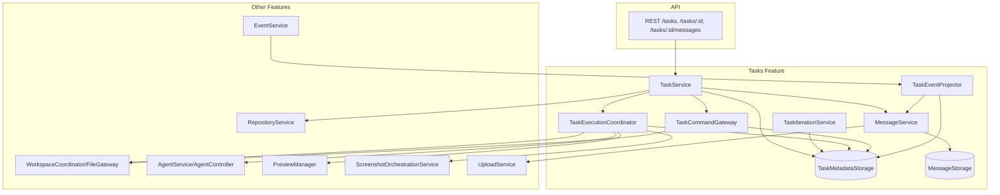
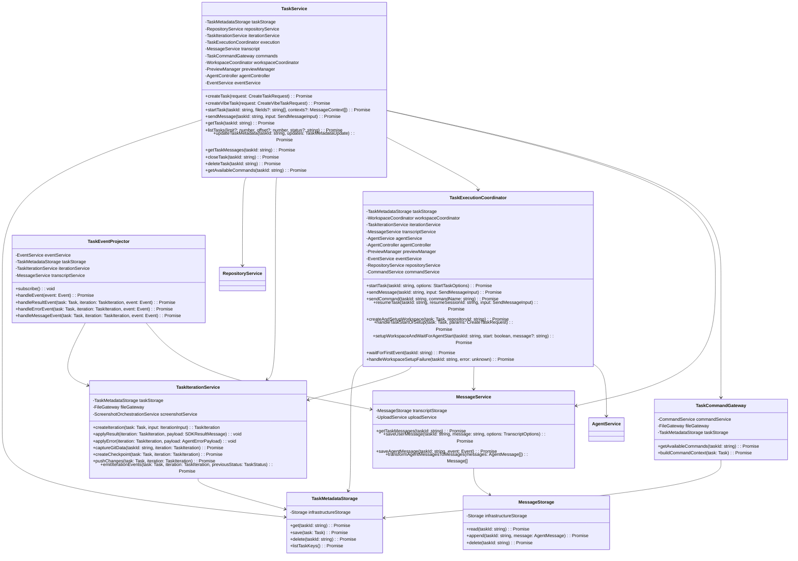
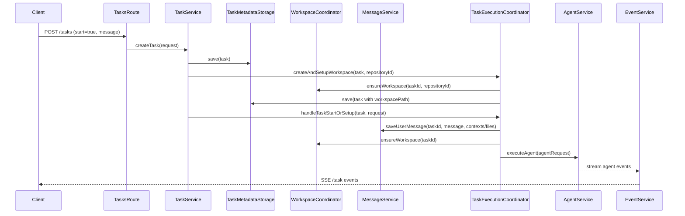
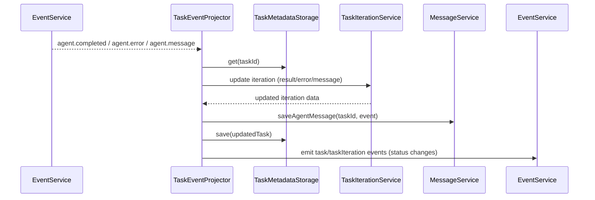

# Tasks Feature Architecture

## Status: Complete

**Last Updated**: 2025-10-27

This document describes the architecture of the tasks feature, which owns task lifecycle, agent orchestration, messaging, and command execution. The feature follows a feature-based architecture pattern with focused services and storage adapters.

## Overview

The tasks domain (see `docs/backend-feature-domains.md`) owns task lifecycle, agent orchestration, messaging, and command execution. The feature is organized as a dedicated `features/tasks` module with feature-scoped storage adapters (`docs/patterns/feature-storage-adapters.md`) and a set of focused application services, following the patterns described in `docs/patterns/backend-feature-architecture.md`.

## Architecture Goals

### Design Principles
- **Feature encapsulation**: The `features/tasks` module exposes a clear service API to routes and other features
- **Single responsibility**: Focused services handle specific concerns (lifecycle, execution, event projection, messaging) with explicit dependencies
- **Storage abstraction**: Task-specific storage adapters enable infrastructure provider flexibility
- **Type safety**: Strongly typed boundaries between tasks, iterations, and messages
- **Event-driven coordination**: Reactive event handlers update task state based on agent events

### Scope Boundaries
- **In scope**: Task lifecycle management, agent orchestration, message persistence, command execution
- **Out of scope**: Agent execution implementation details (delegated to AgentService), workspace management (delegated to WorkspaceCoordinator), repository management (delegated to RepositoryService)

## Domain Scope

| Capability | Description |
| --- | --- |
| Task lifecycle | Create/list/get/update/delete tasks, capture metadata, expose derived status, enforce validation. |
| Iteration management | Start iterations, persist git metadata & screenshots, hydrate context tokens, detect errors. |
| Agent orchestration | Provision workspaces, kick off/resume Claude sessions, pipe events to SSE/event service. |
| Messaging & transcripts | Persist user/assistant/tool messages, attachments, contexts, expose UI-friendly transcript. |
| Command context | Surface available commands per task, integrate git status and workspace state. |
| Event projection | Subscribe to agent/task iteration events and reconcile task state in storage. |

## High-Level Architecture



## Directory Layout

```
apps/backend/src/features/tasks/
  services/
    message.service.ts
    task-lifecycle.service.ts
    task-iteration.service.ts
    task-execution-coordinator.service.ts
    task-event-projector.service.ts
    task-command-gateway.service.ts
    task.service.ts
    __tests__/
      message.service.unit.test.ts
      message.service.integration.test.ts
      task-lifecycle.service.test.ts
      task-iteration.service.test.ts
      task-execution-coordinator.service.test.ts
      task-event-projector.service.test.ts
      task-command-gateway.service.test.ts
  storage/
    task-metadata.storage.ts
    message.storage.ts
    __tests__/
      task-metadata.storage.test.ts
      task-message.storage.test.ts
    index.ts
  utils/
    task-status.utils.ts
  api/
    tasks.routes.ts
    worker.routes.ts
  index.ts
```

**Design Notes**:
- Uses `services/` directory (not `application/`) per `docs/patterns/backend-feature-architecture.md`
- Iterations stored within task metadata - no separate iteration storage needed
- Event subscription handled in `TaskEventProjector` service - no separate subscribers directory
- All services bound in `container/container.ts` as singletons using InversifyJS

## Application Services & Responsibilities

| Service | Responsibilities | Key Dependencies |
| --- | --- | --- |
| `TaskService` | Public facade for all task operations. Handles CRUD (get/list/update with status derivation and enrichment). Orchestrates complex workflows (task creation with workspace setup, deletion with cleanup). Delegates execution to specialized services. | `TaskMetadataStorage`, `TaskExecutionCoordinator`, `MessageService`, `TaskCommandGateway`, `WorkspaceCoordinator`, `RepositoryService`, `EventService`, `AgentController`, `PreviewManager` |
| `TaskIterationService` | Iteration lifecycle management. Create iterations with validation. Apply results/errors. Capture git metadata (status, changes, commit hash). Create checkpoints and push changes. Coordinate screenshot captures. Emit iteration events. | `TaskMetadataStorage`, `FileGateway`, `ScreenshotOrchestrationService`, `EventService`, `RepositoryService` |
| `TaskExecutionCoordinator` | Orchestrate agent execution and workspace management. Send messages/commands to tasks. Start tasks and wait for first event. Provision workspaces and validate readiness. Execute agents in background with error handling. Resume logic for continuing iterations. Handles workspace setup during task creation. | `TaskMetadataStorage`, `TaskIterationService`, `MessageService`, `WorkspaceCoordinator`, `FileGateway`, `AgentController`, `EventService`, `RepositoryService`, `CommandService`, `UploadService`, `FigmaService` |
| `TaskEventProjector` | Reactive event handler for task state updates. Subscribe to `EventService` and reconcile task state based on agent events (`agent.completed`, `agent.error`, `agent.message`). Update context tokens and agent session IDs. Trigger post-processing workflows. | `EventService`, `TaskMetadataStorage`, `TaskIterationService` |
| `TaskCommandGateway` | Filter available commands based on task and workspace state. Build command context from git status and iteration history. Apply command condition filtering using `filterAvailableCommands()` utility. Reads tasks directly from storage (no enrichment needed). | `CommandService`, `FileGateway`, `TaskMetadataStorage` |
| `MessageService` | Persist user/assistant/tool messages to JSONL. Fetch and transform transcripts for UI consumption. Stitch contexts and file attachments for display. Handle message deduplication. | `MessageStorage`, `UploadService`, `TaskMetadataStorage` |

## Storage & Persistence Strategy

Each logical collection is backed by a dedicated adapter per `docs/patterns/feature-storage-adapters.md`:

- **`TaskMetadataStorage`** → `tasks/{taskId}.json` (full `Task` aggregate including iterations)
  - Uses `InfrastructureStorageSymbol` for storage abstraction
  - Methods: `save()`, `get()`, `delete()`, `exists()`, `listTaskKeys()`

- **`MessageStorage`** → `messages/{taskId}.jsonl` (append-only log for transcripts)
  - Uses `StorageSymbol` (`StorageBackend`) for JSONL operations
  - Methods: `read()`, `append()`, `delete()`, `exists()`
  - **Note**: JSONL operations (readJsonl/appendJsonl) not available in minimal `InfrastructureStorageSymbol` interface

**Implementation Example**:
```ts
@injectable()
export class TaskMetadataStorage {
  constructor(@inject(InfrastructureStorageSymbol) private readonly storage: Storage) {}

  async save(task: Task): Promise<void> {
    await this.storage.save(this.getKey(task.taskId), task)
  }

  async get(taskId: string): Promise<Task | null> {
    return this.storage.get<Task>(this.getKey(taskId))
  }

  private getKey(taskId: string): string {
    return `tasks/${taskId}`
  }
}
```

**Container Bindings**:
```ts
container.bind(TaskMetadataStorage).toSelf().inSingletonScope()
container.bind(MessageStorage).toSelf().inSingletonScope()
```

The adapters keep feature services free from infrastructure knowledge. Tests use mocked `Storage` implementations following the pattern doc.

## Message & Event Flow

### Task Transcript Pipeline
1. `TaskExecutionCoordinator` or routes call `MessageService.saveUserMessage` before starting/resuming the agent.
2. `TaskEventProjector` forwards every `agent.message` event to `MessageService.saveAgentMessage`, deduping initial user prompts just like today.
3. `MessageService.getTaskMessages` hydrates attachment metadata via `UploadService` and returns UI-friendly `Message[]` values.
4. Downstream consumers (UI, worker mode) only depend on the transcript service; no other module reads JSONL files directly.

### Agent Event Projection
1. `TaskEventProjector` subscribes to `EventService.subscribeAll` during feature bootstrap.
2. For each relevant event it loads the task aggregate once via `TaskMetadataStorage`, delegates business logic to `TaskIterationService`, persists changes, and emits follow-up task / iteration events when state changes.
3. Context token updates (`agent.message`) and agent session IDs are applied opportunistically without blocking other event handlers.

## API Surface & External Contracts

- `POST /tasks` → `TaskService.createTask` (supports template/vibe creation, immediate start flag, contexts, file attachments).
- `POST /tasks/vibe` → `TaskService.createVibeTask` (repository bootstrap + task creation).
- `POST /tasks/:id/start` / `POST /tasks/:id/messages` → `TaskExecutionCoordinator.startTask` / `sendMessage`.
- `GET /tasks/:id` / `GET /tasks` → `TaskService.getTask` / `listTasks` with derived status and repository metadata.
- `GET /tasks/:id/messages` → `MessageService.getTaskMessages`.
- `POST /tasks/:id/close`, `DELETE /tasks/:id` → Task lifecycle operations that also call workspace/preview cleanup.
- `GET /tasks/:id/commands` → `TaskCommandGateway.getAvailableCommands` leveraging filtered command metadata.

## Class Diagram



## Sequence Diagrams

### Task Creation With Immediate Start



### Agent Event Projection




The routes provide backward-compatible endpoints while exposing the feature's public API. Other domains (worker mode, usage tracking) should import `TaskService` rather than accessing internal services directly.
