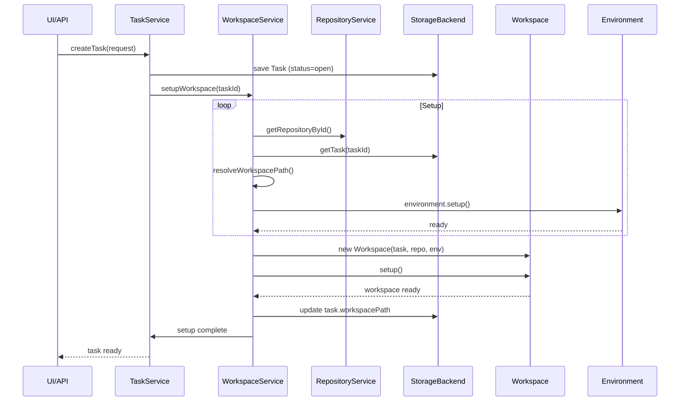
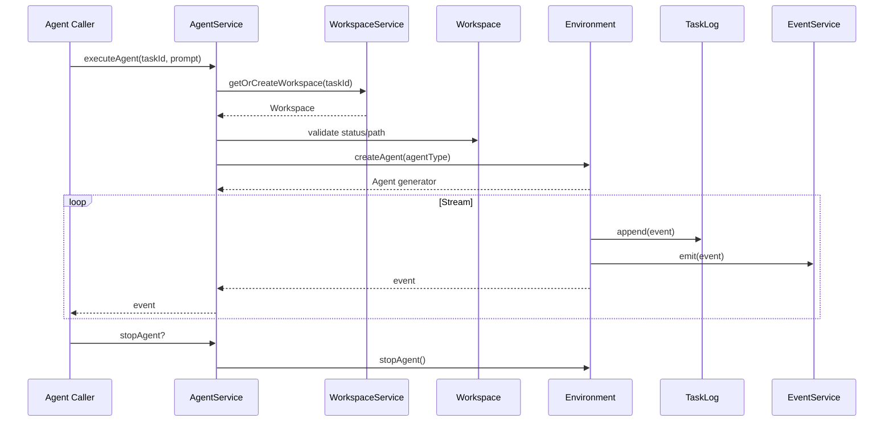
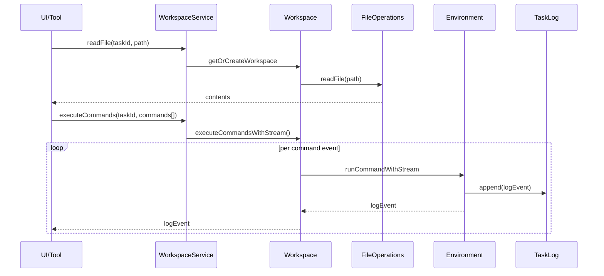
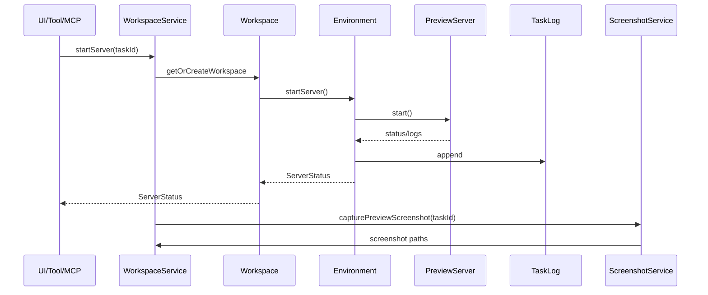
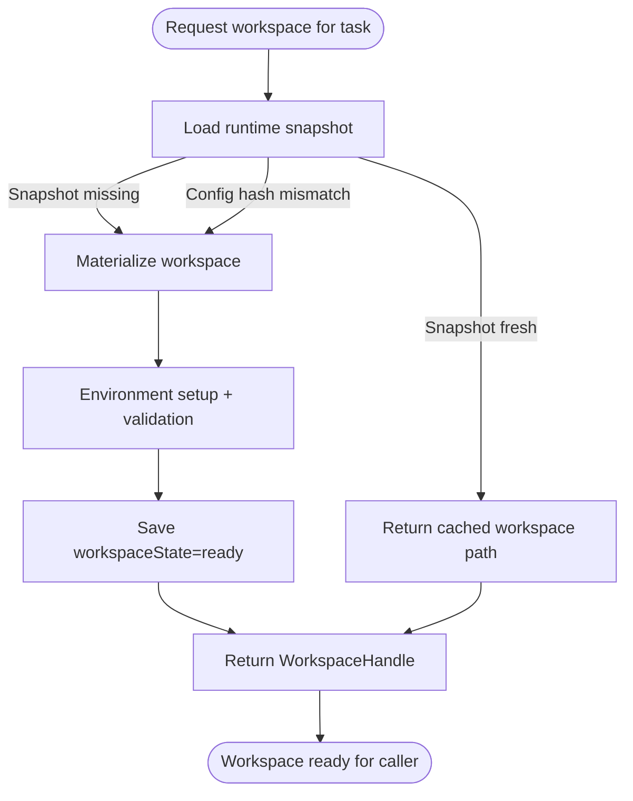
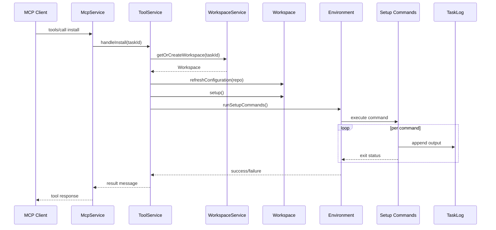
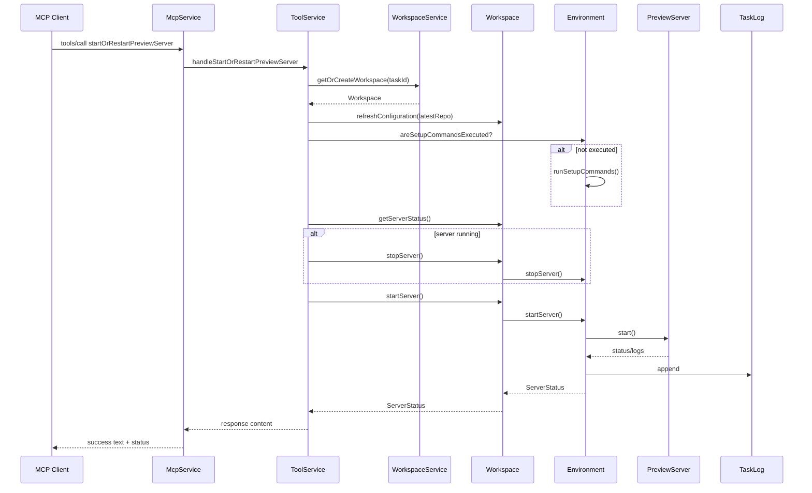
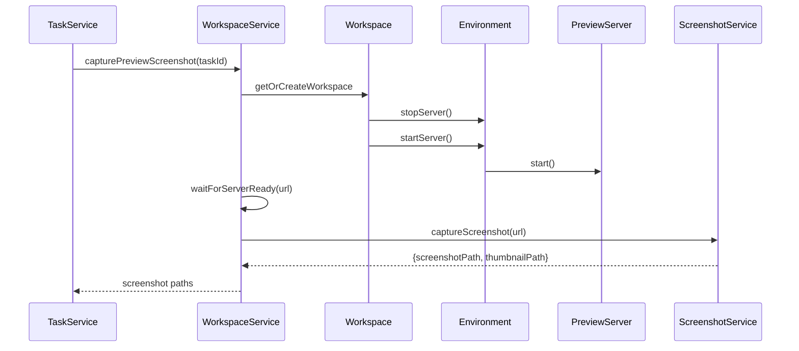
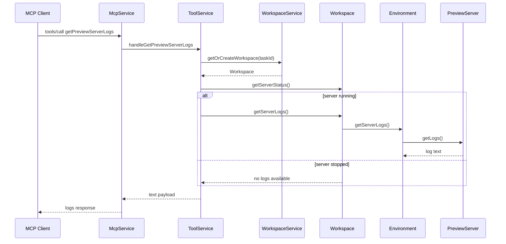

# Workspace Platform Architecture

## Scope & Intent
- Provide a blueprint for the full workspace system that powers task execution: provisioning, file access, command execution, agent orchestration, MCP tooling, screenshots, and preview serving.
- Surface how existing code paths (`WorkspaceService`, `Workspace`, environments, agents, preview server, task/command/screenshot services) collaborate today so maintenance touches every concern consciously.
- Outline the target responsibility split needed for a more resilient runtime (runtime store + coordinators) while staying approachable for a small team.

## Guiding Goals
1. **Deterministic state** — every task’s workspace state should be derivable from a persisted runtime snapshot rather than ad-hoc in-memory objects.
2. **Separation by concern** — orchestration, environment drivers, file/git operations, agent execution, and preview lifecycles communicate through explicit contracts.
3. **Observable operations** — all user-visible actions emit structured status/log updates consumed by UI, agents, and tooling.
4. **Pluggable environments** — new execution targets (local shells, Docker workers, remote VMs, Codespaces) should register through a narrow interface.
5. **Progressive enhancement** — simple local-only flows stay ergonomic while richer experiences (previews, screenshots, MCP tools) layer on top when configured.

## System Context
```mermaid
graph LR
  subgraph Experience & Automation
    UI[Web UI]
    API[REST/SSE API]
    MCP[MCP Clients]
  end
  subgraph Coordination & Services
    WSVC[WorkspaceService]
    ASVC[AgentService]
    TSVC[TaskService]
    MSVC[McpService]
    TLSVC[ToolService]
  end
  subgraph Core Runtime
    STORE[(Future: WorkspaceRuntimeStore)]
    LOG[Task Logs]
    EVENTS[EventService]
  end
  subgraph Execution Fabric
    WORKSPACE[Workspace Wrapper]
    FILE[FileOperations]
    ENVF[Environment Drivers]
    subgraph Environments
      LENV[LocalEnvironment]
      DENV[DockerEnvironment]
    end
    PREVIEW[PreviewServer Package]
    DOCKER[DockerService]
  end
  subgraph Data & External
    STORAGE[StorageBackend]
    REPOS[RepositoryService]
    CLAUDE[ClaudeService]
    SCREEN[ScreenShotService]
    FIGMA[FigmaService]
    UPLOAD[UploadService]
  end

  UI --> API --> WSVC
  MCP --> MSVC --> TLSVC
  TLSVC --> WSVC
  ASVC --> WSVC
  TSVC --> WSVC
  WSVC --> WORKSPACE
  WORKSPACE --> FILE
  WORKSPACE --> ENVF
  ENVF --> LENV
  ENVF --> DENV
  LENV --> PREVIEW
  DENV -.via worker API.-> DOCKER
  WSVC --> LOG
  ENVF --> LOG
  PREVIEW --> LOG
  WSVC --> EVENTS
  ASVC --> EVENTS
  TSVC --> EVENTS
  WSVC --> STORAGE
  WSVC --> REPOS
  DOCKER --> EVENTS
  STORAGE --> TSVC
  STORAGE --> TLSVC
  STORAGE --> ASVC
  REPOS --> WSVC
  CLAUDE --> LENV
  SCREEN --> WSVC
  FIGMA --> ASVC
  UPLOAD --> ASVC
  WSVC -.future-> STORE
  PREVIEW -.future-> STORE
```

## Current Implementation Snapshot
| Concern | Primary Classes / Files | Notes |
|---------|-------------------------|-------|
| Workspace orchestration | `apps/backend/src/services/workspace.service.ts` | Creates/owns in-memory `Workspace` instances, resolves repositories, manages background tasks, starts/stops previews, captures screenshots. |
| Workspace abstraction | `apps/backend/src/workspaces/workspace.ts` | Wraps environments + file operations, exposes file/git APIs, command execution, preview helpers, and workspace status reporting. |
| Environments | `apps/backend/src/environments/local-environment.ts`, `docker-environment.ts`, `base-environment.ts` | Concrete drivers implement setup, command execution, agent lifecycle, preview control, and configuration refresh. |
| File operations | `apps/backend/src/services/file-operations.service.ts` | Safe file IO, git status/diff caching, search, write protection, and tree building. |
| Agents | `apps/backend/src/services/agent.service.ts`, `agents/*` | Prepares workspace, streams agent events, copies uploads, integrates preview awareness, and reacts to `EventService`. |
| Task lifecycle | `apps/backend/src/services/task.service.ts` | Creates tasks, subscribes to events, coordinates commands, waits for workspace readiness, and derives statuses. |
| Tooling & MCP | `apps/backend/src/services/tool.service.ts`, `mcp.service.ts` | Implements install/start preview/get logs/update metadata tools with guard rails and streaming responses. |
| Preview package | `packages/preview-server/src/services/preview-server.ts` + `preview-proxy.ts` | Spawns preview processes, executes setup commands per launch, manages proxy + inspector, emits lifecycle callbacks. |
| Storage & repositories | `apps/backend/src/storage/*`, `services/repository.service.ts` | Persist tasks/workspaces/commands, fetch repository configs (paths, setup commands, env vars, preview definitions). |
| Observability | `apps/backend/src/utils/task-log.ts`, `utils/logger.ts`, `services/event.service.ts` | Append-only logs per task, structured events for UI & analytics, SSE streaming helpers. |
| Supporting services | `services/screenshot.service.ts`, `services/docker.service.ts`, `agents/claude-code/claude.service.ts`, `services/message.service.ts`, `services/command.service.ts`, etc. | Provide screenshots, docker worker control, Claude auth/requests, persistence of messages/commands. |

## Architectural Layers

### Experience Surfaces
- **REST & SSE routes** (e.g. `routes/preview-environment.ts`, `routes/workspace.ts`) validate `taskId`, resolve workspaces through `WorkspaceService`, and stream logs/events via `streamSSE`.
- **MCP tools** funnel through `McpService` → `ToolService`, leveraging the same workspace APIs as the UI.
- **Task iterations & commands** originate from the UI/CLI; `TaskService` and `CommandService` ensure only valid actions run.

### Coordination Core (Current & Target Blend)
- **WorkspaceService** remains the orchestrator today: caching active workspaces, resolving repository paths (clone/worktree/direct), triggering setup, surfacing status, and running background tasks (auto preview start, screenshot capture).
- **AgentService** depends on the workspace, ensures environment readiness, copies uploaded files, and streams agent events back to callers.
- **ToolService** executes install/start preview/logs/screenshot flows while respecting environment capabilities and guarding against stale config.
- **TaskService** listens to `EventService`, updates task iterations, waits for workspace readiness, and exposes git checkpoints via `CommandService`.
- **Target addition**: introduce `WorkspaceCoordinator`, `SetupRunner`, `PreviewManager`, and `WorkspaceRuntimeStore` (described in [Workspace & Preview System](workspace-preview-system.md)) to replace brittle in-memory state.

### Runtime State & Observability
- **Current**: `WorkspaceService` caches `Workspace` instances (`activeWorkspaces`), storing workspace path in the task record (`task.workspacePath`). Logs live in `data/logs/<taskId>.log`; environment setup/preview errors surface via `EventService`.
- **Future**: persist runtime snapshots capturing workspace/setup/preview state, enabling safe reuse across processes and crash recovery.
- **Task Logs**: `task-log.ts` handles ensure/append/read/clear, while `LocalEnvironment` writes shell output directly when `logFile` provided.
- **EventService**: emits environment (`initializing/ready/error`), server (`installing/started/failed`), and agent events; `TaskService` subscribes to update task state.

### Execution Fabric & Core Responsibilities
- **Workspace (wrapper)** (`workspaces/workspace.ts`)
  - Combines `FileOperations` and `BaseEnvironment` for a task.
  - Ensures environment setup, validates workspace path, exposes file IO, git diff/tree, command execution (`runCommand`, `runCommandWithStream`, `executeCommandsWithStream`).
  - Delegates preview control (`startServer`, `stopServer`, `getServerStatus`, `streamServerLogs`) to the environment.
  - Computes workspace status snapshots consumed by UI/API (includes git summary, agent state, command availability).
- **FileOperations**
  - Guarded read/write (path traversal prevention), list/search, diff, git status caching, support for original branch context.
- **Environments**
  - `LocalEnvironment`: interacts with local filesystem, `ShellCommand`, preview lifecycle (via `PreviewServer`), event emission on install, repository config refresh, run command stream.
  - `DockerEnvironment`: manages worker containers via `DockerService`, proxied command execution over worker API routes, container lifecycle, preview server start/stop/status/logs using worker endpoints.
  - Both expose agent lifecycle (`createAgent`, `runAgent`, `stopAgent`), representing environment-specific agent hosting.
- **Preview Server Package**
  - Executes optional setup commands per start, spawns server command with placeholder substitution (`{PORT}`, `{HOSTNAME}`), opens inspector/proxy, and notifies lifecycle sink for status and log streaming.
- **DockerService & ClaudeService**
  - Provide container orchestration (start worker, copy configs) and Claude auth verification for agent execution in Docker.

### Service Integrations
- **AgentService**
  - Orchestrates agent execution: obtains workspace, validates status/path, builds run options (preview awareness via `hasPreviewServer`), streams events, and persists artifacts (uploads, Figma snapshots).
  - Emits events to `TaskService` via `EventService`, enabling real-time task status updates.
- **TaskService**
  - Creates tasks (`CreateTaskRequest`), triggers workspace setup, monitors for readiness (`WORKSPACE_READY_TIMEOUT`), coordinates git checkpoints (`getCurrentCommitHash`, `createGitCheckpoint`), and listens to agent events for iteration status.
  - Integrates with `ScreenshotService` for preview captures and publishes task-level events.
- **ToolService & McpService**
  - Provide automation-friendly entry points for install/setup commands, preview control, log retrieval, repository config inspection, and screenshot capture, delegating to workspace/environment APIs.
- **ScreenshotService**
  - Called by `WorkspaceService.capturePreviewScreenshot` after restarting preview and waiting for HTTP readiness, producing screenshot + thumbnail artifacts.
- **CommandService**
  - Persists user-defined commands in storage, used by UI to expose quick actions; interacts with git utils for enforcement.

### Supporting Utilities & Data Access
- **StorageBackend**
  - Persists tasks, commands, uploads, runtime metadata, and is injectable (`@inject('Storage')`) across services.
- **RepositoryService**
  - Supplies repository metadata (path, code execution settings, setup/preview commands, env vars) used during workspace creation and config refresh.
- **Git Utilities** (`utils/index.ts`, `utils/git-utils.ts`)
  - Provide `cloneRepository`, `createGitWorktree`, `branchExists`, `createBranch`, diff helpers, git sync status for command gating.
- **Logging**
  - `logger.ts` builds scoped loggers per service/task; `LocalEnvironment` and `Workspace` rely heavily on structured logs for observability.
- **Background Tasks**
  - `WorkspaceService.backgroundTasks` tracks asynchronous processes (auto preview start, screenshot capture) tied to a task, ensuring cleanup when complete.

## Key Workflows

### Task Creation & Workspace Setup


### Agent Execution
(Existing flow)


### File Operations & Commands


### Preview Lifecycle (Current)


### Workspace Reuse Flow (Future Runtime Store)


### Install Tool & Setup Commands


### Preview Restart via Tool


### Screenshot Capture Flow


### MCP Tool: getPreviewServerLogs


### Cleanup & Background Tasks
- `WorkspaceService.cleanupWorkspace(taskId)` forces teardown (checking for uncommitted changes unless `force`), stops agents/preview, removes workspace from cache, and deletes background task handles.
- Background operations (auto preview start, screenshot capture, command installs) are tracked in `backgroundTasks` map to prevent leaks and enable status reporting.

## Target Evolution (From Preview Redesign Plan)
- **WorkspaceRuntimeStore** to persist runtime state and provide CAS updates.
- **WorkspaceCoordinator** replacing direct `WorkspaceService` access, enforcing snapshot validation and delegating to `SetupRunner`, `PreviewManager`, and environment factory.
- **SetupRunner** ensures repository setup commands run only when repo/setup revision changes.
- **PreviewManager** centralizes preview lifecycle, consuming the runtime store for status updates and log streaming.
- **Preview Gateway** to proxy task-specific preview traffic securely.

See [Workspace & Preview System Redesign Proposal](../plans/workspace-preview-system-redesign.md) and [Workspace & Preview System Design](workspace-preview-system.md) for the detailed target blueprint.

## Data & State Contracts
- **Task Record** (`@moatless/types::Task`): holds `repositoryId`, iterations, agent metadata, and `workspacePath` (current source of truth for path reuse).
- **Repository Config** (`RepositoryConfig`): includes `codeExecution` (type, env vars, setup commands, clone/worktree flags) and optional `previewConfig` (start commands, inspector, proxy).
- **Environment State**: stored in memory (status, error, setup flags) inside each environment instance.
- **Logs**: plain text files per task with timestamped entries; preview and command logs flush into same log when available.
- **Events**: structured payloads describing environment/server/agent transitions, consumed by UI and TaskService.
- **Future runtime snapshot**: will track workspace/setup/preview state, config revisions, errors, and timestamps for resilience.

## Observability & Resilience
- Extensive logger usage with task-scoped children ensures traceability (`WorkspaceService`, environments, agents, preview package).
- `EventService` fan-out allows UI to react to server status, agent completion, and errors.
- Command execution streams include start/completion markers and error events for reliable progress reporting.
- Preview server integrates lifecycle sink callbacks so restart failures notify UI/tooling immediately.
- Error handling in `WorkspaceService`, environments, and agents ensures workspace teardown on failure and prevents stale cached entries.

## Security & Isolation
- File operations enforce workspace-root boundaries to prevent path traversal.
- Environment commands inherit repository-defined env vars; additional vars can be injected per command.
- Docker environments isolate execution inside worker containers accessible only over localhost APIs.
- Preview proxy (current: environment-provided, future: dedicated gateway) restricts preview access to authenticated task owners; screenshot capture runs locally to avoid exposing public URLs unintentionally.

## Migration Strategy
1. Introduce runtime snapshot persistence and coordinator facade alongside existing `WorkspaceService`, feature flagging the new path.
2. Gradually port routes/services (preview, tool, agent, task) to the coordinator so `WorkspaceService` becomes a thin compatibility layer.
3. Move preview orchestration from environments/workspace into the dedicated `PreviewManager`, reusing the preview package.
4. Refactor `LocalEnvironment`/`DockerEnvironment` into stateless drivers (no cached setup flags) that interact with runtime store revisions.
5. Implement preview gateway + proxy endpoints to consolidate preview traffic and authentication.
6. Expand testing: unit tests for runtime store updates, environment drivers, preview lifecycle; integration tests for agent execution, command streaming, screenshot capture, and MCP tool flows.

## Open Questions
- Where should runtime snapshots live (shared task storage vs dedicated store such as SQLite/Redis/Postgres)?
- Do we need distributed locking if multiple backend instances can act on the same `taskId` concurrently?
- How long do we retain task logs, preview artifacts, and runtime metadata after task completion/archival?
- Should preview sharing support signed external URLs, and how do we enforce rate limiting/throttling?
- What metrics should Docker workers and local environments expose (CPU/memory) for future autoscaling and quota management?
