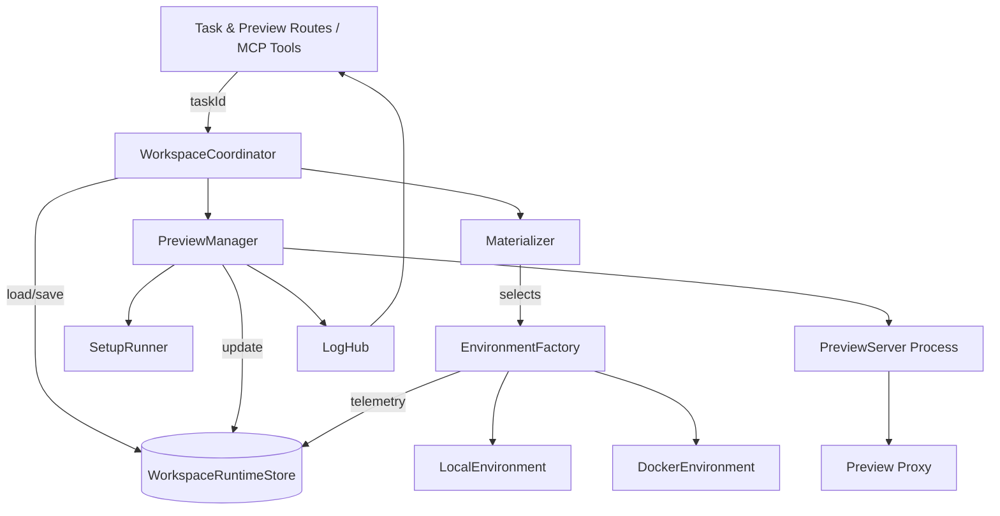
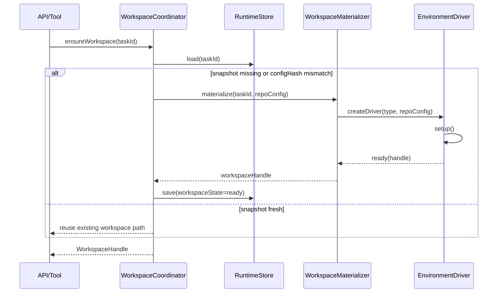
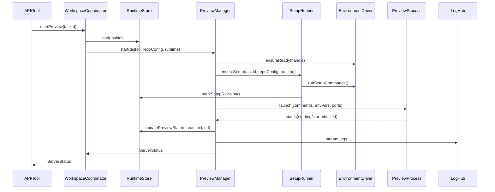
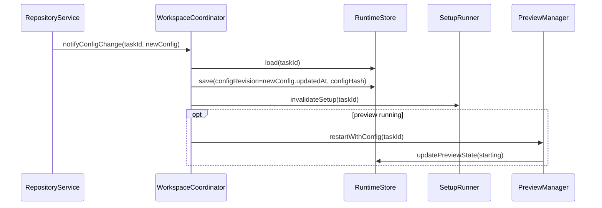

# Task -> Workspace -> Environment -> Preview System Design

## Goals
- Deliver a resilient yet approachable architecture for connecting task execution to workspace state, environments, and preview servers.
- Clarify single ownership boundaries so each layer can evolve independently and be tested in isolation.
- Reduce duplicated setup work and stale configuration issues while keeping day-to-day operations obvious to maintainers.

## Non-Goals
- Replace every existing preview-related implementation today; this document focuses on the target shape.
- Specify UI wiring or detailed retry policies for every edge case.
- Optimize for multi-tenant or horizontal scaling scenarios beyond a single control plane.

## Context Snapshot
- Cached `Workspace` instances in memory are reused even when repository configuration drifts, so env vars and command changes are missed.
- Environments mark setup commands as completed once, but the preview server replays them on every launch, doubling the work and creating conflicting lifecycle events.
- Preview lifecycle updates live in multiple places (workspace, environment, preview package) with no single source of truth for task-level status reporting.

## Design Principles
1. **Single runtime record per task**: Persist the authoritative snapshot that callers can query without touching live environment objects.
2. **Pull on demand**: Rehydrate workspaces and environments lazily from the runtime record instead of keeping long-lived instances in memory.
3. **Delegate platform specifics**: Local vs Docker logic stays behind environment drivers that implement a shared interface.
4. **Preview manager owns lifecycle**: Only one component is responsible for starting/stopping preview servers and replaying setup.
5. **Observable by default**: Every lifecycle transition pushes structured updates through the runtime store and event bus.

## Architecture Overview
The system is split into narrowly scoped coordinators. API routes and tools talk to the `WorkspaceCoordinator`, which orchestrates runtime lookup, workspace materialization, environment readiness, and preview lifecycle.



## Component Responsibilities
| Component | Proposed Location | Responsibility |
|-----------|-------------------|----------------|
| Task/Preview API & Tools | `apps/backend/src/routes/preview-environment.ts`, `.../services/tool.service.ts` | Invoke coordinator entry points using `taskId`; never touch environments directly. |
| WorkspaceCoordinator | `apps/backend/src/workspace/coordinator.ts` | Entry surface for task operations; loads runtime snapshot, materializes workspace if stale, and routes preview requests to managers. |
| WorkspaceRuntimeStore | `apps/backend/src/workspace/runtime-store.ts` | Persisted snapshot per task (workspace path, config revision, setup revision, preview status, timestamps, errors). Provides atomic load/update helpers. |
| WorkspaceMaterializer | `apps/backend/src/workspace/materializer.ts` | Resolve filesystem location (clone/worktree), ensure repo validity, and hand back a `WorkspaceHandle` with repository metadata. |
| EnvironmentFactory / Drivers | `apps/backend/src/environments/*` | Build environment adapters for `local` / `docker`, exposing `setup`, `runCommand`, `startPreview`, etc., without carrying long-lived state between calls. |
| SetupRunner | `apps/backend/src/workspace/setup-runner.ts` | Execute repo `setupCommands` only when the runtime snapshot hash changes; records last successful revision in the runtime store. |
| PreviewManager | `apps/backend/src/workspace/preview-manager.ts` | Own preview lifecycle: pull latest repo config, ensure setup via `SetupRunner`, start/stop preview process, stream logs, and update runtime snapshot + events. |
| PreviewProcess Wrapper | `packages/preview-server` | Spawn the preview command, manage proxy + inspector, emit structured lifecycle updates. |
| Preview Proxy Gateway | `apps/backend/src/workspace/preview-gateway.ts` | Provide authenticated HTTP proxy endpoints mapping `taskId` to the active preview. |
| LogHub | `apps/backend/src/utils/task-log.ts` | Central sink for command/setup/preview logs exposed to UI and tooling. |

## Key Workflows

### Workspace Provisioning
The coordinator materializes a workspace only when the runtime snapshot is missing or stale. Otherwise it reuses the cached path without recreating environment instances.



### Start Preview
All preview lifecycle orchestration flows through the preview manager, which keeps runtime and observers in sync.



### Repository Configuration Refresh
Whenever repository metadata updates, the coordinator regenerates the runtime snapshot before servicing new requests.



## Workspace Runtime Snapshot
The runtime store keeps the only durable state about a task workspace.

```ts
interface WorkspaceRuntimeSnapshot {
  taskId: string
  repositoryId: string
  configRevision: string // monotonic e.g. repo updatedAt or hash
  workspacePath: string | null
  workspaceState: {
    status: 'absent' | 'initializing' | 'ready' | 'error'
    lastValidatedAt?: string
    lastError?: string
  }
  setupState: {
    revision: string | null // hash of setup commands + env
    lastRunAt?: string
    lastError?: string
  }
  previewState: {
    status: 'stopped' | 'starting' | 'started' | 'failed'
    url?: string
    proxyUrl?: string
    pid?: number
    lastStartedAt?: string
    lastStoppedAt?: string
    lastError?: string
  }
}
```

## Error Handling & Observability
- Coordinators attach the current snapshot version to logs to trace stale writes; failed writes emit structured events through `EventService`.
- Setup runner records failed command output in `LogHub` and stores the failure in `setupState.lastError` so UI can surface actionable feedback.
- Preview manager listens to `PreviewProcess` lifecycle callbacks and writes `previewState` transitions atomically to avoid flicker on restart.
- Environments expose health probes (ready/error) that the coordinator checks before reusing a workspace path; if a path disappears, the snapshot is reset to `absent`.

## Operational Considerations
- **Concurrency**: Runtime store updates are compare-and-swap based on `configRevision` to avoid conflicting writers (preview restarts vs setup).
- **Cleanup**: Coordinator registers process exit hooks to stop preview processes and persist `stopped` state before shutdown.
- **Extensibility**: Additional environment types (remote VM, Codespaces) plug into the factory without touching coordinator logic.
- **Testing**: Each component has clear seams, enabling unit tests for setup hashing, preview manager transitions, and materializer path selection.

## Migration Sketch
1. Implement `WorkspaceRuntimeStore` on top of the existing storage backend and backfill current tasks with minimal snapshots.
2. Introduce `WorkspaceCoordinator` facade; migrate routes and tools to use it instead of `WorkspaceService` directly.
3. Extract preview lifecycle into the new `PreviewManager` and `SetupRunner`, wiring them through the coordinator.
4. Refactor `LocalEnvironment` and `DockerEnvironment` to operate statelessly per invocation and remove direct preview server ownership.
5. Delete in-memory `activeWorkspaces` map once runtime-backed lookups cover all callers.
6. Add regression tests covering auto-setup, preview restarts, config drift detection, and error surfacing through the runtime snapshot.

## Open Questions
- Should runtime snapshots live in the primary task store or a dedicated collection/table for faster lookups?
- Do we require cross-process coordination (e.g., Redis locks) if multiple worker instances can operate on the same task simultaneously?
- How far should the preview proxy go in enforcing authentication and rate limiting for public preview URLs?

