# Refactored Workspace Runtime Architecture

## Purpose
- Present a future-ready workspace system design that resolves current pain points (stale state, duplicated preview logic, ad-hoc coordination).
- Provide a layered blueprint so teams can evolve features independently while sharing durable runtime state.
- Serve as the reference for implementation epics that migrate from `WorkspaceService` to the new coordinator-driven model.

## Layer Overview
1. **Experience Layer** – Routes, GraphQL/REST handlers, MCP endpoints, and background jobs that trigger workspace activities.
2. **Coordination Layer** – Stateless orchestrators (`WorkspaceCoordinator`, `ExecutionTargetManager`, `PreviewManager`, `AgentController`, `WorkerProvisioner`) that interpret requests and manipulate runtime state.
3. **Runtime State Layer** – `WorkspaceRuntimeStore` plus derived caches that persist workspace/preview/agent status, worker identity, errors, and timestamps.
4. **Execution Layer** – Local filesystem drivers or remote worker clients that run commands, manage previews, and stream logs.
5. **Support & Integration Layer** – Repository metadata, storage adapters, logging, events, screenshot tooling, docker control, and authentication providers.
6. **Observability & Policy Layer** – Structured logging, metrics, tracing, audit trails, rate limiting, and authorization decisions applied across requests.

## Layered Responsibilities
| Layer | Core Responsibilities | Key Artifacts |
|-------|----------------------|---------------|
| Experience | Validate identity/ownership, translate API/MCP payloads into coordinator calls, stream results to clients. | HTTP routes, SSE streams, MCP tools, cron/background jobs. |
| Coordination | Determine desired state transitions, read/update runtime snapshots, enforce invariants (idempotency, retries, locking). | `WorkspaceCoordinator`, `ExecutionTargetManager`, `PreviewManager`, `AgentController`, `WorkerProvisioner`. |
| Runtime State | Persist and version snapshots; expose atomic load/update helpers; issue change notifications. | `WorkspaceRuntimeStore`, snapshot schemas, optimistic locking helpers. |
| Execution | Perform heavy operations (clone repo, run commands, start preview, stream logs, run agents) either locally or inside a worker. | `LocalEnvironmentDriver`, `RemoteWorkerEnvironment`, `Worker RPC clients`. |
| Support & Integration | Supply metadata, secrets, credentials, artifacts, and durable storage, abstracting external systems. | `RepositoryService`, `StorageBackend`, `DockerService`, `ScreenshotService`, `ClaudeService`, `UploadService`. |
| Observability & Policy | Capture logs/metrics/traces, enforce authorization, handle rate limits, emit structured events for UI/automation. | `LogHub`, `EventService`, policy middleware, audit log writers. |

## Coordination Components
```mermaid
classDiagram
  class WorkspaceRoutes {
    +ensureWorkspace(taskId)
    +getWorkspaceStatus(taskId)
  }

  class PreviewRoutes {
    +startPreview(taskId)
    +stopPreview(taskId)
    +getPreviewStatus(taskId)
    +streamLogs(taskId)
  }

  class AgentRoutes {
    +startAgent(taskId)
    +stopAgent(taskId)
    +streamAgent(taskId)
  }

  class TaskService {
    +setupWorkspace(taskId)
    +captureScreenshot(taskId)
    +triggerAgent(taskId)
  }

  class WorkspaceCoordinator {
    +ensureWorkspace(taskId): Promise<WorkspaceHandle>
    +getStatus(taskId): Promise<WorkspaceRuntimeSnapshot>
    +runCommand(taskId, command): AsyncGenerator<LogEvent>
    +startAgent(taskId, options)
    +startPreview(taskId)
    -loadSnapshot(taskId)
    -saveSnapshot(snapshot)
  }

  class WorkspaceProvisionPlan {
    +mode: string
    +branch: string
    +reusePath?: string
    +localTargetPath?: string
    +remoteClone?: RemoteClonePlan
    +setupMetadataHash: string
  }

  class RepositoryService {
    +getRepositoryById(id): Promise<RepositoryConfig>
    +createProvisionPlan(taskId, repoConfig): Promise<WorkspaceProvisionPlan>
    +resolveCredentials(repoConfig): CredentialBundle
    +getRepositoryConfig(taskId): Promise<RepositoryConfig>
  }

  class ExecutionTargetManager {
    +prepareExecutionTarget(plan): Promise<ExecutionTarget>
    +release(target)
  }

  class ExecutionTargetProvider {
    +type: string
    +provision(plan): Promise<ExecutionTarget>
    +ensureOnline(target): Promise<void>
    +destroy(target): Promise<void>
  }

  class DockerExecutionTargetProvider {
    +provision(plan): Promise<ExecutionTarget>
    +ensureOnline(target): Promise<void>
    +destroy(target): Promise<void>
  }

  class WorkerProvisioner {
    +prepareWorkspace(target, plan): Promise<WorkspaceHandle>
    +ensureWorker(target): Promise<void>
    -requestWorkerRPC(target, command)
  }

  class WorkspaceMaterializer {
    +applyPlan(plan): Promise<WorkspaceHandle>
    -createWorktree(plan)
    -cloneRepository(plan)
    -validateCheckout(plan)
  }

  class WorkspaceRuntimeStore {
    +load(taskId): Promise<WorkspaceRuntimeSnapshot>
    +compareAndSwap(snapshot, update): Promise<boolean>
    +watch(taskId, listener)
  }

  class PreviewManager {
    +start(snapshot): Promise<ServerStatus>
    +stop(snapshot): Promise<void>
    +restart(snapshot): Promise<ServerStatus>
    +getStatus(snapshot): Promise<ServerStatus>
  }

  class AgentController {
    +startAgent(snapshot, prompt): AsyncGenerator<AgentEvent>
    +stopAgent(snapshot): Promise<void>
    -claimAgentSlot(snapshot)
    -releaseAgentSlot(snapshot)
  }

  class LocalEnvironmentDriver {
    +runCommand(cmd): AsyncGenerator<LogEvent>
    +startPreview(): Promise<ServerStatus>
    +stopPreview(): Promise<void>
    +createAgent(options)
    +readFile(path)
  }

  class RemoteWorkerEnvironment {
    +runCommand(cmd): AsyncGenerator<LogEvent>
    +startPreview(): Promise<ServerStatus>
    +stopPreview(): Promise<void>
    +request(endpoint, payload)
    +readFile(path)
  }

  class WorkerClient {
    +prepareWorkspace(workerId, plan)
    +executeCommand(workerId, payload)
    +startPreview(workerId, payload)
    +streamLogs(workerId, channel)
    +proxyRequest(workerId, httpRequest)
  }

  class LogHub {
    +append(taskId, channel, event)
    +stream(taskId, channel)
    +rotate(taskId)
  }

  class EventService {
    +emitEvent(event)
    +subscribe(taskId, handler)
  }

  class FileGateway {
    +getWorkspacePath(taskId): Promise<string>
    +readFile(taskId, filePath): Promise<string>
    +writeFile(taskId, filePath, content): Promise<void>
    +listFiles(taskId, path?, recursive?): Promise<string[]>
    +searchFiles(taskId, query, limit?): Promise<SearchResult>
    +getGitStatus(taskId): Promise<GitStatus>
    +getGitChanges(taskId): Promise<GitChanges>
    +getGitDiff(taskId): Promise<GitDiff>
    +getCurrentCommitHash(taskId): Promise<string>
    +readFileWithChanges(taskId, filePath): Promise<FileWithChanges>
    +getFileTreeWithChanges(taskId, rootPath?): Promise<FileTree>
  }

  class FileOperations {
    +readFile(filePath): Promise<string>
    +writeFile(filePath, content): Promise<void>
    +listFiles(path, recursive): Promise<string[]>
    +searchFiles(request): Promise<SearchResult>
    +getGitStatus(): Promise<GitStatus>
    +getGitChanges(): Promise<GitChanges>
  }

  WorkspaceRoutes --> WorkspaceCoordinator
  PreviewRoutes --> PreviewManager
  AgentRoutes --> AgentController
  FileRoutes --> FileGateway : file operations
  TaskService --> WorkspaceCoordinator
  TaskService --> PreviewManager
  TaskService --> AgentController
  TaskService --> FileGateway : file operations
  WorkspaceCoordinator --> WorkspaceRuntimeStore : load/save snapshot
  WorkspaceCoordinator --> RepositoryService : fetch repo + plan
  WorkspaceCoordinator --> ExecutionTargetManager : request execution target
  ExecutionTargetManager --> ExecutionTargetProvider : provision target
  ExecutionTargetManager --> DockerExecutionTargetProvider
  WorkspaceCoordinator --> WorkspaceMaterializer : local plan execution
  WorkspaceCoordinator --> WorkerProvisioner : worker plan execution
  WorkerProvisioner --> WorkerClient : RPC calls
  PreviewManager --> WorkspaceCoordinator : ensure workspace
  AgentController --> WorkspaceCoordinator : ensure workspace
  PreviewManager --> RepositoryService
  PreviewManager --> LocalEnvironmentDriver
  PreviewManager --> RemoteWorkerEnvironment
  AgentController --> LocalEnvironmentDriver
  AgentController --> RemoteWorkerEnvironment
  WorkspaceCoordinator --> LogHub
  WorkspaceCoordinator --> EventService
  RemoteWorkerEnvironment --> WorkerClient
  FileGateway --> WorkspaceRuntimeManager : get workspace path
  FileGateway --> FileOperations : delegate file ops
  FileGateway --> WorkerClient : worker file ops (future)
```

### WorkspaceCoordinator
- Entry point for all workspace lifecycle actions (`ensureWorkspace`, `getStatus`, `runCommand`, `proxyPreview`).
- Reads runtime snapshot; if absent or outdated, invokes the appropriate materialization path (local filesystem or worker provisioning) and persists the updated execution target.
- Updates snapshot using compare-and-swap semantics to prevent race conditions.
- Provides lifecycle guarantees that other services rely on. Feature-scoped HTTP routes call preview/agent managers directly; those managers in turn call `WorkspaceCoordinator.ensureWorkspace()` before doing any domain-specific work. `TaskService` also uses the coordinator when orchestrating multi-step workflows (e.g., ensure workspace → start preview → capture screenshot → cleanup).

### RepositoryService Extensions
- Produces a **WorkspaceProvisionPlan** for each task/repository combination, describing how the workspace should be materialized:
  ```ts
  interface WorkspaceProvisionPlan {
    mode: 'direct' | 'worktree' | 'clone' | 'remote'
    branch: string
    reusePath?: string
    localTargetPath?: string
    remoteClone?: {
      repoUrl: string
      credentialsRef: string
      depth?: number
    }
    setupMetadataHash: string
  }
  ```
- Handles git/branch validation, worktree naming, and clone path derivation so coordinators and workers only execute the plan, not recompute policy.
- Exposes credential-bundles for remote clones (SSH keys, tokens) so worker pods/containers can authenticate without additional lookups.
- Emits setup metadata hashes used by runtime snapshots to detect when repo configuration changes.

### WorkerProvisioner & WorkspaceMaterializer
- **Local mode:** Reads the `WorkspaceProvisionPlan` and executes it directly (create worktree, fresh clone, or reuse path). The LocalEnvironment driver then runs commands on that filesystem path.
- **Worker-backed mode:** Uses the same plan but delegates execution to the worker via RPC (`worker.prepareWorkspace(plan)`). The worker performs the clone/checkout inside the container or pod, then reports back the workspace locator (`worker://<id>/workspace`).
- Supports heterogeneous targets: Docker workers mount host volumes (plan includes host path), Kubernetes workers perform in-pod clones (plan carries repo URL + credentials). The runtime snapshot stores only the worker locator; all subsequent operations route through the environment driver tied to that worker.

#### PreviewManager
- Calls `WorkspaceCoordinator.ensureWorkspace(taskId)` before every operation to guarantee the execution target is ready, then requests the current repository configuration from `RepositoryService`.
- **Executes setup commands** (e.g., `bun install`, `npm install`) once before the first preview start for each workspace. Setup execution is:
  - Triggered when `snapshot.preview.lastStartedAt` is undefined (first start detection)
  - Delegated to the environment driver via `driver.executeSetupCommands(workspacePath, commands, envVars)`
  - Tracked via `snapshot.preview.lastStartedAt` to ensure idempotency across restarts
  - Commands sourced from `repoConfig.codeExecution.setupCommands`
- Applies any necessary plan substitutions and orchestrates preview lifecycle.
- **Local mode:** uses the fetched repository configuration every time a preview is started or restarted, then starts/stops preview processes directly via `LocalEnvironment`, managing port allocation and log streaming.
- **Worker-backed mode:** delegates start/stop/status/proxy calls to the worker (`worker.preview.*`), then mirrors status/logs into the runtime snapshot and `LogHub`. No host-side process management required.

#### AgentController
- Calls `WorkspaceCoordinator.ensureWorkspace(taskId)` before starting or stopping agents so execution targets are ready, then claims agent slots in the runtime snapshot and streams events through `LogHub`/`EventService`.
- **Claims agent slot** in runtime snapshot using atomic update to prevent concurrent agent execution
- **Local mode:** launches agents directly via `LocalEnvironmentDriver.createAgent()`, which instantiates `ClaudeCodeAgent`
- **Worker-backed mode:** proxies `runAgent`/`stopAgent` requests to the worker's agent endpoints and forwards streamed events/logs
- **Releases agent slot** in finally block to ensure cleanup even on errors

### FileGateway

**Design Principle: TaskId-Only API**
FileGateway provides a unified file operation interface that accepts only `taskId` as the workspace identifier. This design hides workspace path resolution and execution target routing from consumers (TaskService, file routes), enabling seamless transitions between local and worker-backed execution modes without API changes.

**Responsibilities:**
- **Workspace Resolution**: Coordinates with `WorkspaceRuntimeManager` to resolve `taskId → workspacePath` and retrieve execution target information from runtime snapshot
- **Path Validation**: Enforces workspace path boundaries and validates file paths before operations
- **Operation Delegation**: Routes file operations to appropriate backend based on execution mode:
  - Local mode: delegates to `FileOperations` for direct filesystem access
  - Worker mode: proxies to `WorkerClient` file endpoints
- **Git State Management**: Provides git status, changes, and diff information coordinated with workspace state

**API Surface (11 methods organized by category):**

*Core File Operations:*
- `readFile(taskId, filePath): Promise<string>` - Read file contents
- `writeFile(taskId, filePath, content): Promise<void>` - Write file contents
- `listFiles(taskId, path?, recursive?): Promise<string[]>` - List directory contents

*Search & Discovery:*
- `searchFiles(taskId, query, limit?): Promise<SearchResult>` - Search file contents (ripgrep-based)
- `getFileTreeWithChanges(taskId, rootPath?): Promise<FileTree>` - Get file tree with git status annotations

*Git Operations:*
- `getGitStatus(taskId): Promise<GitStatus>` - Get current git status (staged, unstaged, untracked)
- `getGitChanges(taskId): Promise<GitChanges>` - Get detailed git changes (additions, deletions, modifications)
- `getGitDiff(taskId): Promise<GitDiff>` - Get unified diff for all changes
- `getCurrentCommitHash(taskId): Promise<string>` - Get current commit SHA

*Enhanced Operations:*
- `readFileWithChanges(taskId, filePath): Promise<FileWithChanges>` - Read file with git diff annotations
- `getWorkspacePath(taskId): Promise<string>` - Get resolved workspace path (internal use)

**Implementation Modes:**
- **Local mode**: Calls `WorkspaceRuntimeManager.getWorkspacePath(taskId)` to resolve path, then delegates to `FileOperations` service for direct filesystem access
- **Worker-backed mode**: Retrieves execution target from runtime snapshot, then proxies file operation requests to `WorkerClient` endpoints without touching host filesystem

**Key Benefit**: TaskService and file routes remain execution-mode agnostic—they call the same FileGateway methods regardless of whether the workspace runs locally or in a worker. FileGateway handles all mode-specific routing internally.

## Runtime Snapshot Schema
```ts
interface WorkspaceRuntimeSnapshot {
  taskId: string
  repositoryId: string
  configRevision: string
  executionTarget: {
    mode: 'local' | 'worker'
    workerId?: string
    workspaceLocator?: string // e.g. file:///..., worker://container-id/workspace
    lastValidatedAt?: string
    lastError?: string
  }
  agent?: {
    state: 'idle' | 'running'
    sessionId?: string
    agentType?: string
    startedAt?: string
  }
  preview: {
    status: 'stopped' | 'starting' | 'started' | 'failed'
    endpoint?: string // e.g. http://localhost:3000 or worker proxy path
    proxyUrl?: string
    lastStartedAt?: string
    lastStoppedAt?: string
    lastError?: string
  }
  locks?: {
    type: 'setup' | 'preview' | 'agent'
    owner: string
    acquiredAt: string
  }[]
}
```
- Stored via `WorkspaceRuntimeStore` (initial implementation: storage backend; future: dedicated DB supporting WATCH/TTL).
- All writers supply expected revision token to guard against lost updates.
- Change notifications feed event bus to invalidate caches and broadcast UI updates.

## Execution Drivers
### EnvironmentFactory & Drivers
- `EnvironmentFactory` instantiates drivers based on repository execution type (`local`, `docker`, future types).
- Drivers implement shared interface (`executeSetupCommands`, `runCommand`, `runCommandWithStream`, `startPreview`, `stopPreview`, `proxyPreviewRequest`, `createAgent`, `stopAgent`).
- **Setup command execution** happens at the driver level via `executeSetupCommands()`, allowing local and remote implementations to prepare their environments appropriately. Local drivers execute commands directly via ShellCommand; remote drivers delegate to worker RPC.
- Drivers are stateless between invocations; all state persists in runtime snapshot or short-lived handles scoped to requests.
- Docker driver coordinates with worker API for command execution, port mapping, and preview lifecycle; local driver manages shell execution and port allocation directly.

### FileOperations Adapter
- Provides safe file IO, directory traversal, git status/diff caching, and search.
- Supports incremental update notifications to runtime snapshot (e.g., track latest git SHA or dirty flag for UI badges).

### PreviewProcessAdapter
- Wraps preview server package; responsible for process management, env var templating, proxy setup, inspector toggles, log streaming, and lifecycle callbacks.
- Works with `PreviewManager` to persist transitions and deliver SSE streams without requiring direct environment references.

## Observability & Policy Enhancements
- **LogHub 2.0**: structured JSON appenders keyed by `taskId` and channel (`setup`, `preview`, `agent`, `command`) to improve filtering and UI rendering.
- **Event Enrichment**: runtime snapshot metadata attached to events for easier debugging and analytics.
- **Metrics**: counters/timers for setup duration, preview uptime, agent runtime, command latency; exported via Prometheus.
- **Policy Hooks**: central authorization middleware (e.g., `canManagePreview`, `canWriteFiles`, `canRunAgent`) backed by task ownership, roles, and feature flags.

## API & Core Flows
### Workspace Routes
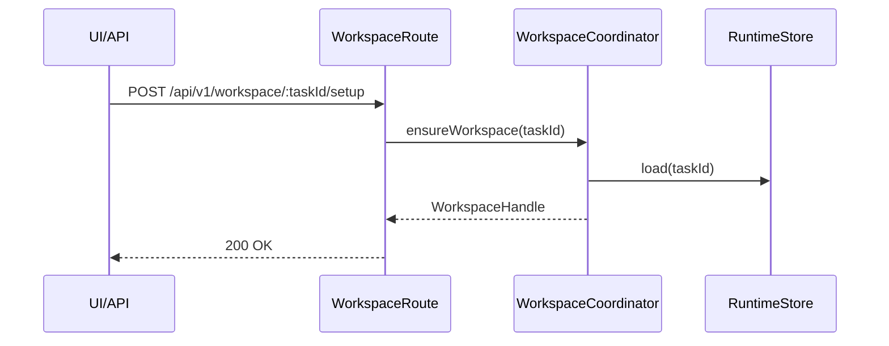

### Preview Routes
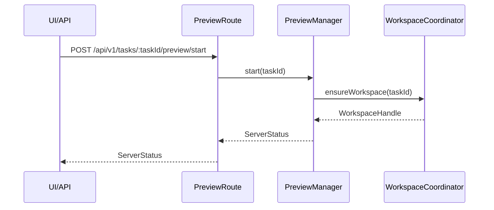

### Agent Routes
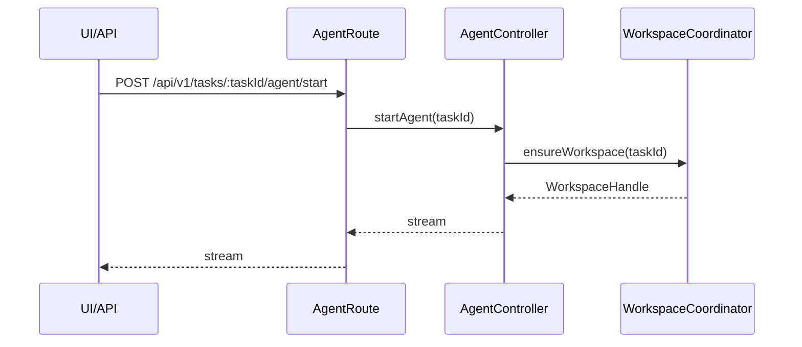

### Task Service Integration
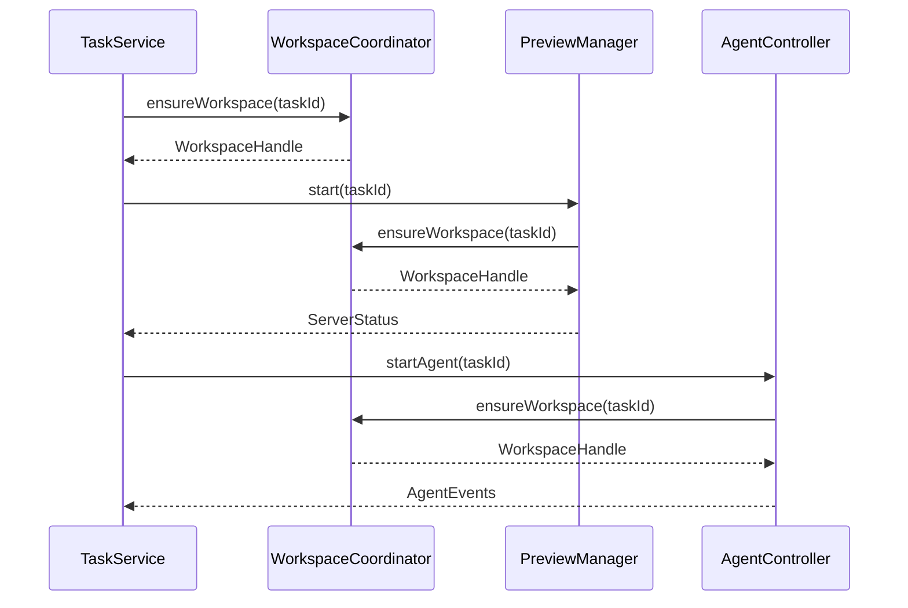

## Core Flows
### 1. Workspace Provisioning & Reuse
#### Local Flow
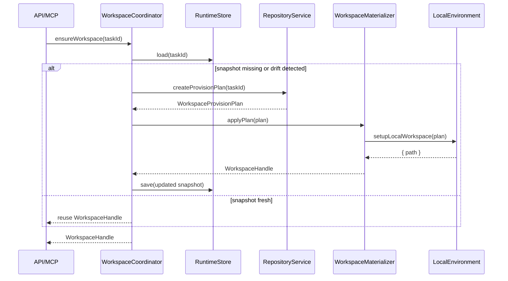

#### Docker Worker Flow
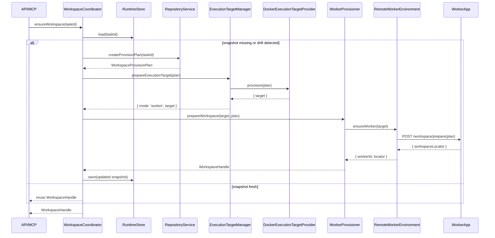

### 2. Agent Execution
#### Local Flow
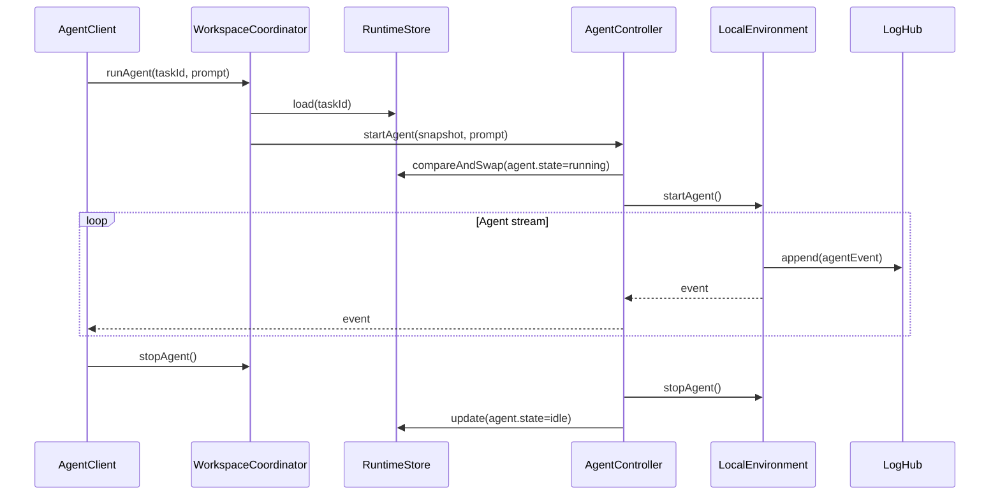

#### Worker Flow
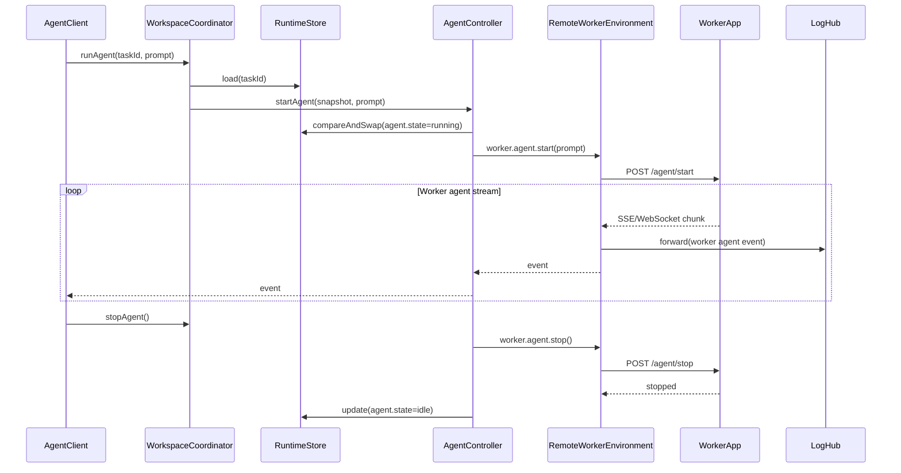

### 3. Preview Start
#### Local Flow
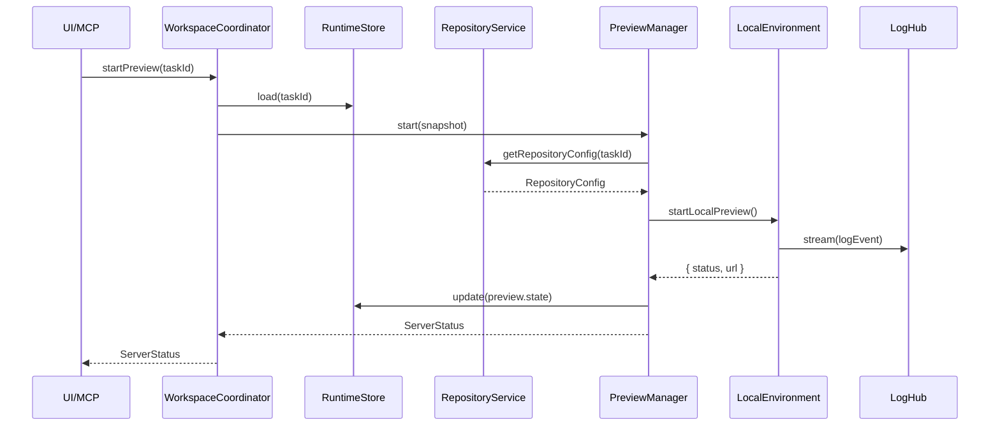

#### Worker Flow
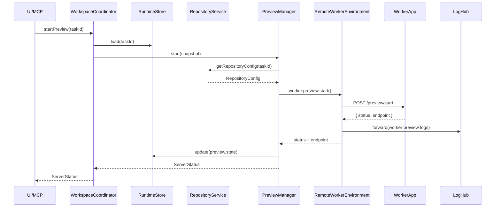

### 4. File Operations
#### Local Flow
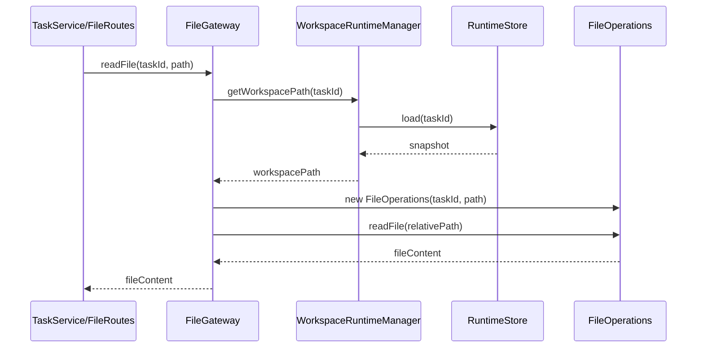

#### Worker Flow
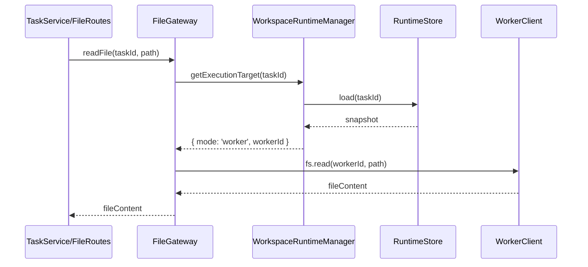

#### Git Operations Flow
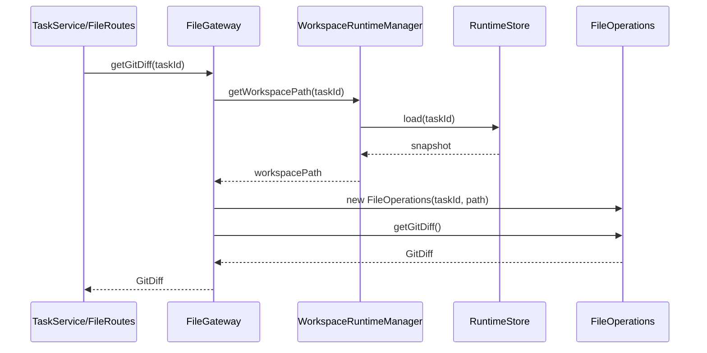

## Implementation Roadmap
1. **Establish Runtime Store** – Define schema, build storage adapter with optimistic locking, seed existing tasks.
2. **Introduce WorkspaceCoordinator** – Wrap existing `WorkspaceService` APIs; gate rollout behind feature flag per task/environment.
3. **Extract PreviewManager & WorkerProvisioner** – Move preview control and workspace provisioning into dedicated controllers; integrate with new coordinator while maintaining backward compatibility.
4. **Implement FileGateway** – Create taskId-only file operation interface that coordinates with `WorkspaceRuntimeManager` for path resolution and delegates to `FileOperations` (local) or `WorkerClient` (worker). Migrate file routes to use FileGateway, update TaskService to eliminate direct workspace path dependencies. Implement remaining methods: `searchFiles`, `readFileWithChanges`, `getFileTreeWithChanges`, `getGitDiff`.
5. **Refactor Environments** – Split into thin local vs remote drivers; remote path becomes a transport client for worker RPCs, local path keeps direct filesystem execution.
6. **Upgrade Observability** – Implement structured logs, event enrichment, and metrics instrumentation.
7. **Finalize Experience Migration** – Update routes, tools, agent service, and background jobs to call coordinator directly; retire `WorkspaceService` caches.

## Risks & Mitigations
- **Concurrent Writers** – Mitigate with compare-and-swap operations and per-operation locks in snapshot (`locks[]`).
- **Migration Complexity** – Deploy in phases with feature flags; dual-write to legacy structures until confidence achieved.
- **Preview Downtime** – Introduce circuit breaker in `PreviewManager` to avoid thrashing and maintain last-known status for UI.
- **Adapter Drift** – Maintain contract tests for each environment driver and preview adapter to ensure compatibility during refactor.

## Success Metrics
- Snapshot accuracy vs actual environment state ( <1% mismatch incidents ).
- Reduction in duplicate setup executions per preview start.
- Mean time to recover from environment errors (target < 1 min).
- Agent execution start latency and preview startup latency improvements.
- File operation latency and throughput (target: p95 < 100ms for read/write, < 500ms for search).
- File operation error rate (target: < 0.1% excluding user errors like invalid paths).
- Execution mode transparency (zero API changes required when switching local ↔ worker modes).
- Observability coverage (percentage of flows with structured logs + metrics + events).
