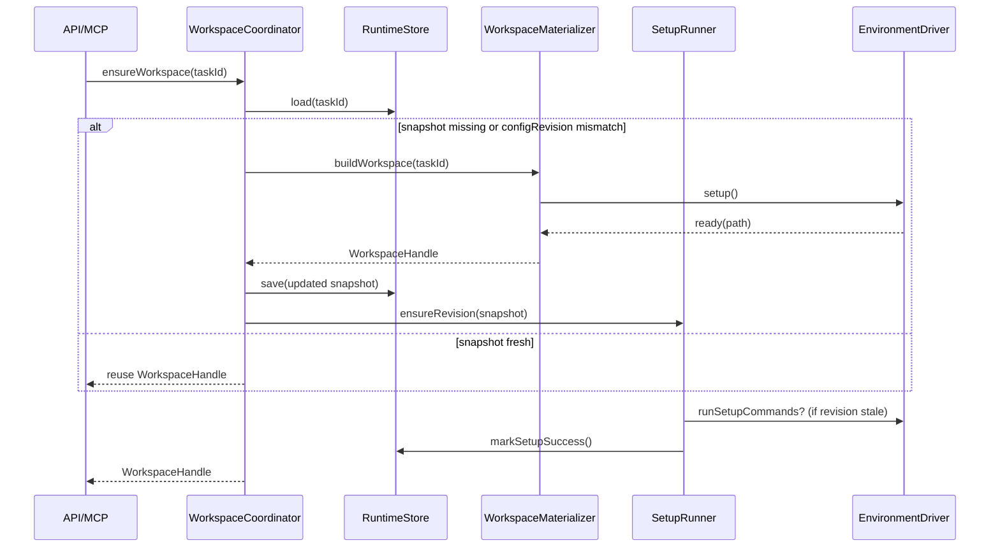
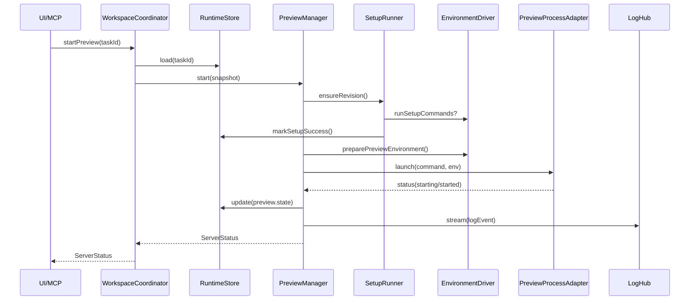

# Refactored Workspace Runtime Architecture

## Purpose
- Present a future-ready workspace system design that resolves current pain points (stale state, duplicated preview logic, ad-hoc coordination).
- Provide a layered blueprint so teams can evolve features independently while sharing durable runtime state.
- Serve as the reference for implementation epics that migrate from `WorkspaceService` to the new coordinator-driven model.

## Layer Overview
1. **Experience Layer** – Routes, GraphQL/REST handlers, MCP endpoints, and background jobs that trigger workspace activities.
2. **Coordination Layer** – Stateless orchestrators (`WorkspaceCoordinator`, `PreviewManager`, `SetupRunner`, `AgentController`) that interpret requests and manipulate runtime state.
3. **Runtime State Layer** – `WorkspaceRuntimeStore` plus derived caches that persist workspace/setup/preview status, errors, paths, and timestamps.
4. **Execution Layer** – Environment drivers, file system adapters, command runners, preview process wrappers, and agent hosts that act on the filesystem or remote workers.
5. **Support & Integration Layer** – Repository metadata, storage adapters, logging, events, screenshot tooling, docker control, and authentication providers.
6. **Observability & Policy Layer** – Structured logging, metrics, tracing, audit trails, rate limiting, and authorization decisions applied across requests.

## Layered Responsibilities
| Layer | Core Responsibilities | Key Artifacts |
|-------|----------------------|---------------|
| Experience | Validate identity/ownership, translate API/MCP payloads into coordinator calls, stream results to clients. | HTTP routes, SSE streams, MCP tools, cron/background jobs. |
| Coordination | Determine desired state transitions, read/update runtime snapshots, enforce invariants (idempotency, retries, locking). | `WorkspaceCoordinator`, `PreviewManager`, `SetupRunner`, `AgentController`, `FileGateway`. |
| Runtime State | Persist and version snapshots; expose atomic load/update helpers; issue change notifications. | `WorkspaceRuntimeStore`, snapshot schemas, optimistic locking helpers. |
| Execution | Perform heavy operations (clone repo, run commands, start preview, stream logs, run agents) under deterministic contracts. | `EnvironmentFactory`, `LocalEnvironmentDriver`, `DockerEnvironmentDriver`, `FileOperations`, `PreviewProcessAdapter`. |
| Support & Integration | Supply metadata, secrets, credentials, artifacts, and durable storage, abstracting external systems. | `RepositoryService`, `StorageBackend`, `DockerService`, `ScreenshotService`, `ClaudeService`, `UploadService`. |
| Observability & Policy | Capture logs/metrics/traces, enforce authorization, handle rate limits, emit structured events for UI/automation. | `LogHub`, `EventService`, policy middleware, audit log writers. |

## Coordination Components
### WorkspaceCoordinator
- Entry point for all workspace actions (`ensureWorkspace`, `getStatus`, `runCommand`, `startAgent`, `startPreview`, `proxyPreview`).
- Reads runtime snapshot; if absent or outdated, calls `WorkspaceMaterializer` and `SetupRunner` to rebuild.
- Updates snapshot using compare-and-swap semantics to prevent race conditions.
- Delegates to specialized controllers (Agent/Preview/File) and handles cross-cutting policies (authorization, rate limiting, dry-run support).

### SetupRunner
- Derives deterministic setup revision hash using repository version, setup commands, environment variables, and runner version.
- Executes setup commands via environment driver only when revision changes or previous run failed.
- Streams install logs to `LogHub` and records success/failure metadata in runtime snapshot.

### PreviewManager
- Before start: loads latest repo config, ensures setup revision satisfied, chooses preview command template, allocates ports, configures proxy.
- On start: spawns preview via `PreviewProcessAdapter`, subscribes to lifecycle events, updates runtime snapshot (`status`, `pid`, `url`, timestamps).
- On stop/teardown: signals environment driver, releases ports, writes terminal state, and rotates logs.
- Exposes `start`, `restart`, `stop`, `getStatus`, `streamLogs`, and `proxyHttp` APIs used by Experience layer.

### AgentController
- Bridges `AgentService` with runtime store: ensures workspace ready, claims agent slot in snapshot (`agentState.running`), attaches MCP server URLs, streams events through `LogHub` and `EventService`.
- Handles cooperative stop requests and cleans up runtime snapshot when agent exits or crashes.

### FileGateway
- Orchestrates file read/write/search/diff commands, enforcing workspace path boundaries and checking `capabilities.fileOperations` from snapshot before allowing operations.
- Routes updates through `FileOperations` and invalidates cached git status when writes succeed.

## Runtime Snapshot Schema
```ts
interface WorkspaceRuntimeSnapshot {
  taskId: string
  repositoryId: string
  configRevision: string
  workspace: {
    path: string | null
    status: 'absent' | 'initializing' | 'ready' | 'error'
    lastValidatedAt?: string
    lastError?: string
  }
  setup: {
    revision: string | null
    status: 'idle' | 'running' | 'succeeded' | 'failed'
    lastRunAt?: string
    lastError?: string
  }
  agent?: {
    state: 'idle' | 'running'
    sessionId?: string
    agentType?: string
    startedAt?: string
  }
  preview: {
    status: 'stopped' | 'starting' | 'started' | 'failed'
    pid?: number
    url?: string
    proxyUrl?: string
    lastStartedAt?: string
    lastStoppedAt?: string
    lastError?: string
  }
  locks?: {
    type: 'setup' | 'preview' | 'agent'
    owner: string
    acquiredAt: string
  }[]
}
```
- Stored via `WorkspaceRuntimeStore` (initial implementation: storage backend; future: dedicated DB supporting WATCH/TTL).
- All writers supply expected revision token to guard against lost updates.
- Change notifications feed event bus to invalidate caches and broadcast UI updates.

## Execution Drivers
### EnvironmentFactory & Drivers
- `EnvironmentFactory` instantiates drivers based on repository execution type (`local`, `docker`, future types).
- Drivers implement shared interface (`setup`, `runCommand`, `runCommandWithStream`, `startPreview`, `stopPreview`, `proxyPreviewRequest`, `createAgent`, `stopAgent`).
- Drivers are stateless between invocations; all state persists in runtime snapshot or short-lived handles scoped to requests.
- Docker driver coordinates with worker API for command execution, port mapping, and preview lifecycle; local driver manages shell execution and port allocation directly.

### FileOperations Adapter
- Provides safe file IO, directory traversal, git status/diff caching, and search.
- Supports incremental update notifications to runtime snapshot (e.g., track latest git SHA or dirty flag for UI badges).

### PreviewProcessAdapter
- Wraps preview server package; responsible for process management, env var templating, proxy setup, inspector toggles, log streaming, and lifecycle callbacks.
- Works with `PreviewManager` to persist transitions and deliver SSE streams without requiring direct environment references.

## Observability & Policy Enhancements
- **LogHub 2.0**: structured JSON appenders keyed by `taskId` and channel (`setup`, `preview`, `agent`, `command`) to improve filtering and UI rendering.
- **Event Enrichment**: runtime snapshot metadata attached to events for easier debugging and analytics.
- **Metrics**: counters/timers for setup duration, preview uptime, agent runtime, command latency; exported via Prometheus.
- **Policy Hooks**: central authorization middleware (e.g., `canManagePreview`, `canWriteFiles`, `canRunAgent`) backed by task ownership, roles, and feature flags.

## Core Flows
### 1. Workspace Provisioning & Reuse


### 2. Agent Execution


### 3. Preview Start


## Implementation Roadmap
1. **Establish Runtime Store** – Define schema, build storage adapter with optimistic locking, seed existing tasks.
2. **Introduce WorkspaceCoordinator** – Wrap existing `WorkspaceService` APIs; gate rollout behind feature flag per task/environment.
3. **Extract SetupRunner & PreviewManager** – Move logic from `Workspace` and environment classes; integrate with new coordinator while maintaining backward compatibility.
4. **Refactor Environments** – Split into thin drivers using descriptor inputs; remove cached setup flags and preview ownership from `LocalEnvironment`/`DockerEnvironment`.
5. **Upgrade Observability** – Implement structured logs, event enrichment, and metrics instrumentation.
6. **Finalize Experience Migration** – Update routes, tools, agent service, and background jobs to call coordinator directly; retire `WorkspaceService` caches.

## Risks & Mitigations
- **Concurrent Writers** – Mitigate with compare-and-swap operations and per-operation locks in snapshot (`locks[]`).
- **Migration Complexity** – Deploy in phases with feature flags; dual-write to legacy structures until confidence achieved.
- **Preview Downtime** – Introduce circuit breaker in `PreviewManager` to avoid thrashing and maintain last-known status for UI.
- **Adapter Drift** – Maintain contract tests for each environment driver and preview adapter to ensure compatibility during refactor.

## Success Metrics
- Snapshot accuracy vs actual environment state ( <1% mismatch incidents ).
- Reduction in duplicate setup executions per preview start.
- Mean time to recover from environment errors (target < 1 min).
- Agent execution start latency and preview startup latency improvements.
- Observability coverage (percentage of flows with structured logs + metrics + events).

