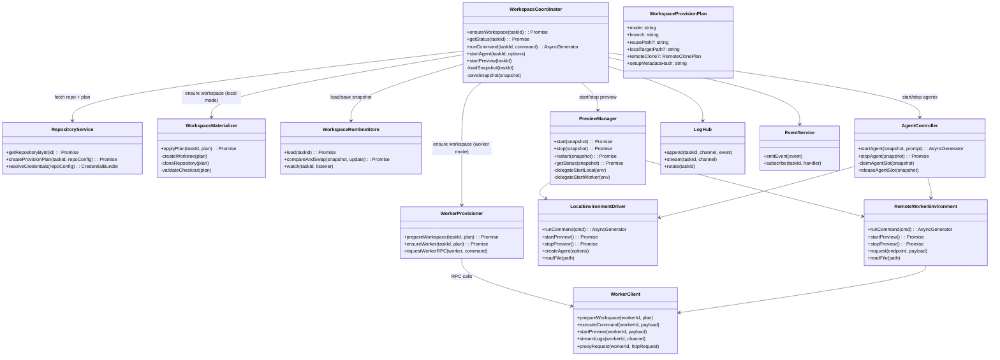
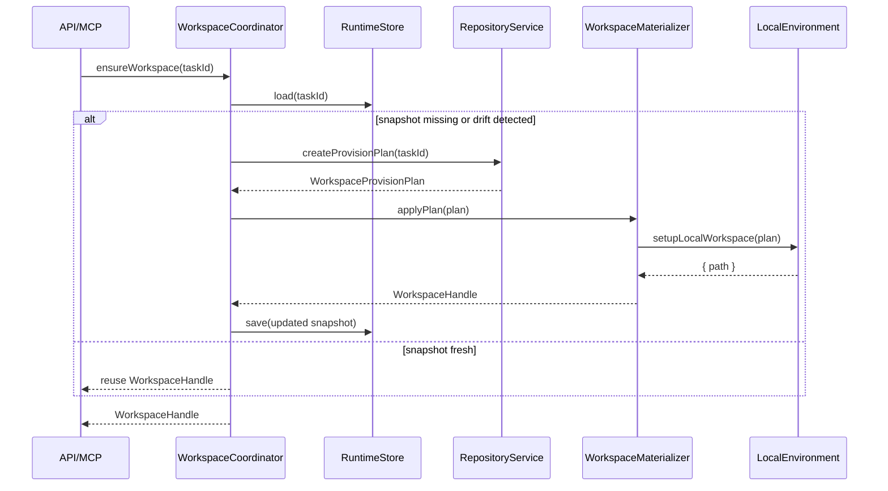
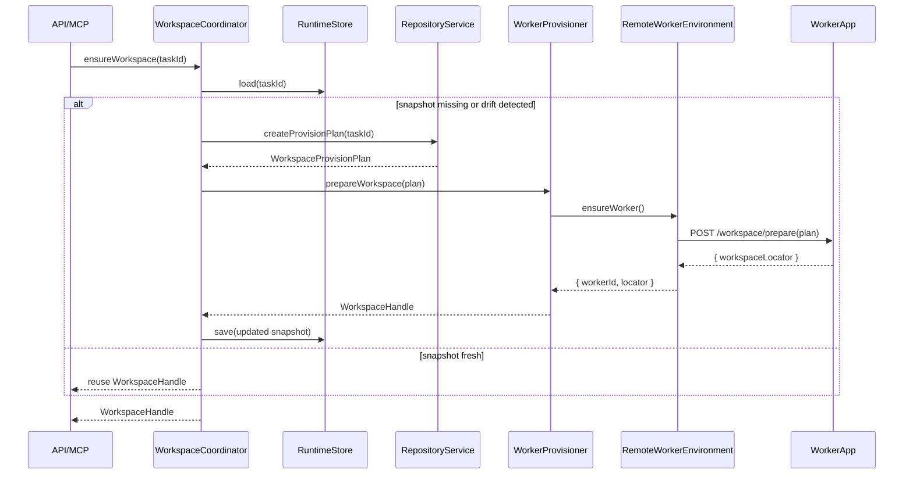
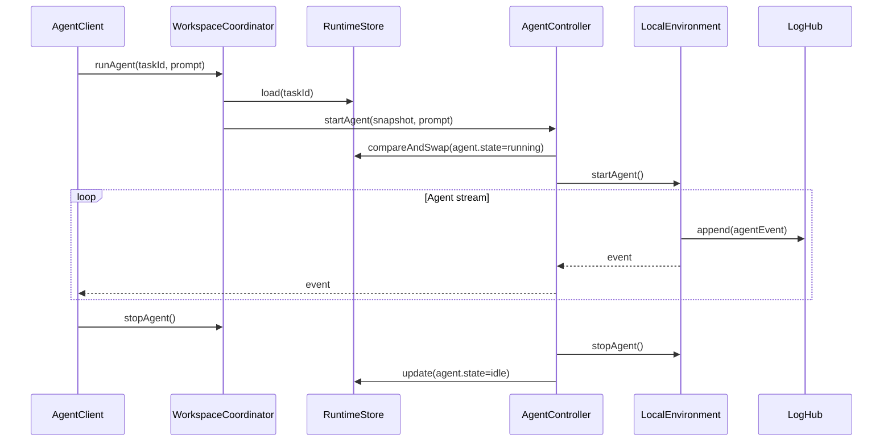
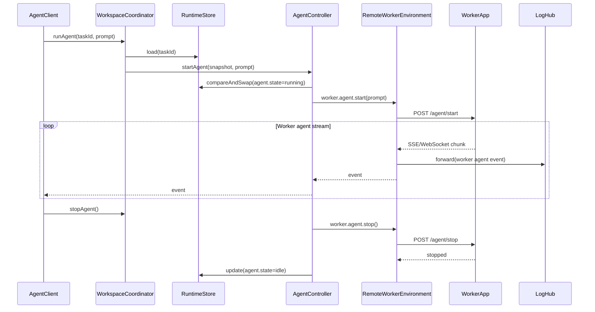
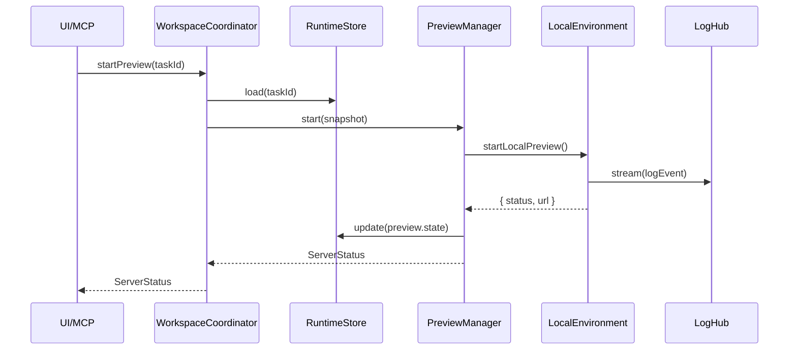
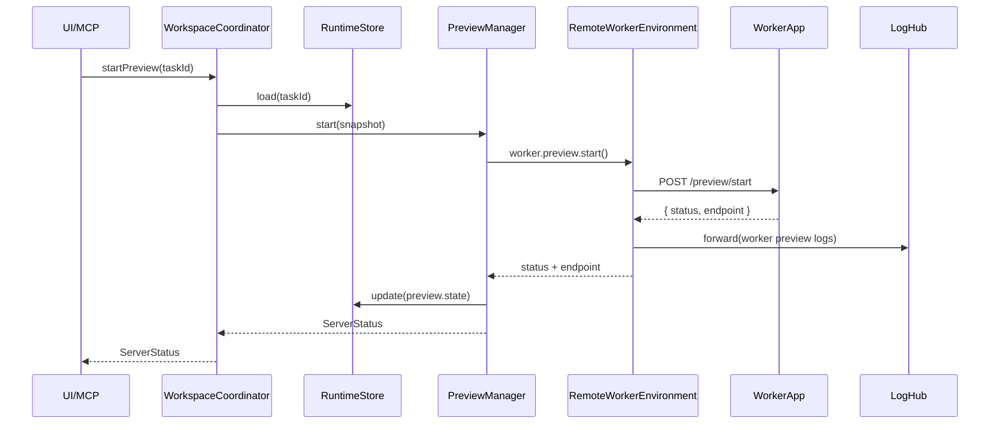

# Refactored Workspace Runtime Architecture

## Purpose
- Present a future-ready workspace system design that resolves current pain points (stale state, duplicated preview logic, ad-hoc coordination).
- Provide a layered blueprint so teams can evolve features independently while sharing durable runtime state.
- Serve as the reference for implementation epics that migrate from `WorkspaceService` to the new coordinator-driven model.

## Layer Overview
1. **Experience Layer** – Routes, GraphQL/REST handlers, MCP endpoints, and background jobs that trigger workspace activities.
2. **Coordination Layer** – Stateless orchestrators (`WorkspaceCoordinator`, `PreviewManager`, `AgentController`, `WorkerProvisioner`) that interpret requests and manipulate runtime state.
3. **Runtime State Layer** – `WorkspaceRuntimeStore` plus derived caches that persist workspace/preview/agent status, worker identity, errors, and timestamps.
4. **Execution Layer** – Local filesystem drivers or remote worker clients that run commands, manage previews, and stream logs.
5. **Support & Integration Layer** – Repository metadata, storage adapters, logging, events, screenshot tooling, docker control, and authentication providers.
6. **Observability & Policy Layer** – Structured logging, metrics, tracing, audit trails, rate limiting, and authorization decisions applied across requests.

## Layered Responsibilities
| Layer | Core Responsibilities | Key Artifacts |
|-------|----------------------|---------------|
| Experience | Validate identity/ownership, translate API/MCP payloads into coordinator calls, stream results to clients. | HTTP routes, SSE streams, MCP tools, cron/background jobs. |
| Coordination | Determine desired state transitions, read/update runtime snapshots, enforce invariants (idempotency, retries, locking). | `WorkspaceCoordinator`, `PreviewManager`, `AgentController`, `WorkerProvisioner`. |
| Runtime State | Persist and version snapshots; expose atomic load/update helpers; issue change notifications. | `WorkspaceRuntimeStore`, snapshot schemas, optimistic locking helpers. |
| Execution | Perform heavy operations (clone repo, run commands, start preview, stream logs, run agents) either locally or inside a worker. | `LocalEnvironmentDriver`, `RemoteWorkerEnvironment`, `Worker RPC clients`. |
| Support & Integration | Supply metadata, secrets, credentials, artifacts, and durable storage, abstracting external systems. | `RepositoryService`, `StorageBackend`, `DockerService`, `ScreenshotService`, `ClaudeService`, `UploadService`. |
| Observability & Policy | Capture logs/metrics/traces, enforce authorization, handle rate limits, emit structured events for UI/automation. | `LogHub`, `EventService`, policy middleware, audit log writers. |

## Coordination Components


### WorkspaceCoordinator
- Entry point for all workspace actions (`ensureWorkspace`, `getStatus`, `runCommand`, `startAgent`, `startPreview`, `proxyPreview`).
- Reads runtime snapshot; if absent or outdated, invokes the appropriate materialization path (local filesystem or worker provisioning) and persists the updated execution target.
- Updates snapshot using compare-and-swap semantics to prevent race conditions.
- Delegates to specialized controllers (Agent/Preview/File) and handles cross-cutting policies (authorization, rate limiting, dry-run support).

### RepositoryService Extensions
- Produces a **WorkspaceProvisionPlan** for each task/repository combination, describing how the workspace should be materialized:
  ```ts
  interface WorkspaceProvisionPlan {
    mode: 'direct' | 'worktree' | 'clone' | 'remote'
    branch: string
    reusePath?: string
    localTargetPath?: string
    remoteClone?: {
      repoUrl: string
      credentialsRef: string
      depth?: number
    }
    setupMetadataHash: string
  }
  ```
- Handles git/branch validation, worktree naming, and clone path derivation so coordinators and workers only execute the plan, not recompute policy.
- Exposes credential-bundles for remote clones (SSH keys, tokens) so worker pods/containers can authenticate without additional lookups.
- Emits setup metadata hashes used by runtime snapshots to detect when repo configuration changes.

### WorkerProvisioner & WorkspaceMaterializer
- **Local mode:** Reads the `WorkspaceProvisionPlan` and executes it directly (create worktree, fresh clone, or reuse path). The LocalEnvironment driver then runs commands on that filesystem path.
- **Worker-backed mode:** Uses the same plan but delegates execution to the worker via RPC (`worker.prepareWorkspace(plan)`). The worker performs the clone/checkout inside the container or pod, then reports back the workspace locator (`worker://<id>/workspace`).
- Supports heterogeneous targets: Docker workers mount host volumes (plan includes host path), Kubernetes workers perform in-pod clones (plan carries repo URL + credentials). The runtime snapshot stores only the worker locator; all subsequent operations route through the environment driver tied to that worker.

### PreviewManager
- Before start: loads latest repo config and ensures the workspace is prepared on the active execution target.
- Local mode: starts/stops preview processes directly via LocalEnvironment, manages port allocation, and streams logs from the host.
- Worker-backed mode: delegates start/stop/status/proxy calls to the worker (`worker.preview.*`), then mirrors status/logs into the runtime snapshot and `LogHub`. No host-side process management required.

### AgentController
- Bridges `AgentService` with runtime store: ensures workspace ready, claims agent slot in snapshot (`agentState.running`), attaches MCP server URLs, streams events through `LogHub` and `EventService`.
- Local mode: launches agents directly via LocalEnvironment.
- Worker-backed mode: proxies `runAgent`/`stopAgent` requests to the worker’s agent endpoints and forwards streamed events/logs.

### FileGateway
- Orchestrates file read/write/search/diff commands, enforcing workspace path boundaries and checking `capabilities.fileOperations` from snapshot before allowing operations.
- Local mode: delegates to `FileOperations` for direct filesystem access and git state invalidation.
- Worker-backed mode: proxies requests to the worker’s file routes (e.g. `worker.fs.read`), streaming responses back to callers without touching host storage.

## Runtime Snapshot Schema
```ts
interface WorkspaceRuntimeSnapshot {
  taskId: string
  repositoryId: string
  configRevision: string
  executionTarget: {
    mode: 'local' | 'worker'
    workerId?: string
    workspaceLocator?: string // e.g. file:///..., worker://container-id/workspace
    lastValidatedAt?: string
    lastError?: string
  }
  agent?: {
    state: 'idle' | 'running'
    sessionId?: string
    agentType?: string
    startedAt?: string
  }
  preview: {
    status: 'stopped' | 'starting' | 'started' | 'failed'
    endpoint?: string // e.g. http://localhost:3000 or worker proxy path
    proxyUrl?: string
    lastStartedAt?: string
    lastStoppedAt?: string
    lastError?: string
  }
  locks?: {
    type: 'setup' | 'preview' | 'agent'
    owner: string
    acquiredAt: string
  }[]
}
```
- Stored via `WorkspaceRuntimeStore` (initial implementation: storage backend; future: dedicated DB supporting WATCH/TTL).
- All writers supply expected revision token to guard against lost updates.
- Change notifications feed event bus to invalidate caches and broadcast UI updates.

## Execution Drivers
### EnvironmentFactory & Drivers
- `EnvironmentFactory` instantiates drivers based on repository execution type (`local`, `docker`, future types).
- Drivers implement shared interface (`setup`, `runCommand`, `runCommandWithStream`, `startPreview`, `stopPreview`, `proxyPreviewRequest`, `createAgent`, `stopAgent`).
- Drivers are stateless between invocations; all state persists in runtime snapshot or short-lived handles scoped to requests.
- Docker driver coordinates with worker API for command execution, port mapping, and preview lifecycle; local driver manages shell execution and port allocation directly.

### FileOperations Adapter
- Provides safe file IO, directory traversal, git status/diff caching, and search.
- Supports incremental update notifications to runtime snapshot (e.g., track latest git SHA or dirty flag for UI badges).

### PreviewProcessAdapter
- Wraps preview server package; responsible for process management, env var templating, proxy setup, inspector toggles, log streaming, and lifecycle callbacks.
- Works with `PreviewManager` to persist transitions and deliver SSE streams without requiring direct environment references.

## Observability & Policy Enhancements
- **LogHub 2.0**: structured JSON appenders keyed by `taskId` and channel (`setup`, `preview`, `agent`, `command`) to improve filtering and UI rendering.
- **Event Enrichment**: runtime snapshot metadata attached to events for easier debugging and analytics.
- **Metrics**: counters/timers for setup duration, preview uptime, agent runtime, command latency; exported via Prometheus.
- **Policy Hooks**: central authorization middleware (e.g., `canManagePreview`, `canWriteFiles`, `canRunAgent`) backed by task ownership, roles, and feature flags.

## Core Flows
### 1. Workspace Provisioning & Reuse
#### Local Flow


#### Worker Flow


### 2. Agent Execution
#### Local Flow


#### Worker Flow


### 3. Preview Start
#### Local Flow


#### Worker Flow


## Implementation Roadmap
1. **Establish Runtime Store** – Define schema, build storage adapter with optimistic locking, seed existing tasks.
2. **Introduce WorkspaceCoordinator** – Wrap existing `WorkspaceService` APIs; gate rollout behind feature flag per task/environment.
3. **Extract PreviewManager & WorkerProvisioner** – Move preview control and workspace provisioning into dedicated controllers; integrate with new coordinator while maintaining backward compatibility.
4. **Refactor Environments** – Split into thin local vs remote drivers; remote path becomes a transport client for worker RPCs, local path keeps direct filesystem execution.
5. **Upgrade Observability** – Implement structured logs, event enrichment, and metrics instrumentation.
6. **Finalize Experience Migration** – Update routes, tools, agent service, and background jobs to call coordinator directly; retire `WorkspaceService` caches.

## Risks & Mitigations
- **Concurrent Writers** – Mitigate with compare-and-swap operations and per-operation locks in snapshot (`locks[]`).
- **Migration Complexity** – Deploy in phases with feature flags; dual-write to legacy structures until confidence achieved.
- **Preview Downtime** – Introduce circuit breaker in `PreviewManager` to avoid thrashing and maintain last-known status for UI.
- **Adapter Drift** – Maintain contract tests for each environment driver and preview adapter to ensure compatibility during refactor.

## Success Metrics
- Snapshot accuracy vs actual environment state ( <1% mismatch incidents ).
- Reduction in duplicate setup executions per preview start.
- Mean time to recover from environment errors (target < 1 min).
- Agent execution start latency and preview startup latency improvements.
- Observability coverage (percentage of flows with structured logs + metrics + events).
