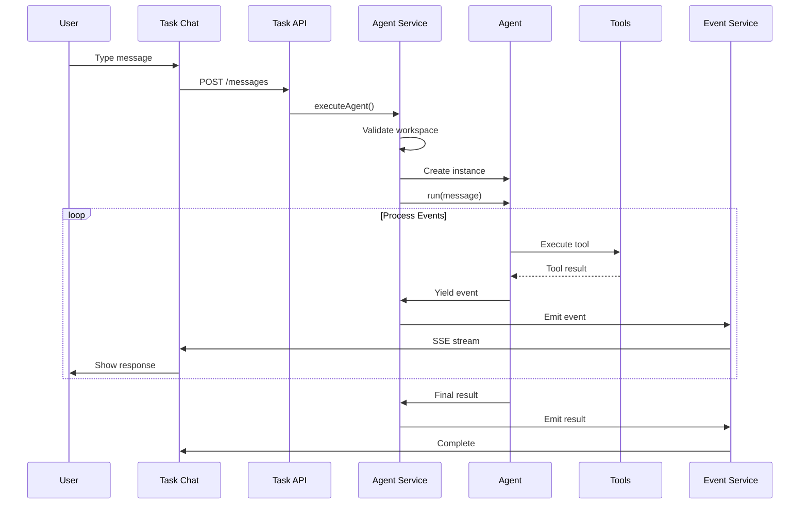
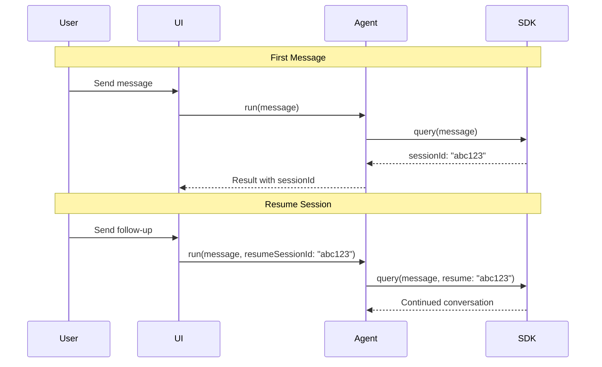

# Agent Architecture

## Table of Contents
1. [Overview](#overview)
2. [Core Concepts](#core-concepts)
3. [Architecture](#architecture)
4. [Backend Implementation](#backend-implementation)
5. [Frontend Implementation](#frontend-implementation)
6. [Data Flow](#data-flow)
7. [Integration Points](#integration-points)
8. [Configuration](#configuration)
9. [Best Practices](#best-practices)
10. [Troubleshooting](#troubleshooting)

## Overview

### Purpose
The Agent system provides the core AI capabilities for Moatless Swarm UI, enabling AI-powered code generation, modification, and analysis. It integrates Claude Code and other AI agents into the task execution pipeline with proper workspace access, tool execution, and real-time streaming.

### Key Responsibilities
- Execute AI agents with workspace context
- Manage agent lifecycle (start, run, stop)
- Stream responses in real-time
- Execute tools (web fetch, search, bash commands)
- Track costs and usage metrics
- Handle errors and recovery
- Maintain session continuity
- Emit events for UI updates

### Position in Architecture
Agents are the intelligence layer that processes user requests, modifies code, and provides insights. They sit between the task management system and workspace execution environment.

## Core Concepts

### Domain Terminology

| Term | Definition |
|------|------------|
| Agent | AI model that processes messages and executes actions |
| Tool | Capability available to agents (bash, web search, etc.) |
| Iteration | Single request-response cycle within a task |
| Session | Continuous conversation context across iterations |
| Message Event | Streamed response chunk from agent |
| Result Event | Final outcome of agent execution |
| Tool Use | Agent invoking a tool to perform an action |

### Key Abstractions

#### Base Agent
```typescript
abstract class BaseAgent {
  protected sessionId: string | null = null
  protected stopRequested = false
  protected currentIteration = 0
  
  abstract getAgentType(): string
  abstract run(
    message: string,
    options: AgentRunOptions
  ): AsyncGenerator<AgentEvent>
  
  stop(): void {
    this.stopRequested = true
  }
  
  getSessionId(): string | null {
    return this.sessionId
  }
}
```

#### Agent Event
```typescript
interface AgentEvent {
  type: 'message' | 'result' | 'error'
  subtype?: string
  data: any
  timestamp: string
  iteration?: number
  sessionId?: string
}
```

### Design Decisions
- **One agent per task** prevents concurrent execution conflicts
- **Event streaming** provides real-time feedback
- **Background execution** keeps API responsive
- **Tool permissions** are configurable per agent
- **Session continuity** enables resuming conversations
- **Workspace isolation** ensures security

## Architecture

### High-Level Overview
```mermaid
graph TB
    subgraph "Agent System"
        AS[Agent Service]
        BA[Base Agent]
        CC[Claude Code Agent]
        TE[Tool Executor]
    end
    
    subgraph "External Systems"
        SDK[Claude Code SDK]
        WS[Workspace Service]
        ES[Event Service]
        TS[Task Service]
    end
    
    subgraph "Tools"
        BASH[Bash Tool]
        WEB[Web Fetch Tool]
        SEARCH[Search Tool]
    end
    
    AS --> BA
    BA <|-- CC
    CC --> SDK
    CC --> TE
    TE --> BASH
    TE --> WEB
    TE --> SEARCH
    
    AS --> WS
    AS --> ES
    AS --> TS
```

### Component Relationships
- Agent Service orchestrates agent execution
- Base Agent defines the contract
- Claude Code Agent implements Claude-specific logic
- Tools provide capabilities to agents
- Integration with workspace, events, and tasks

### Dependency Flow
```
User Message → Task Service → Agent Service
                                  ↓
                            Validate Workspace
                                  ↓
                            Create Agent → Execute
                                            ↓
                                      Tool Execution
                                            ↓
                                      Event Streaming → Client
```

## Backend Implementation

### Service Layer

#### Agent Service
```typescript
// apps/backend/services/agent.service.ts
export class AgentService {
  private runningAgents = new Map<string, BaseAgent>()
  
  constructor(
    private workspaceService: WorkspaceService,
    private eventService: EventService,
    private storageService: StorageService
  ) {}

  // Core operations
  async executeAgent(
    taskId: string,
    iterationId: string,
    message: string,
    options?: ExecuteAgentOptions
  ): Promise<void>
  
  async stopAgent(taskId: string): Promise<void>
  
  // Agent management
  private createAgent(type: string, config: AgentConfig): BaseAgent
  private async validateWorkspace(taskId: string): Promise<WorkspaceInfo>
  private async processAgentEvents(
    agent: BaseAgent,
    taskId: string,
    iterationId: string
  ): Promise<void>
  
  // Event handling
  private createTaskEvent(
    taskId: string,
    iterationId: string,
    agentEvent: AgentEvent
  ): TaskEvent
}
```

#### Claude Code Agent
```typescript
// apps/backend/services/agents/claude-code.agent.ts
export class ClaudeCodeAgent extends BaseAgent {
  private abortController: AbortController | null = null
  
  getAgentType(): string {
    return 'claude-code'
  }
  
  async *run(
    message: string,
    options: AgentRunOptions
  ): AsyncGenerator<AgentEvent> {
    this.currentIteration++
    this.abortController = new AbortController()
    
    try {
      // Configure SDK
      const sdkOptions: ClaudeCodeOptions = {
        allowedTools: ['WebFetch', 'WebSearch', 'Bash'],
        permissionMode: 'acceptEdits',
        cwd: options.workingDirectory,
        model: options.model || 'claude-3-5-sonnet-20241022',
        resume: options.resumeSessionId,
        abortSignal: this.abortController.signal
      }
      
      // Execute query
      const { messages, metadata } = await query(
        message,
        options.attachments,
        sdkOptions
      )
      
      // Capture session ID
      this.sessionId = metadata.sessionId
      
      // Process messages
      for (const msg of messages) {
        if (this.stopRequested) break
        
        yield this.createEvent('message', {
          role: msg.role,
          content: msg.content,
          tool_use: msg.tool_use
        })
      }
      
      // Final result
      yield this.createEvent('result', {
        status: 'completed',
        cost: metadata.cost,
        sessionId: this.sessionId,
        resultText: this.extractResultText(messages)
      })
      
    } catch (error) {
      yield this.createEvent('error', {
        message: error.message,
        stack: error.stack
      })
    }
  }
  
  stop(): void {
    super.stop()
    this.abortController?.abort()
  }
}
```

#### Key Methods
| Method | Purpose | Parameters | Returns |
|--------|---------|------------|---------|
| `executeAgent` | Run agent for task | taskId, message, options | void (async) |
| `stopAgent` | Stop running agent | taskId | void |
| `createAgent` | Factory for agents | type, config | BaseAgent |
| `processAgentEvents` | Handle event stream | agent, taskId, iterationId | void |

### Message Processing

#### Message Flow
```typescript
async executeAgent(
  taskId: string,
  iterationId: string,
  message: string,
  options?: ExecuteAgentOptions
): Promise<void> {
  // 1. Validate workspace
  const workspace = await this.validateWorkspace(taskId)
  
  // 2. Check for running agent
  if (this.runningAgents.has(taskId)) {
    throw new Error('Agent already running for this task')
  }
  
  // 3. Create agent instance
  const agent = this.createAgent(options?.agentType || 'claude-code', {
    workingDirectory: workspace.path,
    model: options?.model,
    resumeSessionId: options?.resumeSessionId
  })
  
  // 4. Register agent
  this.runningAgents.set(taskId, agent)
  
  // 5. Execute in background
  this.processAgentEvents(agent, taskId, iterationId)
    .catch(error => {
      console.error('Agent execution failed:', error)
      this.eventService.emitTaskEvent({
        taskId,
        iterationId,
        type: EventType.ERROR,
        payload: { error: error.message }
      })
    })
    .finally(() => {
      this.runningAgents.delete(taskId)
    })
}
```

#### Event Processing
```typescript
private async processAgentEvents(
  agent: BaseAgent,
  taskId: string,
  iterationId: string
): Promise<void> {
  try {
    for await (const event of agent.run(message, options)) {
      // Transform agent event to task event
      const taskEvent = this.createTaskEvent(taskId, iterationId, event)
      
      // Emit via event service
      await this.eventService.emitTaskEvent(taskEvent)
      
      // Handle special events
      if (event.type === 'result') {
        await this.handleResultEvent(taskId, iterationId, event)
      }
    }
  } catch (error) {
    if (error.code === 'ELIFECYCLE' && [143, 130].includes(error.exitCode)) {
      // Expected exit codes for stop requests
      console.log('Agent stopped gracefully')
    } else {
      throw error
    }
  }
}
```

### Tool Execution Framework

#### Available Tools
```typescript
interface ToolConfig {
  WebFetch: {
    enabled: boolean
    maxContentLength?: number
    timeout?: number
  }
  WebSearch: {
    enabled: boolean
    maxResults?: number
    blockedDomains?: string[]
  }
  Bash: {
    enabled: boolean
    allowedCommands?: string[]
    timeout?: number
  }
}
```

#### Tool Security
- **Bash**: Executes only within workspace directory
- **WebFetch**: Respects content length limits
- **WebSearch**: Can block specific domains
- All tools respect agent permissions

### Error Recovery

#### Workspace Recovery
```typescript
private async validateWorkspace(taskId: string): Promise<WorkspaceInfo> {
  const workspace = await this.workspaceService.getWorkspace(taskId)
  
  // Check if workspace exists
  if (!workspace || !await fs.pathExists(workspace.path)) {
    // Recreate workspace
    console.log('Workspace missing, recreating...')
    await this.workspaceService.createWorkspace(taskId)
    return await this.workspaceService.getWorkspace(taskId)
  }
  
  return workspace
}
```

#### Error Event Handling
```typescript
private handleAgentError(error: Error, taskId: string): AgentEvent {
  return {
    type: 'error',
    data: {
      message: error.message,
      code: error.code,
      recoverable: this.isRecoverableError(error)
    },
    timestamp: new Date().toISOString()
  }
}
```

### API Endpoints

#### Route Definitions
| Method | Path | Purpose | Auth Required |
|--------|------|---------|---------------|
| GET | `/api/v1/agents` | List available agents | No |
| GET | `/api/v1/agents/:type` | Get agent details | No |
| POST | `/api/tasks/:taskId/messages` | Send message to agent | No |
| POST | `/api/tasks/:taskId/stop` | Stop running agent | No |

#### Request/Response Schemas
```typescript
// Send message request
interface SendMessageRequest {
  content: string
  attachments?: FileAttachment[]
  model?: string
  resumeSessionId?: string
}

// Agent info response
interface AgentInfoResponse {
  type: string
  displayName: string
  description: string
  supportedModels: string[]
  availableTools: string[]
  defaultModel: string
}
```

## Frontend Implementation

### Feature Structure
```
apps/frontend/src/features/agents/
├── api/           # API client functions
│   └── agents-api.ts
├── components/    # UI components (minimal)
│   └── agent-selector.tsx
├── hooks/         # Custom React hooks
│   ├── use-agents.ts
│   └── use-send-message.ts
├── types/         # TypeScript types
│   └── index.ts
└── index.ts       # Public exports
```

### Integration with Task System

Agents are primarily accessed through the task system:
- Messages sent via task chat interface
- Events received through task event stream
- Status updates reflected in task UI

### Hooks

#### Custom Hooks
| Hook | Purpose | Parameters | Returns |
|------|---------|------------|---------|
| `useAgents` | List available agents | void | Agent list |
| `useSendMessage` | Send message mutation | taskId | Mutation object |

## Data Flow

### Message Execution Flow


### Session Continuity Flow


## Integration Points

### Dependencies
- **Internal Components:**
  - Task Service - Creates iterations, tracks status
  - Workspace Service - Provides execution environment
  - Event Service - Streams responses to clients
  - Storage Service - Persists agent outputs

- **External Libraries:**
  - `@anthropic-ai/claude-code` - Claude Code SDK
  - Native tools via SDK

### Events

#### Emitted Events
| Event | Payload | When Triggered |
|-------|---------|----------------|
| `MESSAGE` | Agent response | During execution |
| `RESULT` | Final outcome | Execution complete |
| `ERROR` | Error details | Execution failed |
| `INPUT` | Status change | Agent started/stopped |

#### Event Flow
```typescript
// Agent yields event
yield {
  type: 'message',
  data: { content: 'Analyzing code...' }
}

// Transformed to task event
{
  taskId: 'task-123',
  iterationId: 'iter-456',
  type: EventType.MESSAGE,
  subtype: 'assistant',
  payload: { content: 'Analyzing code...' }
}

// Emitted via SSE
data: {"taskId":"task-123","type":"MESSAGE",...}
```

### Shared Data Structures
```typescript
// Message format
interface AgentMessage {
  role: 'user' | 'assistant' | 'system'
  content: string
  tool_use?: ToolUse[]
}

// Cost tracking
interface UsageMetrics {
  inputTokens: number
  outputTokens: number
  totalTokens: number
  cost: number
  model: string
}

// Tool invocation
interface ToolUse {
  tool: string
  input: any
  output?: any
  error?: string
}
```

## Configuration

### Environment Variables
| Variable | Purpose | Default | Required |
|----------|---------|---------|----------|
| `DEFAULT_AGENT_MODEL` | Default Claude model | claude-3-5-sonnet-20241022 | No |
| `AGENT_TIMEOUT` | Max execution time | 3600000 (1 hour) | No |
| `ENABLE_WEB_TOOLS` | Allow web fetch/search | true | No |
| `MAX_TOOL_RETRIES` | Tool retry attempts | 3 | No |

### Agent Configuration
```typescript
const AGENT_CONFIGS = {
  'claude-code': {
    displayName: 'Claude Code',
    description: 'AI coding assistant with file editing',
    supportedModels: [
      'claude-3-5-sonnet-20241022',
      'claude-3-5-haiku-20241022'
    ],
    defaultModel: 'claude-3-5-sonnet-20241022',
    availableTools: ['WebFetch', 'WebSearch', 'Bash'],
    permissionMode: 'acceptEdits'
  }
};
```

### Tool Permissions
```typescript
interface ToolPermissions {
  bash: {
    allowedCommands?: string[]  // Whitelist specific commands
    blockedCommands?: string[]  // Blacklist dangerous commands
    workingDirOnly: boolean     // Restrict to workspace
  }
  webFetch: {
    allowedDomains?: string[]   // Whitelist domains
    maxContentSize: number      // Limit response size
  }
  webSearch: {
    safeSearch: boolean         // Filter results
    maxResults: number          // Limit result count
  }
}
```

## Best Practices

### Do's
- **Always validate workspace** before agent execution
- **Handle stop requests gracefully** via abort controllers
- **Stream events in real-time** for responsive UI
- **Track costs and usage** for transparency
- **Maintain session continuity** for better context
- **Log tool executions** for debugging
- **Implement timeouts** to prevent hanging

### Don'ts
- Don't allow concurrent agents per task
- Don't execute tools outside workspace
- Don't ignore error events
- Don't block on agent execution
- Don't trust user input for tool commands
- Don't keep agents running after task closure

### Performance Considerations
- **Stream events efficiently** using generators
- **Cache agent configurations** to avoid lookups
- **Limit message history** for context windows
- **Implement request queuing** for rate limits
- **Use background execution** for long tasks
- **Clean up resources** promptly

### Security Guidelines
- **Isolate workspace access** per task
- **Validate all tool inputs**
- **Sanitize command execution**
- **Limit network access** for tools
- **Track and audit** all operations
- **Implement rate limiting**
- **Never expose API keys** in events

## Troubleshooting

### Common Issues

#### Issue: Agent Not Responding
**Symptoms:**
- No events after sending message
- UI shows loading indefinitely
- No errors in console

**Cause:**
- Agent crashed silently
- Workspace issues
- SDK initialization failed

**Solution:**
1. Check agent service logs
2. Verify workspace exists:
   ```bash
   ls -la data/workspaces/
   ```
3. Check for running processes:
   ```bash
   ps aux | grep claude-code
   ```

#### Issue: Tool Execution Fails
**Symptoms:**
- Error: "Tool execution failed"
- Bash commands not working
- Web requests timeout

**Cause:**
- Insufficient permissions
- Network issues
- Command not in PATH

**Solution:**
```bash
# Check workspace permissions
ls -la /workspace/path

# Test command manually
cd /workspace/path && [command]

# Verify network access
curl -v https://example.com
```

#### Issue: Session Not Resuming
**Symptoms:**
- Agent doesn't remember context
- Starting fresh conversation
- Session ID null

**Cause:**
- Session expired
- Wrong session ID
- Model change

**Solution:**
1. Check session ID in task events
2. Verify same model used
3. Look for session expiry in logs

### Debug Strategies

1. **Enable verbose logging**:
   ```typescript
   console.debug('Agent event:', event)
   ```

2. **Monitor event stream**:
   ```bash
   curl -N http://localhost:8000/api/tasks/{taskId}/events/stream
   ```

3. **Check agent registry**:
   ```typescript
   console.log('Running agents:', this.runningAgents.keys())
   ```

### Logging
Agent operations are logged:
- **Info**: Agent start/stop, tool use
- **Debug**: Event details, SDK calls
- **Error**: Failures, exceptions
- **Warn**: Timeout warnings, retries

### Monitoring
Key metrics to track:
- Agent execution time
- Tool usage frequency
- Error rates by type
- Cost per iteration
- Session continuity rate
- Message volume

## Related Documentation
- [Task Management Architecture](./tasks.md)
- [Event Architecture](./events.md)
- [Workspace Architecture](./workspaces.md)
- [Claude Code SDK Documentation](https://github.com/anthropics/claude-code)