# Agent Architecture

## Table of Contents
1. [Overview](#overview)
2. [Core Concepts](#core-concepts)
3. [Architecture](#architecture)
4. [Backend Implementation](#backend-implementation)
5. [Frontend Implementation](#frontend-implementation)
6. [Data Flow](#data-flow)
7. [Integration Points](#integration-points)
8. [Configuration](#configuration)
9. [Best Practices](#best-practices)
10. [Troubleshooting](#troubleshooting)

## Overview

### Purpose
The Agent system provides the core AI capabilities for Moatless Swarm UI, enabling AI-powered code generation, modification, and analysis. It integrates Claude Code and other AI agents into the task execution pipeline with proper workspace access, tool execution, and real-time streaming.

### Key Responsibilities
- Execute AI agents with workspace context
- Manage agent lifecycle (start, run, stop)
- Stream responses in real-time
- Execute tools (web fetch, search, bash commands)
- Track costs and usage metrics
- Handle errors and recovery
- Maintain session continuity
- Emit events for UI updates

### Position in Architecture
Agents are the intelligence layer that processes user requests, modifies code, and provides insights. They sit between the task management system and workspace execution environment.

## Core Concepts

### Domain Terminology

| Term | Definition |
|------|------------|
| Agent | AI model that processes messages and executes actions |
| Tool | Capability available to agents (bash, web search, etc.) |
| Iteration | Single request-response cycle within a task |
| Session | Continuous conversation context across iterations |
| Message Event | Streamed response chunk from agent |
| Result Event | Final outcome of agent execution |
| Tool Use | Agent invoking a tool to perform an action |

### Key Abstractions

#### Base Agent
```typescript
abstract class BaseAgent {
  protected sessionId: string | null = null
  protected stopRequested = false
  protected currentIteration = 0
  
  abstract getAgentType(): string
  abstract run(
    message: string,
    options: AgentRunOptions
  ): AsyncGenerator<AgentEvent>
  
  stop(): void {
    this.stopRequested = true
  }
  
  getSessionId(): string | null {
    return this.sessionId
  }
}
```

#### Agent Event
```typescript
interface AgentEvent {
  type: 'message' | 'result' | 'error'
  subtype?: string
  data: any
  timestamp: string
  iteration?: number
  sessionId?: string
}
```

### Design Decisions
- **One agent per task** prevents concurrent execution conflicts
- **Event streaming** provides real-time feedback
- **Background execution** keeps API responsive
- **Tool permissions** are configurable per agent
- **Session continuity** enables resuming conversations
- **Workspace isolation** ensures security

## Architecture

### High-Level Overview

The Agent system orchestrates AI-powered code modifications through a carefully designed flow that ensures workspace isolation, real-time feedback, and reliable execution.

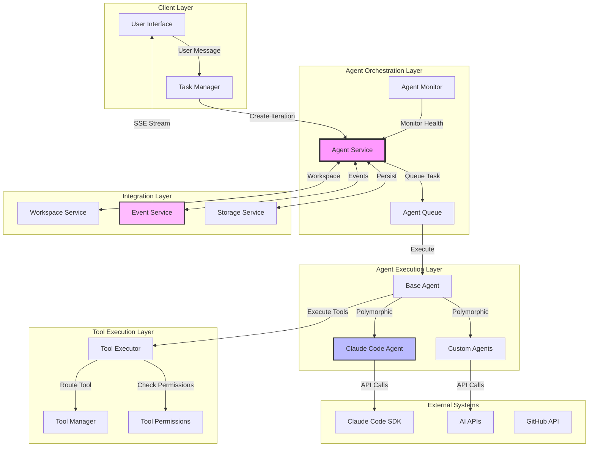

### Agent Execution Flow

The agent execution follows a precise choreography designed for reliability and real-time feedback:

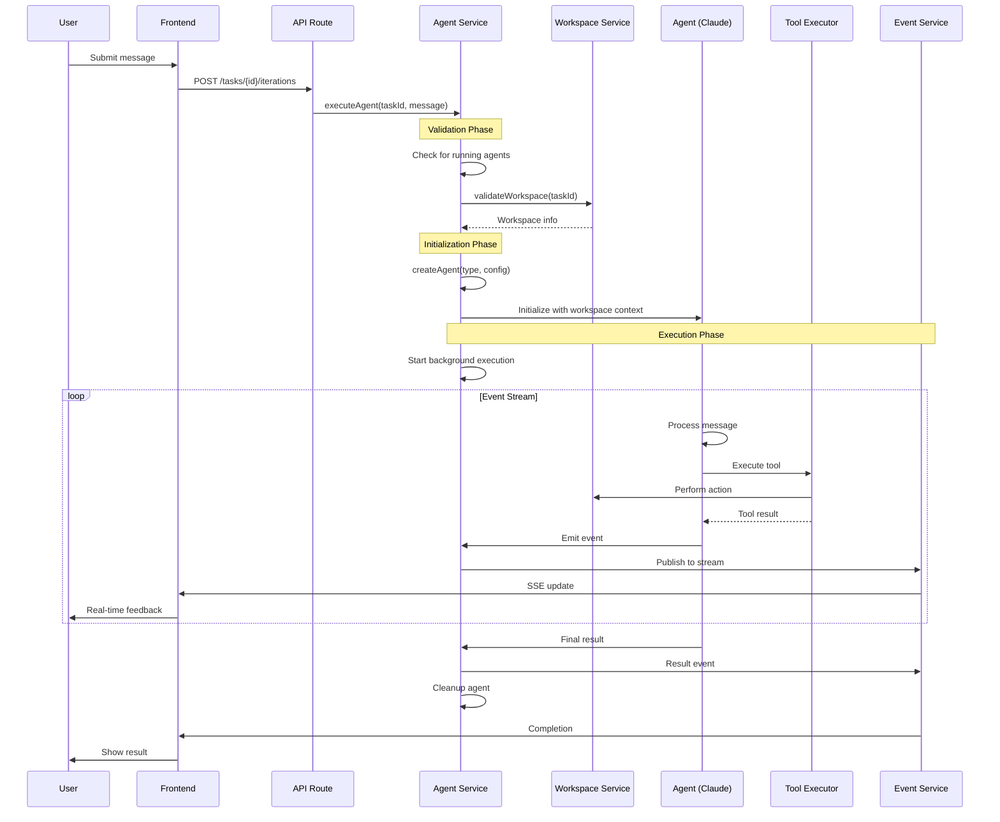

### Tool Execution Architecture

Tools extend agent capabilities by providing controlled access to external resources:

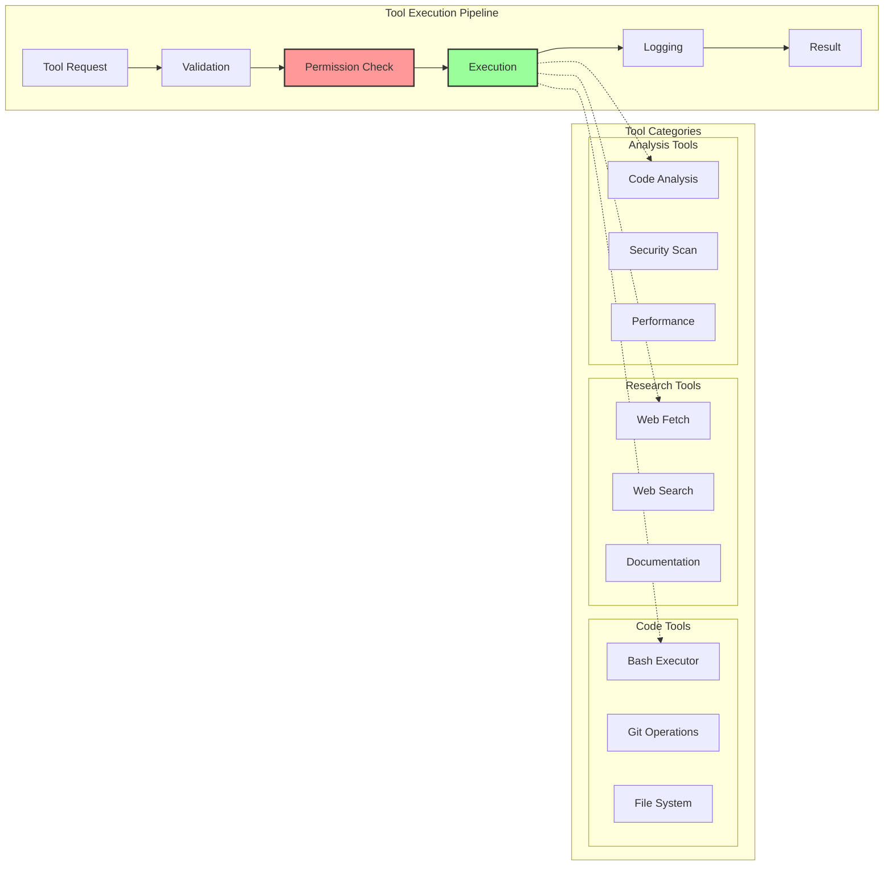

## Backend Implementation

### Agent Lifecycle Management

The backend manages agent lifecycles through a sophisticated state machine that ensures proper resource management and error recovery:

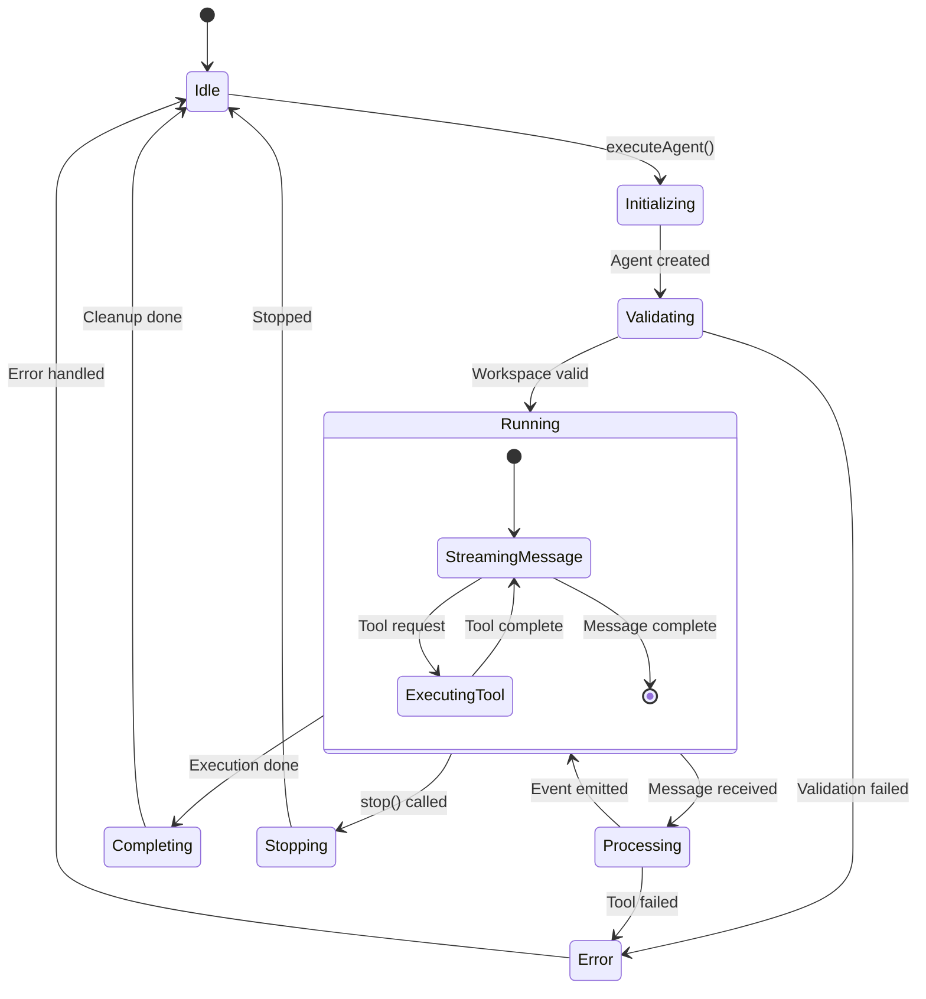

### Concurrent Execution Prevention

The system enforces single-agent-per-task to prevent race conditions:

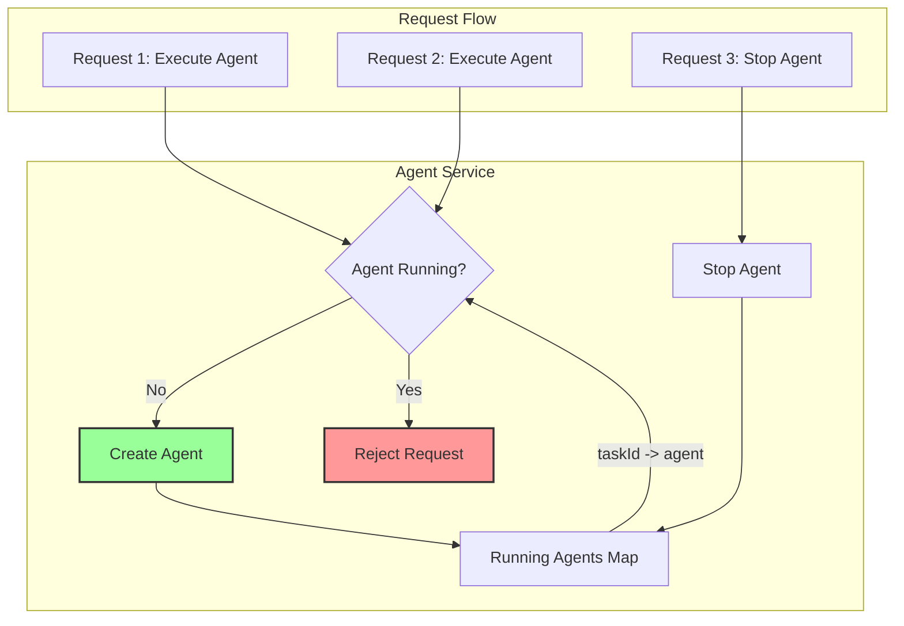

#### Claude Code Agent
```typescript
// apps/backend/services/agents/claude-code.agent.ts
export class ClaudeCodeAgent extends BaseAgent {
  private abortController: AbortController | null = null
  
  getAgentType(): string {
    return 'claude-code'
  }
  
  async *run(
    message: string,
    options: AgentRunOptions
  ): AsyncGenerator<AgentEvent> {
    this.currentIteration++
    this.abortController = new AbortController()
    
    try {
      // Configure SDK
      const sdkOptions: ClaudeCodeOptions = {
        allowedTools: ['WebFetch', 'WebSearch', 'Bash'],
        permissionMode: 'acceptEdits',
        cwd: options.workingDirectory,
        model: options.model || 'claude-3-5-sonnet-20241022',
        resume: options.resumeSessionId,
        abortSignal: this.abortController.signal
      }
      
      // Execute query
      const { messages, metadata } = await query(
        message,
        options.attachments,
        sdkOptions
      )
      
      // Capture session ID
      this.sessionId = metadata.sessionId
      
      // Process messages
      for (const msg of messages) {
        if (this.stopRequested) break
        
        yield this.createEvent('message', {
          role: msg.role,
          content: msg.content,
          tool_use: msg.tool_use
        })
      }
      
      // Final result
      yield this.createEvent('result', {
        status: 'completed',
        cost: metadata.cost,
        sessionId: this.sessionId,
        resultText: this.extractResultText(messages)
      })
      
    } catch (error) {
      yield this.createEvent('error', {
        message: error.message,
        stack: error.stack
      })
    }
  }
  
  stop(): void {
    super.stop()
    this.abortController?.abort()
  }
}
```

#### Key Methods
| Method | Purpose | Parameters | Returns |
|--------|---------|------------|---------|
| `executeAgent` | Run agent for task | taskId, message, options | void (async) |
| `stopAgent` | Stop running agent | taskId | void |
| `createAgent` | Factory for agents | type, config | BaseAgent |
| `processAgentEvents` | Handle event stream | agent, taskId, iterationId | void |

### Message Processing

#### Message Flow
```typescript
async executeAgent(
  taskId: string,
  iterationId: string,
  message: string,
  options?: ExecuteAgentOptions
): Promise<void> {
  // 1. Validate workspace
  const workspace = await this.validateWorkspace(taskId)
  
  // 2. Check for running agent
  if (this.runningAgents.has(taskId)) {
    throw new Error('Agent already running for this task')
  }
  
  // 3. Create agent instance
  const agent = this.createAgent(options?.agentType || 'claude-code', {
    workingDirectory: workspace.path,
    model: options?.model,
    resumeSessionId: options?.resumeSessionId
  })
  
  // 4. Register agent
  this.runningAgents.set(taskId, agent)
  
  // 5. Execute in background
  this.processAgentEvents(agent, taskId, iterationId)
    .catch(error => {
      console.error('Agent execution failed:', error)
      this.eventService.emitTaskEvent({
        taskId,
        iterationId,
        type: EventType.ERROR,
        payload: { error: error.message }
      })
    })
    .finally(() => {
      this.runningAgents.delete(taskId)
    })
}
```

#### Event Processing
```typescript
private async processAgentEvents(
  agent: BaseAgent,
  taskId: string,
  iterationId: string
): Promise<void> {
  try {
    for await (const event of agent.run(message, options)) {
      // Transform agent event to task event
      const taskEvent = this.createTaskEvent(taskId, iterationId, event)
      
      // Emit via event service
      await this.eventService.emitTaskEvent(taskEvent)
      
      // Handle special events
      if (event.type === 'result') {
        await this.handleResultEvent(taskId, iterationId, event)
      }
    }
  } catch (error) {
    if (error.code === 'ELIFECYCLE' && [143, 130].includes(error.exitCode)) {
      // Expected exit codes for stop requests
      console.log('Agent stopped gracefully')
    } else {
      throw error
    }
  }
}
```

### Tool Execution Framework

#### Available Tools
```typescript
interface ToolConfig {
  WebFetch: {
    enabled: boolean
    maxContentLength?: number
    timeout?: number
  }
  WebSearch: {
    enabled: boolean
    maxResults?: number
    blockedDomains?: string[]
  }
  Bash: {
    enabled: boolean
    allowedCommands?: string[]
    timeout?: number
  }
}
```

#### Tool Security
- **Bash**: Executes only within workspace directory
- **WebFetch**: Respects content length limits
- **WebSearch**: Can block specific domains
- All tools respect agent permissions

### Error Recovery

#### Workspace Recovery
```typescript
private async validateWorkspace(taskId: string): Promise<WorkspaceInfo> {
  const workspace = await this.workspaceService.getWorkspace(taskId)
  
  // Check if workspace exists
  if (!workspace || !await fs.pathExists(workspace.path)) {
    // Recreate workspace
    console.log('Workspace missing, recreating...')
    await this.workspaceService.createWorkspace(taskId)
    return await this.workspaceService.getWorkspace(taskId)
  }
  
  return workspace
}
```

#### Error Event Handling
```typescript
private handleAgentError(error: Error, taskId: string): AgentEvent {
  return {
    type: 'error',
    data: {
      message: error.message,
      code: error.code,
      recoverable: this.isRecoverableError(error)
    },
    timestamp: new Date().toISOString()
  }
}
```

### API Endpoints

#### Route Definitions
| Method | Path | Purpose | Auth Required |
|--------|------|---------|---------------|
| GET | `/api/v1/agents` | List available agents | No |
| GET | `/api/v1/agents/:type` | Get agent details | No |
| POST | `/api/tasks/:taskId/messages` | Send message to agent | No |
| POST | `/api/tasks/:taskId/stop` | Stop running agent | No |

#### Request/Response Schemas
```typescript
// Send message request
interface SendMessageRequest {
  content: string
  attachments?: FileAttachment[]
  model?: string
  resumeSessionId?: string
}

// Agent info response
interface AgentInfoResponse {
  type: string
  displayName: string
  description: string
  supportedModels: string[]
  availableTools: string[]
  defaultModel: string
}
```

## Frontend Implementation

### Agent Integration Architecture

The frontend integrates agents through the task system, providing a seamless chat-based interface for AI interactions:

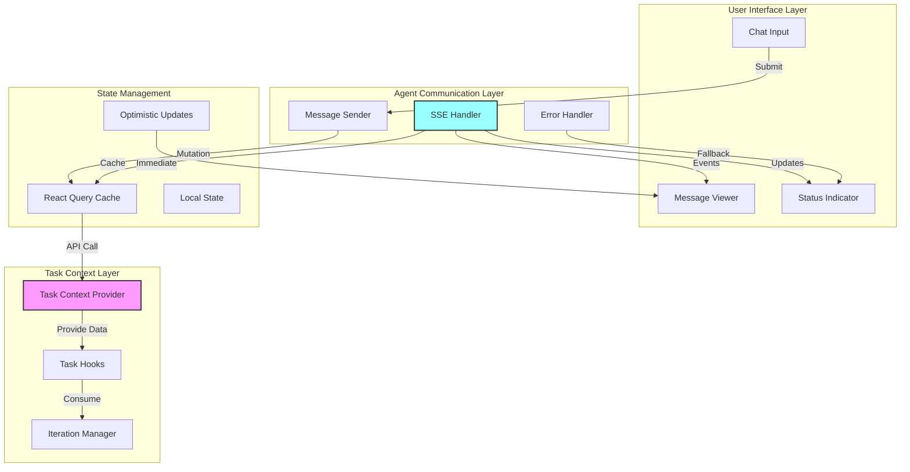

### Real-time Event Processing

The frontend processes agent events through a sophisticated streaming architecture:

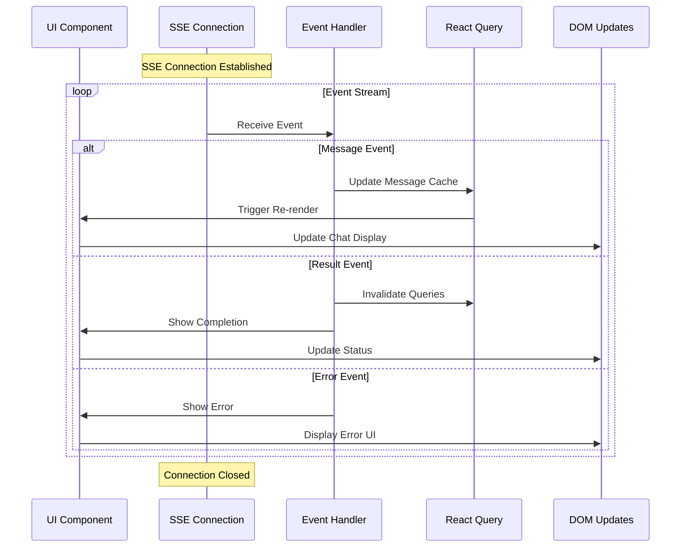

## Data Flow

### End-to-End Message Processing

The complete data flow from user input to AI response demonstrates the system's sophisticated orchestration:

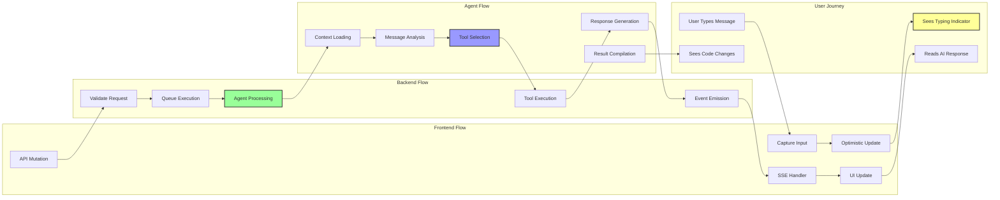

### Session Management Architecture

The system maintains conversation continuity across multiple interactions:

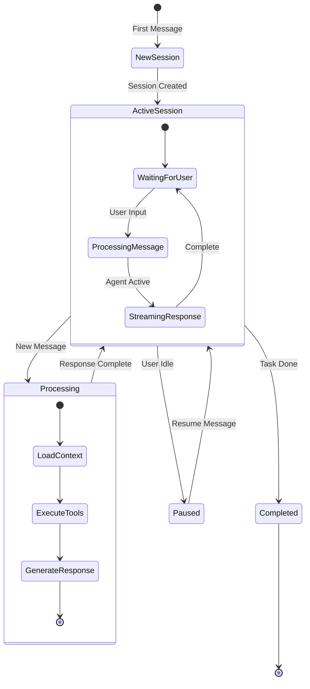

### Error Recovery Flow

The system handles errors gracefully at multiple levels:

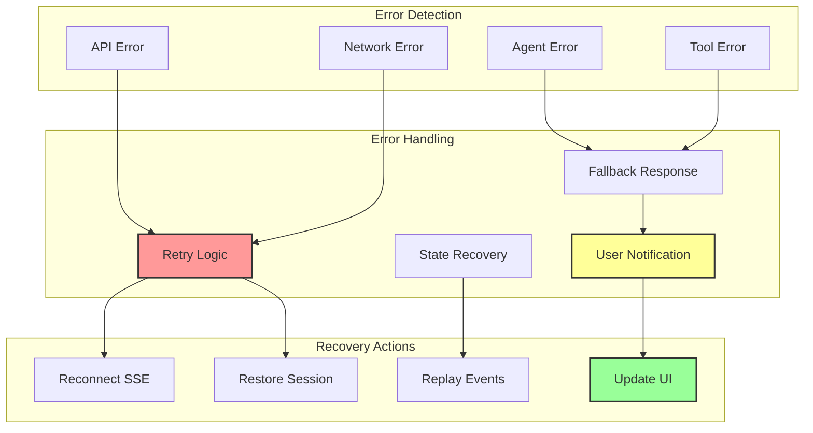

## Integration Points

### System Integration Architecture

The Agent system integrates with multiple components to provide a cohesive AI experience:

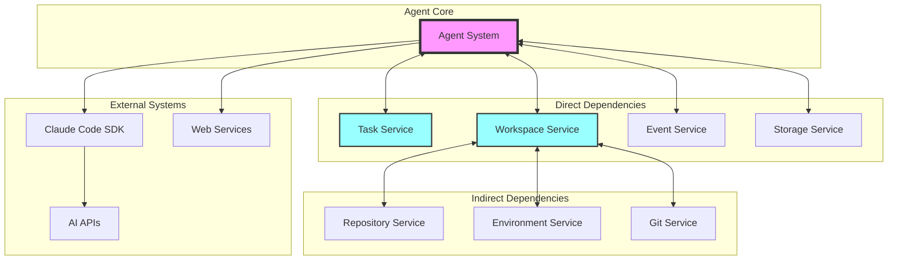

### Event-Driven Communication

The agent system communicates through a well-defined event protocol:

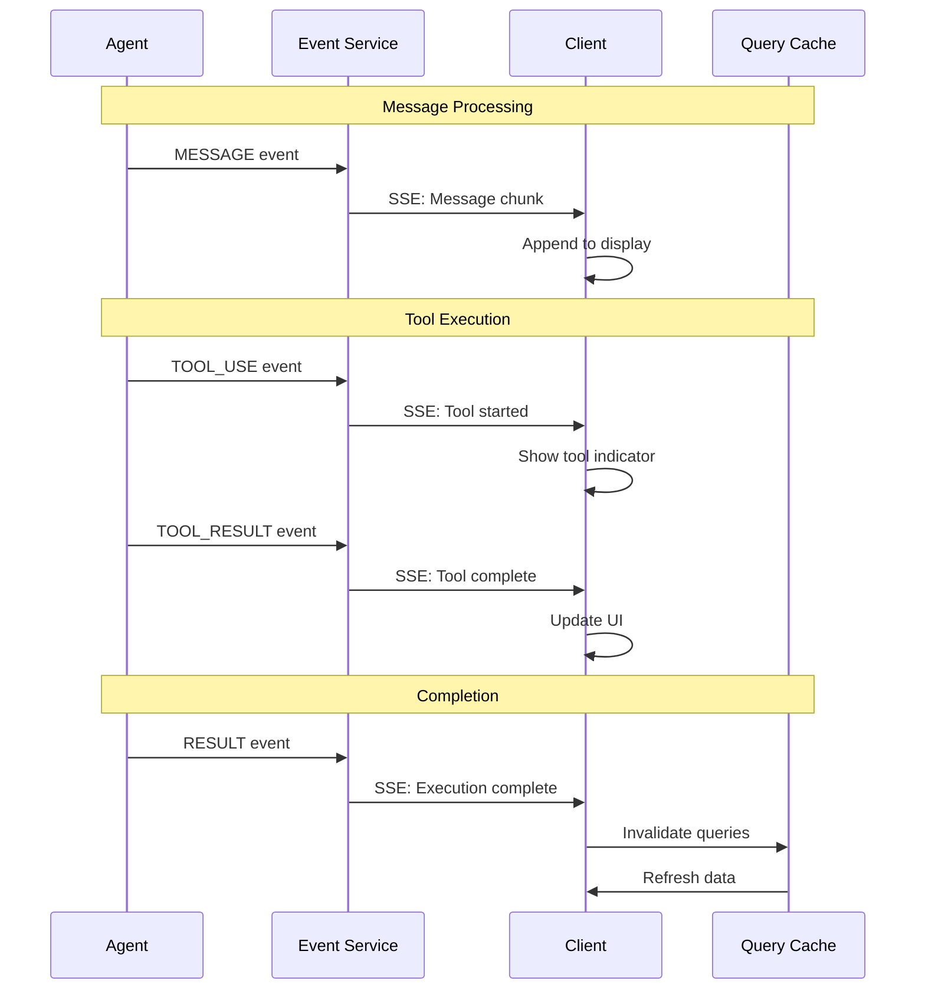

### Cross-Component Data Flow

The agent system participates in complex data flows across the architecture:

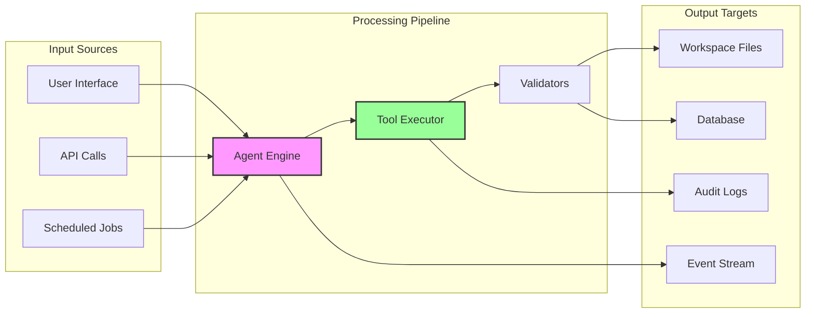

## Best Practices

### Architectural Principles

The agent system follows key architectural principles for reliability and security:

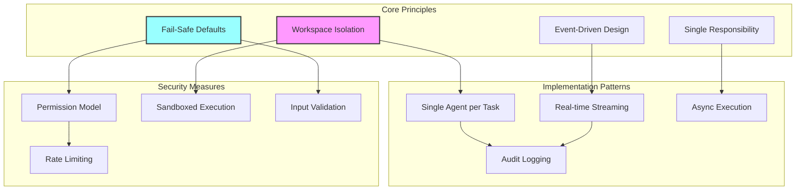

### Performance Architecture

The system optimizes performance through careful design choices:

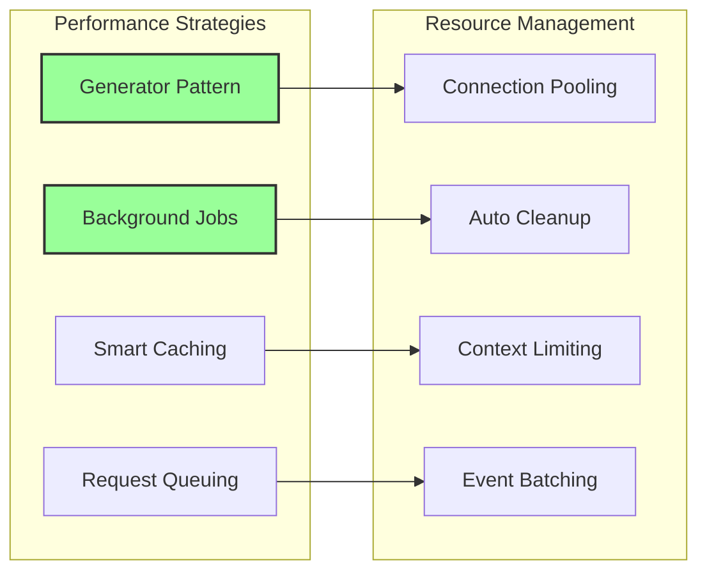

## Troubleshooting

### Diagnostic Flow

When issues arise, follow this systematic diagnostic approach:

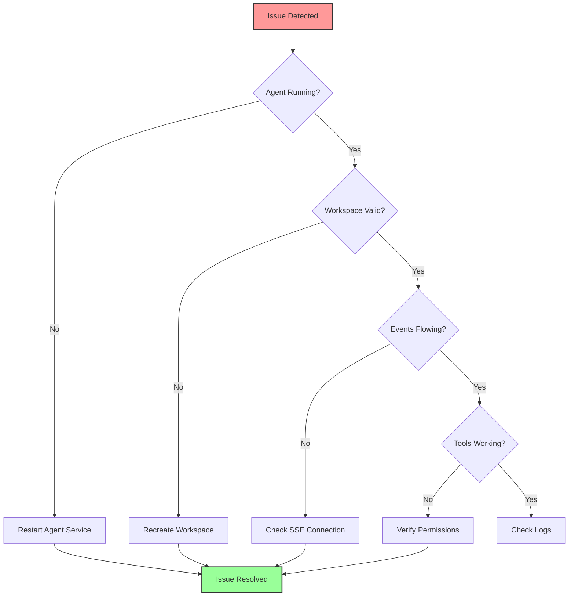

### System Health Monitoring

Key indicators for agent system health:

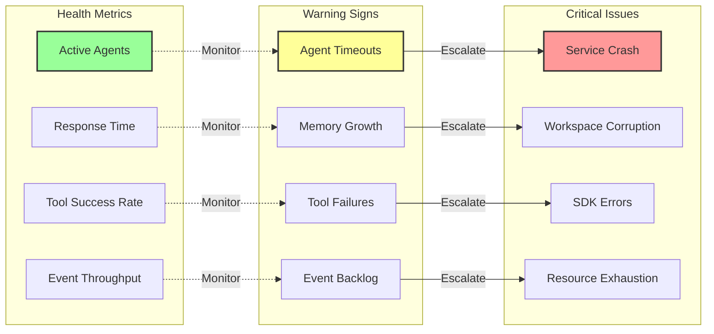

## Related Documentation
- [Task Management Architecture](./tasks.md)
- [Event Architecture](./events.md)
- [Workspace Architecture](./workspaces.md)
- [Claude Code SDK Documentation](https://github.com/anthropics/claude-code)