# Event Architecture

## Table of Contents
1. [Overview](#overview)
2. [Core Concepts](#core-concepts)
3. [Architecture](#architecture)
4. [Backend Implementation](#backend-implementation)
5. [Frontend Implementation](#frontend-implementation)
6. [Data Flow](#data-flow)
7. [Integration Points](#integration-points)
8. [Configuration](#configuration)
9. [Best Practices](#best-practices)
10. [Troubleshooting](#troubleshooting)

## Overview

### Purpose
The Event system is the real-time communication backbone of Moatless Swarm UI, enabling instant feedback as AI agents modify code. It uses Server-Sent Events (SSE) to stream updates from backend services to frontend components, ensuring users see live progress without polling.

### Key Responsibilities
- Stream real-time updates via SSE with automatic reconnection
- Manage dual-stream architecture (global and task-specific)
- Orchestrate cache invalidation for UI consistency
- Buffer events for reliable delivery during disconnections
- Track connection health with ping/pong heartbeats
- Filter and route events to appropriate consumers
- Provide debugging and monitoring capabilities
- Ensure ordered event delivery with sequence numbers

### Position in Architecture
The Event system bridges the gap between backend actions and frontend reactions. It transforms discrete service operations into continuous streams of updates, enabling the reactive UI patterns that make Moatless feel responsive and alive.

## Core Concepts

### Domain Terminology

| Term | Definition |
|------|------------|
| Event | A discrete notification about a state change or action |
| SSE | Server-Sent Events - unidirectional real-time communication protocol |
| Event Stream | Continuous connection for receiving events |
| Global Stream | Application-wide event stream for all events |
| Task Stream | Task-specific event stream for focused updates |
| Event Type | Category of event (e.g., MESSAGE, RESULT, ERROR) |
| Event Subtype | Specific variant within an event type |
| NDJSON | Newline-delimited JSON format used for streaming |
| Connection ID | Unique identifier for each SSE connection |
| Sequence Number | Ordered counter for event ordering |
| Event Bus | Central dispatcher for event routing |
| Heartbeat | Periodic ping to maintain connection health |

### Key Abstractions

#### Event Hierarchy
```typescript
interface BaseEvent {
  eventId: string
  timestamp: Date
  sequenceNumber: number
}

interface TaskEvent extends BaseEvent {
  taskId: string
  iterationId?: string
  agentType?: string
}

interface SystemEvent extends BaseEvent {
  source: string
  severity: 'info' | 'warning' | 'error'
}
```

### Design Decisions

- **Dual-Stream Architecture**: Separate global and task streams for scalability
- **NDJSON over SSE**: Simpler parsing, better proxy compatibility
- **Event Buffering**: In-memory cache for reconnection recovery
- **Selective Persistence**: Store only business-critical events
- **Automatic Enrichment**: Add metadata at emission time
- **Connection Multiplexing**: Single connection for multiple subscriptions
- **Graceful Degradation**: Fall back to polling if SSE fails

## Architecture

### High-Level Overview

The Event system orchestrates real-time communication through a sophisticated multi-layered architecture that ensures reliable, ordered delivery of updates across the application.

#### Event Processing Flow

The event system processes updates through several distinct stages, each implemented in specific modules:

1. **Event Generation** (Backend Services)
   - **Agent Service** (`apps/backend/services/agents/`) - Emits events when AI agents perform actions like code generation, file modifications, or tool executions
   - **Task Service** (`apps/backend/services/task.service.ts`) - Generates events for task lifecycle changes, status updates, and iteration results
   - **Workspace Service** (`apps/backend/services/workspace.service.ts`) - Produces events when workspace files change, git operations occur, or server states update
   - **Preview Service** (`apps/backend/services/preview.service.ts`) - Creates events for preview server lifecycle, hot reloads, and build status

2. **Event Processing Core** (`apps/backend/services/event.service.ts`)
   - **Event Bus** - Central dispatcher that receives all events and manages distribution
   - **Event Enricher** - Adds metadata like timestamps, sequence numbers, and correlation IDs
   - **Event Filter** - Applies routing rules and permission checks before delivery
   - **Event Cache** - Maintains recent events for recovery and debugging

3. **Delivery Infrastructure** (`apps/backend/utils/sse-manager.ts`)
   - **SSE Manager** - Manages Server-Sent Event connections and handles streaming protocol
   - **Connection Manager** - Tracks active connections, manages lifecycles, and handles cleanup
   - **Health Monitor** - Sends periodic heartbeats and detects stale connections

4. **Frontend Reception** (`apps/frontend/src/features/tasks/hooks/`)
   - **Event Parser** (`use-task-sse-connection.ts`) - Parses NDJSON format and validates event structure
   - **Event Router** - Distributes events to appropriate subscribers based on type and filters
   - **Event Handlers** - Process events and trigger UI updates

5. **UI Integration**
   - **React Query** (`apps/frontend/src/lib/api/query-client.ts`) - Invalidates caches based on event types
   - **State Updates** - Direct component state modifications for real-time feedback
   - **UI Components** - Final rendering of updated data in the interface

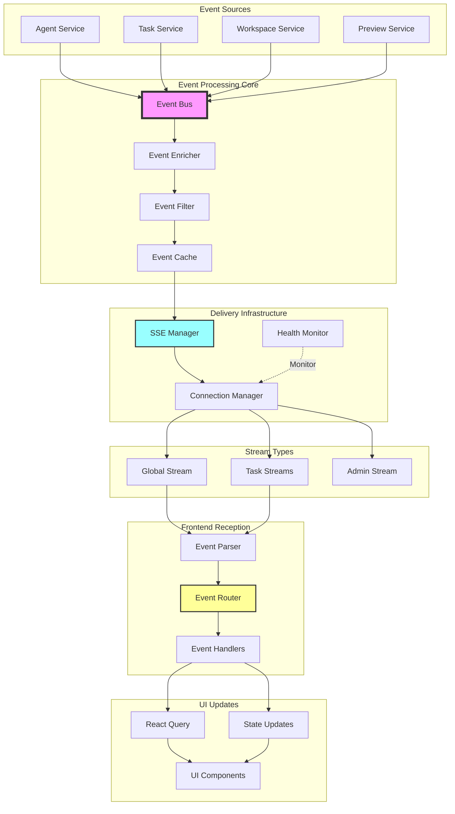

### Event Flow Architecture

The event system implements a sophisticated pipeline that transforms service-level operations into UI updates. Here's what happens at each stage:

#### Event Lifecycle Stages

1. **Event Creation** (`apps/backend/services/*.service.ts`)
   - Services generate events when state changes occur
   - Example: When an agent modifies a file, the workspace service creates a `WORKSPACE_FILE_CHANGE` event
   - Events are created with minimal data - just the essential payload

2. **Event Enrichment** (`apps/backend/services/event.service.ts#enrichEvent`)
   - System adds metadata to raw events:
     - Unique event ID (UUID v4)
     - Timestamp with millisecond precision
     - Sequence number for ordering
     - Service source identifier
     - Correlation IDs for request tracing

3. **Event Filtering** (`apps/backend/services/event.service.ts#filterEvent`)
   - Applies business rules to determine event routing:
     - Permission checks based on user context
     - Rate limiting to prevent spam
     - Content filtering for sensitive data
     - Event type validation

4. **Event Routing** (`apps/backend/services/event.service.ts#routeEvent`)
   - Determines which streams receive the event:
     - Task-specific events go to task streams
     - System-wide events go to global stream
     - Administrative events go to admin stream
   - Multiple streams can receive the same event

5. **Event Delivery** (`apps/backend/utils/sse-manager.ts#sendEvent`)
   - Serializes events to NDJSON format
   - Writes to active SSE connections
   - Handles connection failures gracefully
   - Buffers events for disconnected clients

6. **Event Processing** (`apps/frontend/src/features/tasks/hooks/use-task-event-subscription.ts`)
   - Frontend receives and parses events
   - Triggers appropriate handlers
   - Updates UI through React Query or direct state changes

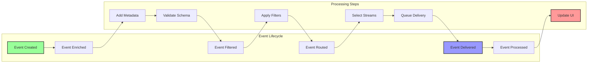

### Connection Management Architecture

The system manages SSE connections through a sophisticated state machine that ensures reliability. Each state transition is carefully orchestrated to maintain continuous event delivery:

#### Connection States and Transitions

1. **Disconnected State** (Initial)
   - Implementation: `apps/frontend/src/features/tasks/hooks/use-task-sse-connection.ts#connect`
   - No active connection exists
   - Waiting for explicit connection request or auto-reconnect timer

2. **Connecting State**
   - Creates new EventSource instance
   - Establishes TCP connection to server
   - Timeout: 30 seconds before failing

3. **Handshaking State**
   - Implementation: `apps/backend/routes/events.routes.ts#handleSSEConnection`
   - Server validates request headers
   - Sets up SSE-specific response headers
   - Establishes streaming response

4. **Authenticating State**
   - Validates optional authentication tokens
   - Assigns connection ID
   - Registers with connection pool

5. **Connected State** (Active)
   - Implementation: `apps/backend/utils/sse-manager.ts#registerConnection`
   - Connection ready to receive events
   - Heartbeat monitoring active
   - Sub-states handle event processing:
     - **Idle**: Waiting for events
     - **Receiving**: Event data arriving
     - **Processing**: Parsing NDJSON payload
     - **Dispatching**: Routing to subscribers

6. **Streaming State**
   - Actively transmitting events
   - Buffer management active
   - Monitors write pressure

7. **Heartbeat State**
   - Implementation: `apps/backend/utils/sse-manager.ts#startHeartbeat`
   - Sends ping every 30 seconds
   - Expects pong within 5 seconds
   - Prevents proxy timeouts

8. **Stale State**
   - Heartbeat timeout detected
   - Connection possibly dead
   - Triggers automatic recovery

9. **Reconnecting State**
   - Implementation: `apps/frontend/src/features/tasks/hooks/use-task-sse-connection.ts#reconnect`
   - Exponential backoff: 1s, 2s, 4s, 8s, max 30s
   - Preserves event buffer
   - Maintains subscription state

10. **Failed State**
    - Permanent failure detected
    - Authentication errors
    - Maximum retries exceeded

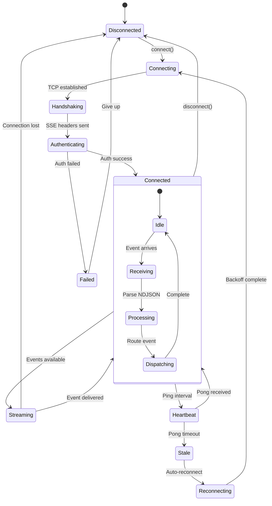

## Backend Implementation

### Event Processing Pipeline

The backend implements a sophisticated event processing pipeline that ensures reliable delivery and proper ordering. Here's a detailed walkthrough of each stage:

#### Event Source Integration

Events originate from three primary sources, each handled differently:

1. **Service-Emitted Events** (`apps/backend/services/*.service.ts`)
   - Direct method calls to EventService.emit()
   - Example: `taskService.updateStatus()` emits `TASK_STATUS_CHANGE`
   - Synchronous emission with immediate processing

2. **Background Job Events** (`apps/backend/services/agents/`)
   - Asynchronous operations emit progress events
   - Example: Code generation jobs emit `AGENT_PROGRESS` events
   - Queued for processing to avoid blocking

3. **System Events** (`apps/backend/app.ts`)
   - Infrastructure-level events (startup, shutdown, errors)
   - Health monitoring events
   - Configuration change notifications

#### Processing Stages

**Enrichment Stage** (`apps/backend/services/event.service.ts#enrichEvent`):
1. **Generate Event ID**: Creates UUID v4 for unique identification
2. **Add Timestamp**: Captures event creation time with microsecond precision
3. **Assign Sequence**: Increments global counter for ordering guarantees
4. **Add Context**: Attaches request ID, user context, and service metadata

**Validation Stage** (`apps/backend/services/event.service.ts#validateEvent`):
1. **Schema Validation**: Ensures event conforms to TypeScript interfaces
2. **Permission Check**: Verifies user can receive this event type
3. **Rate Limiting**: Prevents event flooding (100 events/second per connection)

**Distribution Stage** (`apps/backend/services/event.service.ts#distributeEvent`):
1. **Task Channel**: Routes task-specific events to subscribed connections
2. **Global Channel**: Broadcasts system-wide events to all connections
3. **Admin Channel**: Sends monitoring events to administrative users

**Persistence Stage** (`apps/backend/services/event.service.ts#persistEvent`):
1. **Check Rules**: Determines if event needs persistence
2. **Write Storage**: Saves to file system in NDJSON format
3. **Update Cache**: Maintains in-memory buffer for quick access

**Delivery Mechanisms**:
- **SSE Connections**: Primary real-time delivery via `apps/backend/utils/sse-manager.ts`
- **WebSocket Fallback**: Alternative for environments blocking SSE
- **Polling Endpoint**: Last resort for restrictive networks

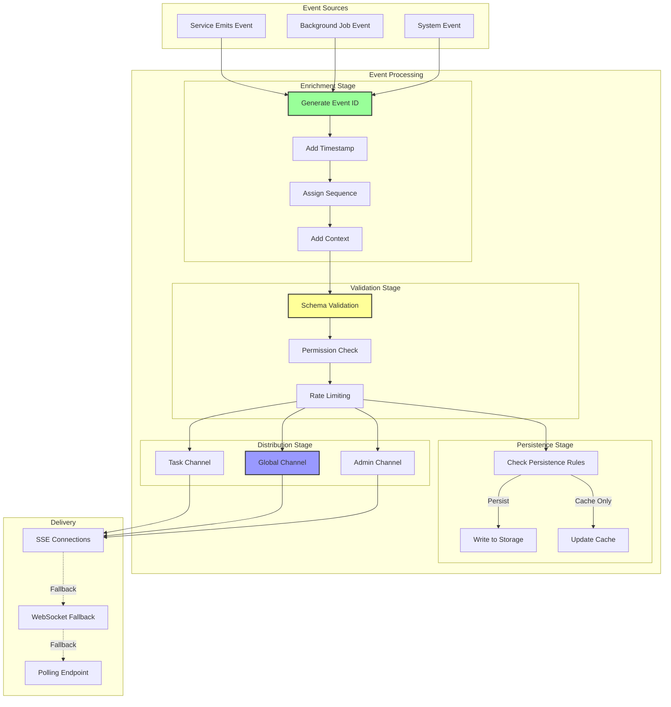

### Event Service Architecture

The Event Service acts as the central hub for all event operations:

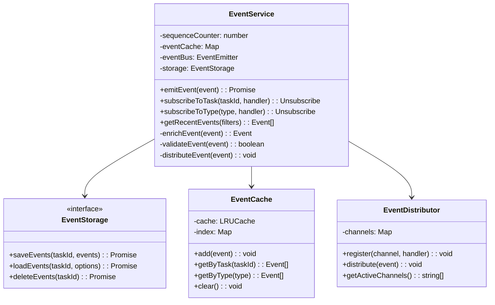

### SSE Connection Management

The SSE Manager handles the complexity of maintaining persistent connections through a well-defined lifecycle:

#### Connection Lifecycle Details

1. **New Connection** (`apps/backend/routes/events.routes.ts#streamEvents`)
   - HTTP request arrives at `/api/v1/events/stream/:type`
   - Headers validated for SSE compatibility
   - Response headers set: `Content-Type: text/event-stream`

2. **Registration** (`apps/backend/utils/sse-manager.ts#registerConnection`)
   - Generates unique connection ID
   - Creates connection metadata object
   - Adds to appropriate connection pool

3. **Authentication** (`apps/backend/utils/sse-manager.ts#authenticateConnection`)
   - Optional token validation
   - User context extraction
   - Permission scope determination

4. **Subscription** (`apps/backend/utils/sse-manager.ts#subscribeConnection`)
   - Registers event type filters
   - Sets up task-specific subscriptions
   - Configures delivery preferences

5. **Event Streaming** (`apps/backend/utils/sse-manager.ts#streamToConnection`)
   - Writes events in NDJSON format
   - Manages write buffer pressure
   - Handles backpressure gracefully

6. **Connection Closure** (`apps/backend/utils/sse-manager.ts#closeConnection`)
   - Removes from connection pools
   - Cleans up subscriptions
   - Logs connection metrics

#### Connection Pool Management

The system maintains three separate connection pools for different use cases:

- **Global Pool** (`apps/backend/utils/sse-manager.ts#globalPool`)
  - All application-wide events
  - Default for new connections
  - Broadcasts system notifications

- **Task Pool** (`apps/backend/utils/sse-manager.ts#taskPool`)
  - Task-specific event streams
  - Filtered by task ID
  - Higher priority delivery

- **Admin Pool** (`apps/backend/utils/sse-manager.ts#adminPool`)
  - System monitoring events
  - Debug information
  - Performance metrics

#### Health Monitoring Implementation

The health system ensures connections remain active:

1. **Ping Scheduler** (`apps/backend/utils/sse-manager.ts#schedulePing`)
   - Runs every 30 seconds
   - Sends `:ping\n\n` to all connections
   - Tracks last activity time

2. **Health Check** (`apps/backend/utils/sse-manager.ts#checkHealth`)
   - Identifies stale connections (no activity > 60s)
   - Validates socket state
   - Monitors memory usage

3. **Cleanup Process** (`apps/backend/utils/sse-manager.ts#cleanupStale`)
   - Closes dead connections
   - Frees associated resources
   - Updates connection metrics

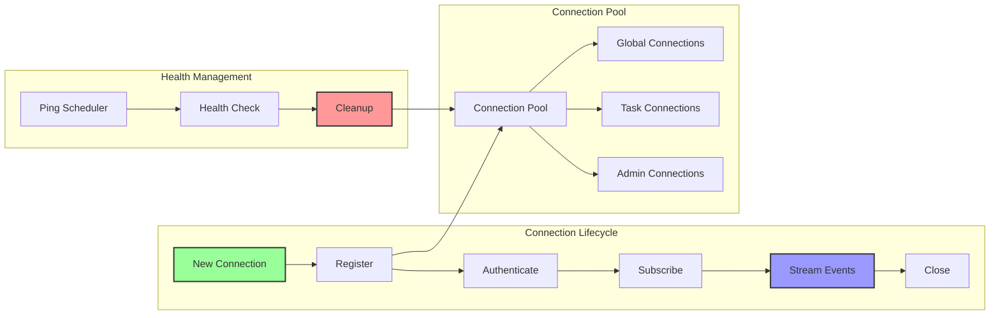

### Event Routing Logic

| Event Type | Global Stream | Task Stream | Admin Stream | Persistence |
|------------|---------------|-------------|--------------|-------------|
| MESSAGE | ✓ | ✓ | - | Conditional |
| RESULT | ✓ | ✓ | ✓ | Always |
| ERROR | ✓ | ✓ | ✓ | Always |
| TOOL | - | ✓ | - | Never |
| WORKSPACE | ✓ | ✓ | - | Always |
| SERVER | - | ✓ | ✓ | Conditional |

## Frontend Implementation

### Event Reception Architecture

The frontend implements a sophisticated event reception and distribution system that processes real-time updates through multiple layers:

#### Reception Layer Details

1. **SSE Connection** (`apps/frontend/src/features/tasks/hooks/use-task-sse-connection.ts`)
   - Creates EventSource instance with proper URL construction
   - Handles connection lifecycle (open, message, error events)
   - Implements automatic reconnection with exponential backoff
   - Example connection: `new EventSource('/api/v1/events/stream/task/123')`

2. **NDJSON Parser** (`apps/frontend/src/features/tasks/hooks/use-task-sse-connection.ts#parseEvent`)
   - Parses newline-delimited JSON format
   - Handles malformed data gracefully
   - Validates JSON structure before processing
   - Extracts event type and payload

3. **Event Validator** (`apps/frontend/src/lib/utils/event-validator.ts`)
   - Validates event against TypeScript interfaces
   - Ensures required fields are present
   - Type guards for event discrimination
   - Logs validation errors for debugging

#### Processing Layer Implementation

1. **Event Router** (`apps/frontend/src/features/tasks/providers/task-event-provider.tsx`)
   - Central dispatcher for all incoming events
   - Routes based on event type and metadata
   - Maintains routing table for efficiency
   - Handles wildcard subscriptions

2. **Event Filter** (`apps/frontend/src/features/tasks/hooks/use-event-filter.ts`)
   - Applies user-defined filters
   - Filters by event type, severity, source
   - Implements debouncing for high-frequency events
   - Preserves filter state across reconnections

3. **Event Buffer** (`apps/frontend/src/features/tasks/utils/event-buffer.ts`)
   - Circular buffer for recent events
   - Configurable size (default: 1000 events)
   - Enables replay after reconnection
   - Provides event history for debugging

#### Distribution Layer Architecture

**Subscription Manager** manages three types of subscriptions:

1. **Task Subscriptions** (`apps/frontend/src/features/tasks/hooks/use-task-event-subscription.ts`)
   - Subscribes to events for specific tasks
   - Filters by task ID automatically
   - Unsubscribes on component unmount
   - Example: `useTaskEventSubscription(taskId, handleEvent)`

2. **Type Subscriptions** (`apps/frontend/src/features/tasks/hooks/use-event-type-subscription.ts`)
   - Subscribes to specific event types globally
   - Useful for cross-cutting concerns
   - Example: `useEventTypeSubscription('ERROR', handleError)`

3. **Global Subscriptions** (`apps/frontend/src/features/tasks/providers/global-event-provider.tsx`)
   - Receives all events regardless of type
   - Used for logging and monitoring
   - Provides event stream context to entire app

#### UI Update Mechanisms

1. **Event Handlers** (`apps/frontend/src/features/tasks/handlers/`)
   - Type-specific handler functions
   - Transform events into UI actions
   - Handle side effects (notifications, logging)

2. **Cache Invalidator** (`apps/frontend/src/features/tasks/utils/cache-invalidation.ts`)
   - Maps event types to React Query keys
   - Intelligently invalidates affected queries
   - Prevents unnecessary refetches
   - Example: `TASK_STATUS_CHANGE` invalidates `['tasks', taskId]`

3. **State Updater** (`apps/frontend/src/features/tasks/stores/`)
   - Direct state updates for immediate feedback
   - Updates Zustand stores for global state
   - Triggers re-renders efficiently

#### Component Integration Examples

- **Task Components** (`apps/frontend/src/features/tasks/components/`)
  - Task viewer subscribes to iteration events
  - Updates progress in real-time
  - Shows live agent output

- **Sidebar** (`apps/frontend/src/features/navigation/components/sidebar.tsx`)
  - Updates task counts on status changes
  - Shows active task indicators
  - Reflects workspace changes

- **Notifications** (`apps/frontend/src/features/notifications/`)
  - Displays toast notifications for errors
  - Shows success messages for completions
  - Provides action buttons for quick responses

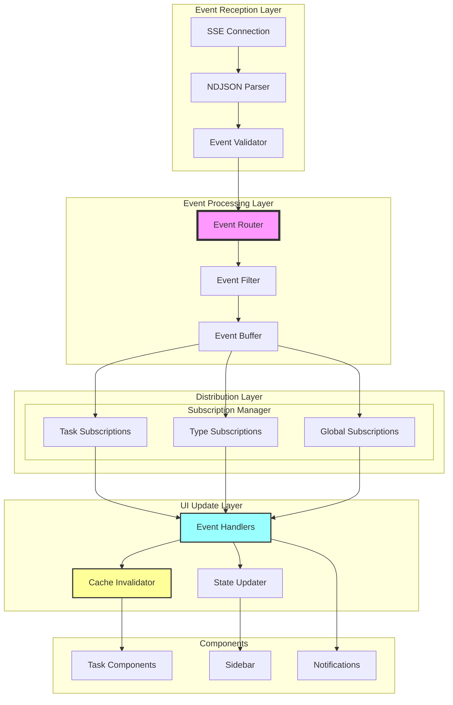

### Event Stream Provider Architecture

The providers manage connection lifecycle and event distribution:

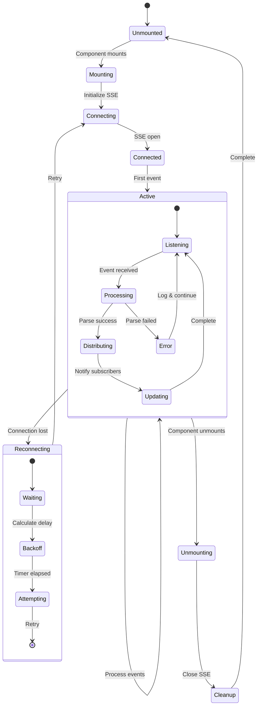

### React Query Integration

Events trigger intelligent cache updates through a sophisticated invalidation system:

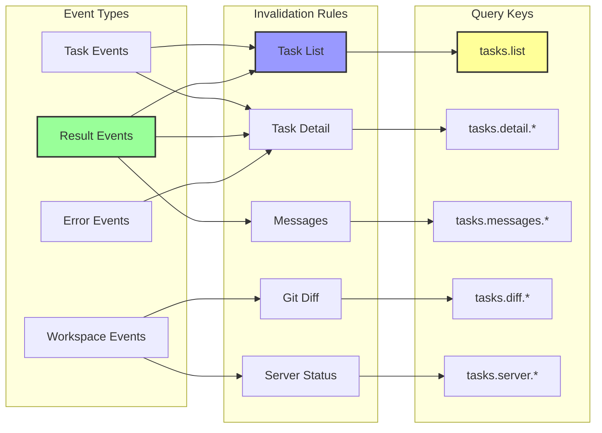

### Component Integration Patterns

Components integrate with the event system through well-defined patterns:

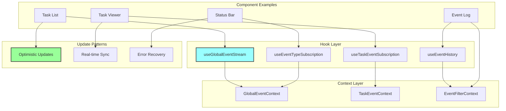

### Event Hook Patterns

| Hook | Purpose | Usage Pattern | Returns |
|------|---------|---------------|---------|
| useGlobalEventStream | Access global stream context | `const { subscribe } = useGlobalEventStream()` | Context API |
| useTaskEventSubscription | Subscribe to task events | `useTaskEventSubscription(taskId, handler)` | Cleanup function |
| useEventTypeSubscription | Subscribe by event type | `useEventTypeSubscription('result', handler)` | Cleanup function |
| useEventHistory | Load past events | `const { events, loading } = useEventHistory(taskId)` | Query state |

## Data Flow

### End-to-End Event Journey

The complete event flow demonstrates the sophistication of the real-time architecture. Here's a detailed walkthrough of what happens when a user action triggers an event:

#### Step-by-Step Event Flow

1. **User Interaction** (`apps/frontend/src/features/tasks/components/`)
   - User clicks "Run Task" button in the UI
   - Component calls mutation hook
   - HTTP request sent to backend API

2. **API Processing** (`apps/backend/routes/tasks.routes.ts`)
   - Route handler receives POST request
   - Validates request parameters
   - Calls TaskService to execute action

3. **Event Emission** (`apps/backend/services/task.service.ts`)
   - Service performs business logic
   - Creates event object with type and payload
   - Calls `eventService.emit(event)`

4. **Event Processing Phase**
   - **ID Generation**: UUID v4 created for tracking
   - **Timestamping**: Current time captured with microsecond precision
   - **Sequencing**: Global counter incremented atomically
   - **Schema Validation**: Event structure verified against TypeScript interface

5. **Event Bus Distribution** (`apps/backend/services/event.service.ts`)
   - Event published to internal event bus
   - All subscribers notified synchronously
   - Routing rules applied based on event type

6. **Channel Routing** (`apps/backend/utils/sse-manager.ts`)
   - SSE Manager receives event from bus
   - Determines target connections:
     - Global stream for system-wide events
     - Task stream for task-specific events
   - Filters connections by subscription criteria

7. **Connection Delivery**
   - Each connection receives event independently
   - NDJSON format: `{"type":"TASK_STATUS","data":{...}}\n`
   - Write buffer managed to prevent overflow
   - Failed writes trigger reconnection

8. **Frontend Reception** (`apps/frontend/src/features/tasks/hooks/use-task-sse-connection.ts`)
   - EventSource receives message event
   - Raw data extracted from event
   - NDJSON parsed to JavaScript object

9. **Frontend Processing**
   - **Validation**: Event structure verified
   - **Cache Invalidation**: React Query keys invalidated
   - **State Updates**: Component state modified
   - **UI Rendering**: React re-renders affected components

10. **User Feedback**
    - Visual changes appear immediately
    - Progress indicators update
    - Success/error messages displayed

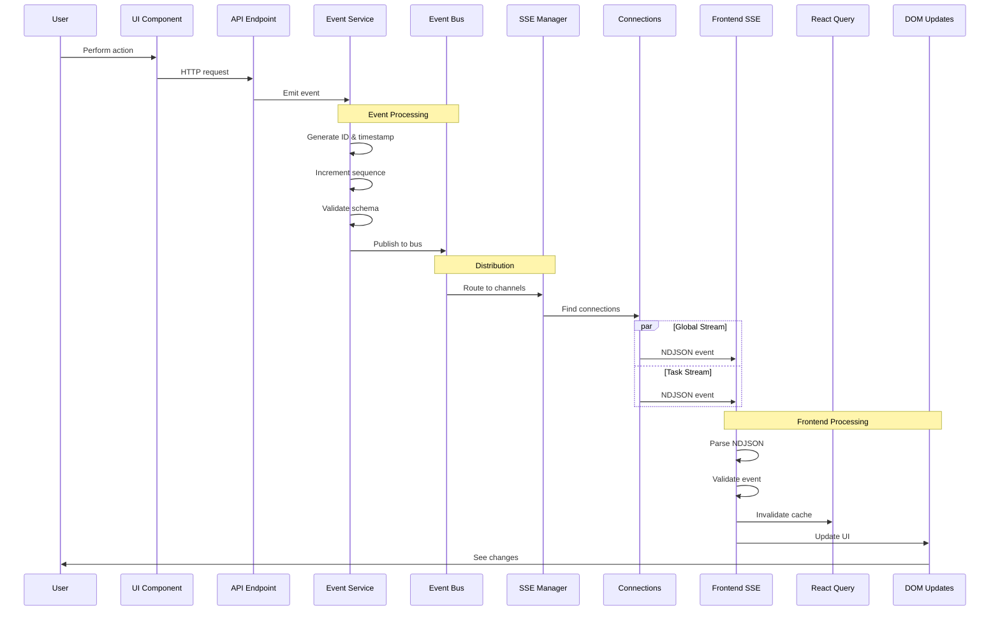

### Event Routing Architecture

Events flow through a sophisticated routing system that ensures proper delivery:

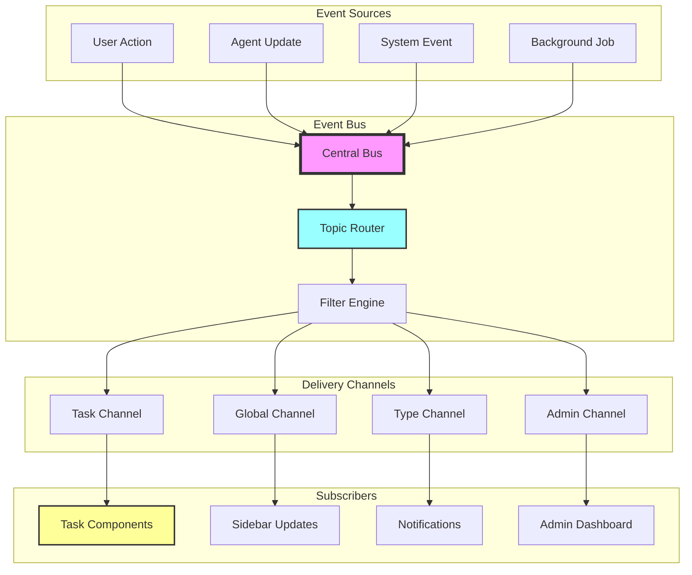

### Connection Recovery Flow

The system handles connection failures gracefully with automatic recovery. Here's how each stage ensures no events are lost:

#### Recovery Process Details

1. **Connection Disruption Detection**
   - Implementation: `apps/frontend/src/features/tasks/hooks/use-task-sse-connection.ts#handleError`
   - Triggers: Network failure, server restart, proxy timeout
   - Detection time: < 100ms via EventSource error event

2. **Buffering Stage** (`apps/frontend/src/features/tasks/utils/event-buffer.ts`)
   - **Collecting**: All new events stored in circular buffer
   - **Buffer Management**: 
     - Default size: 1000 events
     - Memory limit: 10MB
     - Oldest events dropped when full
   - **Persistence**: Critical events saved to IndexedDB

3. **Reconnection Process** (`apps/frontend/src/features/tasks/hooks/use-task-sse-connection.ts#reconnect`)
   - **Initial Attempt**: Immediate reconnection try
   - **Backoff Strategy**:
     - 1st retry: 1 second delay
     - 2nd retry: 2 seconds
     - 3rd retry: 4 seconds
     - Max delay: 30 seconds
   - **Connection Validation**: Waits for first event before declaring success

4. **Recovery Handshake** (`apps/backend/routes/events.routes.ts#handleReconnect`)
   - **Send Last Sequence**: Client sends last received sequence number
   - **Server Validation**: Checks if events are still in cache
   - **Gap Detection**: Identifies missing events by sequence

5. **Event Replay** (`apps/backend/utils/sse-manager.ts#replayEvents`)
   - **Missed Events**: Server sends all events after last sequence
   - **Order Preservation**: Events sent in original order
   - **Duplicate Prevention**: Client filters by event ID

6. **State Synchronization**
   - **Cache Refresh**: React Query refetches active queries
   - **UI Update**: Components re-render with latest state
   - **Notification**: User informed of successful reconnection

#### Buffer Management Implementation

The buffering system ensures events aren't lost during disconnections:

- **Circular Buffer**: Fixed-size array with head/tail pointers
- **Priority Levels**: Critical events never dropped
- **Compression**: Events compressed after 30 seconds
- **Persistence**: IndexedDB for long-term storage

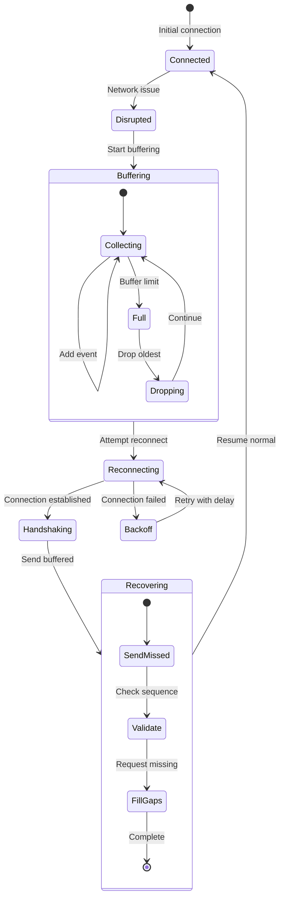

## Integration Points

### System Integration Map

The Event system integrates deeply with all major components:

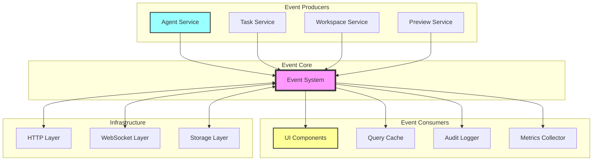

### Event Type Matrix

| Event Type | Producers | Consumers | Cache Impact | Persistence |
|------------|-----------|-----------|--------------|-------------|
| MESSAGE | Agent Service | Task UI, Event Log | Messages | Conditional |
| RESULT | Agent Service | Task List, Task Detail | Full refresh | Always |
| ERROR | All Services | Error Display, Logs | Status only | Always |
| TOOL | Agent Service | Tool Monitor | None | Never |
| WORKSPACE | Workspace Service | File Tree, Git UI | Workspace | Always |
| SERVER | Preview Service | Preview UI | Server status | Conditional |
