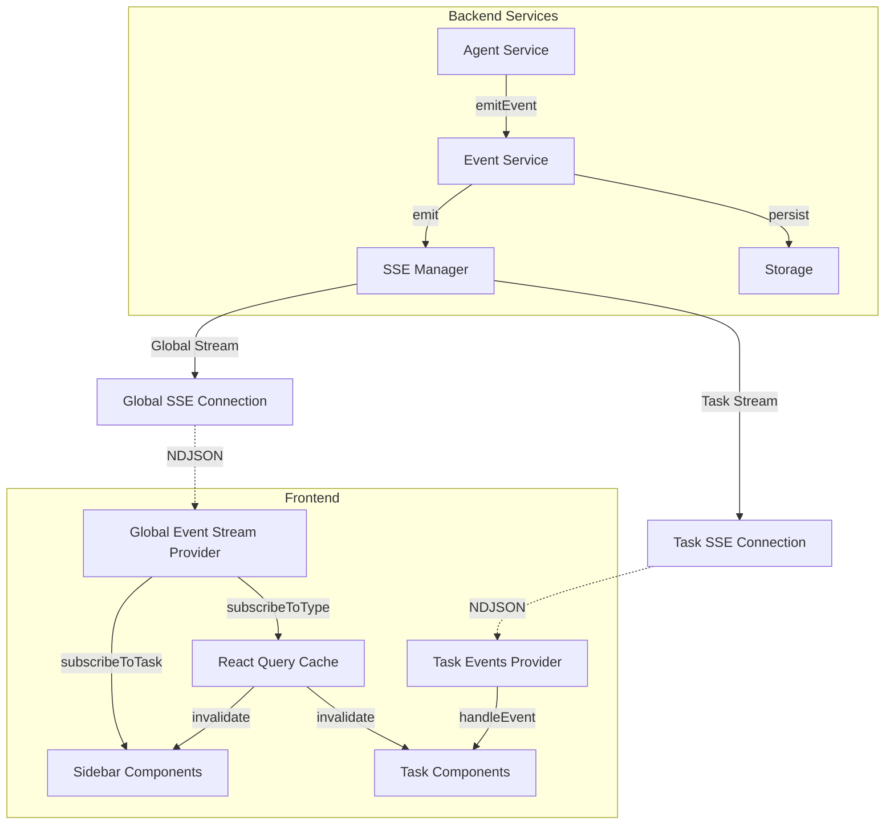
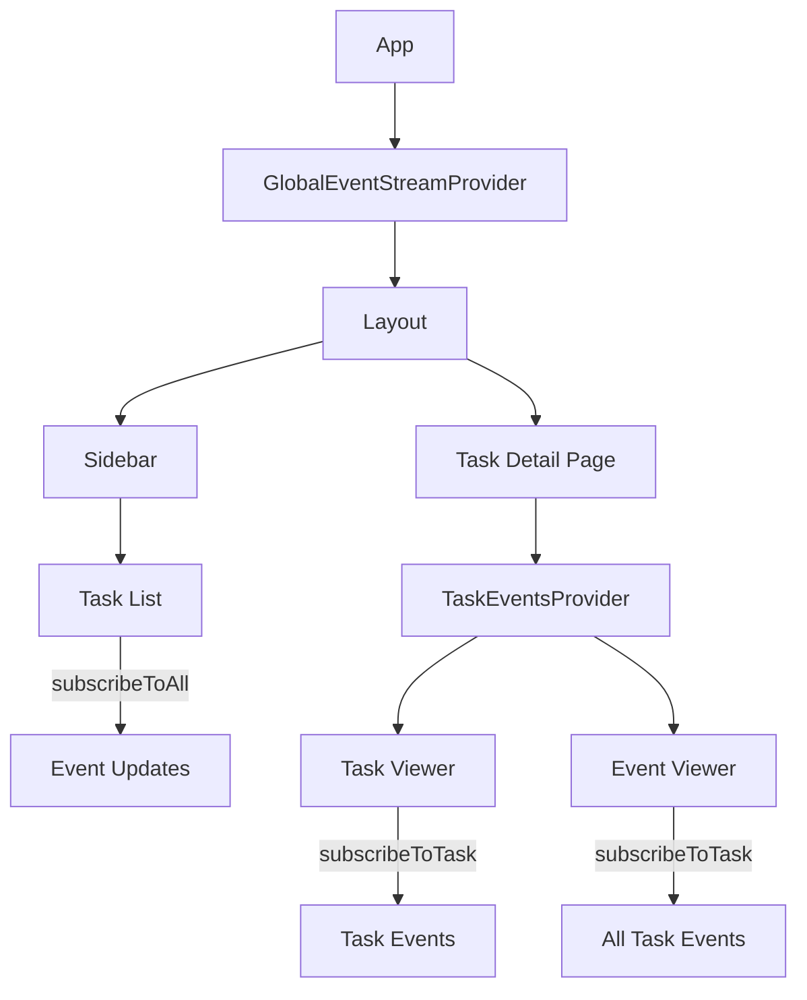
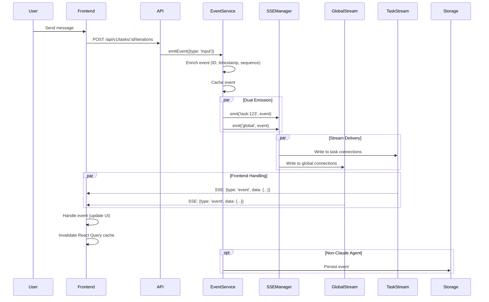
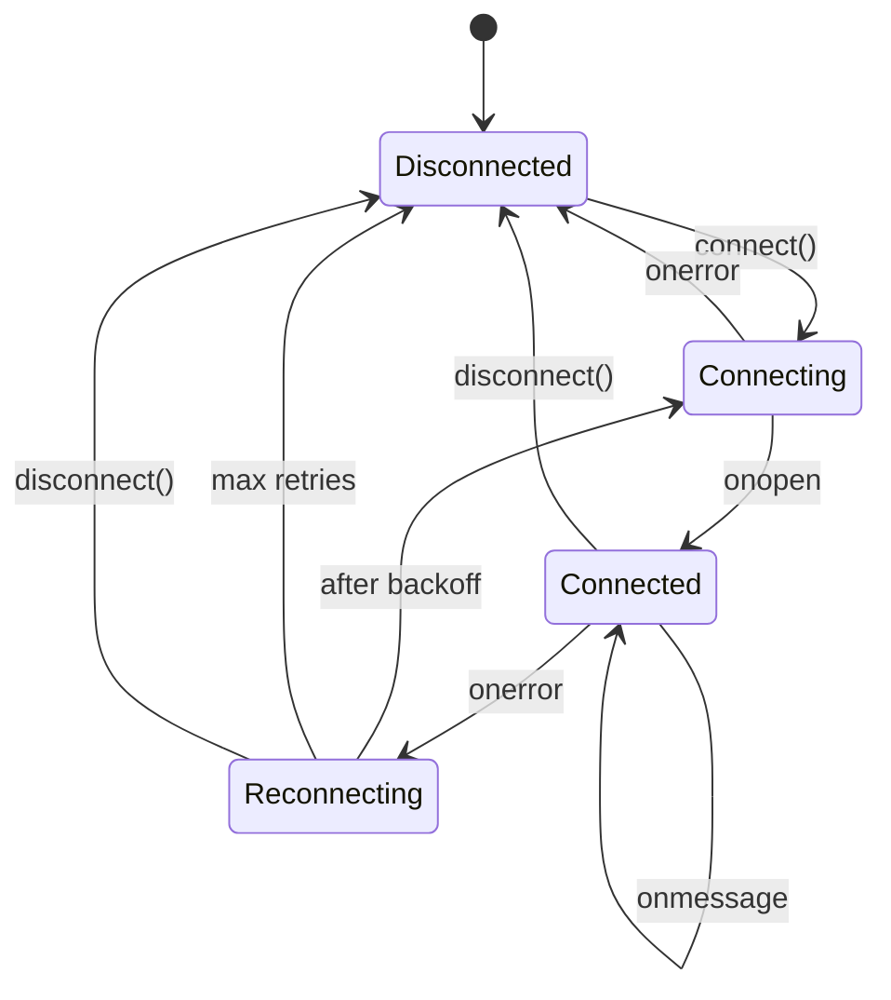

# Events Architecture

## Table of Contents
1. [Overview](#overview)
2. [Core Concepts](#core-concepts)
3. [Architecture](#architecture)
4. [Backend Implementation](#backend-implementation)
5. [Frontend Implementation](#frontend-implementation)
6. [Data Flow](#data-flow)
7. [Integration Points](#integration-points)
8. [Configuration](#configuration)
9. [Best Practices](#best-practices)
10. [Troubleshooting](#troubleshooting)

## Overview

### Purpose
The Events system provides real-time, bidirectional communication between the backend and frontend through Server-Sent Events (SSE). It enables live updates for task execution, agent actions, and system state changes, ensuring users see immediate feedback as AI agents work on their code.

### Key Responsibilities
- Stream real-time events from backend to frontend via SSE
- Manage dual event emission (task-specific and global streams)
- Handle connection lifecycle and automatic reconnection
- Cache and persist event history
- Enable targeted cache invalidation for UI updates
- Support event filtering and aggregation
- Provide debugging and monitoring capabilities
- Ensure reliable delivery with connection health checks

### Position in Architecture
The Events system acts as the real-time communication backbone, connecting agent actions to UI updates. It sits between the service layer (which emits events) and the frontend components (which consume events), enabling a responsive, live-updating user experience.

## Core Concepts

### Domain Terminology

| Term | Definition |
|------|------------|
| Event | A discrete notification about a state change or action |
| SSE | Server-Sent Events - unidirectional real-time communication protocol |
| Event Stream | Continuous connection for receiving events |
| Global Stream | Application-wide event stream for all events |
| Task Stream | Task-specific event stream for focused updates |
| Event Type | Category of event (e.g., MESSAGE, RESULT, ERROR) |
| Event Subtype | Specific variant within an event type |
| NDJSON | Newline-delimited JSON format used for streaming |
| Connection ID | Unique identifier for each SSE connection |
| Sequence Number | Ordered counter for event ordering |

### Key Abstractions

#### Event Structure
```typescript
// packages/shared/types/event.ts
export interface Event {
  eventId: string
  taskId: string
  iterationId?: string
  type: EventType
  subtype?: string
  payload: any
  timestamp: Date
  sequenceNumber: number
  agentType?: string
  source?: string
}

export enum EventType {
  INPUT = 'input',
  MESSAGE = 'message',
  START = 'start',
  STOP = 'stop',
  RESULT = 'result',
  ERROR = 'error',
  WORKSPACE = 'workspace',
  SERVER = 'server',
  TOOL = 'tool',
  COMPLETION = 'completion',
}
```

#### Composite Event Types
```typescript
// Frontend-specific composite types
type CompositeEventType = 
  | 'task:created' 
  | 'task:updated' 
  | 'task:statusChanged'
  | 'iteration:created' 
  | 'iteration:updated'
  | 'tool:start' 
  | 'tool:result' 
  | 'tool:error'
```

### Design Decisions

1. **Dual Stream Architecture**: Support both global and task-specific streams for flexibility
2. **NDJSON Format**: Use newline-delimited JSON for simpler parsing and better reliability
3. **In-Memory Caching**: Keep recent events in memory for fast catchup
4. **Conditional Persistence**: Only persist non-Claude events to reduce storage
5. **Event Enrichment**: Automatically add IDs and timestamps to events
6. **Connection Health**: Regular ping/pong for connection liveness
7. **Graceful Degradation**: System continues to function without real-time updates

## Architecture

### High-Level Overview


### Component Relationships

1. **Event Service** → **SSE Manager**: Event emission and distribution
2. **SSE Manager** → **Frontend Providers**: Real-time event delivery
3. **Frontend Providers** → **React Query**: Cache invalidation
4. **Frontend Providers** → **Components**: Direct event handling

### Dependency Flow

- **Upstream**: Agent Service, Task Service, Workspace Service
- **Core**: Event Service, SSE Manager
- **Downstream**: Frontend components, React Query cache

## Backend Implementation

### Service Layer

#### Event Service Structure
```typescript
// apps/backend/services/event.service.ts
export class EventService extends EventEmitter {
  private sequenceCounter = 0
  private eventCache = new Map<string, Event[]>()
  private readonly MAX_CACHE_SIZE = 1000
  
  constructor(
    private storage: EventStorage,
    private config: EventConfig
  ) {
    super()
    this.setMaxListeners(100) // Support many concurrent connections
  }
  
  async emitEvent(event: Partial<Event>): Promise<void> {
    // Enrich event
    const enrichedEvent: Event = {
      ...event,
      eventId: event.eventId || randomUUID(),
      timestamp: event.timestamp || new Date(),
      sequenceNumber: this.sequenceCounter++,
    }
    
    // Cache event
    this.cacheEvent(enrichedEvent)
    
    // Dual emission
    this.emit(`task:${enrichedEvent.taskId}`, enrichedEvent)
    this.emit('global', enrichedEvent)
    
    // Conditional persistence
    if (enrichedEvent.agentType !== 'claude-code') {
      await this.storage.saveEvents(enrichedEvent.taskId, [enrichedEvent])
    }
  }
  
  subscribeToTask(taskId: string, handler: (event: Event) => void): () => void {
    this.on(`task:${taskId}`, handler)
    return () => this.off(`task:${taskId}`, handler)
  }
  
  subscribeAll(handler: (event: Event) => void): () => void {
    this.on('global', handler)
    return () => this.off('global', handler)
  }
}
```

#### Key Methods
| Method | Purpose | Parameters | Returns |
|--------|---------|------------|---------|
| emitEvent | Emit an event to all subscribers | Partial<Event> | Promise<void> |
| subscribeToTask | Subscribe to task-specific events | taskId, handler | Unsubscribe function |
| subscribeAll | Subscribe to all events | handler | Unsubscribe function |
| getRecentEvents | Get cached events | taskId?, limit? | Event[] |
| clearCache | Clear event cache | taskId? | void |

#### Error Handling
```typescript
async emitEvent(event: Partial<Event>): Promise<void> {
  try {
    // Event processing...
  } catch (error) {
    console.error('Failed to emit event:', error)
    // Emit error event
    this.emit('error', {
      type: 'event-emission-error',
      originalEvent: event,
      error: error.message,
    })
  }
}
```

### API Endpoints

#### Route Definitions
| Method | Path | Purpose | Auth Required |
|--------|------|---------|---------------|
| GET | /api/v1/events/stream | Global event stream | No |
| GET | /api/v1/tasks/:taskId/stream | Task-specific event stream | No |
| GET | /api/v1/events/stream/status | Connection status | No |
| GET | /api/v1/tasks/:taskId/events | Historical events | No |

#### Request/Response Schemas
```typescript
// Global stream query parameters
interface GlobalStreamQuery {
  types?: string          // Comma-separated event types
  activeTasksOnly?: boolean
  lastEventId?: string    // For reconnection
}

// Stream response format (NDJSON)
interface StreamMessage {
  type: 'event' | 'ping' | 'error'
  data: Event | { timestamp: number } | { error: string }
}

// Historical events response
interface EventsResponse {
  events: Event[]
  hasMore: boolean
  nextCursor?: string
}
```

### SSE Manager Implementation

```typescript
// apps/backend/utils/sse-manager.ts
export class SSEConnectionManager {
  private connections = new Map<string, Set<SSEConnection>>()
  private globalConnections = new Map<string, GlobalSSEConnection>()
  private stats = {
    totalConnections: 0,
    activeConnections: 0,
    messagesDelivered: 0,
  }
  
  connect(taskId: string, request: Request, reply: Reply): string {
    const connectionId = randomUUID()
    
    // Set SSE headers
    reply.raw.writeHead(200, {
      'Content-Type': 'application/x-ndjson',
      'Cache-Control': 'no-cache',
      'Connection': 'keep-alive',
      'X-Accel-Buffering': 'no',
    })
    
    // Create connection
    const connection: SSEConnection = {
      id: connectionId,
      taskId,
      request,
      reply,
      createdAt: new Date(),
      lastPing: new Date(),
    }
    
    // Track connection
    if (!this.connections.has(taskId)) {
      this.connections.set(taskId, new Set())
    }
    this.connections.get(taskId)!.add(connection)
    
    this.stats.totalConnections++
    this.stats.activeConnections++
    
    // Send initial ping
    this.sendMessage(connection, { type: 'ping', data: { timestamp: Date.now() } })
    
    return connectionId
  }
  
  sendEvent(taskId: string, event: Event): void {
    const connections = this.connections.get(taskId)
    if (!connections) return
    
    const message = { type: 'event', data: event }
    
    for (const connection of connections) {
      try {
        this.sendMessage(connection, message)
        this.stats.messagesDelivered++
      } catch (error) {
        console.warn(`Failed to send event to connection ${connection.id}:`, error)
        this.disconnect(taskId, connection.id)
      }
    }
  }
  
  private sendMessage(connection: SSEConnection, message: any): void {
    const data = JSON.stringify(message)
    connection.reply.raw.write(`${data}\n`)
  }
}
```

### Business Logic

#### Event Filtering
```typescript
function shouldSendEvent(event: Event, filters: EventFilters): boolean {
  // Type filtering
  if (filters.types && !filters.types.includes(event.type)) {
    return false
  }
  
  // Active tasks filtering
  if (filters.activeTasksOnly) {
    const task = getTask(event.taskId)
    if (!task || !['open', 'running'].includes(task.status)) {
      return false
    }
  }
  
  // Last event ID filtering (for reconnection)
  if (filters.lastEventId) {
    if (event.sequenceNumber <= getSequenceNumber(filters.lastEventId)) {
      return false
    }
  }
  
  return true
}
```

#### Connection Health Management
```typescript
class ConnectionHealthManager {
  private readonly PING_INTERVAL = 30000 // 30 seconds
  private readonly CONNECTION_TIMEOUT = 120000 // 2 minutes
  
  startHealthChecks(manager: SSEConnectionManager): void {
    setInterval(() => {
      const now = Date.now()
      
      // Check all connections
      for (const [taskId, connections] of manager.connections) {
        for (const connection of connections) {
          const lastActivity = Math.max(
            connection.createdAt.getTime(),
            connection.lastPing.getTime()
          )
          
          if (now - lastActivity > this.CONNECTION_TIMEOUT) {
            console.warn(`Connection ${connection.id} timed out`)
            manager.disconnect(taskId, connection.id)
          } else {
            // Send ping
            manager.sendMessage(connection, {
              type: 'ping',
              data: { timestamp: now }
            })
            connection.lastPing = new Date()
          }
        }
      }
    }, this.PING_INTERVAL)
  }
}
```

## Frontend Implementation

### Feature Structure
```
apps/frontend/src/features/events/
├── api/           # Event API utilities
├── components/    # Event viewer components
├── contexts/      # Event stream providers
├── hooks/         # Event subscription hooks
├── stores/        # Event state management
├── types/         # Event-specific types
├── utils/         # Event utilities
└── index.ts       # Public exports
```

### Components

#### Component Hierarchy


#### Key Components
| Component | Purpose | Props | State Management |
|-----------|---------|-------|------------------|
| GlobalEventStreamProvider | Manages global SSE connection | children | Internal state + context |
| TaskEventsProvider | Manages task-specific events | taskId, useGlobalStream? | Internal state + context |
| EventViewer | Displays event stream | taskId, filters? | Local filtering state |
| EventListItem | Renders individual event | event, expanded? | Local expansion state |

### Hooks and Context

#### Custom Hooks
| Hook | Purpose | Parameters | Returns |
|------|---------|------------|---------|
| useGlobalEventStream | Access global event stream | - | Context value with subscribe methods |
| useTaskEventSubscription | Subscribe to task events | taskId, handler | void (manages subscription) |
| useEventTypeSubscription | Subscribe to event type | type, handler | void (manages subscription) |
| useEventHistory | Get historical events | taskId, options? | Event[] with loading state |

#### Global Event Stream Context
```typescript
// apps/frontend/src/features/events/contexts/global-event-stream-context.tsx
interface GlobalEventStreamContextValue {
  isConnected: boolean
  connectionError: string | null
  subscribeToTask: (taskId: string, handler: (event: Event) => void) => () => void
  subscribeToType: (type: EventType, handler: (event: Event) => void) => () => void
  subscribeToAll: (handler: (event: Event) => void) => () => void
  getConnectionStats: () => ConnectionStats
}

export function GlobalEventStreamProvider({ children }: PropsWithChildren) {
  const [isConnected, setIsConnected] = useState(false)
  const [connectionError, setConnectionError] = useState<string | null>(null)
  const eventSourceRef = useRef<EventSource | null>(null)
  const subscribersRef = useRef<EventSubscribers>({
    task: new Map(),
    type: new Map(),
    all: new Set(),
  })
  
  const connect = useCallback(() => {
    if (eventSourceRef.current?.readyState === EventSource.OPEN) return
    
    const url = new URL('/api/v1/events/stream', window.location.origin)
    url.searchParams.set('activeTasksOnly', 'true')
    
    const eventSource = new EventSource(url.toString())
    
    eventSource.onopen = () => {
      setIsConnected(true)
      setConnectionError(null)
      console.log('Global event stream connected')
    }
    
    eventSource.onmessage = (event) => {
      try {
        const message = JSON.parse(event.data)
        
        if (message.type === 'event') {
          handleEvent(message.data)
        } else if (message.type === 'ping') {
          // Connection health check
        }
      } catch (error) {
        console.error('Failed to parse event:', error)
      }
    }
    
    eventSource.onerror = () => {
      setIsConnected(false)
      setConnectionError('Connection lost')
      reconnectWithBackoff()
    }
    
    eventSourceRef.current = eventSource
  }, [])
  
  const handleEvent = useCallback((event: Event) => {
    // Notify task subscribers
    const taskSubscribers = subscribersRef.current.task.get(event.taskId)
    taskSubscribers?.forEach(handler => handler(event))
    
    // Notify type subscribers
    const typeSubscribers = subscribersRef.current.type.get(event.type)
    typeSubscribers?.forEach(handler => handler(event))
    
    // Notify all subscribers
    subscribersRef.current.all.forEach(handler => handler(event))
    
    // Handle cache invalidation
    invalidateQueriesForEvent(event)
  }, [])
  
  // ... subscription methods, reconnection logic, etc.
}
```

### Real-time Updates

#### SSE Integration
```typescript
// apps/frontend/src/features/events/utils/ndjson-sse-client.ts
export class NDJSONSSEClient {
  private eventSource: EventSource | null = null
  private reconnectAttempts = 0
  private reconnectTimer: number | null = null
  
  constructor(
    private config: {
      taskId?: string
      onEvent: (event: Event) => void
      onError?: (error: Error) => void
      onConnect?: () => void
      onDisconnect?: () => void
    }
  ) {}
  
  connect(): void {
    const url = this.config.taskId
      ? `/api/v1/tasks/${this.config.taskId}/stream`
      : '/api/v1/events/stream'
    
    this.eventSource = new EventSource(url)
    
    this.eventSource.onopen = () => {
      this.reconnectAttempts = 0
      this.config.onConnect?.()
    }
    
    this.eventSource.onmessage = (event) => {
      try {
        const data = JSON.parse(event.data)
        if (data.type === 'event') {
          this.config.onEvent(data.data)
        }
      } catch (error) {
        this.config.onError?.(new Error('Failed to parse event'))
      }
    }
    
    this.eventSource.onerror = () => {
      this.config.onDisconnect?.()
      this.scheduleReconnect()
    }
  }
  
  private scheduleReconnect(): void {
    const delay = Math.min(1000 * Math.pow(2, this.reconnectAttempts), 30000)
    this.reconnectAttempts++
    
    this.reconnectTimer = window.setTimeout(() => {
      this.connect()
    }, delay)
  }
  
  disconnect(): void {
    this.eventSource?.close()
    this.eventSource = null
    
    if (this.reconnectTimer) {
      clearTimeout(this.reconnectTimer)
      this.reconnectTimer = null
    }
  }
}
```

#### Cache Invalidation
```typescript
// apps/frontend/src/features/events/utils/cache-invalidation.ts
import { queryClient } from '@/lib/api/query-client'
import { queryKeys } from '@/lib/api/query-keys'

export function invalidateQueriesForEvent(event: Event): void {
  switch (event.type) {
    case EventType.RESULT:
    case EventType.ERROR:
      // Invalidate task queries
      queryClient.invalidateQueries({
        queryKey: queryKeys.task(event.taskId),
      })
      queryClient.invalidateQueries({
        queryKey: queryKeys.tasksList(),
      })
      break
      
    case EventType.INPUT:
      // Invalidate task messages
      queryClient.invalidateQueries({
        queryKey: queryKeys.taskMessages(event.taskId),
      })
      break
      
    case EventType.SERVER:
      // Invalidate server status
      if (event.subtype === 'started' || event.subtype === 'stopped') {
        queryClient.invalidateQueries({
          queryKey: queryKeys.taskServerStatus(event.taskId),
        })
      }
      break
      
    case EventType.WORKSPACE:
      // Invalidate workspace status
      queryClient.invalidateQueries({
        queryKey: queryKeys.taskWorkspaceStatus(event.taskId),
      })
      break
  }
  
  // Handle composite event types
  if (event.type.includes(':')) {
    const [entity, action] = event.type.split(':')
    
    if (entity === 'task') {
      queryClient.invalidateQueries({
        queryKey: queryKeys.tasksList(),
      })
      
      if (action === 'statusChanged') {
        queryClient.invalidateQueries({
          queryKey: queryKeys.task(event.taskId),
        })
      }
    }
  }
}
```

#### Optimistic Updates
```typescript
// Example of optimistic updates with events
export function useCreateTaskWithOptimisticUpdate() {
  const queryClient = useQueryClient()
  const { subscribeToType } = useGlobalEventStream()
  
  useEffect(() => {
    return subscribeToType('task:created', (event) => {
      // Optimistically add task to list
      queryClient.setQueryData(
        queryKeys.tasksList(),
        (old: Task[] = []) => [event.payload.task, ...old]
      )
    })
  }, [])
  
  return useMutation({
    mutationFn: createTask,
    onMutate: async (newTask) => {
      // Cancel in-flight queries
      await queryClient.cancelQueries({ queryKey: queryKeys.tasksList() })
      
      // Snapshot previous value
      const previousTasks = queryClient.getQueryData(queryKeys.tasksList())
      
      // Optimistically update
      queryClient.setQueryData(
        queryKeys.tasksList(),
        (old: Task[] = []) => [{
          ...newTask,
          taskId: `temp-${Date.now()}`,
          status: 'open',
          createdAt: new Date(),
        }, ...old]
      )
      
      return { previousTasks }
    },
    onError: (err, newTask, context) => {
      // Rollback on error
      queryClient.setQueryData(
        queryKeys.tasksList(),
        context.previousTasks
      )
    },
    onSettled: () => {
      // Always refetch after mutation
      queryClient.invalidateQueries({ queryKey: queryKeys.tasksList() })
    },
  })
}
```

## Data Flow

### Complete Lifecycle


### State Transitions


## Integration Points

### Dependencies

- **Internal Components:**
  - Task Service (emits task lifecycle events)
  - Agent Service (emits execution events)
  - Workspace Service (emits workspace events)
  - Server Manager (emits preview server events)
  
- **External Libraries:**
  - EventEmitter (Node.js built-in)
  - EventSource API (browser built-in)
  - React Query (cache invalidation)

### Events

#### Emitted Events
| Event | Payload | When Triggered |
|-------|---------|----------------|
| input | { message, taskId, iterationId } | User sends message |
| message | { content, role, taskId } | Agent generates response |
| result | { result, status, cost } | Iteration completes |
| error | { error, taskId, iterationId } | Error occurs |
| workspace | { action, path, taskId } | Workspace changes |
| server | { status, port, url } | Preview server state changes |
| tool | { tool, args, result } | Tool execution |

#### Consumed Events
| Event | Source | Action |
|-------|--------|--------|
| All events | Various services | Stream to connected clients |
| task:* events | Task service | Filter and forward |
| Task lifecycle | Task service | Update connection tracking |

### Shared Data Structures
```typescript
// packages/shared/types/event.ts
export interface Event {
  eventId: string
  taskId: string
  iterationId?: string
  type: EventType
  subtype?: string
  payload: any
  timestamp: Date
  sequenceNumber: number
  agentType?: string
  source?: string
}

// packages/shared/types/sse.ts
export interface SSEMessage {
  type: 'event' | 'ping' | 'error'
  data: any
}

// packages/shared/constants/events.ts
export const EVENT_TYPES = {
  // ... event type constants
} as const
```

## Configuration

### Environment Variables
| Variable | Purpose | Default | Required |
|----------|---------|---------|----------|
| SSE_PING_INTERVAL | Ping interval in ms | 30000 | No |
| SSE_CONNECTION_TIMEOUT | Connection timeout in ms | 120000 | No |
| EVENT_CACHE_SIZE | Max events to cache | 1000 | No |
| PERSIST_CLAUDE_EVENTS | Persist Claude Code events | false | No |
| VITE_USE_GLOBAL_EVENT_STREAM | Use global stream in frontend | false | No |
| VITE_DEBUG_EVENT_STREAM | Enable debug logging | false | No |

### Feature Flags
```typescript
// apps/frontend/src/lib/config/feature-flags.ts
export const featureFlags = {
  useGlobalEventStream: {
    enabled: process.env.VITE_USE_GLOBAL_EVENT_STREAM === 'true',
    description: 'Use global event stream for all real-time updates'
  },
  eventBatching: {
    enabled: false,
    description: 'Batch multiple events for performance'
  }
}
```

### Runtime Configuration
```typescript
// Event service configuration
interface EventConfig {
  cacheSize: number
  persistClaudeEvents: boolean
  connectionTimeout: number
  pingInterval: number
  maxConnectionsPerTask: number
  maxGlobalConnections: number
}

// SSE client configuration
interface SSEClientConfig {
  reconnectAttempts: number
  reconnectDelay: number
  maxReconnectDelay: number
  heartbeatInterval: number
}
```

## Best Practices

### Do's
- Always include taskId in event payloads
- Use specific event types for different actions
- Handle connection errors gracefully
- Clean up event subscriptions in useEffect
- Use event subtypes for fine-grained control
- Monitor connection health with regular pings
- Cache recent events for fast reconnection
- Test event handling with connection failures

### Don'ts
- Don't emit sensitive data in event payloads
- Don't rely on event ordering across types
- Don't create circular event dependencies
- Don't emit high-frequency events without throttling
- Don't keep connections open unnecessarily
- Don't ignore connection cleanup on unmount
- Don't parse events without error handling

### Performance Considerations
- Use task-specific streams for focused views
- Implement event filtering to reduce bandwidth
- Batch cache invalidations when possible
- Throttle high-frequency event types
- Monitor connection count and memory usage
- Use connection pooling for multiple streams
- Implement event aggregation for bulk updates

### Security Guidelines
- Validate event payloads before emission
- Sanitize user-generated content in events
- Don't expose internal system details
- Rate limit connection attempts
- Monitor for connection abuse
- Use secure origins for EventSource
- Implement proper CORS headers

## Troubleshooting

### Common Issues

#### Issue: Connection Keeps Dropping
**Symptoms:**
- Frequent disconnection/reconnection cycles
- Missing events in the UI
- Console errors about connection failures

**Cause:**
- Network instability
- Proxy/firewall interference
- Server resource limits

**Solution:**
- Check network stability
- Verify proxy configuration supports SSE
- Increase server connection limits
- Implement exponential backoff for reconnection

#### Issue: Events Not Appearing in UI
**Symptoms:**
- Backend shows events emitted
- Frontend doesn't update
- No console errors

**Cause:**
- Incorrect event subscription
- Event filtering too restrictive
- Cache invalidation not configured

**Solution:**
- Verify subscription matches event type/taskId
- Check event filters in subscription
- Ensure cache invalidation is set up
- Enable debug logging to trace events

#### Issue: High Memory Usage
**Symptoms:**
- Browser memory increases over time
- Application becomes sluggish
- Event processing slows down

**Cause:**
- Event listeners not cleaned up
- Large event payloads cached
- Too many concurrent connections

**Solution:**
- Ensure all subscriptions are cleaned up
- Limit event cache size
- Implement event payload trimming
- Use connection pooling

### Debug Strategies
1. Enable verbose event logging with `VITE_DEBUG_EVENT_STREAM=true`
2. Monitor connection status endpoint `/api/v1/events/stream/status`
3. Use browser DevTools Network tab to inspect SSE connections
4. Check event sequence numbers for gaps
5. Verify event enrichment (IDs, timestamps)
6. Test with curl: `curl -N http://localhost:8000/api/v1/events/stream`

### Logging
```typescript
// Backend event logging
console.log('[EventService] Event emitted:', {
  type: event.type,
  taskId: event.taskId,
  sequenceNumber: event.sequenceNumber,
})

// Frontend event logging
console.log('[EventStream] Event received:', {
  type: event.type,
  taskId: event.taskId,
  timestamp: event.timestamp,
})

// Connection logging
console.log('[SSE] Connection state:', {
  readyState: eventSource.readyState,
  url: eventSource.url,
})
```

### Monitoring
- **Connection Count**: Track active SSE connections
- **Event Rate**: Monitor events per second
- **Event Latency**: Measure emission to delivery time
- **Connection Duration**: Track connection lifetimes
- **Error Rate**: Monitor connection and parsing errors
- **Memory Usage**: Track event cache size
- **Reconnection Rate**: Monitor connection stability

## Related Documentation
- [Architecture Overview](../architecture-overview.md)
- [Task Architecture](./tasks.md)
- [Agent Architecture](./agents.md)
- [Event-Driven Pattern](../patterns/event-driven.md)
- [SSE Management Pattern](../patterns/sse-management.md)