# Event Architecture

## Table of Contents
1. [Overview](#overview)
2. [Core Concepts](#core-concepts)
3. [Architecture](#architecture)
4. [Backend Implementation](#backend-implementation)
5. [Frontend Implementation](#frontend-implementation)
6. [Data Flow](#data-flow)
7. [Integration Points](#integration-points)
8. [Configuration](#configuration)
9. [Best Practices](#best-practices)
10. [Troubleshooting](#troubleshooting)

## Overview

### Purpose
The Event system is the real-time communication backbone of Moatless Swarm UI, enabling instant feedback as AI agents modify code. It uses Server-Sent Events (SSE) to stream updates from backend services to frontend components, ensuring users see live progress without polling.

### Key Responsibilities
- Stream real-time updates via SSE with automatic reconnection
- Manage dual-stream architecture (global and task-specific)
- Orchestrate cache invalidation for UI consistency
- Buffer events for reliable delivery during disconnections
- Track connection health with ping/pong heartbeats
- Filter and route events to appropriate consumers
- Provide debugging and monitoring capabilities
- Ensure ordered event delivery with sequence numbers

### Position in Architecture
The Event system bridges the gap between backend actions and frontend reactions. It transforms discrete service operations into continuous streams of updates, enabling the reactive UI patterns that make Moatless feel responsive and alive.

## Core Concepts

### Domain Terminology

| Term | Definition |
|------|------------|
| Event | A discrete notification about a state change or action |
| SSE | Server-Sent Events - unidirectional real-time communication protocol |
| Event Stream | Continuous connection for receiving events |
| Global Stream | Application-wide event stream for all events |
| Task Stream | Task-specific event stream for focused updates |
| Event Type | Category of event (e.g., MESSAGE, RESULT, ERROR) |
| Event Subtype | Specific variant within an event type |
| NDJSON | Newline-delimited JSON format used for streaming |
| Connection ID | Unique identifier for each SSE connection |
| Sequence Number | Ordered counter for event ordering |
| Event Bus | Central dispatcher for event routing |
| Heartbeat | Periodic ping to maintain connection health |

### Key Abstractions

#### Event Hierarchy
```typescript
interface BaseEvent {
  eventId: string
  timestamp: Date
  sequenceNumber: number
}

interface TaskEvent extends BaseEvent {
  taskId: string
  iterationId?: string
  agentType?: string
}

interface SystemEvent extends BaseEvent {
  source: string
  severity: 'info' | 'warning' | 'error'
}
```

### Design Decisions

- **Dual-Stream Architecture**: Separate global and task streams for scalability
- **NDJSON over SSE**: Simpler parsing, better proxy compatibility
- **Event Buffering**: In-memory cache for reconnection recovery
- **Selective Persistence**: Store only business-critical events
- **Automatic Enrichment**: Add metadata at emission time
- **Connection Multiplexing**: Single connection for multiple subscriptions
- **Graceful Degradation**: Fall back to polling if SSE fails

## Architecture

### High-Level Overview

The Event system orchestrates real-time communication through a sophisticated multi-layered architecture that ensures reliable, ordered delivery of updates across the application.

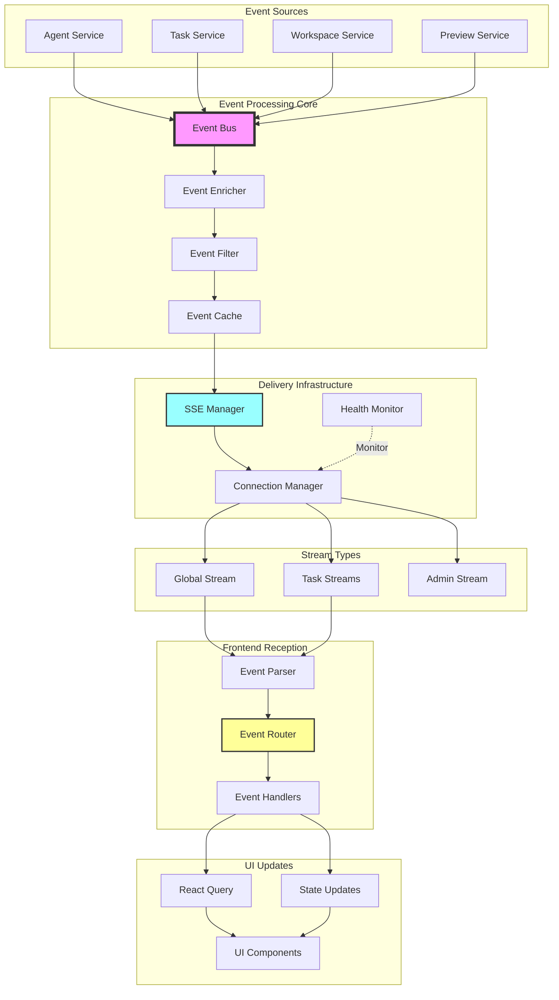

### Event Flow Architecture

The event system implements a sophisticated pipeline that transforms service-level operations into UI updates:

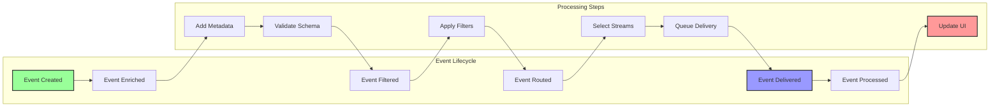

### Connection Management Architecture

The system manages SSE connections through a sophisticated state machine that ensures reliability:

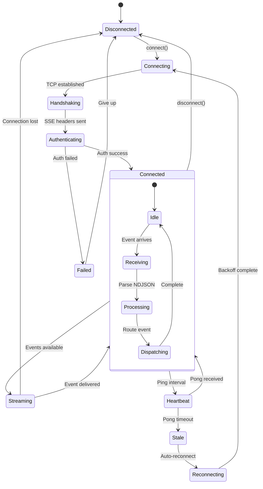

## Backend Implementation

### Event Processing Pipeline

The backend implements a sophisticated event processing pipeline that ensures reliable delivery and proper ordering:

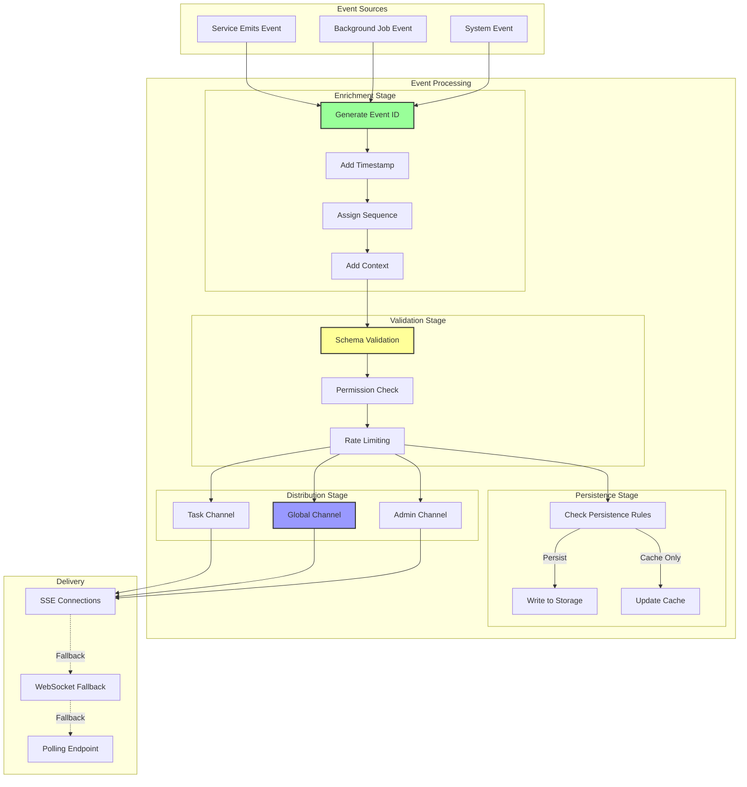

### Event Service Architecture

The Event Service acts as the central hub for all event operations:

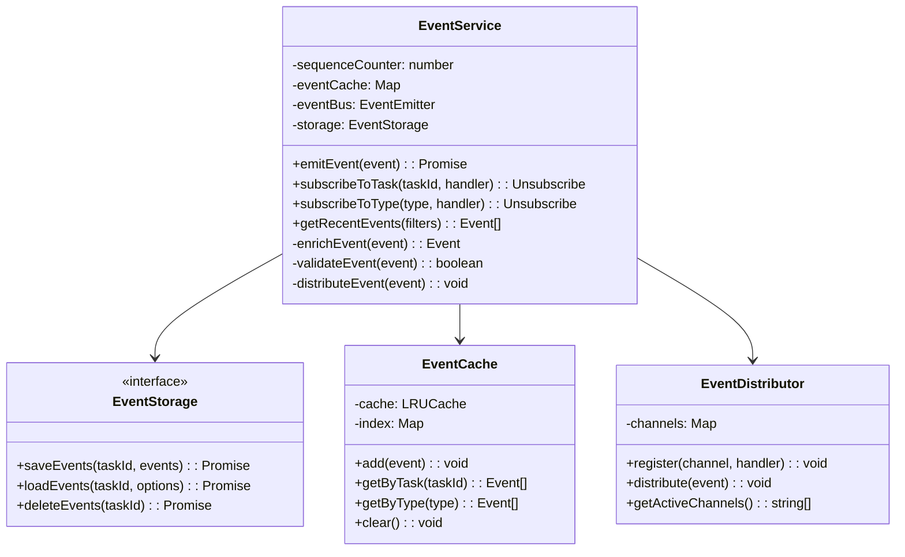

### SSE Connection Management

The SSE Manager handles the complexity of maintaining persistent connections:

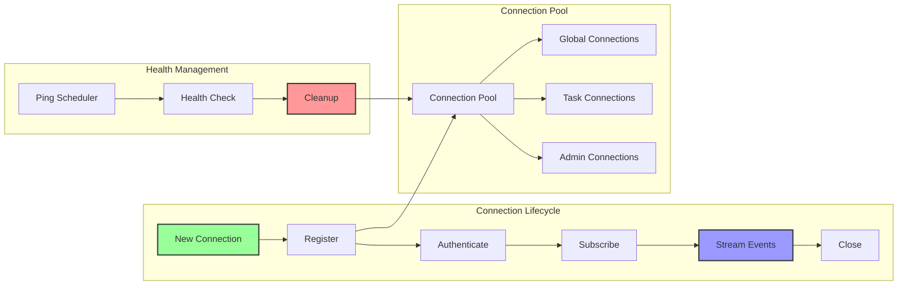

### Event Routing Logic

| Event Type | Global Stream | Task Stream | Admin Stream | Persistence |
|------------|---------------|-------------|--------------|-------------|
| MESSAGE | ✓ | ✓ | - | Conditional |
| RESULT | ✓ | ✓ | ✓ | Always |
| ERROR | ✓ | ✓ | ✓ | Always |
| TOOL | - | ✓ | - | Never |
| WORKSPACE | ✓ | ✓ | - | Always |
| SERVER | - | ✓ | ✓ | Conditional |

### Performance Optimization

The backend employs several strategies to handle high event throughput:

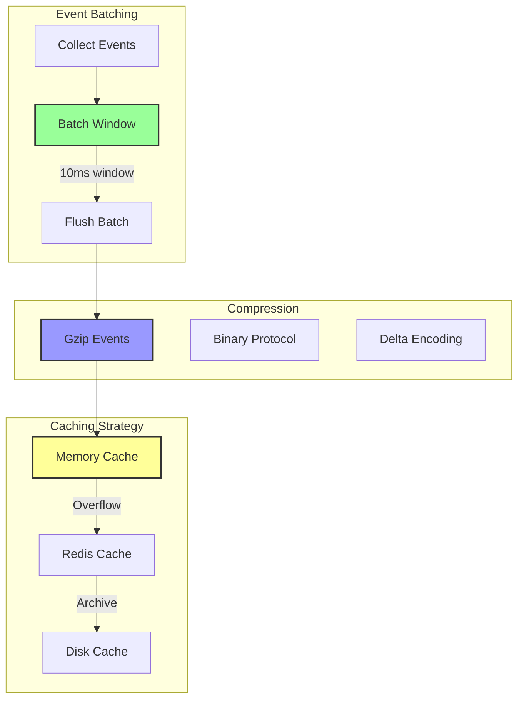

## Frontend Implementation

### Event Reception Architecture

The frontend implements a sophisticated event reception and distribution system:

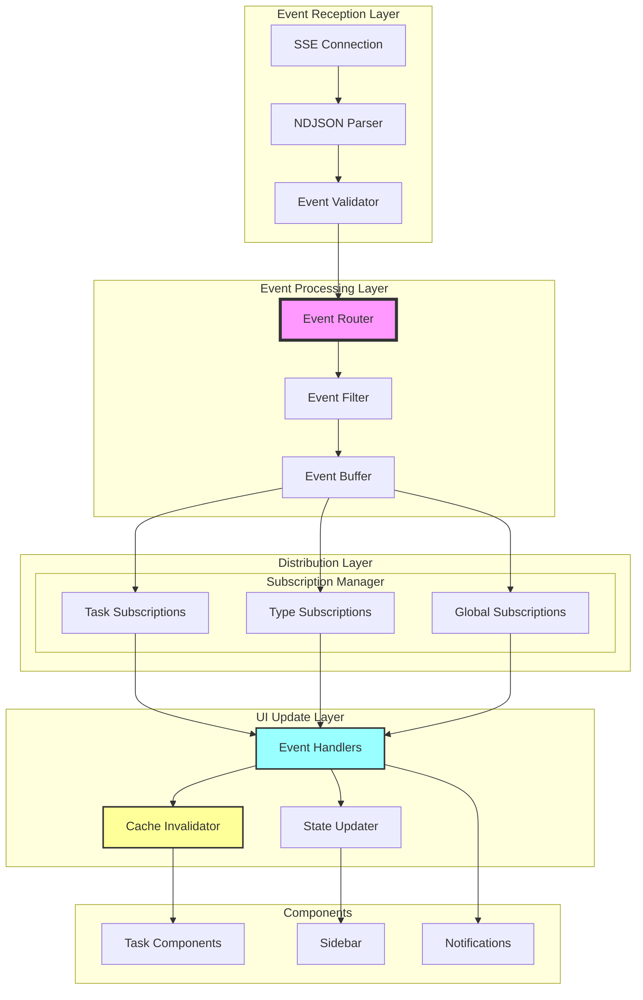

### Event Stream Provider Architecture

The providers manage connection lifecycle and event distribution:

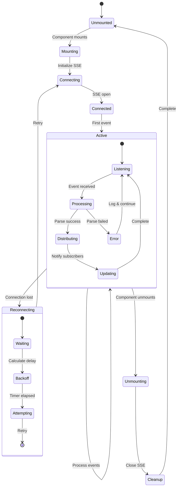

### React Query Integration

Events trigger intelligent cache updates through a sophisticated invalidation system:

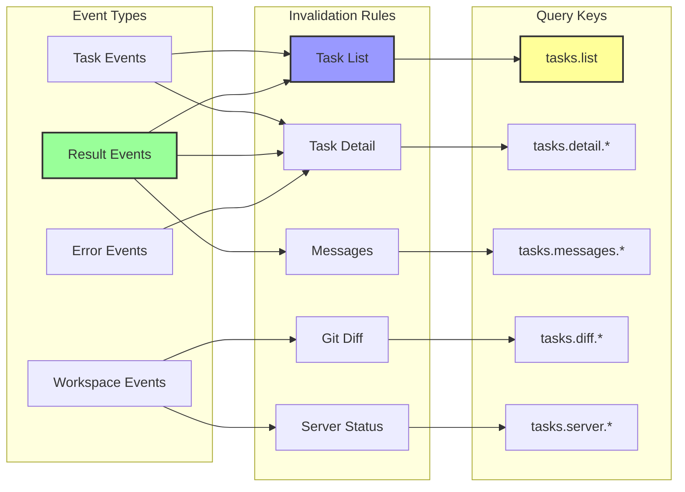

### Component Integration Patterns

Components integrate with the event system through well-defined patterns:

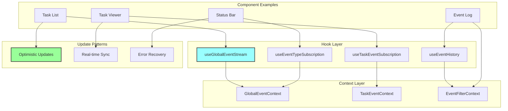

### Event Hook Patterns

| Hook | Purpose | Usage Pattern | Returns |
|------|---------|---------------|---------|
| useGlobalEventStream | Access global stream context | `const { subscribe } = useGlobalEventStream()` | Context API |
| useTaskEventSubscription | Subscribe to task events | `useTaskEventSubscription(taskId, handler)` | Cleanup function |
| useEventTypeSubscription | Subscribe by event type | `useEventTypeSubscription('result', handler)` | Cleanup function |
| useEventHistory | Load past events | `const { events, loading } = useEventHistory(taskId)` | Query state |

## Data Flow

### End-to-End Event Journey

The complete event flow demonstrates the sophistication of the real-time architecture:

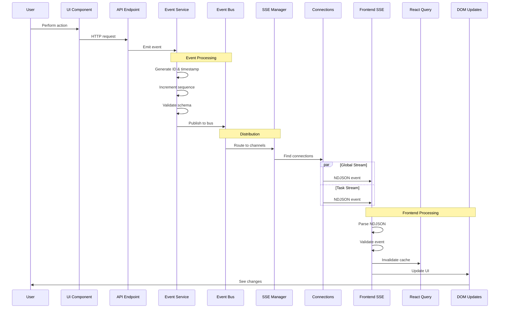

### Event Routing Architecture

Events flow through a sophisticated routing system that ensures proper delivery:

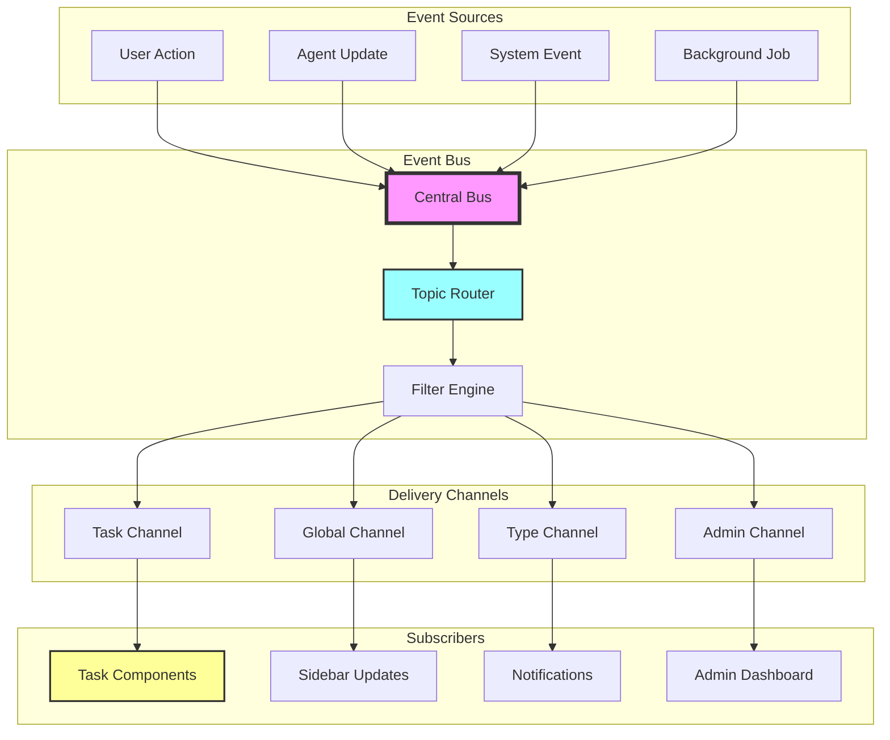

### Connection Recovery Flow

The system handles connection failures gracefully with automatic recovery:

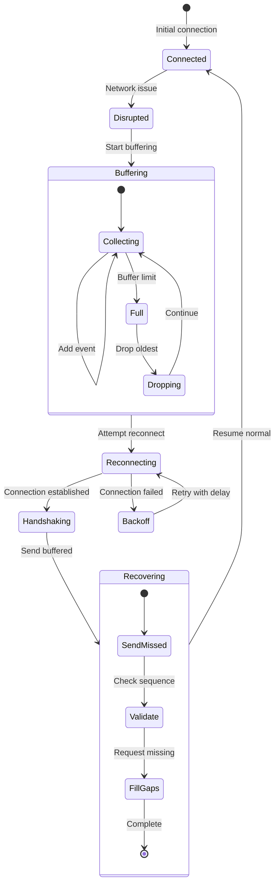

## Integration Points

### System Integration Map

The Event system integrates deeply with all major components:

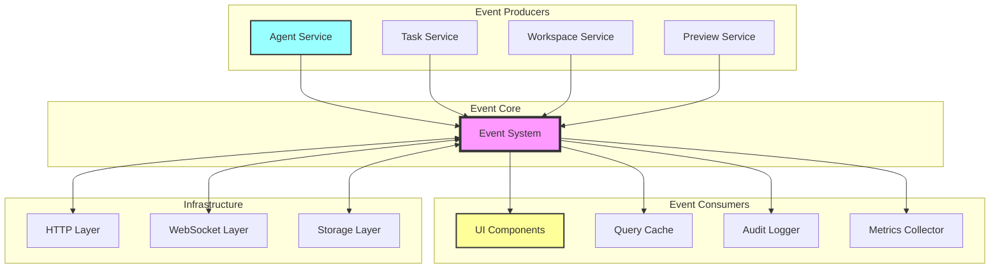

### Event Type Matrix

| Event Type | Producers | Consumers | Cache Impact | Persistence |
|------------|-----------|-----------|--------------|-------------|
| MESSAGE | Agent Service | Task UI, Event Log | Messages | Conditional |
| RESULT | Agent Service | Task List, Task Detail | Full refresh | Always |
| ERROR | All Services | Error Display, Logs | Status only | Always |
| TOOL | Agent Service | Tool Monitor | None | Never |
| WORKSPACE | Workspace Service | File Tree, Git UI | Workspace | Always |
| SERVER | Preview Service | Preview UI | Server status | Conditional |

### Cross-System Event Flows

Events enable complex cross-system interactions:

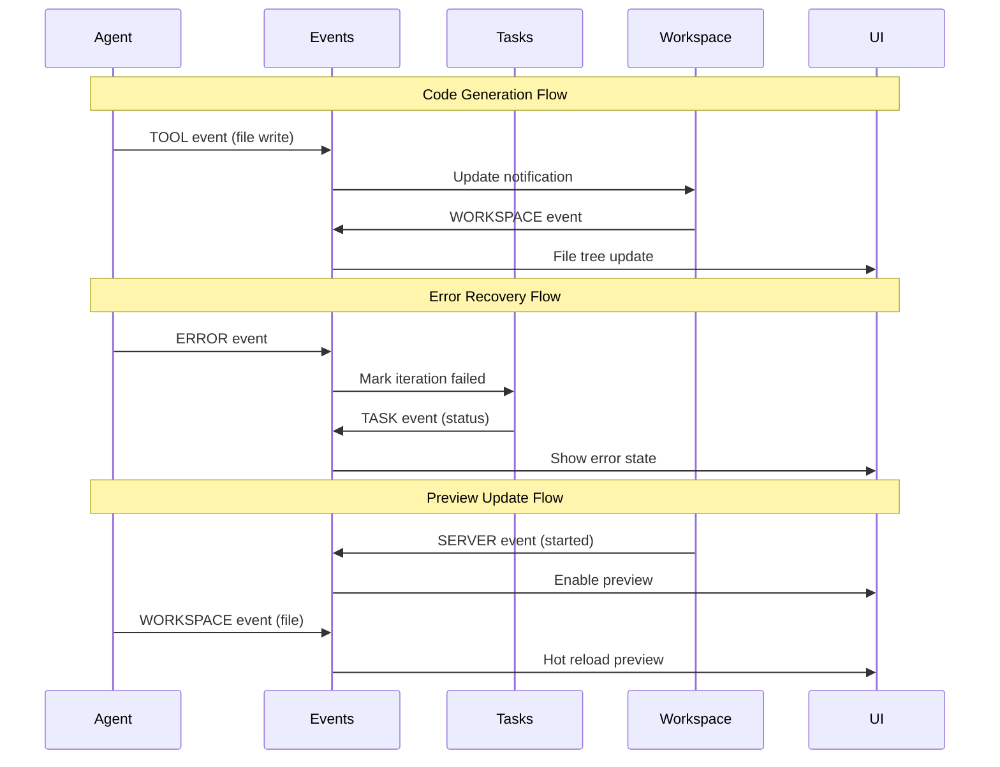

## Configuration

### Configuration Architecture

The Event system supports flexible configuration at multiple levels:

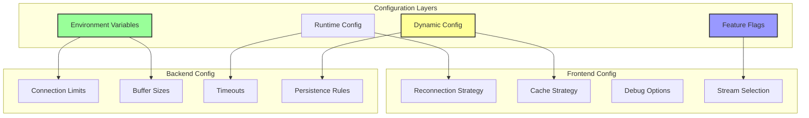

### Performance Tuning Parameters

| Parameter | Purpose | Default | Impact |
|-----------|---------|---------|--------|
| Connection Pool Size | Max concurrent SSE connections | 1000 | Memory usage |
| Event Buffer Size | Events to buffer during disconnect | 100 | Recovery speed |
| Batch Window | Time to collect events for batching | 10ms | Latency vs throughput |
| Cache TTL | How long to cache events | 5min | Memory vs performance |
| Ping Interval | Connection health check frequency | 30s | Network usage |
| Reconnect Backoff | Delay multiplier for reconnection | 2x | Recovery time |

## Best Practices

### Architectural Principles

The Event system follows key principles for reliability and performance:

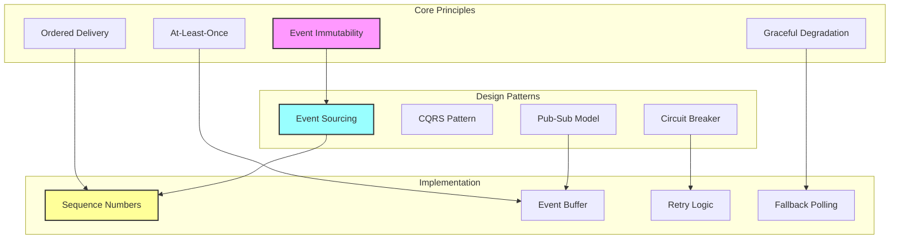

### Performance Architecture

Optimize event handling for scale:

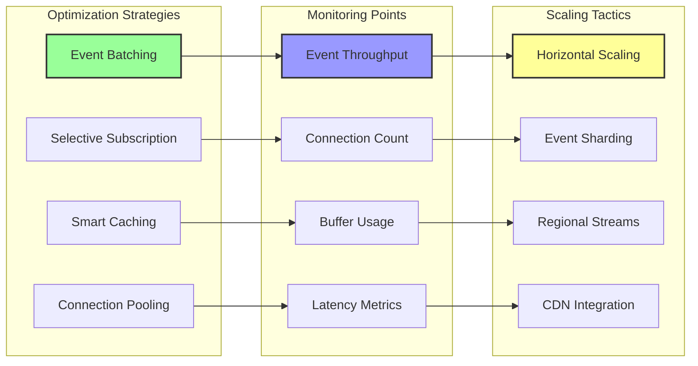

### Security Considerations

- **Event Validation**: Schema validation on all events
- **Rate Limiting**: Per-connection and per-IP limits
- **Authentication**: Optional auth for sensitive streams
- **Encryption**: TLS for all SSE connections
- **Sanitization**: Clean user content in events
- **Monitoring**: Track suspicious patterns

## Troubleshooting

### Diagnostic Architecture

Systematic troubleshooting through layered diagnostics:

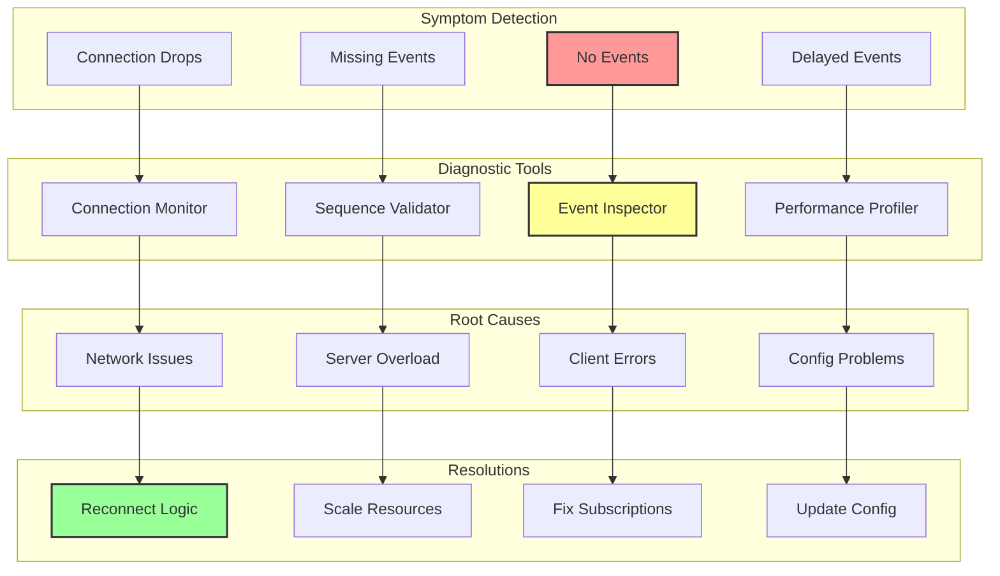

### Health Monitoring Dashboard

Key metrics to track system health:

```mermaid
graph LR
    subgraph "Real-time Metrics"
        RT1[Active Connections]
        RT2[Events/Second]
        RT3[Error Rate]
        RT4[Avg Latency]
    end
    
    subgraph "Aggregate Metrics"
        AG1[Daily Event Volume]
        AG2[Peak Connections]
        AG3[Reconnection Rate]
        AG4[Success Rate]
    end
    
    subgraph "Alerts"
        A1[Connection Spike]
        A2[High Error Rate]
        A3[Memory Pressure]
        A4[Sequence Gaps]
    end
    
    RT1 --> AG2
    RT2 --> AG1
    RT3 --> AG4
    RT4 --> AG3
    
    AG2 --> A1
    AG4 --> A2
    RT1 --> A3
    RT2 --> A4
    
    style RT2 fill:#9f9,stroke:#333,stroke-width:2px
    style AG1 fill:#99f,stroke:#333,stroke-width:2px
    style A2 fill:#f99,stroke:#333,stroke-width:2px
```

### Debug Workflow

1. **Check Connection Status**
   ```bash
   curl http://localhost:8000/api/v1/events/stream/status
   ```

2. **Monitor Event Stream**
   ```bash
   curl -N http://localhost:8000/api/v1/events/stream | jq .
   ```

3. **Validate Event Sequence**
   ```javascript
   // In browser console
   window.DEBUG_EVENT_STREAM = true;
   ```

4. **Analyze Performance**
   - Check Network tab for SSE timing
   - Monitor Memory profiler for leaks
   - Review Performance timeline

### Common Patterns

| Issue | Pattern | Solution |
|-------|---------|----------|
| Proxy timeout | Drops after 60s | Add keep-alive headers |
| Buffer overflow | Events lost on reconnect | Increase buffer size |
| Sequence gaps | Missing events | Check event cache |
| Memory leak | Growing heap | Clean up subscriptions |

## Related Documentation
- [Architecture Overview](../architecture-overview.md)
- [Task Management Architecture](./tasks.md)
- [Agent Architecture](./agents.md)
- [Event-Driven Pattern](../patterns/event-driven.md)
- [SSE Management Pattern](../patterns/sse-management.md)
- [Cache Invalidation Pattern](../patterns/cache-invalidation.md)
- [Real-time Architecture](../event-architecture.md)