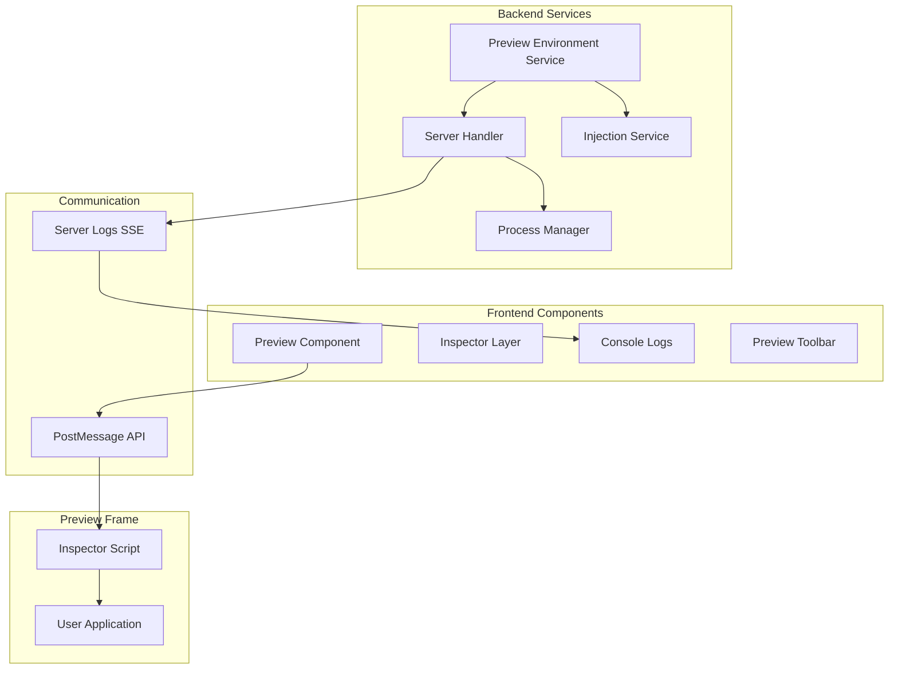
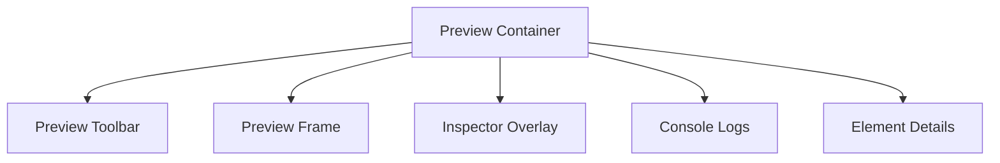
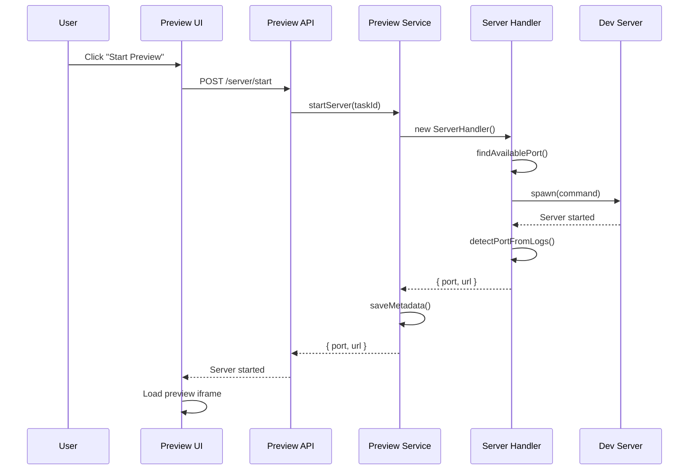
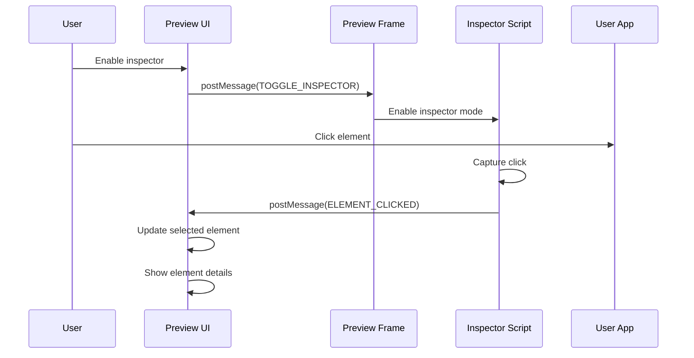

# Preview Environment Architecture

## Table of Contents
1. [Overview](#overview)
2. [Core Concepts](#core-concepts)
3. [Architecture](#architecture)
4. [Backend Implementation](#backend-implementation)
5. [Frontend Implementation](#frontend-implementation)
6. [Data Flow](#data-flow)
7. [Integration Points](#integration-points)
8. [Configuration](#configuration)
9. [Best Practices](#best-practices)
10. [Troubleshooting](#troubleshooting)

## Overview

### Purpose
The Preview Environment system provides live preview capabilities for web applications, enabling AI agents and developers to see real-time results of code changes. It includes advanced features like DOM inspection, console capture, and framework-aware server management.

### Key Responsibilities
- Manage development server lifecycle (start, stop, restart)
- Provide live preview with hot reload support
- Capture and display console output
- Enable DOM inspection and element selection
- Handle framework-specific configurations
- Manage port allocation and process recovery
- Stream server logs in real-time

### Position in Architecture
Preview environments bridge the gap between code modifications and visual feedback, providing essential real-time validation for AI-driven development workflows.

## Core Concepts

### Domain Terminology

| Term | Definition |
|------|------------|
| Preview Server | Development server running the application |
| Inspector Script | Injected JavaScript providing debugging capabilities |
| Port Allocation | Dynamic assignment of available ports |
| Script Injection | Method of adding inspector capabilities to apps |
| Server Handler | Low-level process management for servers |
| Console Capture | Intercepting and forwarding console output |
| DOM Inspector | Interactive element selection and inspection |

### Key Abstractions

#### Preview Environment Metadata
```typescript
interface PreviewEnvironmentMetadata {
  taskId: string
  pid: number              // Process ID
  port: number            // Assigned port
  startTime: string       // ISO timestamp
  command: string         // Executed command
  workspacePath: string   // Working directory
  logFile: string         // Path to log file
}
```

#### Injection Strategies
```typescript
type ScriptInjectionStrategy = 
  | 'html-injection'      // Modify HTML files
  | 'middleware'          // Server middleware
  | 'build-plugin'        // Build tool plugin
  | 'proxy'              // Proxy server
  | 'none'               // Manual setup
```

### Design Decisions
- **Dynamic port allocation** prevents conflicts
- **Process recovery** handles service restarts gracefully
- **Framework detection** optimizes injection strategy
- **Message-based communication** ensures iframe isolation
- **Persistent metadata** enables crash recovery

## Architecture

### High-Level Overview


### Component Relationships
- Preview Service manages Server Handlers
- Server Handlers control process lifecycle
- Inspector Script communicates via PostMessage
- Frontend components render preview and tools
- Injection Service modifies application code

### Dependency Flow
```
Task Creation → Preview Service → Server Handler
                     ↓
               Port Allocation
                     ↓
               Script Injection → Process Start
                                       ↓
                                 Preview Ready
```

## Backend Implementation

### Service Layer

#### Preview Environment Service
```typescript
// apps/backend/services/preview-environment.service.ts
export class PreviewEnvironmentService {
  private servers = new Map<string, ServerHandler>()
  
  constructor(
    private workspaceService: WorkspaceService,
    private repositoryService: RepositoryService
  ) {
    this.recoverServers() // Restore from metadata
  }

  // Server lifecycle
  async startServer(taskId: string): Promise<ServerStartResult>
  async stopServer(taskId: string): Promise<void>
  async restartServer(taskId: string): Promise<ServerStartResult>
  async getServerStatus(taskId: string): Promise<ServerStatus>
  
  // Log management
  async getServerLogs(taskId: string, tail?: number): Promise<string>
  streamServerLogs(taskId: string): ReadableStream
  
  // Recovery and cleanup
  private async recoverServers(): Promise<void>
  private async saveServerMetadata(taskId: string, handler: ServerHandler): Promise<void>
  private async deleteServerMetadata(taskId: string): Promise<void>
}
```

#### Server Handler
```typescript
// apps/backend/workspaces/server-handler.ts
export class ServerHandler {
  private process: ChildProcess | null = null
  private port: number | null = null
  private logStream: WriteStream | null = null
  
  constructor(
    private workspacePath: string,
    private command: string,
    private env: Record<string, string>
  ) {}

  async start(): Promise<{ port: number; url: string }>
  async stop(): Promise<void>
  async restart(): Promise<{ port: number; url: string }>
  isRunning(): boolean
  
  // Port detection
  private async findAvailablePort(): Promise<number>
  private async detectPortFromLogs(): Promise<number | null>
  private replacePortPlaceholder(command: string, port: number): string
}
```

#### Key Methods
| Method | Purpose | Parameters | Returns |
|--------|---------|------------|---------|
| `startServer` | Start preview server | taskId | Port and URL |
| `stopServer` | Stop preview server | taskId | void |
| `getServerStatus` | Check server status | taskId | Status object |
| `streamServerLogs` | Stream logs via SSE | taskId | ReadableStream |
| `recoverServers` | Restore after crash | none | void |

### Script Injection System

#### Injection Strategies

```typescript
class InjectionService {
  async injectScript(
    workspacePath: string,
    framework: string,
    strategy: ScriptInjectionStrategy
  ): Promise<void> {
    switch (strategy) {
      case 'html-injection':
        await this.injectIntoHtml(workspacePath)
        break
      case 'middleware':
        await this.setupMiddleware(workspacePath, framework)
        break
      case 'build-plugin':
        await this.installPlugin(workspacePath, framework)
        break
      // ... other strategies
    }
  }
  
  private async injectIntoHtml(workspacePath: string): Promise<void> {
    const htmlFiles = await glob('**/*.html', { cwd: workspacePath })
    
    for (const file of htmlFiles) {
      const content = await fs.readFile(file, 'utf-8')
      const injected = content.replace(
        '</head>',
        `<script src="/__preview-inspector.js"></script></head>`
      )
      await fs.writeFile(file, injected)
    }
  }
}
```

#### Inspector Script
```javascript
// Injected into preview applications
(function() {
  const PREVIEW_ORIGIN = window.location.origin;
  
  // Console capture
  ['log', 'warn', 'error', 'info', 'debug'].forEach(method => {
    const original = console[method];
    console[method] = function(...args) {
      original.apply(console, args);
      
      window.parent.postMessage({
        source: 'preview-iframe',
        type: 'console',
        method,
        args: args.map(formatArg),
        timestamp: Date.now()
      }, '*');
    };
  });
  
  // Error capture
  window.addEventListener('error', (event) => {
    window.parent.postMessage({
      source: 'preview-iframe',
      type: 'console',
      method: 'error',
      args: [{
        message: event.message,
        filename: event.filename,
        line: event.lineno,
        column: event.colno,
        stack: event.error?.stack
      }],
      timestamp: Date.now()
    }, '*');
  });
  
  // DOM inspection
  let inspectorMode = false;
  let hoveredElement = null;
  
  window.addEventListener('message', (event) => {
    if (event.data.type === 'TOGGLE_INSPECTOR') {
      inspectorMode = event.data.enabled;
      updateInspectorMode();
    }
  });
  
  // ... more inspector functionality
})();
```

### API Endpoints

#### Route Definitions
| Method | Path | Purpose | Auth Required |
|--------|------|---------|---------------|
| POST | `/api/tasks/:taskId/server/start` | Start preview server | No |
| POST | `/api/tasks/:taskId/server/stop` | Stop preview server | No |
| POST | `/api/tasks/:taskId/server/restart` | Restart preview server | No |
| GET | `/api/tasks/:taskId/server/status` | Get server status | No |
| GET | `/api/tasks/:taskId/server/logs` | Get/stream server logs | No |

#### Request/Response Schemas
```typescript
// Start server response
interface ServerStartResponse {
  port: number
  url: string
  command: string
  startTime: string
}

// Server status response
interface ServerStatusResponse {
  isRunning: boolean
  port?: number
  url?: string
  pid?: number
  startTime?: string
  uptime?: number
}

// Server logs query params
interface ServerLogsQuery {
  tail?: number  // Number of lines from end
  stream?: boolean  // Enable SSE streaming
}
```

### Business Logic

#### Port Allocation Algorithm
```typescript
async findAvailablePort(): Promise<number> {
  // Let OS assign a free port
  const server = createServer();
  
  return new Promise((resolve, reject) => {
    server.listen(0, '127.0.0.1', () => {
      const { port } = server.address();
      server.close(() => resolve(port));
    });
    
    server.on('error', reject);
  });
}
```

#### Process Recovery
```typescript
async recoverServers(): Promise<void> {
  const metadataFiles = await glob('data/preview-environments/*.json');
  
  for (const file of metadataFiles) {
    try {
      const metadata = await fs.readJson(file);
      
      // Check if process still exists
      if (process.kill(metadata.pid, 0)) {
        // Process exists, recreate handler
        const handler = new ServerHandler(
          metadata.workspacePath,
          metadata.command,
          {}
        );
        
        handler.pid = metadata.pid;
        handler.port = metadata.port;
        handler.logFile = metadata.logFile;
        
        this.servers.set(metadata.taskId, handler);
      } else {
        // Process dead, clean up
        await fs.remove(file);
      }
    } catch (error) {
      // Invalid metadata, remove
      await fs.remove(file);
    }
  }
}
```

## Frontend Implementation

### Feature Structure
```
apps/frontend/src/features/preview/
├── api/           # API client functions
│   └── preview-api.ts
├── components/    # UI components
│   ├── preview.tsx
│   ├── preview-toolbar.tsx
│   ├── console-logs.tsx
│   ├── inspector-overlay.tsx
│   └── element-details.tsx
├── hooks/         # Custom React hooks
│   ├── use-preview-server.ts
│   ├── use-server-logs.ts
│   └── use-inspector.ts
├── stores/        # State management
│   └── preview-store.ts
├── types/         # TypeScript types
│   └── index.ts
├── utils/         # Helper functions
│   └── message-handlers.ts
└── index.ts       # Public exports
```

### Components

#### Component Hierarchy


#### Key Components
| Component | Purpose | Props | State Management |
|-----------|---------|-------|------------------|
| `Preview` | Main container | `taskId`, `workspaceId` | Preview store |
| `PreviewToolbar` | Control buttons | `onRefresh`, `onInspect` | Local state |
| `ConsoleLog` | Console output | `logs[]` | Virtualized list |
| `InspectorOverlay` | Element highlighting | `selectedElement` | Inspector state |

### State Management

#### Preview Store (Zustand)
```typescript
interface PreviewStore {
  // Connection state
  serverUrl: string | null
  isConnected: boolean
  connectionError: Error | null
  
  // Inspector state
  inspectorEnabled: boolean
  selectedElement: ElementInfo | null
  hoveredElement: ElementInfo | null
  
  // Console state
  consoleLogs: ConsoleEntry[]
  currentPath: string
  
  // Actions
  setServerUrl: (url: string | null) => void
  toggleInspector: () => void
  selectElement: (element: ElementInfo | null) => void
  addConsoleLog: (entry: ConsoleEntry) => void
  clearConsole: () => void
}
```

### Message Communication

#### Message Handler
```typescript
// utils/message-handlers.ts
export function handlePreviewMessage(
  event: MessageEvent,
  store: PreviewStore
) {
  if (event.data.source !== 'preview-iframe') return;
  
  switch (event.data.type) {
    case 'console':
      store.addConsoleLog({
        method: event.data.method,
        args: event.data.args,
        timestamp: event.data.timestamp,
        id: generateId()
      });
      break;
      
    case 'ELEMENT_CLICKED':
      if (store.inspectorEnabled) {
        store.selectElement(event.data.element);
      }
      break;
      
    case 'ROUTE_CHANGE':
      store.setCurrentPath(event.data.path);
      break;
      
    // ... more message types
  }
}
```

### Real-time Updates

#### Server Logs Streaming
```typescript
export function useServerLogs(taskId: string) {
  const [logs, setLogs] = useState<string[]>([]);
  
  useEffect(() => {
    const eventSource = new EventSource(
      `/api/tasks/${taskId}/server/logs?stream=true`
    );
    
    eventSource.onmessage = (event) => {
      const data = JSON.parse(event.data);
      setLogs(prev => [...prev, ...data.lines]);
    };
    
    return () => eventSource.close();
  }, [taskId]);
  
  return logs;
}
```

## Data Flow

### Server Lifecycle Flow


### Inspector Communication Flow


## Integration Points

### Dependencies
- **Internal Components:**
  - Task Service - Associates preview with tasks
  - Workspace Service - Provides working directory
  - Repository Service - Supplies server commands
  - Event Service - Emits server status changes

- **External Libraries:**
  - `node-pty` - Process management
  - `chokidar` - File watching
  - `ws` - WebSocket support (future)

### Events

#### Emitted Events
| Event | Payload | When Triggered |
|-------|---------|----------------|
| `preview.server.started` | { taskId, port, url } | Server starts |
| `preview.server.stopped` | { taskId } | Server stops |
| `preview.server.error` | { taskId, error } | Server crashes |

#### Consumed Events
| Event | Source | Action |
|-------|--------|--------|
| `task.deleted` | Task Service | Stop preview server |
| `workspace.deleted` | Workspace Service | Stop preview server |

### Shared Data Structures
```typescript
// Console entry shared between frontend and inspector
interface ConsoleEntry {
  id: string
  method: 'log' | 'warn' | 'error' | 'info' | 'debug'
  args: any[]
  timestamp: number
  source?: string
  stack?: string
}

// Element info for inspection
interface ElementInfo {
  tagName: string
  id?: string
  className?: string
  attributes: Record<string, string>
  computedStyle?: CSSStyleDeclaration
  boundingRect: DOMRect
  path: string[]  // DOM path from root
}
```

## Configuration

### Environment Variables
| Variable | Purpose | Default | Required |
|----------|---------|---------|----------|
| `PREVIEW_SCRIPT_URL` | Inspector script location | `/__preview-inspector.js` | No |
| `SERVER_START_TIMEOUT` | Server startup timeout | 30000 (30s) | No |
| `SERVER_STOP_TIMEOUT` | Graceful stop timeout | 5000 (5s) | No |
| `LOG_RETENTION_DAYS` | Server log retention | 7 | No |

### Framework Configurations
```typescript
const FRAMEWORK_CONFIGS = {
  vite: {
    defaultPort: 5173,
    injectionStrategy: 'html-injection',
    portDetectionPattern: /Local:.*http:\/\/localhost:(\d+)/
  },
  nextjs: {
    defaultPort: 3000,
    injectionStrategy: 'middleware',
    portDetectionPattern: /ready on.*:(\d+)/
  },
  cra: {
    defaultPort: 3000,
    injectionStrategy: 'html-injection',
    portDetectionPattern: /On Your Network.*:(\d+)/
  }
};
```

### Runtime Configuration
Preview behavior can be customized:
- Server command templates
- Injection strategies per framework
- Custom port detection patterns
- Environment variable injection

## Best Practices

### Do's
- **Always use dynamic ports** to avoid conflicts
- **Implement graceful shutdown** for servers
- **Save metadata** for recovery after crashes
- **Stream logs efficiently** using tail/follow
- **Validate message sources** in iframe communication
- **Clean up injected scripts** when stopping
- **Use framework detection** for optimal configuration

### Don'ts
- Don't hardcode preview URLs or ports
- Don't leave orphaned processes
- Don't inject scripts in production builds
- Don't trust all postMessage events
- Don't keep servers running indefinitely
- Don't ignore server startup failures

### Performance Considerations
- **Lazy load preview iframe** until needed
- **Throttle console logs** for high-frequency output
- **Virtualize long lists** in console display
- **Debounce element hover** events
- **Limit log file size** with rotation
- **Cache framework detection** results

### Security Guidelines
- **Sandbox preview iframes** appropriately
- **Validate all message origins**
- **Sanitize console output** before display
- **Restrict file access** to workspace only
- **Use subprocess isolation** for servers
- **Never execute user input** directly

## Troubleshooting

### Common Issues

#### Issue: Server Fails to Start
**Symptoms:**
- "Failed to start server" error
- Preview shows connection error
- No server logs appear

**Cause:**
- Port already in use
- Missing dependencies
- Invalid server command

**Solution:**
1. Check if port is available:
   ```bash
   lsof -i :3000  # Check specific port
   ```
2. Verify dependencies installed:
   ```bash
   cd /workspace/path
   npm install
   ```
3. Test server command manually

#### Issue: Inspector Not Working
**Symptoms:**
- Can't select elements
- Console logs not appearing
- Inspector toggle does nothing

**Cause:**
- Script injection failed
- CSP blocking injection
- Framework incompatibility

**Solution:**
1. Check browser console for CSP errors
2. Verify injection strategy matches framework
3. Try different injection method
4. Check if script loaded: `window.__PREVIEW_INSPECTOR_LOADED__`

#### Issue: Server Crashes Repeatedly
**Symptoms:**
- Server starts then immediately stops
- Restart loop
- Error in logs about missing modules

**Cause:**
- Build errors
- Missing environment variables
- Memory issues

**Solution:**
```bash
# Check server logs
cat data/logs/server-{taskId}.log

# Run build manually
cd /workspace/path
npm run build

# Increase memory
export NODE_OPTIONS="--max-old-space-size=4096"
```

### Debug Strategies

1. **Enable debug logging**:
   ```typescript
   // In preview service
   console.debug('Preview server starting', { command, env });
   ```

2. **Check process status**:
   ```bash
   ps aux | grep node  # Find server processes
   ```

3. **Monitor port usage**:
   ```bash
   netstat -an | grep LISTEN
   ```

### Logging
Preview operations are logged:
- **Server logs**: `data/logs/server-{taskId}.log`
- **Service logs**: Application logs
- **Browser console**: Frontend errors

### Monitoring
Key metrics to track:
- Server start success rate
- Average startup time
- Port allocation failures
- Inspector script load success
- Console message volume

## Related Documentation
- [Repository Architecture](./repositories.md)
- [Workspace Architecture](./workspaces.md)
- [Task Management Architecture](./tasks.md)
- [Event Architecture](./events.md)