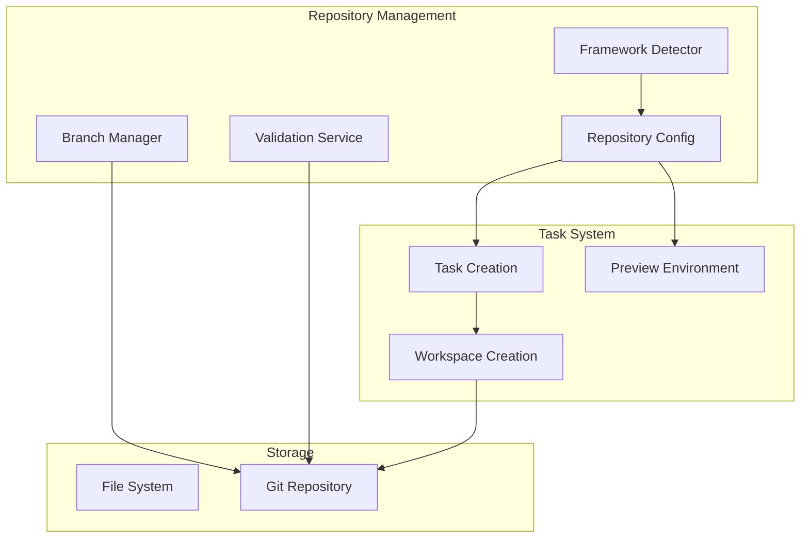
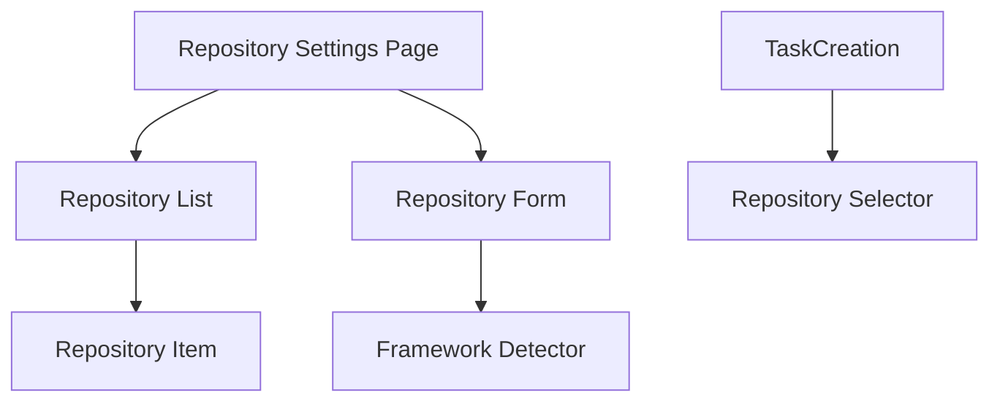
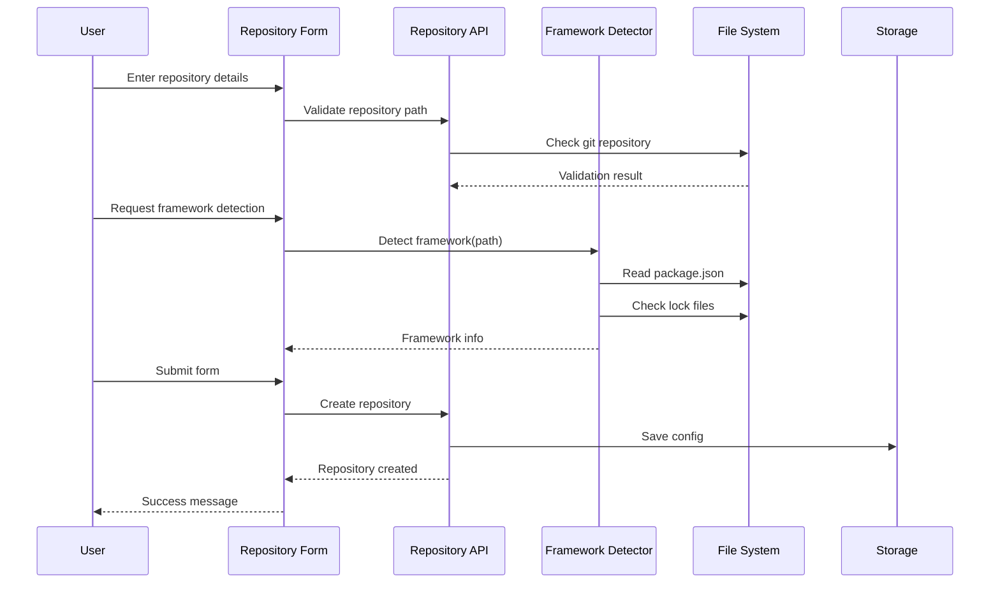
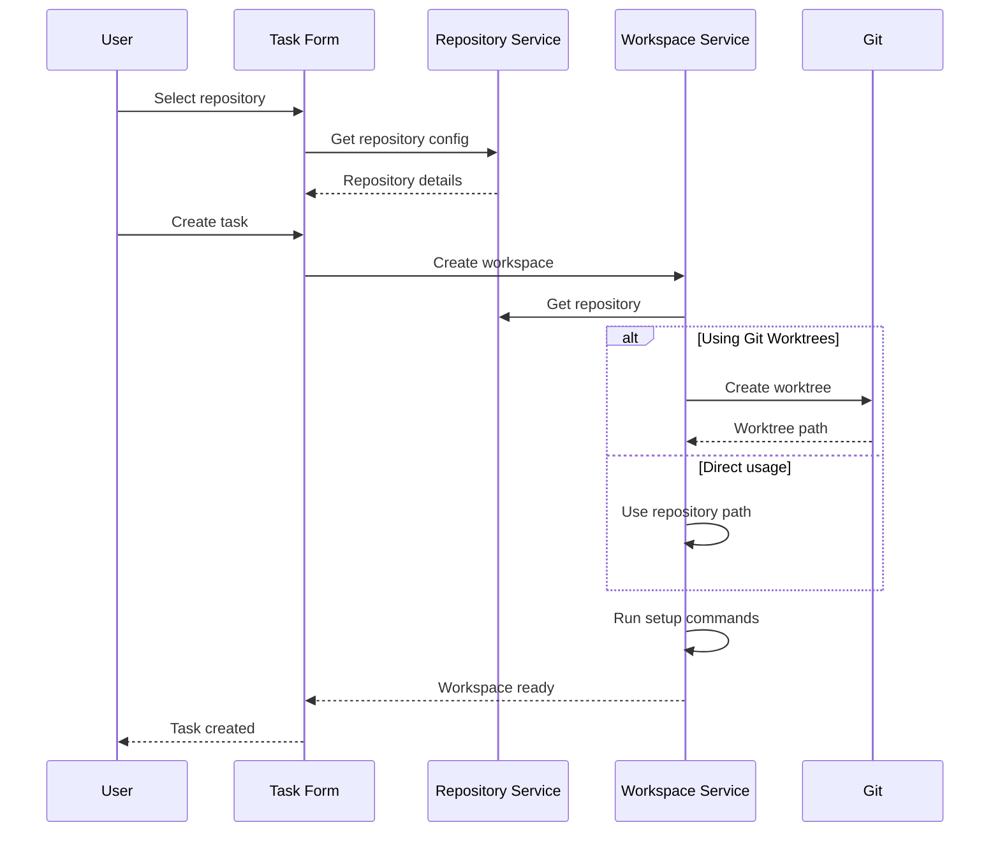

# Repository Architecture

## Table of Contents
1. [Overview](#overview)
2. [Core Concepts](#core-concepts)
3. [Architecture](#architecture)
4. [Backend Implementation](#backend-implementation)
5. [Frontend Implementation](#frontend-implementation)
6. [Data Flow](#data-flow)
7. [Integration Points](#integration-points)
8. [Configuration](#configuration)
9. [Best Practices](#best-practices)
10. [Troubleshooting](#troubleshooting)

## Overview

### Purpose
Repositories in Moatless Swarm UI are not just git repositories - they are complete **execution environments** that define how code is built, run, and previewed. They provide the foundation for creating isolated workspaces where AI agents can safely modify and test code.

### Key Responsibilities
- Define execution environments for tasks
- Automatic framework detection and configuration
- Manage preview server settings
- Provide isolated workspaces via git worktrees
- Store environment variables and setup commands
- Enable concurrent task execution on the same codebase

### Position in Architecture
Repositories serve as the bridge between local codebases and the task execution system, providing configuration and isolation necessary for safe AI-driven code modifications.

## Core Concepts

### Domain Terminology

| Term | Definition |
|------|------------|
| Repository | An execution environment configuration, not just a git repo |
| Framework Detection | Automatic identification of project type (Vite, Next.js, etc.) |
| Code Execution | How code runs - locally or in Docker containers |
| Preview Config | Settings for live preview functionality |
| Git Worktree | Isolated git working directory for concurrent tasks |
| Injection Strategy | How preview scripts are added to the application |

### Key Abstractions

#### Repository as Configuration
```typescript
interface RepositoryConfig {
  id: string
  name: string
  description?: string
  path: string                    // Local file system path
  useGitWorktrees?: boolean       // Enable isolation
  originalBranch?: string         // Default branch
  codeExecution: CodeExecution    // How to run code
  previewConfig?: PreviewConfig   // Preview settings
  variables: Record<string, string> // Environment vars
  createdAt: Date
  updatedAt: Date
}
```

### Design Decisions
- **Repositories are configurations**, not just paths to git repos
- **Framework detection is automatic** but can be overridden
- **Git worktrees provide isolation** for concurrent tasks
- **Preview configuration is framework-aware** for optimal experience

## Architecture

### High-Level Overview


### Component Relationships
- Tasks depend on repositories for workspace creation
- Workspaces use repository configuration for setup
- Preview environments use repository settings for server startup
- Framework detection informs preview configuration

### Dependency Flow
```
User Input → Repository Service → Git Repository
                ↓
        Framework Detection
                ↓
        Repository Config → Task Creation → Workspace
                              ↓
                        Preview Environment
```

## Backend Implementation

### Service Layer

#### Service Structure
```typescript
// apps/backend/services/repository.service.ts
export class RepositoryService {
  constructor(
    private storageService: StorageService,
    private gitService: GitService
  ) {}

  // Core CRUD operations
  async createRepository(data: CreateRepositoryDto): Promise<RepositoryConfig>
  async getRepository(id: string): Promise<RepositoryConfig>
  async updateRepository(id: string, data: UpdateRepositoryDto): Promise<RepositoryConfig>
  async deleteRepository(id: string): Promise<void>
  async listRepositories(): Promise<RepositoryConfig[]>
  
  // Advanced operations
  async detectFramework(path: string): Promise<DetectedFramework>
  async validateRepository(path: string): Promise<ValidationResult>
  async listBranches(id: string): Promise<string[]>
  async runSetupScript(id: string): Promise<SetupResult>
  async searchFiles(id: string, query: string): Promise<SearchResult[]>
}
```

#### Key Methods
| Method | Purpose | Parameters | Returns |
|--------|---------|------------|---------|
| `createRepository` | Create new repository config | Repository data | Complete config with ID |
| `detectFramework` | Auto-detect project framework | Repository path | Framework info |
| `validateRepository` | Ensure path is valid git repo | Repository path | Validation result |
| `runSetupScript` | Execute setup commands | Repository ID | Command output |
| `searchFiles` | Search files in repository | ID, query | Matching files |

#### Error Handling
```typescript
// Repository-specific errors
export class RepositoryNotFoundError extends Error {}
export class InvalidRepositoryPathError extends Error {}
export class RepositoryInUseError extends Error {}
export class FrameworkDetectionError extends Error {}
```

### API Endpoints

#### Route Definitions
| Method | Path | Purpose | Auth Required |
|--------|------|---------|---------------|
| GET | `/api/v1/repositories` | List all repositories | No |
| POST | `/api/v1/repositories` | Create repository | No |
| GET | `/api/v1/repositories/:id` | Get repository details | No |
| PUT | `/api/v1/repositories/:id` | Update repository | No |
| DELETE | `/api/v1/repositories/:id` | Delete repository | No |
| POST | `/api/v1/repositories/:id/run-setup` | Run setup script | No |
| POST | `/api/v1/repositories/:id/search-files` | Search files | No |
| GET | `/api/v1/repositories/:id/branches` | List branches | No |
| POST | `/api/v1/repositories/:id/detect-framework` | Detect framework | No |

#### Request/Response Schemas
```typescript
// Create repository request
interface CreateRepositoryRequest {
  name: string
  description?: string
  path: string
  useGitWorktrees?: boolean
  codeExecution?: CodeExecution
  previewConfig?: PreviewConfig
  variables?: Record<string, string>
}

// Repository response
interface RepositoryResponse extends RepositoryConfig {
  isValid: boolean
  validationErrors?: string[]
}
```

### Data Models

#### TypeScript Interfaces
```typescript
// Code execution configuration
interface CodeExecution {
  type: 'local' | 'docker'
  setupCommands?: string          // e.g., "npm install"
  serverCommand?: string          // e.g., "npm run dev -- --port {PORT}"
  serverPortPlaceholder?: string  // e.g., "{PORT}"
  envVars?: Record<string, string>
  dockerImage?: string            // For docker execution
  dockerCommand?: string
  dockerWorkdir?: string
}

// Preview configuration
interface PreviewConfig {
  framework?: 'vite' | 'nextjs' | 'cra' | 'webpack' | 'unknown'
  frameworkVersion?: string
  serverStartCommand?: string
  serverPort?: number
  injectionStrategy?: ScriptInjectionStrategy
  customScript?: string
}

// Framework detection result
interface DetectedFramework {
  framework: string
  version?: string
  packageManager: 'npm' | 'yarn' | 'pnpm' | 'bun'
  suggestedServerCommand: string
  suggestedSetupCommand: string
  injectionStrategy: ScriptInjectionStrategy
}
```

#### Validation Rules
- Repository path must exist and be a valid git repository
- Name must be unique across all repositories
- Setup commands are validated for basic syntax
- Server commands must include port placeholder if specified

### Business Logic

#### Framework Detection Algorithm
```typescript
async detectFramework(path: string): Promise<DetectedFramework> {
  const packageJson = await this.readPackageJson(path);
  
  // Check dependencies for framework indicators
  const deps = { ...packageJson.dependencies, ...packageJson.devDependencies };
  
  if (deps['next']) {
    return {
      framework: 'nextjs',
      version: deps['next'],
      packageManager: await this.detectPackageManager(path),
      suggestedServerCommand: 'npm run dev -- -p {PORT}',
      suggestedSetupCommand: 'npm install',
      injectionStrategy: 'middleware'
    };
  }
  
  if (deps['vite']) {
    return {
      framework: 'vite',
      version: deps['vite'],
      packageManager: await this.detectPackageManager(path),
      suggestedServerCommand: 'npm run dev -- --port {PORT}',
      suggestedSetupCommand: 'npm install',
      injectionStrategy: 'html-injection'
    };
  }
  
  // ... more framework checks
}
```

#### Git Worktree Management
```typescript
async createWorktreeForTask(repositoryId: string, taskId: string): Promise<string> {
  const repository = await this.getRepository(repositoryId);
  
  if (!repository.useGitWorktrees) {
    return repository.path; // Use main directory
  }
  
  const worktreePath = path.join(
    path.dirname(repository.path),
    '.worktrees',
    taskId
  );
  
  await this.gitService.createWorktree(
    repository.path,
    worktreePath,
    repository.originalBranch || 'main'
  );
  
  return worktreePath;
}
```

## Frontend Implementation

### Feature Structure
```
apps/frontend/src/features/repositories/
├── api/           # API client functions
│   └── repositories-api.ts
├── components/    # UI components
│   ├── repository-list.tsx
│   ├── repository-form.tsx
│   ├── repository-selector.tsx
│   └── framework-detector.tsx
├── hooks/         # Custom React hooks
│   ├── use-repositories.ts
│   ├── use-repository.ts
│   └── use-framework-detection.ts
├── types/         # TypeScript types
│   └── index.ts
└── index.ts       # Public exports
```

### Components

#### Component Hierarchy


#### Key Components
| Component | Purpose | Props | State Management |
|-----------|---------|-------|------------------|
| `RepositoryList` | Display all repositories | `repositories[]` | Query state |
| `RepositoryForm` | Create/edit repository | `repository?`, `onSubmit` | Form state |
| `RepositorySelector` | Select repo for task | `value`, `onChange` | Selection state |
| `FrameworkDetector` | Auto-detect framework | `path`, `onDetect` | Detection state |

### Hooks and Context

#### Custom Hooks
| Hook | Purpose | Parameters | Returns |
|------|---------|------------|---------|
| `useRepositories` | List all repositories | Query options | Repository list |
| `useRepository` | Get single repository | Repository ID | Repository data |
| `useCreateRepository` | Create repository | Mutation options | Mutation object |
| `useDetectFramework` | Detect framework | Repository path | Detection result |

#### Query Key Management
```typescript
export const repositoryKeys = {
  all: ['repositories'] as const,
  lists: () => [...repositoryKeys.all, 'list'] as const,
  list: (filters?: RepositoryFilters) => 
    [...repositoryKeys.lists(), filters] as const,
  details: () => [...repositoryKeys.all, 'detail'] as const,
  detail: (id: string) => [...repositoryKeys.details(), id] as const,
  branches: (id: string) => [...repositoryKeys.detail(id), 'branches'] as const,
};
```

### Real-time Updates
While repositories don't have real-time events like tasks, they integrate with the system's event architecture:
- Repository deletion events invalidate related task caches
- Setup script completion triggers UI updates
- Framework detection results update form state

## Data Flow

### Repository Creation Flow


### Task Creation with Repository


## Integration Points

### Dependencies
- **Internal Components:**
  - Task Service - Uses repositories for workspace creation
  - Workspace Service - Creates workspaces from repository configs
  - Preview Service - Uses repository settings for server startup
  - Git Service - Manages git operations and worktrees

- **External Libraries:**
  - `simple-git` - Git operations
  - `fs-extra` - File system operations
  - `execa` - Command execution

### Events
Repository operations don't emit events directly but trigger cache invalidations:

#### Cache Invalidation Triggers
| Action | Invalidated Queries |
|--------|-------------------|
| Repository created | Repository list |
| Repository updated | Repository detail, related tasks |
| Repository deleted | Repository list, related tasks |
| Framework detected | Repository detail |

### Shared Data Structures
```typescript
// Shared between frontend and backend
export interface RepositoryConfig {
  // ... (defined in @moatless/shared)
}

// Used by multiple services
export interface WorkspaceConfig {
  repositoryId: string
  workspacePath: string
  isWorktree: boolean
}
```

## Configuration

### Environment Variables
| Variable | Purpose | Default | Required |
|----------|---------|---------|----------|
| `DEFAULT_SETUP_TIMEOUT` | Timeout for setup scripts | 300000 (5 min) | No |
| `MAX_REPOSITORIES` | Maximum repositories allowed | 50 | No |
| `ENABLE_DOCKER_EXECUTION` | Allow Docker execution | false | No |

### Framework-Specific Defaults
```typescript
const FRAMEWORK_DEFAULTS = {
  vite: {
    serverCommand: 'npm run dev -- --port {PORT}',
    setupCommand: 'npm install',
    injectionStrategy: 'html-injection'
  },
  nextjs: {
    serverCommand: 'npm run dev -- -p {PORT}',
    setupCommand: 'npm install',
    injectionStrategy: 'middleware'
  },
  // ... more frameworks
};
```

### Runtime Configuration
Repositories can be configured at runtime via the API or UI:
- Update server commands
- Change injection strategies
- Modify environment variables
- Toggle git worktree usage

## Best Practices

### Do's
- **Always validate repository paths** before saving
- **Use framework detection** for optimal configuration
- **Enable git worktrees** for concurrent task execution
- **Define setup commands** to ensure dependencies are installed
- **Use port placeholders** in server commands for flexibility
- **Set appropriate injection strategies** based on framework
- **Document custom configurations** in repository description

### Don'ts
- Don't hardcode ports in server commands
- Don't skip repository validation
- Don't delete repositories with active tasks
- Don't use relative paths for repository locations
- Don't ignore framework detection suggestions

### Performance Considerations
- **Cache repository configurations** to avoid repeated file system access
- **Limit file search depth** to prevent long operations
- **Use git worktrees** to avoid conflicts in concurrent operations
- **Batch repository operations** when possible

### Security Guidelines
- **Validate all paths** to prevent directory traversal
- **Sanitize setup commands** to prevent injection
- **Limit command execution** to repository directories
- **Never expose sensitive paths** in API responses
- **Validate git operations** to prevent unauthorized access

## Troubleshooting

### Common Issues

#### Issue: Framework Detection Fails
**Symptoms:**
- Framework shown as "unknown"
- Incorrect server commands suggested
- Preview not working properly

**Cause:**
- Missing package.json
- Unusual project structure
- New framework not supported

**Solution:**
1. Manually select framework in UI
2. Provide custom server command
3. Check package.json exists and is valid

#### Issue: Git Worktree Creation Fails
**Symptoms:**
- Error: "fatal: not a git repository"
- Workspace creation fails
- Multiple tasks can't run concurrently

**Cause:**
- Path is not a git repository
- Git version too old
- Worktree already exists

**Solution:**
```bash
# Initialize git repository
cd /path/to/repository
git init

# Or update git
git --version  # Should be 2.5+
brew upgrade git  # macOS
```

#### Issue: Setup Script Timeout
**Symptoms:**
- Task creation hangs
- "Setup script timed out" error
- Dependencies not installed

**Cause:**
- Large dependencies
- Slow network
- Interactive prompts in script

**Solution:**
1. Increase timeout in environment variables
2. Use non-interactive commands: `npm ci` instead of `npm install`
3. Pre-install dependencies manually

### Debug Strategies
1. **Check repository validation**:
   ```bash
   # Verify git repository
   cd /repository/path
   git status
   ```

2. **Test framework detection**:
   ```bash
   # Check package.json
   cat package.json | jq '.dependencies,.devDependencies'
   ```

3. **Verify setup commands**:
   ```bash
   # Run setup manually
   cd /repository/path
   npm install  # or your setup command
   ```

### Logging
Repository operations are logged at various levels:
- **INFO**: Repository CRUD operations
- **DEBUG**: Framework detection details
- **ERROR**: Validation failures, command errors
- **WARN**: Deprecated configurations

### Monitoring
Key metrics to track:
- Repository creation/deletion rate
- Framework detection success rate
- Setup script execution time
- Git worktree creation failures

## Related Documentation
- [Workspace Architecture](./workspaces.md)
- [Task Management Architecture](./tasks.md)
- [Preview Environment Architecture](./preview-environments.md)
- [Git Operations Guide](../guides/git-operations.md)