# Repository Architecture

## Table of Contents
1. [Overview](#overview)
2. [Conceptual Model](#conceptual-model)
3. [Architectural Design](#architectural-design)
4. [Repository Lifecycle](#repository-lifecycle)
5. [Execution Environment Architecture](#execution-environment-architecture)
6. [Integration Architecture](#integration-architecture)
7. [State Management](#state-management)
8. [Framework Detection System](#framework-detection-system)
9. 
## Overview

### Purpose
Repositories in Moatless Swarm UI represent **execution environments** that define how AI agents interact with codebases. They are not merely git repositories, but complete configurations that enable isolated, concurrent, and safe code modifications through automated task execution.

### Key Implementation Files
- **Service Layer**: `apps/backend/services/repository.service.ts` - Core repository management logic
- **Route Handlers**: `apps/backend/routes/repositories.ts` - HTTP API endpoints
- **Type Definitions**: `packages/shared/types/repository.ts` - Repository interfaces and types
- **Schemas**: `packages/shared/schemas/repository.schemas.ts` - Validation schemas
- **Constants**: `packages/shared/constants/preview-config.ts` - Framework detection constants

### Architectural Role
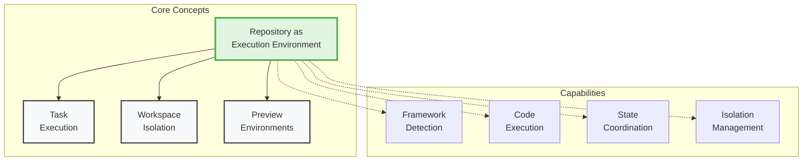

### Key Responsibilities
- **Define execution contexts** for AI agent operations
- **Provide workspace isolation** through git worktrees
- **Enable preview environments** with framework-aware configuration
- **Coordinate state** across concurrent task executions
- **Manage lifecycle** of code execution environments

### How Repositories Function as Execution Environments

A repository configuration transforms a simple git repository into a complete execution environment. When a task is created, the system:

1. **Loads Repository Configuration** from storage (`RepositoryService.getRepositoryById()`)
2. **Creates an Isolated Workspace** using git worktrees or directory copies
3. **Applies Execution Settings** including setup commands and server commands
4. **Configures Preview Environment** based on detected or specified framework
5. **Manages State** throughout the task lifecycle

This transformation enables multiple AI agents to work on the same codebase concurrently without interference.

## Conceptual Model

### Repository as an Execution Environment
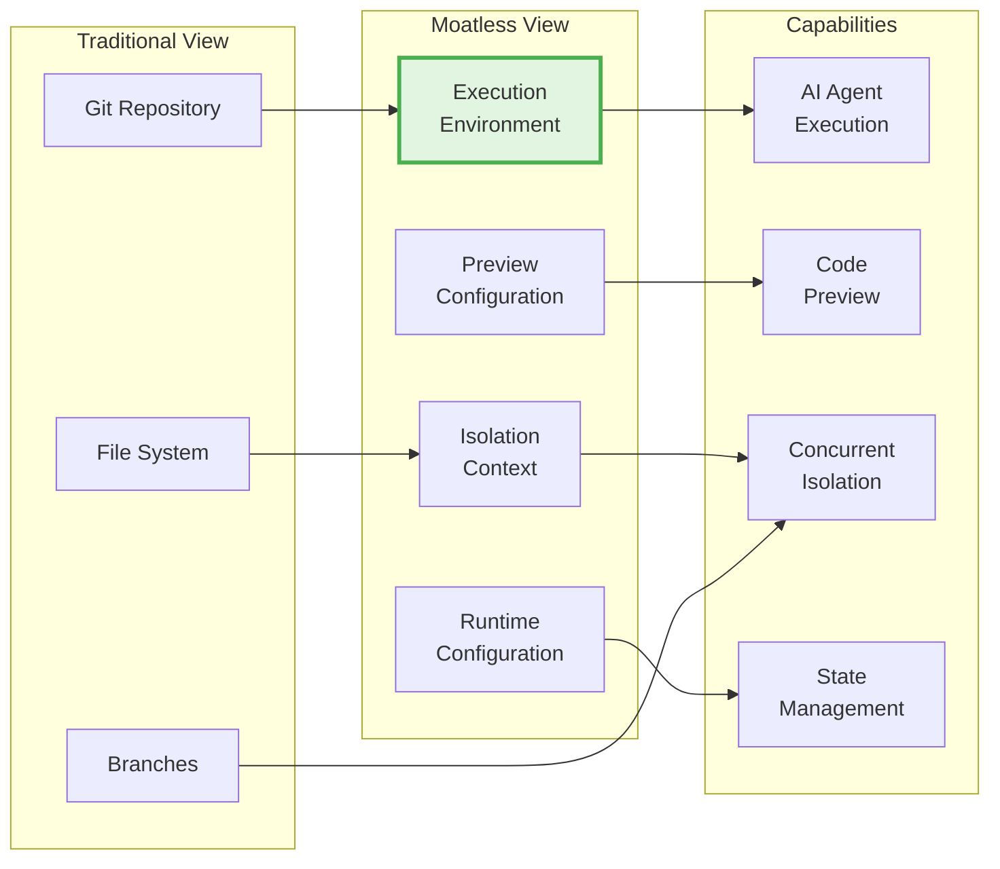

### Core Abstractions
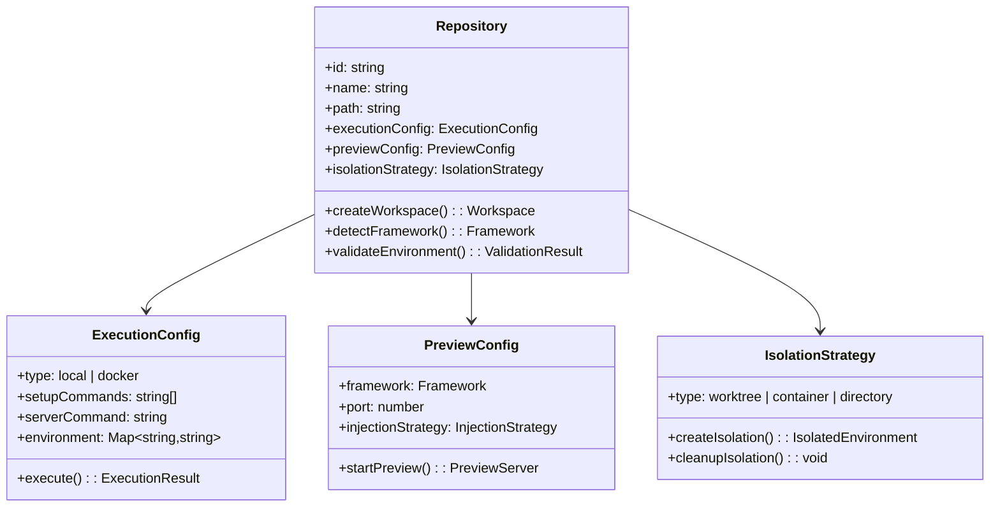

### Data Model Implementation

The repository data model is defined in `packages/shared/schemas/repository.schemas.ts`:

```typescript
// Core Repository Configuration
RepositoryConfig {
  id: string                    // Unique identifier
  name: string                  // Human-readable name
  description?: string          // Optional description
  path: string                  // Absolute path to git repository
  useGitWorktrees?: boolean     // Enable git worktree isolation
  originalBranch?: string       // Base branch for operations
  codeExecution: {              // Execution configuration
    type: 'local' | 'docker'    // Execution environment type
    setupCommands?: string      // Commands run before tasks
    serverCommand?: string      // Command to start dev server
    // Docker-specific fields
    image?: string              // Docker image
    volumes?: string[]          // Volume mounts
    ports?: Record<string, number> // Port mappings
  }
  previewConfig?: {             // Preview environment settings
    framework?: string          // Detected framework
    serverStartCommand?: string // Override server command
    injectionStrategy?: {       // How to inject preview scripts
      method: string            // Injection method
      config?: any              // Method-specific config
    }
  }
  variables: Record<string, string> // Environment variables
  createdAt: Date              // Creation timestamp
  updatedAt: Date              // Last update timestamp
}
```

## Architectural Design

### System Architecture
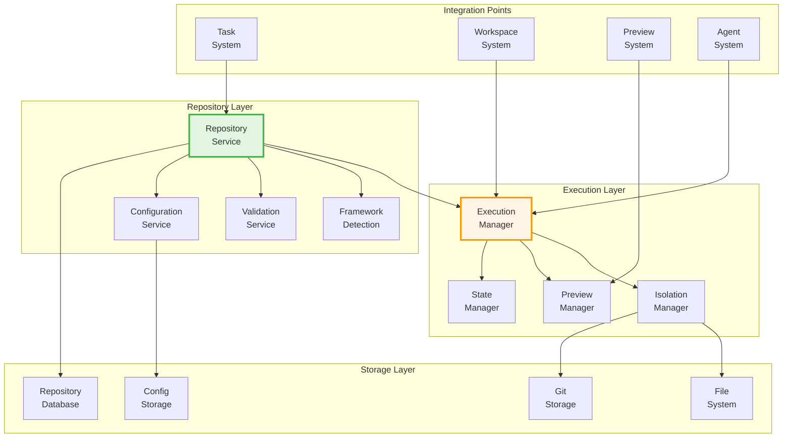

### Component Interactions
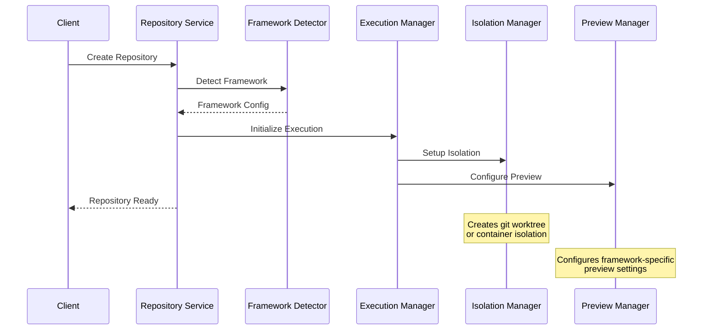

### Detailed Component Interaction Flow

The repository creation process involves several key components working together:

1. **Client Request** (`apps/backend/routes/repositories.ts`)
   - HTTP POST request to `/api/repositories`
   - Request body validated by `CreateRepositorySchema`
   - Includes path, name, execution config, and optional preview config

2. **Repository Service Processing** (`apps/backend/services/repository.service.ts`)
   - `createRepository()` method handles the request
   - Validates repository path exists and is a git repository
   - Auto-detects framework if preview config not provided
   - Generates unique ID and timestamps
   - Persists configuration to storage

3. **Framework Detection** (`RepositoryService.detectFramework()`)
   - Reads `package.json` from repository path
   - Checks for framework-specific dependencies (vite, next, react-scripts, webpack)
   - Detects package manager from lock files (pnpm, yarn, npm, bun)
   - Returns appropriate server commands and injection strategies

4. **Storage Persistence** (`apps/backend/services/storage.ts`)
   - Saves repository configuration to `data/repositories/{id}.json`
   - Maintains repository list for quick access
   - Handles concurrent access with file locking

## Repository Lifecycle

### State Transitions
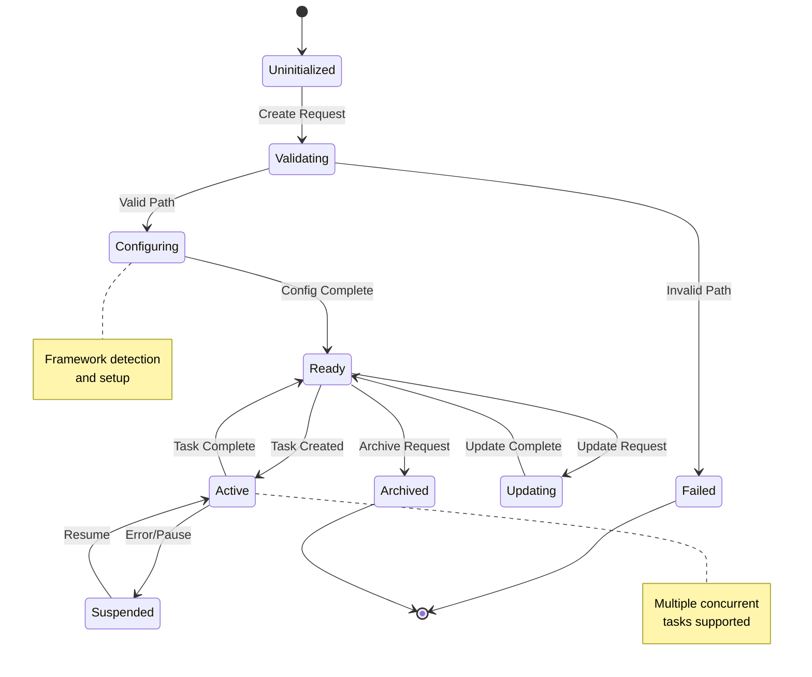

### Lifecycle Management Flow
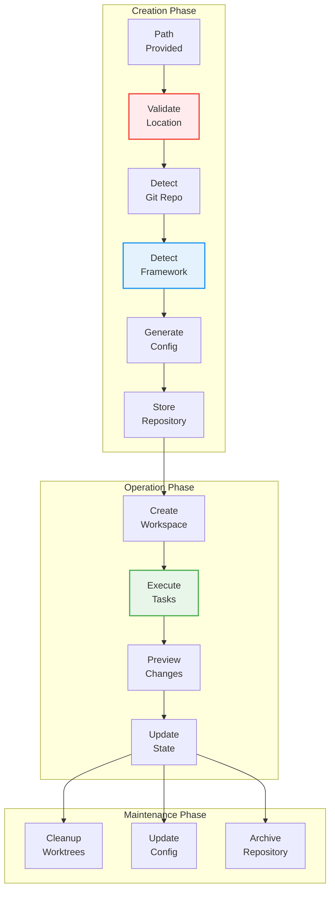

### Detailed Lifecycle Phases

#### Creation Phase
1. **Path Validation** (`RepositoryService.validateLocalRepository()`)
   - Verifies path exists and is a directory
   - Checks for `.git` directory presence
   - Throws `ValidationError` if invalid

2. **Git Repository Detection** (`apps/backend/utils/git-utils.ts`)
   - Uses `isGitRepository()` to verify git status
   - Checks for valid git configuration
   - Ensures repository is properly initialized

3. **Framework Detection** (`RepositoryService.detectFramework()`)
   - Parses `package.json` for dependencies
   - Checks lock files to determine package manager
   - Returns framework-specific configuration:
     ```typescript
     {
       framework: 'vite' | 'nextjs' | 'cra' | 'webpack' | 'unknown',
       frameworkVersion: string,
       serverStartCommand: string,
       injectionStrategy: { method: string, config: any }
     }
     ```

4. **Configuration Generation**
   - Merges user-provided config with auto-detected settings
   - Sets default values for optional fields
   - Validates complete configuration

5. **Storage** (`StorageBackend.saveRepository()`)
   - Writes to `data/repositories/{id}.json`
   - Updates repository index
   - Returns saved configuration

#### Operation Phase
1. **Workspace Creation** (`WorkspaceService.createWorkspace()`)
   - Called when a task needs an execution environment
   - Creates git worktree if `useGitWorktrees` is enabled
   - Falls back to direct repository access if disabled
   - Implementation in `apps/backend/services/workspace.service.ts`

2. **Task Execution**
   - Runs setup commands defined in `codeExecution.setupCommands`
   - Starts development server using `serverCommand`
   - Manages process lifecycle and logging

3. **Preview Environment**
   - Configures based on `previewConfig` settings
   - Injects preview scripts according to `injectionStrategy`
   - Provides live preview URL for AI agents

#### Maintenance Phase
1. **Worktree Cleanup** (`WorkspaceService.cleanupWorkspace()`)
   - Removes git worktrees after task completion
   - Cleans up temporary files and processes
   - Frees system resources

2. **Configuration Updates** (`RepositoryService.updateRepository()`)
   - Allows modification of repository settings
   - Re-validates if path changes
   - Updates timestamps

3. **Repository Archival/Deletion** (`RepositoryService.deleteRepository()`)
   - Checks for active tasks using the repository
   - Prevents deletion if in use
   - Removes configuration from storage

## Execution Environment Architecture

### Environment Layers
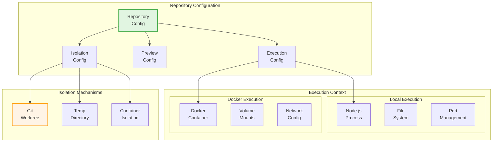

### Execution Flow
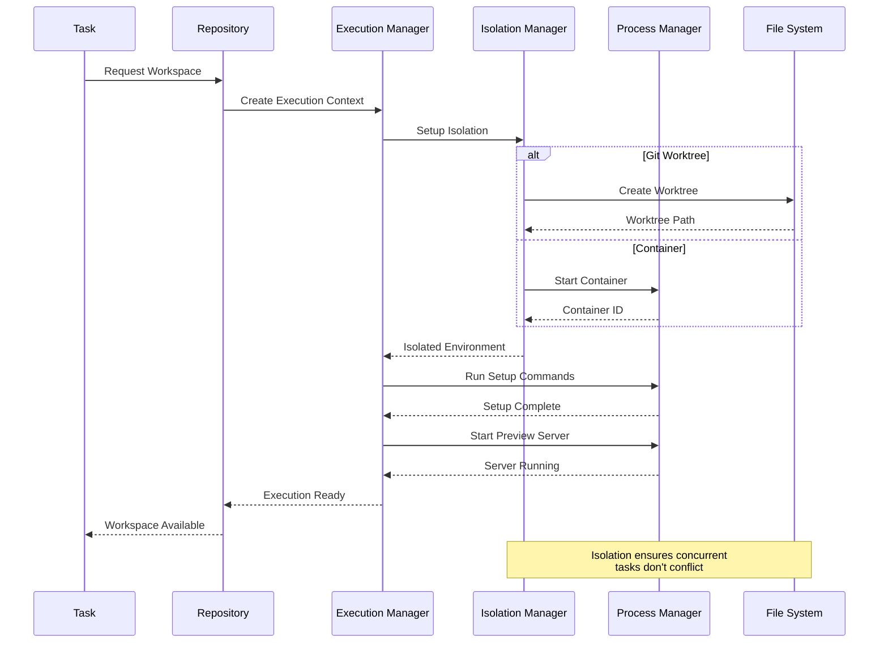

### Detailed Execution Flow Implementation

The execution environment setup involves multiple components working in coordination:

#### 1. Workspace Request (`apps/backend/services/workspace.service.ts`)
When a task requests a workspace:
```typescript
// WorkspaceService.createWorkspace()
const repository = await this.repositoryService.getRepositoryById(repositoryId)
const workspacePath = await this.createWorkspaceRepository(repository, taskId, branchName)
```

#### 2. Isolation Setup
The system supports two primary isolation mechanisms:

**Git Worktree Isolation** (`apps/backend/utils/git-utils.ts`):
```typescript
// createGitWorktree() - Creates isolated git working directory
if (repository.useGitWorktrees) {
  const worktreePath = path.join(worktreeDir, `workspace-${taskId}`)
  await createGitWorktree(repo.path, worktreePath, branchName)
}
```

**Direct Repository Access**:
- Used when `useGitWorktrees` is false
- Task operates directly on the repository path
- Suitable for single-task scenarios

#### 3. Setup Command Execution
After workspace creation, setup commands are executed:
```typescript
// RepositoryService.runSetupScript()
const commands = repository.codeExecution.setupCommands.split('\n')
for (const command of commands) {
  const result = await this.executeCommand(command, repository.path)
}
```

#### 4. Preview Server Startup
The development server is started based on the configuration:
- Uses `serverCommand` from repository config
- Replaces `{PORT}` placeholder with actual port
- Monitors server process for health checks

#### 5. Workspace Availability
Once setup is complete, the workspace is registered:
```typescript
this.activeWorkspaces.set(taskId, workspace)
```

### Isolation Mechanisms Explained

**Git Worktrees** (`apps/backend/utils/git-utils.ts`):
- Creates separate working directories linked to the same repository
- Each task gets its own branch and file system space
- Changes are isolated until explicitly merged
- Implementation: `createGitWorktree()`, `removeGitWorktree()`

**Benefits of Git Worktree Isolation**:
1. **Concurrent Tasks**: Multiple tasks can modify the same repository simultaneously
2. **Clean State**: Each task starts with a fresh working directory
3. **Easy Cleanup**: Worktrees can be removed without affecting the main repository
4. **Branch Management**: Each task can work on its own branch

**Worktree Creation Process**:
1. Determine worktree location: `{repo}/.worktrees/workspace-{taskId}`
2. Check if branch is already checked out
3. Create worktree with new or existing branch
4. Return isolated workspace path

## Integration Architecture

### System Integration Points
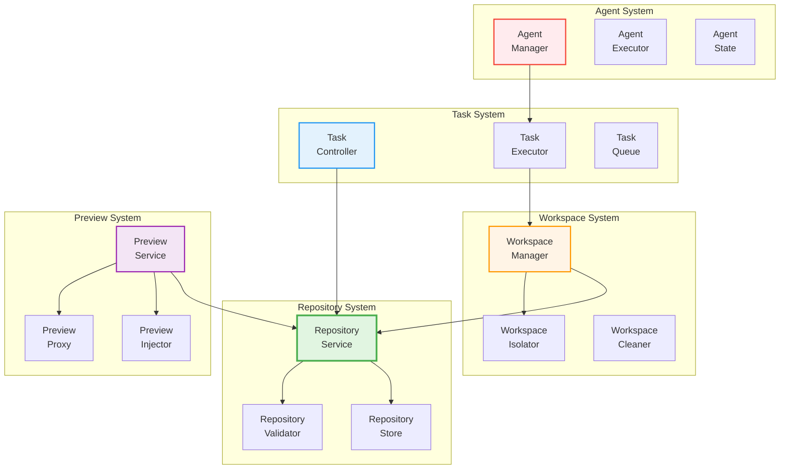

### Data Flow Between Systems
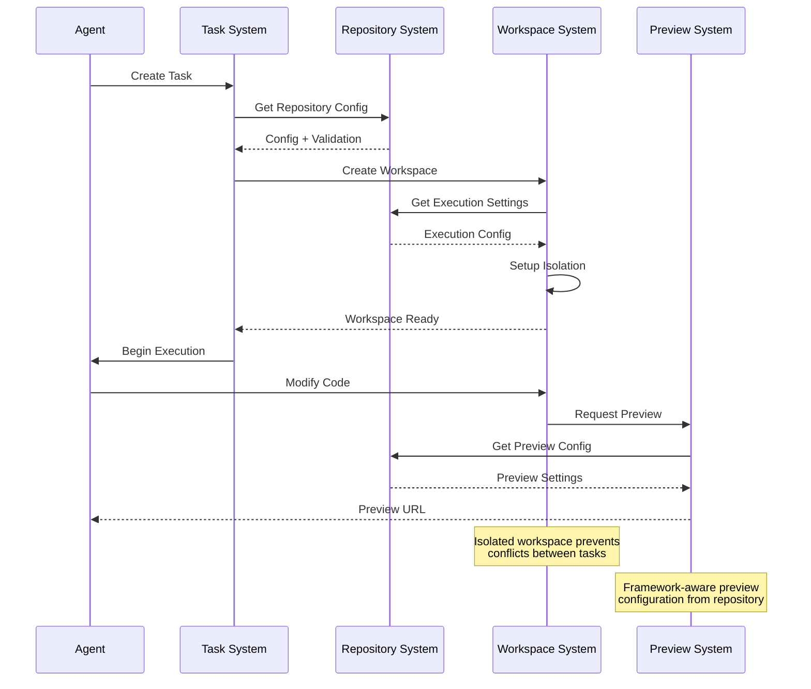

### Integration Points Implementation

The repository system integrates with multiple other systems through well-defined interfaces:

#### 1. Task System Integration
**Entry Point**: `apps/backend/routes/tasks.ts`
- When creating a task, the system validates the repository exists
- Retrieves repository configuration for workspace setup
- Passes repository settings to the workspace service

**Key Methods**:
```typescript
// TaskService.createTask()
const repository = await this.repositoryService.getRepositoryById(repositoryId)
const workspace = await this.workspaceService.createWorkspace(taskId, repositoryId)
```

#### 2. Workspace System Integration
**Entry Point**: `apps/backend/services/workspace.service.ts`
- Uses repository configuration to determine isolation strategy
- Applies execution settings from repository config
- Creates appropriate workspace type (Local or Docker)

**Workspace Creation Logic**:
```typescript
if (repository.codeExecution.type === 'docker') {
  workspace = new DockerWorkspace(taskId, repository, this.eventService)
} else {
  workspace = new LocalWorkspace(taskId, repository, this.eventService, ...)
}
```

#### 3. Preview System Integration
**Entry Point**: `apps/backend/services/preview-environment.service.ts`
- Reads preview configuration from repository
- Applies framework-specific settings
- Manages preview server lifecycle

**Preview Configuration Usage**:
- Framework detection results guide preview setup
- Injection strategies determine how preview scripts are added
- Server commands control preview server startup

#### 4. Agent System Integration
**Entry Point**: `apps/backend/services/agents/`
- Agents receive repository context through tasks
- Use repository settings for code execution
- Respect isolation boundaries during operations

## State Management

### Repository State Model
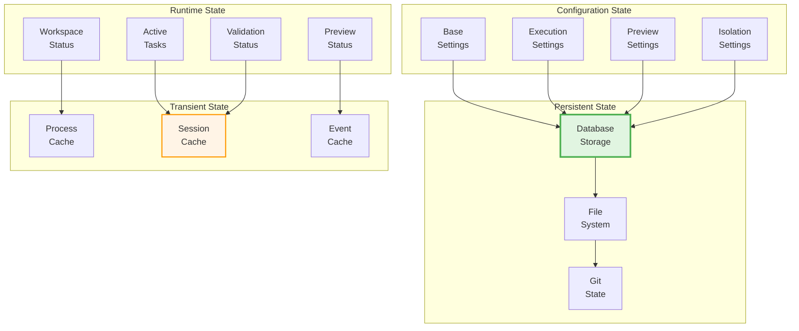

### State Synchronization
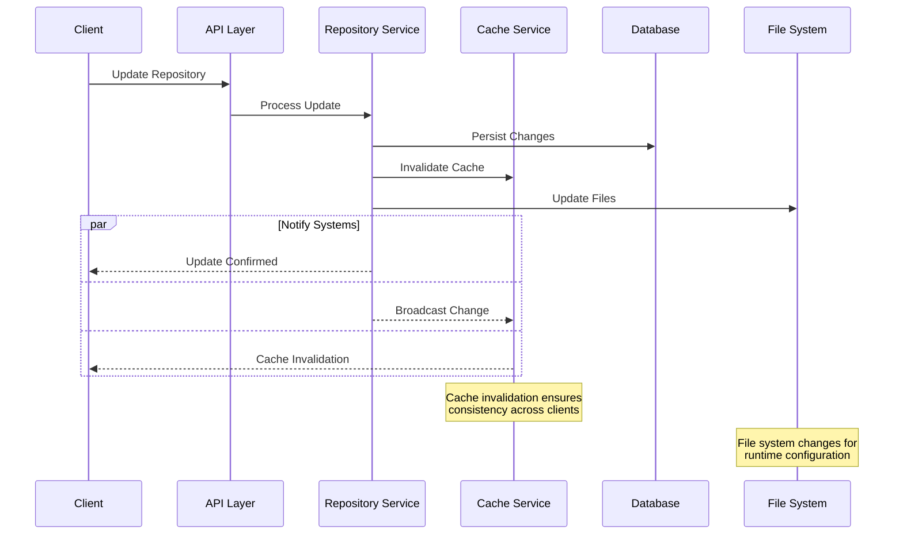

### State Management Implementation Details

The repository state is managed across multiple layers:

#### 1. Persistent State (`apps/backend/services/storage.ts`)
Repository configurations are stored as JSON files:
```typescript
// Storage location: data/repositories/{id}.json
{
  id: "uuid",
  name: "My Repository",
  path: "/path/to/repo",
  codeExecution: { ... },
  previewConfig: { ... },
  createdAt: "2024-01-01T00:00:00Z",
  updatedAt: "2024-01-01T00:00:00Z"
}
```

#### 2. Runtime State (`apps/backend/services/repository.service.ts`)
- Repository configurations are loaded on-demand
- No in-memory caching to ensure consistency
- Each request reads from disk for latest state

#### 3. Update Flow
When a repository is updated:
1. **Validation**: Changes are validated against schema
2. **Persistence**: New configuration saved to disk
3. **Timestamp Update**: `updatedAt` field refreshed
4. **Response**: Updated configuration returned to client

#### 4. Concurrency Handling
- File-based locking prevents concurrent writes
- Atomic file operations ensure data integrity
- Read operations are non-blocking

## Framework Detection System

### Detection Architecture
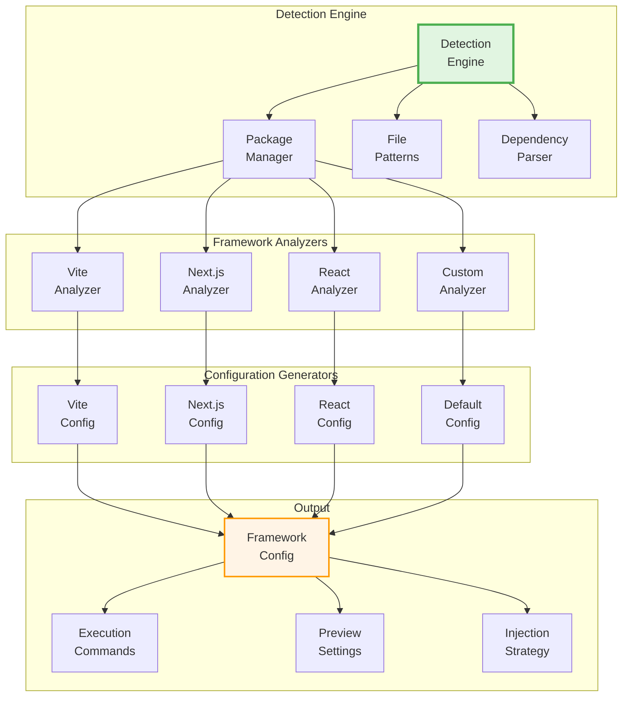

### Detection Flow
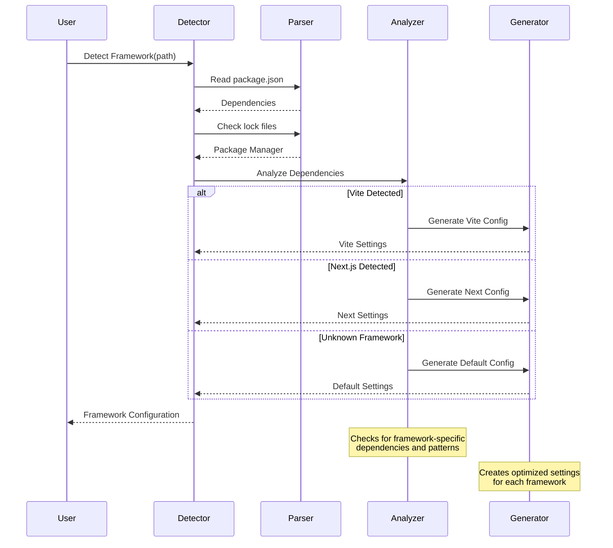

### Framework Detection Implementation

The framework detection system is implemented in `RepositoryService.detectFramework()`:

#### 1. Package Manager Detection (`RepositoryService.detectPackageManager()`)
Checks for lock files in order of preference:
```typescript
const PACKAGE_MANAGER_FILES = [
  { file: 'bun.lockb', manager: 'bun' },
  { file: 'pnpm-lock.yaml', manager: 'pnpm' },
  { file: 'yarn.lock', manager: 'yarn' },
  { file: 'package-lock.json', manager: 'npm' },
]
```

#### 2. Framework Detection Logic
The system analyzes `package.json` dependencies:

**Vite Detection**:
- Looks for `vite` in dependencies
- Returns: `framework: 'vite'`, HTML injection strategy
- Default command: `npm run dev -- --port {PORT}`

**Next.js Detection**:
- Looks for `next` in dependencies
- Returns: `framework: 'nextjs'`, middleware injection strategy
- Default command: `npm run dev -- --port {PORT}`

**Create React App Detection**:
- Looks for `react-scripts` in dependencies
- Returns: `framework: 'cra'`, HTML injection strategy
- Default command: `npm start`

**Webpack Detection**:
- Looks for `webpack` in dependencies
- Returns: `framework: 'webpack'`, HTML injection strategy
- Default command: `npm run serve -- --port {PORT}`

#### 3. Script Detection (`RepositoryService.detectServerCommand()`)
Searches package.json scripts for development commands:
1. Checks preferred commands: `['dev', 'start', 'serve']`
2. Falls back to any script containing 'dev' or 'start'
3. Prepends detected package manager to command

#### 4. Configuration Generation
Returns a `PreviewConfig` object:
```typescript
{
  framework: string,              // Detected framework
  frameworkVersion: string,       // Version from package.json
  serverStartCommand: string,     // Command to start dev server
  injectionStrategy: {
    method: string,               // How to inject preview scripts
    config: {                     // Method-specific configuration
      indexPath?: string,         // For HTML injection
      middleware?: string,        // For middleware injection
    }
  }
}
```

## Configuration Flow

### Configuration Lifecycle
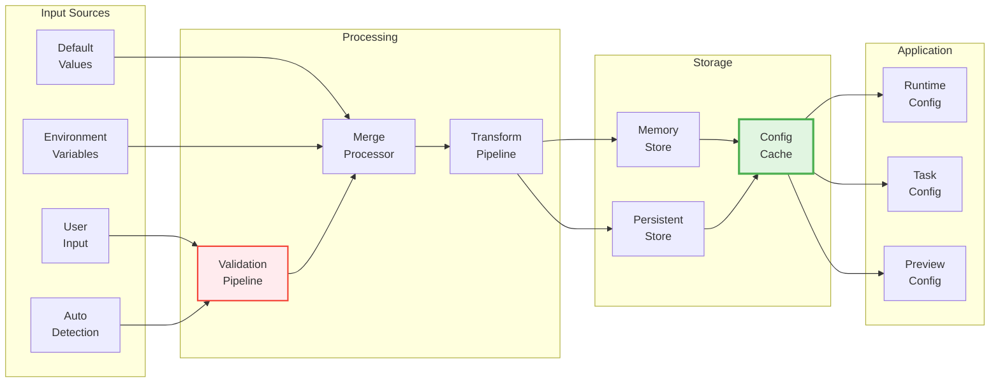

### Configuration Validation
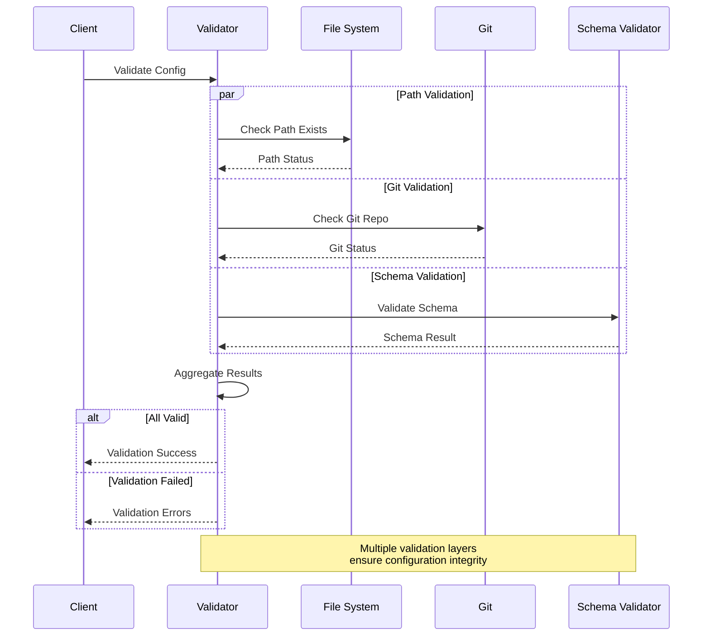

### Configuration Flow Implementation

The configuration flow encompasses creation, validation, storage, and application:

#### 1. Input Processing (`apps/backend/routes/repositories.ts`)
```typescript
// Request validation using Zod schemas
const validatedBody = CreateRepositorySchema.parse(body)
```

#### 2. Validation Pipeline (`RepositoryService.validateRepository()`)
The validation process ensures repository integrity:

**Path Validation**:
```typescript
// Check path exists and is a directory
const stats = await fs.stat(repo.path)
if (!stats.isDirectory()) {
  throw new ValidationError(`Path ${repo.path} is not a directory`)
}
```

**Git Repository Validation**:
```typescript
// Verify .git directory exists
const gitPath = path.join(repo.path, '.git')
await fs.access(gitPath)
```

**Schema Validation** (`packages/shared/schemas/repository.schemas.ts`):
- Validates data types and required fields
- Ensures enum values are valid
- Checks nested object structures

#### 3. Configuration Merging
When creating a repository:
1. User-provided configuration is validated
2. Framework detection fills missing preview config
3. Default values are applied for optional fields
4. Final configuration is validated again

#### 4. Storage and Retrieval
**Storage** (`StorageBackend.saveRepository()`):
- Serializes configuration to JSON
- Writes atomically to prevent corruption
- Updates modification timestamp

**Retrieval** (`StorageBackend.getRepository()`):
- Reads from disk on each request
- Deserializes JSON to TypeScript objects
- Converts date strings to Date objects
