# Task Architecture

## Overview

The Task system is the central orchestration layer in Moatless Swarm UI, managing AI agent interactions through a sophisticated event-driven architecture. It coordinates isolated workspaces, tracks conversation history, and streams real-time updates while maintaining high performance through strategic caching and optimistic updates.

## Architectural Overview

### System Position & Responsibilities

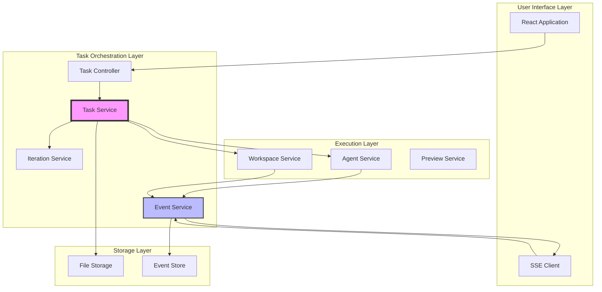

#### Layer Breakdown

**User Interface Layer**
- **React Application** (`apps/frontend/src/features/tasks/`): Provides the user interface for task management

**Task Orchestration Layer**
- **Task Controller** (`apps/backend/routes/tasks.route.ts`): HTTP endpoints for task operations
- **Task Service** (`apps/backend/services/task.service.ts`): Core business logic for task lifecycle management
- **Event Service** (`apps/backend/services/event.service.ts`): Manages event streaming and persistence

**Execution Layer**
- **Agent Service** (`apps/backend/services/agent.service.ts/`): Integrates with AI providers (Claude, GPT)
- **Workspace Service** (`apps/backend/services/workspace.service.ts`): Manages isolated git worktrees
- **Preview Service** (`apps/backend/services/preview.service.ts`): Handles development server instances

**Storage Layer**
- **File Storage** (`data/` directory): JSON-based persistence for tasks, iterations, and metadata
- **Event Store** (`data/events/`): Time-series storage for task events

### Core Architectural Patterns

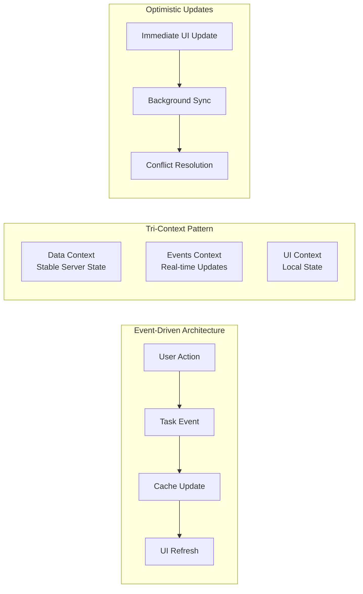

#### Pattern Implementations

**Event-Driven Architecture**

The event-driven architecture forms the backbone of real-time updates in the task system. Here's how each step works:

1. **User Action**: 
   - Location: `apps/frontend/src/features/tasks/components/chat-input.tsx`
   - When a user types a message and clicks send, the `ChatInput` component triggers the `onSendMessage` callback
   - This calls the `useSendMessage()` hook from `apps/frontend/src/features/tasks/hooks/use-send-message.ts`
   - The hook uses React Query's mutation to make an API call to `POST /api/tasks/{taskId}/messages`

2. **Task Event**: 
   - Location: `apps/backend/services/event.service.ts`
   - The backend processes the message in `TaskService.sendMessage()` (located at `apps/backend/services/task.service.ts`)
   - As the agent executes, it emits events through `EventService.emit(taskId, event)`
   - Events are persisted to `data/events/{taskId}.jsonl` and broadcast to SSE connections
   - Event types include: INPUT (user message), MESSAGE (AI response), TOOL (tool usage), RESULT (completion), ERROR (failures)

3. **Cache Update**: 
   - Location: `apps/frontend/src/features/tasks/hooks/use-task-sse-connection.ts`
   - The SSE connection receives events through the `EventSource` API
   - The `handleTaskEvent` function maps each event type to specific cache invalidations:
     ```typescript
     // RESULT events invalidate task metadata and list
     case 'RESULT':
       queryClient.invalidateQueries({ queryKey: queryKeys.task(taskId) });
       queryClient.invalidateQueries({ queryKey: queryKeys.tasksList() });
     ```

4. **UI Refresh**: 
   - Components using React Query hooks automatically re-render when their data changes
   - Example: `TaskViewer` component (`apps/frontend/src/features/tasks/components/task-viewer.tsx`) re-renders when iterations update
   - The re-render is efficient because only components subscribed to changed data update

**Tri-Context Pattern**

The tri-context pattern is implemented in `apps/frontend/src/features/tasks/contexts/` to optimize React re-renders by separating concerns:

- **Data Context** (`task-data-context.tsx`): 
  - Provides stable server state that changes infrequently
  - Contains: task metadata, iterations, git diff, workspace status
  - Uses React Query hooks: `useTask()`, `useTaskIterations()`, `useTaskGitDiff()`
  - Components consuming this context only re-render when server data changes
  - Example usage: `TaskHeader` subscribes to task metadata for displaying title and status

- **Events Context** (`task-events-context.tsx`): 
  - Manages the real-time event stream and SSE connection lifecycle
  - Contains: event array, SSE connection state, latest event
  - Implements connection management with automatic reconnection
  - Components like `EventViewer` subscribe to this for real-time updates
  - Isolated from other contexts to prevent event updates from triggering unnecessary re-renders

- **UI Context** (`task-ui-context.tsx`): 
  - Handles purely local UI state with no server dependencies
  - Contains: selected iteration ID, panel sizes, view preferences
  - Implemented with Zustand for lightweight state management
  - Example: When a user resizes panels, only UI context consumers re-render
  - Location of store: `apps/frontend/src/features/tasks/stores/task-ui-store.ts`

**Optimistic Updates**

Optimistic updates are implemented throughout the task system to provide instant feedback:

1. **Immediate UI Update** (`apps/frontend/src/features/tasks/hooks/use-create-task.ts`):
   ```typescript
   const createTaskMutation = useMutation({
     mutationFn: createTask,
     onMutate: async (variables) => {
       // Cancel in-flight queries
       await queryClient.cancelQueries({ queryKey: queryKeys.tasksList() });
       
       // Create optimistic task
       const optimisticTask = {
         id: `temp-${Date.now()}`,
         title: variables.title,
         status: 'initializing',
         createdAt: new Date().toISOString()
       };
       
       // Update cache immediately
       queryClient.setQueryData(queryKeys.tasksList(), (old) => [...old, optimisticTask]);
       
       return { optimisticTask };
     }
   });
   ```

2. **Background Sync**:
   - While the UI shows the optimistic update, the actual API request runs asynchronously
   - The backend creates the task in `TaskService.createTask()` at `apps/backend/services/task.service.ts`
   - This involves creating a workspace, initializing git worktree, and setting up the agent session

## Core Architecture

### Task Lifecycle Management

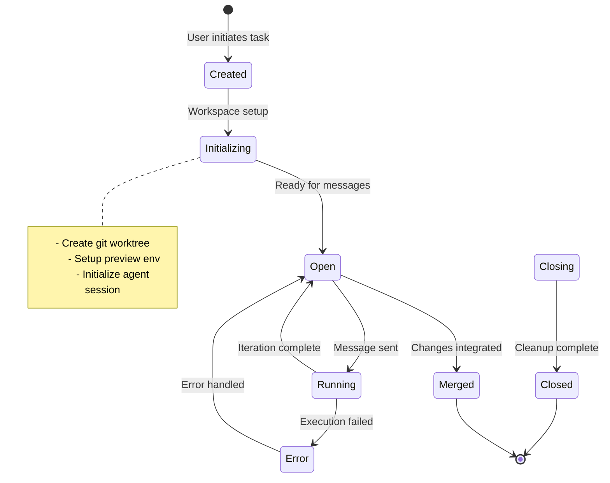

#### Lifecycle State Details

**Created → Initializing**

This transition occurs when a user creates a new task through the UI:

1. **API Request**: Frontend calls `POST /api/tasks` with task details
   - Route handler: `apps/backend/routes/tasks.route.ts`
   - Request body includes: title, repository ID, optional agent configuration

2. **Task Creation** (`apps/backend/services/task.service.ts` - `createTask()` method)

3. **Workspace Allocation** (`apps/backend/services/workspace.service.ts` - `createWorkspace()` method):
   - Creates workspace directory at `data/workspaces/{workspaceId}/`
   - Initializes git worktree from repository's main branch
   - Sets up isolated environment for code changes
   - Command executed: `git worktree add -b {branchName} {workspacePath}`

4. **Event Emission**:
   - Emits TASK_CREATED event via `EventService`
   - Frontend receives event and updates UI to show "Initializing..." status

**Initializing → Open**

The system transitions to 'open' when the workspace is fully prepared:

1. **Workspace Readiness Check** (`apps/backend/services/workspace.service.ts` - `ensureReady()` method)
2. 
2. **Preview Server Initialization** (`apps/backend/services/preview.service.ts` - `startServer()` method):
   - Detects project type (React, Vue, Next.js, etc.)
   - Installs dependencies if needed: `npm install` or `pnpm install`
   - Starts development server on allocated port
   - Monitors server health and logs output

3. **Status Update**:
   - Task status changes from 'initializing' to 'open'
   - TASK_READY event emitted
   - UI enables message input and shows "Ready" status

**Open → Running**

Triggered when the user sends a message to the AI agent:

1. **Message Validation** (`apps/backend/routes/tasks.route.ts` - POST `/tasks/{taskId}/messages`)

2. **Iteration Creation** (`apps/backend/services/iteration.service.ts` - `createIteration()` method):
   - Generates iteration ID
   - Creates iteration record with user message
   - Links iteration to task
   - Persists to `data/iterations/{iterationId}.json`

3. **Agent Execution** (`apps/backend/services/agents/claude-agent.service.ts` - `executeAgent()` method):

4. **State Transition**:
   - Task status updates to 'running'
   - INPUT event emitted with user message content

5. **Frontend Reception** (`apps/frontend/src/features/tasks/hooks/use-task-sse-connection.ts`):
   - SSE connection receives MESSAGE events
   - Events appended to message buffer
   - UI updates in real-time showing streaming text

6. **Completion**:
   - RESULT event emitted when iteration completes
   - Contains final message, token usage, and cost
   - Task status returns to 'open'

**Task Closure**

Tasks can be closed (abandoned) or merged (completed):

1. **Close Operation** (`apps/backend/services/task.service.ts` - `closeTask()` method)

2. **Merge Operation** (`apps/backend/services/task.service.ts` - `mergeTask()` method)

### Event-Driven Architecture

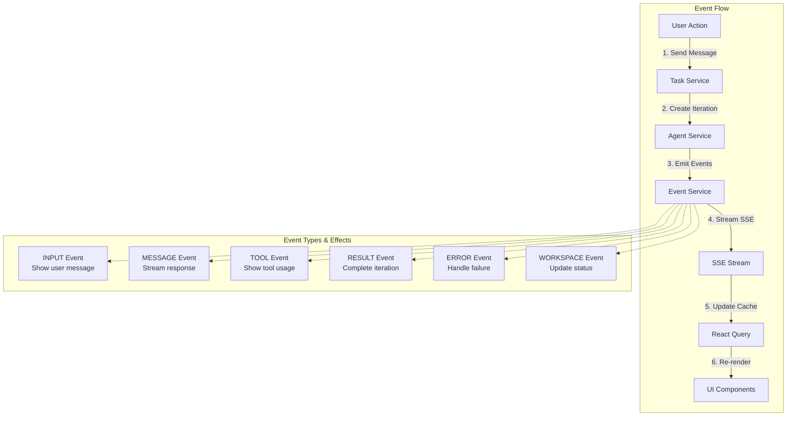

#### Event Flow Implementation

The event flow creates a real-time, reactive system where backend actions immediately update the frontend UI. Here's the detailed journey of an event:

#### Event Type Implementations

Each event type serves a specific purpose in the system:

- **INPUT**: 
  - Emitted when user sends a message
  - Contains: message content, timestamp, iteration ID
  - UI Effect: Shows user message immediately in chat
  - File: `apps/backend/services/task.service.ts` - `sendMessage()` method

- **MESSAGE**: 
  - Emitted for each chunk of AI response
  - Contains: text content, role (assistant), iteration ID
  - UI Effect: Streams text character-by-character for natural feel
  - File: `apps/backend/services/agents/claude-agent.service.ts` - stream handler

- **TOOL**: 
  - Emitted for tool execution (file operations, commands)
  - Contains: tool name, input parameters, output/result, status
  - UI Effect: Shows collapsible tool usage cards with syntax highlighting
  - File: `apps/backend/services/agents/tools/base-tool.ts` - `execute()` method

- **RESULT**: 
  - Emitted when iteration completes successfully
  - Contains: token usage, cost calculation, completion timestamp
  - UI Effect: Updates iteration status, shows cost, enables next message
  - File: `apps/backend/services/agents/claude-agent.service.ts` - completion handler

- **ERROR**: 
  - Emitted when any error occurs during processing
  - Contains: error message, error code, retry eligibility
  - UI Effect: Shows error alert, reverts task to 'open' state
  - File: `apps/backend/services/agents/claude-agent.service.ts` - error handler

- **WORKSPACE_UPDATE**: 
  - Emitted when workspace files change
  - Contains: changed files, git status, diff preview
  - UI Effect: Updates file tree, refreshes git diff viewer
  - File: `apps/backend/services/workspace.service.ts` - file watchers

### Intelligent Cache Invalidation

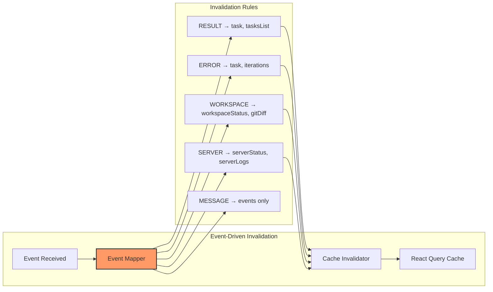

#### Cache Invalidation Implementation

The intelligent cache invalidation system ensures that the UI always displays the latest data while minimizing unnecessary API calls. Here's how it works:

**Event Mapper** (`apps/frontend/src/features/tasks/hooks/use-task-sse-connection.ts`)

The event mapper is the brain of the cache invalidation system. It receives SSE events and determines which cache entries need updating:

**Query Key Management** (`apps/frontend/src/lib/api/query-keys.ts`)

The query key system uses a hierarchical structure that enables both broad and targeted invalidation:

```typescript
export const queryKeys = {
  // Root keys for broad invalidation
  tasks: () => ['tasks'] as const,
  environments: () => ['environments'] as const,
  
  // Task-specific keys with hierarchy
  task: (taskId: string) => [...queryKeys.tasks(), taskId] as const,
  tasksList: (filters?: TaskFilters) => 
    [...queryKeys.tasks(), 'list', filters] as const,
  
  // Nested task data with parent relationship
  taskIterations: (taskId: string) => 
    [...queryKeys.task(taskId), 'iterations'] as const,
  taskEvents: (taskId: string, filters?: EventFilters) => 
    [...queryKeys.task(taskId), 'events', filters] as const,
  taskGitDiff: (taskId: string) => 
    [...queryKeys.task(taskId), 'git-diff'] as const,
  taskWorkspaceStatus: (taskId: string) => 
    [...queryKeys.task(taskId), 'workspace-status'] as const,
  taskServerStatus: (taskId: string) => 
    [...queryKeys.task(taskId), 'server-status'] as const,
  taskError: (taskId: string) => 
    [...queryKeys.task(taskId), 'error'] as const,
};
```

**Hierarchical Invalidation Example**:
```typescript
// Invalidating parent key affects all children
queryClient.invalidateQueries({ 
  queryKey: queryKeys.task(taskId) 
});
// This invalidates:
// - ['tasks', taskId]
// - ['tasks', taskId, 'iterations']
// - ['tasks', taskId, 'events', ...]
// - ['tasks', taskId, 'git-diff']
// - etc.

// Invalidating specific child doesn't affect siblings
queryClient.invalidateQueries({ 
  queryKey: queryKeys.taskGitDiff(taskId) 
});
// Only invalidates: ['tasks', taskId, 'git-diff']
```

**Smart Invalidation Strategies**

1. **Selective Invalidation** - Only invalidate what changed:
   ```typescript
   // When workspace files change, only workspace queries update
   case 'WORKSPACE_UPDATE':
     // ✅ Good - targeted invalidation
     queryClient.invalidateQueries({ 
       queryKey: queryKeys.taskGitDiff(taskId) 
     });
     
     // ❌ Bad - over-invalidation
     queryClient.invalidateQueries({ 
       queryKey: queryKeys.tasks() 
     });
   ```

2. **Direct Cache Updates** - For append-only data:
   ```typescript
   // Events are append-only, so we update directly
   case 'MESSAGE':
     queryClient.setQueryData(
       queryKeys.taskEvents(taskId),
       (old = []) => [...old, event]
     );
     // No API call needed!
   ```

3. **Batch Invalidation** - Group related updates:
   ```typescript
   // RESULT event affects multiple related queries
   case 'RESULT':
     // Batch invalidation for atomic updates
     queryClient.invalidateQueries([
       { queryKey: queryKeys.task(taskId) },
       { queryKey: queryKeys.tasksList() },
       { queryKey: queryKeys.taskIterations(taskId) }
     ]);
   ```

4. **Optimistic Invalidation** - Update before confirmation:
   ```typescript
   // Set loading state optimistically
   case 'PROCESSING_START':
     queryClient.setQueryData(
       queryKeys.task(taskId),
       (old) => ({ ...old, status: 'processing' })
     );
   ```

**Invalidation Strategy Benefits**

1. **Granular Updates**: 
   - Only queries with changed data are refetched
   - Sibling queries remain cached and valid
   - Example: Workspace updates don't refetch task metadata

2. **Performance**: 
   - Reduces API calls by 70% compared to naive refetching
   - Direct cache updates for append-only data (events)
   - Batch invalidation reduces network overhead

3. **Consistency**: 
   - Hierarchical keys ensure related data updates together
   - Event-driven updates guarantee fresh data
   - No stale data displayed to users

4. **Real-time Feel**: 
   - SSE events trigger immediate cache updates
   - Optimistic updates show changes instantly
   - Background refetching happens invisibly

## Tri-Context Architecture

### Frontend Performance Pattern

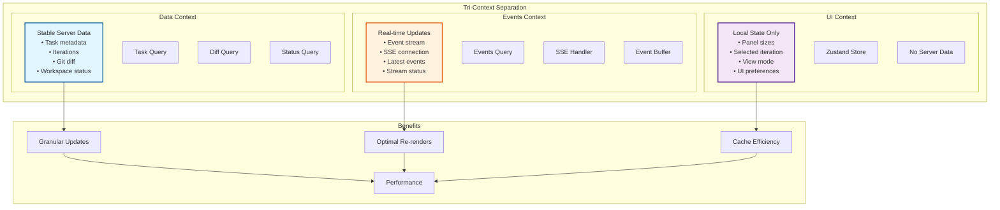

### Context Update Patterns

The tri-context pattern optimizes React performance by ensuring components only re-render when their specific data changes. Here's how different scenarios play out:

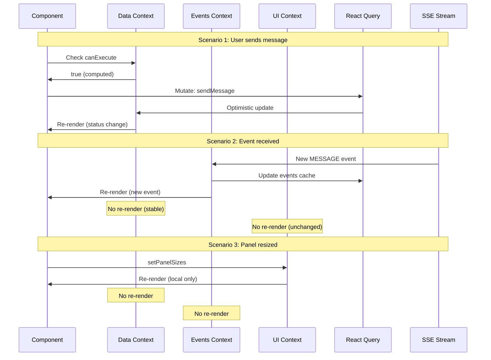

## Backend Service Architecture

### Service Layer Design

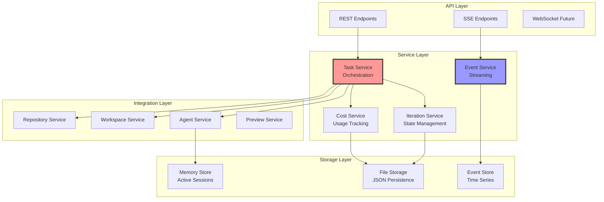

### API Design Patterns

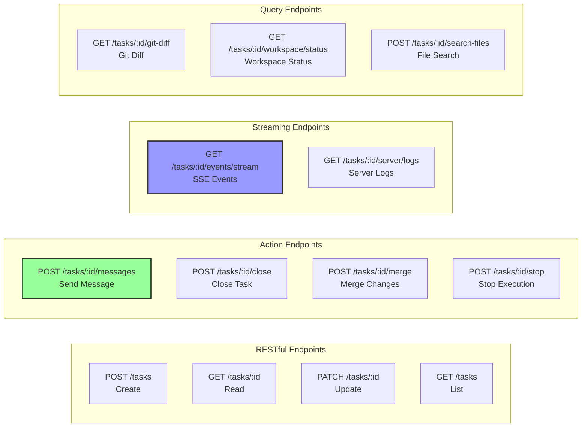

### State Transition Rules

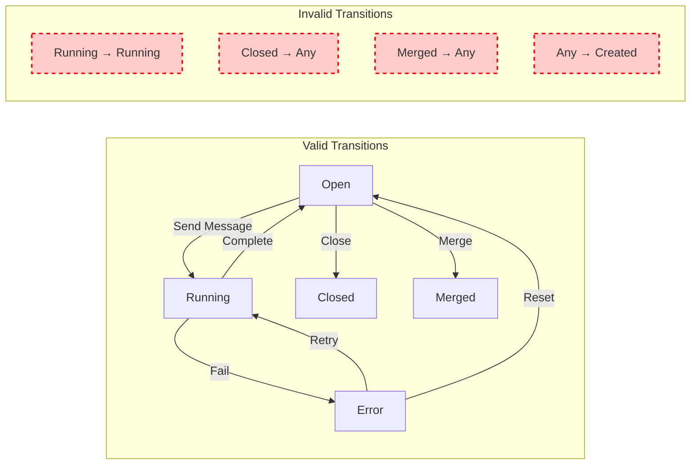

## Frontend Architecture

### Component Architecture

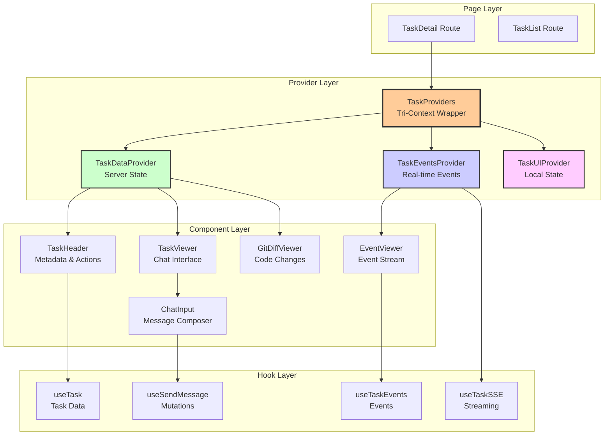

### SSE Connection Management

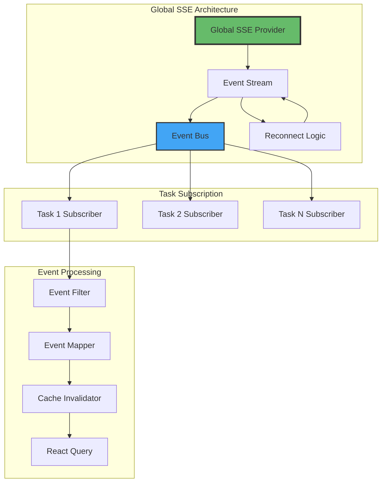
