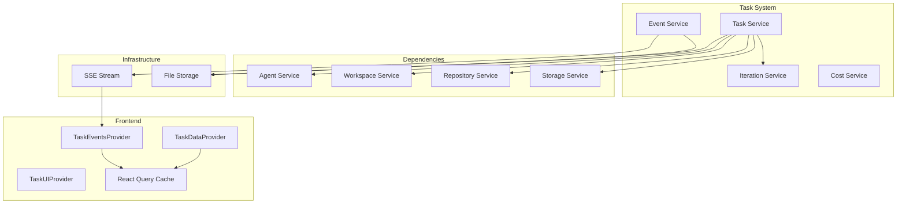
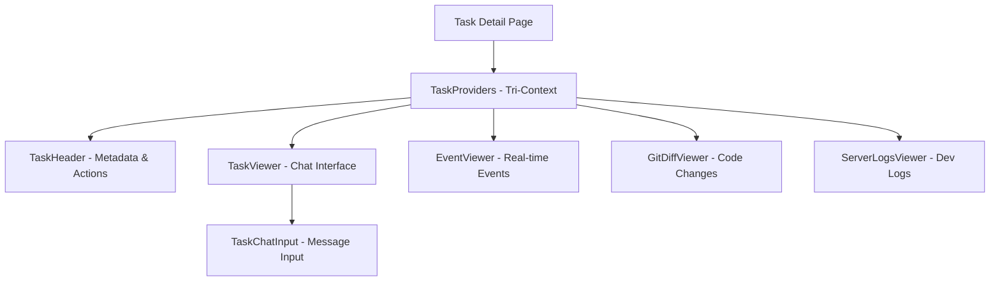
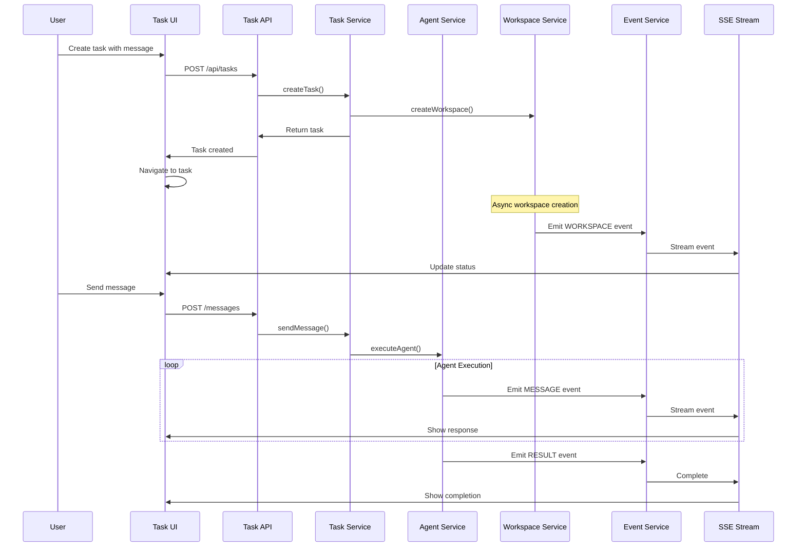
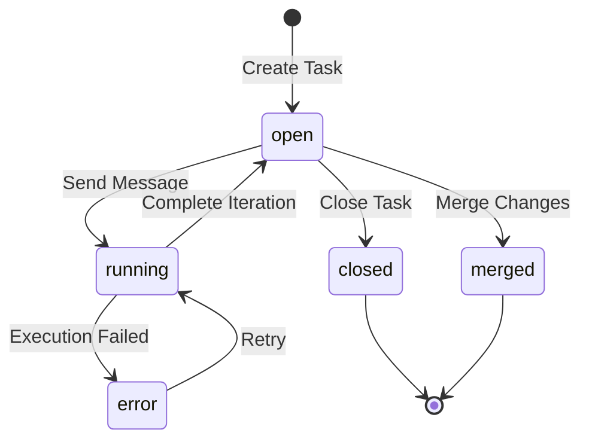

# Task Architecture

## Table of Contents
1. [Overview](#overview)
2. [Core Concepts](#core-concepts)
3. [Architecture](#architecture)
4. [Backend Implementation](#backend-implementation)
5. [Frontend Implementation](#frontend-implementation)
6. [Data Flow](#data-flow)
7. [Integration Points](#integration-points)
8. [Configuration](#configuration)
9. [Best Practices](#best-practices)
10. [Troubleshooting](#troubleshooting)

## Overview

### Purpose
The Task system is the central orchestration layer in Moatless Swarm UI, managing AI agent interactions, tracking iterations, handling real-time events, and coordinating workspace modifications. It provides a robust foundation for executing AI-powered code generation and modification workflows with proper state management, cost tracking, and real-time user feedback.

### Key Responsibilities
- Orchestrate AI agent execution lifecycle
- Track task iterations and conversation history
- Stream real-time events to clients via SSE
- Manage workspace isolation through git worktrees
- Track costs and token usage
- Handle errors and recovery
- Coordinate preview environments
- Enable concurrent task execution
- Maintain conversation context across iterations

### Position in Architecture
Tasks are the primary unit of work, sitting between the user interface and the agent execution layer. They coordinate repositories, workspaces, agents, and events to deliver a seamless AI-assisted coding experience.

## Core Concepts

### Domain Terminology

| Term | Definition |
|------|------------|
| Task | A conversation thread with an AI agent in a specific workspace |
| Iteration | A single request-response cycle within a task |
| Event | Real-time update streamed during task execution |
| Workspace | Isolated git worktree where task modifications occur |
| Session | Continuous conversation context maintained by the agent |
| Status | Current state of the task (open, running, error, closed, merged) |
| Context Tokens | Number of tokens in the current conversation context |

### Key Abstractions

#### Task Model
```typescript
interface Task {
  taskId: string
  status: TaskStatus
  repositoryId: string
  environmentId?: string
  agentType: string
  iterations: TaskIteration[]
  createdAt: Date
  updatedAt: Date
  lastMessageAt?: Date
  numTurns: number
  totalCostUsd: number
  sessionId?: string
  workspacePath?: string
}

type TaskStatus = 'open' | 'running' | 'error' | 'closed' | 'merged'
```

#### Task Iteration
```typescript
interface TaskIteration {
  iterationId: string
  taskId: string
  message: string      // User input
  result?: string      // Agent response
  error?: string       // Error message if failed
  startTime: Date
  endTime?: Date
  status: 'pending' | 'running' | 'completed' | 'error'
  contextTokens?: number
  costUsd?: number
  usage?: UsageMetrics
}
```

#### Task Event
```typescript
interface TaskEvent {
  eventId: string
  taskId: string
  iterationId?: string
  type: EventType
  subtype?: string
  payload: any
  timestamp: Date
  sequenceNumber: number
}

enum EventType {
  INPUT = 'input',        // User message
  MESSAGE = 'message',    // Agent response
  START = 'start',        // Task/iteration start
  STOP = 'stop',          // Task/iteration stop  
  RESULT = 'result',      // Iteration completion
  ERROR = 'error',        // Error occurrence
  WORKSPACE = 'workspace', // Workspace state change
  SERVER = 'server',      // Dev server status
  TOOL = 'tool',          // Tool execution
  COMPLETION = 'completion' // Task completion
}
```

### Design Decisions
- **One task per workspace** ensures isolation
- **Event-driven architecture** for real-time updates
- **Tri-context pattern** in frontend for performance
- **React Query as single source of truth** for caching
- **SSE for unidirectional streaming** from server to client
- **Optimistic updates** for immediate user feedback

## Architecture

### High-Level Overview


### Component Relationships
- Task Service orchestrates task lifecycle
- Event Service handles real-time streaming
- Agent Service executes AI operations
- Workspace Service manages isolated environments
- Frontend providers separate concerns for performance

### Dependency Flow
```
User Message → Task API → Task Service
                              ↓
                        Create Iteration
                              ↓
                        Validate Workspace → Agent Service
                              ↓
                        Stream Events → SSE → Frontend
                              ↓
                        Update Task State
```

## Backend Implementation

### Service Layer

#### Task Service
```typescript
// apps/backend/services/task.service.ts
export class TaskService {
  constructor(
    private storageService: StorageService,
    private repositoryService: RepositoryService,
    private workspaceService: WorkspaceService,
    private eventService: EventService,
    private agentService: AgentService
  ) {}

  // Core operations
  async createTask(data: CreateTaskDto): Promise<Task>
  async getTask(taskId: string): Promise<Task>
  async updateTask(taskId: string, data: UpdateTaskDto): Promise<Task>
  async closeTask(taskId: string): Promise<Task>
  async mergeTask(taskId: string): Promise<Task>
  async listTasks(filters?: TaskFilters): Promise<Task[]>
  
  // Iteration management
  async createIteration(taskId: string, message: string): Promise<TaskIteration>
  async getIterations(taskId: string): Promise<TaskIteration[]>
  async completeIteration(
    taskId: string, 
    iterationId: string, 
    result: IterationResult
  ): Promise<TaskIteration>
  
  // Message handling
  async sendMessage(
    taskId: string, 
    content: string,
    options?: SendMessageOptions
  ): Promise<void>
  
  // Status management
  async updateTaskStatus(
    taskId: string, 
    status: TaskStatus,
    reason?: string
  ): Promise<void>
  
  // Cost tracking
  async updateTaskCost(
    taskId: string,
    cost: CostUpdate
  ): Promise<void>
}
```

#### Event Service
```typescript
// apps/backend/services/event.service.ts
export class EventService {
  private eventEmitter = new EventEmitter()
  private sequenceNumbers = new Map<string, number>()
  
  constructor(private storageService: StorageService) {}
  
  // Event emission
  async emitTaskEvent(event: Omit<TaskEvent, 'eventId' | 'sequenceNumber'>): Promise<void>
  
  // Event streaming
  async *streamTaskEvents(
    taskId?: string,
    options?: StreamOptions
  ): AsyncGenerator<TaskEvent>
  
  // Event persistence
  async saveEvent(event: TaskEvent): Promise<void>
  async getTaskEvents(taskId: string, filters?: EventFilters): Promise<TaskEvent[]>
  
  // SSE management
  createSSEStream(options?: SSEOptions): ReadableStream
  
  // Event lifecycle
  private assignSequenceNumber(taskId: string): number
  private formatSSEMessage(event: TaskEvent): string
}
```

#### Key Methods
| Method | Purpose | Parameters | Returns |
|--------|---------|------------|---------|
| `createTask` | Initialize new task | Repository, message, agent | Task with ID |
| `sendMessage` | Process user message | Task ID, content | void (async) |
| `streamTaskEvents` | Real-time event stream | Task ID, options | Event generator |
| `updateTaskStatus` | Change task state | Task ID, status | Updated task |
| `completeIteration` | Finalize iteration | IDs, result | Updated iteration |

#### Error Handling
```typescript
// Task-specific errors
export class TaskNotFoundError extends ApiError {
  constructor(taskId: string) {
    super(`Task ${taskId} not found`, 404)
  }
}

export class TaskAlreadyRunningError extends ApiError {
  constructor(taskId: string) {
    super(`Task ${taskId} is already running`, 409)
  }
}

export class TaskWorkspaceError extends ApiError {
  constructor(message: string) {
    super(`Workspace error: ${message}`, 500)
  }
}
```

### API Endpoints

#### Route Definitions
| Method | Path | Purpose | Auth Required |
|--------|------|---------|---------------|
| GET | `/api/v1/tasks` | List tasks | No |
| POST | `/api/v1/tasks` | Create task | No |
| GET | `/api/v1/tasks/:taskId` | Get task details | No |
| POST | `/api/v1/tasks/:taskId/messages` | Send message | No |
| POST | `/api/v1/tasks/:taskId/close` | Close task | No |
| POST | `/api/v1/tasks/:taskId/merge` | Merge changes | No |
| POST | `/api/v1/tasks/:taskId/stop` | Stop execution | No |
| GET | `/api/v1/tasks/:taskId/events` | Get events | No |
| GET | `/api/v1/tasks/:taskId/events/stream` | SSE stream | No |
| GET | `/api/v1/tasks/:taskId/git-diff` | Get diff | No |
| GET | `/api/v1/tasks/:taskId/workspace/status` | Workspace status | No |
| GET | `/api/v1/tasks/:taskId/server/status` | Server status | No |
| GET | `/api/v1/tasks/:taskId/server/logs` | Server logs | No |
| POST | `/api/v1/tasks/:taskId/search-files` | Search files | No |

#### Request/Response Schemas
```typescript
// Create task request
interface CreateTaskRequest {
  repositoryId: string
  message: string
  agentType?: string
  environmentId?: string
}

// Send message request
interface SendMessageRequest {
  content: string
  attachments?: FileAttachment[]
  model?: string
}

// Task response
interface TaskResponse extends Task {
  iterations: TaskIteration[]
  latestEvent?: TaskEvent
  workspaceStatus?: WorkspaceStatus
}

// Event stream response (SSE format)
// data: {"eventId":"123","type":"MESSAGE","payload":{...}}
```

### Data Models

#### TypeScript Interfaces
```typescript
// Core task structure
interface Task {
  taskId: string
  status: TaskStatus
  repositoryId: string
  environmentId?: string
  agentType: string
  iterations: TaskIteration[]
  sessionId?: string
  workspacePath?: string
  createdAt: Date
  updatedAt: Date
  lastMessageAt?: Date
  numTurns: number
  totalCostUsd: number
}

// Workspace status
interface WorkspaceStatus {
  status: 'active' | 'inactive' | 'error' | 'creating'
  path?: string
  error?: string
  hasChanges?: boolean
  branch?: string
}

// Usage tracking
interface UsageMetrics {
  inputTokens: number
  outputTokens: number
  cacheReadTokens?: number
  cacheWriteTokens?: number
  totalTokens: number
  model: string
}
```

#### Validation Rules
- Task must have valid repository
- Message content cannot be empty
- Status transitions must be valid
- Iteration must belong to task
- Cost must be non-negative

### Business Logic

#### Task Creation Flow
```typescript
async createTask(data: CreateTaskDto): Promise<Task> {
  // 1. Validate repository
  const repository = await this.repositoryService.getRepository(data.repositoryId)
  if (!repository) throw new Error('Repository not found')
  
  // 2. Create task record
  const task: Task = {
    taskId: generateId('task'),
    status: 'open',
    repositoryId: data.repositoryId,
    agentType: data.agentType || 'claude-code',
    iterations: [],
    createdAt: new Date(),
    updatedAt: new Date(),
    numTurns: 0,
    totalCostUsd: 0
  }
  
  // 3. Create workspace (async)
  this.workspaceService.createWorkspace(task.taskId, repository)
    .then(workspace => {
      task.workspacePath = workspace.path
      this.updateTask(task.taskId, { workspacePath: workspace.path })
    })
    .catch(error => {
      console.error('Workspace creation failed:', error)
      this.updateTaskStatus(task.taskId, 'error', error.message)
    })
  
  // 4. Save and return
  await this.storageService.saveTask(task)
  
  // 5. Create first iteration if message provided
  if (data.message) {
    await this.createIteration(task.taskId, data.message)
  }
  
  return task
}
```

#### Message Processing
```typescript
async sendMessage(
  taskId: string, 
  content: string,
  options?: SendMessageOptions
): Promise<void> {
  // 1. Validate task state
  const task = await this.getTask(taskId)
  if (task.status === 'closed' || task.status === 'merged') {
    throw new Error('Cannot send message to closed task')
  }
  
  // 2. Check for running agent
  if (task.status === 'running') {
    throw new TaskAlreadyRunningError(taskId)
  }
  
  // 3. Create iteration
  const iteration = await this.createIteration(taskId, content)
  
  // 4. Update task status
  await this.updateTaskStatus(taskId, 'running')
  
  // 5. Emit input event
  await this.eventService.emitTaskEvent({
    taskId,
    iterationId: iteration.iterationId,
    type: EventType.INPUT,
    payload: {
      message: content,
      status: 'running'
    }
  })
  
  // 6. Execute agent (non-blocking)
  this.agentService.executeAgent(
    taskId,
    iteration.iterationId,
    content,
    {
      agentType: task.agentType,
      resumeSessionId: task.sessionId,
      ...options
    }
  )
}
```

## Frontend Implementation

### Feature Structure
```
apps/frontend/src/features/tasks/
├── api/           # API client functions
│   ├── tasks-api.ts
│   └── events-api.ts
├── components/    # UI components
│   ├── task-list/
│   ├── task-viewer/
│   ├── task-header/
│   ├── event-viewer/
│   ├── git-diff-viewer/
│   └── task-chat-input/
├── contexts/      # React contexts
│   ├── task-providers.tsx
│   ├── task-data-provider.tsx
│   ├── task-events-provider.tsx
│   └── task-ui-provider.tsx
├── hooks/         # Custom React hooks
│   ├── use-tasks.ts
│   ├── use-task.ts
│   ├── use-task-events.ts
│   ├── use-task-sse-connection.ts
│   ├── use-create-task.ts
│   ├── use-send-message.ts
│   └── use-task-mutations.ts
├── stores/        # State management
│   └── task-ui-store.ts
├── types/         # TypeScript types
│   └── index.ts
├── utils/         # Helper functions
│   ├── event-utils.ts
│   └── task-utils.ts
└── index.ts       # Public exports
```

### Components

#### Component Hierarchy


#### Key Components
| Component | Purpose | Props | State Management |
|-----------|---------|-------|------------------|
| `TaskViewer` | Main chat interface | taskId | Uses all three contexts |
| `EventViewer` | Real-time event display | taskId | TaskEventsProvider |
| `GitDiffViewer` | Code diff visualization | taskId | TaskDataProvider |
| `TaskHeader` | Metadata and actions | taskId | TaskDataProvider |
| `TaskChatInput` | Message composition | taskId, onSend | Local state + mutations |

### Hooks and Context

#### Tri-Context Pattern
The frontend uses a sophisticated tri-context pattern to optimize performance:

```typescript
// Task data context - stable server data
interface TaskDataContextValue {
  // Task metadata (rarely changes)
  taskId: string
  status: string | undefined
  agentType: string | undefined
  environmentId: string | undefined
  iterations: TaskIteration[]
  createdAt: Date | undefined
  
  // Git diff data
  gitDiff: GitDiffResponse | undefined
  
  // Workspace status with smart polling
  workspaceStatus: string | undefined
  workspaceReady: boolean
  workspaceHasChanges: boolean
  
  // Derived flags (stable primitives)
  canExecute: boolean
  isRunning: boolean
  isComplete: boolean
  
  // Task runtime metrics
  runningStartTime: Date | undefined
  latestContextTokens: number | undefined
  
  // Loading & error states
  isLoading: boolean
  error: Error | null
}

// Task events context - real-time updates
interface TaskEventsContextValue {
  events: Event[]
  isStreaming: boolean
  streamingError: string | null
  latestEventId: string | null
  hasNewEvents: boolean
  isLoading: boolean
  error: Error | null
}

// Task UI context - pure local state
interface TaskUIContextValue {
  rightPanelView: PanelView
  selectedIteration: TaskIteration | undefined
  panelSizes: { left: number; right: number }
  selectedFile: string
  
  setRightPanelView: (view: PanelView) => void
  setSelectedIteration: (iteration?: TaskIteration) => void
  setPanelSizes: (sizes: { left: number; right: number }) => void
  setSelectedFile: (file: string) => void
}
```

#### Custom Hooks
| Hook | Purpose | Parameters | Returns |
|------|---------|------------|---------|
| `useTasks` | List tasks with filters | filters | Task list query |
| `useTask` | Single task details | taskId | Task query |
| `useTaskEvents` | Task event stream | taskId | Events query |
| `useCreateTask` | Create task mutation | options | Mutation object |
| `useSendMessage` | Send message mutation | taskId, options | Mutation object |
| `useCloseTask` | Close task mutation | taskId, options | Mutation object |
| `useMergeTask` | Merge task mutation | taskId, options | Mutation object |

#### Context Providers
```typescript
// Composed provider for easy setup
export function TaskProviders({ taskId, children }: TaskProvidersProps) {
  return (
    <TaskUIProvider>
      <TaskDataProvider taskId={taskId}>
        <TaskEventsProvider taskId={taskId}>
          {children}
        </TaskEventsProvider>
      </TaskDataProvider>
    </TaskUIProvider>
  )
}
```

### Real-time Updates

#### SSE Integration
```typescript
// Global event stream at app level
<GlobalEventStreamProvider>
  <RouterProvider />
</GlobalEventStreamProvider>

// Task-specific event subscription
function TaskEventsProvider({ taskId, children }) {
  const globalStream = useGlobalEventStream()
  
  // Subscribe to events for this task
  useTaskEventSubscription(taskId, (event) => {
    handleTaskEvent(event)
  })
  
  // Event-driven cache updates
  const handleTaskEvent = useCallback((event: Event) => {
    // Update events cache
    queryClient.setQueryData(
      queryKeys.taskEvents(taskId),
      (old: Event[] = []) => mergeEvents(old, event)
    )
    
    // Invalidate affected queries
    if (STATUS_AFFECTING_EVENTS.includes(event.type)) {
      queueMicrotask(() => {
        queryClient.invalidateQueries({ 
          queryKey: queryKeys.task(taskId) 
        })
      })
    }
  }, [taskId, queryClient])
}
```

#### Cache Invalidation
Smart mapping of events to cache invalidation:

```typescript
const STATUS_AFFECTING_EVENTS = [
  EventType.RESULT,    // Task completed
  EventType.ERROR,     // Task failed
  EventType.STOP,      // Agent stopped
  EventType.START,     // Agent started
]

const EVENT_INVALIDATION_MAP = {
  [EventType.WORKSPACE]: [
    queryKeys.taskWorkspaceStatus,
    queryKeys.taskGitDiff
  ],
  [EventType.SERVER]: [
    queryKeys.taskServerStatus,
    queryKeys.taskServerLogs
  ]
}
```

#### Optimistic Updates
```typescript
const createTask = useCreateTask({
  mutationFn: async (data) => tasksApi.createTask(data),
  onMutate: async (data) => {
    // Create optimistic task
    const tempTask = {
      taskId: `temp-${Date.now()}`,
      status: 'open',
      ...data,
      createdAt: new Date()
    }
    
    // Update cache
    queryClient.setQueryData(
      queryKeys.task(tempTask.taskId),
      tempTask
    )
    
    // Navigate immediately
    navigate({ to: `/tasks/${tempTask.taskId}` })
    
    return { tempTask }
  },
  onSuccess: (realTask, _, context) => {
    // Replace temp with real
    queryClient.removeQueries({ 
      queryKey: queryKeys.task(context.tempTask.taskId) 
    })
    queryClient.setQueryData(
      queryKeys.task(realTask.taskId),
      realTask
    )
    
    // Update route
    navigate({ 
      to: `/tasks/${realTask.taskId}`,
      replace: true 
    })
  }
})
```

## Data Flow

### Complete Lifecycle


### State Transitions


## Integration Points

### Dependencies
- **Internal Components:**
  - Repository Service - Provides execution environment
  - Workspace Service - Creates isolated workspaces
  - Agent Service - Executes AI operations
  - Event Service - Streams real-time updates
  - Storage Service - Persists task data
  
- **External Libraries:**
  - React Query - Client state management
  - EventSource API - SSE client
  - Zod - Schema validation

### Events

#### Emitted Events
| Event | Payload | When Triggered |
|-------|---------|----------------|
| `INPUT` | User message, status | Message sent |
| `START` | Task/iteration info | Execution begins |
| `MESSAGE` | Agent response chunk | During streaming |
| `RESULT` | Final result, cost | Iteration complete |
| `ERROR` | Error details | Execution failed |
| `WORKSPACE` | Workspace status | State change |
| `COMPLETION` | Summary | Task finished |

#### Consumed Events
| Event | Source | Action |
|-------|--------|--------|
| Agent events | Agent Service | Transform and emit |
| Workspace events | Workspace Service | Update status |
| Cost updates | Agent Service | Track spending |

### Shared Data Structures
```typescript
// Shared between frontend and backend
// packages/shared/types/task.types.ts

export interface Task {
  taskId: string
  status: TaskStatus
  repositoryId: string
  environmentId?: string
  agentType: string
  iterations: TaskIteration[]
  // ... other fields
}

export interface TaskEvent {
  eventId: string
  taskId: string
  type: EventType
  payload: any
  timestamp: Date
}

export interface CreateTaskDto {
  repositoryId: string
  message: string
  agentType?: string
  environmentId?: string
}
```

## Configuration

### Environment Variables
| Variable | Purpose | Default | Required |
|----------|---------|---------|----------|
| `TASK_TIMEOUT` | Max task duration | 3600000 (1 hour) | No |
| `MAX_ITERATIONS` | Max iterations per task | 50 | No |
| `EVENT_RETENTION_DAYS` | Event storage duration | 30 | No |
| `ENABLE_COST_TRACKING` | Track AI costs | true | No |
| `DEFAULT_AGENT_TYPE` | Default agent | claude-code | No |

### Feature Flags
```typescript
const TASK_FEATURES = {
  enableMerge: true,           // Allow merging to repository
  enableCostTracking: true,    // Show cost information
  enableSessionResume: true,   // Resume agent sessions
  enableWorkspaceRecovery: true, // Auto-recover workspaces
  maxConcurrentTasks: 10       // Limit concurrent tasks
}
```

### Runtime Configuration
```typescript
// Task limits
const TASK_LIMITS = {
  maxMessageLength: 10000,      // Characters
  maxAttachmentSize: 10485760,  // 10MB
  maxIterations: 50,
  maxContextTokens: 200000,
  maxCostUsd: 100
}

// Polling intervals
const POLLING_INTERVALS = {
  workspaceStatus: 2000,        // 2 seconds
  serverStatus: 5000,           // 5 seconds
  taskList: 30000               // 30 seconds
}
```

## Best Practices

### Do's
- **Use TaskProviders** for all task-related pages
- **Leverage tri-context pattern** for performance
- **Use specialized hooks** for specific data needs
- **Implement optimistic updates** for better UX
- **Handle SSE disconnections** gracefully
- **Track costs transparently** for users
- **Validate task state** before operations
- **Clean up resources** on task closure
- **Use task-specific mutation keys** for isolation

### Don'ts
- Don't allow concurrent messages per task
- Don't modify workspace outside task context
- Don't ignore event sequencing
- Don't keep SSE connections after unmount
- Don't mix task contexts (isolation)
- Don't poll when SSE is available
- Don't create tasks without repositories
- Don't allow operations on closed tasks

### Performance Considerations
- **Use primitive extraction** in contexts for stable references
- **Implement virtual scrolling** for long event lists
- **Debounce rapid UI updates** (panel resizing)
- **Use React Query cache** as single source of truth
- **Batch cache invalidations** with queueMicrotask
- **Enable selective re-renders** with context separation
- **Lazy load heavy components** (diff viewer)
- **Implement smart polling** that stops when stable

### Security Guidelines
- **Isolate task workspaces** using git worktrees
- **Validate all user inputs** before processing
- **Sanitize file paths** in workspace operations
- **Limit resource consumption** per task
- **Track and audit** all operations
- **Implement rate limiting** for API calls
- **Never expose sensitive data** in events
- **Clean up workspaces** after task completion

## Troubleshooting

### Common Issues

#### Issue: Task Stuck in Running State
**Symptoms:**
- Task shows "running" indefinitely
- No new events appearing
- Agent appears unresponsive

**Cause:**
- Agent crashed without emitting error
- Workspace issues preventing execution
- SSE connection dropped

**Solution:**
1. Check agent service logs:
   ```bash
   tail -f logs/agent-service.log
   ```
2. Verify workspace exists:
   ```bash
   ls -la data/workspaces/task-*
   ```
3. Stop and retry:
   ```bash
   curl -X POST http://localhost:8000/api/tasks/{taskId}/stop
   ```

#### Issue: Events Not Streaming
**Symptoms:**
- No real-time updates in UI
- Events appear only on refresh
- SSE connection errors in console

**Cause:**
- SSE connection failed
- Event service not running
- Network proxy issues

**Solution:**
```bash
# Test SSE endpoint directly
curl -N http://localhost:8000/api/tasks/{taskId}/events/stream

# Check event service
ps aux | grep event-service

# Verify no proxy interference
curl -H "Accept: text/event-stream" \
     http://localhost:8000/api/v1/events/stream
```

#### Issue: Workspace Not Created
**Symptoms:**
- Task created but can't execute
- "Workspace not found" errors
- Preview unavailable

**Cause:**
- Git worktree creation failed
- Insufficient permissions
- Repository not found

**Solution:**
1. Check workspace service logs
2. Verify repository path:
   ```bash
   cd {repository-path} && git status
   ```
3. Manually create workspace:
   ```bash
   git worktree add data/workspaces/task-{id} -b task-{id}
   ```

### Debug Strategies
1. **Enable verbose logging**:
   ```typescript
   console.debug('Task event:', event)
   console.debug('Cache state:', queryClient.getQueryData(key))
   ```

2. **Monitor React Query DevTools**:
   - Check cache state
   - Verify invalidations
   - Track query status

3. **Use SSE debugging**:
   ```typescript
   eventSource.addEventListener('open', () => console.log('SSE connected'))
   eventSource.addEventListener('error', (e) => console.error('SSE error:', e))
   ```

### Logging
Task operations are extensively logged:
- **Info**: Task creation, status changes, message sent
- **Debug**: Event details, cache updates, SSE traffic
- **Error**: Execution failures, workspace issues
- **Warn**: Timeout warnings, cost limits

### Monitoring
Key metrics to track:
- Task creation rate
- Average task duration
- Iteration count distribution
- Error rate by type
- Cost per task
- SSE connection stability
- Cache hit rate
- Message volume

## Related Documentation
- [Event Architecture](../event-architecture.md)
- [Agent Architecture](./agents.md)
- [Repository Architecture](./repositories.md)
- [Workspace Architecture](./workspaces.md)
- [Task Management Architecture](../task-management-architecture.md)
- [Frontend Task Architecture](../frontend-task-architecture.md)