# Workspace Architecture

## Table of Contents
1. [Overview](#overview)
2. [Architectural Principles](#architectural-principles)
3. [Core Architecture](#core-architecture)
4. [Isolation Architecture](#isolation-architecture)
5. [Lifecycle Management](#lifecycle-management)
6. [Security Architecture](#security-architecture)
7. [Integration Architecture](#integration-architecture)
8. [Performance & Scalability](#performance--scalability)
9. [Monitoring & Observability](#monitoring--observability)
10. [Best Practices](#best-practices)

## Overview

### Purpose
The Workspace system creates **isolated execution environments** for AI agents, enabling safe and concurrent task execution while maintaining complete separation between tasks and protecting the main repository.

### Key Capabilities
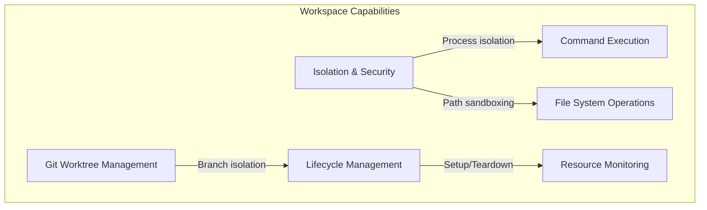

### Strategic Value
- **Complete Task Isolation**: Every task operates in its own environment
- **Concurrent Execution**: Multiple agents work simultaneously without conflicts
- **Version Control Safety**: Git worktrees prevent code conflicts
- **Resource Management**: Controlled allocation and cleanup
- **Security Boundaries**: Sandboxed execution prevents system access

### Workspace Capabilities

The workspace service provides capability checking to ensure operations are only performed when the workspace is in an appropriate state:

1. **File Operations** (`apps/backend/services/workspace.service.ts`)
   - `canListFiles()`: Available when workspace exists (any state except NOT_SETUP)
   - `canReadWriteFiles()`: Available during setup, idle, or running states
   - `canSearchFiles()`: Available when workspace is initialized

2. **Command Execution**
   - `canExecuteCommands()`: Only when workspace is in IDLE state
   - Prevents command execution during setup or when agent is running
   - Ensures exclusive access to command execution

3. **Git Operations**
   - `canAccessGit()`: Available when workspace exists
   - Includes diff generation, branch info, commit status
   - Works even during active development

4. **Server Management** (Preview Environments)
   - `canManageServer()`: Available in IDLE or RUNNING states
   - Start/stop/restart development servers
   - Port forwarding and log access

5. **State-Based Availability**
   ```
   NOT_SETUP:     No operations available
   SETTING_UP:    File operations only
   IDLE:          All operations available
   RUNNING:       File/git operations, no commands
   ERROR:         Limited to cleanup operations
   ```

## Architectural Principles

### Core Design Principles

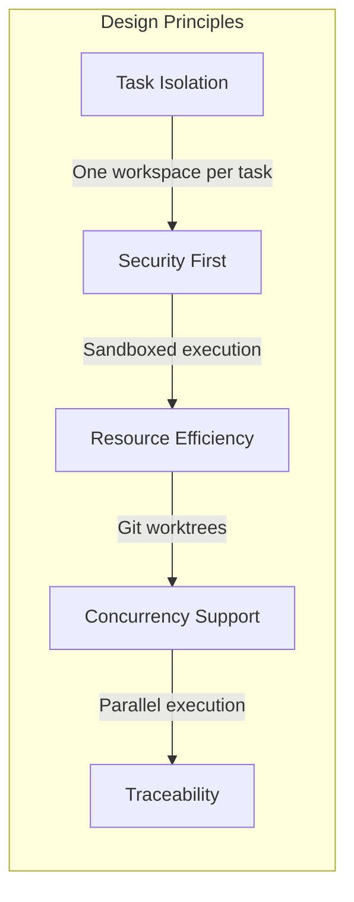

1. **Complete Isolation**: Each task operates in a completely separate environment
2. **Security by Design**: All operations are sandboxed and validated
3. **Resource Efficiency**: Shared git objects, lazy initialization
4. **Concurrent Safety**: Multiple agents can work simultaneously
5. **Full Traceability**: All operations are logged and tracked

### Architectural Constraints

- **No Shared State**: Workspaces never share data or resources
- **Immutable Infrastructure**: Workspaces are disposable and recreatable
- **Fail-Safe Defaults**: Security restrictions enabled by default
- **Graceful Degradation**: Failures isolated to individual workspaces

## Core Architecture

### System Architecture

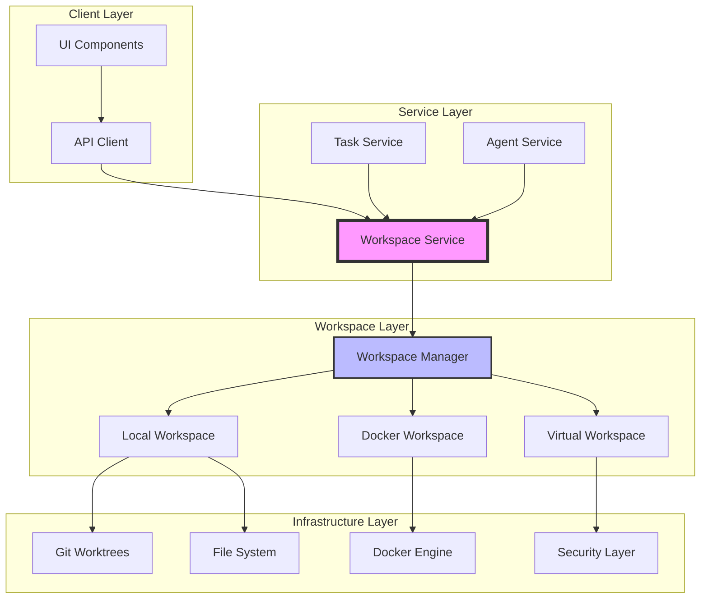

**Implementation Details:**

The workspace system architecture is organized into distinct layers:

1. **Service Layer** - Core business logic
   - `apps/backend/services/workspace.service.ts` - Main workspace service orchestrating all workspace operations
   - `apps/backend/services/task.service.ts` - Task service that requests workspace creation
   - `apps/backend/services/agents/` - Agent implementations that execute within workspaces

2. **Workspace Layer** - Workspace implementations
   - `apps/backend/workspaces/base.ts` - Abstract base class defining workspace interface
   - `apps/backend/workspaces/local.ts` - Local filesystem workspace using git worktrees
   - `apps/backend/workspaces/docker.ts` - Docker container-based workspace implementation
   - Virtual workspace (planned for future implementation)

3. **Infrastructure Layer** - Low-level utilities
   - `apps/backend/utils/git-utils.ts` - Git operations including worktree management
   - `apps/backend/utils/file-search.ts` - File system search utilities
   - Docker integration through shell commands
   - Path validation and security utilities

### Component Architecture

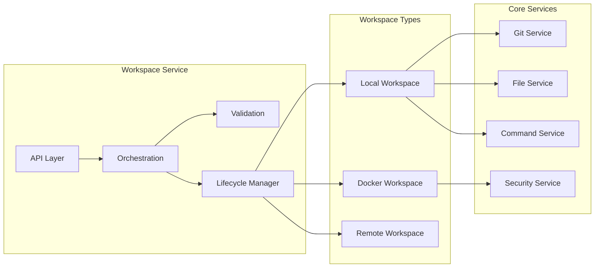

### Workspace Hierarchy

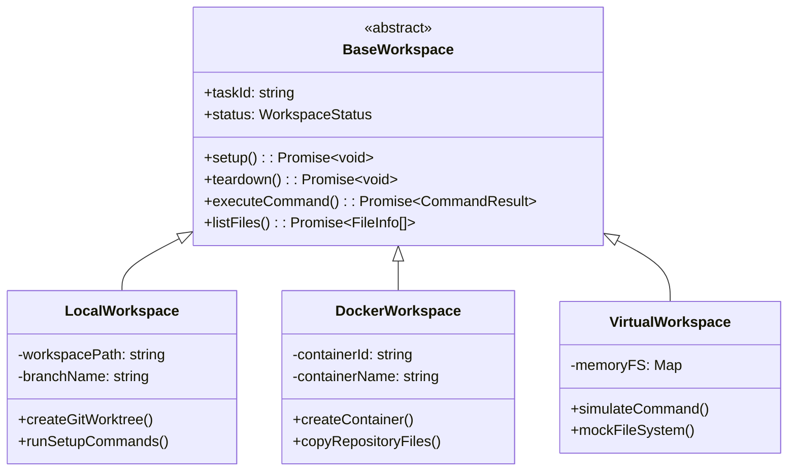

**Workspace Class Implementation Details:**

1. **BaseWorkspace Abstract Class** (`apps/backend/workspaces/base.ts`)
   - Defines common interface for all workspace types
   - Properties:
     - `taskId`: Unique identifier linking to task
     - `repositoryConfig`: Configuration from repository service
     - `eventService`: For emitting workspace events
   - Abstract methods that subclasses must implement:
     - `setup()`: Initialize workspace environment
     - `teardown()`: Clean up resources
     - `runCommand()`: Execute shell commands
     - `listFiles()`: Directory traversal
     - `readFile()`: File content retrieval
     - `writeFile()`: File modification
     - `searchFiles()`: File search functionality
     - `getGitDiff()`: Version control changes

2. **LocalWorkspace Implementation** (`apps/backend/workspaces/local.ts`)
   - Uses git worktrees for isolation
   - Key methods:
     - `createGitWorktree()`: Sets up isolated git working directory
     - `runSetupCommands()`: Executes npm install, pip install, etc.
     - `validatePath()`: Ensures operations stay within workspace
     - `executeCommand()`: Runs commands with timeout and resource limits
   - State management:
     - Tracks setup progress
     - Monitors running processes
     - Manages background tasks

3. **DockerWorkspace Implementation** (`apps/backend/workspaces/docker.ts`)
   - Container-based isolation
   - Key methods:
     - `createContainer()`: Docker container initialization
     - `copyRepositoryFiles()`: Syncs code to container
     - `executeInContainer()`: Runs commands inside Docker
     - `getContainerLogs()`: Retrieves execution logs
   - Container lifecycle:
     - Creates named containers per task
     - Manages volume mounts
     - Handles container cleanup

4. **VirtualWorkspace (Planned)**
   - In-memory workspace for testing
   - Would provide:
     - Memory-based file system
     - Command simulation
     - Fast test execution
     - No disk I/O

## Isolation Architecture

### Git Worktree Isolation

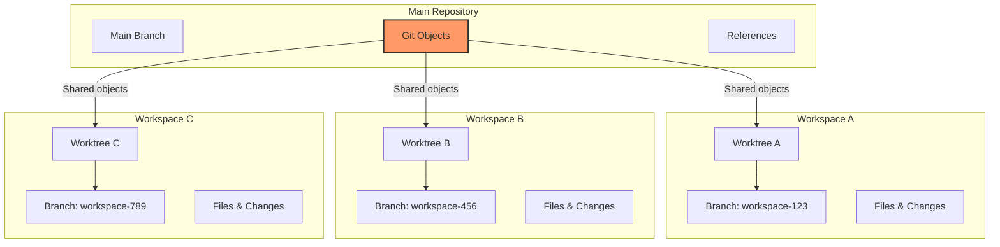

**Git Worktree Implementation Details:**

Git worktrees provide workspace isolation through separate working directories while sharing the same git repository objects. Here's how it works:

1. **Worktree Creation** (`apps/backend/utils/git-utils.ts:createGitWorktree()`)
   - Each task gets its own worktree with a dedicated branch
   - Branch naming convention: `workspace-<task-id>`
   - Worktree path: `<repo-parent>/<repo-name>-workspace-<task-id>`
   - Creation command: `git worktree add -b "workspace-<task-id>" "<path>"`

2. **Object Sharing Benefits**
   - Git objects (.git/objects) are shared across all worktrees
   - Reduces disk usage by ~90% compared to full clones
   - Faster creation time (seconds vs minutes for large repos)
   - Automatic garbage collection manages shared objects

3. **Branch Isolation** (`apps/backend/workspaces/local.ts`)
   - Each workspace operates on its own branch
   - Changes are isolated from main repository and other workspaces
   - Prevents conflicts between concurrent AI agents
   - Branches can be merged back to main when task completes

4. **Conflict Prevention**
   - Git prevents same branch from being checked out in multiple worktrees
   - System automatically creates new branch if conflict detected
   - Branch tracking ensures proper upstream relationships

**Key Benefits:**
- **Shared Git Objects**: Efficient disk usage through object sharing
- **Independent Branches**: Each workspace has its own branch
- **Parallel Development**: Multiple agents work without conflicts
- **Clean Separation**: Changes isolated until explicitly merged

### Docker Container Isolation

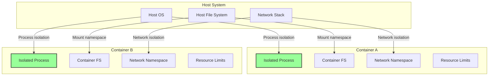

**Docker Container Implementation Details:**

Docker provides complete process and resource isolation for workspace execution:

1. **Container Creation** (`apps/backend/workspaces/docker.ts:setup()`)
   - Container naming: `moatless-task-<task-id>`
   - Base image configurable per repository (default: `node:18-alpine`)
   - Working directory: `/workspace`
   - Container creation: `docker create --name "<name>" -w "/workspace" "<image>" sleep infinity`

2. **File System Isolation**
   - Repository files copied to container: `docker cp "<repo>/." "<container>:/workspace/"`
   - Complete filesystem isolation from host and other containers
   - Volume mounts supported for persistent data
   - Changes confined to container filesystem

3. **Process Isolation Features**
   - **Namespace Isolation**: PID, network, mount, UTS, IPC namespaces
   - **Resource Limits**: Configurable CPU and memory constraints
   - **Security**: Capabilities dropped, seccomp profiles applied
   - **User Isolation**: Runs as non-root user when configured

4. **Network Isolation**
   - Each container gets its own network namespace
   - Port mapping required for external access
   - Inter-container communication restricted by default
   - Network policies enforceable via Docker networks

5. **Resource Management** (`apps/backend/workspaces/docker.ts`)
   - CPU limits prevent resource hogging
   - Memory limits prevent OOM conditions
   - I/O throttling available for disk operations
   - Automatic cleanup on container stop

**Container Benefits:**
- **Complete Process Isolation**: No cross-task interference
- **Resource Limits**: CPU, memory, and I/O constraints
- **Network Isolation**: Separate network namespaces
- **File System Isolation**: Independent file systems

### Process Isolation Strategy

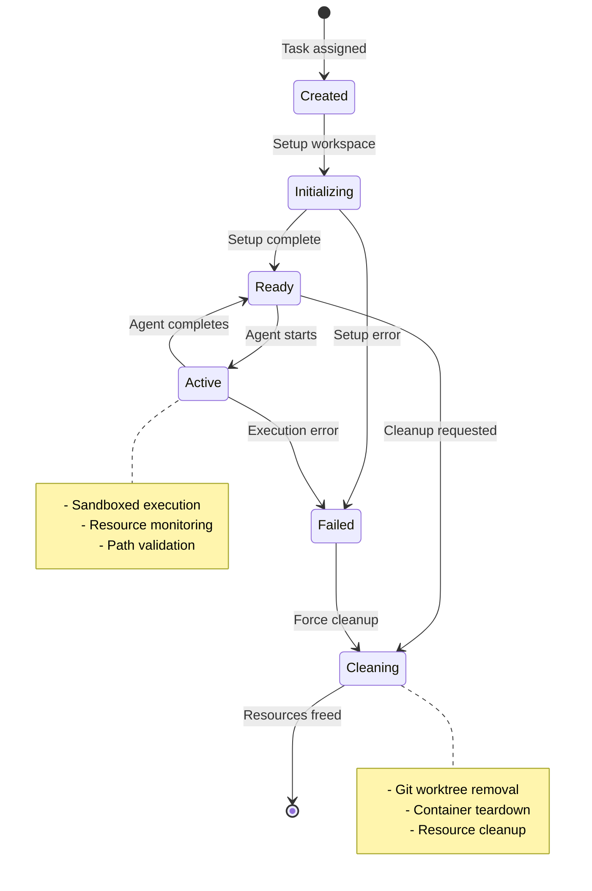

**Process Isolation Implementation:**

The workspace system implements a comprehensive state machine for process lifecycle management:

1. **State Transitions** (`packages/shared/types/workspace.ts:WorkspaceStatus`)
   - `NOT_SETUP`: Initial state before workspace creation
   - `SETTING_UP`: Workspace being created and configured
   - `IDLE`: Ready for agent execution
   - `RUNNING`: Agent actively executing
   - `ERROR`: Setup or execution failure

2. **Workspace Initialization** (`apps/backend/workspaces/local.ts:setup()`)
   - Validates workspace path exists or creates it
   - Sets up git worktree for version control isolation
   - Runs background setup commands (npm install, etc.)
   - Transitions to IDLE state when ready

3. **Agent Execution Isolation**
   - **Process Spawning**: Uses Node.js `child_process.exec` with constraints
   - **Working Directory**: Always set to workspace root
   - **Environment Variables**: Filtered and workspace-specific
   - **Signal Handling**: Proper SIGTERM/SIGKILL escalation

4. **Resource Monitoring** (`apps/backend/workspaces/local.ts`)
   - Tracks active processes per workspace
   - Monitors command execution time
   - Enforces timeout limits (default 2 min, max 10 min)
   - Prevents resource exhaustion

5. **Cleanup Process** (`apps/backend/workspaces/local.ts:teardown()`)
   - Terminates all running processes
   - Removes git worktree and branch
   - Cleans up temporary files
   - Updates workspace state to reflect cleanup

## Lifecycle Management

### Workspace Creation Flow

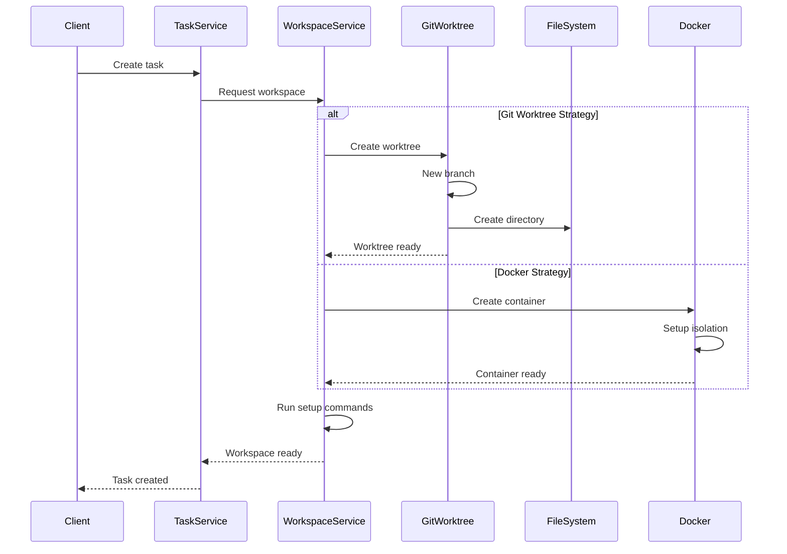

**Detailed Workspace Creation Process:**

1. **Task Creation** (`apps/backend/services/task.service.ts`)
   - Client initiates task creation through API endpoint
   - Task service validates repository configuration
   - Generates unique task ID for workspace isolation

2. **Workspace Request** (`apps/backend/services/workspace.service.ts:createWorkspace()`)
   - WorkspaceService receives task ID and repository ID
   - Retrieves repository configuration to determine workspace type
   - Decides between Local (git worktree) or Docker workspace based on `repository.codeExecution.type`

3. **Git Worktree Creation** (for Local workspaces)
   - **Path Generation** (`workspace.service.ts:createWorkspaceRepository()`)
     - Constructs workspace path: `<WORKTREE_DIR>/<repo-name>-workspace-<task-id>`
     - Default worktree directory: `../` relative to repository path
     - Can be overridden with `WORKTREE_DIR` environment variable
   
   - **Branch Creation** (`utils/git-utils.ts:createGitWorktree()`)
     - Creates new branch named `workspace-<task-id>`
     - If branch exists and is checked out, creates alternative branch
     - Executes: `git worktree add -b "<branch-name>" "<workspace-path>"`
   
   - **Validation**
     - Verifies repository is a git repository
     - Ensures worktree directory exists and is writable
     - Handles existing worktrees gracefully

4. **Docker Container Creation** (for Docker workspaces)
   - **Container Setup** (`apps/backend/workspaces/docker.ts:setup()`)
     - Creates container with name `moatless-task-<task-id>`
     - Configures working directory as `/workspace`
     - Applies volume mounts and environment variables from config
   
   - **File Synchronization**
     - Copies repository files to container: `docker cp "<repo-path>/." "<container-id>:/workspace/"`
     - Preserves file permissions and structure
   
   - **Container Initialization**
     - Starts container with `sleep infinity` to keep it running
     - Executes setup commands defined in repository config

5. **Setup Commands Execution**
   - **Local Workspace** (`apps/backend/workspaces/local.ts:runSetupCommandsInBackground()`)
     - Runs commands like `npm install`, `pip install`, etc.
     - Executes in background to allow immediate workspace availability
     - Emits events for command progress tracking
   
   - **Docker Workspace**
     - Runs setup commands inside container
     - Each command execution is tracked and logged
     - Failures in setup commands mark workspace as errored

6. **Workspace Registration**
   - Workspace instance stored in `activeWorkspaces` Map
   - Workspace path saved to task metadata for recovery
   - Status transitions from `initializing` to `ready`

### Workspace Teardown Flow

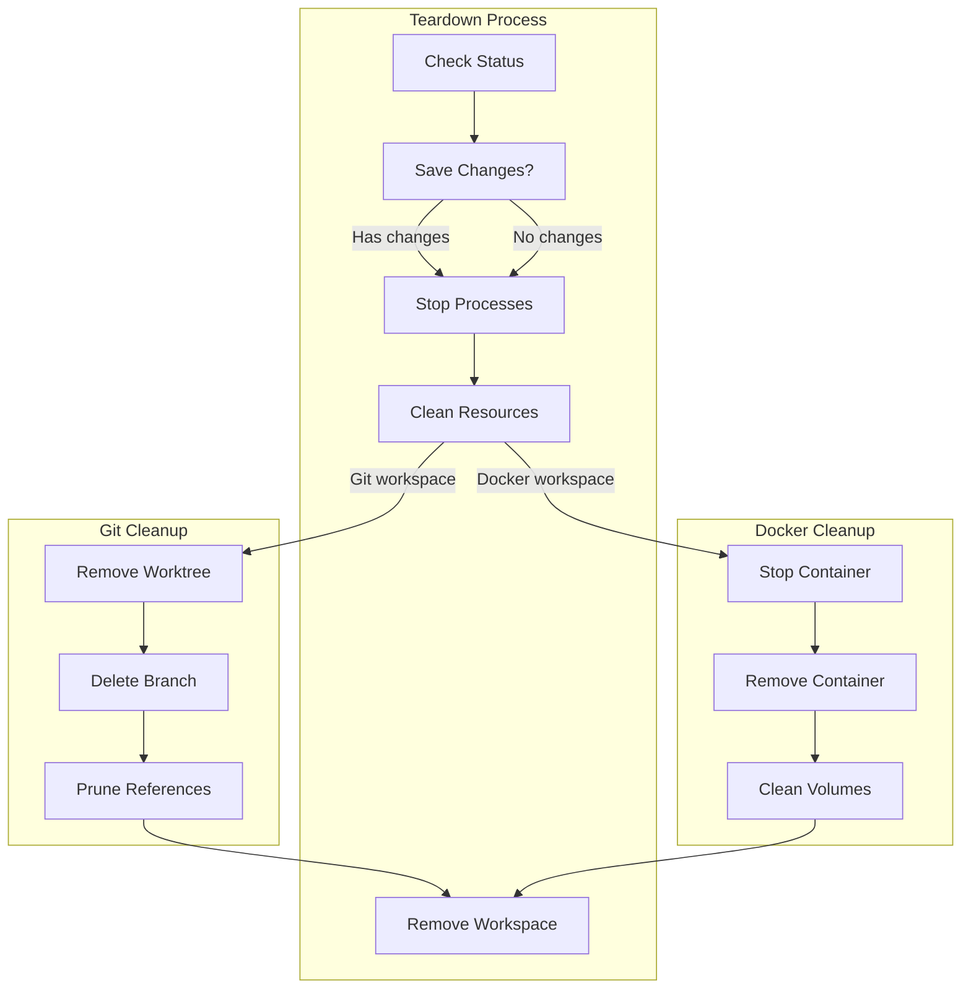

**Detailed Workspace Teardown Process:**

1. **Cleanup Initiation** (`apps/backend/services/workspace.service.ts:cleanupWorkspace()`)
   - Triggered when task completes, fails, or is manually stopped
   - Logs cleanup start time for performance tracking
   - Retrieves workspace from `activeWorkspaces` Map

2. **Status Verification**
   - Checks current workspace status and type
   - Determines if force cleanup is needed (always true in current implementation)
   - Captures workspace path before cleanup for logging

3. **Local Workspace Teardown** (`apps/backend/workspaces/local.ts:teardown()`)
   - **Process Termination**
     - Stops any running agent processes
     - Kills server processes if preview environment is active
     - Ensures all child processes are terminated
   
   - **Git Worktree Removal** (`utils/git-utils.ts:removeGitWorktree()`)
     - Executes: `git worktree remove --force "<workspace-path>"`
     - Force flag ensures removal even with uncommitted changes
     - Handles cases where worktree is already removed
   
   - **Branch Cleanup**
     - Deletes workspace branch: `git branch -D workspace-<task-id>`
     - Prunes worktree references: `git worktree prune`
     - Cleans up any dangling references

4. **Docker Workspace Teardown** (`apps/backend/workspaces/docker.ts:teardown()`)
   - **Container Stopping**
     - Gracefully stops container: `docker stop "<container-id>"`
     - Waits for container to stop with timeout
     - Force kills if graceful stop fails
   
   - **Container Removal**
     - Removes container: `docker rm -f "<container-id>"`
     - Cleans up associated volumes if configured
     - Removes any temporary files created during execution
   
   - **Resource Cleanup**
     - Releases allocated ports
     - Cleans up network configurations
     - Removes any created volumes

5. **Workspace Deregistration**
   - Removes workspace from `activeWorkspaces` Map
   - Updates task metadata to reflect workspace removal
   - Emits workspace deleted event for audit trail

6. **Error Handling During Teardown**
   - Catches and logs all errors without rethrowing
   - Ensures workspace is removed from active list even if teardown fails
   - Provides detailed error logging for debugging
   - Total cleanup time is tracked and logged

## Security Architecture

### Path Sandboxing

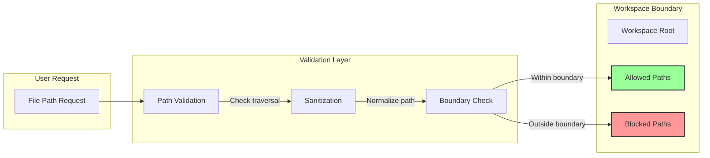

**Path Sandboxing Implementation:**

Path validation ensures all file operations remain within workspace boundaries:

1. **Path Validation** (`apps/backend/workspaces/local.ts:validatePath()`)
   - All paths resolved to absolute paths using `path.resolve()`
   - Directory traversal attempts (../) are detected and blocked
   - Symbolic links resolved to ensure they stay within workspace
   - Path normalization removes redundant separators and segments

2. **Sanitization Process**
   - Input paths sanitized to remove dangerous characters
   - Null bytes and control characters stripped
   - Windows path separators normalized to Unix style
   - Leading/trailing whitespace removed

3. **Boundary Enforcement** (`apps/backend/workspaces/local.ts:isWithinWorkspace()`)
   - Workspace root established during creation
   - All operations checked against workspace root
   - Paths outside workspace return permission errors
   - No access to parent directories or system paths

4. **Security Measures**
   - **Prevent Directory Traversal**: Block `../` and absolute paths outside workspace
   - **Symbolic Link Protection**: Resolve symlinks and validate destination
   - **Hidden File Protection**: Optional blocking of dotfiles
   - **System Path Protection**: Block access to /etc, /usr, /bin, etc.

### Command Execution Security

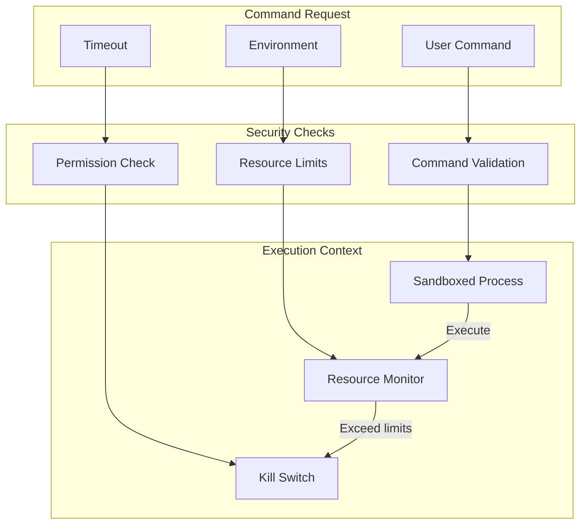

**Command Execution Security Implementation:**

Secure command execution with multiple layers of protection:

1. **Command Validation** (`apps/backend/workspaces/local.ts:runCommand()`)
   - Commands sanitized before execution
   - Shell injection patterns detected and blocked
   - Command length limits enforced (max 10KB)
   - Dangerous commands can be blacklisted

2. **Execution Environment**
   - **Working Directory**: Always set to workspace root
   - **Environment Variables**: Filtered and sanitized
   - **Shell**: Configurable (bash, sh, or no shell)
   - **User Context**: Runs as application user, not root

3. **Resource Limits** (`apps/backend/workspaces/local.ts:executeCommand()`)
   - **Timeout Enforcement**: Default 2 minutes, max 10 minutes
   - **Memory Limits**: Prevent OOM through ulimits
   - **CPU Limits**: Nice values and cgroup constraints
   - **Process Limits**: Max number of child processes

4. **Process Monitoring**
   - Real-time resource usage tracking
   - Automatic termination on limit exceeded
   - Kill signal escalation (SIGTERM → SIGKILL)
   - Zombie process prevention

5. **Output Handling**
   - Output buffering with size limits (10MB default)
   - Stream handling for long-running commands
   - Error stream capture and logging
   - Exit code and signal reporting

### Multi-Layer Security

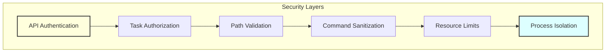

## Integration Architecture

### Service Integration

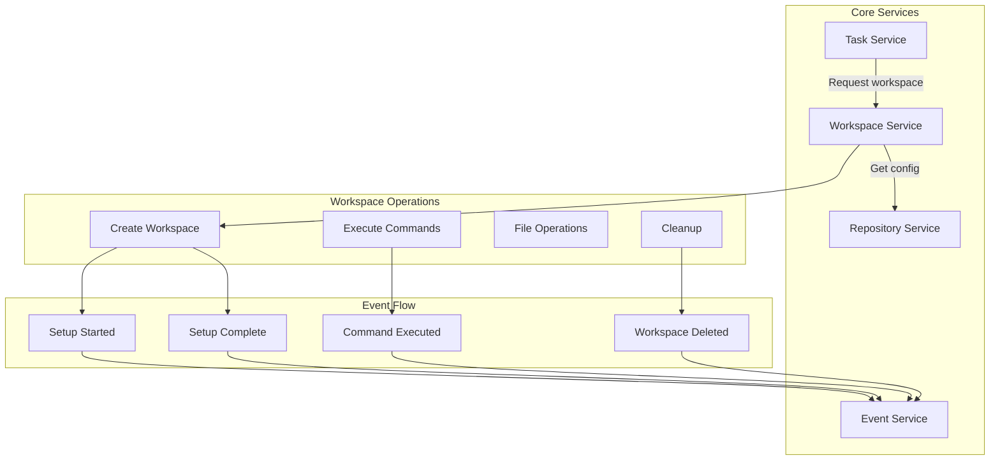

**Service Integration Details:**

The workspace system integrates with multiple services to provide a complete execution environment:

1. **Workspace Service Integration** (`apps/backend/services/workspace.service.ts`)
   - Central orchestrator for all workspace operations
   - Maintains `activeWorkspaces` Map for workspace lifecycle
   - Integrates with Repository, Event, and Storage services
   - Provides unified API for workspace management

2. **Task Service Integration** (`apps/backend/services/task.service.ts`)
   - Requests workspace creation when task starts
   - Monitors workspace status throughout task execution
   - Triggers workspace cleanup on task completion
   - Stores workspace path in task metadata

3. **Repository Service Integration** (`apps/backend/services/repository.service.ts`)
   - Provides repository configuration for workspace setup
   - Determines workspace type (local vs Docker)
   - Supplies setup commands and environment variables
   - Manages git worktree preferences

4. **Event Service Integration** (`apps/backend/services/event.service.ts`)
   - Emits workspace lifecycle events for monitoring
   - Tracks command execution and file operations
   - Provides audit trail for all workspace activities
   - Enables real-time UI updates via SSE

5. **Storage Backend Integration** (`apps/backend/services/storage/`)
   - Persists workspace metadata with tasks
   - Enables workspace recovery after restarts
   - Stores workspace paths for cleanup operations
   - Maintains workspace-task associations

### API Integration Pattern

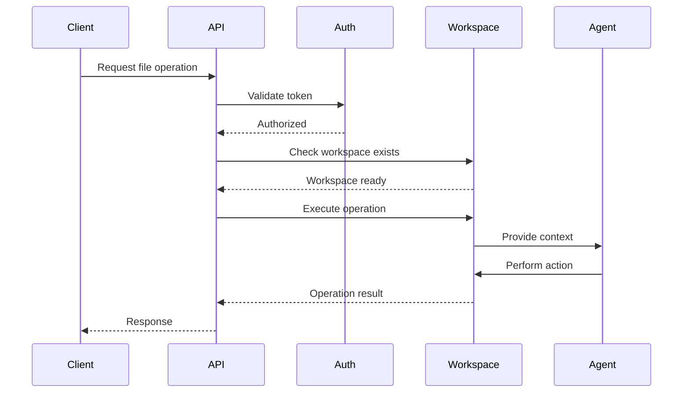

**API Integration Implementation:**

The workspace API provides secure access to workspace operations:

1. **API Endpoints** (`apps/backend/routes/workspace.routes.ts`)
   - `GET /api/workspaces/:taskId/files` - List files in workspace
   - `GET /api/workspaces/:taskId/files/*` - Read specific file
   - `PUT /api/workspaces/:taskId/files/*` - Write/update file
   - `POST /api/workspaces/:taskId/execute` - Execute command
   - `GET /api/workspaces/:taskId/status` - Get workspace status
   - `GET /api/workspaces/:taskId/git-diff` - Get git changes

2. **Authentication & Authorization**
   - JWT token validation for all requests
   - Task ownership verification
   - Workspace access control per user/team
   - Rate limiting to prevent abuse

3. **Request Flow**
   - **Validation Layer**: Input sanitization and parameter validation
   - **Capability Check**: Verify workspace supports requested operation
   - **Workspace Resolution**: Get or create workspace instance
   - **Operation Execution**: Delegate to workspace implementation
   - **Response Formatting**: Consistent error handling and data format

4. **Error Handling**
   - Workspace not found: 404 response
   - Unauthorized access: 403 response
   - Invalid operations: 400 response
   - Internal errors: 500 with safe error messages

5. **Real-time Updates** (`apps/backend/routes/events.routes.ts`)
   - SSE connection for workspace events
   - Command execution progress
   - File change notifications
   - Status updates

## Performance & Scalability

### Resource Management

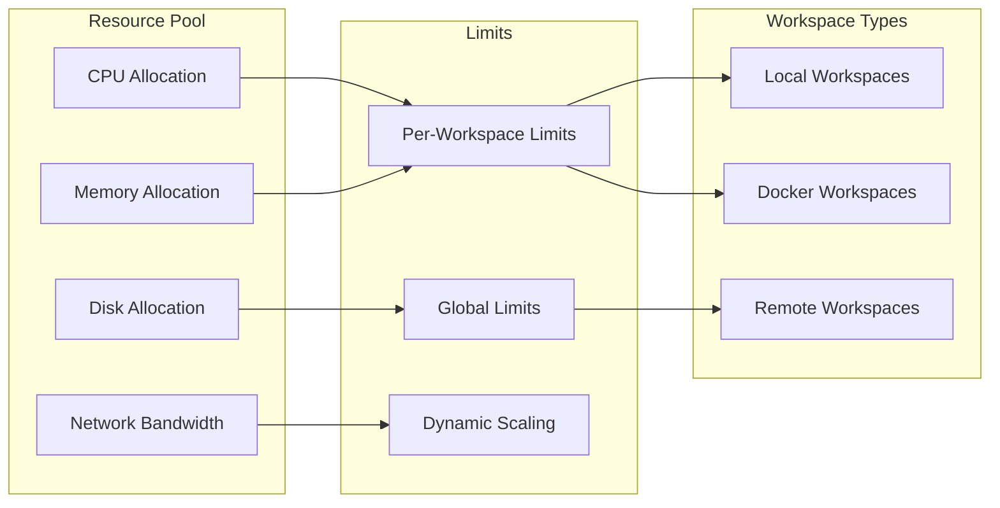

### Scaling Strategy

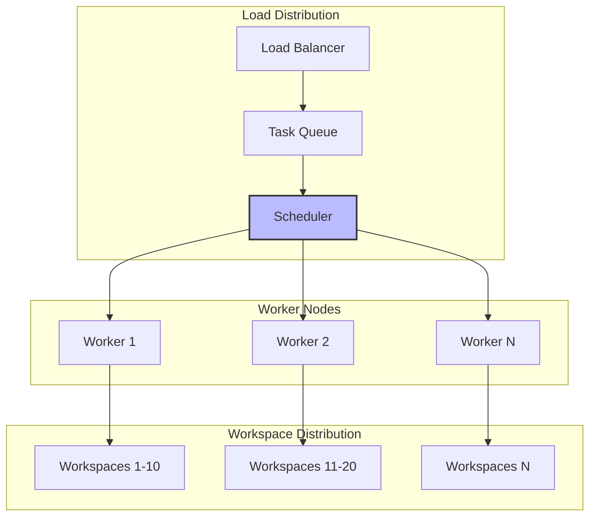

**Scaling Implementation Strategy:**

The workspace system is designed for horizontal scalability:

1. **Workspace Distribution**
   - Each worker node can manage multiple workspaces
   - Workspaces assigned based on resource availability
   - Load balancing across available nodes
   - Automatic failover for node failures

2. **Resource Pooling** (`apps/backend/services/workspace.service.ts`)
   - Active workspace tracking in memory
   - Background task monitoring per workspace
   - Resource usage aggregation
   - Capacity planning metrics

3. **Concurrency Management**
   - Multiple workspaces per repository supported
   - Git worktrees enable parallel development
   - Docker containers provide complete isolation
   - No shared state between workspaces

4. **Performance Optimizations**
   - Git object sharing reduces disk usage
   - Lazy workspace initialization
   - Background setup commands
   - Workspace reuse for same task

5. **Scaling Limits**
   - Git worktree limit: ~100 per repository
   - Docker container limit: System dependent
   - File descriptor limits: Configurable
   - Memory limits: Per-workspace constraints

## Monitoring & Observability

### Workspace Metrics

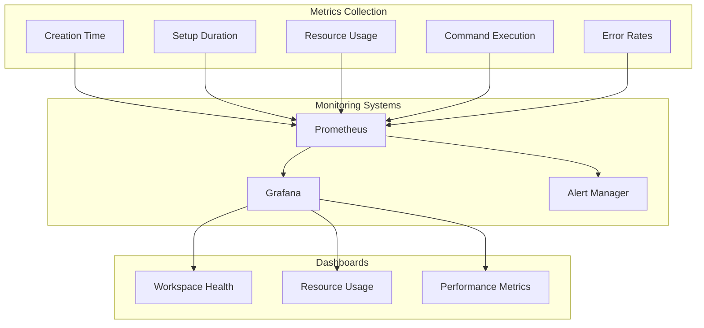

### Event Tracking

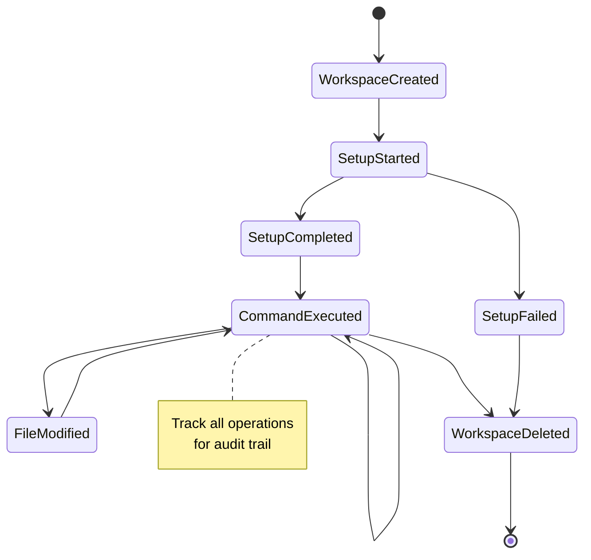

**Event Tracking Implementation:**

The workspace system emits detailed events for monitoring and debugging:

1. **Event Types** (`packages/shared/types/event.ts`)
   - **Workspace Events**:
     - `workspace.created`: Workspace instance created
     - `workspace.setup_started`: Setup process initiated
     - `workspace.setup_completed`: Setup successful
     - `workspace.setup_failed`: Setup encountered errors
     - `workspace.deleted`: Workspace cleaned up
   
   - **Command Events**:
     - `command.started`: Command execution begins
     - `command.output`: Stdout/stderr streaming
     - `command.completed`: Command finished successfully
     - `command.failed`: Command execution error
   
   - **File Events**:
     - `file.created`: New file created
     - `file.modified`: Existing file updated
     - `file.deleted`: File removed
     - `file.read`: File accessed

2. **Event Service Integration** (`apps/backend/services/event.service.ts`)
   - Centralized event emission
   - Event persistence to storage
   - Real-time streaming via SSE
   - Event filtering by task ID

3. **Event Data Structure**
   ```typescript
   {
     eventId: string,
     taskId: string,
     type: EventType,
     subType: string,
     timestamp: Date,
     data: {
       workspacePath?: string,
       command?: string,
       exitCode?: number,
       output?: string,
       error?: string,
       filePath?: string
     }
   }
   ```

4. **Audit Trail Benefits**
   - Complete operation history
   - Debugging failed tasks
   - Performance analysis
   - Security auditing
   - Usage analytics

## Best Practices

### Workspace Lifecycle Best Practices

1. **Lazy Initialization**
   - Create workspaces only when needed
   - Defer expensive operations
   - Cache setup results

2. **Resource Cleanup**
   - Always clean up on task completion
   - Implement timeout-based cleanup
   - Monitor orphaned workspaces

3. **Error Handling**
   - Graceful degradation on failures
   - Automatic retry with backoff
   - Clear error reporting

4. **Security First**
   - Validate all inputs
   - Sandbox all operations
   - Audit all actions

### Performance Optimization

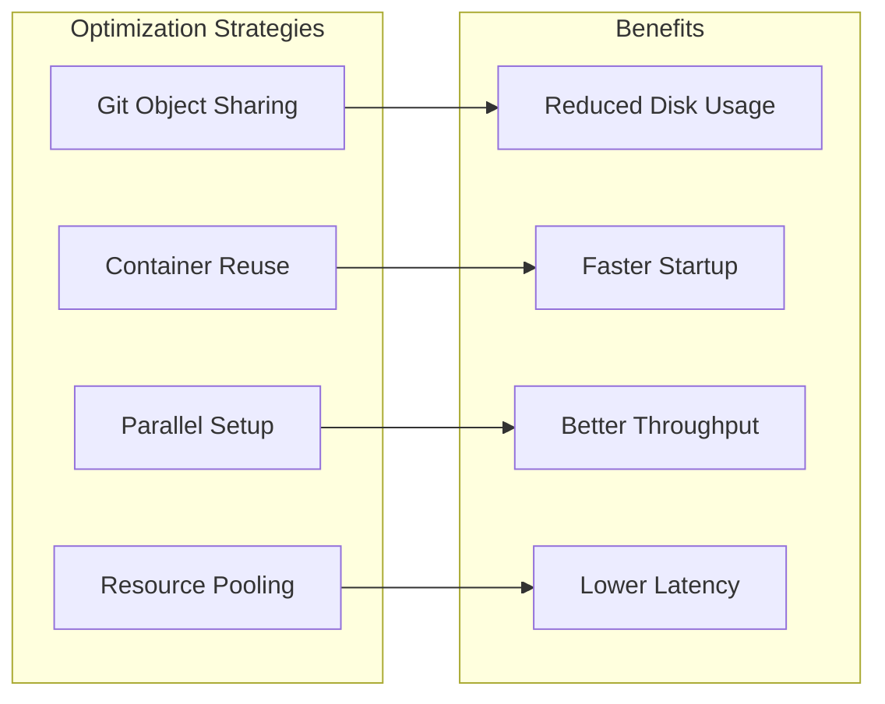

### Security Guidelines

- **Never expose host paths** outside workspace boundaries
- **Validate all file paths** against directory traversal
- **Limit command execution** with timeouts and resource limits
- **Audit all operations** for security analysis
- **Use containers** for untrusted code execution
- **Implement defense in depth** with multiple security layers

## Related Documentation

- [Architecture Overview](../architecture-overview.md)
- [Repository Management](./repositories.md)
- [Agent Architecture](./agents.md)
- [Task Management](./tasks.md)
- [Event Architecture](./events.md)
- [Security Patterns](../patterns/security.md)