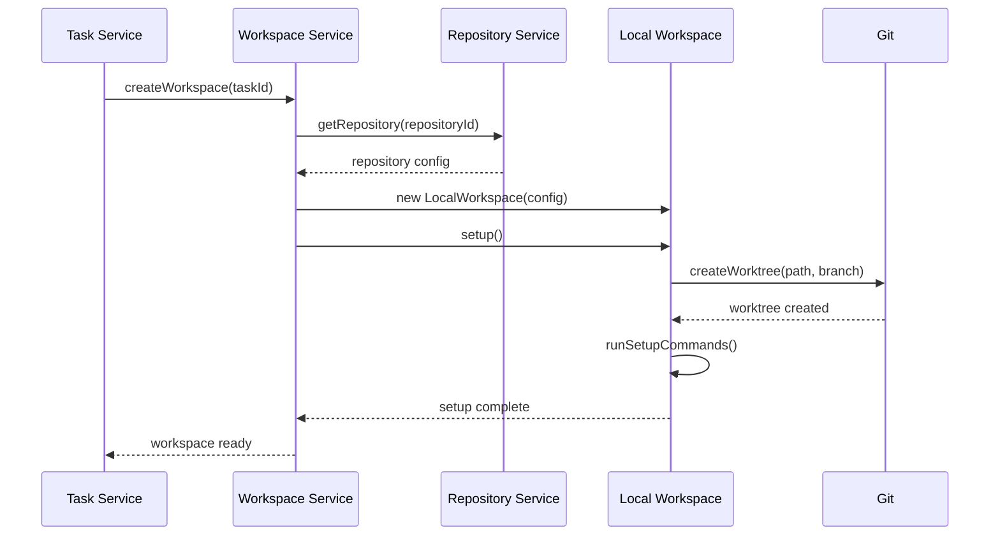
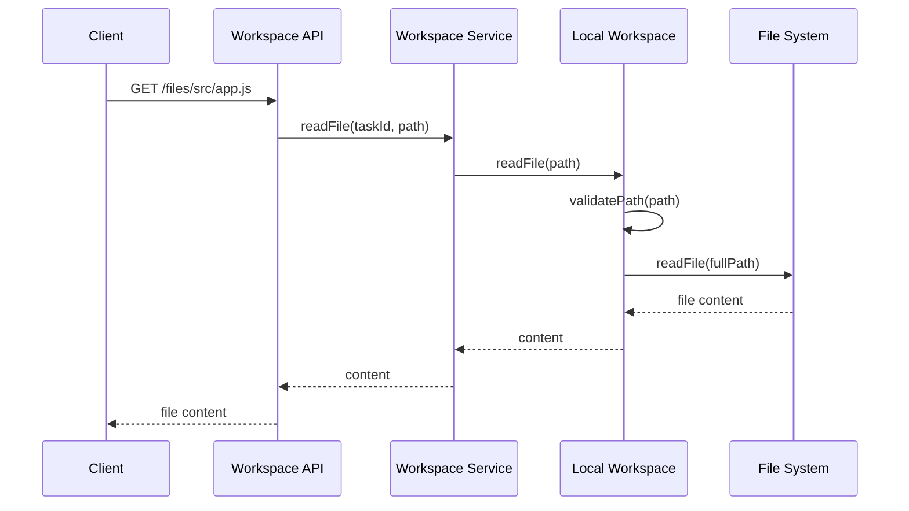

# Workspace Architecture

## Table of Contents
1. [Overview](#overview)
2. [Core Concepts](#core-concepts)
3. [Architecture](#architecture)
4. [Backend Implementation](#backend-implementation)
5. [Frontend Integration](#frontend-integration)
6. [Data Flow](#data-flow)
7. [Integration Points](#integration-points)
8. [Configuration](#configuration)
9. [Best Practices](#best-practices)
10. [Troubleshooting](#troubleshooting)

## Overview

### Purpose
The Workspace system provides isolated execution environments for tasks, enabling safe code modification, testing, and execution. Each task gets its own workspace where AI agents can operate without affecting other tasks or the main repository.

### Key Responsibilities
- Create isolated environments for task execution
- Manage git worktrees for version control isolation
- Provide secure file system access
- Execute commands within workspace boundaries
- Manage workspace lifecycle (creation, setup, cleanup)
- Support both local and containerized environments
- Track workspace status and resource usage

### Position in Architecture
Workspaces sit between the task management system and the actual code execution, providing the isolated environment where repositories become active working directories for AI agents.

## Core Concepts

### Domain Terminology

| Term | Definition |
|------|------------|
| Workspace | Isolated execution environment for a single task |
| Git Worktree | Separate working directory sharing the same git repository |
| Local Workspace | Host-based workspace using git worktrees |
| Docker Workspace | Container-based workspace for enhanced isolation |
| Workspace Status | Current state of workspace (setup, idle, running) |
| Setup Commands | Repository-defined commands run during workspace creation |

### Key Abstractions

#### Workspace Interface
```typescript
interface WorkspaceInfo {
  taskId: string
  type: 'local' | 'docker'
  path: string
  status: WorkspaceStatus
  repository: RepositoryConfig
  isSetup: boolean
  setupOutput?: string
  error?: string
}

enum WorkspaceStatus {
  NOT_SETUP = 'not_setup',     // Workspace not created
  SETTING_UP = 'setting_up',   // Creation in progress  
  IDLE = 'idle',               // Ready for operations
  RUNNING = 'running',         // Agent actively running
}
```

#### Workspace Capabilities
```typescript
interface WorkspaceCapabilities {
  canListFiles: boolean
  canExecuteCommands: boolean
  canRunServer: boolean
  hasGitSupport: boolean
  supportsFileWatch: boolean
  maxFileSize: number
  allowedCommands?: string[]
}
```

### Design Decisions
- **One workspace per task** ensures complete isolation
- **Git worktrees provide efficiency** while maintaining separation
- **Lazy initialization** creates workspaces only when needed
- **Background setup** keeps API responsive
- **Security-first approach** with path validation and sandboxing

## Architecture

### High-Level Overview
```mermaid
graph TB
    subgraph "Workspace Management"
        WS[Workspace Service]
        BW[Base Workspace]
        LW[Local Workspace]
        DW[Docker Workspace]
    end
    
    subgraph "Storage & Git"
        GW[Git Worktrees]
        FS[File System]
        DC[Docker Containers]
    end
    
    subgraph "Integration"
        RS[Repository Service]
        ES[Event Service]
        SB[Storage Backend]
    end
    
    WS --> BW
    BW <|-- LW
    BW <|-- DW
    
    LW --> GW
    LW --> FS
    DW --> DC
    
    WS --> RS
    WS --> ES
    WS --> SB
```

### Component Relationships
- Workspace Service orchestrates all workspace operations
- Base Workspace defines the common interface
- Local/Docker Workspaces implement environment-specific logic
- Integration services provide context and persistence

### Dependency Flow
```
Task Creation → Repository Config → Workspace Service
                                         ↓
                                  Create Workspace
                                         ↓
                               Setup Environment → Agent Execution
```

## Backend Implementation

### Service Layer

#### Workspace Service
```typescript
// apps/backend/services/workspace.service.ts
export class WorkspaceService {
  private activeWorkspaces = new Map<string, BaseWorkspace>()
  
  constructor(
    private repositoryService: RepositoryService,
    private eventService: EventService,
    private storageService: StorageService
  ) {}

  // Core workspace operations
  async createWorkspace(taskId: string): Promise<WorkspaceInfo>
  async getWorkspace(taskId: string): Promise<WorkspaceInfo | null>
  async deleteWorkspace(taskId: string, force?: boolean): Promise<void>
  async getWorkspaceStatus(taskId: string): Promise<WorkspaceStatus>
  
  // File operations
  async listFiles(taskId: string, path?: string): Promise<FileInfo[]>
  async readFile(taskId: string, filePath: string): Promise<string>
  async writeFile(taskId: string, filePath: string, content: string): Promise<void>
  async searchFiles(taskId: string, query: string): Promise<SearchResult[]>
  
  // Command execution
  async executeCommand(
    taskId: string, 
    command: string, 
    options?: CommandOptions
  ): Promise<CommandResult>
  
  // Git operations
  async getGitDiff(taskId: string): Promise<GitDiff>
  async getGitSyncStatus(taskId: string): Promise<GitSyncStatus>
  
  // Capability checks
  getWorkspaceCapabilities(taskId: string): WorkspaceCapabilities
  
  // Lifecycle management
  private async setupWorkspace(workspace: BaseWorkspace): Promise<void>
  private createWorkspaceInstance(
    type: string, 
    config: WorkspaceConfig
  ): BaseWorkspace
}
```

#### Base Workspace Abstract Class
```typescript
// apps/backend/workspaces/base.ts
export abstract class BaseWorkspace {
  protected status: WorkspaceStatus = WorkspaceStatus.NOT_SETUP
  protected setupOutput: string = ''
  protected error: string | null = null
  
  constructor(
    protected taskId: string,
    protected repository: RepositoryConfig,
    protected eventService: EventService
  ) {}

  // Abstract methods that implementations must provide
  abstract setup(): Promise<void>
  abstract teardown(force?: boolean): Promise<void>
  abstract listFiles(path?: string): Promise<FileInfo[]>
  abstract readFile(filePath: string): Promise<string>
  abstract writeFile(filePath: string, content: string): Promise<void>
  abstract executeCommand(
    command: string, 
    options?: CommandOptions
  ): Promise<CommandResult>
  abstract getPath(): string
  abstract getCapabilities(): WorkspaceCapabilities
  
  // Common functionality
  getStatus(): WorkspaceStatus { return this.status }
  getSetupOutput(): string { return this.setupOutput }
  getError(): string | null { return this.error }
  
  protected async emitEvent(type: string, data: any): Promise<void> {
    await this.eventService.emitTaskEvent({
      id: generateId(),
      type: EventType.INPUT,
      subtype: type,
      payload: {
        taskId: this.taskId,
        ...data,
      },
      timestamp: new Date().toISOString(),
      source: 'workspace',
    })
  }
  
  protected validatePath(path: string): void {
    // Security validation
    if (path.includes('..') || path.startsWith('/')) {
      throw new SecurityError('Invalid file path')
    }
  }
}
```

#### Local Workspace Implementation
```typescript
// apps/backend/workspaces/local.ts
export class LocalWorkspace extends BaseWorkspace {
  private workspacePath: string | null = null
  private branchName: string
  
  constructor(
    taskId: string,
    repository: RepositoryConfig,
    eventService: EventService
  ) {
    super(taskId, repository, eventService)
    this.branchName = `workspace-${taskId}`
  }

  async setup(): Promise<void> {
    this.status = WorkspaceStatus.SETTING_UP
    await this.emitEvent('workspace_setup_started', {})
    
    try {
      if (this.repository.useGitWorktrees) {
        await this.createGitWorktree()
      } else {
        this.workspacePath = this.repository.path
      }
      
      await this.runSetupCommands()
      
      this.status = WorkspaceStatus.IDLE
      await this.emitEvent('workspace_setup_completed', {
        path: this.workspacePath,
      })
      
    } catch (error) {
      this.status = WorkspaceStatus.NOT_SETUP
      this.error = error.message
      await this.emitEvent('workspace_setup_failed', {
        error: error.message,
      })
      throw error
    }
  }
  
  private async createGitWorktree(): Promise<void> {
    const repoName = path.basename(this.repository.path)
    const worktreeName = `${repoName}-workspace-${this.taskId}`
    const worktreePath = path.join(
      path.dirname(this.repository.path),
      '.worktrees',
      worktreeName
    )
    
    // Ensure worktrees directory exists
    await fs.ensureDir(path.dirname(worktreePath))
    
    // Create git worktree with new branch
    const git = simpleGit(this.repository.path)
    
    try {
      await git.worktreeAdd(worktreePath, this.branchName, {
        '--checkout': null,
      })
      
      this.workspacePath = worktreePath
      
      console.log(`Created git worktree: ${worktreePath}`)
    } catch (error) {
      // If branch already exists, try to use existing worktree
      if (error.message.includes('already exists')) {
        await git.worktreeAdd(worktreePath, this.branchName)
        this.workspacePath = worktreePath
      } else {
        throw new Error(`Failed to create git worktree: ${error.message}`)
      }
    }
  }
  
  private async runSetupCommands(): Promise<void> {
    const setupCommands = this.repository.codeExecution?.setupCommands
    if (!setupCommands) return
    
    console.log(`Running setup commands in ${this.workspacePath}`)
    
    const result = await this.executeCommand(setupCommands, {
      timeout: 300000, // 5 minutes
      cwd: this.workspacePath,
    })
    
    this.setupOutput = result.output
    
    if (result.exitCode !== 0) {
      throw new Error(`Setup commands failed: ${result.output}`)
    }
  }
  
  async teardown(force = false): Promise<void> {
    if (!force) {
      // Check for uncommitted changes
      const gitStatus = await this.getGitStatus()
      if (gitStatus.modified.length > 0 || gitStatus.staged.length > 0) {
        throw new Error(
          'Workspace has uncommitted changes. Use force=true to discard.'
        )
      }
    }
    
    if (this.repository.useGitWorktrees && this.workspacePath) {
      const git = simpleGit(this.repository.path)
      
      try {
        // Remove worktree
        await git.worktreeRemove(this.workspacePath, ['--force'])
        
        // Delete the branch
        await git.branch(['-D', this.branchName])
        
        console.log(`Removed git worktree: ${this.workspacePath}`)
      } catch (error) {
        console.warn(`Failed to clean up worktree: ${error.message}`)
      }
    }
    
    this.status = WorkspaceStatus.NOT_SETUP
    await this.emitEvent('workspace_deleted', {})
  }
  
  async listFiles(relativePath = ''): Promise<FileInfo[]> {
    this.validatePath(relativePath)
    const fullPath = path.join(this.getPath(), relativePath)
    
    if (!await fs.pathExists(fullPath)) {
      return []
    }
    
    const entries = await fs.readdir(fullPath, { withFileTypes: true })
    const files: FileInfo[] = []
    
    for (const entry of entries) {
      // Skip hidden files and git directory
      if (entry.name.startsWith('.') && entry.name !== '.env') {
        continue
      }
      
      const filePath = path.join(relativePath, entry.name)
      const fullFilePath = path.join(fullPath, entry.name)
      const stats = await fs.stat(fullFilePath)
      
      files.push({
        name: entry.name,
        path: filePath,
        type: entry.isDirectory() ? 'directory' : 'file',
        size: entry.isFile() ? stats.size : undefined,
        modified: stats.mtime.toISOString(),
      })
    }
    
    return files.sort((a, b) => {
      // Directories first, then files
      if (a.type !== b.type) {
        return a.type === 'directory' ? -1 : 1
      }
      return a.name.localeCompare(b.name)
    })
  }
  
  async readFile(filePath: string): Promise<string> {
    this.validatePath(filePath)
    const fullPath = path.join(this.getPath(), filePath)
    
    const stats = await fs.stat(fullPath)
    if (stats.size > 10 * 1024 * 1024) { // 10MB limit
      throw new Error('File too large to read')
    }
    
    return fs.readFile(fullPath, 'utf-8')
  }
  
  async writeFile(filePath: string, content: string): Promise<void> {
    this.validatePath(filePath)
    const fullPath = path.join(this.getPath(), filePath)
    
    // Ensure directory exists
    await fs.ensureDir(path.dirname(fullPath))
    
    await fs.writeFile(fullPath, content, 'utf-8')
  }
  
  async executeCommand(
    command: string,
    options: CommandOptions = {}
  ): Promise<CommandResult> {
    const startTime = Date.now()
    const cwd = options.cwd || this.getPath()
    const timeout = options.timeout || 120000 // 2 minutes
    
    console.log(`Executing command in ${cwd}: ${command}`)
    
    return new Promise((resolve, reject) => {
      const child = spawn('bash', ['-c', command], {
        cwd,
        env: {
          ...process.env,
          ...this.repository.codeExecution?.envVars,
          ...options.env,
        },
        stdio: 'pipe',
      })
      
      let output = ''
      let timeoutId: NodeJS.Timeout | null = null
      
      // Set timeout
      if (timeout > 0) {
        timeoutId = setTimeout(() => {
          child.kill('SIGTERM')
          reject(new Error(`Command timed out after ${timeout}ms`))
        }, timeout)
      }
      
      // Collect output
      child.stdout?.on('data', (data) => {
        output += data.toString()
      })
      
      child.stderr?.on('data', (data) => {
        output += data.toString()
      })
      
      child.on('close', (code) => {
        if (timeoutId) clearTimeout(timeoutId)
        
        const duration = Date.now() - startTime
        
        resolve({
          output: output.trim(),
          exitCode: code || 0,
          duration,
          command,
        })
      })
      
      child.on('error', (error) => {
        if (timeoutId) clearTimeout(timeoutId)
        reject(error)
      })
    })
  }
  
  getPath(): string {
    if (!this.workspacePath) {
      throw new Error('Workspace not set up')
    }
    return this.workspacePath
  }
  
  getCapabilities(): WorkspaceCapabilities {
    return {
      canListFiles: true,
      canExecuteCommands: true,
      canRunServer: true,
      hasGitSupport: true,
      supportsFileWatch: true,
      maxFileSize: 10 * 1024 * 1024, // 10MB
    }
  }
  
  // Git-specific operations
  async getGitDiff(): Promise<GitDiff> {
    const git = simpleGit(this.getPath())
    
    const diff = await git.diff(['--cached'])
    const diffUnstaged = await git.diff()
    
    return {
      staged: diff,
      unstaged: diffUnstaged,
      combined: diff + '\n' + diffUnstaged,
    }
  }
  
  private async getGitStatus(): Promise<any> {
    const git = simpleGit(this.getPath())
    return git.status()
  }
}
```

#### Docker Workspace Implementation
```typescript
// apps/backend/workspaces/docker.ts
export class DockerWorkspace extends BaseWorkspace {
  private containerId: string | null = null
  private containerName: string
  
  constructor(
    taskId: string,
    repository: RepositoryConfig,
    eventService: EventService
  ) {
    super(taskId, repository, eventService)
    this.containerName = `workspace-${taskId}`
  }

  async setup(): Promise<void> {
    this.status = WorkspaceStatus.SETTING_UP
    await this.emitEvent('workspace_setup_started', {})
    
    try {
      await this.createContainer()
      await this.copyRepositoryFiles()
      await this.runSetupCommands()
      
      this.status = WorkspaceStatus.IDLE
      await this.emitEvent('workspace_setup_completed', {
        containerId: this.containerId,
      })
      
    } catch (error) {
      this.status = WorkspaceStatus.NOT_SETUP
      this.error = error.message
      await this.emitEvent('workspace_setup_failed', {
        error: error.message,
      })
      throw error
    }
  }
  
  private async createContainer(): Promise<void> {
    const image = this.repository.codeExecution?.dockerImage || 'node:18'
    const workdir = this.repository.codeExecution?.dockerWorkdir || '/workspace'
    const volumes = this.repository.codeExecution?.dockerVolumes || []
    
    const createCommand = [
      'docker', 'create',
      '--name', this.containerName,
      '--workdir', workdir,
      ...volumes.flatMap(v => ['--volume', v]),
      image,
      'tail', '-f', '/dev/null' // Keep container running
    ]
    
    const result = await this.executeHostCommand(createCommand.join(' '))
    this.containerId = result.output.trim()
    
    // Start the container
    await this.executeHostCommand(`docker start ${this.containerId}`)
  }
  
  private async copyRepositoryFiles(): Promise<void> {
    if (!this.containerId) throw new Error('Container not created')
    
    const repoPath = this.repository.path
    const workdir = this.repository.codeExecution?.dockerWorkdir || '/workspace'
    
    await this.executeHostCommand(
      `docker cp "${repoPath}/." ${this.containerId}:${workdir}`
    )
  }
  
  async teardown(force = false): Promise<void> {
    if (this.containerId) {
      try {
        // Stop and remove container
        await this.executeHostCommand(`docker stop ${this.containerId}`)
        await this.executeHostCommand(`docker rm ${this.containerId}`)
        
        console.log(`Removed Docker container: ${this.containerId}`)
      } catch (error) {
        console.warn(`Failed to clean up container: ${error.message}`)
      }
    }
    
    this.status = WorkspaceStatus.NOT_SETUP
    await this.emitEvent('workspace_deleted', {})
  }
  
  async executeCommand(
    command: string,
    options: CommandOptions = {}
  ): Promise<CommandResult> {
    if (!this.containerId) {
      throw new Error('Container not available')
    }
    
    const workdir = this.repository.codeExecution?.dockerWorkdir || '/workspace'
    const dockerCommand = `docker exec -w ${workdir} ${this.containerId} bash -c "${command}"`
    
    return this.executeHostCommand(dockerCommand, options)
  }
  
  private async executeHostCommand(
    command: string,
    options: CommandOptions = {}
  ): Promise<CommandResult> {
    // Implementation similar to LocalWorkspace.executeCommand
    // but runs on the host system for Docker commands
  }
  
  getPath(): string {
    return this.repository.codeExecution?.dockerWorkdir || '/workspace'
  }
  
  getCapabilities(): WorkspaceCapabilities {
    return {
      canListFiles: true,
      canExecuteCommands: true,
      canRunServer: false, // Limited server support in containers
      hasGitSupport: false, // Limited git support
      supportsFileWatch: false,
      maxFileSize: 10 * 1024 * 1024,
    }
  }
}
```

### API Endpoints

#### Route Definitions
| Method | Path | Purpose | Description |
|--------|------|---------|-------------|
| GET | `/api/tasks/:taskId/workspace-status` | Get workspace status | Returns status, path, and git info |
| GET | `/api/tasks/:taskId/files` | List workspace files | Directory listing with file metadata |
| GET | `/api/tasks/:taskId/files/*` | Read file content | Returns file content as text |
| PUT | `/api/tasks/:taskId/files/*` | Write file content | Updates or creates file |
| POST | `/api/tasks/:taskId/search-files` | Search files | Fuzzy search by filename/content |
| GET | `/api/tasks/:taskId/git-diff` | Get git diff | Staged and unstaged changes |
| GET | `/api/tasks/:taskId/git-sync-status` | Get sync status | Comparison with remote origin |
| POST | `/api/tasks/:taskId/execute` | Execute command | Run command in workspace |

#### Request/Response Schemas
```typescript
// Workspace status response
interface WorkspaceStatusResponse {
  status: WorkspaceStatus
  path?: string
  isSetup: boolean
  error?: string
  gitStatus?: {
    branch: string
    ahead: number
    behind: number
    modified: string[]
    staged: string[]
  }
}

// File info response
interface FileInfoResponse {
  name: string
  path: string
  type: 'file' | 'directory'
  size?: number
  modified: string
}

// Command execution request
interface ExecuteCommandRequest {
  command: string
  timeout?: number
  env?: Record<string, string>
}

// Command execution response
interface CommandResult {
  output: string
  exitCode: number
  duration: number
  command: string
}
```

## Frontend Integration

The frontend primarily interacts with workspaces through task-level APIs and doesn't directly manage workspace lifecycle.

### Integration Points
- **File Explorer**: Browse and edit workspace files
- **Terminal**: Execute commands in workspace
- **Git Diff Viewer**: View workspace changes
- **Preview Environment**: Run servers in workspace
- **Agent Chat**: Agents operate within workspace context

## Data Flow

### Workspace Creation Flow


### File Operation Flow


## Integration Points

### Dependencies
- **Internal Components:**
  - Repository Service - Provides repository configuration
  - Event Service - Emits workspace lifecycle events  
  - Storage Service - Persists workspace metadata
  - Agent Service - Executes agents in workspaces
  - Preview Service - Runs dev servers in workspaces

- **External Dependencies:**
  - `simple-git` - Git operations
  - `fs-extra` - Enhanced file system operations
  - `child_process` - Command execution
  - Docker CLI (for Docker workspaces)

### Events

#### Emitted Events
| Event | Payload | When Triggered |
|-------|---------|----------------|
| `workspace_setup_started` | { taskId } | Workspace creation begins |
| `workspace_setup_completed` | { taskId, path } | Workspace ready |
| `workspace_setup_failed` | { taskId, error } | Setup fails |
| `workspace_deleted` | { taskId } | Workspace cleaned up |

### Shared Data Structures
```typescript
// Used across workspace, task, and agent services
interface WorkspaceContext {
  taskId: string
  workspacePath: string
  repositoryId: string
  status: WorkspaceStatus
  capabilities: WorkspaceCapabilities
}
```

## Configuration

### Environment Variables
| Variable | Purpose | Default | Required |
|----------|---------|---------|----------|
| `WORKSPACE_ROOT` | Base directory for workspaces | `./data/workspaces` | No |
| `MAX_COMMAND_TIMEOUT` | Maximum command timeout | 600000 (10 min) | No |
| `MAX_FILE_SIZE` | Maximum file read size | 10485760 (10MB) | No |
| `DOCKER_DEFAULT_IMAGE` | Default Docker image | `node:18` | No |

### Repository Configuration
```typescript
// Workspace behavior configured in repository
interface RepositoryConfig {
  useGitWorktrees: boolean // Enable git worktree isolation
  codeExecution: {
    type: 'local' | 'docker'
    setupCommands?: string    // Commands to run on setup
    dockerImage?: string      // Docker image for containers
    dockerWorkdir?: string    // Working directory in container
    dockerVolumes?: string[]  // Volume mounts
    envVars?: Record<string, string> // Environment variables
  }
}
```

### Runtime Configuration
Workspace behavior can be configured at runtime:
- Command timeouts per operation
- File size limits
- Security restrictions
- Container resources (for Docker workspaces)

## Best Practices

### Do's
- **Use git worktrees** for local development isolation
- **Validate all file paths** to prevent directory traversal
- **Set appropriate timeouts** for long-running commands
- **Monitor workspace resource usage**
- **Clean up workspaces** when tasks complete
- **Handle setup failures gracefully**
- **Use containerization** for untrusted code execution

### Don'ts
- Don't allow workspace operations without path validation
- Don't ignore git worktree cleanup failures
- Don't run unlimited command timeouts
- Don't store sensitive data in workspace environment
- Don't share workspaces between tasks
- Don't skip capability checks

### Performance Considerations
- **Lazy workspace creation** reduces resource usage
- **Background setup** keeps APIs responsive
- **Efficient file operations** with streaming for large files
- **Git worktree sharing** reduces disk usage
- **Container reuse** for Docker workspaces when possible

### Security Guidelines
- **Sandbox all operations** within workspace boundaries
- **Validate and sanitize** all file paths and commands
- **Use Docker** for untrusted code execution
- **Limit resource usage** (CPU, memory, disk)
- **Audit all file operations**
- **Never expose host system paths**

## Troubleshooting

### Common Issues

#### Issue: Git Worktree Creation Fails
**Symptoms:**
- Workspace setup fails with git errors
- "Branch already exists" error
- Permission denied errors

**Cause:**
- Repository not properly initialized as git repo
- Branch name conflicts
- File system permission issues

**Solution:**
```bash
# Check git repository status
cd /repository/path
git status

# Clean up orphaned worktrees
git worktree prune

# Check permissions
ls -la .git/worktrees/
```

#### Issue: Setup Commands Timeout
**Symptoms:**
- Workspace stuck in "setting_up" status
- Timeout errors in logs
- Commands that work manually fail in setup

**Cause:**
- Interactive commands waiting for input
- Network issues during package installation
- Missing dependencies

**Solution:**
1. Use non-interactive commands: `npm ci` instead of `npm install`
2. Increase timeout for slow operations
3. Pre-install dependencies manually

#### Issue: File Operations Fail
**Symptoms:**
- "File not found" errors
- Permission denied for file writes
- Path validation errors

**Cause:**
- Workspace not fully set up
- File path outside workspace
- File system permission issues

**Solution:**
```bash
# Check workspace directory exists
ls -la /workspace/path

# Verify workspace status
curl /api/tasks/{taskId}/workspace-status

# Check file permissions
ls -la /workspace/path/file
```

### Debug Strategies

1. **Check workspace status**:
   ```bash
   curl http://localhost:8000/api/tasks/{taskId}/workspace-status
   ```

2. **Examine setup logs**:
   ```typescript
   const workspace = await workspaceService.getWorkspace(taskId);
   console.log(workspace.setupOutput);
   ```

3. **Test commands manually**:
   ```bash
   cd /workspace/path
   # Run the same commands manually
   ```

### Logging
Workspace operations are logged at various levels:
- **INFO**: Workspace creation, setup completion
- **DEBUG**: File operations, command execution
- **ERROR**: Setup failures, git errors, permission issues
- **WARN**: Cleanup failures, timeout warnings

### Monitoring
Key metrics to track:
- Workspace creation success rate
- Setup command duration
- Active workspace count
- Disk usage per workspace
- Command execution failures
- Git operation performance

## Related Documentation
- [Repository Architecture](./repositories.md)
- [Agent Architecture](./agents.md)
- [Preview Environment Architecture](./preview-environments.md)
- [Task Management Architecture](./tasks.md)