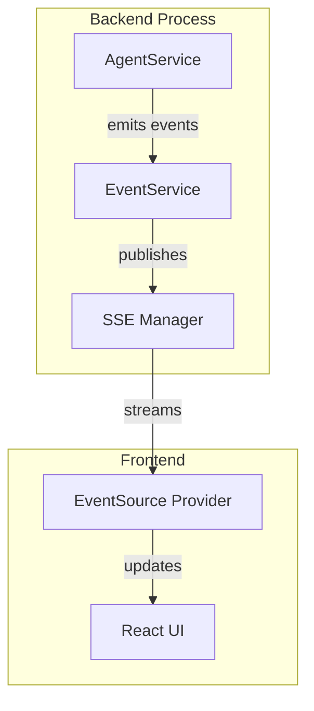
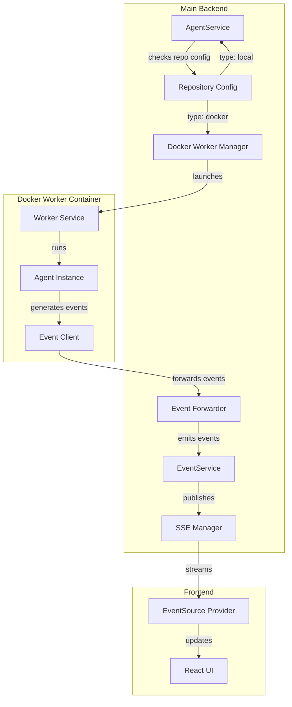

# Docker Worker Architecture

## Overview

This document describes the architecture for running AI agents asynchronously in Docker containers while maintaining real-time event streaming to the frontend. The solution enables complete isolation of agent execution, better resource management, and scalability while preserving the existing event-driven architecture.

## Current Architecture

Currently, agents run directly within the backend process:



## Proposed Docker Worker Architecture

The new architecture introduces Docker workers for agent execution based on repository configuration:



## Architecture Components

### 1. Repository-Based Agent Execution

Agent execution mode is determined by the repository's `codeExecution.type` configuration:

```typescript
interface RepositoryConfig {
  id: string
  name: string
  path: string
  codeExecution: {
    type: 'local' | 'docker'  // Determines agent execution mode
    image?: string            // Docker image for agent execution
    envVars?: Record<string, string>
    volumes?: string[]
    // ... other settings
  }
}
```

### 2. Docker Worker Manager

The Docker Worker Manager orchestrates agent execution in containers:

```typescript
interface DockerWorkerManager {
  // Launch a worker container for agent execution
  launchWorker(config: WorkerConfig): Promise<WorkerInstance>
  
  // Monitor worker status
  getWorkerStatus(workerId: string): Promise<WorkerStatus>
  
  // Stop a running worker
  stopWorker(workerId: string): Promise<void>
  
  // Clean up completed workers
  cleanupWorkers(): Promise<void>
}

interface WorkerConfig {
  taskId: string
  iterationNumber: number
  agentType: string
  message: string
  workspaceConfig: WorkspaceConfig
  eventForwardingUrl: string
  resumeSessionId?: string
  model?: string
  dockerImage?: string
}

interface WorkerInstance {
  containerId: string
  workerId: string
  status: 'starting' | 'running' | 'completed' | 'failed'
  startTime: Date
  logs: string[]
}
```

### 3. Worker Container

Each worker container runs a lightweight Node.js service:

```dockerfile
# Dockerfile.worker
FROM node:20-slim

WORKDIR /app

# Install Claude Code SDK and dependencies
COPY worker/package*.json ./
RUN npm ci --only=production

# Copy worker service code
COPY worker/src ./src

# Set up non-root user
RUN useradd -m -s /bin/bash worker
USER worker

ENTRYPOINT ["node", "src/index.js"]
```

Worker service implementation:

```typescript
// worker/src/index.ts
import { ClaudeCodeAgent } from './agents/claude-code-agent.js'
import { EventForwarder } from './event-forwarder.js'

interface WorkerConfig {
  taskId: string
  iterationNumber: number
  agentType: string
  message: string
  workspaceDir: string
  eventEndpoint: string
  resumeSessionId?: string
  model?: string
}

async function main() {
  const config: WorkerConfig = JSON.parse(process.env.WORKER_CONFIG!)
  
  // Initialize event forwarder
  const eventForwarder = new EventForwarder(config.eventEndpoint)
  
  // Create agent instance
  const agent = createAgent(config.agentType, config.taskId, { 
    model: config.model 
  })
  
  // Run agent and forward events
  try {
    for await (const event of agent.run(config.message, {
      workspaceDir: config.workspaceDir,
      iterationNumber: config.iterationNumber,
      resume: config.resumeSessionId
    })) {
      await eventForwarder.sendEvent(event)
    }
    
    // Signal completion
    await eventForwarder.sendCompletion()
    process.exit(0)
  } catch (error) {
    await eventForwarder.sendError(error)
    process.exit(1)
  }
}

main().catch(console.error)
```

### 4. Event Communication Architecture

The event forwarding system is designed to be extensible, starting with HTTP-based forwarding:

```typescript
// Interface for event forwarding (enables future implementations)
export interface EventForwarder {
  sendEvent(event: Event): Promise<void>
  sendCompletion(): Promise<void>
  sendError(error: Error): Promise<void>
}

// HTTP-based implementation (default)
export class HttpEventForwarder implements EventForwarder {
  constructor(private endpoint: string) {}
  
  async sendEvent(event: Event): Promise<void> {
    await fetch(`${this.endpoint}/worker/events`, {
      method: 'POST',
      headers: { 'Content-Type': 'application/json' },
      body: JSON.stringify(event)
    })
  }
  
  async sendCompletion(): Promise<void> {
    await fetch(`${this.endpoint}/worker/complete`, {
      method: 'POST'
    })
  }
  
  async sendError(error: Error): Promise<void> {
    await fetch(`${this.endpoint}/worker/error`, {
      method: 'POST',
      headers: { 'Content-Type': 'application/json' },
      body: JSON.stringify({
        message: error.message,
        stack: error.stack
      })
    })
  }
}

// Factory for creating event forwarders (enables extensibility)
export function createEventForwarder(type: string, config: any): EventForwarder {
  switch (type) {
    case 'http':
      return new HttpEventForwarder(config.endpoint)
    // Future: case 'websocket': return new WebSocketEventForwarder(config)
    // Future: case 'redis': return new RedisEventForwarder(config)
    default:
      throw new Error(`Unknown forwarder type: ${type}`)
  }
}
```

### 5. Backend Integration

Modify the AgentService to use Docker workers based on repository configuration:

```typescript
// apps/backend/services/agent.service.ts
export class AgentService {
  constructor(
    private storage: StorageBackend,
    private eventService: EventService,
    private workspaceService: WorkspaceService,
    private repositoryService: RepositoryService,
    private dockerWorkerManager: DockerWorkerManager
  ) {}
  
  async executeAgent(
    taskId: string,
    message: string,
    iteration: TaskIteration,
    agentType: string = 'claude-code',
    resumeSessionId?: string,
    model?: string
  ): Promise<void> {
    // Get repository configuration
    const task = await this.storage.getTask(taskId)
    const repository = await this.repositoryService.getRepository(task.repositoryId)
    
    // Execute based on repository configuration
    if (repository.codeExecution.type === 'docker') {
      await this.executeAgentInDocker(
        taskId, 
        message, 
        iteration, 
        agentType, 
        resumeSessionId,
        model,
        repository
      )
    } else {
      // Existing in-process execution for 'local' type
      await this.processAgentExecution(/* ... */)
    }
  }
  
  private async executeAgentInDocker(
    taskId: string,
    message: string,
    iteration: TaskIteration,
    agentType: string,
    resumeSessionId: string | undefined,
    model: string | undefined,
    repository: RepositoryConfig
  ): Promise<void> {
    const workspace = await this.workspaceService.getOrCreateWorkspace(taskId)
    
    // Launch worker container
    const worker = await this.dockerWorkerManager.launchWorker({
      taskId,
      iterationNumber: iteration.iterationNumber,
      agentType,
      message,
      workspaceConfig: {
        path: workspace.getWorkspacePath(),
        type: workspace.getType()
      },
      eventForwardingUrl: `http://host.docker.internal:${process.env.PORT || 8000}/api/v1`,
      resumeSessionId,
      model,
      dockerImage: repository.codeExecution.image
    })
    
    // Track running worker
    this.runningWorkers.set(taskId, worker)
    
    // Monitor worker status
    this.monitorWorker(worker, taskId, iteration)
  }
}
```

### 6. Worker Event Endpoints

Add new endpoints for worker event forwarding:

```typescript
// apps/backend/routes/worker.ts
export async function registerWorkerRoutes(app: FastifyInstance) {
  // Receive events from workers
  app.post('/events', async (request, reply) => {
    const event = request.body as Event
    
    // Forward to event service
    await app.services.event.emitEvent(event)
    
    return { success: true }
  })
  
  // Handle worker completion
  app.post('/complete', async (request, reply) => {
    const { taskId, workerId } = request.body as { taskId: string; workerId: string }
    
    // Update task status
    await app.services.dockerWorker.handleWorkerCompletion(workerId)
    
    return { success: true }
  })
  
  // Handle worker errors
  app.post('/error', async (request, reply) => {
    const { taskId, workerId, message, stack } = request.body as {
      taskId: string
      workerId: string
      message: string
      stack?: string
    }
    
    // Handle error
    await app.services.dockerWorker.handleWorkerError(workerId, message, stack)
    
    return { success: true }
  })
}
```

## Docker Worker Implementation

### Container Lifecycle Management

```typescript
// apps/backend/services/docker-worker-manager.ts
import Docker from 'dockerode'

export class DockerWorkerManager {
  private docker: Docker
  private workers: Map<string, WorkerInstance> = new Map()
  
  constructor() {
    this.docker = new Docker()
  }
  
  async launchWorker(config: WorkerConfig): Promise<WorkerInstance> {
    const workerId = `worker-${config.taskId}-${Date.now()}`
    
    // Use custom image if specified, otherwise default
    const imageName = config.dockerImage || 'moatless/agent-worker:latest'
    
    // Create container
    const container = await this.docker.createContainer({
      Image: imageName,
      name: workerId,
      Env: [
        `WORKER_CONFIG=${JSON.stringify(config)}`,
        `NODE_ENV=production`
      ],
      HostConfig: {
        // Mount workspace directory
        Binds: [`${config.workspaceConfig.path}:/workspace:rw`],
        // Resource limits
        Memory: 2 * 1024 * 1024 * 1024, // 2GB
        CpuShares: 1024,
        // Network mode to access host
        NetworkMode: 'bridge',
        ExtraHosts: ['host.docker.internal:host-gateway']
      },
      Labels: {
        'moatless.type': 'agent-worker',
        'moatless.task': config.taskId,
        'moatless.iteration': String(config.iterationNumber)
      }
    })
    
    // Start container
    await container.start()
    
    const worker: WorkerInstance = {
      containerId: container.id,
      workerId,
      status: 'running',
      startTime: new Date(),
      logs: []
    }
    
    this.workers.set(workerId, worker)
    
    // Monitor container
    this.monitorContainer(container, worker)
    
    return worker
  }
  
  private async monitorContainer(
    container: Docker.Container, 
    worker: WorkerInstance
  ): Promise<void> {
    // Stream logs
    const logStream = await container.logs({
      stdout: true,
      stderr: true,
      follow: true
    })
    
    logStream.on('data', (chunk) => {
      worker.logs.push(chunk.toString())
    })
    
    // Monitor container status
    const checkInterval = setInterval(async () => {
      try {
        const info = await container.inspect()
        if (!info.State.Running) {
          worker.status = info.State.ExitCode === 0 ? 'completed' : 'failed'
          clearInterval(checkInterval)
          
          // Clean up after delay
          setTimeout(() => this.cleanupWorker(worker.workerId), 60000)
        }
      } catch (error) {
        clearInterval(checkInterval)
        worker.status = 'failed'
      }
    }, 5000)
  }
  
  async stopWorker(workerId: string): Promise<void> {
    const worker = this.workers.get(workerId)
    if (!worker) return
    
    try {
      const container = this.docker.getContainer(worker.containerId)
      await container.stop({ t: 10 })
      await container.remove()
    } catch (error) {
      logger.error('Failed to stop worker', error as Error, { workerId })
    }
    
    this.workers.delete(workerId)
  }
  
  private async cleanupWorker(workerId: string): Promise<void> {
    const worker = this.workers.get(workerId)
    if (!worker) return
    
    try {
      const container = this.docker.getContainer(worker.containerId)
      await container.remove()
    } catch (error) {
      // Container may already be removed
    }
    
    this.workers.delete(workerId)
  }
}
```

## Worker Builder

The `worker-builder` service in the docker-compose file is used to **build the Docker image for the agent workers**. Here's what it does:

```yaml
worker-builder:
  build:
    context: ./worker
    dockerfile: Dockerfile
  image: moatless/agent-worker:latest
```

**Purpose:**
1. **Builds the worker image** from the worker directory source code
2. **Tags it** as `moatless/agent-worker:latest` for use by the backend
3. **Ensures the image exists** before the backend tries to launch workers
4. **Allows local development** without pushing to a registry

**Benefits:**
- No need for a Docker registry in development
- Automatically rebuilds when worker code changes
- Ensures the backend has access to the latest worker image
- Simplifies the development workflow

## Security Considerations

### Container Isolation

- Run containers with non-root user
- Use read-only root filesystem where possible
- Limit container capabilities
- Network isolation between workers

### Resource Limits

```yaml
# docker-compose.yml for workers
services:
  agent-worker:
    image: moatless/agent-worker:latest
    deploy:
      resources:
        limits:
          cpus: '1'
          memory: 2G
        reservations:
          cpus: '0.5'
          memory: 512M
    security_opt:
      - no-new-privileges:true
    read_only: true
    tmpfs:
      - /tmp
```

## Error Handling and Recovery

### Worker Failure Recovery

```typescript
export class WorkerFailureHandler {
  async handleWorkerFailure(
    workerId: string, 
    error: Error
  ): Promise<void> {
    const worker = this.workers.get(workerId)
    if (!worker) return
    
    // Log failure
    logger.error('Worker failed', error, {
      workerId,
      taskId: worker.config.taskId,
      duration: Date.now() - worker.startTime.getTime()
    })
    
    // Update task status
    await this.updateTaskStatus(worker.config.taskId, 'error', error)
    
    // Clean up container
    await this.cleanupFailedWorker(workerId)
    
    // Notify event service
    await this.eventService.emitEvent({
      type: EventType.ERROR,
      taskId: worker.config.taskId,
      payload: {
        message: `Worker failed: ${error.message}`,
        workerId
      }
    })
  }
}
```

### Connection Resilience

```typescript
export class ResilientEventForwarder implements EventForwarder {
  private retryCount = 0
  private maxRetries = 3
  
  async sendEvent(event: Event): Promise<void> {
    try {
      await this.attemptSend(event)
      this.retryCount = 0
    } catch (error) {
      if (this.retryCount < this.maxRetries) {
        this.retryCount++
        await this.delay(Math.pow(2, this.retryCount) * 1000)
        return this.sendEvent(event)
      }
      
      // Store failed events locally
      await this.storeFailedEvent(event)
      throw error
    }
  }
}
```

## Deployment Strategies

### Docker Compose Development

```yaml
version: '3.8'

services:
  backend:
    build: ./apps/backend
    environment:
      - WORKER_IMAGE=moatless/agent-worker:latest
    volumes:
      - /var/run/docker.sock:/var/run/docker.sock
      - ./workspaces:/workspaces
    networks:
      - moatless
      
  worker-builder:
    build:
      context: ./worker
      dockerfile: Dockerfile
    image: moatless/agent-worker:latest
    
networks:
  moatless:
    driver: bridge
```

### Kubernetes Production

```yaml
apiVersion: batch/v1
kind: Job
metadata:
  name: agent-worker-{{ .TaskID }}
spec:
  template:
    spec:
      containers:
      - name: agent-worker
        image: moatless/agent-worker:latest
        env:
        - name: WORKER_CONFIG
          value: "{{ .WorkerConfig }}"
        resources:
          limits:
            memory: "2Gi"
            cpu: "1"
          requests:
            memory: "512Mi"
            cpu: "0.5"
        volumeMounts:
        - name: workspace
          mountPath: /workspace
      volumes:
      - name: workspace
        persistentVolumeClaim:
          claimName: workspace-{{ .TaskID }}
      restartPolicy: Never
  backoffLimit: 3
```

## Best Practices

### 1. Worker Configuration

- Keep worker images minimal
- Use specific version tags, not `latest`
- Set appropriate resource limits
- Implement graceful shutdown

### 2. Event Handling

- Validate all events before forwarding
- Implement event deduplication
- Handle out-of-order events
- Keep event payloads small

### 3. Security

- Scan worker images for vulnerabilities
- Implement network policies
- Use least privilege principle
- Isolate worker containers

### 4. Repository Configuration

Configure repositories for Docker execution:

```json
{
  "id": "repo-1",
  "name": "my-project",
  "path": "/repos/my-project",
  "codeExecution": {
    "type": "docker",
    "image": "node:20-slim",
    "setupCommands": "npm install",
    "envVars": {
      "NODE_ENV": "development"
    }
  }
}
```

## Future Enhancements

### 1. Authentication & Authorization
- Add JWT-based authentication for worker requests
- Implement role-based access control
- Add API key management for workers

### 2. Alternative Communication Patterns
- **WebSocket**: For bidirectional real-time communication
- **Message Queue**: Redis Streams or RabbitMQ for high-volume scenarios
- **gRPC**: For efficient binary protocol communication

### 3. Monitoring and Observability
- Worker metrics collection (execution time, resource usage)
- Distributed tracing for event flow
- Log aggregation from all workers
- Performance dashboards

### 4. Advanced Features
- Worker pooling for faster startup
- GPU support for AI workloads
- Distributed execution across multiple nodes
- Auto-scaling based on workload

## Conclusion

The Docker worker architecture provides:

1. **Flexible Execution**: Repository-based configuration for local or Docker execution
2. **Isolation**: Complete isolation of agent execution when using Docker
3. **Scalability**: Easy horizontal scaling of workers
4. **Reliability**: Failure isolation and recovery
5. **Extensibility**: Pluggable event forwarding architecture

This architecture maintains the existing event streaming capabilities while adding the benefits of containerized execution, making the system more robust and scalable for AI agent workloads.