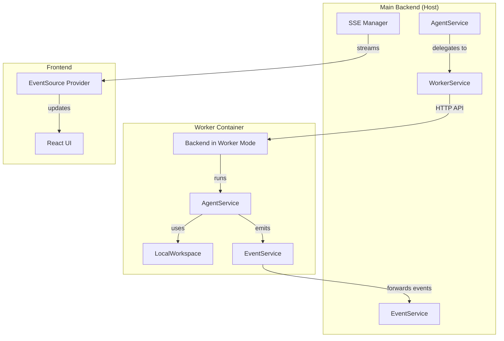

# Docker Worker Architecture

## Overview

This document describes the architecture for running the backend service in a "Docker Worker Mode" where the backend can be deployed inside a Docker container to execute agent tasks. This approach leverages the existing `LocalWorkspace` functionality within Docker containers, providing isolation and scalability while maintaining simplicity.

## Current Architecture

Currently, the system supports two workspace types:
- **LocalWorkspace**: Executes agents directly on the host machine using git worktrees
- **DockerWorkspace**: Creates Docker containers for code execution but doesn't support agent execution

## Simplified Docker Worker Mode

Instead of implementing a complex worker orchestration system, we can run the entire backend service in a Docker container with a "worker mode" flag. This approach:

1. **Reuses existing code**: Uses `LocalWorkspace` inside the container
2. **Simplifies deployment**: Single Docker image for both main backend and workers
3. **Maintains compatibility**: No changes to event streaming or frontend
4. **Enables scaling**: Launch multiple worker containers as needed



## Implementation Approach

### 1. Backend Worker Mode

Add a new environment variable to run the backend in "worker mode":

```typescript
// Environment configuration
interface WorkerModeConfig {
  WORKER_MODE: boolean           // Enable worker mode
  WORKER_API_URL: string        // Main backend API URL
  WORKER_API_KEY: string        // Authentication key
  WORKSPACE_DIR: string         // Local directory for workspaces
}
```

### 2. Worker Mode Startup

When `WORKER_MODE=true`, the backend:
1. Starts with limited services (no SSE, no UI routes)
2. Registers itself with the main backend
3. Polls for or receives agent execution tasks
4. Uses `LocalWorkspace` to execute agents
5. Forwards events to the main backend

```typescript
// apps/backend/index.ts
if (process.env.WORKER_MODE === 'true') {
  await startWorkerMode({
    apiUrl: process.env.WORKER_API_URL!,
    apiKey: process.env.WORKER_API_KEY!,
    workspaceDir: process.env.WORKSPACE_DIR || '/workspace'
  })
} else {
  await startMainBackend()
}
```

### 3. Docker Image Configuration

Use the existing backend Docker image with environment-based configuration:

```dockerfile
# Dockerfile (existing backend)
FROM node:20-slim

WORKDIR /app

# Install git and other dependencies for LocalWorkspace
RUN apt-get update && apt-get install -y \
    git \
    && rm -rf /var/lib/apt/lists/*

# Copy and install dependencies
COPY package*.json ./
RUN pnpm install --frozen-lockfile

# Copy application code
COPY . .

# Build the application
RUN pnpm build

# Create workspace directory
RUN mkdir -p /workspace && chmod 777 /workspace

EXPOSE 8000

# Start in normal or worker mode based on environment
CMD ["node", "dist/index.js"]
```

### 4. Worker Mode Implementation

```typescript
// apps/backend/worker-mode.ts
export async function startWorkerMode(config: WorkerModeConfig) {
  const logger = createLogger('worker')
  
  // Initialize minimal services
  const eventForwarder = new RemoteEventService(config.apiUrl, config.apiKey)
  const storage = new RemoteStorageBackend(config.apiUrl, config.apiKey)
  
  // Create workspace service with local workspaces only
  const workspaceService = new WorkspaceService(storage, eventForwarder)
  
  // Create agent service
  const agentService = new AgentService(
    storage,
    eventForwarder,
    workspaceService
  )
  
  // Start HTTP server for receiving tasks
  const app = new Hono()
  
  app.post('/execute-agent', async (c) => {
    const { taskId, message, iteration, agentType, resumeSessionId, model } = await c.req.json()
    
    try {
      // Execute agent using LocalWorkspace
      await agentService.executeAgent(
        taskId,
        message,
        iteration,
        agentType,
        resumeSessionId,
        model
      )
      
      return c.json({ success: true })
    } catch (error) {
      logger.error('Agent execution failed', error)
      return c.json({ success: false, error: error.message }, 500)
    }
  })
  
  app.get('/health', (c) => c.json({ status: 'ok', mode: 'worker' }))
  
  const port = process.env.PORT || 8001
  logger.info(`Worker mode started on port ${port}`)
  
  return serve({
    fetch: app.fetch,
    port
  })
}
```

### 5. Event Forwarding

In worker mode, events are forwarded to the main backend:

```typescript
// apps/backend/services/remote-event.service.ts
export class RemoteEventService implements EventService {
  constructor(
    private apiUrl: string,
    private apiKey: string
  ) {}
  
  async emitEvent(event: Event): Promise<void> {
    await fetch(`${this.apiUrl}/api/v1/worker/events`, {
      method: 'POST',
      headers: {
        'Content-Type': 'application/json',
        'Authorization': `Bearer ${this.apiKey}`
      },
      body: JSON.stringify(event)
    })
  }
  
  // Other EventService methods...
}
```

### 6. Main Backend Worker Integration

The main backend manages worker containers:

```typescript
// apps/backend/services/worker.service.ts
export class WorkerService {
  private docker: Docker
  private workers = new Map<string, WorkerInfo>()
  
  async executeAgentInWorker(
    taskId: string,
    message: string,
    iteration: TaskIteration,
    agentType: string,
    resumeSessionId?: string,
    model?: string
  ): Promise<void> {
    // Find or create a worker container
    const worker = await this.getOrCreateWorker()
    
    // Send execution request to worker
    const response = await fetch(`http://${worker.host}:${worker.port}/execute-agent`, {
      method: 'POST',
      headers: {
        'Content-Type': 'application/json',
        'Authorization': `Bearer ${worker.apiKey}`
      },
      body: JSON.stringify({
        taskId,
        message,
        iteration,
        agentType,
        resumeSessionId,
        model
      })
    })
    
    if (!response.ok) {
      throw new Error(`Worker execution failed: ${await response.text()}`)
    }
  }
  
  private async getOrCreateWorker(): Promise<WorkerInfo> {
    // Simple round-robin or least-loaded selection
    const availableWorker = this.findAvailableWorker()
    if (availableWorker) return availableWorker
    
    // Create new worker container
    return this.createWorkerContainer()
  }
  
  private async createWorkerContainer(): Promise<WorkerInfo> {
    const workerId = `worker-${Date.now()}`
    const apiKey = generateApiKey()
    
    const container = await this.docker.createContainer({
      Image: 'moatless/backend:latest',
      name: workerId,
      Env: [
        'WORKER_MODE=true',
        `WORKER_API_URL=http://host.docker.internal:${process.env.PORT || 8000}`,
        `WORKER_API_KEY=${apiKey}`,
        'WORKSPACE_DIR=/workspace'
      ],
      HostConfig: {
        AutoRemove: true,
        NetworkMode: 'bridge',
        ExtraHosts: ['host.docker.internal:host-gateway']
      }
    })
    
    await container.start()
    
    const info = {
      id: workerId,
      containerId: container.id,
      host: workerId,
      port: 8001,
      apiKey,
      tasksExecuted: 0
    }
    
    this.workers.set(workerId, info)
    return info
  }
}
```

## Implementation Steps

### Phase 1: Worker Mode Foundation

1. **Add Worker Mode to Backend**
   - Create `worker-mode.ts` with minimal service initialization
   - Add environment variable checks in `index.ts`
   - Implement `RemoteEventService` for event forwarding
   - Add worker health endpoint

2. **Update Docker Configuration**
   - Ensure Dockerfile includes git and workspace directory
   - Add worker mode environment variables
   - Test container can run in worker mode

### Phase 2: Worker Management

3. **Create Worker Service**
   - Implement `WorkerService` in main backend
   - Add Docker container management
   - Implement worker selection logic
   - Add worker health monitoring

4. **Update Agent Service**
   - Add logic to detect when to use workers
   - Implement task delegation to workers
   - Handle worker failures gracefully

### Phase 3: Integration & Testing

5. **Add Worker Endpoints**
   - Create `/api/v1/worker/events` endpoint
   - Add authentication middleware
   - Test event forwarding

6. **Docker Compose Setup**
   ```yaml
   version: '3.8'
   services:
     backend:
       build: .
       environment:
         - WORKER_MODE=false
       ports:
         - "8000:8000"
       volumes:
         - /var/run/docker.sock:/var/run/docker.sock
     
     worker-1:
       build: .
       environment:
         - WORKER_MODE=true
         - WORKER_API_URL=http://backend:8000
         - WORKER_API_KEY=dev-key-123
       depends_on:
         - backend
   ```

## Benefits of This Approach

1. **Simplicity**: No need for separate worker codebase or complex orchestration
2. **Reusability**: Uses existing `LocalWorkspace` and agent code
3. **Flexibility**: Can run workers on same machine or distributed
4. **Compatibility**: No changes to frontend or event streaming
5. **Scalability**: Easy to add more worker containers

## Configuration Examples

### Repository Configuration

Repositories can specify whether to use workers:

```json
{
  "id": "repo-1",
  "name": "my-project",
  "path": "/repos/my-project",
  "codeExecution": {
    "type": "local",
    "useWorkers": true,  // New flag to use worker containers
    "workerImage": "moatless/backend:latest",
    "workerResources": {
      "memory": "2G",
      "cpu": "1"
    }
  }
}
```

### Environment Variables

```bash
# Main Backend
PORT=8000
WORKER_MODE=false
ENABLE_WORKERS=true
WORKER_POOL_SIZE=3

# Worker Container
PORT=8001
WORKER_MODE=true
WORKER_API_URL=http://main-backend:8000
WORKER_API_KEY=secure-key-here
WORKSPACE_DIR=/workspace
```

## Security Considerations

1. **API Key Authentication**: Worker containers authenticate with main backend
2. **Network Isolation**: Workers can only communicate with main backend
3. **Resource Limits**: Prevent runaway containers
4. **No Direct Database Access**: Workers only use remote storage

## Next Steps

### Required Code Changes

1. **Create `worker-mode.ts`**
   - Minimal service initialization
   - HTTP server for task execution
   - Health endpoint

2. **Create `RemoteEventService`**
   - Implements `EventService` interface
   - Forwards events via HTTP

3. **Create `RemoteStorageBackend`**
   - Implements `StorageBackend` interface
   - Proxies storage calls to main backend

4. **Update `index.ts`**
   - Check `WORKER_MODE` environment variable
   - Route to appropriate startup function

5. **Create `WorkerService`**
   - Manages Docker containers
   - Delegates tasks to workers
   - Monitors worker health

6. **Update `AgentService`**
   - Check repository config for `useWorkers`
   - Delegate to `WorkerService` when needed

### Testing Plan

1. **Unit Tests**
   - Test worker mode initialization
   - Test event forwarding
   - Test task delegation

2. **Integration Tests**
   - Test full flow with Docker
   - Test worker failure scenarios
   - Test concurrent executions

3. **Performance Tests**
   - Measure overhead of worker mode
   - Test scaling with multiple workers
   - Monitor resource usage

## Future Enhancements

1. **Worker Pooling**: Pre-warm containers for faster task execution
2. **Load Balancing**: Distribute tasks based on worker metrics
3. **Auto-scaling**: Scale workers based on queue depth
4. **Persistent Workspaces**: Mount persistent volumes for workspace reuse
5. **GPU Support**: For ML/AI workloads that need acceleration

## Migration Path

1. **Phase 1**: Implement worker mode without changing existing behavior
2. **Phase 2**: Test with select repositories using `useWorkers` flag
3. **Phase 3**: Gradually migrate all Docker-based repositories
4. **Phase 4**: Deprecate complex `DockerWorkspace` implementation

## Conclusion

This simplified Docker worker architecture:

1. **Leverages existing code**: Uses `LocalWorkspace` inside containers
2. **Maintains simplicity**: Single codebase, environment-based behavior
3. **Enables scalability**: Easy to add more worker containers
4. **Preserves compatibility**: No changes to frontend or APIs
5. **Reduces complexity**: No need for separate worker implementation

By running the backend in "worker mode" inside Docker containers, we achieve isolation and scalability without the complexity of a full worker orchestration system.