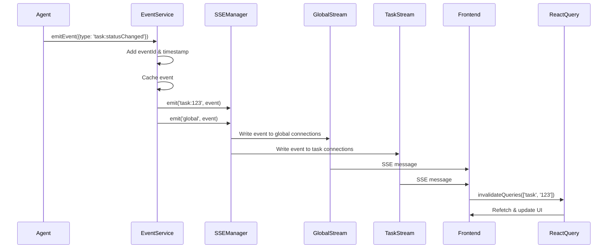

# Event Architecture

This document describes the event-driven architecture used in the Moatless Swarm UI application for real-time updates and communication between the backend and frontend.

## Overview

The application uses a hybrid event architecture that supports both task-specific and global event streams. This design enables real-time updates across the UI while maintaining flexibility for different use cases.

### Key Components

1. **Event Service** - Backend service that manages event emission and storage
2. **SSE Manager** - Manages Server-Sent Events connections
3. **Global Event Stream** - Single connection for app-wide events
4. **Task Event Streams** - Per-task connections for focused updates
5. **Event Subscribers** - Frontend components that react to events

## Event Types

Events are strongly typed and defined in `shared/types/event.ts`:

```typescript
export enum EventType {
  INPUT = 'input',
  MESSAGE = 'message',
  START = 'start',
  STOP = 'stop',
  RESULT = 'result',
  ERROR = 'error',
  WORKSPACE = 'workspace',
  SERVER = 'server',
  TOOL = 'tool',
  COMPLETION = 'completion',
}
```

Additionally, the frontend recognizes composite event types with subtypes:
- `task:created`, `task:updated`, `task:statusChanged` - Task lifecycle events
- `iteration:created`, `iteration:updated` - Iteration events
- `tool:start`, `tool:result`, `tool:error` - Tool execution events

## Backend Architecture

### Event Service

The `EventService` (`apps/backend/services/event.service.ts`) is the central hub for event management:

```typescript
class EventService extends EventEmitter {
  async emitEvent(event: Event): Promise<void> {
    // Ensure event has required fields
    event.eventId = event.eventId || randomUUID()
    event.timestamp = event.timestamp || new Date()
    
    // Cache event
    this.cacheEvent(event)
    
    // Emit to task-specific channel
    this.emit(`task:${event.taskId}`, event)
    
    // Emit to global channel
    this.emit('global', event)
    
    // Persist non-Claude events
    if (event.agentType !== 'claude-code') {
      await this.storage.saveEvents(event.taskId, [event])
    }
  }
}
```

Key features:
- Dual emission to both task-specific and global channels
- In-memory caching for performance
- Conditional persistence based on agent type
- Event enrichment with IDs and timestamps

### SSE Manager

The `SSEConnectionManager` (`apps/backend/utils/sse-manager.ts`) handles connection lifecycle:

```typescript
class SSEConnectionManager {
  // Task-specific connections
  private connections: Map<string, Set<SSEConnection>> = new Map()
  
  // Global connections
  private globalConnections: Map<string, GlobalSSEConnection> = new Map()
  
  connect(taskId: string, request, reply): string
  connectGlobal(connectionId: string, request, reply, filters): void
  
  disconnect(taskId: string, connectionId: string): void
  disconnectGlobal(connectionId: string): void
}
```

Features:
- Separate management for task and global connections
- Connection tracking and statistics
- Graceful cleanup on disconnect

### Event Routes

#### Global Event Stream (`/api/v1/events/stream`)

```typescript
app.get('/stream', async (request, reply) => {
  // Set SSE headers
  reply.raw.writeHead(200, {
    'Content-Type': 'application/x-ndjson',
    'Cache-Control': 'no-cache',
    'Connection': 'keep-alive',
  })
  
  // Register connection
  sseManager.connectGlobal(connectionId, request, reply, filters)
  
  // Subscribe to all events
  const unsubscribe = eventService.subscribeAll((event) => {
    // Apply filters
    if (shouldSendEvent(event, filters)) {
      reply.raw.write(`${JSON.stringify(event)}\n`)
    }
  })
  
  // Keep-alive ping every 30s
  const pingInterval = setInterval(() => {
    reply.raw.write(`${JSON.stringify({ type: 'ping' })}\n`)
  }, 30000)
})
```

Query parameters:
- `types` - Filter by event types (comma-separated)
- `activeTasksOnly` - Only stream events from active tasks
- `lastEventId` - Resume from a specific event (reconnection support)

#### Task Event Stream (`/api/v1/tasks/:taskId/stream`)

Similar to global stream but filtered to a specific task:
- Only events for the specified task
- Automatic cleanup when task completes
- Lower overhead for task-focused views

## Frontend Architecture

### Global Event Stream Provider

The `GlobalEventStreamProvider` (`apps/frontend/src/features/events/contexts/global-event-stream-provider.tsx`) manages the global SSE connection:

```typescript
function GlobalEventStreamProvider({ children }) {
  const [isConnected, setIsConnected] = useState(false)
  const eventSourceRef = useRef<EventSource | null>(null)
  
  const connect = useCallback(() => {
    const eventSource = new EventSource('/api/v1/events/stream')
    
    eventSource.onmessage = (event) => {
      const data = JSON.parse(event.data)
      handleEvent(data)
    }
    
    eventSource.onerror = () => {
      // Exponential backoff reconnection
      reconnectWithBackoff()
    }
  }, [])
  
  // Subscription methods
  const subscribeToTask = (taskId, handler) => { ... }
  const subscribeToType = (type, handler) => { ... }
  const subscribeToAll = (handler) => { ... }
}
```

Features:
- Single connection for entire application
- Automatic reconnection with exponential backoff
- Flexible subscription patterns
- React Query cache invalidation

### Event-Driven Updates

Components subscribe to events and update accordingly:

```typescript
// Sidebar tasks component
function SidebarTasks() {
  const { subscribeToAll } = useGlobalEventStream()
  const queryClient = useQueryClient()
  
  useEffect(() => {
    return subscribeToAll((event) => {
      if (isTaskRelatedEvent(event)) {
        // Invalidate task list query
        queryClient.invalidateQueries({ 
          queryKey: queryKeys.tasksList() 
        })
      }
    })
  }, [])
}
```

### Task Event Provider

For task detail views, the `TaskEventsProvider` can use either:
1. Global stream (when feature flag enabled)
2. Task-specific stream (default)

```typescript
function TaskEventsProvider({ taskId, useGlobalStream = false }) {
  if (useGlobalStream) {
    // Subscribe to global stream, filter by taskId
    useTaskEventSubscription(taskId, handleTaskEvent)
  } else {
    // Create task-specific SSE connection
    const client = new NDJSONSSEClient({ taskId, onEvent })
    client.connect()
  }
}
```

## Event Flow

### Standard Event Flow

1. **Agent Action** → Event generated
2. **Event Service** → Event enriched and emitted
3. **Dual Emission** → Both `task:${taskId}` and `global` channels
4. **SSE Delivery** → Events streamed to connected clients
5. **Frontend Handler** → Event processed and UI updated
6. **Cache Invalidation** → React Query refetches affected data

### Example: Task Status Change



## Performance Considerations

### Connection Management

- **Global Stream**: Single connection serves entire app
- **Task Streams**: Created on-demand for focused views
- **Connection Limits**: Browser typically allows 6 connections per domain
- **Cleanup**: Automatic cleanup on disconnect/navigation

### Event Filtering

Events are filtered at multiple levels:
1. **Backend**: Only send relevant events based on filters
2. **Frontend**: Subscribe only to needed event types
3. **Component**: Process only events affecting component

### Caching Strategy

- **In-Memory Cache**: Recent events kept in memory
- **Lazy Loading**: Historical events loaded on demand
- **Cache Invalidation**: Targeted invalidation based on event type
- **Optimistic Updates**: UI updates before server confirmation

## Migration Strategy

The architecture supports gradual migration from task-specific to global streams:

### Feature Flags

```typescript
// client/src/lib/config/feature-flags.ts
export const featureFlags = {
  useGlobalEventStream: {
    enabled: process.env.VITE_USE_GLOBAL_EVENT_STREAM === 'true',
    description: 'Use global event stream for all real-time updates'
  }
}
```

### Migration Phases

1. **Phase 1**: Global stream for sidebar and task lists (current)
2. **Phase 2**: Optional global stream for task details (flag-controlled)
3. **Phase 3**: Global stream everywhere, task streams deprecated
4. **Phase 4**: Remove task-specific stream code

## Best Practices

### Frontend

1. **Subscribe Early**: Set up subscriptions in useEffect
2. **Cleanup Properly**: Always return unsubscribe function
3. **Filter Wisely**: Subscribe only to relevant events
4. **Batch Updates**: Group related invalidations

```typescript
useEffect(() => {
  return subscribeToType(EventType.TASK_STATUS_CHANGED, (event) => {
    // Handle only relevant events
    if (relevantTaskIds.includes(event.taskId)) {
      updateUI(event)
    }
  })
}, [relevantTaskIds])
```

### Backend

1. **Enrich Events**: Always include eventId and timestamp
2. **Emit Consistently**: Always emit to both channels
3. **Handle Errors**: Graceful degradation on connection issues
4. **Monitor Connections**: Track connection counts and health

## Monitoring and Debugging

### Status Endpoint

```bash
GET /api/v1/events/stream/status

{
  "globalConnections": 5,
  "taskConnections": {
    "task-123": 2,
    "task-456": 1
  },
  "totalConnections": 8
}
```

### Debug Logging

Enable verbose logging with:
```bash
VITE_DEBUG_EVENT_STREAM=true npm run dev
```

### Common Issues

1. **Connection Drops**: Check network stability and proxy settings
2. **Missing Events**: Verify event emission and filtering
3. **Memory Leaks**: Ensure proper cleanup of subscriptions
4. **Performance**: Monitor connection count and event volume

## Future Enhancements

1. **Event Replay**: Replay events from a specific point
2. **Event Compression**: Compress event payloads
3. **Enhanced SSE Features**: Implement message acknowledgments via API calls
4. **Event Batching**: Batch multiple events in single message
5. **Priority Events**: Fast-track critical events
6. **Event Analytics**: Track event patterns and performance