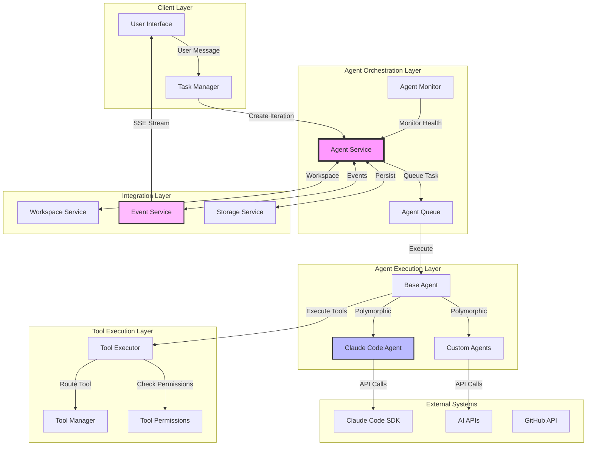
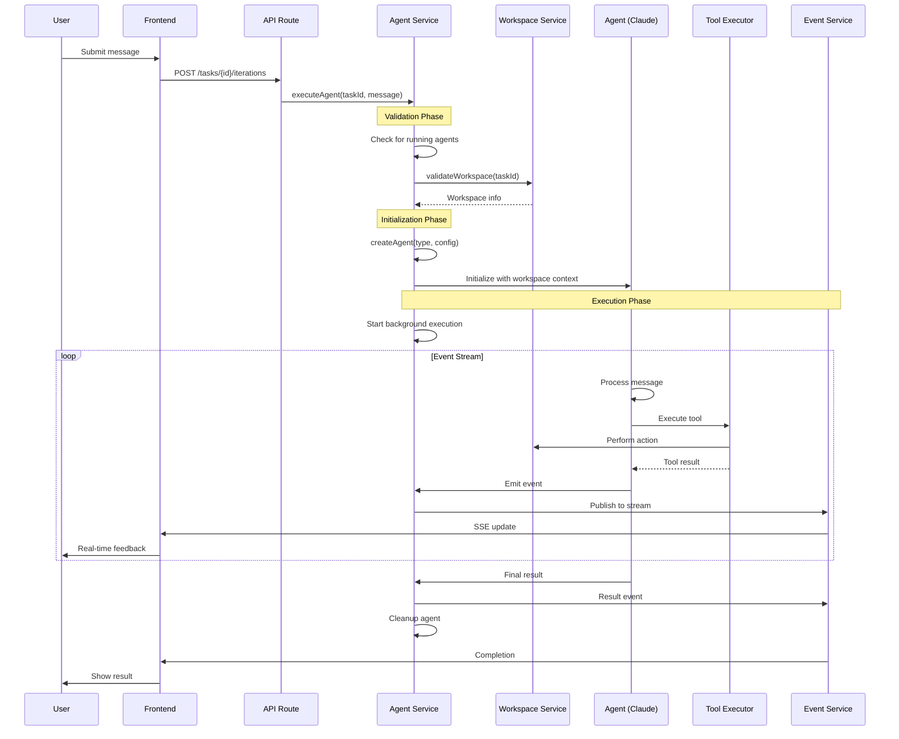
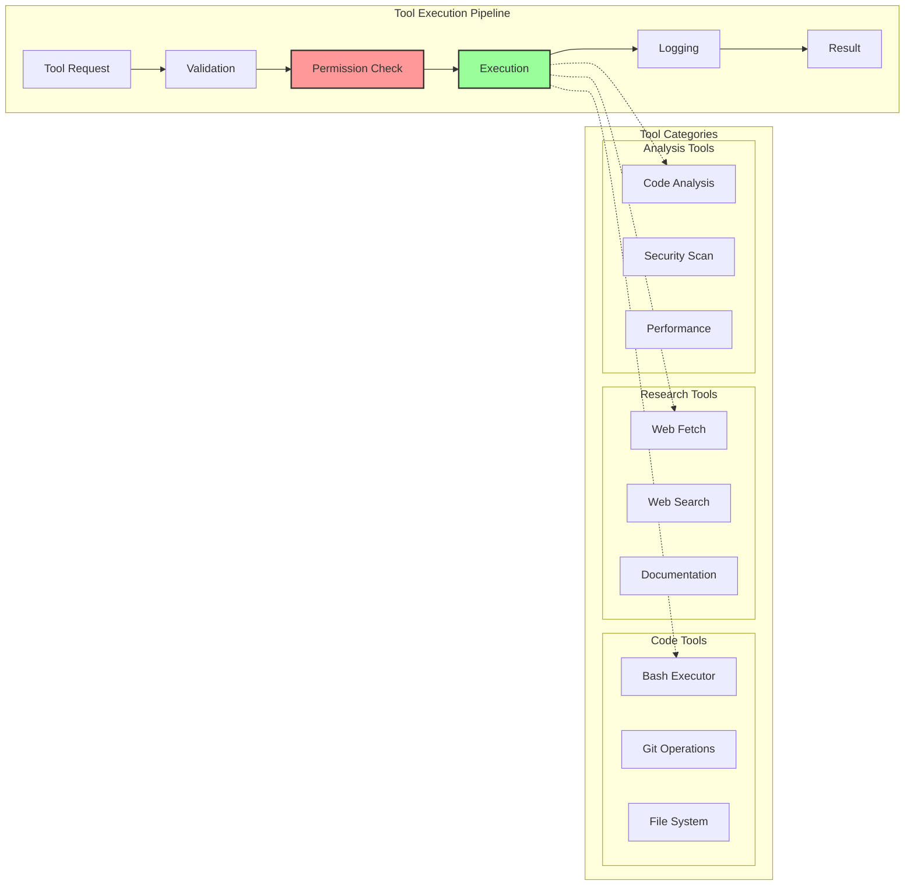
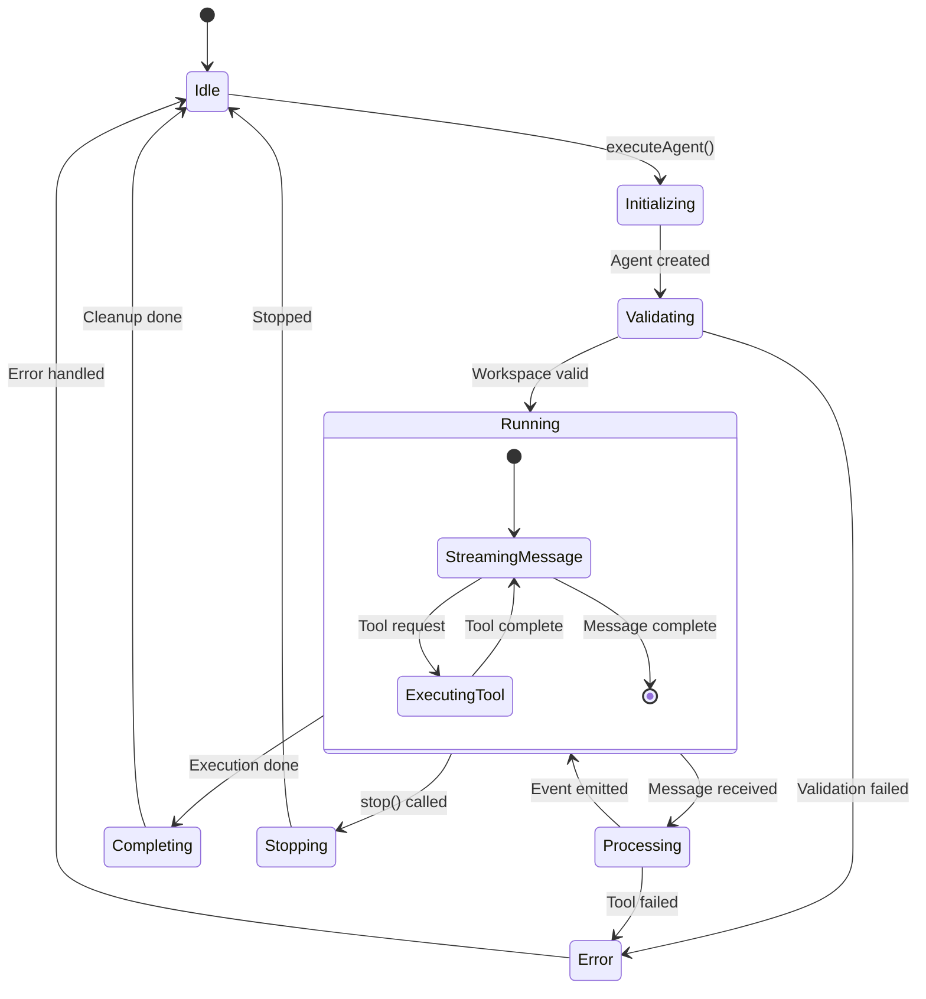
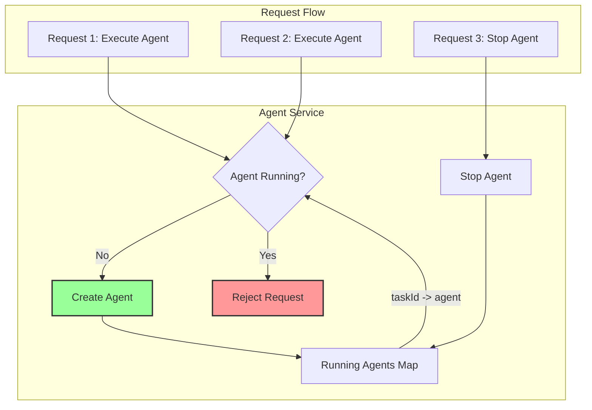

# Agent Architecture

## Table of Contents
1. [Overview](#overview)
2. [Core Concepts](#core-concepts)
3. [Architecture](#architecture)
4. [Backend Implementation](#backend-implementation)

## Overview

### Purpose
The Agent system provides the core AI capabilities for Moatless Vibe, enabling AI-powered code generation, modification, and analysis. It integrates Claude Code and other AI agents into the task execution pipeline with proper workspace access, tool execution, and real-time streaming.

### Key Responsibilities
- Execute AI agents with workspace context
- Manage agent lifecycle (start, run, stop)
- Stream responses in real-time
- Execute tools (web fetch, search, bash commands)
- Track costs and usage metrics
- Handle errors and recovery
- Maintain session continuity
- Emit events for UI updates

### Position in Architecture
Agents are the intelligence layer that processes user requests, modifies code, and provides insights. They sit between the task management system and workspace execution environment.

## Core Concepts

### Domain Terminology

| Term | Definition |
|------|------------|
| Agent | AI model that processes messages and executes actions |
| Tool | Capability available to agents (bash, web search, etc.) |
| Iteration | Single request-response cycle within a task |
| Session | Continuous conversation context across iterations |
| Message Event | Streamed response chunk from agent |
| Result Event | Final outcome of agent execution |
| Tool Use | Agent invoking a tool to perform an action |

### Key Abstractions

#### Base Agent
```typescript
abstract class BaseAgent {
  protected sessionId: string | null = null
  protected stopRequested = false
  protected currentIteration = 0
  
  abstract getAgentType(): string
  abstract run(
    message: string,
    options: AgentRunOptions
  ): AsyncGenerator<AgentEvent>
  
  stop(): void {
    this.stopRequested = true
  }
  
  getSessionId(): string | null {
    return this.sessionId
  }
}
```

#### Agent Event
```typescript
interface AgentEvent {
  type: 'message' | 'result' | 'error'
  subtype?: string
  data: any
  timestamp: string
  iteration?: number
  sessionId?: string
}
```

### Design Decisions
- **One agent per task** prevents concurrent execution conflicts
- **Event streaming** provides real-time feedback
- **Background execution** keeps API responsive
- **Tool permissions** are configurable per agent
- **Session continuity** enables resuming conversations
- **Workspace isolation** ensures security

## Architecture

### High-Level Overview

The Agent system orchestrates AI-powered code modifications through a carefully designed flow that ensures workspace isolation, real-time feedback, and reliable execution.



#### Component Flow Description

The high-level architecture consists of several interconnected layers, each with specific responsibilities:

2. **Agent Orchestration Layer**:
   - **Agent Service** (`apps/backend/services/agent.service.ts`): Central service that manages agent lifecycle, handles execution requests, and coordinates with other services
   - **Agent Queue**: In-memory queue that prevents concurrent agent execution on the same task
   - **Agent Monitor**: Health monitoring component that tracks agent performance and resource usage

3. **Agent Execution Layer**:
   - **Base Agent** (`apps/backend/services/agents/base.agent.ts`): Abstract base class defining the agent interface and common functionality
   - **Claude Code Agent** (`apps/backend/services/agents/claude-code.agent.ts`): Concrete implementation integrating with Claude Code SDK
   - **Custom Agents**: Placeholder for future agent implementations (e.g., GPT-4, local models)

4. **Tool Execution Layer**:
   - **Tool Executor**: Processes tool requests from agents and delegates to appropriate handlers
   - **Tool Manager**: Manages available tools and their configurations
   - **Tool Permissions**: Enforces security policies and access controls for tool usage

5. **Integration Layer**:
   - **Workspace Service** (`apps/backend/services/workspace.service.ts`): Provides isolated file system access for agent operations
   - **Event Service** (`apps/backend/services/event.service.ts`): Manages real-time event streaming to clients
   - **Storage Service** (`apps/backend/services/storage.service.ts`): Persists agent results and metadata

### Agent Execution Flow

The agent execution follows a precise choreography designed for reliability and real-time feedback:



#### Detailed Execution Flow Steps

**1. User Input Capture**
- **Location**: `apps/frontend/src/features/tasks/components/chat-input.tsx`
- **Process**: User types a message in the chat interface
- **Action**: The ChatInput component captures the text and triggers the submission handler

**2. API Request**
- **Location**: `apps/frontend/src/features/tasks/hooks/use-create-iteration.ts`
- **Process**: Frontend creates a new iteration using React Query mutation
- **Route**: `POST /api/v1/tasks/{taskId}/iterations`
- **Handler**: `apps/backend/routes/task.routes.ts`

**3. Agent Service Invocation**
- **Location**: `apps/backend/services/agent.service.ts` - `executeAgent()` method
- **Process**: The route handler delegates to the Agent Service for execution

**4. Validation Phase**
- **Concurrent Check**: 
  - Location: `apps/backend/services/agent.service.ts` - `runningAgents` Map
  - Process: Verifies no other agent is running for this task
  - Error: Throws if agent already active
- **Workspace Validation**:
  - Location: `apps/backend/services/workspace.service.ts` - `validateWorkspace()` 
  - Process: Ensures workspace exists and is accessible
  - Recovery: Auto-creates workspace if missing

**5. Initialization Phase**
- **Agent Factory**:
  - Location: `apps/backend/services/agent.service.ts` - `createAgent()` method
  - Process: Instantiates appropriate agent based on type (default: claude-code)
- **Context Setup**:
  - Working directory path from workspace
  - Model configuration (e.g., claude-3-5-sonnet)
  - Session ID for conversation continuity

**6. Background Execution**
- **Location**: `apps/backend/services/agent.service.ts` - `processAgentEvents()` method
- **Process**: Executes agent in background to keep API responsive
- **Error Handling**: Catches and emits errors as events

**7. Event Stream Loop**
- **Message Processing**:
  - Location: `apps/backend/services/agents/claude-code.agent.ts` - `run()` generator
  - Process: Agent analyzes message and determines required actions
- **Tool Execution**:
  - Request: Agent requests tool use (bash, web search, etc.)
  - Validation: Tool permissions checked
  - Execution: Tool performs action in workspace context
  - Result: Tool output returned to agent
- **Event Emission**:
  - Location: `apps/backend/services/event.service.ts` - `emitTaskEvent()`
  - Types: MESSAGE, TOOL_USE, TOOL_RESULT, ERROR
  - Transport: Server-Sent Events (SSE) to frontend
- **UI Updates**:
  - Location: `apps/frontend/src/features/tasks/hooks/use-task-sse-connection.ts`
  - Process: SSE handler updates UI in real-time
  - Display: Messages appear as they stream

**8. Completion**
- **Final Result**:
  - Location: `apps/backend/services/agents/claude-code.agent.ts`
  - Content: Summary, cost metrics, session ID
- **Cleanup**:
  - Location: `apps/backend/services/agent.service.ts`
  - Actions: Remove from running agents map, abort controller cleanup
- **UI Finalization**:
  - Status update to "completed"
  - Enable input for next message
  - Show cost and token usage

### Tool Execution Architecture

Tools extend agent capabilities by providing controlled access to external resources:



#### Tool Execution Pipeline Details

**1. Tool Request Phase**
- **Origin**: Agent determines it needs to execute a tool based on user request
- **Format**: Tool request includes tool name, parameters, and context
- **Example**: `{ tool: "Bash", params: { command: "npm test" } }`

**2. Validation Phase**
- **Location**: Tool-specific validators in Claude Code SDK
- **Checks**:
  - Parameter format and types
  - Command syntax validation
  - Path existence verification
  - Input sanitization

**3. Permission Check Phase**
- **Location**: `apps/backend/services/agents/claude-code.agent.ts` - `sdkOptions.allowedTools`
- **Process**:
  - Verify tool is in allowed list for agent
  - Check user permissions for tool category
  - Validate scope of requested operation
- **Default Allowed Tools**: WebFetch, WebSearch, Bash

**4. Execution Phase**
- **Bash Executor**:
  - Location: Handled by Claude Code SDK
  - Context: Executes in task workspace directory
  - Security: Sandboxed to workspace path
  - Timeout: Configurable per command
- **Web Fetch**:
  - Location: Claude Code SDK internal
  - Features: HTML to markdown conversion
  - Limits: Content length restrictions
- **Web Search**:
  - Location: Claude Code SDK internal  
  - Provider: Integrated search API
  - Filtering: Domain allow/block lists

**5. Logging Phase**
- **Location**: `apps/backend/services/event.service.ts`
- **Events Emitted**:
  - TOOL_USE: When tool execution starts
  - TOOL_RESULT: When tool completes
  - TOOL_ERROR: On tool failure
- **Audit Trail**: All tool uses logged with timestamp, parameters, and results

**6. Result Phase**
- **Format**: Structured result object with output, error status, execution time
- **Delivery**: Results returned to agent for processing
- **Integration**: Agent incorporates results into response generation

## Backend Implementation

### Agent Lifecycle Management

The backend manages agent lifecycles through a sophisticated state machine that ensures proper resource management and error recovery:



#### Lifecycle State Transitions

**1. Idle State**
- **Description**: No agent is active for the task
- **Location**: `apps/backend/services/agent.service.ts` - `runningAgents` Map is empty for task
- **Entry Actions**: None
- **Exit Actions**: Register new agent in running agents map

**2. Initializing State**
- **Trigger**: `executeAgent()` method called
- **Location**: `apps/backend/services/agent.service.ts` - `executeAgent()` method
- **Actions**:
  - Validate no concurrent agent running
  - Retrieve task and workspace information
  - Create agent instance via factory

**3. Validating State**
- **Location**: `apps/backend/services/workspace.service.ts` - `validateWorkspace()` method
- **Checks**:
  - Workspace directory exists
  - File system permissions valid
  - Git repository initialized (if needed)
- **Recovery**: Auto-create missing workspace

**4. Running State**
- **Location**: `apps/backend/services/agent.service.ts` - `processAgentEvents()` method
- **Characteristics**:
  - Background execution active
  - Event stream open
  - Agent generator yielding events
- **Sub-states**:
  - **StreamingMessage**: Agent generating response text
  - **ExecutingTool**: Tool operation in progress

**5. Processing State**
- **Location**: `apps/backend/services/agents/claude-code.agent.ts` - `run()` generator
- **Actions**:
  - Parse user message
  - Determine required tools
  - Generate response chunks
  - Emit events for each chunk

**6. Completing State**
- **Trigger**: Agent generator completes
- **Actions**:
  - Emit final result event
  - Calculate usage metrics
  - Store completion status

**7. Error State**
- **Triggers**:
  - Validation failures
  - Tool execution errors
  - Network timeouts
  - SDK errors
- **Location**: Error handling in `processAgentEvents()`
- **Recovery**: Emit error event, cleanup resources

**8. Stopping State**
- **Trigger**: `stopAgent()` method called
- **Location**: `apps/backend/services/agent.service.ts` - `stopAgent()` method
- **Actions**:
  - Call agent's `stop()` method
  - Abort any active HTTP requests
  - Clean up from running agents map

### Concurrent Execution Prevention

The system enforces single-agent-per-task to prevent race conditions:



#### Concurrency Control Implementation

**1. Running Agents Map**
- **Location**: `apps/backend/services/agent.service.ts` - `private runningAgents: Map<string, BaseAgent>`
- **Structure**: Maps task ID to active agent instance
- **Purpose**: Tracks which tasks have agents currently executing

**2. Request Processing Flow**

**Request 1 - First Agent Execution**:
- **Check**: `runningAgents.has(taskId)` returns false
- **Action**: Create new agent and add to map
- **Result**: Agent begins execution

**Request 2 - Concurrent Attempt**:
- **Check**: `runningAgents.has(taskId)` returns true
- **Action**: Throw error "Agent already running for task"
- **Result**: Request rejected, user notified

**Request 3 - Stop Request**:
- **Action**: Retrieve agent from map
- **Process**:
  - Call `agent.stop()` to set stop flag
  - Call `abortController.abort()` to cancel HTTP requests
  - Remove from running agents map
- **Result**: Agent stops gracefully

**3. Implementation Details**

```typescript
// Location: apps/backend/services/agent.service.ts

private runningAgents = new Map<string, BaseAgent>();

async executeAgent(taskId: string, ...): Promise<void> {
  // Concurrency check
  if (this.runningAgents.has(taskId)) {
    throw new Error('Agent already running for this task');
  }
  
  // Create and register
  const agent = this.createAgent(...);
  this.runningAgents.set(taskId, agent);
  
  // Clean up on completion
  try {
    await this.processAgentEvents(agent, ...);
  } finally {
    this.runningAgents.delete(taskId);
  }
}
```

**4. Race Condition Prevention**
- **Synchronous Check**: Map check and insertion are synchronous
- **No Await Between**: No async operations between check and set
- **Guaranteed Cleanup**: Finally block ensures removal even on error

#### Claude Code Agent
```typescript
// apps/backend/services/agents/claude-code.agent.ts
export class ClaudeCodeAgent extends BaseAgent {
  private abortController: AbortController | null = null
  
  getAgentType(): string {
    return 'claude-code'
  }
  
  async *run(
    message: string,
    options: AgentRunOptions
  ): AsyncGenerator<AgentEvent> {
    this.currentIteration++
    this.abortController = new AbortController()
    
    try {
      // Configure SDK
      const sdkOptions: ClaudeCodeOptions = {
        allowedTools: ['WebFetch', 'WebSearch', 'Bash'],
        permissionMode: 'acceptEdits',
        cwd: options.workingDirectory,
        model: options.model || 'claude-3-5-sonnet-20241022',
        resume: options.resumeSessionId,
        abortSignal: this.abortController.signal
      }
      
      // Execute query
      const { messages, metadata } = await query(
        message,
        options.attachments,
        sdkOptions
      )
      
      // Capture session ID
      this.sessionId = metadata.sessionId
      
      // Process messages
      for (const msg of messages) {
        if (this.stopRequested) break
        
        yield this.createEvent('message', {
          role: msg.role,
          content: msg.content,
          tool_use: msg.tool_use
        })
      }
      
      // Final result
      yield this.createEvent('result', {
        status: 'completed',
        cost: metadata.cost,
        sessionId: this.sessionId,
        resultText: this.extractResultText(messages)
      })
      
    } catch (error) {
      yield this.createEvent('error', {
        message: error.message,
        stack: error.stack
      })
    }
  }
  
  stop(): void {
    super.stop()
    this.abortController?.abort()
  }
}
```

#### Key Methods
| Method | Purpose | Parameters | Returns |
|--------|---------|------------|---------|
| `executeAgent` | Run agent for task | taskId, message, options | void (async) |
| `stopAgent` | Stop running agent | taskId | void |
| `createAgent` | Factory for agents | type, config | BaseAgent |
| `processAgentEvents` | Handle event stream | agent, taskId, iterationId | void |

### Message Processing

#### Message Flow
```typescript
async executeAgent(
  taskId: string,
  iterationId: string,
  message: string,
  options?: ExecuteAgentOptions
): Promise<void> {
  // 1. Validate workspace
  const workspace = await this.validateWorkspace(taskId)
  
  // 2. Check for running agent
  if (this.runningAgents.has(taskId)) {
    throw new Error('Agent already running for this task')
  }
  
  // 3. Create agent instance
  const agent = this.createAgent(options?.agentType || 'claude-code', {
    workingDirectory: workspace.path,
    model: options?.model,
    resumeSessionId: options?.resumeSessionId
  })
  
  // 4. Register agent
  this.runningAgents.set(taskId, agent)
  
  // 5. Execute in background
  this.processAgentEvents(agent, taskId, iterationId)
    .catch(error => {
      console.error('Agent execution failed:', error)
      this.eventService.emitTaskEvent({
        taskId,
        iterationId,
        type: EventType.ERROR,
        payload: { error: error.message }
      })
    })
    .finally(() => {
      this.runningAgents.delete(taskId)
    })
}
```

#### Event Processing
```typescript
private async processAgentEvents(
  agent: BaseAgent,
  taskId: string,
  iterationId: string
): Promise<void> {
  try {
    for await (const event of agent.run(message, options)) {
      // Transform agent event to task event
      const taskEvent = this.createTaskEvent(taskId, iterationId, event)
      
      // Emit via event service
      await this.eventService.emitTaskEvent(taskEvent)
      
      // Handle special events
      if (event.type === 'result') {
        await this.handleResultEvent(taskId, iterationId, event)
      }
    }
  } catch (error) {
    if (error.code === 'ELIFECYCLE' && [143, 130].includes(error.exitCode)) {
      // Expected exit codes for stop requests
      console.log('Agent stopped gracefully')
    } else {
      throw error
    }
  }
}
```

### Tool Execution Framework

#### Available Tools
```typescript
interface ToolConfig {
  WebFetch: {
    enabled: boolean
    maxContentLength?: number
    timeout?: number
  }
  WebSearch: {
    enabled: boolean
    maxResults?: number
    blockedDomains?: string[]
  }
  Bash: {
    enabled: boolean
    allowedCommands?: string[]
    timeout?: number
  }
}
```