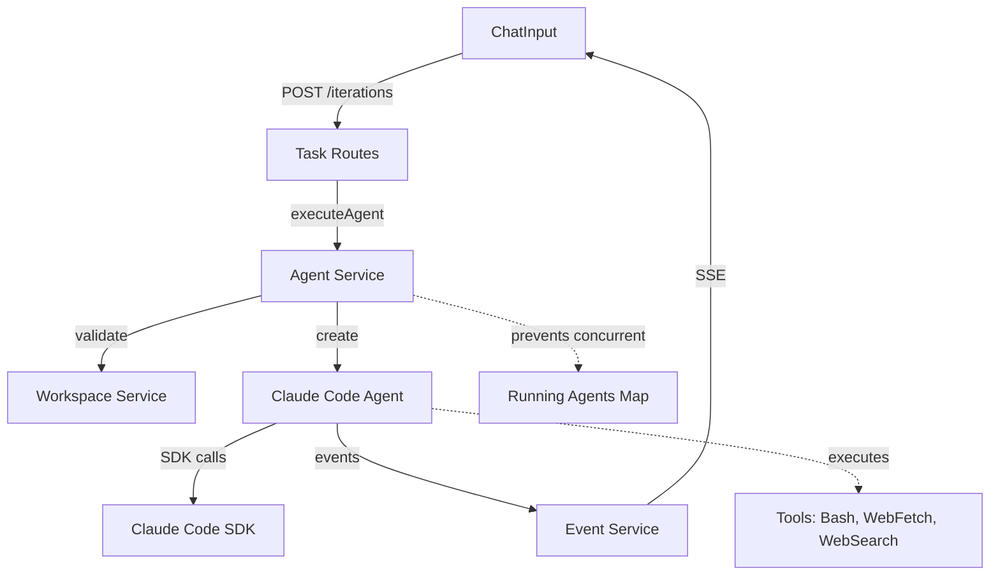

# Agent Architecture

## Quick Reference

### Key Files
- **Agent Service**: `apps/backend/services/agent.service.ts`
- **Base Agent**: `apps/backend/services/agents/base.agent.ts`
- **Claude Code Agent**: `apps/backend/services/agents/claude-code.agent.ts`
- **Agent Routes**: `apps/backend/routes/task.routes.ts` (POST /tasks/{id}/iterations)
- **Frontend Hook**: `apps/frontend/src/features/tasks/hooks/use-create-iteration.ts`

### Core Methods
```typescript
// Agent Service
executeAgent(taskId: string, iterationId: string, message: string, options?: ExecuteAgentOptions): Promise<void>
stopAgent(taskId: string): void
createAgent(type: string, config: AgentConfig): BaseAgent
processAgentEvents(agent: BaseAgent, taskId: string, iterationId: string): Promise<void>

// Base Agent Abstract Methods
abstract getAgentType(): string
abstract run(message: string, options: AgentRunOptions): AsyncGenerator<AgentEvent>
stop(): void
getSessionId(): string | null
```

## Architecture Overview



## Implementation Guide

### 1. Creating a New Iteration (Frontend → Backend)
```typescript
// Frontend: apps/frontend/src/features/tasks/hooks/use-create-iteration.ts
const createIteration = useCreateIteration({
  onSuccess: (data) => {
    // Iteration created, agent will start processing
  }
});

// Backend: apps/backend/routes/task.routes.ts
app.post("/tasks/:taskId/iterations", async (c) => {
  const { taskId } = c.req.param();
  const { message, options } = await c.req.json();
  
  // Create iteration in storage
  const iteration = await taskService.createIteration(taskId, message);
  
  // Execute agent in background
  await agentService.executeAgent(taskId, iteration.id, message, options);
  
  return c.json(iteration);
});
```

### 2. Agent Execution Flow
```typescript
// apps/backend/services/agent.service.ts
async executeAgent(taskId: string, iterationId: string, message: string, options?: ExecuteAgentOptions) {
  // Step 1: Prevent concurrent execution
  if (this.runningAgents.has(taskId)) {
    throw new Error('Agent already running for this task');
  }
  
  // Step 2: Validate workspace
  const workspace = await this.workspaceService.getWorkspace(taskId);
  if (!workspace) {
    await this.workspaceService.createWorkspace(taskId);
  }
  
  // Step 3: Create agent
  const agent = this.createAgent(options?.agentType || 'claude-code', {
    workingDirectory: workspace.path,
    model: options?.model || 'claude-3-5-sonnet-20241022',
    resumeSessionId: options?.resumeSessionId
  });
  
  // Step 4: Register and execute
  this.runningAgents.set(taskId, agent);
  
  // Step 5: Process in background
  this.processAgentEvents(agent, taskId, iterationId)
    .finally(() => this.runningAgents.delete(taskId));
}
```

### 3. Event Processing Pipeline
```typescript
// apps/backend/services/agent.service.ts
private async processAgentEvents(agent: BaseAgent, taskId: string, iterationId: string) {
  for await (const event of agent.run(message, options)) {
    // Transform and emit each event
    await this.eventService.emitTaskEvent({
      taskId,
      iterationId,
      type: this.mapEventType(event.type),
      payload: event.data
    });
    
    // Handle completion
    if (event.type === 'result') {
      await this.taskService.updateIterationResult(iterationId, event.data);
    }
  }
}
```

### 4. Claude Code Agent Implementation
```typescript
// apps/backend/services/agents/claude-code.agent.ts
async *run(message: string, options: AgentRunOptions): AsyncGenerator<AgentEvent> {
  const sdkOptions: ClaudeCodeOptions = {
    allowedTools: ['WebFetch', 'WebSearch', 'Bash'],
    permissionMode: 'acceptEdits',
    cwd: options.workingDirectory,
    model: options.model,
    resume: options.resumeSessionId,
    abortSignal: this.abortController.signal
  };
  
  // Execute via SDK
  const { messages, metadata } = await query(message, options.attachments, sdkOptions);
  
  // Yield events for each message
  for (const msg of messages) {
    yield {
      type: 'message',
      data: { role: msg.role, content: msg.content, tool_use: msg.tool_use },
      timestamp: new Date().toISOString()
    };
  }
  
  // Final result
  yield {
    type: 'result',
    data: {
      status: 'completed',
      cost: metadata.cost,
      sessionId: metadata.sessionId,
      usage: metadata.usage
    },
    timestamp: new Date().toISOString()
  };
}
```


## Common Patterns

### Handling Agent Errors
```typescript
// In processAgentEvents
try {
  for await (const event of agent.run(message, options)) {
    // Process events
  }
} catch (error) {
  if (error.code === 'ELIFECYCLE' && [143, 130].includes(error.exitCode)) {
    // Expected stop signal - not an error
    console.log('Agent stopped gracefully');
  } else {
    // Real error - emit error event
    await this.eventService.emitTaskEvent({
      type: EventType.ERROR,
      payload: { error: error.message }
    });
  }
}
```

### Resuming Sessions
```typescript
// Frontend: Pass previous session ID
const { data: lastIteration } = useTaskIterations(taskId);
const resumeSessionId = lastIteration?.sessionId;

createIteration.mutate({
  taskId,
  message,
  options: { resumeSessionId }
});
```

### Stopping Active Agents
```typescript
// Frontend: apps/frontend/src/features/tasks/hooks/use-stop-agent.ts
const stopAgent = useStopAgent();
stopAgent.mutate(taskId);

// Backend: apps/backend/services/agent.service.ts
stopAgent(taskId: string) {
  const agent = this.runningAgents.get(taskId);
  if (agent) {
    agent.stop(); // Sets stop flag
    // AbortController will cancel SDK operations
  }
}
```
