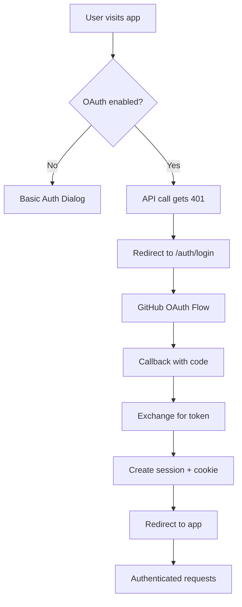

# Authentication Architecture

## Quick Reference

### Key Files
**Backend:**
- **Auth Service**: `apps/backend/services/auth.service.ts`
- **Auth Routes**: `apps/backend/routes/auth.ts`
- **Auth Middleware**: `apps/backend/middleware/github-auth.ts`
- **GitHub Service**: `apps/backend/services/github.service.ts`

**Frontend:**
- **Auth API**: `apps/frontend/src/features/auth/api/auth.api.ts`
- **Auth Hook**: `apps/frontend/src/features/auth/hooks/use-auth.ts`
- **Callback Route**: `apps/frontend/src/routes/auth/callback.tsx`
- **API Client**: `apps/frontend/src/lib/api/client.ts`

**Shared:**
- **Auth Types**: `packages/types/src/types/auth.ts`
- **Auth Schemas**: `packages/types/src/schemas/auth.schemas.ts`

### Core Methods
```typescript
// Backend: AuthService
generateOAuthState(): string
exchangeCodeForToken(code: string): Promise<GitHubOAuthTokenResponse | null>
createSession(accessToken: string, tokenType: string, scope: string): Promise<string | null>
getSession(sessionId: string): Promise<UserSession | null>
deleteSession(sessionId: string): Promise<void>

// Backend: GitHubService
getAuthenticatedUser(token: string): Promise<GitHubUser | null>
getUserRepositories(token: string): Promise<Array<{...}> | null>

// Frontend: useAuth hook
const { user, isAuthenticated, isLoading, logout } = useAuth()
```

## Architecture Overview

The application supports two authentication modes:
1. **Basic Auth** (default) - Browser's native username/password dialog
2. **GitHub OAuth** - OAuth 2.0 flow with session-based authentication



## Configuration

### Environment Variables
```bash
# Enable GitHub OAuth (when false, falls back to Basic Auth)
GITHUB_OAUTH_ENABLED=true

# GitHub OAuth App credentials
GITHUB_CLIENT_ID=your_client_id
GITHUB_CLIENT_SECRET=your_client_secret
GITHUB_CALLBACK_URL=http://localhost:8000/auth/github/callback

# Session management
SESSION_SECRET=32_char_random_secret
SESSION_MAX_AGE=604800  # seconds (7 days)

# Frontend URL for OAuth redirects
FRONTEND_URL=http://localhost:3000
```

## OAuth Flow Implementation

### 1. Initial Request (401)
```typescript
// apps/frontend/src/lib/api/client.ts
if (response.status === 401 && !window.location.pathname.startsWith('/auth')) {
  window.location.href = `${API_BASE_URL}/auth/login`
}
```

### 2. Initiate OAuth
```typescript
// apps/backend/routes/auth.ts
// GET /auth/login
const state = services.auth.generateOAuthState()
setCookie(c, 'oauth_state', state, { httpOnly: true, maxAge: 600 })

const authUrl = new URL('https://github.com/login/oauth/authorize')
authUrl.searchParams.set('client_id', clientId)
authUrl.searchParams.set('redirect_uri', callbackUrl)
authUrl.searchParams.set('scope', 'repo user:email')
authUrl.searchParams.set('state', state)

return c.redirect(authUrl.toString())
```

### 3. Handle Callback
```typescript
// GET /auth/github/callback
const { code, state } = oauthCallbackQuerySchema.parse(queryParams)

// Verify CSRF state
const storedState = getCookie(c, 'oauth_state')
if (state !== storedState) {
  throw new HTTPException(400, { message: 'Invalid state parameter' })
}

// Exchange code for token
const tokenResponse = await services.auth.exchangeCodeForToken(code)

// Create session
const sessionId = await services.auth.createSession(
  tokenResponse.access_token,
  tokenResponse.token_type,
  tokenResponse.scope
)

// Set httpOnly cookie
setCookie(c, 'moatless_session', sessionId, {
  httpOnly: true,
  secure: process.env.NODE_ENV === 'production',
  maxAge: SESSION_MAX_AGE,
  sameSite: 'Lax'
})

// Redirect to frontend
return c.redirect(`${FRONTEND_URL}/auth/callback?success=true`)
```

### 4. Frontend Callback
```typescript
// apps/frontend/src/routes/auth/callback.tsx
const success = searchParams.get('success')
if (success === 'true') {
  // Session cookie is set, redirect to app
  navigate({ to: '/' })
}
```

## Session Management

### Session Structure
```typescript
// packages/types/src/types/auth.ts
interface UserSession {
  id: string                // Session ID (stored in cookie)
  userId: number            // GitHub user ID
  userLogin: string         // GitHub username
  userEmail: string | null
  userName: string | null
  avatarUrl: string | null
  accessToken: string       // GitHub access token
  tokenType: string
  scope: string
  createdAt: Date
  expiresAt: Date
  lastAccessedAt: Date
}
```

### Session Storage
```typescript
// apps/backend/services/auth.service.ts
// Sessions stored in file system
await this.storage.save(`sessions/${sessionId}`, session)

// Retrieve session
const session = await this.storage.get<UserSession>(`sessions/${sessionId}`)

// Auto-cleanup on retrieval
if (new Date() > new Date(session.expiresAt)) {
  await this.deleteSession(sessionId)
  return null
}
```

## Middleware

### GitHub Auth Middleware
```typescript
// apps/backend/middleware/github-auth.ts
export const githubAuth = async (c: Context, next: Next) => {
  if (process.env.GITHUB_OAUTH_ENABLED !== 'true') {
    return next()
  }

  // Skip auth for public endpoints
  const skipPaths = ['/health', '/auth/login', '/auth/github/callback']
  if (skipPaths.some((path) => c.req.path === path)) {
    return next()
  }

  const sessionId = getCookie(c, 'moatless_session')
  if (!sessionId) {
    throw new HTTPException(401, { message: 'Authentication required' })
  }

  const session = await services.auth.getSession(sessionId)
  if (!session) {
    throw new HTTPException(401, { message: 'Session expired or invalid' })
  }

  // Inject session into context
  c.set('session', session)
  await next()
}
```

### Middleware Order (CRITICAL)
```typescript
// apps/backend/app.ts
app.use('*', requestId)
app.use('*', loggerMiddleware)
app.use('*', secureHeaders())
app.use('*', cors({ credentials: true }))  // MUST be before auth
app.use('*', githubAuth)                   // Auth comes after CORS
```

**Why CORS must be first**: CORS headers must be set even on 401 responses, otherwise browsers block the response.

## Frontend Integration

### Auth Hook
```typescript
// apps/frontend/src/features/auth/hooks/use-auth.ts
export function useAuth() {
  const { data: session, isLoading } = useQuery({
    queryKey: ['auth', 'session'],
    queryFn: getCurrentUser,
    retry: false,
    staleTime: 5 * 60 * 1000
  })

  const logoutMutation = useMutation({
    mutationFn: logout,
    onSuccess: () => {
      queryClient.clear()
      window.location.href = '/'
    }
  })

  return {
    user: session?.user ?? null,
    isAuthenticated: !!session,
    isLoading,
    logout: () => logoutMutation.mutate()
  }
}
```

### API Client Configuration
```typescript
// apps/frontend/src/lib/api/client.ts
const response = await fetch(url, {
  ...fetchOptions,
  credentials: 'include'  // REQUIRED for cookies
})
```

### Display User in UI
```typescript
// apps/frontend/src/features/navigation/components/top-bar.tsx
const { user, isAuthenticated, logout } = useAuth()

{isAuthenticated && user && (
  <>
    <div className="flex items-center gap-2">
      
      <div>{user.login}</div>
    </div>
    <Button onClick={logout}>Logout</Button>
  </>
)}
```

## Using GitHub Token

### Access Token from Context
```typescript
// In any route handler
import { getGitHubTokenFromContext } from '../middleware/github-auth.js'

app.get('/api/v1/user-repos', async (c) => {
  const token = getGitHubTokenFromContext(c)
  if (!token) {
    throw new HTTPException(401, { message: 'Not authenticated' })
  }

  const repos = await c.get('services').github.getUserRepositories(token)
  return c.json({ repositories: repos })
})
```

## Security Considerations

### CSRF Protection
- `state` parameter in OAuth flow
- Stored in httpOnly cookie (10 min expiration)
- Verified on callback

### Cookie Security
- `httpOnly`: Prevents XSS attacks
- `secure`: Only sent over HTTPS in production
- `sameSite: 'Lax'`: CSRF protection
- `maxAge`: Session expiration

### Token Storage
- GitHub access tokens stored server-side only
- Never exposed to frontend
- Used by backend for GitHub API calls

### Session Expiration
- Default: 7 days (604800 seconds)
- Auto-cleanup on retrieval
- `lastAccessedAt` updated on each request

## Fallback to Basic Auth

When `GITHUB_OAUTH_ENABLED=false` or unset:
1. GitHub auth middleware is **not loaded**
2. Basic auth middleware is loaded instead
3. Browser shows native username/password dialog
4. No OAuth routes registered
5. Frontend works as-is (401s trigger browser dialog)

## Troubleshooting

### CORS Errors on 401
**Problem**: `No 'Access-Control-Allow-Origin' header`
**Cause**: Auth middleware runs before CORS middleware
**Fix**: Move CORS middleware **above** auth middleware in `app.ts`

### Cookie Max-Age Error
**Problem**: `Max-Age should not be greater than 400 days`
**Cause**: `SESSION_MAX_AGE` interpreted as seconds when it's milliseconds
**Fix**: Set `SESSION_MAX_AGE` in **seconds** (e.g., `604800` for 7 days)

### Session Not Persisting
**Problem**: Session cookie not saved
**Cause**: Missing `credentials: 'include'` in fetch
**Fix**: Add to API client fetch options

### OAuth Callback 404
**Problem**: `/auth/login` returns 404
**Cause**: Auth routes not registered (OAuth disabled)
**Fix**: Set `GITHUB_OAUTH_ENABLED=true` and restart server
